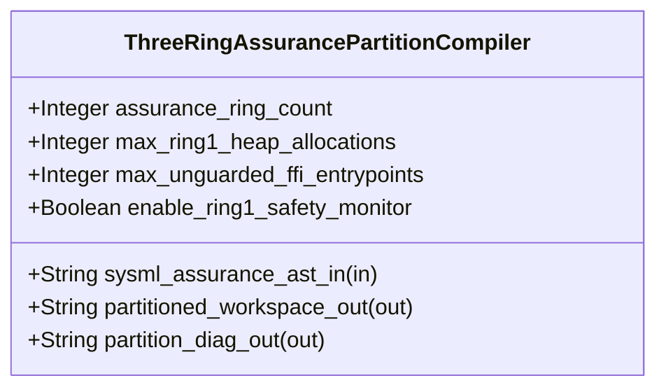

| Attribute | Specification Detail |
| :--- | :--- |
| **Issue ID** | #759 |
| **Title** | Feature 53: [BP 11 Ferrocene Qualified Toolchain FLS Traceability Structural Coverage and 3 Ring Rust_Flutter DO 178 C DO 330 Certification Architecture] ThreeRingAssurancePartitionCompiler |
| **Type** | feature |
| **Parent Epic** | [EPIC-11-BP_11_Ferrocene_Qualified_Toolchain_FLS_Traceability_Structural_Coverage_and_3_Ring_Rust_Flutter_DO_178C_DO_330_Certification_Architecture](../epics/EPIC-11-BP_11_Ferrocene_Qualified_Toolchain_FLS_Traceability_Structural_Coverage_and_3_Ring_Rust_Flutter_DO_178C_DO_330_Certification_Architecture.md) |
| **Interface Type** | Physical / Structural / Internal Bus |
| **Schema Containers** | `BP_11_Ferrocene_Qualified_Toolchain_FLS_Traceability_Structural_Coverage_and_3_Ring_Rust_Flutter_DO_178C_DO_330_Certification_Architecture::ThreeRingAssurancePartitionCompiler` |
| **Generation Mode** | subagent |
| **Specification Source** | [schema/model.sysml](../../schema/model.sysml) |

# Feature 53: [BP 11 Ferrocene Qualified Toolchain FLS Traceability Structural Coverage and 3 Ring Rust_Flutter DO 178 C DO 330 Certification Architecture] ThreeRingAssurancePartitionCompiler

## UML Class Diagram



## Interface Requirements
### 1. Test Data Shape
```json
{
  "$schema": "https://json-schema.org/draft/2020-12/schema",
  "title": "ThreeRingAssurancePartitionCompilerPayloadSchema",
  "type": "object",
  "properties": {
    "part": {
      "type": "string",
      "const": "ThreeRingAssurancePartitionCompiler"
    },
    "status": {
      "type": "string",
      "enum": ["nominal", "degraded", "fault"]
    },
    "assurance_ring_count": {
      "type": "integer",
      "x-sysml-type": "Integer",
      "description": "Declared attribute assurance_ring_count (Integer)",
      "default": 3
    },
    "max_ring1_heap_allocations": {
      "type": "integer",
      "x-sysml-type": "Integer",
      "description": "Permitted heap allocation primitives (`alloc`, `Box`, `Vec`, `String`) inside Ring-1 `#![no_std]` safety kernels. [unit: allocs]",
      "default": 0
    },
    "max_unguarded_ffi_entrypoints": {
      "type": "integer",
      "x-sysml-type": "Integer",
      "description": "Permitted Ring-2 C-ABI or `flutter_rust_bridge` entrypoints bypassing SysML port range, finiteness, or FSM state preconditions. [unit: entrypoints]",
      "default": 0
    },
    "enable_ring1_safety_monitor": {
      "type": "boolean",
      "x-sysml-type": "Boolean",
      "description": "Synthesizes Ring-1 challenge-response command interlocks and SHA-256/CRC-32C `TelemetryFrame` digest readback monitors. [unit: flag]",
      "default": true
    },
    "sysml_assurance_ast_in": {
      "type": "object",
      "properties": {
        "direction": { "type": "string", "const": "in" },
        "port_type": { "type": "string", "const": "String" }
      },
      "required": ["direction", "port_type"]
    },
    "partitioned_workspace_out": {
      "type": "object",
      "properties": {
        "direction": { "type": "string", "const": "out" },
        "port_type": { "type": "string", "const": "String" }
      },
      "required": ["direction", "port_type"]
    },
    "partition_diag_out": {
      "type": "object",
      "properties": {
        "direction": { "type": "string", "const": "out" },
        "port_type": { "type": "string", "const": "String" }
      },
      "required": ["direction", "port_type"]
    }
  },
  "required": [
    "part",
    "status",
    "sysml_assurance_ast_in",
    "partitioned_workspace_out",
    "partition_diag_out"
  ],
  "additionalProperties": false
}
```

### 2. Validation & Constraints
Declared structural attributes, boundary ports, invariants, and allocated requirements for classifier `ThreeRingAssurancePartitionCompiler`:

| AST Member Kind | Identifier | Declared Type / Direction | Default / Invariant Contract |
| :--- | :--- | :--- | :--- |
| Attribute | `assurance_ring_count` | `Integer` | Default `3` (`C_CERT_06`: `assurance_ring_count >= 3 and assurance_ring_count <= 3`; partitions workspace into Ring 1 `safety_kernel/`, Ring 2 `ffi_guard_bridge/`, and Ring 3 `app_flutter/` with `DEAP-E1105`) |
| Attribute | `max_ring1_heap_allocations` | `Integer` | Default `0` (zero permitted `alloc`, `Box`, `Vec`, or `String` heap allocations inside Ring-1 `#![no_std]` + `#![forbid(unsafe_code)]` safety kernels) |
| Attribute | `max_unguarded_ffi_entrypoints` | `Integer` | Default `0` (zero permitted Ring-2 C-ABI or `flutter_rust_bridge` entrypoints bypassing Miri-verified range, finiteness, and FSM state precondition guards `Gamma_R2`) |
| Attribute | `enable_ring1_safety_monitor` | `Boolean` | Default `true` (synthesizes Ring-1 `SafetyMonitor` two-step challenge-response command interlocks `hat_eta_t == eta_t` and FIPS 180-4 SHA-256 `TelemetryFrame` digest readback `hat_h_t == h_t`, `hat_seq_t == seq_t` with `DEAP-E1106`) |
| Port | `sysml_assurance_ast_in` | `in String` | Boundary interface contract receiving lossless SysML v2.0 + KerML 1.0 assurance AST (`deap_core::sysml_cst`) |
| Port | `partitioned_workspace_out` | `out String` | Boundary interface contract emitting `ThreeRingWorkspacePlan` and connecting via `BP_11_PartitionToFlsTraceabilityConnection` to `FlsParagraphTraceabilitySynthesizer.lowered_module_graph_in` |
| Port | `partition_diag_out` | `out String` | Boundary interface contract emitting single-line NDJSON diagnostics (`DEAP-E1105`, `DEAP-E1106`) |
| Constraint | `C_CERT_06` | `assurance_ring_count >= 3 and assurance_ring_count <= 3` | Enforces 3-Ring DAL-A..E Rust/Flutter assurance workspace partitioning and strict one-way dependency isolation |
| Constraint | `C_CERT_07` | `max_module_exec_sloc >= 1 and max_module_exec_sloc <= 380` | Bounds submodule implementation inside `< 380` executable SLOC (`crates/compile-sysml/src/ring_partition/`) |
| Requirement | `REQ-0611 (REQ_0611_BP_11_Ferrocene_Qualified_Toolchain_FLS_Traceability_Structural_Coverage_and_3_Ring_Rust_Flutter_DO_178C)` | Allocated Requirement | Enforces `Invariant_REQ_0611_SC_04` and `Invariant_REQ_0611_SC_05` under RTCA DO-178C DAL-A..E and RTCA DO-330 TQL-1 / TQL-5 |

### 3. Visual Layout & Arrangement
Structural composition and boundary topology for classifier `ThreeRingAssurancePartitionCompiler` organize no nested subparts declared in schema paired with boundary ports `in sysml_assurance_ast_in : String`, `out partitioned_workspace_out : String`, `out partition_diag_out : String`. Under Contract A, `ThreeRingAssurancePartitionCompiler` ingests full OMG SysML v2.0 and KerML 1.0 CST/AST models (`package`, `part def`/`part`, `port def`/`port`, `state def`/`state`, `action def`/`action`, `calc def`/`calc`, `constraint def`/`constraint`, `requirement def`/`requirement`, `allocation def`/`allocation`, and `metadata def`/`@Metadata`/`#dal`/`#fls`/`#rt_loop`) via `logos` + `rowan` + `salsa` + `ariadne` (`deap_core::sysml_cst`, `deap_core::dart_cst`) with zero 16-construct caps.

### 4. Interactive Flow & States
Operational lifecycle events and discrete state transitions for `ThreeRingAssurancePartitionCompiler` follow `BP_11_Ferrocene_Qualified_Toolchain_FLS_Traceability_Structural_Coverage_and_3_Ring_Rust_Flutter_DO_178C_DO_330_Certification_Architecture_LifecycleState` (`VerifyingDualToolchainParity -> SynthesizingThreeRingPartitions` on `toolchainAndStage2ParityLocked`; `SynthesizingThreeRingPartitions -> EmbeddingFlsTraceability` on `threeRingTopologyIsolated` or `RejectedFailClosed` on `rejectCrossRingCouplingE1105`; `AuditingCoreSubsetAndMcdc -> VerifyingRing1SafetyMonitor` on `coreSubsetAndTableA7Verified`; `VerifyingRing1SafetyMonitor -> CertifiedPackageReady` on `certificationEvidenceVerified` or `RejectedFailClosed` on `rejectMonitorReadbackFaultE1106`).

### Layer 1: Domain State & Signal Model
Classifier `ThreeRingAssurancePartitionCompiler` encapsulates typed domain state attributes `assurance_ring_count : Integer`, `max_ring1_heap_allocations : Integer`, `max_unguarded_ffi_entrypoints : Integer`, `enable_ring1_safety_monitor : Boolean` alongside operational lifecycle status, `ThreeRingWorkspacePlan` manifests (`safety_kernel/`, `ffi_guard_bridge/`, `app_flutter/` parsed/audited via `cargo_metadata`, `cargo-lock`, `toml_edit`, and `ra_ap_syntax`), and `SafetyMonitor` `TelemetryFrame` readback envelopes (`seq_t`, FIPS 180-4 SHA-256 `h_t`, challenge nonce `eta_t`).

### Layer 2: Logic & Safety State Management
Classifier `ThreeRingAssurancePartitionCompiler` governs deterministic structural transition evaluation (`synthesize_three_ring_workspace(spec)` and `verify_three_ring_edge_and_monitor_readback(from_ring, to_ring, envelope)`) enforcing invariant obligations `C_CERT_06`, `C_CERT_07`, `Invariant_REQ_0611_SC_04`, and `Invariant_REQ_0611_SC_05`. Under Contract B, all 3-Ring Rust/Flutter code synthesis (`syn` + `proc-macro2` + `quote` + `prettyplease`), Ring-2 Miri-guarded FFI precondition synthesis (`Gamma_R2`), and Ring-1 `SafetyMonitor` interlock verification execute inside `< 380`-SLOC submodules (`crates/compile-sysml/src/ring_partition/`, `max_module_exec_sloc <= 380`, `C_CERT_07`) with explicit deletion of legacy hand-rolled workspace and FFI string scanners.

### Layer 3: Presentation & Actuator Interface Binding
Classifier `ThreeRingAssurancePartitionCompiler` binds external and behavioral interfaces across port `in sysml_assurance_ast_in : String`, port `out partitioned_workspace_out : String`, port `out partition_diag_out : String`, routing `ThreeRingWorkspacePlan` over `BP_11_PartitionToFlsTraceabilityConnection` and emitting single-line NDJSON diagnostics (`DEAP-E1105`, `DEAP-E1106`) with zero hardcoded OS/user/machine paths.

### Associated Use Cases & User Stories

#### Associated Use Cases
- [ ] #791 - [Use Case 63: Schema Driven 3 Ring Workspace Partitioning and Ring 2 Miri Guarded FFI Precondition Enforcement](../use-cases/UC-63-Schema_Driven_3_Ring_Workspace_Partitioning_and_Ring_2_Miri_Guarded_FFI_Precondition_Enforcement.md)
- [ ] #792 - [Use Case 64: Ring 1 Challenge Response Command Interlock and Telemetry Frame Digest Readback Safety Monitor Against Ring 3 Faults](../use-cases/UC-64-Ring_1_Challenge_Response_Command_Interlock_and_TelemetryFrame_Digest_Readback_SafetyMonitor_Against_Ring_3_Faults.md)

#### Associated User Stories
- [ ] #822 - [User Story 73: probe criticalup toolchain](../user-stories/US-73-probe_criticalup_toolchain.md)
- [ ] #823 - [User Story 74: verify dual toolchain parity](../user-stories/US-74-verify_dual_toolchain_parity.md)
- [ ] #824 - [User Story 75: synthesize three ring workspace](../user-stories/US-75-synthesize_three_ring_workspace.md)
- [ ] #825 - [User Story 76: verify fls traceability chain](../user-stories/US-76-verify_fls_traceability_chain.md)
- [ ] #826 - [User Story 77: verify certified core and table a7 coverage](../user-stories/US-77-verify_certified_core_and_table_a7_coverage.md)
- [ ] #827 - [User Story 78: verify three ring edge and monitor readback](../user-stories/US-78-verify_three_ring_edge_and_monitor_readback.md)

## Acceptance Criteria (BDD)
- [ ] AC-01: Given valid `ThreeRingAssurancePartitionCompiler` initialization inputs for `assurance_ring_count` (`Integer`), `max_ring1_heap_allocations` (`Integer`), `max_unguarded_ffi_entrypoints` (`Integer`), `enable_ring1_safety_monitor` (`Boolean`) satisfying `C_CERT_06` (`assurance_ring_count == 3`, `max_ring1_heap_allocations == 0`, `max_unguarded_ffi_entrypoints == 0`, `enable_ring1_safety_monitor == true`) and `Invariant_REQ_0611_SC_04`, When `ThreeRingAssurancePartitionCompiler` synthesizes the 3-Ring DAL-A..E Rust/Flutter workspace (`safety_kernel/`, `ffi_guard_bridge/`, `app_flutter/`) and commits typed domain state, Then declared state attributes hold verified values with strict one-way ring dependency isolation.
- [ ] AC-02: Given malformed or out-of-domain input values for `assurance_ring_count` (`Integer`), `max_ring1_heap_allocations` (`Integer`), `max_unguarded_ffi_entrypoints` (`Integer`), `enable_ring1_safety_monitor` (`Boolean`), an upward cross-ring dependency (`safety_kernel -> ffi_guard_bridge` or `app_flutter`), an unguarded FFI entrypoint, or a corrupted/stale Ring-3 `TelemetryFrame` readback or missing challenge nonce (`hat_h_t != h_t`, `hat_seq_t < seq_t`, `hat_eta_t != eta_t`), When `ThreeRingAssurancePartitionCompiler` validates incoming state updates, Then `ThreeRingAssurancePartitionCompiler` rejects the invalid state update fail-closed and emits diagnostic `DEAP-E1105` or `DEAP-E1106` via diagnostic port `partitioned_workspace_out` and `partition_diag_out`.
- [ ] AC-03: Given nominal signal arrival across `sysml_assurance_ast_in` (`in String`), `partitioned_workspace_out` (`out String`), `partition_diag_out` (`out String`), When `ThreeRingAssurancePartitionCompiler` processes the declared interface transaction inside `< 380`-SLOC submodules (`C_CERT_07`), Then output state conforms to the structural classifier contract.
- [ ] AC-04: Given an invalid or unrecognized interface frame across `sysml_assurance_ast_in` (`in String`), `partitioned_workspace_out` (`out String`), `partition_diag_out` (`out String`), When `ThreeRingAssurancePartitionCompiler` boundary validation executes, Then `ThreeRingAssurancePartitionCompiler` refuses the malformed frame via diagnostic port `partitioned_workspace_out` and `partition_diag_out` (`DEAP-E1105`) and preserves prior verified state.

## Source References
Formal component specifications and normative systems engineering requirements:
- System Architecture Model: `schema/model.sysml`
- Normative Systems Engineering Standard: ISO/IEC/IEEE 15288:2023 §6.4.3 Architecture Definition Process

Component behavior and interface definitions derive from `schema/model.sysml` pursuant to ISO/IEC/IEEE 15288.
