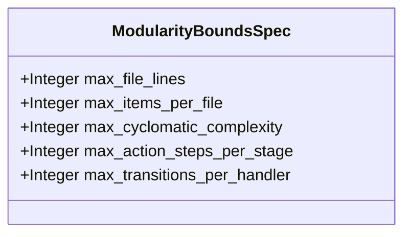

| Attribute | Specification Detail |
| :--- | :--- |
| **Issue ID** | #857 |
| **Title** | Feature 54: [BP 07 Self Hosting 4 Level Modular Multi File Code Generator Blueprint] ModularityBoundsSpec |
| **Type** | feature |
| **Parent Epic** | [EPIC-07-BP_07_Self_Hosting_4_Level_Modular_Multi_File_Code_Generator_Blueprint](../epics/EPIC-07-BP_07_Self_Hosting_4_Level_Modular_Multi_File_Code_Generator_Blueprint.md) |
| **Interface Type** | Physical / Structural / Internal Bus |
| **Schema Containers** | `BP_07_Self_Hosting_4_Level_Modular_Multi_File_Code_Generator_Blueprint::ModularityBoundsSpec` |
| **Generation Mode** | subagent |
| **Specification Source** | [schema/model.sysml](../../schema/model.sysml) |

# Feature 54: [BP 07 Self Hosting 4 Level Modular Multi File Code Generator Blueprint] ModularityBoundsSpec

## UML Class Diagram



## Interface Requirements
### 1. Test Data Shape
```json
{
  "$schema": "https://json-schema.org/draft/2020-12/schema",
  "title": "ModularityBoundsSpecPayloadSchema",
  "type": "object",
  "properties": {
    "part": {
      "type": "string",
      "const": "ModularityBoundsSpec"
    },
    "status": {
      "type": "string",
      "enum": ["nominal", "degraded", "fault"]
    },
    "max_file_lines": {
      "type": "integer",
      "x-sysml-type": "Integer",
      "description": "Declared attribute max_file_lines (Integer)",
      "default": 400
    },
    "max_items_per_file": {
      "type": "integer",
      "x-sysml-type": "Integer",
      "description": "Declared attribute max_items_per_file (Integer)",
      "default": 12
    },
    "max_cyclomatic_complexity": {
      "type": "integer",
      "x-sysml-type": "Integer",
      "description": "Declared attribute max_cyclomatic_complexity (Integer)",
      "default": 8
    },
    "max_action_steps_per_stage": {
      "type": "integer",
      "x-sysml-type": "Integer",
      "description": "Declared attribute max_action_steps_per_stage (Integer)",
      "default": 5
    },
    "max_transitions_per_handler": {
      "type": "integer",
      "x-sysml-type": "Integer",
      "description": "Declared attribute max_transitions_per_handler (Integer)",
      "default": 6
    }
  },
  "required": [
    "part",
    "status"
  ],
  "x-sysml-constraints": [
    {
      "name": "ValidBoundsEnvelope",
      "expression": "max_file_lines >= 50 and max_file_lines <= 400 and max_items_per_file >= 1 and max_items_per_file <= 12 and max_cyclomatic_complexity >= 1 and max_cyclomatic_complexity <= 8 and max_action_steps_per_stage >= 1 and max_action_steps_per_stage <= 8 and max_transitions_per_handler >= 1 and max_transitions_per_handler <= 8"
    }
  ],
  "additionalProperties": false
}
```

### 2. Validation & Constraints
Declared structural attributes, boundary ports, calculations, invariants, and allocated requirements for classifier `ModularityBoundsSpec`:

| AST Member Kind | Identifier | Declared Type / Direction | Default / Invariant Contract |
| :--- | :--- | :--- | :--- |
| Attribute | `max_file_lines` | `Integer` | Default `400` |
| Attribute | `max_items_per_file` | `Integer` | Default `12` |
| Attribute | `max_cyclomatic_complexity` | `Integer` | Default `8` |
| Attribute | `max_action_steps_per_stage` | `Integer` | Default `5` |
| Attribute | `max_transitions_per_handler` | `Integer` | Default `6` |
| Calculation | `ComputeCyclomaticComplexity` | `Integer (in decision_points : Integer)` | `decision_points + 1` |
| Constraint | `ValidBoundsEnvelope` | Invariant (`REQ-0607 (REQ_0607_BP_07_Self_Hosting_4_Level_Modular_Multi_File_Code_Generator_Blueprint)`) | `max_file_lines >= 50 and max_file_lines <= 400 and max_items_per_file >= 1 and max_items_per_file <= 12 and max_cyclomatic_complexity >= 1 and max_cyclomatic_complexity <= 8 and max_action_steps_per_stage >= 1 and max_action_steps_per_stage <= 8 and max_transitions_per_handler >= 1 and max_transitions_per_handler <= 8` |
| Requirement | `REQ-0607 (REQ_0607_BP_07_Self_Hosting_4_Level_Modular_Multi_File_Code_Generator_Blueprint)` | Allocated Requirement | SelfHostingModularCodegenCompiler (**REQ-0607** / BP-07 / DEAP-BP-DET-07, UUIDv5 6ba7b810-9dad-11d1-80b4-00c04fd430c7, Class P linear Kahn DAG and AST traversal complexity, governed by DO-178C Level A, DO-330 TQL-4, ISO 26262 ASIL D, and ECSS-E-ST-40C) |

```sysml
constraint ValidBoundsEnvelope { max_file_lines >= 50 and max_file_lines <= 400 and max_items_per_file >= 1 and max_items_per_file <= 12 and max_cyclomatic_complexity >= 1 and max_cyclomatic_complexity <= 8 and max_action_steps_per_stage >= 1 and max_action_steps_per_stage <= 8 and max_transitions_per_handler >= 1 and max_transitions_per_handler <= 8 }
```

### 3. Visual Layout & Arrangement
Structural composition and boundary topology for classifier `ModularityBoundsSpec` (`@Layer("Domain")` inside `ModularCodegen::domain`) organize domain modularity budget thresholds (`max_file_lines`, `max_items_per_file`, `max_cyclomatic_complexity`, `max_action_steps_per_stage`, `max_transitions_per_handler`) and calculation `ComputeCyclomaticComplexity` referenced by `FourLevelLoweringEngineSpec.bounds_ref`.

### 4. Interactive Flow & States
Operational lifecycle events and discrete state transitions for `ModularityBoundsSpec` within `ModularCodegenLifecycle` (`VerifyingBounds -> PersistingAtomic` on `bounds_verified` or `VerifyingBounds -> AbortedFailClosed` on `on_fixed_point_drift_e0705`).

### Layer 1: Domain State & Signal Model
Classifier `ModularityBoundsSpec` (`@Layer("Domain")`) encapsulates typed domain state attributes `max_file_lines : Integer` (default `400`), `max_items_per_file : Integer` (default `12`), `max_cyclomatic_complexity : Integer` (default `8`), `max_action_steps_per_stage : Integer` (default `5`), and `max_transitions_per_handler : Integer` (default `6`) alongside calculation `ComputeCyclomaticComplexity(in decision_points : Integer) : Integer = decision_points + 1`. Under **Contract A (100% Normative OMG SysML v2.0 + KerML 1.0 Grammar Coverage -- Zero 16-Construct Caps)**, `ModularityBoundsSpec` governs modularity budgets across all OMG SysML v2.0 and KerML 1.0 constructs (`package`/`library package`/`standard library package`, `import`, `alias`, `doc`, `comment`, `rep`, `dependency`, `metadata def`/`metadata`/`@Metadata`/`#user_keyword` `#hazard`/`#risk`/`#capability`/`#rt_loop`/`#dal`/`#fls` while preserving backward-compatible parsing of legacy `hazard def`/`risk def`/`capability def`, `attribute def`/`attribute`, `enum def`/`enum`, `item def`/`item`, `part def`/`part`, `port def`/`port` `in`/`out`/`inout`/`~`, `connection def`/`connection`, `interface def`/`interface`, `flow def`/`flow`, `allocation def`/`allocation`, `occurrence def`/`occurrence`, `action def`/`action`, `state def`/`state`, `calc def`/`calc`, `constraint def`/`constraint`, `requirement def`/`requirement`, `concern def`/`concern`, `use case def`/`use case`, `analysis def`/`analysis`, `verification def`/`verification`, `test case def`/`test case`, `interaction def`/`interaction`, `view def`/`view`, `viewpoint def`/`viewpoint`, `rendering def`/`rendering`, `variation`/`variant`, and KerML 1.0 specialization/multiplicity/expressions) parsed via `deap_core::sysml_cst` (`logos` + `rowan` + `salsa` + `ariadne`).

### Layer 2: Logic & Safety State Management
Classifier `ModularityBoundsSpec` governs stateless structural invariant evaluation enforcing `ValidBoundsEnvelope` (`50 <= max_file_lines <= 400`, `1 <= max_items_per_file <= 12`, `1 <= max_cyclomatic_complexity <= 8`, `1 <= max_action_steps_per_stage <= 8`, `1 <= max_transitions_per_handler <= 8`), `C_MOD_01..03`, and `ComputeCyclomaticComplexity` (`v(G) = decision_points + 1 <= 8`). Under **Contract B (Official Rust Compiler & Codegen Stack -- Zero Hand-Rolled Scanners)** and the **3-Layer Definition of Done (DoD)**, implementation is bounded inside `< 380` exec SLOC submodules (`./crates/compile-sysml/src/modular_codegen/domain/bounds.rs` and `./crates/compile-sysml/src/modular_codegen/generated/`) synthesized deterministically via `proc-macro2` + `quote::quote!` + `syn::parse2::<syn::File>` + `prettyplease::unparse` (`SHA-256(Stage 1) == SHA-256(Stage 2)`) while retiring `-450+` SLOC in `./crates/compile-sysml/src/driver.rs` and `-650+` SLOC in `./crates/compile-sysml/src/flutter_codegen.rs`.

### Layer 3: Presentation & Actuator Interface Binding
Classifier `ModularityBoundsSpec` binds as part composition reference `bounds_ref : ModularityBoundsSpec` inside `FourLevelLoweringEngineSpec`, supplying validated modularity thresholds to `ExecuteFourLevelLoweringPipeline` (`step verify_in_memory_modularity_bounds`) and routing deterministic `E0701` bounds rejection diagnostics across `VerifiedModuleGraphPort` (`graph_out`) whenever any generated unit violates `ValidBoundsEnvelope`.

### Associated Use Cases & User Stories

#### Associated Use Cases
- [ ] #762 - [Use Case 33: Four Level Deterministic Lowering with Typed syn File AST and prettyplease Formatting](../use-cases/UC-33-Four_Level_Deterministic_Lowering_with_Typed_syn_File_AST_and_prettyplease_Formatting.md)
- [ ] #763 - [Use Case 34: Metacircular Self Hosting Stage 1 to Stage 2 SHA 256 Fixed Point Identity](../use-cases/UC-34-Metacircular_Self_Hosting_Stage_1_to_Stage_2_SHA_256_Fixed_Point_Identity.md)

#### Associated User Stories
- [ ] #852 - [User Story 79: Execute Four Level Lowering Pipeline](../user-stories/US-79-ExecuteFourLevelLoweringPipeline.md)

## Acceptance Criteria (BDD)
- [ ] AC-01: Given valid `ModularityBoundsSpec` inputs satisfying `ValidBoundsEnvelope` (`max_file_lines >= 50 and max_file_lines <= 400 and max_items_per_file >= 1 and max_items_per_file <= 12 and max_cyclomatic_complexity >= 1 and max_cyclomatic_complexity <= 8 and max_action_steps_per_stage >= 1 and max_action_steps_per_stage <= 8 and max_transitions_per_handler >= 1 and max_transitions_per_handler <= 8`) [Req `REQ-0607 (REQ_0607_BP_07_Self_Hosting_4_Level_Modular_Multi_File_Code_Generator_Blueprint)`], When `ModularityBoundsSpec` evaluates invariant `ValidBoundsEnvelope`, Then the invariant holds and verified state is committed.
- [ ] AC-02: Given boundary inputs that violate `ValidBoundsEnvelope` (`max_file_lines >= 50 and max_file_lines <= 400 and max_items_per_file >= 1 and max_items_per_file <= 12 and max_cyclomatic_complexity >= 1 and max_cyclomatic_complexity <= 8 and max_action_steps_per_stage >= 1 and max_action_steps_per_stage <= 8 and max_transitions_per_handler >= 1 and max_transitions_per_handler <= 8`) [Req `REQ-0607 (REQ_0607_BP_07_Self_Hosting_4_Level_Modular_Multi_File_Code_Generator_Blueprint)`], When `ModularityBoundsSpec` evaluates invariant `ValidBoundsEnvelope`, Then `ModularityBoundsSpec` rejects the invalid transition and routes a diagnostic via deterministic error diagnostic output.
- [ ] AC-03: Given nominal typed values for `max_file_lines` (`Integer`), `max_items_per_file` (`Integer`), `max_cyclomatic_complexity` (`Integer`), `max_action_steps_per_stage` (`Integer`), `max_transitions_per_handler` (`Integer`) across `ModularityBoundsSpec` structural boundary, When `ModularityBoundsSpec` executes structural interface processing and `ComputeCyclomaticComplexity`, Then state and output ports conform to declared schema types.
- [ ] AC-04: Given malformed input frames across `max_file_lines` (`Integer`), `max_items_per_file` (`Integer`), `max_cyclomatic_complexity` (`Integer`), `max_action_steps_per_stage` (`Integer`), `max_transitions_per_handler` (`Integer`) or `ModularityBoundsSpec` structural boundary, When `ModularityBoundsSpec` boundary validation executes, Then `ModularityBoundsSpec` rejects the malformed input via deterministic error diagnostic output.

## Source References
Formal component specifications and normative systems engineering requirements:
- System Architecture Model: `schema/model.sysml`
- Normative Systems Engineering Standard: ISO/IEC/IEEE 15288:2023 §6.4.3 Architecture Definition Process

Component behavior and interface definitions derive from `schema/model.sysml` pursuant to ISO/IEC/IEEE 15288.
