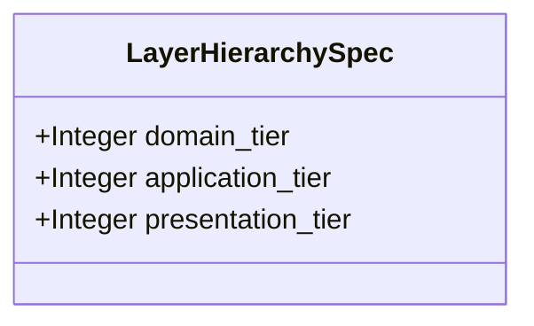

| Attribute | Specification Detail |
| :--- | :--- |
| **Issue ID** | #858 |
| **Title** | Feature 55: [BP 07 Self Hosting 4 Level Modular Multi File Code Generator Blueprint] LayerHierarchySpec |
| **Type** | feature |
| **Parent Epic** | [EPIC-07-BP_07_Self_Hosting_4_Level_Modular_Multi_File_Code_Generator_Blueprint](../epics/EPIC-07-BP_07_Self_Hosting_4_Level_Modular_Multi_File_Code_Generator_Blueprint.md) |
| **Interface Type** | Physical / Structural / Internal Bus |
| **Schema Containers** | `BP_07_Self_Hosting_4_Level_Modular_Multi_File_Code_Generator_Blueprint::LayerHierarchySpec` |
| **Generation Mode** | subagent |
| **Specification Source** | [schema/model.sysml](../../schema/model.sysml) |

# Feature 55: [BP 07 Self Hosting 4 Level Modular Multi File Code Generator Blueprint] LayerHierarchySpec

## UML Class Diagram



## Interface Requirements
### 1. Test Data Shape
```json
{
  "$schema": "https://json-schema.org/draft/2020-12/schema",
  "title": "LayerHierarchySpecPayloadSchema",
  "type": "object",
  "properties": {
    "part": {
      "type": "string",
      "const": "LayerHierarchySpec"
    },
    "status": {
      "type": "string",
      "enum": ["nominal", "degraded", "fault"]
    },
    "domain_tier": {
      "type": "integer",
      "x-sysml-type": "Integer",
      "description": "Declared attribute domain_tier (Integer)",
      "default": 1
    },
    "application_tier": {
      "type": "integer",
      "x-sysml-type": "Integer",
      "description": "Declared attribute application_tier (Integer)",
      "default": 2
    },
    "presentation_tier": {
      "type": "integer",
      "x-sysml-type": "Integer",
      "description": "Declared attribute presentation_tier (Integer)",
      "default": 3
    }
  },
  "required": [
    "part",
    "status"
  ],
  "x-sysml-constraints": [
    {
      "name": "NonUpwardLayerImport",
      "expression": "importer_tier >= 1 and importer_tier <= 3 and imported_tier >= 1 and imported_tier <= 3 and importer_tier >= imported_tier"
    }
  ],
  "additionalProperties": false
}
```

### 2. Validation & Constraints
Declared structural attributes, boundary ports, invariants, and allocated requirements for classifier `LayerHierarchySpec`:

| AST Member Kind | Identifier | Declared Type / Direction | Default / Invariant Contract |
| :--- | :--- | :--- | :--- |
| Attribute | `domain_tier` | `Integer` | Default `1` |
| Attribute | `application_tier` | `Integer` | Default `2` |
| Attribute | `presentation_tier` | `Integer` | Default `3` |
| Constraint | `NonUpwardLayerImport` | Invariant (`REQ-0607 (REQ_0607_BP_07_Self_Hosting_4_Level_Modular_Multi_File_Code_Generator_Blueprint)`) | `importer_tier >= 1 and importer_tier <= 3 and imported_tier >= 1 and imported_tier <= 3 and importer_tier >= imported_tier` |
| Requirement | `REQ-0607 (REQ_0607_BP_07_Self_Hosting_4_Level_Modular_Multi_File_Code_Generator_Blueprint)` | Allocated Requirement | SelfHostingModularCodegenCompiler (**REQ-0607** / BP-07 / DEAP-BP-DET-07, UUIDv5 6ba7b810-9dad-11d1-80b4-00c04fd430c7, Class P linear Kahn DAG and AST traversal complexity, governed by DO-178C Level A, DO-330 TQL-4, ISO 26262 ASIL D, and ECSS-E-ST-40C) |

```sysml
constraint NonUpwardLayerImport { importer_tier >= 1 and importer_tier <= 3 and imported_tier >= 1 and imported_tier <= 3 and importer_tier >= imported_tier }
```

### 3. Visual Layout & Arrangement
Structural composition and boundary topology for classifier `LayerHierarchySpec` (`@Layer("Domain")` inside `ModularCodegen::domain`) organize the 3-tier architectural layer hierarchy (`domain_tier = 1`, `application_tier = 2`, `presentation_tier = 3`) referenced by `FourLevelLoweringEngineSpec.layer_ref`.

### 4. Interactive Flow & States
Operational lifecycle events and discrete state transitions for `LayerHierarchySpec` within `ModularCodegenLifecycle` (`ResolvingLayers -> VerifyingDag` on `layers_resolved` and `VerifyingDag -> AbortedFailClosed` on `on_upward_layer_e0703`).

### Layer 1: Domain State & Signal Model
Classifier `LayerHierarchySpec` (`@Layer("Domain")`) encapsulates typed domain state attributes `domain_tier : Integer` (default `1`), `application_tier : Integer` (default `2`), and `presentation_tier : Integer` (default `3`) alongside operational lifecycle status. Under **Contract A (100% Normative OMG SysML v2.0 + KerML 1.0 Grammar Coverage -- Zero 16-Construct Caps)**, `LayerHierarchySpec` extracts `@Layer` metadata (`metadata def`/`metadata`/`@Metadata`/`#user_keyword` alongside `#hazard`, `#risk`, `#capability`, `#rt_loop`, `#dal`, `#fls` and backward-compatible `hazard def`/`risk def`/`capability def`) across all OMG SysML v2.0 and KerML 1.0 constructs (`package`/`library package`/`standard library package`, `import`, `part def`/`part`, `item def`/`item`, `attribute def`/`attribute`, `enum def`/`enum`, `port def`/`port`, `connection def`/`connection`, `interface def`/`interface`, `flow def`/`flow`, `allocation def`/`allocation`, `occurrence def`/`occurrence`, `action def`/`action`, `state def`/`state`, `calc def`/`calc`, `constraint def`/`constraint`, `requirement def`/`requirement`, `concern def`/`concern`, `use case def`/`use case`, `analysis def`/`analysis`, `verification def`/`verification`, `test case def`/`test case`, `interaction def`/`interaction`, `view def`/`view`, `viewpoint def`/`viewpoint`, `rendering def`/`rendering`, `variation`/`variant`, and KerML 1.0 specialization/multiplicity/expressions) parsed via `deap_core::sysml_cst` (`logos` + `rowan` + `salsa` + `ariadne`).

### Layer 2: Logic & Safety State Management
Classifier `LayerHierarchySpec` governs stateless structural invariant evaluation enforcing `NonUpwardLayerImport` (`1 <= importer_tier <= 3`, `1 <= imported_tier <= 3`, `importer_tier >= imported_tier`) and `Invariant_REQ_0607_SC_02`. Under **Contract B (Official Rust Compiler & Codegen Stack -- Zero Hand-Rolled Scanners)** and the **3-Layer Definition of Done (DoD)**, implementation is bounded inside `< 380` exec SLOC submodules (`./crates/compile-sysml/src/modular_codegen/domain/layer_role.rs` and `./crates/compile-sysml/src/modular_codegen/generated/`) synthesized deterministically via `proc-macro2` + `quote::quote!` + `syn::parse2::<syn::File>` + `prettyplease::unparse` (`SHA-256(Stage 1) == SHA-256(Stage 2)`) while retiring `-450+` SLOC in `./crates/compile-sysml/src/driver.rs` and `-650+` SLOC in `./crates/compile-sysml/src/flutter_codegen.rs`.

### Layer 3: Presentation & Actuator Interface Binding
Classifier `LayerHierarchySpec` binds as part composition reference `layer_ref : LayerHierarchySpec` inside `FourLevelLoweringEngineSpec`, supplying resolved layer ordinals to `ExecuteFourLevelLoweringPipeline` (`step extract_part_layer_annotations` and `step verify_non_upward_layer_edges`) and routing deterministic `E0703` upward-layer rejection diagnostics across `VerifiedModuleGraphPort` (`graph_out`).

### Associated Use Cases & User Stories

#### Associated Use Cases
- [ ] #761 - [Use Case 32: Fail Closed Rejection on Directed Dependency Cycles and Upward Layer Imports](../use-cases/UC-32-Fail_Closed_Rejection_on_Directed_Dependency_Cycles_and_Upward_Layer_Imports.md)
- [ ] #763 - [Use Case 34: Metacircular Self Hosting Stage 1 to Stage 2 SHA 256 Fixed Point Identity](../use-cases/UC-34-Metacircular_Self_Hosting_Stage_1_to_Stage_2_SHA_256_Fixed_Point_Identity.md)

#### Associated User Stories
- [ ] #852 - [User Story 79: Execute Four Level Lowering Pipeline](../user-stories/US-79-ExecuteFourLevelLoweringPipeline.md)

## Acceptance Criteria (BDD)
- [ ] AC-01: Given valid `LayerHierarchySpec` inputs satisfying `NonUpwardLayerImport` (`importer_tier >= 1 and importer_tier <= 3 and imported_tier >= 1 and imported_tier <= 3 and importer_tier >= imported_tier`) [Req `REQ-0607 (REQ_0607_BP_07_Self_Hosting_4_Level_Modular_Multi_File_Code_Generator_Blueprint)`], When `LayerHierarchySpec` evaluates invariant `NonUpwardLayerImport`, Then the invariant holds and verified state is committed.
- [ ] AC-02: Given boundary inputs that violate `NonUpwardLayerImport` (`importer_tier >= 1 and importer_tier <= 3 and imported_tier >= 1 and imported_tier <= 3 and importer_tier >= imported_tier`) [Req `REQ-0607 (REQ_0607_BP_07_Self_Hosting_4_Level_Modular_Multi_File_Code_Generator_Blueprint)`], When `LayerHierarchySpec` evaluates invariant `NonUpwardLayerImport`, Then `LayerHierarchySpec` rejects the invalid transition and routes a diagnostic via deterministic error diagnostic output.
- [ ] AC-03: Given nominal typed values for `domain_tier` (`Integer`), `application_tier` (`Integer`), `presentation_tier` (`Integer`) across `LayerHierarchySpec` structural boundary, When `LayerHierarchySpec` executes structural interface processing, Then state and output ports conform to declared schema types.
- [ ] AC-04: Given malformed input frames across `domain_tier` (`Integer`), `application_tier` (`Integer`), `presentation_tier` (`Integer`) or `LayerHierarchySpec` structural boundary, When `LayerHierarchySpec` boundary validation executes, Then `LayerHierarchySpec` rejects the malformed input via deterministic error diagnostic output.

## Source References
Formal component specifications and normative systems engineering requirements:
- System Architecture Model: `schema/model.sysml`
- Normative Systems Engineering Standard: ISO/IEC/IEEE 15288:2023 §6.4.3 Architecture Definition Process

Component behavior and interface definitions derive from `schema/model.sysml` pursuant to ISO/IEC/IEEE 15288.
