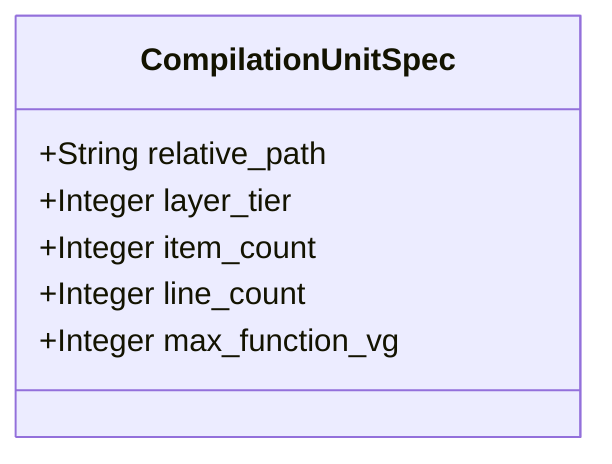

| Attribute | Specification Detail |
| :--- | :--- |
| **Issue ID** | #859 |
| **Title** | Feature 56: [BP 07 Self Hosting 4 Level Modular Multi File Code Generator Blueprint] CompilationUnitSpec |
| **Type** | feature |
| **Parent Epic** | [EPIC-07-BP_07_Self_Hosting_4_Level_Modular_Multi_File_Code_Generator_Blueprint](../epics/EPIC-07-BP_07_Self_Hosting_4_Level_Modular_Multi_File_Code_Generator_Blueprint.md) (#852) |
| **Interface Type** | Physical / Structural / Internal Bus |
| **Schema Containers** | `BP_07_Self_Hosting_4_Level_Modular_Multi_File_Code_Generator_Blueprint::CompilationUnitSpec` |
| **Generation Mode** | subagent |
| **Specification Source** | [schema/model.sysml](../../schema/model.sysml) |

# Feature 56: [BP 07 Self Hosting 4 Level Modular Multi File Code Generator Blueprint] CompilationUnitSpec

## UML Class Diagram



## Interface Requirements
### 1. Test Data Shape
```json
{
  "$schema": "https://json-schema.org/draft/2020-12/schema",
  "title": "CompilationUnitSpecPayloadSchema",
  "type": "object",
  "properties": {
    "part": {
      "type": "string",
      "const": "CompilationUnitSpec"
    },
    "status": {
      "type": "string",
      "enum": ["nominal", "degraded", "fault"]
    },
    "relative_path": {
      "type": "string",
      "x-sysml-type": "String",
      "description": "Declared attribute relative_path (String)",
      "default": "mod.rs"
    },
    "layer_tier": {
      "type": "integer",
      "x-sysml-type": "Integer",
      "description": "Declared attribute layer_tier (Integer)",
      "default": 1
    },
    "item_count": {
      "type": "integer",
      "x-sysml-type": "Integer",
      "description": "Declared attribute item_count (Integer)",
      "default": 1
    },
    "line_count": {
      "type": "integer",
      "x-sysml-type": "Integer",
      "description": "Declared attribute line_count (Integer)",
      "default": 10
    },
    "max_function_vg": {
      "type": "integer",
      "x-sysml-type": "Integer",
      "description": "Declared attribute max_function_vg (Integer)",
      "default": 1
    }
  },
  "required": [
    "part",
    "status"
  ],
  "x-sysml-constraints": [
    {
      "name": "UnitObeysBounds",
      "expression": "line_count >= 1 and line_count <= max_file_lines and item_count >= 1 and item_count <= max_items_per_file and max_function_vg >= 1 and max_function_vg <= max_cyclomatic_complexity"
    }
  ],
  "additionalProperties": false
}
```

### 2. Validation & Constraints
Declared structural attributes, boundary ports, invariants, and allocated requirements for classifier `CompilationUnitSpec`:

| AST Member Kind | Identifier | Declared Type / Direction | Default / Invariant Contract |
| :--- | :--- | :--- | :--- |
| Attribute | `relative_path` | `String` | Default `"mod.rs"` |
| Attribute | `layer_tier` | `Integer` | Default `1` |
| Attribute | `item_count` | `Integer` | Default `1` |
| Attribute | `line_count` | `Integer` | Default `10` |
| Attribute | `max_function_vg` | `Integer` | Default `1` |
| Constraint | `UnitObeysBounds` | Invariant (`REQ-0607 (REQ_0607_BP_07_Self_Hosting_4_Level_Modular_Multi_File_Code_Generator_Blueprint)`) | `line_count >= 1 and line_count <= max_file_lines and item_count >= 1 and item_count <= max_items_per_file and max_function_vg >= 1 and max_function_vg <= max_cyclomatic_complexity` |
| Requirement | `REQ-0607 (REQ_0607_BP_07_Self_Hosting_4_Level_Modular_Multi_File_Code_Generator_Blueprint)` | Allocated Requirement | SelfHostingModularCodegenCompiler (**REQ-0607** / BP-07 / DEAP-BP-DET-07, UUIDv5 6ba7b810-9dad-11d1-80b4-00c04fd430c7, Class P linear Kahn DAG and AST traversal complexity, governed by DO-178C Level A, DO-330 TQL-4, ISO 26262 ASIL D, and ECSS-E-ST-40C) |

```sysml
constraint UnitObeysBounds { line_count >= 1 and line_count <= max_file_lines and item_count >= 1 and item_count <= max_items_per_file and max_function_vg >= 1 and max_function_vg <= max_cyclomatic_complexity }
```

### 3. Visual Layout & Arrangement
Structural composition and boundary topology for classifier `CompilationUnitSpec` (`@Layer("Domain")` inside `ModularCodegen::domain`) organize per-file compilation unit metrics (`relative_path`, `layer_tier`, `item_count`, `line_count`, `max_function_vg`) emitted into `ModuleGraph` during 4-level lowering.

### 4. Interactive Flow & States
Operational lifecycle events and discrete state transitions for `CompilationUnitSpec` within `ModularCodegenLifecycle` (`SynthesizingTree -> VerifyingBounds -> PersistingAtomic`).

### Layer 1: Domain State & Signal Model
Classifier `CompilationUnitSpec` (`@Layer("Domain")`) encapsulates typed domain state attributes `relative_path : String` (default `"mod.rs"`), `layer_tier : Integer` (default `1`), `item_count : Integer` (default `1`), `line_count : Integer` (default `10`), and `max_function_vg : Integer` (default `1`) alongside operational lifecycle status. Under **Contract A (100% Normative OMG SysML v2.0 + KerML 1.0 Grammar Coverage -- Zero 16-Construct Caps)**, `CompilationUnitSpec` represents lowered compilation units synthesized from all OMG SysML v2.0 and KerML 1.0 constructs (`package`/`library package`/`standard library package`, `import`, `metadata def`/`@Metadata`/`#capability`/`#hazard`/`#risk`/`#rt_loop`/`#dal`/`#fls` and backward-compatible `hazard def`/`risk def`/`capability def`, `part def`/`part`, `item def`/`item`, `attribute def`/`attribute`, `enum def`/`enum`, `port def`/`port`, `connection def`/`connection`, `interface def`/`interface`, `flow def`/`flow`, `allocation def`/`allocation`, `occurrence def`/`occurrence`, `action def`/`action`, `state def`/`state`, `calc def`/`calc`, `constraint def`/`constraint`, `requirement def`/`requirement`, `concern def`/`concern`, `use case def`/`use case`, `analysis def`/`analysis`, `verification def`/`verification`, `test case def`/`test case`, `interaction def`/`interaction`, `view def`/`view`, `viewpoint def`/`viewpoint`, `rendering def`/`rendering`, `variation`/`variant`, and KerML 1.0 specialization/multiplicity/expressions) parsed via `deap_core::sysml_cst` (`logos` + `rowan` + `salsa` + `ariadne`).

### Layer 2: Logic & Safety State Management
Classifier `CompilationUnitSpec` governs stateless structural invariant evaluation enforcing `UnitObeysBounds` (`1 <= line_count <= max_file_lines`, `1 <= item_count <= max_items_per_file`, `1 <= max_function_vg <= max_cyclomatic_complexity`) and `Invariant_REQ_0607_SC_01`. Under **Contract B (Official Rust Compiler & Codegen Stack -- Zero Hand-Rolled Scanners)** and the **3-Layer Definition of Done (DoD)**, implementation is bounded inside `< 380` exec SLOC submodules (`./crates/compile-sysml/src/modular_codegen/domain/module_graph.rs` and `./crates/compile-sysml/src/modular_codegen/generated/`) synthesized deterministically via `proc-macro2` + `quote::quote!` + `syn::parse2::<syn::File>` + `prettyplease::unparse` (`SHA-256(Stage 1) == SHA-256(Stage 2)`) while retiring `-450+` SLOC in `./crates/compile-sysml/src/driver.rs` and `-650+` SLOC in `./crates/compile-sysml/src/flutter_codegen.rs`.

### Layer 3: Presentation & Actuator Interface Binding
Classifier `CompilationUnitSpec` binds as the canonical unit descriptor streamed over `VerifiedModuleGraphPort` (`module_graph_stream`) from `FourLevelLoweringEngineSpec.graph_out` to `ModularEmitterSuiteSpec` (`rust_tree_out` and `flutter_tree_out`), triggering fail-closed `E0701` diagnostic rejection if any unit exceeds `ModularityBoundsSpec` limits.

### Associated Use Cases & User Stories

#### Associated Use Cases
- [ ] #762 - [Use Case 33: Four Level Deterministic Lowering with Typed syn File AST and prettyplease Formatting](../use-cases/UC-33-Four_Level_Deterministic_Lowering_with_Typed_syn_File_AST_and_prettyplease_Formatting.md)
- [ ] #763 - [Use Case 34: Metacircular Self Hosting Stage 1 to Stage 2 SHA 256 Fixed Point Identity](../use-cases/UC-34-Metacircular_Self_Hosting_Stage_1_to_Stage_2_SHA_256_Fixed_Point_Identity.md)

#### Associated User Stories
- [ ] #862 - [User Story 79: Execute Four Level Lowering Pipeline](../user-stories/US-79-ExecuteFourLevelLoweringPipeline.md)

## Acceptance Criteria (BDD)
- [ ] AC-01: Given valid `CompilationUnitSpec` inputs satisfying `UnitObeysBounds` (`line_count >= 1 and line_count <= max_file_lines and item_count >= 1 and item_count <= max_items_per_file and max_function_vg >= 1 and max_function_vg <= max_cyclomatic_complexity`) [Req `REQ-0607 (REQ_0607_BP_07_Self_Hosting_4_Level_Modular_Multi_File_Code_Generator_Blueprint)`], When `CompilationUnitSpec` evaluates invariant `UnitObeysBounds`, Then the invariant holds and verified state is committed.
- [ ] AC-02: Given boundary inputs that violate `UnitObeysBounds` (`line_count >= 1 and line_count <= max_file_lines and item_count >= 1 and item_count <= max_items_per_file and max_function_vg >= 1 and max_function_vg <= max_cyclomatic_complexity`) [Req `REQ-0607 (REQ_0607_BP_07_Self_Hosting_4_Level_Modular_Multi_File_Code_Generator_Blueprint)`], When `CompilationUnitSpec` evaluates invariant `UnitObeysBounds`, Then `CompilationUnitSpec` rejects the invalid transition and routes a diagnostic via deterministic error diagnostic output.
- [ ] AC-03: Given nominal typed values for `relative_path` (`String`), `layer_tier` (`Integer`), `item_count` (`Integer`), `line_count` (`Integer`), `max_function_vg` (`Integer`) across `CompilationUnitSpec` structural boundary, When `CompilationUnitSpec` executes structural interface processing, Then state and output ports conform to declared schema types.
- [ ] AC-04: Given malformed input frames across `relative_path` (`String`), `layer_tier` (`Integer`), `item_count` (`Integer`), `line_count` (`Integer`), `max_function_vg` (`Integer`) or `CompilationUnitSpec` structural boundary, When `CompilationUnitSpec` boundary validation executes, Then `CompilationUnitSpec` rejects the malformed input via deterministic error diagnostic output.

## Source References
Formal component specifications and normative systems engineering requirements:
- System Architecture Model: `schema/model.sysml`
- Normative Systems Engineering Standard: ISO/IEC/IEEE 15288:2023 §6.4.3 Architecture Definition Process

Component behavior and interface definitions derive from `schema/model.sysml` pursuant to ISO/IEC/IEEE 15288.
