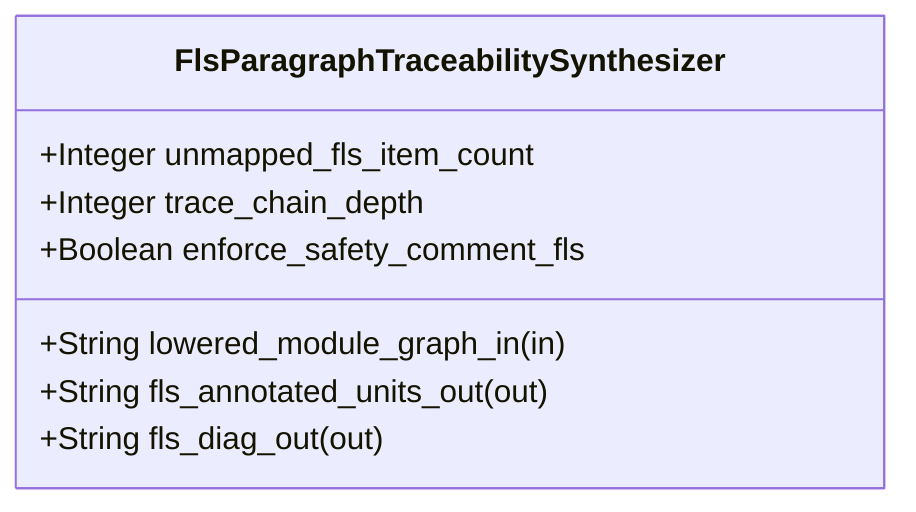

| Attribute | Specification Detail |
| :--- | :--- |
| **Issue ID** | TBD |
| **Title** | Feature 57: [BP 11 Ferrocene Qualified Toolchain FLS Traceability Structural Coverage and 3 Ring Rust Flutter DO 178 C DO 330 Certification Architecture] FlsParagraphTraceabilitySynthesizer |
| **Type** | feature |
| **Parent Epic** | [EPIC-11-BP_11_Ferrocene_Qualified_Toolchain_FLS_Traceability_Structural_Coverage_and_3_Ring_Rust_Flutter_DO_178C_DO_330_Certification_Architecture](../epics/EPIC-11-BP_11_Ferrocene_Qualified_Toolchain_FLS_Traceability_Structural_Coverage_and_3_Ring_Rust_Flutter_DO_178C_DO_330_Certification_Architecture.md) |
| **Interface Type** | Physical / Structural / Internal Bus |
| **Schema Containers** | `BP_11_Ferrocene_Qualified_Toolchain_FLS_Traceability_Structural_Coverage_and_3_Ring_Rust_Flutter_DO_178C_DO_330_Certification_Architecture::FlsParagraphTraceabilitySynthesizer` |
| **Generation Mode** | subagent |
| **Specification Source** | [schema/model.sysml](../../schema/model.sysml) |

# Feature 57: [BP 11 Ferrocene Qualified Toolchain FLS Traceability Structural Coverage and 3 Ring Rust Flutter DO 178 C DO 330 Certification Architecture] FlsParagraphTraceabilitySynthesizer

## UML Class Diagram



## Interface Requirements
### 1. Test Data Shape
```json
{
  "$schema": "https://json-schema.org/draft/2020-12/schema",
  "title": "FlsParagraphTraceabilitySynthesizerPayloadSchema",
  "type": "object",
  "properties": {
    "part": {
      "type": "string",
      "const": "FlsParagraphTraceabilitySynthesizer"
    },
    "status": {
      "type": "string",
      "enum": ["nominal", "degraded", "fault"]
    },
    "unmapped_fls_item_count": {
      "type": "integer",
      "x-sysml-type": "Integer",
      "description": "Declared attribute unmapped_fls_item_count (Integer)",
      "default": 0
    },
    "trace_chain_depth": {
      "type": "integer",
      "x-sysml-type": "Integer",
      "description": "Mandatory end-to-end traceability link count (`REQ-*`, `SC-*`, `RustItem`, `fls_*`, `KaniAndCoverage`). [unit: links]",
      "default": 5
    },
    "enforce_safety_comment_fls": {
      "type": "boolean",
      "x-sysml-type": "Boolean",
      "description": "Requires every Ring-2 FFI `unsafe` block to carry `// SAFETY: [SC-*] [FLS: fls_*]` matching the pinned FLS catalog. [unit: flag]",
      "default": true
    },
    "lowered_module_graph_in": {
      "type": "object",
      "properties": {
        "direction": { "type": "string", "const": "in" },
        "port_type": { "type": "string", "const": "String" }
      },
      "required": ["direction", "port_type"]
    },
    "fls_annotated_units_out": {
      "type": "object",
      "properties": {
        "direction": { "type": "string", "const": "out" },
        "port_type": { "type": "string", "const": "String" }
      },
      "required": ["direction", "port_type"]
    },
    "fls_diag_out": {
      "type": "object",
      "properties": {
        "direction": { "type": "string", "const": "out" },
        "port_type": { "type": "string", "const": "String" }
      },
      "required": ["direction", "port_type"]
    }
  },
  "required": [
    "part",
    "status",
    "lowered_module_graph_in",
    "fls_annotated_units_out",
    "fls_diag_out"
  ],
  "additionalProperties": false
}
```

### 2. Validation & Constraints
Declared structural attributes, boundary ports, invariants, and allocated requirements for classifier `FlsParagraphTraceabilitySynthesizer`:

| AST Member Kind | Identifier | Declared Type / Direction | Default / Invariant Contract |
| :--- | :--- | :--- | :--- |
| Attribute | `unmapped_fls_item_count` | `Integer` | Default `0` |
| Attribute | `trace_chain_depth` | `Integer` | Default `5` |
| Attribute | `enforce_safety_comment_fls` | `Boolean` | Default `true` |
| Port | `lowered_module_graph_in` | `in String` | Boundary interface contract |
| Port | `fls_annotated_units_out` | `out String` | Boundary interface contract |
| Port | `fls_diag_out` | `out String` | Boundary interface contract |

### 3. Visual Layout & Arrangement
Structural composition and boundary topology for classifier `FlsParagraphTraceabilitySynthesizer` organize no nested subparts declared in schema paired with boundary ports `in lowered_module_graph_in : String`, `out fls_annotated_units_out : String`, `out fls_diag_out : String`.

### 4. Interactive Flow & States
Operational lifecycle events and discrete state transitions for FlsParagraphTraceabilitySynthesizer.

### Layer 1: Domain State & Signal Model
Classifier `FlsParagraphTraceabilitySynthesizer` encapsulates typed domain state attributes `unmapped_fls_item_count : Integer`, `trace_chain_depth : Integer`, `enforce_safety_comment_fls : Boolean` alongside operational lifecycle status.

### Layer 2: Logic & Safety State Management
Classifier `FlsParagraphTraceabilitySynthesizer` governs stateless structural transition evaluation enforcing no additional invariant guards declared in schema.

### Layer 3: Presentation & Actuator Interface Binding
Classifier `FlsParagraphTraceabilitySynthesizer` binds external and behavioral interfaces across port `in lowered_module_graph_in : String`, port `out fls_annotated_units_out : String`, port `out fls_diag_out : String`.

## Acceptance Criteria (BDD)
- [ ] AC-01: Given valid `FlsParagraphTraceabilitySynthesizer` initialization inputs for `unmapped_fls_item_count` (`Integer`), `trace_chain_depth` (`Integer`), `enforce_safety_comment_fls` (`Boolean`) (no additional constraints specified in schema), When `FlsParagraphTraceabilitySynthesizer` commits typed domain state, Then declared state attributes hold verified values.
- [ ] AC-02: Given malformed or out-of-domain input values for `unmapped_fls_item_count` (`Integer`), `trace_chain_depth` (`Integer`), `enforce_safety_comment_fls` (`Boolean`), When `FlsParagraphTraceabilitySynthesizer` validates incoming state updates, Then `FlsParagraphTraceabilitySynthesizer` rejects the invalid state update and emits a diagnostic via diagnostic port `fls_annotated_units_out`.
- [ ] AC-03: Given nominal signal arrival across `lowered_module_graph_in` (`in String`), `fls_annotated_units_out` (`out String`), `fls_diag_out` (`out String`), When `FlsParagraphTraceabilitySynthesizer` processes the declared interface transaction, Then output state conforms to the structural classifier contract.
- [ ] AC-04: Given an invalid or unrecognized interface frame across `lowered_module_graph_in` (`in String`), `fls_annotated_units_out` (`out String`), `fls_diag_out` (`out String`), When `FlsParagraphTraceabilitySynthesizer` boundary validation executes, Then `FlsParagraphTraceabilitySynthesizer` refuses the malformed frame via diagnostic port `fls_annotated_units_out` and preserves prior verified state.

## Source References
Formal component specifications and normative systems engineering requirements:
- System Architecture Model: `schema/model.sysml`
- Normative Systems Engineering Standard: ISO/IEC/IEEE 15288:2023 §6.4.3 Architecture Definition Process

Component behavior and interface definitions derive from `schema/model.sysml` pursuant to ISO/IEC/IEEE 15288.
