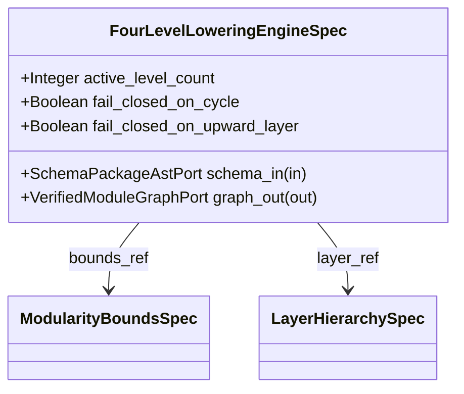

| Attribute | Specification Detail |
| :--- | :--- |
| **Issue ID** | #860 |
| **Title** | Feature 57: [BP 07 Self Hosting 4 Level Modular Multi File Code Generator Blueprint] FourLevelLoweringEngineSpec |
| **Type** | feature |
| **Parent Epic** | [EPIC-07-BP_07_Self_Hosting_4_Level_Modular_Multi_File_Code_Generator_Blueprint](../epics/EPIC-07-BP_07_Self_Hosting_4_Level_Modular_Multi_File_Code_Generator_Blueprint.md) |
| **Interface Type** | Physical / Structural / Internal Bus |
| **Schema Containers** | `BP_07_Self_Hosting_4_Level_Modular_Multi_File_Code_Generator_Blueprint::FourLevelLoweringEngineSpec` |
| **Generation Mode** | subagent |
| **Specification Source** | [schema/model.sysml](../../schema/model.sysml) |

# Feature 57: [BP 07 Self Hosting 4 Level Modular Multi File Code Generator Blueprint] FourLevelLoweringEngineSpec

## UML Class Diagram



## Interface Requirements
### 1. Test Data Shape
```json
{
  "$schema": "https://json-schema.org/draft/2020-12/schema",
  "title": "FourLevelLoweringEngineSpecPayloadSchema",
  "type": "object",
  "properties": {
    "part": {
      "type": "string",
      "const": "FourLevelLoweringEngineSpec"
    },
    "status": {
      "type": "string",
      "enum": ["nominal", "degraded", "fault"]
    },
    "active_level_count": {
      "type": "integer",
      "x-sysml-type": "Integer",
      "description": "Declared attribute active_level_count (Integer)",
      "default": 4
    },
    "fail_closed_on_cycle": {
      "type": "boolean",
      "x-sysml-type": "Boolean",
      "description": "Declared attribute fail_closed_on_cycle (Boolean)",
      "default": true
    },
    "fail_closed_on_upward_layer": {
      "type": "boolean",
      "x-sysml-type": "Boolean",
      "description": "Declared attribute fail_closed_on_upward_layer (Boolean)",
      "default": true
    },
    "schema_in": {
      "type": "object",
      "properties": {
        "direction": { "type": "string", "const": "in" },
        "port_type": { "type": "string", "const": "SchemaPackageAstPort" }
      },
      "required": ["direction", "port_type"]
    },
    "graph_out": {
      "type": "object",
      "properties": {
        "direction": { "type": "string", "const": "out" },
        "port_type": { "type": "string", "const": "VerifiedModuleGraphPort" }
      },
      "required": ["direction", "port_type"]
    }
  },
  "required": [
    "part",
    "status",
    "schema_in",
    "graph_out"
  ],
  "x-sysml-constraints": [
    {
      "name": "LoweringLevelsComplete",
      "expression": "active_level_count == 4"
    }
  ],
  "additionalProperties": false
}
```

### 2. Validation & Constraints
Declared structural attributes, boundary ports, actions, state machines, invariants, and allocated requirements for classifier `FourLevelLoweringEngineSpec`:

| AST Member Kind | Identifier | Declared Type / Direction | Default / Invariant Contract |
| :--- | :--- | :--- | :--- |
| Attribute | `active_level_count` | `Integer` | Default `4` |
| Attribute | `fail_closed_on_cycle` | `Boolean` | Default `true` |
| Attribute | `fail_closed_on_upward_layer` | `Boolean` | Default `true` |
| Port | `schema_in` | `in SchemaPackageAstPort` | Boundary interface contract (`package_ast_stream : String`) |
| Port | `graph_out` | `out VerifiedModuleGraphPort` | Boundary interface contract (`module_graph_stream : String`) |
| Action | `ExecuteFourLevelLoweringPipeline` | `in package_count : Integer, out unit_count : Integer` | 12-step deterministic 4-level lowering pipeline |
| State Machine | `ModularCodegenLifecycle` | 12 states (`Idle` .. `Verified` / `AbortedFailClosed`) | Self-hosting modular codegen lifecycle FSM |
| Constraint | `LoweringLevelsComplete` | Invariant (`REQ-0607 (REQ_0607_BP_07_Self_Hosting_4_Level_Modular_Multi_File_Code_Generator_Blueprint)`) | `active_level_count == 4` |
| Requirement | `REQ-0607 (REQ_0607_BP_07_Self_Hosting_4_Level_Modular_Multi_File_Code_Generator_Blueprint)` | Allocated Requirement | SelfHostingModularCodegenCompiler (**REQ-0607** / BP-07 / DEAP-BP-DET-07, UUIDv5 6ba7b810-9dad-11d1-80b4-00c04fd430c7, Class P linear Kahn DAG and AST traversal complexity, governed by DO-178C Level A, DO-330 TQL-4, ISO 26262 ASIL D, and ECSS-E-ST-40C) |

```sysml
constraint LoweringLevelsComplete { active_level_count == 4 }
```

### 3. Visual Layout & Arrangement
Structural composition and boundary topology for classifier `FourLevelLoweringEngineSpec` (`@Layer("Application")` inside `ModularCodegen::lowering`) organize nested subparts `bounds_ref : ModularityBoundsSpec` and `layer_ref : LayerHierarchySpec` paired with boundary ports `in schema_in : SchemaPackageAstPort` and `out graph_out : VerifiedModuleGraphPort`.

### 4. Interactive Flow & States
Operational lifecycle events and discrete state transitions for `FourLevelLoweringEngineSpec` execute `ModularCodegenLifecycle` (`Idle -> ResolvingLayers -> VerifyingDag -> PartitioningPackages -> SplittingFacets -> OutliningBehaviors -> HoistingPredicates -> SynthesizingTree -> VerifyingBounds -> PersistingAtomic -> Verified`, with fail-closed transitions `on_cycle_e0702`, `on_upward_layer_e0703`, and `on_fixed_point_drift_e0705` to `AbortedFailClosed`).

### Layer 1: Domain State & Signal Model
Classifier `FourLevelLoweringEngineSpec` (`@Layer("Application")`) encapsulates typed domain state attributes `active_level_count : Integer` (default `4`), `fail_closed_on_cycle : Boolean` (default `true`), and `fail_closed_on_upward_layer : Boolean` (default `true`) alongside nested part compositions `bounds_ref : ModularityBoundsSpec` and `layer_ref : LayerHierarchySpec`. Under **Contract A (100% Normative OMG SysML v2.0 + KerML 1.0 Grammar Coverage -- Zero 16-Construct Caps)**, `FourLevelLoweringEngineSpec` ingests full OMG SysML v2.0 and KerML 1.0 AST hierarchies across `SchemaPackageAstPort` (`package`/`library package`/`standard library package`, `import`, `metadata def`/`@Metadata`/`#capability`/`#hazard`/`#risk`/`#rt_loop`/`#dal`/`#fls` and backward-compatible `hazard def`/`risk def`/`capability def`, `part def`/`part`, `item def`/`item`, `attribute def`/`attribute`, `enum def`/`enum`, `port def`/`port`, `connection def`/`connection`, `interface def`/`interface`, `flow def`/`flow`, `allocation def`/`allocation`, `occurrence def`/`occurrence`, `action def`/`action`, `state def`/`state`, `calc def`/`calc`, `constraint def`/`constraint`, `requirement def`/`requirement`, `concern def`/`concern`, `use case def`/`use case`, `analysis def`/`analysis`, `verification def`/`verification`, `test case def`/`test case`, `interaction def`/`interaction`, `view def`/`view`, `viewpoint def`/`viewpoint`, `rendering def`/`rendering`, `variation`/`variant`, and KerML 1.0 specialization/multiplicity/expressions) parsed via `deap_core::sysml_cst` (`logos` + `rowan` + `salsa` + `ariadne`).

### Layer 2: Logic & Safety State Management
Classifier `FourLevelLoweringEngineSpec` governs `ExecuteFourLevelLoweringPipeline` across all 12 lowering steps (`resolve_package_hierarchy`, `extract_part_layer_annotations`, `build_directed_dependency_edges`, `run_kahn_topological_cycle_check`, `verify_non_upward_layer_edges`, `partition_package_directories`, `split_part_responsibility_facets`, `outline_sequential_action_stages`, `outline_source_state_handlers`, `hoist_anf_boolean_subpredicates`, `synthesize_barrel_reexport_facades`, `verify_in_memory_modularity_bounds`) and state machine `ModularCodegenLifecycle`, enforcing `LoweringLevelsComplete` (`active_level_count == 4`). Under **Contract B (Official Rust Compiler & Codegen Stack -- Zero Hand-Rolled Scanners)** and the **3-Layer Definition of Done (DoD)**, implementation is bounded inside `< 380` exec SLOC submodules (`./crates/compile-sysml/src/modular_codegen/lowering/` and `./crates/compile-sysml/src/modular_codegen/generated/`) synthesized deterministically via `proc-macro2` + `quote::quote!` + `syn::parse2::<syn::File>` + `prettyplease::unparse` (`SHA-256(Stage 1) == SHA-256(Stage 2)`) while retiring `-450+` SLOC in `./crates/compile-sysml/src/driver.rs` and `-650+` SLOC in `./crates/compile-sysml/src/flutter_codegen.rs`.

### Layer 3: Presentation & Actuator Interface Binding
Classifier `FourLevelLoweringEngineSpec` binds external and behavioral interfaces across ingress port `in schema_in : SchemaPackageAstPort` (`package_ast_stream : String`) and egress port `out graph_out : VerifiedModuleGraphPort` (`module_graph_stream : String`), feeding `ModularEmitterSuiteSpec.engine_ref` and emitting fail-closed diagnostics (`E0701`, `E0702`, `E0703`, `E0705`) on any DAG cycle, upward layer reference, or modularity bound breach.

### Associated Use Cases & User Stories

#### Associated Use Cases
- [ ] #761 - [Use Case 32: Fail Closed Rejection on Directed Dependency Cycles and Upward Layer Imports](../use-cases/UC-32-Fail_Closed_Rejection_on_Directed_Dependency_Cycles_and_Upward_Layer_Imports.md)
- [ ] #762 - [Use Case 33: Four Level Deterministic Lowering with Typed syn File AST and prettyplease Formatting](../use-cases/UC-33-Four_Level_Deterministic_Lowering_with_Typed_syn_File_AST_and_prettyplease_Formatting.md)
- [ ] #763 - [Use Case 34: Metacircular Self Hosting Stage 1 to Stage 2 SHA 256 Fixed Point Identity](../use-cases/UC-34-Metacircular_Self_Hosting_Stage_1_to_Stage_2_SHA_256_Fixed_Point_Identity.md)

#### Associated User Stories
- [ ] #852 - [User Story 79: Execute Four Level Lowering Pipeline](../user-stories/US-79-ExecuteFourLevelLoweringPipeline.md)

## Acceptance Criteria (BDD)
- [ ] AC-01: Given valid `FourLevelLoweringEngineSpec` inputs satisfying `LoweringLevelsComplete` (`active_level_count == 4`) [Req `REQ-0607 (REQ_0607_BP_07_Self_Hosting_4_Level_Modular_Multi_File_Code_Generator_Blueprint)`], When `FourLevelLoweringEngineSpec` evaluates invariant `LoweringLevelsComplete` during `ExecuteFourLevelLoweringPipeline`, Then the invariant holds and verified state is committed.
- [ ] AC-02: Given boundary inputs that violate `LoweringLevelsComplete` (`active_level_count == 4`) [Req `REQ-0607 (REQ_0607_BP_07_Self_Hosting_4_Level_Modular_Multi_File_Code_Generator_Blueprint)`], When `FourLevelLoweringEngineSpec` evaluates invariant `LoweringLevelsComplete`, Then `FourLevelLoweringEngineSpec` rejects the invalid transition and routes a diagnostic via diagnostic port `graph_out`.
- [ ] AC-03: Given nominal typed values for `active_level_count` (`Integer`), `fail_closed_on_cycle` (`Boolean`), `fail_closed_on_upward_layer` (`Boolean`) across `schema_in` (`in SchemaPackageAstPort`), `graph_out` (`out VerifiedModuleGraphPort`), When `FourLevelLoweringEngineSpec` executes structural interface processing across `ModularCodegenLifecycle`, Then state and output ports conform to declared schema types.
- [ ] AC-04: Given malformed input frames across `active_level_count` (`Integer`), `fail_closed_on_cycle` (`Boolean`), `fail_closed_on_upward_layer` (`Boolean`) or `schema_in` (`in SchemaPackageAstPort`), `graph_out` (`out VerifiedModuleGraphPort`), When `FourLevelLoweringEngineSpec` boundary validation executes, Then `FourLevelLoweringEngineSpec` rejects the malformed input via diagnostic port `graph_out`.

## Source References
Formal component specifications and normative systems engineering requirements:
- System Architecture Model: `schema/model.sysml`
- Normative Systems Engineering Standard: ISO/IEC/IEEE 15288:2023 §6.4.3 Architecture Definition Process

Component behavior and interface definitions derive from `schema/model.sysml` pursuant to ISO/IEC/IEEE 15288.
