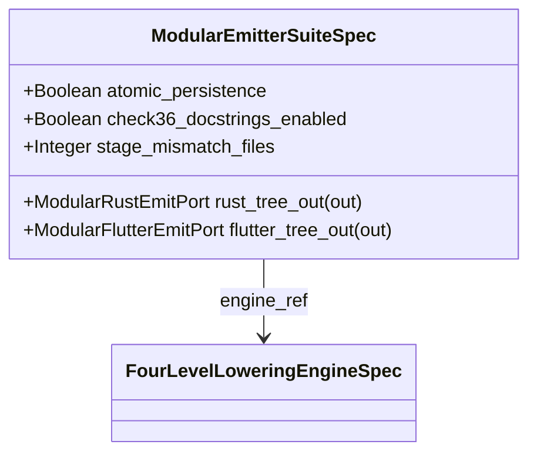

| Attribute | Specification Detail |
| :--- | :--- |
| **Issue ID** | #861 |
| **Title** | Feature 58: [BP 07 Self Hosting 4 Level Modular Multi File Code Generator Blueprint] ModularEmitterSuiteSpec |
| **Type** | feature |
| **Parent Epic** | [EPIC-07-BP_07_Self_Hosting_4_Level_Modular_Multi_File_Code_Generator_Blueprint](../epics/EPIC-07-BP_07_Self_Hosting_4_Level_Modular_Multi_File_Code_Generator_Blueprint.md) |
| **Interface Type** | Physical / Structural / Internal Bus |
| **Schema Containers** | `BP_07_Self_Hosting_4_Level_Modular_Multi_File_Code_Generator_Blueprint::ModularEmitterSuiteSpec` |
| **Generation Mode** | subagent |
| **Specification Source** | [schema/model.sysml](../../schema/model.sysml) |

# Feature 58: [BP 07 Self Hosting 4 Level Modular Multi File Code Generator Blueprint] ModularEmitterSuiteSpec

## UML Class Diagram



## Interface Requirements
### 1. Test Data Shape
```json
{
  "$schema": "https://json-schema.org/draft/2020-12/schema",
  "title": "ModularEmitterSuiteSpecPayloadSchema",
  "type": "object",
  "properties": {
    "part": {
      "type": "string",
      "const": "ModularEmitterSuiteSpec"
    },
    "status": {
      "type": "string",
      "enum": ["nominal", "degraded", "fault"]
    },
    "atomic_persistence": {
      "type": "boolean",
      "x-sysml-type": "Boolean",
      "description": "Declared attribute atomic_persistence (Boolean)",
      "default": true
    },
    "check36_docstrings_enabled": {
      "type": "boolean",
      "x-sysml-type": "Boolean",
      "description": "Declared attribute check36_docstrings_enabled (Boolean)",
      "default": true
    },
    "stage_mismatch_files": {
      "type": "integer",
      "x-sysml-type": "Integer",
      "description": "Declared attribute stage_mismatch_files (Integer)",
      "default": 0
    },
    "rust_tree_out": {
      "type": "object",
      "properties": {
        "direction": { "type": "string", "const": "out" },
        "port_type": { "type": "string", "const": "ModularRustEmitPort" }
      },
      "required": ["direction", "port_type"]
    },
    "flutter_tree_out": {
      "type": "object",
      "properties": {
        "direction": { "type": "string", "const": "out" },
        "port_type": { "type": "string", "const": "ModularFlutterEmitPort" }
      },
      "required": ["direction", "port_type"]
    }
  },
  "required": [
    "part",
    "status",
    "rust_tree_out",
    "flutter_tree_out"
  ],
  "x-sysml-constraints": [
    {
      "name": "FixedPointBootstrapParity",
      "expression": "stage_mismatch_files == 0"
    }
  ],
  "additionalProperties": false
}
```

### 2. Validation & Constraints
Declared structural attributes, boundary ports, invariants, and allocated requirements for classifier `ModularEmitterSuiteSpec`:

| AST Member Kind | Identifier | Declared Type / Direction | Default / Invariant Contract |
| :--- | :--- | :--- | :--- |
| Attribute | `atomic_persistence` | `Boolean` | Default `true` |
| Attribute | `check36_docstrings_enabled` | `Boolean` | Default `true` |
| Attribute | `stage_mismatch_files` | `Integer` | Default `0` |
| Port | `rust_tree_out` | `out ModularRustEmitPort` | Boundary interface contract (`rust_manifest_sha256 : String`) |
| Port | `flutter_tree_out` | `out ModularFlutterEmitPort` | Boundary interface contract (`dart_manifest_sha256 : String`) |
| Constraint | `FixedPointBootstrapParity` | Invariant (`REQ-0607 (REQ_0607_BP_07_Self_Hosting_4_Level_Modular_Multi_File_Code_Generator_Blueprint)`) | `stage_mismatch_files == 0` |
| Requirement | `REQ-0607 (REQ_0607_BP_07_Self_Hosting_4_Level_Modular_Multi_File_Code_Generator_Blueprint)` | Allocated Requirement | SelfHostingModularCodegenCompiler (**REQ-0607** / BP-07 / DEAP-BP-DET-07, UUIDv5 6ba7b810-9dad-11d1-80b4-00c04fd430c7, Class P linear Kahn DAG and AST traversal complexity, governed by DO-178C Level A, DO-330 TQL-4, ISO 26262 ASIL D, and ECSS-E-ST-40C) |

```sysml
constraint FixedPointBootstrapParity { stage_mismatch_files == 0 }
```

### 3. Visual Layout & Arrangement
Structural composition and boundary topology for classifier `ModularEmitterSuiteSpec` (`@Layer("Presentation")` inside `ModularCodegen::emitters`) organize nested subpart `engine_ref : FourLevelLoweringEngineSpec` paired with boundary ports `out rust_tree_out : ModularRustEmitPort` and `out flutter_tree_out : ModularFlutterEmitPort`.

### 4. Interactive Flow & States
Operational lifecycle events and discrete state transitions for `ModularEmitterSuiteSpec` within `ModularCodegenLifecycle` (`SynthesizingTree -> VerifyingBounds -> PersistingAtomic -> Verified` on `atomic_commit_succeeded`, or `VerifyingBounds -> AbortedFailClosed` on `on_fixed_point_drift_e0705`).

### Layer 1: Domain State & Signal Model
Classifier `ModularEmitterSuiteSpec` (`@Layer("Presentation")`) encapsulates typed domain state attributes `atomic_persistence : Boolean` (default `true`), `check36_docstrings_enabled : Boolean` (default `true`), and `stage_mismatch_files : Integer` (default `0`) alongside nested composition `engine_ref : FourLevelLoweringEngineSpec`. Under **Contract A (100% Normative OMG SysML v2.0 + KerML 1.0 Grammar Coverage -- Zero 16-Construct Caps)**, `ModularEmitterSuiteSpec` emits multi-file Rust and Dart contract trees for all OMG SysML v2.0 and KerML 1.0 constructs (`package`/`library package`/`standard library package`, `import`, `metadata def`/`@Metadata`/`#capability`/`#hazard`/`#risk`/`#rt_loop`/`#dal`/`#fls` and backward-compatible `hazard def`/`risk def`/`capability def`, `part def`/`part`, `item def`/`item`, `attribute def`/`attribute`, `enum def`/`enum`, `port def`/`port`, `connection def`/`connection`, `interface def`/`interface`, `flow def`/`flow`, `allocation def`/`allocation`, `occurrence def`/`occurrence`, `action def`/`action`, `state def`/`state`, `calc def`/`calc`, `constraint def`/`constraint`, `requirement def`/`requirement`, `concern def`/`concern`, `use case def`/`use case`, `analysis def`/`analysis`, `verification def`/`verification`, `test case def`/`test case`, `interaction def`/`interaction`, `view def`/`view`, `viewpoint def`/`viewpoint`, `rendering def`/`rendering`, `variation`/`variant`, and KerML 1.0 specialization/multiplicity/expressions) parsed via `deap_core::sysml_cst` (`logos` + `rowan` + `salsa` + `ariadne`).

### Layer 2: Logic & Safety State Management
Classifier `ModularEmitterSuiteSpec` governs stateless structural transition evaluation enforcing `FixedPointBootstrapParity` (`stage_mismatch_files == 0`), `C_MOD_04`, and `Invariant_REQ_0607_SC_03`. Under **Contract B (Official Rust Compiler & Codegen Stack -- Zero Hand-Rolled Scanners)** and the **3-Layer Definition of Done (DoD)**, implementation is bounded inside `< 380` exec SLOC submodules (`./crates/compile-sysml/src/modular_codegen/emitters/` and `./crates/compile-sysml/src/modular_codegen/generated/`) synthesizing multi-file Rust trees via `proc-macro2` + `quote::quote!` + `syn::parse2::<syn::File>` + `prettyplease::unparse` (`SHA-256(Stage 1) == SHA-256(Stage 2)`) and `.g.dart` contracts with `<= 80`-LOC barrel facades while retiring `-450+` SLOC in `./crates/compile-sysml/src/driver.rs` and `-650+` SLOC in `./crates/compile-sysml/src/flutter_codegen.rs`.

### Layer 3: Presentation & Actuator Interface Binding
Classifier `ModularEmitterSuiteSpec` binds external and behavioral interfaces across egress ports `out rust_tree_out : ModularRustEmitPort` (`rust_manifest_sha256 : String`) and `out flutter_tree_out : ModularFlutterEmitPort` (`dart_manifest_sha256 : String`), committing generated trees atomically from staging directories or aborting fail-closed with `E0705` on Stage-1 versus Stage-2 SHA-256 drift.

### Associated Use Cases & User Stories

#### Associated Use Cases
- [ ] #763 - [Use Case 34: Metacircular Self Hosting Stage 1 to Stage 2 SHA 256 Fixed Point Identity](../use-cases/UC-34-Metacircular_Self_Hosting_Stage_1_to_Stage_2_SHA_256_Fixed_Point_Identity.md)
- [ ] #764 - [Use Case 35: Modular Multi File Flutter_Contract Emission and Monolith Barrel Decomposition](../use-cases/UC-35-Modular_Multi_File_Flutter_Contract_Emission_and_Monolith_Barrel_Decomposition.md)
- [ ] #765 - [Use Case 36: Zero String Concatenation Codegen DO 178 C Seven Section Docstring and Clippy Forbid Compliance](../use-cases/UC-36-Zero_String_Concatenation_Codegen_DO_178C_Seven_Section_Docstring_and_Clippy_Forbid_Compliance.md)

#### Associated User Stories
- [ ] #852 - [User Story 79: Execute Four Level Lowering Pipeline](../user-stories/US-79-ExecuteFourLevelLoweringPipeline.md)

## Acceptance Criteria (BDD)
- [ ] AC-01: Given valid `ModularEmitterSuiteSpec` inputs satisfying `FixedPointBootstrapParity` (`stage_mismatch_files == 0`) [Req `REQ-0607 (REQ_0607_BP_07_Self_Hosting_4_Level_Modular_Multi_File_Code_Generator_Blueprint)`], When `ModularEmitterSuiteSpec` evaluates invariant `FixedPointBootstrapParity`, Then the invariant holds and verified state is committed.
- [ ] AC-02: Given boundary inputs that violate `FixedPointBootstrapParity` (`stage_mismatch_files == 0`) [Req `REQ-0607 (REQ_0607_BP_07_Self_Hosting_4_Level_Modular_Multi_File_Code_Generator_Blueprint)`], When `ModularEmitterSuiteSpec` evaluates invariant `FixedPointBootstrapParity`, Then `ModularEmitterSuiteSpec` rejects the invalid transition and routes a diagnostic via diagnostic port `rust_tree_out`.
- [ ] AC-03: Given nominal typed values for `atomic_persistence` (`Boolean`), `check36_docstrings_enabled` (`Boolean`), `stage_mismatch_files` (`Integer`) across `rust_tree_out` (`out ModularRustEmitPort`), `flutter_tree_out` (`out ModularFlutterEmitPort`), When `ModularEmitterSuiteSpec` executes structural interface processing, Then state and output ports conform to declared schema types.
- [ ] AC-04: Given malformed input frames across `atomic_persistence` (`Boolean`), `check36_docstrings_enabled` (`Boolean`), `stage_mismatch_files` (`Integer`) or `rust_tree_out` (`out ModularRustEmitPort`), `flutter_tree_out` (`out ModularFlutterEmitPort`), When `ModularEmitterSuiteSpec` boundary validation executes, Then `ModularEmitterSuiteSpec` rejects the malformed input via diagnostic port `rust_tree_out`.

## Source References
Formal component specifications and normative systems engineering requirements:
- System Architecture Model: `schema/model.sysml`
- Normative Systems Engineering Standard: ISO/IEC/IEEE 15288:2023 §6.4.3 Architecture Definition Process

Component behavior and interface definitions derive from `schema/model.sysml` pursuant to ISO/IEC/IEEE 15288.
