| Attribute | Specification Detail |
| :--- | :--- |
| **Issue ID** | #640 |
| **Title** | System Interface Matrix & Topological Connectivity |
| **Type** | icd |
| **Interface Level** | Level 1C Logical Interface |
| **Generation Mode** | subagent |
| **Specification Source** | [schema/model.sysml](../../schema/model.sysml) |

# Level 1C: System Interface Matrix & Topological Connectivity

## 1. Executive Summary & Interface Scope

This Level 1C Logical Interface Control Document (`ICD_01_SYSTEM_INTERFACE_MATRIX.md`) defines the complete subsystem boundary partitioning, directional port roster, topological connectivity graph, and canonical $N^2$ interface matrices across all 11 architectural blueprint packages (`BP-01` through `BP-11`) and 53 structural `part def` components in `./.pipeline/upstream/schema/model.sysml` and `./.pipeline/upstream/schema/modular_codegen.sysml`.

### 1.1 Contract A: 100% Normative OMG SysML v2.0 + KerML 1.0 Grammar Coverage
All port definitions, connections, interfaces, allocations, and item flows in this specification derive deterministically from the lossless SysML v2 Concrete/Abstract Syntax Tree (`deap_core::sysml_cst`) with full Definition and Usage symmetry across all six normative OMG SysML v2.0 and KerML 1.0 construct families:
1. **Namespaces & Metadata**: `package`, `library package`, `standard library package`, `import` (`all`, `::*`, `::**`, filter `[...]`), `alias`, `doc`, `comment`, `rep`, `dependency`, and `metadata def` / `metadata` / `@Metadata` / `#user_keyword` (modeling `#hazard`, `#risk`, `#capability`, `#rt_loop`, `#dal`, `#fls` via standard OMG SysML v2 `metadata def` extensions alongside backward-compatible parsing of legacy `hazard def`, `risk def`, and `capability def`).
2. **Structural & Data Types**: `attribute def`/`attribute`, `enum def`/`enum`, `item def`/`item`, `part def`/`part`, `port def`/`port` (`in`, `out`, `inout`, `~` conjugation), `connection def`/`connection` (`connect ... to ...`), `interface def`/`interface`, `flow def`/`flow` (`of ... from ... to ...`), `allocation def`/`allocation` (`allocate ... to ...`), and `occurrence def`/`occurrence` (`individual`, `snapshot`, `timeslice`).
3. **Behavioral & State**: `action def`/`action` (`perform`, `accept`, `send`, `assign`, `if`/`else`, `while`/`loop`, `for`, `fork`, `join`, `merge`, `decide`, `first ... then ...` succession) and `state def`/`state` (`exhibit`, `parallel`, `entry`, `do`, `exit`, `transition first ... accept ... if ... do ... then ...`).
4. **Calculations, Constraints & Requirements**: `calc def`/`calc` (`return`), `constraint def`/`constraint` (`assert`, `assume`, `require`), `requirement def`/`requirement` (`subject`, `actor`, `stakeholder`, `framed concern`, `satisfy ... by ...`), and `concern def`/`concern`.
5. **Use Cases, Analysis, Verification & Views**: `use case def`/`use case` (`include use case`), `analysis def`/`analysis` (`objective`), `verification def`/`verification` (`verify requirement`), `test case def`/`test case`, `interaction def`/`interaction`, `view def`/`view`, `viewpoint def`/`viewpoint`, `rendering def`/`rendering` (`expose`, `filter`, `render`), and `variation`/`variant`.
6. **KerML 1.0 Specialization, Multiplicity & Expressions**: `:` (`defined by`), `:>` (`subsets`), `:>>` (`redefines`), `::>` (`references`), `~` (`conjugates`), `ref`, `abstract`, `readonly`, `derived`, `end`, `default`, `:=`, `[lo..hi]`, `[*]`, `{ordered, nonunique}`, full KerML logical/conditional/relational/arithmetic/collection expressions (`implies`, `xor`, `??`, `->`, `collect`, `select`, `forAll`, `exists`), and `ISQ`/`SI`/`ScalarValues` standard libraries.

### 1.2 Contract B: 100% Official Rust Compiler, Cargo, `rust-analyzer` & Rustdoc Crate Stack
All 53 subsystem components and 95 directional ports across `BP-01..11` operate exclusively on the official Rust compiler and `rust-analyzer` crate stack with zero legacy hand-rolled string, line, or character scanners:
- **Workspace & Manifest Governance (`BP-01`, `BP-08`)**: `cargo_metadata`, `cargo-lock`, `cargo-util-schemas`, `cargo-platform`, and `toml_edit`.
- **Lossless Rust CST, VFS & Span Codemods (`BP-01`, `BP-02`, `BP-05`, `BP-06`, `BP-08`)**: `ra_ap_syntax` (`ast::{MatchExpr, MatchArmList, CallExpr, MethodCallExpr, TryExpr, Fn, HasDocComments, HasAttrs}`), `ra_ap_vfs`, `ra_ap_paths`, `ra_ap_line_index`, `ra_ap_text_edit`, `rowan`, `camino`, and `ignore` powering `ClippyAttributeCstParser`, `Check34AstPurityAndAntiGamingGate`, `UnifiedRustDartCstParser`, `FivePillarStaticAstAnalyzer`, `LosslessRustCstAnalyzer`, and `ZeroTokenRustSpanCodemodEngine`.
- **Lossless SysML v2, Dart & Polyglot CST + Incremental Query DB (`BP-03`, `BP-05`, `BP-10`)**: `logos` + `rowan` + `salsa` + `ariadne` (`deap_core::sysml_cst`, `deap_core::dart_cst`, `ingest_sysml::cst::{idl_cst, yang_cst}`, and typed `serde_json` OpenAPI/JSON-Schema) powering `LogosRowanSysmlCstEngine`, `SalsaIncrementalCompilerDatabase`, `TypedPolyglotIngestionFrontend`, and `FormattingPreservingSyncSplicer`.
- **Lossless Markdown AST (`BP-04`, `BP-06`)**: `pulldown-cmark` + `pulldown-cmark-to-cmark` powering `AgileSpecForwardProjector`, `BidirectionalBacklogReconciler`, `LogicalIcdMatrixCompiler`, and `DeterministicDossierSynthesizer`.
- **Deterministic Fixed-Point Codegen (`BP-07`, `BP-08`)**: `syn` + `proc-macro2` + `quote` + `prettyplease` powering `FourLevelAstPartitionerAndHoister`, `ModularRustMultiFileEmitter`, `ModularFlutterMultiFileEmitter`, and `StructuredModularCodegenSynthesizer`.
- **5-Stage Verification & Ferrocene Qualification (`BP-09`, `BP-11`)**: Stage 1 `rustc`/`cargo clippy --message-format=json` (`StableClippyTotalFunctionGate`) -> Stage 2 isolated `./lints/deap-dylint-mir/` (`IsolatedDylintMirAllocationGate`, `feature(rustc_private)`, `rustc_middle::mir`) -> Stage 3 `cargo miri` + `flutter_rust_bridge` (`FrbIcdBridgeAndMiriUbGate`) -> Stage 4 `cargo kani` (`KaniCbmcProofSynthesizer`, `kani::proof`) -> Stage 5 Ferrocene `criticalup.toml` + `FLS: fls_*` + `symbol-report`/`blanket` MC/DC + 3-Ring DAL-A..E partitioning (`DualModeFerroceneToolchainGate`, `FlsParagraphTraceabilitySynthesizer`, `CertifiedCoreSubsetAndCoverageGate`, `ThreeRingAssurancePartitionCompiler`).

## 2. Subsystem Topological Connectivity Graph

```mermaid
flowchart TD
    subgraph "Tier 1: Ingestion and CST"
        direction TB
        BP01["BP-01 Forbid Lint Gate<br/>* PORT-BP01-STATUS_OUT<br/>* PORT-BP01-MANIFEST_IN"]
        BP02["BP-02 Check 34 CST Purity<br/>* PORT-BP02-AUDIT_AST_OUT<br/>* PORT-BP02-TEST_AST_IN"]
        BP03["BP-03 SysML Roundtrip Gate<br/>* PORT-BP03-SYSML_OUT<br/>* PORT-BP03-RAW_SYSML_IN"]
        BP10["BP-10 Salsa Polyglot Engine<br/>* PORT-BP10-HIR_OUT<br/>* PORT-BP10-REV_IN"]
    end

    subgraph "Tier 2: Lowering and Synthesis"
        direction TB
        BP04["BP-04 Spec ICD WBS Compiler<br/>* PORT-BP04-SYNC_OUT<br/>* PORT-BP04-PKG_AST_IN"]
        BP05["BP-05 Safety Docstring Gate<br/>* PORT-BP05-CTX_OUT<br/>* PORT-BP05-CTX_IN"]
        BP07["BP-07 4-Level Codegen<br/>* PORT-BP07-GRAPH_OUT<br/>* PORT-BP07-GRAPH_IN"]
        BP08["BP-08 Rust CST Codemod<br/>* PORT-BP08-ERR_OUT<br/>* PORT-BP08-FINDING_IN"]
    end

    subgraph "Tier 3: Verification and Assurance"
        direction TB
        BP06["BP-06 5-Pillar Code Auditor<br/>* PORT-BP06-DOSSIER_OUT<br/>* PORT-BP06-DOSSIER_IN"]
        BP09["BP-09 Multi-Stage Gatekeeper<br/>* PORT-BP09-CLIPPY_OUT<br/>* PORT-BP09-GATE_IN"]
        BP11["BP-11 Ferrocene 3-Ring Gate<br/>* PORT-BP11-PART_OUT<br/>* PORT-BP11-MOD_GRAPH_IN"]
    end

    BP01 -->|"CONN-01 (Lint Verdict)"| BP02
    BP02 -->|"CONN-02 (CST Purity)"| BP03
    BP03 -->|"CONN-03 (Bijective AST)"| BP10
    BP10 -->|"CONN-10 (Salsa HIR)"| BP04
    BP04 -->|"CONN-04 (Forward Specs)"| BP05
    BP05 -->|"CONN-05 (Docstring CST)"| BP07
    BP07 -->|"CONN-07 (Module Graph)"| BP08
    BP08 -->|"CONN-08 (NDJSON Diag)"| BP06
    BP06 -->|"CONN-06 (Defect Dossier)"| BP09
    BP09 -->|"CONN-09 (Formal Proofs)"| BP11
```

## 3. Canonical N² Subsystem Interface Matrix

### 3.1 Package-Level 11 x 11 Subsystem Interface Matrix (`BP-01..11`)

| Subsystem Package | 1. BP-01 | 2. BP-02 | 3. BP-03 | 4. BP-04 | 5. BP-05 | 6. BP-06 | 7. BP-07 | 8. BP-08 | 9. BP-09 | 10. BP-10 | 11. BP-11 |
| :--- | :--- | :--- | :--- | :--- | :--- | :--- | :--- | :--- | :--- | :--- | :--- |
| **1. BP-01 Forbid Lint Gate** | **[ BP-01 : CONN-01 (3 Signals) ]** | -- | -- | -- | -- | -- | -- | -- | -- | -- | -- |
| **2. BP-02 Check 34 CST Purity** | -- | **[ BP-02 : CONN-02 (3 Signals) ]** | -- | -- | -- | -- | -- | -- | -- | -- | -- |
| **3. BP-03 Bijective Roundtrip** | -- | -- | **[ BP-03 : CONN-03 (3 Signals) ]** | -- | -- | -- | -- | -- | -- | -- | -- |
| **4. BP-04 Spec ICD WBS Compiler** | -- | -- | -- | **[ BP-04 : CONN-04 (3 Signals) ]** | -- | -- | -- | -- | -- | -- | -- |
| **5. BP-05 Safety Docstring Gate** | -- | -- | -- | -- | **[ BP-05 : CONN-05 (3 Signals) ]** | -- | -- | -- | -- | -- | -- |
| **6. BP-06 5-Pillar Code Auditor** | -- | -- | -- | -- | -- | **[ BP-06 : CONN-06 (3 Signals) ]** | -- | -- | -- | -- | -- |
| **7. BP-07 4-Level Modular Codegen** | -- | -- | -- | -- | -- | -- | **[ BP-07 : CONN-07 (3 Signals) ]** | -- | -- | -- | -- |
| **8. BP-08 Rust CST Codemod Engine** | -- | -- | -- | -- | -- | -- | -- | **[ BP-08 : CONN-08 (3 Signals) ]** | -- | -- | -- |
| **9. BP-09 Formal Gatekeeper** | -- | -- | -- | -- | -- | -- | -- | -- | **[ BP-09 : CONN-09 (3 Signals) ]** | -- | -- |
| **10. BP-10 Incremental CST Engine** | -- | -- | -- | -- | -- | -- | -- | -- | -- | **[ BP-10 : CONN-10 (3 Signals) ]** | -- |
| **11. BP-11 Ferrocene 3-Ring Gate** | -- | -- | -- | -- | -- | -- | -- | -- | -- | -- | **[ BP-11 : CONN-11 (3 Signals) ]** |

### 3.2 Component-Level 53 x 53 Subsystem & Component Interconnect Matrix

| Component | AgileSpecForwardProjector | AirGappedCargoLockGovernor | AntiGamingTestBodyAuditor | BidirectionalBacklogReconciler | BijectiveSysmlSerializer | CertifiedCoreSubsetAndCoverageGate | Check34AstPurityAndAntiGamingGate | Check36AstCompletenessVerifier | ClippyAttributeCstParser | ClosedLoopDefectPublisherGate | CompilerLintEnforcementGate | CompilerRoundtripVerificationGate | CrateRootAttributeSanitizer | DeterministicDossierSynthesizer | DeterministicSpecIcdWbsForwardCompiler | DeterministicStaticDefectAuditor | DualModeFerroceneToolchainGate | FailClosedIoAstVerifier | FailClosedRecursiveDescentParser | FivePillarStaticAstAnalyzer | FlsParagraphTraceabilitySynthesizer | FormattingPreservingSyncSplicer | FourLevelAstPartitionerAndHoister | FrbIcdBridgeAndMiriUbGate | IsolatedDylintMirAllocationGate | KaniCbmcProofSynthesizer | LogicalIcdMatrixCompiler | LogosRowanSysmlCstEngine | LosslessRustCstAnalyzer | MermaidUmlDiagramGenerator | MilStd881eWbsExporter | ModularFlutterMultiFileEmitter | ModularRustMultiFileEmitter | MultiStageVerificationOrchestrator | NativeSigilAndLifetimeLexer | RangeSliceAstDetector | SalsaIncrementalCompilerDatabase | ScopedSchemaContextResolver | SelfHostingModularCodegenCompiler | SevenSectionDocstringGenerator | SsotSymbolDeduplicationGate | StableClippyTotalFunctionGate | StructuredModularCodegenSynthesizer | SysmlBijectiveRoundtripCompilerGate | TestTargetLintEnforcer | ThreeRingAssurancePartitionCompiler | TopologicalLayerDagVerifier | TypedPolyglotIngestionFrontend | UnifiedRustDartCstParser | UnifiedRustcJsonDiagnosticEmitter | UnifiedSafetyDocstringSynthesizer | WorkspaceManifestForbidGate | ZeroTokenRustSpanCodemodEngine |
| :--- | :--- | :--- | :--- | :--- | :--- | :--- | :--- | :--- | :--- | :--- | :--- | :--- | :--- | :--- | :--- | :--- | :--- | :--- | :--- | :--- | :--- | :--- | :--- | :--- | :--- | :--- | :--- | :--- | :--- | :--- | :--- | :--- | :--- | :--- | :--- | :--- | :--- | :--- | :--- | :--- | :--- | :--- | :--- | :--- | :--- | :--- | :--- | :--- | :--- | :--- | :--- | :--- | :--- |
| **AgileSpecForwardProjector** | --- | - | - | - | - | - | - | - | - | - | - | - | - | - | - | - | - | - | - | - | - | - | - | - | - | - | - | - | - | - | - | - | - | - | - | - | - | - | - | - | - | - | - | - | - | - | - | - | - | - | - | - | - |
| **AirGappedCargoLockGovernor** | - | --- | - | - | - | - | - | - | - | - | - | - | - | - | - | - | - | - | - | - | - | - | - | - | - | - | - | - | - | - | - | - | - | - | - | - | - | - | - | - | - | - | - | - | - | - | - | - | - | - | - | - | - |
| **AntiGamingTestBodyAuditor** | - | - | --- | - | - | - | `BP_02_AuditorToPurityGateConnection` | - | - | - | - | - | - | - | - | - | - | - | - | - | - | - | - | - | - | - | - | - | - | - | - | - | - | - | - | - | - | - | - | - | - | - | - | - | - | - | - | - | - | - | - | - | - |
| **BidirectionalBacklogReconciler** | - | - | - | --- | - | - | - | - | - | - | - | - | - | - | `BP_04_ReconcilerToForwardCompilerConnection` | - | - | - | - | - | - | - | - | - | - | - | - | - | - | - | - | - | - | - | - | - | - | - | - | - | - | - | - | - | - | - | - | - | - | - | - | - | - |
| **BijectiveSysmlSerializer** | - | - | - | - | --- | - | - | - | - | - | - | - | - | - | - | - | - | - | - | - | - | - | - | - | - | - | - | - | - | - | - | - | - | - | - | - | - | - | - | - | - | - | - | `BP_03_SerializerToRoundtripGateConnection` | - | - | - | - | - | - | - | - | - |
| **CertifiedCoreSubsetAndCoverageGate** | - | - | - | - | - | --- | - | - | - | - | - | - | - | - | - | - | - | - | - | - | - | - | - | - | - | - | - | - | - | - | - | - | - | - | - | - | - | - | - | - | - | - | - | - | - | - | - | - | - | - | - | - | - |
| **Check34AstPurityAndAntiGamingGate** | - | - | - | - | - | - | --- | - | - | - | - | - | - | - | - | - | - | - | - | - | - | - | - | - | - | - | - | - | - | - | - | - | - | - | - | - | - | - | - | - | - | - | - | - | - | - | - | - | - | - | - | - | - |
| **Check36AstCompletenessVerifier** | - | - | - | - | - | - | - | --- | - | - | - | - | - | - | - | - | - | - | - | - | - | - | - | - | - | - | - | - | - | - | - | - | - | - | - | - | - | - | - | - | - | - | - | - | - | - | - | - | - | - | - | - | - |
| **ClippyAttributeCstParser** | - | - | - | - | - | - | - | - | --- | - | - | - | - | - | - | - | - | - | - | - | - | - | - | - | - | - | - | - | - | - | - | - | - | - | - | - | - | - | - | - | - | - | - | - | - | - | - | - | - | - | - | - | - |
| **ClosedLoopDefectPublisherGate** | - | - | - | - | - | - | - | - | - | --- | - | - | - | - | - | - | - | - | - | - | - | - | - | - | - | - | - | - | - | - | - | - | - | - | - | - | - | - | - | - | - | - | - | - | - | - | - | - | - | - | - | - | - |
| **CompilerLintEnforcementGate** | - | - | - | - | - | - | - | - | - | - | --- | - | - | - | - | - | - | - | - | - | - | - | - | - | - | - | - | - | - | - | - | - | - | - | - | - | - | - | - | - | - | - | - | - | - | - | - | - | - | - | - | - | - |
| **CompilerRoundtripVerificationGate** | - | - | - | - | - | - | - | - | - | - | - | --- | - | - | - | - | - | - | - | - | - | - | - | - | - | - | - | - | - | - | - | - | - | - | - | - | - | - | - | - | - | - | - | - | - | - | - | - | - | - | - | - | - |
| **CrateRootAttributeSanitizer** | - | - | - | - | - | - | - | - | - | - | - | - | --- | - | - | - | - | - | - | - | - | - | - | - | - | - | - | - | - | - | - | - | - | - | - | - | - | - | - | - | - | - | - | - | - | - | - | - | - | - | - | - | - |
| **DeterministicDossierSynthesizer** | - | - | - | - | - | - | - | - | - | `BP_06_DossierToPublisherGateConnection` | - | - | - | --- | - | - | - | - | - | - | - | - | - | - | - | - | - | - | - | - | - | - | - | - | - | - | - | - | - | - | - | - | - | - | - | - | - | - | - | - | - | - | - |
| **DeterministicSpecIcdWbsForwardCompiler** | - | - | - | - | - | - | - | - | - | - | - | - | - | - | --- | - | - | - | - | - | - | - | - | - | - | - | - | - | - | - | - | - | - | - | - | - | - | - | - | - | - | - | - | - | - | - | - | - | - | - | - | - | - |
| **DeterministicStaticDefectAuditor** | - | - | - | - | - | - | - | - | - | - | - | - | - | - | - | --- | - | - | - | - | - | - | - | - | - | - | - | - | - | - | - | - | - | - | - | - | - | - | - | - | - | - | - | - | - | - | - | - | - | - | - | - | - |
| **DualModeFerroceneToolchainGate** | - | - | - | - | - | - | - | - | - | - | - | - | - | - | - | - | --- | - | - | - | - | - | - | - | - | - | - | - | - | - | - | - | - | - | - | - | - | - | - | - | - | - | - | - | - | - | - | - | - | - | - | - | - |
| **FailClosedIoAstVerifier** | - | - | - | - | - | - | - | - | - | - | - | - | - | - | - | - | - | --- | - | - | - | - | - | - | - | - | - | - | - | - | - | - | - | - | - | - | - | - | - | - | - | - | - | - | - | - | - | - | - | - | - | - | - |
| **FailClosedRecursiveDescentParser** | - | - | - | - | - | - | - | - | - | - | - | - | - | - | - | - | - | - | --- | - | - | - | - | - | - | - | - | - | - | - | - | - | - | - | - | - | - | - | - | - | - | - | - | - | - | - | - | - | - | - | - | - | - |
| **FivePillarStaticAstAnalyzer** | - | - | - | - | - | - | - | - | - | - | - | - | - | - | - | - | - | - | - | --- | - | - | - | - | - | - | - | - | - | - | - | - | - | - | - | - | - | - | - | - | - | - | - | - | - | - | - | - | - | - | - | - | - |
| **FlsParagraphTraceabilitySynthesizer** | - | - | - | - | - | - | - | - | - | - | - | - | - | - | - | - | - | - | - | - | --- | - | - | - | - | - | - | - | - | - | - | - | - | - | - | - | - | - | - | - | - | - | - | - | - | - | - | - | - | - | - | - | - |
| **FormattingPreservingSyncSplicer** | - | - | - | - | - | - | - | - | - | - | - | - | - | - | - | - | - | - | - | - | - | --- | - | - | - | - | - | - | - | - | - | - | - | - | - | - | - | - | - | - | - | - | - | - | - | - | - | - | - | - | - | - | - |
| **FourLevelAstPartitionerAndHoister** | - | - | - | - | - | - | - | - | - | - | - | - | - | - | - | - | - | - | - | - | - | - | --- | - | - | - | - | - | - | - | - | - | `BP_07_PartitionerToRustEmitterConnection` | - | - | - | - | - | - | - | - | - | - | - | - | - | - | - | - | - | - | - | - |
| **FrbIcdBridgeAndMiriUbGate** | - | - | - | - | - | - | - | - | - | - | - | - | - | - | - | - | - | - | - | - | - | - | - | --- | - | - | - | - | - | - | - | - | - | - | - | - | - | - | - | - | - | - | - | - | - | - | - | - | - | - | - | - | - |
| **IsolatedDylintMirAllocationGate** | - | - | - | - | - | - | - | - | - | - | - | - | - | - | - | - | - | - | - | - | - | - | - | - | --- | - | - | - | - | - | - | - | - | - | - | - | - | - | - | - | - | - | - | - | - | - | - | - | - | - | - | - | - |
| **KaniCbmcProofSynthesizer** | - | - | - | - | - | - | - | - | - | - | - | - | - | - | - | - | - | - | - | - | - | - | - | - | - | --- | - | - | - | - | - | - | - | - | - | - | - | - | - | - | - | - | - | - | - | - | - | - | - | - | - | - | - |
| **LogicalIcdMatrixCompiler** | - | - | - | - | - | - | - | - | - | - | - | - | - | - | - | - | - | - | - | - | - | - | - | - | - | - | --- | - | - | - | - | - | - | - | - | - | - | - | - | - | - | - | - | - | - | - | - | - | - | - | - | - | - |
| **LogosRowanSysmlCstEngine** | - | - | - | - | - | - | - | - | - | - | - | - | - | - | - | - | - | - | - | - | - | - | - | - | - | - | - | --- | - | - | - | - | - | - | - | - | - | - | - | - | - | - | - | - | - | - | - | - | - | - | - | - | - |
| **LosslessRustCstAnalyzer** | - | - | - | - | - | - | - | - | - | - | - | - | - | - | - | - | - | - | - | - | - | - | - | - | - | - | - | - | --- | - | - | - | - | - | - | - | - | - | - | - | - | - | - | - | - | - | - | - | - | - | - | - | - |
| **MermaidUmlDiagramGenerator** | - | - | - | - | - | - | - | - | - | - | - | - | - | - | - | - | - | - | - | - | - | - | - | - | - | - | - | - | - | --- | - | - | - | - | - | - | - | - | - | - | - | - | - | - | - | - | - | - | - | - | - | - | - |
| **MilStd881eWbsExporter** | - | - | - | - | - | - | - | - | - | - | - | - | - | - | - | - | - | - | - | - | - | - | - | - | - | - | - | - | - | - | --- | - | - | - | - | - | - | - | - | - | - | - | - | - | - | - | - | - | - | - | - | - | - |
| **ModularFlutterMultiFileEmitter** | - | - | - | - | - | - | - | - | - | - | - | - | - | - | - | - | - | - | - | - | - | - | - | - | - | - | - | - | - | - | - | --- | - | - | - | - | - | - | - | - | - | - | - | - | - | - | - | - | - | - | - | - | - |
| **ModularRustMultiFileEmitter** | - | - | - | - | - | - | - | - | - | - | - | - | - | - | - | - | - | - | - | - | - | - | - | - | - | - | - | - | - | - | - | - | --- | - | - | - | - | - | - | - | - | - | - | - | - | - | - | - | - | - | - | - | - |
| **MultiStageVerificationOrchestrator** | - | - | - | - | - | - | - | - | - | - | - | - | - | - | - | - | - | - | - | - | - | - | - | - | - | - | - | - | - | - | - | - | - | --- | - | - | - | - | - | - | - | - | - | - | - | - | - | - | - | - | - | - | - |
| **NativeSigilAndLifetimeLexer** | - | - | - | - | - | - | - | - | - | - | - | - | - | - | - | - | - | - | - | - | - | - | - | - | - | - | - | - | - | - | - | - | - | - | --- | - | - | - | - | - | - | - | - | - | - | - | - | - | - | - | - | - | - |
| **RangeSliceAstDetector** | - | - | - | - | - | - | - | - | - | - | - | - | - | - | - | - | - | - | - | - | - | - | - | - | - | - | - | - | - | - | - | - | - | - | - | --- | - | - | - | - | - | - | - | - | - | - | - | - | - | - | - | - | - |
| **SalsaIncrementalCompilerDatabase** | - | - | - | - | - | - | - | - | - | - | - | - | - | - | - | - | - | - | - | - | - | - | - | - | - | - | - | - | - | - | - | - | - | - | - | - | --- | - | - | - | - | - | - | - | - | - | - | - | - | - | - | - | - |
| **ScopedSchemaContextResolver** | - | - | - | - | - | - | - | - | - | - | - | - | - | - | - | - | - | - | - | - | - | - | - | - | - | - | - | - | - | - | - | - | - | - | - | - | - | --- | - | `BP_05_ContextToDocstringGeneratorConnection` | - | - | - | - | - | - | - | - | - | - | - | - | - |
| **SelfHostingModularCodegenCompiler** | - | - | - | - | - | - | - | - | - | - | - | - | - | - | - | - | - | - | - | - | - | - | - | - | - | - | - | - | - | - | - | - | - | - | - | - | - | - | --- | - | - | - | - | - | - | - | - | - | - | - | - | - | - |
| **SevenSectionDocstringGenerator** | - | - | - | - | - | - | - | - | - | - | - | - | - | - | - | - | - | - | - | - | - | - | - | - | - | - | - | - | - | - | - | - | - | - | - | - | - | - | - | --- | - | - | - | - | - | - | - | - | - | - | - | - | - |
| **SsotSymbolDeduplicationGate** | - | - | - | - | - | - | - | - | - | - | - | - | - | - | - | - | - | - | - | - | - | - | - | - | - | - | - | - | - | - | - | - | - | - | - | - | - | - | - | - | --- | - | - | - | - | - | - | - | - | - | - | - | - |
| **StableClippyTotalFunctionGate** | - | - | - | - | - | - | - | - | - | - | - | - | - | - | - | - | - | - | - | - | - | - | - | - | - | - | - | - | - | - | - | - | - | `BP_09_ClippyToOrchestratorConnection` | - | - | - | - | - | - | - | --- | - | - | - | - | - | - | - | - | - | - | - |
| **StructuredModularCodegenSynthesizer** | - | - | - | - | - | - | - | - | - | - | - | - | - | - | - | - | - | - | - | - | - | - | - | - | - | - | - | - | - | - | - | - | - | - | - | - | - | - | - | - | - | - | --- | - | - | - | - | - | - | - | - | - | - |
| **SysmlBijectiveRoundtripCompilerGate** | - | - | - | - | - | - | - | - | - | - | - | - | - | - | - | - | - | - | - | - | - | - | - | - | - | - | - | - | - | - | - | - | - | - | - | - | - | - | - | - | - | - | - | --- | - | - | - | - | - | - | - | - | - |
| **TestTargetLintEnforcer** | - | - | - | - | - | - | - | - | - | - | - | - | - | - | - | - | - | - | - | - | - | - | - | - | - | - | - | - | - | - | - | - | - | - | - | - | - | - | - | - | - | - | - | - | --- | - | - | - | - | - | - | - | - |
| **ThreeRingAssurancePartitionCompiler** | - | - | - | - | - | - | - | - | - | - | - | - | - | - | - | - | - | - | - | - | `BP_11_PartitionToFlsTraceabilityConnection` | - | - | - | - | - | - | - | - | - | - | - | - | - | - | - | - | - | - | - | - | - | - | - | - | --- | - | - | - | - | - | - | - |
| **TopologicalLayerDagVerifier** | - | - | - | - | - | - | - | - | - | - | - | - | - | - | - | - | - | - | - | - | - | - | - | - | - | - | - | - | - | - | - | - | - | - | - | - | - | - | - | - | - | - | - | - | - | - | --- | - | - | - | - | - | - |
| **TypedPolyglotIngestionFrontend** | - | - | - | - | - | - | - | - | - | - | - | - | - | - | - | - | - | - | - | - | - | - | - | - | - | - | - | - | - | - | - | - | - | - | - | - | `BP_10_PolyglotToSalsaDbConnection` | - | - | - | - | - | - | - | - | - | - | --- | - | - | - | - | - |
| **UnifiedRustDartCstParser** | - | - | - | - | - | - | - | - | - | - | - | - | - | - | - | - | - | - | - | - | - | - | - | - | - | - | - | - | - | - | - | - | - | - | - | - | - | - | - | - | - | - | - | - | - | - | - | - | --- | - | - | - | - |
| **UnifiedRustcJsonDiagnosticEmitter** | - | - | - | - | - | - | - | - | - | - | - | - | - | - | - | - | - | - | - | - | - | - | - | - | - | - | - | - | - | - | - | - | - | - | - | - | - | - | - | - | - | - | - | - | - | - | - | - | - | --- | - | - | - |
| **UnifiedSafetyDocstringSynthesizer** | - | - | - | - | - | - | - | - | - | - | - | - | - | - | - | - | - | - | - | - | - | - | - | - | - | - | - | - | - | - | - | - | - | - | - | - | - | - | - | - | - | - | - | - | - | - | - | - | - | - | --- | - | - |
| **WorkspaceManifestForbidGate** | - | - | - | - | - | - | - | - | - | - | `BP_01_ManifestToForbidGateConnection` | - | - | - | - | - | - | - | - | - | - | - | - | - | - | - | - | - | - | - | - | - | - | - | - | - | - | - | - | - | - | - | - | - | - | - | - | - | - | - | - | --- | - |
| **ZeroTokenRustSpanCodemodEngine** | - | - | - | - | - | - | - | - | - | - | - | - | - | - | - | - | - | - | - | - | - | - | - | - | - | - | - | - | - | - | - | - | - | - | - | - | - | - | - | - | - | - | - | - | - | - | - | - | - | `BP_08_CodemodToDiagnosticEmitterConnection` | - | - | --- |

## 4. Port Definition Roster Table

| Port ID | Subsystem / Component | Port Name | Direction | Port Type | Multiplicity | Protocol Profile |
| :--- | :--- | :--- | :--- | :--- | :--- | :--- |
| `PORT-BP01-FORBID_LINT_DEF` | `BP_01_Compiler_Enforced_Forbid_Lint_Gate_and_Zero_Suppression_AST_Architecture_Blueprint` | `BP_01_ForbidLintPortDef` | INOUT | DataPort | 1 | RealTimeSync |
| `PORT-BP01-MANIFEST_IN` | `CompilerLintEnforcementGate` | `CargoManifestInputPort` | IN | DataPort | 1 | RealTimeSync |
| `PORT-BP01-TOKEN_STREAM_IN` | `CompilerLintEnforcementGate` | `RustSourceTokenStreamPort` | IN | DataPort | 1 | PeriodicStream |
| `PORT-BP01-COMPILER_DIAG_OUT` | `CompilerLintEnforcementGate` | `CompilerDiagnosticOutputPort` | OUT | TelemetryPort | 1 | AsyncEvent |
| `PORT-BP01-GATE_VERDICT_OUT` | `CompilerLintEnforcementGate` | `BaselineGateVerdictPort` | OUT | TelemetryPort | 1 | RealTimeSync |
| `PORT-BP01-WMFG_CMD_IN` | `WorkspaceManifestForbidGate` | `cmd_in` | IN | CommandPort | 1 | RealTimeSync |
| `PORT-BP01-STATUS_OUT` | `WorkspaceManifestForbidGate` | `status_out` | OUT | TelemetryPort | 1 | RealTimeSync |
| `PORT-BP01-CACP_CMD_IN` | `ClippyAttributeCstParser` | `cmd_in` | IN | CommandPort | 1 | RealTimeSync |
| `PORT-BP01-CACP_STATUS_OUT` | `ClippyAttributeCstParser` | `status_out` | OUT | TelemetryPort | 1 | RealTimeSync |
| `PORT-BP01-CRAS_CMD_IN` | `CrateRootAttributeSanitizer` | `cmd_in` | IN | CommandPort | 1 | RealTimeSync |
| `PORT-BP01-CRAS_STATUS_OUT` | `CrateRootAttributeSanitizer` | `status_out` | OUT | TelemetryPort | 1 | RealTimeSync |
| `PORT-BP01-TTLE_CMD_IN` | `TestTargetLintEnforcer` | `cmd_in` | IN | CommandPort | 1 | RealTimeSync |
| `PORT-BP01-TTLE_STATUS_OUT` | `TestTargetLintEnforcer` | `status_out` | OUT | TelemetryPort | 1 | RealTimeSync |
| `PORT-BP02-PURITY_DIAG_DEF` | `BP_02_Check_34_AST_Purity_Fail_Closed_IO_and_Anti_Gaming_Test_Gate_Blueprint` | `BP_02_PurityDiagnosticPortDef` | INOUT | DataPort | 1 | RealTimeSync |
| `PORT-BP02-AUDIT_AST_OUT` | `AntiGamingTestBodyAuditor` | `audit_ast_out` | OUT | DataPort | 1 | PeriodicStream |
| `PORT-BP02-WS_RUST_CST_IN` | `Check34AstPurityAndAntiGamingGate` | `WorkspaceRustCstPort` | IN | DataPort | 1 | PeriodicStream |
| `PORT-BP02-TEST_AST_IN` | `Check34AstPurityAndAntiGamingGate` | `TestFunctionAstStreamPort` | IN | DataPort | 1 | PeriodicStream |
| `PORT-BP02-PURITY_DIAG_OUT` | `Check34AstPurityAndAntiGamingGate` | `PurityViolationDiagnosticPort` | OUT | TelemetryPort | 1 | AsyncEvent |
| `PORT-BP02-GATE_STATUS_OUT` | `Check34AstPurityAndAntiGamingGate` | `Check34GateStatusPort` | OUT | TelemetryPort | 1 | RealTimeSync |
| `PORT-BP03-ROUNDTRIP_DEF` | `BP_03_SysML_v2_AST_Bijective_Roundtrip_and_Token_Stream_Parser_Gate_Blueprint` | `BP_03_BijectiveRoundtripPortDef` | INOUT | DataPort | 1 | RealTimeSync |
| `PORT-BP03-SYSML_OUT` | `BijectiveSysmlSerializer` | `serialized_sysml_out` | OUT | DataPort | 1 | RealTimeSync |
| `PORT-BP03-RAW_SYSML_IN` | `SysmlBijectiveRoundtripCompilerGate` | `RawSysmlSourceInputPort` | IN | DataPort | 1 | RealTimeSync |
| `PORT-BP03-TOKEN_CH_INOUT` | `SysmlBijectiveRoundtripCompilerGate` | `TokenStreamChannelPort` | INOUT | DataPort | 1 | PeriodicStream |
| `PORT-BP03-SER_SYSML_OUT` | `SysmlBijectiveRoundtripCompilerGate` | `SerializedSysmlOutputPort` | OUT | DataPort | 1 | RealTimeSync |
| `PORT-BP03-DIFF_DIAG_OUT` | `SysmlBijectiveRoundtripCompilerGate` | `BijectiveDiffDiagnosticPort` | OUT | TelemetryPort | 1 | AsyncEvent |
| `PORT-BP04-FWD_PROJ_DEF` | `BP_04_Deterministic_Specification_ICD_and_WBS_Forward_Compiler_Blueprint` | `BP_04_ForwardProjectionPortDef` | INOUT | DataPort | 1 | RealTimeSync |
| `PORT-BP04-ASFP_AST_IN` | `AgileSpecForwardProjector` | `packageAstInPort` | IN | DataPort | 1 | RealTimeSync |
| `PORT-BP04-ASFP_MD_OUT` | `AgileSpecForwardProjector` | `specMarkdownOutPort` | OUT | DataPort | 1 | RealTimeSync |
| `PORT-BP04-BBR_DOCS_INOUT` | `BidirectionalBacklogReconciler` | `specDocsInOutPort` | INOUT | DataPort | 1 | RealTimeSync |
| `PORT-BP04-SYNC_OUT` | `BidirectionalBacklogReconciler` | `subpackageSyncOutPort` | OUT | DataPort | 1 | RealTimeSync |
| `PORT-BP04-PKG_AST_IN` | `DeterministicSpecIcdWbsForwardCompiler` | `SysmlPackageAstInputPort` | IN | DataPort | 1 | RealTimeSync |
| `PORT-BP04-MD_SUITE_OUT` | `DeterministicSpecIcdWbsForwardCompiler` | `MarkdownSpecSuiteOutputPort` | OUT | DataPort | 1 | RealTimeSync |
| `PORT-BP04-ICD_MAT_OUT` | `DeterministicSpecIcdWbsForwardCompiler` | `IcdMatrixArtifactPort` | OUT | DataPort | 1 | RealTimeSync |
| `PORT-BP04-WBS_EXP_OUT` | `DeterministicSpecIcdWbsForwardCompiler` | `WbsEnterpriseExportPort` | OUT | DataPort | 1 | RealTimeSync |
| `PORT-BP04-LIMC_AST_IN` | `LogicalIcdMatrixCompiler` | `interconnectAstInPort` | IN | DataPort | 1 | RealTimeSync |
| `PORT-BP04-LIMC_ICD_OUT` | `LogicalIcdMatrixCompiler` | `icdMarkdownOutPort` | OUT | DataPort | 1 | RealTimeSync |
| `PORT-BP04-WBS_META_IN` | `MilStd881eWbsExporter` | `wbsAstMetadataInPort` | IN | DataPort | 1 | RealTimeSync |
| `PORT-BP04-WBS_ART_OUT` | `MilStd881eWbsExporter` | `wbsArtifactsOutPort` | OUT | DataPort | 1 | RealTimeSync |
| `PORT-BP05-DOCSTRING_DEF` | `BP_05_Unified_AST_Safety_Docstring_Synthesizer_and_Check_36_Verification_Blueprint` | `BP_05_SafetyDocstringPortDef` | INOUT | DataPort | 1 | RealTimeSync |
| `PORT-BP05-CTX_OUT` | `ScopedSchemaContextResolver` | `resolved_context_out` | OUT | DataPort | 1 | RealTimeSync |
| `PORT-BP05-CTX_IN` | `SevenSectionDocstringGenerator` | `schema_context_in` | IN | DataPort | 1 | RealTimeSync |
| `PORT-BP06-DOSSIER_DEF` | `BP_06_Deterministic_Static_5_Pillar_Code_Auditor_and_Defect_Dossier_Synthesizer_Blueprint` | `BP_06_DefectDossierPortDef` | INOUT | DataPort | 1 | RealTimeSync |
| `PORT-BP06-DOSSIER_IN` | `ClosedLoopDefectPublisherGate` | `dossierCandidateInPort` | IN | DataPort | 1 | RealTimeSync |
| `PORT-BP06-RECEIPT_OUT` | `ClosedLoopDefectPublisherGate` | `verifiedReceiptOutPort` | OUT | TelemetryPort | 1 | RealTimeSync |
| `PORT-BP06-FINDING_IN` | `DeterministicDossierSynthesizer` | `findingInPort` | IN | DataPort | 1 | PeriodicStream |
| `PORT-BP06-DOSSIER_OUT` | `DeterministicDossierSynthesizer` | `dossierMarkdownOutPort` | OUT | DataPort | 1 | RealTimeSync |
| `PORT-BP06-TARGET_CST_IN` | `DeterministicStaticDefectAuditor` | `TargetRustCstInputPort` | IN | DataPort | 1 | PeriodicStream |
| `PORT-BP06-GH_SSOT_IN` | `DeterministicStaticDefectAuditor` | `GitHubIssueSsotQueryPort` | IN | DataPort | 1 | RealTimeSync |
| `PORT-BP06-DOSSIER_ART_OUT` | `DeterministicStaticDefectAuditor` | `DefectDossierArtifactPort` | OUT | DataPort | 1 | RealTimeSync |
| `PORT-BP06-TRACKER_PUB_OUT` | `DeterministicStaticDefectAuditor` | `ClosedLoopTrackerPublishPort` | OUT | TelemetryPort | 1 | AsyncEvent |
| `PORT-BP06-AST_STREAM_IN` | `FivePillarStaticAstAnalyzer` | `astStreamInPort` | IN | DataPort | 1 | PeriodicStream |
| `PORT-BP06-FINDING_OUT` | `FivePillarStaticAstAnalyzer` | `findingStreamOutPort` | OUT | DataPort | 1 | PeriodicStream |
| `PORT-BP06-UML_SPEC_IN` | `MermaidUmlDiagramGenerator` | `umlSpecInPort` | IN | DataPort | 1 | RealTimeSync |
| `PORT-BP06-MERMAID_OUT` | `MermaidUmlDiagramGenerator` | `mermaidBlockOutPort` | OUT | DataPort | 1 | RealTimeSync |
| `PORT-BP07-CODEGEN_DEF` | `BP_07_Self_Hosting_4_Level_Modular_Multi_File_Code_Generator_Blueprint` | `BP_07_ModularCodegenPortDef` | INOUT | DataPort | 1 | RealTimeSync |
| `PORT-BP07-VAL_AST_IN` | `FourLevelAstPartitionerAndHoister` | `validated_ast_in` | IN | DataPort | 1 | RealTimeSync |
| `PORT-BP07-GRAPH_OUT` | `FourLevelAstPartitionerAndHoister` | `module_graph_out` | OUT | DataPort | 1 | RealTimeSync |
| `PORT-BP07-FLUTTER_GRAPH_IN` | `ModularFlutterMultiFileEmitter` | `flutter_module_graph_in` | IN | DataPort | 1 | RealTimeSync |
| `PORT-BP07-FLUTTER_MAN_OUT` | `ModularFlutterMultiFileEmitter` | `flutter_manifest_out` | OUT | DataPort | 1 | RealTimeSync |
| `PORT-BP07-GRAPH_IN` | `ModularRustMultiFileEmitter` | `rust_module_graph_in` | IN | DataPort | 1 | RealTimeSync |
| `PORT-BP07-RUST_MAN_OUT` | `ModularRustMultiFileEmitter` | `rust_manifest_out` | OUT | DataPort | 1 | RealTimeSync |
| `PORT-BP07-PKG_AST_IN` | `SelfHostingModularCodegenCompiler` | `package_ast_in` | IN | DataPort | 1 | RealTimeSync |
| `PORT-BP07-RUST_TREE_OUT` | `SelfHostingModularCodegenCompiler` | `rust_tree_out` | OUT | DataPort | 1 | RealTimeSync |
| `PORT-BP07-FLUTTER_TREE_OUT` | `SelfHostingModularCodegenCompiler` | `flutter_tree_out` | OUT | DataPort | 1 | RealTimeSync |
| `PORT-BP07-CODEGEN_DIAG_OUT` | `SelfHostingModularCodegenCompiler` | `diagnostic_out` | OUT | TelemetryPort | 1 | AsyncEvent |
| `PORT-BP07-DEP_EDGES_IN` | `TopologicalLayerDagVerifier` | `dependency_edges_in` | IN | DataPort | 1 | RealTimeSync |
| `PORT-BP07-TOPO_ORDER_OUT` | `TopologicalLayerDagVerifier` | `topological_order_out` | OUT | DataPort | 1 | RealTimeSync |
| `PORT-BP07-SCHEMA_AST_DEF` | `ModularCodegen::lowering` | `SchemaPackageAstPort` | IN | DataPort | 1 | RealTimeSync |
| `PORT-BP07-VERIFIED_GRAPH_DEF` | `ModularCodegen::lowering` | `VerifiedModuleGraphPort` | OUT | DataPort | 1 | RealTimeSync |
| `PORT-BP07-RUST_EMIT_DEF` | `ModularCodegen::emitters` | `ModularRustEmitPort` | OUT | DataPort | 1 | RealTimeSync |
| `PORT-BP07-FLUTTER_EMIT_DEF` | `ModularCodegen::emitters` | `ModularFlutterEmitPort` | OUT | DataPort | 1 | RealTimeSync |
| `PORT-BP07-MOD_SCHEMA_IN` | `FourLevelLoweringEngineSpec` | `schema_in` | IN | SchemaPackageAstPort | 1 | RealTimeSync |
| `PORT-BP07-MOD_GRAPH_OUT` | `FourLevelLoweringEngineSpec` | `graph_out` | OUT | VerifiedModuleGraphPort | 1 | RealTimeSync |
| `PORT-BP07-MOD_RUST_OUT` | `ModularEmitterSuiteSpec` | `rust_tree_out` | OUT | ModularRustEmitPort | 1 | RealTimeSync |
| `PORT-BP07-MOD_FLUTTER_OUT` | `ModularEmitterSuiteSpec` | `flutter_tree_out` | OUT | ModularFlutterEmitPort | 1 | RealTimeSync |
| `PORT-BP08-RUST_CST_DEF` | `BP_08_Lossless_Rust_CST_Codemod_Engine_and_Unified_rustc_Compatible_JSON_Diagnostics` | `BP_08_LosslessRustCstPortDef` | INOUT | DataPort | 1 | RealTimeSync |
| `PORT-BP08-LOCK_IN` | `AirGappedCargoLockGovernor` | `manifest_lock_in` | IN | DataPort | 1 | RealTimeSync |
| `PORT-BP08-LOCK_OUT` | `AirGappedCargoLockGovernor` | `lock_receipt_out` | OUT | TelemetryPort | 1 | RealTimeSync |
| `PORT-BP08-RUST_SRC_IN` | `LosslessRustCstAnalyzer` | `rust_source_in` | IN | DataPort | 1 | PeriodicStream |
| `PORT-BP08-ITEM_INV_OUT` | `LosslessRustCstAnalyzer` | `item_inventory_out` | OUT | DataPort | 1 | RealTimeSync |
| `PORT-BP08-METRICS_OUT` | `LosslessRustCstAnalyzer` | `metrics_report_out` | OUT | TelemetryPort | 1 | RealTimeSync |
| `PORT-BP08-LOWERED_IR_IN` | `StructuredModularCodegenSynthesizer` | `lowered_ir_in` | IN | DataPort | 1 | RealTimeSync |
| `PORT-BP08-FMT_RUST_OUT` | `StructuredModularCodegenSynthesizer` | `formatted_rust_out` | OUT | DataPort | 1 | RealTimeSync |
| `PORT-BP08-FINDING_IN` | `UnifiedRustcJsonDiagnosticEmitter` | `finding_in` | IN | DataPort | 1 | PeriodicStream |
| `PORT-BP08-NDJSON_OUT` | `UnifiedRustcJsonDiagnosticEmitter` | `ndjson_out` | OUT | TelemetryPort | 1 | PeriodicStream |
| `PORT-BP08-MACHINE_FIX_INOUT` | `UnifiedRustcJsonDiagnosticEmitter` | `machine_fix_inout` | INOUT | DataPort | 1 | RealTimeSync |
| `PORT-BP08-CODEMOD_CMD_IN` | `ZeroTokenRustSpanCodemodEngine` | `codemod_command_in` | IN | CommandPort | 1 | RealTimeSync |
| `PORT-BP08-ATOMIC_PATCH_OUT` | `ZeroTokenRustSpanCodemodEngine` | `atomic_patch_out` | OUT | DataPort | 1 | RealTimeSync |
| `PORT-BP08-ERR_OUT` | `ZeroTokenRustSpanCodemodEngine` | `codemod_error_out` | OUT | EventPort | 1 | AsyncEvent |
| `PORT-BP09-FORMAL_VER_DEF` | `BP_09_Multi_Stage_Compiler_and_Formal_Verification_Gatekeeper` | `BP_09_FormalVerificationPortDef` | INOUT | DataPort | 1 | RealTimeSync |
| `PORT-BP09-ICD_AST_IN` | `FrbIcdBridgeAndMiriUbGate` | `sysml_icd_ast_in` | IN | DataPort | 1 | RealTimeSync |
| `PORT-BP09-FRB_DART_OUT` | `FrbIcdBridgeAndMiriUbGate` | `frb_facade_and_dart_out` | OUT | DataPort | 1 | RealTimeSync |
| `PORT-BP09-MIRI_RECEIPT_OUT` | `FrbIcdBridgeAndMiriUbGate` | `miri_and_dart_receipt_out` | OUT | TelemetryPort | 1 | RealTimeSync |
| `PORT-BP09-MIR_GRAPH_IN` | `IsolatedDylintMirAllocationGate` | `mir_body_graph_in` | IN | DataPort | 1 | PeriodicStream |
| `PORT-BP09-DYLINT_OUT` | `IsolatedDylintMirAllocationGate` | `dylint_ndjson_out` | OUT | TelemetryPort | 1 | PeriodicStream |
| `PORT-BP09-SAFETY_AST_IN` | `KaniCbmcProofSynthesizer` | `sysml_safety_ast_in` | IN | DataPort | 1 | RealTimeSync |
| `PORT-BP09-KANI_MOD_OUT` | `KaniCbmcProofSynthesizer` | `kani_proof_module_out` | OUT | DataPort | 1 | RealTimeSync |
| `PORT-BP09-CBMC_RECEIPT_OUT` | `KaniCbmcProofSynthesizer` | `cbmc_proof_receipt_out` | OUT | TelemetryPort | 1 | RealTimeSync |
| `PORT-BP09-GATE_IN` | `MultiStageVerificationOrchestrator` | `gate_invocation_in` | IN | CommandPort | 1 | RealTimeSync |
| `PORT-BP09-UNIFIED_NDJSON_OUT` | `MultiStageVerificationOrchestrator` | `unified_gate_ndjson_out` | OUT | TelemetryPort | 1 | PeriodicStream |
| `PORT-BP09-WS_MAN_IN` | `StableClippyTotalFunctionGate` | `workspace_manifest_in` | IN | DataPort | 1 | RealTimeSync |
| `PORT-BP09-CLIPPY_OUT` | `StableClippyTotalFunctionGate` | `clippy_ndjson_out` | OUT | TelemetryPort | 1 | PeriodicStream |
| `PORT-BP10-INC_CST_DEF` | `BP_10_Incremental_Lossless_SysML_v2_and_Polyglot_Compiler_Engine` | `BP_10_IncrementalCstPortDef` | INOUT | DataPort | 1 | RealTimeSync |
| `PORT-BP10-SYNC_DELTA_IN` | `FormattingPreservingSyncSplicer` | `sync_delta_in` | IN | DataPort | 1 | RealTimeSync |
| `PORT-BP10-SPLICED_ART_OUT` | `FormattingPreservingSyncSplicer` | `spliced_artifact_out` | OUT | DataPort | 1 | RealTimeSync |
| `PORT-BP10-SPLICE_DIAG_OUT` | `FormattingPreservingSyncSplicer` | `splice_diag_out` | OUT | TelemetryPort | 1 | AsyncEvent |
| `PORT-BP10-SYSML_SRC_IN` | `LogosRowanSysmlCstEngine` | `sysml_source_in` | IN | DataPort | 1 | PeriodicStream |
| `PORT-BP10-GREEN_CST_OUT` | `LogosRowanSysmlCstEngine` | `green_cst_out` | OUT | DataPort | 1 | RealTimeSync |
| `PORT-BP10-SYNTAX_DIAG_OUT` | `LogosRowanSysmlCstEngine` | `syntax_diag_out` | OUT | TelemetryPort | 1 | AsyncEvent |
| `PORT-BP10-REV_IN` | `SalsaIncrementalCompilerDatabase` | `source_revision_in` | IN | DataPort | 1 | RealTimeSync |
| `PORT-BP10-HIR_MODEL_OUT` | `SalsaIncrementalCompilerDatabase` | `hir_model_out` | OUT | DataPort | 1 | RealTimeSync |
| `PORT-BP10-SAFETY_VER_OUT` | `SalsaIncrementalCompilerDatabase` | `safety_verification_out` | OUT | TelemetryPort | 1 | RealTimeSync |
| `PORT-BP10-POLYGLOT_SRC_IN` | `TypedPolyglotIngestionFrontend` | `polyglot_source_in` | IN | DataPort | 1 | PeriodicStream |
| `PORT-BP10-HIR_OUT` | `TypedPolyglotIngestionFrontend` | `lowered_hir_out` | OUT | DataPort | 1 | RealTimeSync |
| `PORT-BP10-INGEST_DIAG_OUT` | `TypedPolyglotIngestionFrontend` | `ingest_diag_out` | OUT | TelemetryPort | 1 | AsyncEvent |
| `PORT-BP11-ASSURANCE_DEF` | `BP_11_Ferrocene_Qualified_Toolchain_FLS_Traceability_Structural_Coverage_and_3_Ring_Rust_Flutter_DO_178C_DO_330_Certification_Architecture` | `BP_11_FerroceneAssurancePortDef` | INOUT | DataPort | 1 | RealTimeSync |
| `PORT-BP11-ELF_PROF_IN` | `CertifiedCoreSubsetAndCoverageGate` | `elf_and_profdata_in` | IN | DataPort | 1 | RealTimeSync |
| `PORT-BP11-TABLE_A7_OUT` | `CertifiedCoreSubsetAndCoverageGate` | `table_a7_evidence_out` | OUT | TelemetryPort | 1 | RealTimeSync |
| `PORT-BP11-COV_DIAG_OUT` | `CertifiedCoreSubsetAndCoverageGate` | `coverage_diag_out` | OUT | TelemetryPort | 1 | AsyncEvent |
| `PORT-BP11-TC_MAN_IN` | `DualModeFerroceneToolchainGate` | `toolchain_manifests_in` | IN | DataPort | 1 | RealTimeSync |
| `PORT-BP11-QUAL_DOSSIER_OUT` | `DualModeFerroceneToolchainGate` | `qualification_dossier_out` | OUT | DataPort | 1 | RealTimeSync |
| `PORT-BP11-TC_DIAG_OUT` | `DualModeFerroceneToolchainGate` | `toolchain_diag_out` | OUT | TelemetryPort | 1 | AsyncEvent |
| `PORT-BP11-MOD_GRAPH_IN` | `FlsParagraphTraceabilitySynthesizer` | `lowered_module_graph_in` | IN | DataPort | 1 | RealTimeSync |
| `PORT-BP11-FLS_UNITS_OUT` | `FlsParagraphTraceabilitySynthesizer` | `fls_annotated_units_out` | OUT | DataPort | 1 | RealTimeSync |
| `PORT-BP11-FLS_DIAG_OUT` | `FlsParagraphTraceabilitySynthesizer` | `fls_diag_out` | OUT | TelemetryPort | 1 | AsyncEvent |
| `PORT-BP11-ASSURANCE_AST_IN` | `ThreeRingAssurancePartitionCompiler` | `sysml_assurance_ast_in` | IN | DataPort | 1 | RealTimeSync |
| `PORT-BP11-PART_OUT` | `ThreeRingAssurancePartitionCompiler` | `partitioned_workspace_out` | OUT | DataPort | 1 | RealTimeSync |
| `PORT-BP11-PART_DIAG_OUT` | `ThreeRingAssurancePartitionCompiler` | `partition_diag_out` | OUT | TelemetryPort | 1 | AsyncEvent |

## 5. Connection Binding Roster Table

| Connection ID | Source Port | Dest Port | Flow Behavior | Latency Max ms | Reliability Req | Item Flows Conveyed | Package |
| :--- | :--- | :--- | :--- | :--- | :--- | :--- | :--- |
| `BP_01_ManifestToForbidGateConnection` | `PORT-BP01-STATUS_OUT` (BP_01.WorkspaceManifestForbidGate.status_out) | `PORT-BP01-MANIFEST_IN` (BP_01.CompilerLintEnforcementGate.CargoManifestInputPort) | Synchronous manifest forbid lint status handoff | 10.0 | Critical (DAL-A) | `BP_01_ManifestToForbidGateConnection` | `BP_01_Compiler_Enforced_Forbid_Lint_Gate_and_Zero_Suppression_AST_Architecture_Blueprint` |
| `BP_02_AuditorToPurityGateConnection` | `PORT-BP02-AUDIT_AST_OUT` (BP_02.AntiGamingTestBodyAuditor.audit_ast_out) | `PORT-BP02-TEST_AST_IN` (BP_02.Check34AstPurityAndAntiGamingGate.TestFunctionAstStreamPort) | Synchronous `ra_ap_syntax` test CST stream handoff | 15.0 | Critical (DAL-A) | `BP_02_AuditorToPurityGateConnection` | `BP_02_Check_34_AST_Purity_Fail_Closed_IO_and_Anti_Gaming_Test_Gate_Blueprint` |
| `BP_03_SerializerToRoundtripGateConnection` | `PORT-BP03-SYSML_OUT` (BP_03.BijectiveSysmlSerializer.serialized_sysml_out) | `PORT-BP03-RAW_SYSML_IN` (BP_03.SysmlBijectiveRoundtripCompilerGate.RawSysmlSourceInputPort) | Bijective SysML v2.0 + KerML 1.0 roundtrip verification stream | 25.0 | Critical (DAL-A) | `BP_03_SerializerToRoundtripGateConnection` | `BP_03_SysML_v2_AST_Bijective_Roundtrip_and_Token_Stream_Parser_Gate_Blueprint` |
| `BP_04_ReconcilerToForwardCompilerConnection` | `PORT-BP04-SYNC_OUT` (BP_04.BidirectionalBacklogReconciler.subpackageSyncOutPort) | `PORT-BP04-PKG_AST_IN` (BP_04.DeterministicSpecIcdWbsForwardCompiler.SysmlPackageAstInputPort) | Subpackage-scoped reverse sync AST into forward compiler | 50.0 | High (DAL-B) | `BP_04_ReconcilerToForwardCompilerConnection` | `BP_04_Deterministic_Specification_ICD_and_WBS_Forward_Compiler_Blueprint` |
| `BP_05_ContextToDocstringGeneratorConnection` | `PORT-BP05-CTX_OUT` (BP_05.ScopedSchemaContextResolver.resolved_context_out) | `PORT-BP05-CTX_IN` (BP_05.SevenSectionDocstringGenerator.schema_context_in) | Scoped SysML v2 context binding to 7-section docstring synthesizer | 20.0 | High (DAL-B) | `BP_05_ContextToDocstringGeneratorConnection` | `BP_05_Unified_AST_Safety_Docstring_Synthesizer_and_Check_36_Verification_Blueprint` |
| `BP_06_DossierToPublisherGateConnection` | `PORT-BP06-DOSSIER_OUT` (BP_06.DeterministicDossierSynthesizer.dossierMarkdownOutPort) | `PORT-BP06-DOSSIER_IN` (BP_06.ClosedLoopDefectPublisherGate.dossierCandidateInPort) | 7-section defect dossier validation and closed-loop tracker publish | 30.0 | High (DAL-B) | `BP_06_DossierToPublisherGateConnection` | `BP_06_Deterministic_Static_5_Pillar_Code_Auditor_and_Defect_Dossier_Synthesizer_Blueprint` |
| `BP_07_PartitionerToRustEmitterConnection` | `PORT-BP07-GRAPH_OUT` (BP_07.FourLevelAstPartitionerAndHoister.module_graph_out) | `PORT-BP07-GRAPH_IN` (BP_07.ModularRustMultiFileEmitter.rust_module_graph_in) | 4-level DAG-verified module graph into `syn` + `prettyplease` emitter | 40.0 | Critical (DAL-A) | `BP_07_PartitionerToRustEmitterConnection` | `BP_07_Self_Hosting_4_Level_Modular_Multi_File_Code_Generator_Blueprint` |
| `BP_08_CodemodToDiagnosticEmitterConnection` | `PORT-BP08-ERR_OUT` (BP_08.ZeroTokenRustSpanCodemodEngine.codemod_error_out) | `PORT-BP08-FINDING_IN` (BP_08.UnifiedRustcJsonDiagnosticEmitter.finding_in) | Lossless `ra_ap_syntax` codemod diagnostic into `rustc` JSON emitter | 15.0 | High (DAL-B) | `BP_08_CodemodToDiagnosticEmitterConnection` | `BP_08_Lossless_Rust_CST_Codemod_Engine_and_Unified_rustc_Compatible_JSON_Diagnostics` |
| `BP_09_ClippyToOrchestratorConnection` | `PORT-BP09-CLIPPY_OUT` (BP_09.StableClippyTotalFunctionGate.clippy_ndjson_out) | `PORT-BP09-GATE_IN` (BP_09.MultiStageVerificationOrchestrator.gate_invocation_in) | Stage 1 Clippy NDJSON stream into 5-stage verification orchestrator | 25.0 | Critical (DAL-A) | `BP_09_ClippyToOrchestratorConnection` | `BP_09_Multi_Stage_Compiler_and_Formal_Verification_Gatekeeper` |
| `BP_10_PolyglotToSalsaDbConnection` | `PORT-BP10-HIR_OUT` (BP_10.TypedPolyglotIngestionFrontend.lowered_hir_out) | `PORT-BP10-REV_IN` (BP_10.SalsaIncrementalCompilerDatabase.source_revision_in) | Typed polyglot CST/HIR revision into `salsa` incremental query database | 20.0 | Critical (DAL-A) | `BP_10_PolyglotToSalsaDbConnection` | `BP_10_Incremental_Lossless_SysML_v2_and_Polyglot_Compiler_Engine` |
| `BP_11_PartitionToFlsTraceabilityConnection` | `PORT-BP11-PART_OUT` (BP_11.ThreeRingAssurancePartitionCompiler.partitioned_workspace_out) | `PORT-BP11-MOD_GRAPH_IN` (BP_11.FlsParagraphTraceabilitySynthesizer.lowered_module_graph_in) | 3-Ring DAL-A..E partitioned workspace into Ferrocene `FLS: fls_*` synthesizer | 30.0 | Critical (DAL-A) | `BP_11_PartitionToFlsTraceabilityConnection` | `BP_11_Ferrocene_Qualified_Toolchain_FLS_Traceability_Structural_Coverage_and_3_Ring_Rust_Flutter_DO_178C_DO_330_Certification_Architecture` |

## 6. Source References
- System Architecture Model: [schema/model.sysml](../../schema/model.sysml)
- Modular Codegen Schema: [schema/modular_codegen.sysml](../../schema/modular_codegen.sysml)
- Safety & Hazard Analysis Matrix: [docs/safety/STPA_MATRIX.md](../safety/STPA_MATRIX.md)
- Normative Systems Engineering Standard: ISO/IEC/IEEE 15288:2023 §6.4.3 Architecture Definition Process

Subsystem architectural composition and formal invariants derive from `schema/model.sysml` pursuant to ISO/IEC/IEEE 15288.
