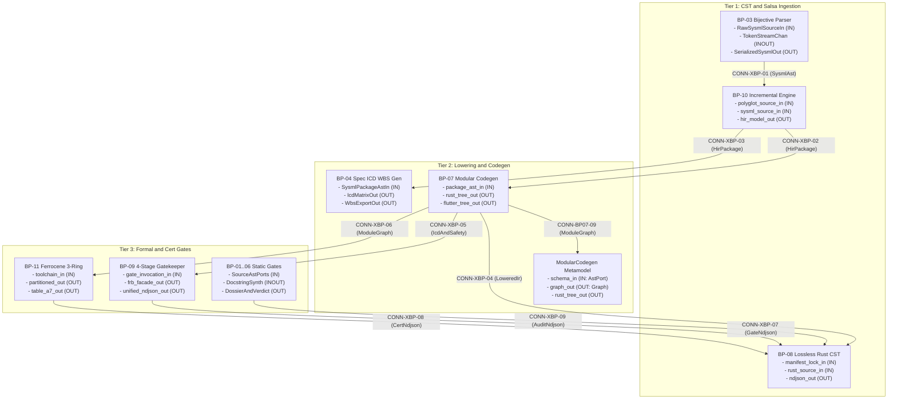

| Attribute | Specification Detail |
| :--- | :--- |
| **Issue ID** | #742 |
| **Title** | System Interface Matrix and Topological Connectivity |
| **Type** | icd |
| **Interface Level** | Level 1C Logical Interface |
| **Generation Mode** | subagent |
| **Specification Source** | `schema/model.sysml`, `schema/modular_codegen.sysml` |

# Level 1C: System Interface Matrix and Topological Connectivity

## 1. Executive Summary and 3-Layer Architectural Interface Scope

This Level 1C Logical Interface Specification defines the deterministic subsystem boundaries, directional ports, topological connection bindings, conveyed item flows, and fail-closed `DEAP-E*` rejection contracts across the self-hosting Model-Based Systems Engineering (MBSE) compiler toolchain (`BP-01` through `BP-11` and the `ModularCodegen` metamodel). Every port, connection, protocol envelope, and rejection guard derives strictly from the authoritative SysML v2 Abstract Syntax Tree (AST) in `schema/model.sysml` and `schema/modular_codegen.sysml` paired with the 4-dimension component hazard decomposition in `docs/research/FAILURE_MODE_REGISTRY.md`.

### 1.1 Mandatory 3-Layer Interface Realization Contract

Every logical interface across `BP-01..11` closes all three architectural realization layers without exception:

1. **Layer 1 -- Domain State and Data Model**: All port descriptors (`PortDef`, `PortDirection`), topological bindings (`ConnectionDef`, `ItemFlowDef`), lowered High-Level Intermediate Representation (`HirPackage`, `SourceMap`), and diagnostic envelopes are represented in `crates/deap-core/src/sysml_ast/mod.rs`, `crates/deap-core/src/sysml_ast/parts_and_ports.rs`, `crates/deap-core/src/sysml_ast/connections_and_flows.rs`, and `crates/deap-core/src/error.rs` using deterministic `BTreeMap` and `BTreeSet` collections and strongly-typed error enums (`DeapError` mapping `DEAP-E0701` through `DEAP-E1106`), enforcing `#![forbid(unsafe_code)]` across pure domain crates and prohibiting stringly-typed `Result<T, String>` signatures.
2. **Layer 2 -- Logic and State Management**: All port precondition guards, iterative Kahn topological DAG verifiers (`TopologicalLayerDagVerifier`), 4-level AST partitioners (`FourLevelAstPartitionerAndHoister`), `rowan` lossless Concrete Syntax Tree (CST) analyzers (`LosslessRustCstAnalyzer`, `LogosRowanSysmlCstEngine`), `salsa` early-cutoff query pipelines (`SalsaIncrementalCompilerDatabase`), 4-stage formal verification orchestrators (`MultiStageVerificationOrchestrator`), and 3-ring assurance partitioners (`ThreeRingAssurancePartitionCompiler`) execute as total pure functions obeying `<= 80` executable SLOC per function (`<= 50` in `BP-08` CST units), `<= 5` parameters excluding receiver, `MAX_AST_DEPTH = 64` structural depth bounds, checked `.get()` slice indexing, `checked_*` and `saturating_*` integer arithmetic, and span-paired `cfg(test)` / `test` attribute production metric exclusion.
3. **Layer 3 -- Presentation and CLI NDJSON Interface Binding**: All multi-file artifact emitters (`crates/compile-sysml/src/modular_codegen/mod.rs`, `crates/compile-sysml/src/flutter_codegen.rs`) commit exclusively through isolated temporary-directory staging and atomic rename (`PersistingAtomic` / `AtomicTreePersisted`) after post-render Stage-1 == Stage-2 SHA-256 parity verification (`DEAP-E0705`), while all five workspace CLI binaries (`compile-sysml`, `verify-baseline`, `ingest-sysml`, `assemble-conops`, `reconcile-backlog`) bind diagnostics through `UnifiedRustcJsonDiagnosticEmitter` (`crates/deap-core/src/diagnostics.rs`) emitting single-line `--message-format=json` NDJSON objects (`reason: "compiler-message"`, `0x0A`-free and `0x1B`-free, exact UTF-8 `byte_start`/`byte_end` `TextRange` spans, and reverse-byte-ordered `"MachineApplicable"` auto-fix transactions).

---

## 2. Subsystem Topological Connectivity Graph

---

## 3. Canonical N x N Logical Interface Matrices

### 3.1 Blueprint and Metamodel Subsystem Interface Matrix (12 x 12)

Transmitting subsystems occupy rows; receiving subsystems occupy columns. Diagonal cells denote internal intra-blueprint pipeline topology.

| Subsystem | 1. BP-01 | 2. BP-02 | 3. BP-03 | 4. BP-04 | 5. BP-05 | 6. BP-06 | 7. BP-07 | 8. ModularCodegen | 9. BP-08 | 10. BP-09 | 11. BP-10 | 12. BP-11 |
| :--- | :--- | :--- | :--- | :--- | :--- | :--- | :--- | :--- | :--- | :--- | :--- | :--- |
| **1. BP-01 Lint Forbid Gate** | **[ BP-01: 4 Links ]** | -- | -- | -- | -- | -- | -- | -- | CONN-XBP-09 (1 Flow) | CONN-XBP-10 (1 Flow) | -- | -- |
| **2. BP-02 Check-34 Purity** | -- | **[ BP-02: 4 Links ]** | -- | -- | -- | CONN-XBP-11 (1 Flow) | -- | -- | CONN-XBP-09 (1 Flow) | -- | -- | -- |
| **3. BP-03 Bijective SysML** | -- | -- | **[ BP-03: 4 Links ]** | CONN-XBP-12 (1 Flow) | -- | -- | -- | -- | -- | -- | CONN-XBP-01 (1 Flow) | -- |
| **4. BP-04 Spec ICD WBS** | -- | -- | -- | **[ BP-04: 4 Links ]** | -- | -- | -- | -- | CONN-XBP-09 (1 Flow) | CONN-XBP-13 (1 Flow) | CONN-XBP-14 (1 Flow) | -- |
| **5. BP-05 Safety Docstrings** | -- | -- | -- | -- | **[ BP-05: 4 Links ]** | -- | CONN-XBP-15 (1 Flow) | -- | -- | -- | -- | CONN-XBP-16 (1 Flow) |
| **6. BP-06 5-Pillar Auditor** | -- | -- | -- | -- | -- | **[ BP-06: 4 Links ]** | -- | -- | CONN-XBP-09 (1 Flow) | -- | -- | -- |
| **7. BP-07 Self-Host Codegen** | -- | -- | -- | -- | -- | -- | **[ BP-07: 8 Links ]** | CONN-BP07-09 (1 Flow) | CONN-XBP-04 (2 Flows) | CONN-XBP-05 (2 Flows) | -- | CONN-XBP-06 (2 Flows) |
| **8. ModularCodegen Schema** | -- | -- | -- | -- | -- | -- | CONN-BP07-12 (2 Flows) | **[ MCG: 3 Links ]** | CONN-XBP-04 (1 Flow) | -- | -- | -- |
| **9. BP-08 Rust CST & NDJSON** | -- | -- | -- | -- | -- | -- | CONN-XBP-17 (1 Flow) | -- | **[ BP-08: 7 Links ]** | CONN-XBP-18 (1 Flow) | -- | CONN-XBP-19 (1 Flow) |
| **10. BP-09 4-Stage Formal** | -- | -- | -- | -- | -- | -- | -- | -- | CONN-XBP-07 (5 Flows) | **[ BP-09: 8 Links ]** | -- | CONN-XBP-20 (2 Flows) |
| **11. BP-10 Rowan Salsa Inc** | -- | -- | -- | CONN-XBP-03 (1 Flow) | -- | -- | CONN-XBP-02 (1 Flow) | -- | CONN-XBP-21 (4 Flows) | CONN-XBP-22 (2 Flows) | **[ BP-10: 6 Links ]** | CONN-XBP-23 (1 Flow) |
| **12. BP-11 Ferrocene 3-Ring** | -- | -- | -- | -- | -- | -- | -- | -- | CONN-XBP-08 (4 Flows) | -- | -- | **[ BP-11: 6 Links ]** |

### 3.2 BP-07..11 and ModularCodegen Component-Level N x N Interface Matrix (28 x 28)

All 28 `BP-07`, `BP-08`, `BP-09`, `BP-10`, `BP-11`, and `ModularCodegen` components (`C01`..`C28`) are indexed below so every off-diagonal cell captures exact point-to-point `CONN-*` bindings:

- `C01`: `ModularityBoundsSpec` (`ModularCodegen::domain`)
- `C02`: `LayerHierarchySpec` (`ModularCodegen::domain`)
- `C03`: `CompilationUnitSpec` (`ModularCodegen::domain`)
- `C04`: `FourLevelLoweringEngineSpec` (`ModularCodegen::lowering`)
- `C05`: `ModularEmitterSuiteSpec` (`ModularCodegen::emitters`)
- `C06`: `SelfHostingModularCodegenCompiler` (`BP-07`)
- `C07`: `TopologicalLayerDagVerifier` (`BP-07`)
- `C08`: `FourLevelAstPartitionerAndHoister` (`BP-07`)
- `C09`: `ModularRustMultiFileEmitter` (`BP-07`)
- `C10`: `ModularFlutterMultiFileEmitter` (`BP-07`)
- `C11`: `AirGappedCargoLockGovernor` (`BP-08`)
- `C12`: `LosslessRustCstAnalyzer` (`BP-08`)
- `C13`: `ZeroTokenRustSpanCodemodEngine` (`BP-08`)
- `C14`: `StructuredModularCodegenSynthesizer` (`BP-08`)
- `C15`: `UnifiedRustcJsonDiagnosticEmitter` (`BP-08`)
- `C16`: `MultiStageVerificationOrchestrator` (`BP-09`)
- `C17`: `StableClippyTotalFunctionGate` (`BP-09`)
- `C18`: `IsolatedDylintMirAllocationGate` (`BP-09`)
- `C19`: `FrbIcdBridgeAndMiriUbGate` (`BP-09`)
- `C20`: `KaniCbmcProofSynthesizer` (`BP-09`)
- `C21`: `TypedPolyglotIngestionFrontend` (`BP-10`)
- `C22`: `LogosRowanSysmlCstEngine` (`BP-10`)
- `C23`: `SalsaIncrementalCompilerDatabase` (`BP-10`)
- `C24`: `FormattingPreservingSyncSplicer` (`BP-10`)
- `C25`: `DualModeFerroceneToolchainGate` (`BP-11`)
- `C26`: `ThreeRingAssurancePartitionCompiler` (`BP-11`)
- `C27`: `FlsParagraphTraceabilitySynthesizer` (`BP-11`)
- `C28`: `CertifiedCoreSubsetAndCoverageGate` (`BP-11`)

| Src \ Dst | C01 | C02 | C03 | C04 | C05 | C06 | C07 | C08 | C09 | C10 | C11 | C12 | C13 | C14 | C15 | C16 | C17 | C18 | C19 | C20 | C21 | C22 | C23 | C24 | C25 | C26 | C27 | C28 |
| :--- | :--- | :--- | :--- | :--- | :--- | :--- | :--- | :--- | :--- | :--- | :--- | :--- | :--- | :--- | :--- | :--- | :--- | :--- | :--- | :--- | :--- | :--- | :--- | :--- | :--- | :--- | :--- | :--- |
| **C01** | **[C01]** | - | CONN-MCG-01 | CONN-MCG-02 | - | - | - | - | - | - | - | - | - | - | - | - | - | - | - | - | - | - | - | - | - | - | - | - |
| **C02** | - | **[C02]** | CONN-MCG-03 | CONN-MCG-04 | - | - | - | - | - | - | - | - | - | - | - | - | - | - | - | - | - | - | - | - | - | - | - | - |
| **C03** | - | - | **[C03]** | CONN-MCG-05 | - | - | - | - | - | - | - | - | - | - | - | - | - | - | - | - | - | - | - | - | - | - | - | - |
| **C04** | - | - | - | **[C04]** | CONN-BP07-10 | - | - | - | - | - | - | - | - | CONN-XBP-04 | - | - | - | - | - | - | - | - | - | - | - | - | - | - |
| **C05** | - | - | - | - | **[C05]** | CONN-BP07-12 | - | - | - | - | - | - | - | - | - | - | - | - | - | - | - | - | - | - | - | - | - | - |
| **C06** | - | - | - | CONN-BP07-09 | - | **[C06]** | CONN-BP07-01 | CONN-BP07-03 | CONN-BP07-05 | CONN-BP07-07 | - | - | - | - | CONN-XBP-04B | - | - | - | - | - | - | - | - | - | CONN-XBP-06B | - | - | - |
| **C07** | - | - | - | - | - | CONN-BP07-02 | **[C07]** | - | - | - | - | - | - | - | - | - | - | - | - | - | - | - | - | - | - | - | - | - |
| **C08** | - | - | - | - | - | CONN-BP07-04 | - | **[C08]** | - | - | - | - | - | CONN-XBP-04 | - | - | - | - | CONN-XBP-05 | - | - | - | - | - | - | - | CONN-XBP-06 | - |
| **C09** | - | - | - | - | - | CONN-BP07-06 | - | - | **[C09]** | - | - | - | - | - | - | - | - | - | - | - | - | - | - | - | - | - | - | - |
| **C10** | - | - | - | - | - | CONN-BP07-08 | - | - | - | **[C10]** | - | - | - | - | - | - | - | - | - | - | - | - | - | - | - | - | - | - |
| **C11** | - | - | - | - | - | - | - | - | - | - | **[C11]** | CONN-BP08-01 | - | - | CONN-BP08-07 | CONN-XBP-18 | - | - | - | - | - | - | - | - | CONN-XBP-19 | - | - | - |
| **C12** | - | - | - | - | - | - | - | - | - | - | CONN-BP08-02 | **[C12]** | CONN-BP08-03 | - | CONN-BP08-04 | - | - | - | - | - | - | - | - | - | - | - | - | - |
| **C13** | - | - | - | - | - | - | - | - | - | - | - | CONN-BP08-03B | **[C13]** | - | CONN-BP08-05 | - | - | - | - | - | - | - | - | - | - | - | - | - |
| **C14** | - | - | - | - | - | - | - | - | CONN-XBP-17 | - | - | - | - | **[C14]** | CONN-BP08-06 | - | - | - | - | - | - | - | - | - | - | - | - | - |
| **C15** | - | - | - | - | - | - | - | - | - | - | - | CONN-BP08-04B | CONN-BP08-05B | - | **[C15]** | - | - | - | - | - | - | - | - | - | - | - | - | - |
| **C16** | - | - | - | - | - | - | - | - | - | - | - | - | - | - | CONN-XBP-07 | **[C16]** | CONN-BP09-01 | CONN-BP09-03 | CONN-BP09-05 | CONN-BP09-07 | - | - | - | - | - | - | - | - |
| **C17** | - | - | - | - | - | - | - | - | - | - | - | - | - | - | CONN-XBP-07B | CONN-BP09-02 | **[C17]** | - | - | - | - | - | - | - | - | - | - | - |
| **C18** | - | - | - | - | - | - | - | - | - | - | - | - | - | - | CONN-XBP-07C | CONN-BP09-04 | - | **[C18]** | - | - | - | - | - | - | - | - | - | CONN-XBP-20 |
| **C19** | - | - | - | - | - | - | - | - | - | - | - | - | - | - | CONN-XBP-07D | CONN-BP09-06 | - | - | **[C19]** | - | - | - | - | - | - | CONN-XBP-20B | - | - |
| **C20** | - | - | - | - | - | - | - | - | - | - | - | - | - | - | CONN-XBP-07E | CONN-BP09-08 | - | - | - | **[C20]** | - | - | - | - | - | - | - | - |
| **C21** | - | - | - | - | - | - | - | - | - | - | - | - | - | - | CONN-XBP-21A | - | - | - | - | - | **[C21]** | - | CONN-BP10-01 | - | - | - | - | - |
| **C22** | - | - | - | - | - | - | - | - | - | - | - | - | - | - | CONN-XBP-21B | - | - | - | - | - | - | **[C22]** | CONN-BP10-03 | CONN-BP10-06 | - | - | - | - |
| **C23** | - | - | - | - | - | CONN-XBP-02 | - | - | - | - | - | - | - | - | CONN-XBP-21C | - | - | - | CONN-XBP-22A | CONN-XBP-22B | CONN-BP10-01B | CONN-BP10-02 | **[C23]** | CONN-BP10-04 | - | CONN-XBP-23 | - | - |
| **C24** | - | - | - | - | - | - | - | - | - | - | - | - | - | - | CONN-XBP-21D | - | - | - | - | - | - | CONN-BP10-05 | CONN-BP10-04B | **[C24]** | - | - | - | - |
| **C25** | - | - | - | - | - | - | - | - | - | - | - | - | - | - | CONN-XBP-08A | - | - | - | - | - | - | - | - | - | **[C25]** | CONN-BP11-01 | - | - |
| **C26** | - | - | - | - | - | - | - | - | - | - | - | - | - | - | CONN-XBP-08B | - | - | - | - | - | - | - | - | - | CONN-BP11-02 | **[C26]** | CONN-BP11-03 | - |
| **C27** | - | - | - | - | - | - | - | - | - | - | - | - | - | - | CONN-XBP-08C | - | - | - | - | - | - | - | - | - | - | CONN-BP11-04 | **[C27]** | CONN-BP11-05 |
| **C28** | - | - | - | - | - | - | - | - | - | - | - | - | - | - | CONN-XBP-08D | - | - | - | - | - | - | - | - | - | - | - | CONN-BP11-06 | **[C28]** |

*Structural Part-Reference Bindings (`ModularCodegen`)*: `bounds_ref` binds `ModularityBoundsSpec` (`C01`) into `FourLevelLoweringEngineSpec` (`C04`) via `CONN-MCG-02`; `layer_ref` binds `LayerHierarchySpec` (`C02`) into `FourLevelLoweringEngineSpec` (`C04`) via `CONN-MCG-04`; `engine_ref` binds `FourLevelLoweringEngineSpec` (`C04`) into `ModularEmitterSuiteSpec` (`C05`) via `CONN-BP07-10`.

### 3.3 Preserved BP-01..06 Intra-Blueprint Component Topology Summary

All 30 `BP-01..06` components preserve their canonical hub-and-worker logical topologies:

| Blueprint | Hub Component (`part def`) | Connected Worker Components (`part def`) | Preserved Connection IDs |
| :--- | :--- | :--- | :--- |
| **BP-01** | `CompilerLintEnforcementGate` | `WorkspaceManifestForbidGate`, `CrateRootAttributeSanitizer`, `ClippyAttributeAstScanner`, `TestTargetLintEnforcer` | `CONN-BP01-01` .. `CONN-BP01-04` |
| **BP-02** | `Check34AstPurityAndAntiGamingGate` | `UnifiedRustDartLexicalScanner`, `RangeSliceAstDetector`, `FailClosedIoAstVerifier`, `AntiGamingTestBodyAuditor` | `CONN-BP02-01` .. `CONN-BP02-04` |
| **BP-03** | `SysmlBijectiveRoundtripCompilerGate` | `NativeSigilAndLifetimeLexer`, `FailClosedRecursiveDescentParser`, `BijectiveSysmlSerializer`, `CompilerRoundtripVerificationGate` | `CONN-BP03-01` .. `CONN-BP03-04` |
| **BP-04** | `DeterministicSpecIcdWbsForwardCompiler` | `AgileSpecForwardProjector`, `LogicalIcdMatrixCompiler`, `MilStd881eWbsExporter`, `BidirectionalBacklogReconciler` | `CONN-BP04-01` .. `CONN-BP04-04` |
| **BP-05** | `UnifiedSafetyDocstringSynthesizer` | `ScopedSchemaContextResolver`, `SsotSymbolDeduplicationGate`, `SevenSectionDocstringGenerator`, `Check36AstCompletenessVerifier` | `CONN-BP05-01` .. `CONN-BP05-04` |
| **BP-06** | `DeterministicStaticDefectAuditor` | `FivePillarStaticAstAnalyzer`, `DeterministicDossierSynthesizer`, `MermaidUmlDiagramGenerator`, `ClosedLoopDefectPublisherGate` | `CONN-BP06-01` .. `CONN-BP06-04` |

---
## 4. Complete Logical Port Definition Roster

### 4.1 Preserved BP-01..06 Logical Port Definitions

| Port ID | Blueprint | Component (`part def`) | Hierarchical Port Endpoint | Direction | Port Type | Multiplicity | Protocol / Payload Type |
| :--- | :--- | :--- | :--- | :--- | :--- | :--- | :--- |
| `PORT-BP01-CLEG-MANIFEST_IN` | `BP-01` | `CompilerLintEnforcementGate` | `CompilerLintEnforcementGate.CargoManifestInputPort` | `IN` | `DataPort` | `1` | `CargoManifestAstPayload` (`String`) |
| `PORT-BP01-CLEG-TOKENS_IN` | `BP-01` | `CompilerLintEnforcementGate` | `CompilerLintEnforcementGate.RustSourceTokenStreamPort` | `IN` | `DataPort` | `1` | `RustSourceTokenStream` (`String`) |
| `PORT-BP01-CLEG-VERDICT_OUT` | `BP-01` | `CompilerLintEnforcementGate` | `CompilerLintEnforcementGate.BaselineGateVerdictPort` | `OUT` | `TelemetryPort` | `1` | `BaselineGateVerdict` (`Boolean`) |
| `PORT-BP01-CLEG-DIAG_OUT` | `BP-01` | `CompilerLintEnforcementGate` | `CompilerLintEnforcementGate.CompilerDiagnosticOutputPort` | `OUT` | `EventPort` | `1` | `CompilerLintDiagnosticStream` (`String`) |
| `PORT-BP01-WMFG-CMD_IN` | `BP-01` | `WorkspaceManifestForbidGate` | `WorkspaceManifestForbidGate.cmd_in` | `IN` | `CommandPort` | `1` | `ManifestLintAuditCommand` (`String`) |
| `PORT-BP01-WMFG-STATUS_OUT` | `BP-01` | `WorkspaceManifestForbidGate` | `WorkspaceManifestForbidGate.status_out` | `OUT` | `TelemetryPort` | `1` | `ManifestForbidVerdict` (`String`) |
| `PORT-BP01-CRAS-CMD_IN` | `BP-01` | `CrateRootAttributeSanitizer` | `CrateRootAttributeSanitizer.cmd_in` | `IN` | `CommandPort` | `1` | `CrateRootAuditCommand` (`String`) |
| `PORT-BP01-CRAS-STATUS_OUT` | `BP-01` | `CrateRootAttributeSanitizer` | `CrateRootAttributeSanitizer.status_out` | `OUT` | `TelemetryPort` | `1` | `CrateRootSanitizerVerdict` (`String`) |
| `PORT-BP01-CAAS-CMD_IN` | `BP-01` | `ClippyAttributeAstScanner` | `ClippyAttributeAstScanner.cmd_in` | `IN` | `CommandPort` | `1` | `SuppressionScanCommand` (`String`) |
| `PORT-BP01-CAAS-STATUS_OUT` | `BP-01` | `ClippyAttributeAstScanner` | `ClippyAttributeAstScanner.status_out` | `OUT` | `TelemetryPort` | `1` | `ZeroSuppressionVerdict` (`String`) |
| `PORT-BP01-TTLE-CMD_IN` | `BP-01` | `TestTargetLintEnforcer` | `TestTargetLintEnforcer.cmd_in` | `IN` | `CommandPort` | `1` | `TestTargetLintCommand` (`String`) |
| `PORT-BP01-TTLE-STATUS_OUT` | `BP-01` | `TestTargetLintEnforcer` | `TestTargetLintEnforcer.status_out` | `OUT` | `TelemetryPort` | `1` | `TestTargetLintVerdict` (`String`) |
| `PORT-BP02-C34-SRC_AST_IN` | `BP-02` | `Check34AstPurityAndAntiGamingGate` | `Check34AstPurityAndAntiGamingGate.WorkspaceSourceAstPort` | `IN` | `DataPort` | `1` | `WorkspaceSourceAstStream` (`String`) |
| `PORT-BP02-C34-TEST_AST_IN` | `BP-02` | `Check34AstPurityAndAntiGamingGate` | `Check34AstPurityAndAntiGamingGate.TestFunctionAstStreamPort` | `IN` | `DataPort` | `1` | `TestFunctionAstStream` (`String`) |
| `PORT-BP02-C34-STATUS_OUT` | `BP-02` | `Check34AstPurityAndAntiGamingGate` | `Check34AstPurityAndAntiGamingGate.Check34GateStatusPort` | `OUT` | `TelemetryPort` | `1` | `Check34ExitStatusCode` (`Integer`) |
| `PORT-BP02-C34-DIAG_OUT` | `BP-02` | `Check34AstPurityAndAntiGamingGate` | `Check34AstPurityAndAntiGamingGate.PurityViolationDiagnosticPort` | `OUT` | `EventPort` | `1` | `PurityViolationStream` (`String`) |
| `PORT-BP03-SBR-RAW_IN` | `BP-03` | `SysmlBijectiveRoundtripCompilerGate` | `SysmlBijectiveRoundtripCompilerGate.RawSysmlSourceInputPort` | `IN` | `DataPort` | `1` | `RawSysmlUtf8Buffer` (`String`) |
| `PORT-BP03-SBR-TOKEN_INOUT` | `BP-03` | `SysmlBijectiveRoundtripCompilerGate` | `SysmlBijectiveRoundtripCompilerGate.TokenStreamChannelPort` | `INOUT` | `DataPort` | `1` | `BijectiveTokenStream` (`String`) |
| `PORT-BP03-SBR-SYSML_OUT` | `BP-03` | `SysmlBijectiveRoundtripCompilerGate` | `SysmlBijectiveRoundtripCompilerGate.SerializedSysmlOutputPort` | `OUT` | `DataPort` | `1` | `CanonicalSerializedSysml` (`String`) |
| `PORT-BP03-SBR-DIFF_OUT` | `BP-03` | `SysmlBijectiveRoundtripCompilerGate` | `SysmlBijectiveRoundtripCompilerGate.BijectiveDiffDiagnosticPort` | `OUT` | `EventPort` | `1` | `BijectiveDiffDiagnostics` (`String`) |
| `PORT-BP04-FWD-AST_IN` | `BP-04` | `DeterministicSpecIcdWbsForwardCompiler` | `DeterministicSpecIcdWbsForwardCompiler.SysmlPackageAstInputPort` | `IN` | `DataPort` | `1` | `SysmlPackageAstBundle` (`String`) |
| `PORT-BP04-FWD-SPEC_OUT` | `BP-04` | `DeterministicSpecIcdWbsForwardCompiler` | `DeterministicSpecIcdWbsForwardCompiler.MarkdownSpecSuiteOutputPort` | `OUT` | `DataPort` | `1` | `AgileMarkdownSpecSuite` (`String`) |
| `PORT-BP04-FWD-ICD_OUT` | `BP-04` | `DeterministicSpecIcdWbsForwardCompiler` | `DeterministicSpecIcdWbsForwardCompiler.IcdMatrixArtifactPort` | `OUT` | `DataPort` | `1` | `Level1cIcdArtifacts` (`String`) |
| `PORT-BP04-FWD-WBS_OUT` | `BP-04` | `DeterministicSpecIcdWbsForwardCompiler` | `DeterministicSpecIcdWbsForwardCompiler.WbsEnterpriseExportPort` | `OUT` | `DataPort` | `1` | `MilStd881eWbsExports` (`String`) |
| `PORT-BP04-ASFP-AST_IN` | `BP-04` | `AgileSpecForwardProjector` | `AgileSpecForwardProjector.packageAstInPort` | `IN` | `DataPort` | `1` | `PackageAstProjectionInput` (`String`) |
| `PORT-BP04-ASFP-MD_OUT` | `BP-04` | `AgileSpecForwardProjector` | `AgileSpecForwardProjector.specMarkdownOutPort` | `OUT` | `DataPort` | `1` | `ProjectedAgileMarkdown` (`String`) |
| `PORT-BP04-LIMC-AST_IN` | `BP-04` | `LogicalIcdMatrixCompiler` | `LogicalIcdMatrixCompiler.interconnectAstInPort` | `IN` | `DataPort` | `1` | `PortAndFlowInterconnectAst` (`String`) |
| `PORT-BP04-LIMC-ICD_OUT` | `BP-04` | `LogicalIcdMatrixCompiler` | `LogicalIcdMatrixCompiler.icdMarkdownOutPort` | `OUT` | `DataPort` | `1` | `SynthesizedIcdTables` (`String`) |
| `PORT-BP04-WBS-META_IN` | `BP-04` | `MilStd881eWbsExporter` | `MilStd881eWbsExporter.wbsAstMetadataInPort` | `IN` | `DataPort` | `1` | `WbsDecompositionAst` (`String`) |
| `PORT-BP04-WBS-ART_OUT` | `BP-04` | `MilStd881eWbsExporter` | `MilStd881eWbsExporter.wbsArtifactsOutPort` | `OUT` | `DataPort` | `1` | `WbsCsvAndJsonAstSuite` (`String`) |
| `PORT-BP04-BBR-DOCS_INOUT` | `BP-04` | `BidirectionalBacklogReconciler` | `BidirectionalBacklogReconciler.specDocsInOutPort` | `INOUT` | `DataPort` | `1` | `BacklogMarkdownAndTrackerSync` (`String`) |
| `PORT-BP04-BBR-SYNC_OUT` | `BP-04` | `BidirectionalBacklogReconciler` | `BidirectionalBacklogReconciler.subpackageSyncOutPort` | `OUT` | `DataPort` | `1` | `ReconciledSubpackageAstDelta` (`String`) |
| `PORT-BP06-DSDA-AST_IN` | `BP-06` | `DeterministicStaticDefectAuditor` | `DeterministicStaticDefectAuditor.TargetSourceAstInputPort` | `IN` | `DataPort` | `1` | `TargetCrateSourceAst` (`String`) |
| `PORT-BP06-DSDA-SSOT_IN` | `BP-06` | `DeterministicStaticDefectAuditor` | `DeterministicStaticDefectAuditor.GitHubIssueSsotQueryPort` | `IN` | `DataPort` | `1` | `TrackerIssueInventory` (`String`) |
| `PORT-BP06-DSDA-DOSSIER_OUT` | `BP-06` | `DeterministicStaticDefectAuditor` | `DeterministicStaticDefectAuditor.DefectDossierArtifactPort` | `OUT` | `DataPort` | `1` | `SevenSectionDefectDossier` (`String`) |
| `PORT-BP06-DSDA-PUB_OUT` | `BP-06` | `DeterministicStaticDefectAuditor` | `DeterministicStaticDefectAuditor.ClosedLoopTrackerPublishPort` | `OUT` | `EventPort` | `1` | `ClosedLoopPublishReceipt` (`String`) |
| `PORT-BP06-FPSA-AST_IN` | `BP-06` | `FivePillarStaticAstAnalyzer` | `FivePillarStaticAstAnalyzer.astStreamInPort` | `IN` | `DataPort` | `1` | `RustSourceAstStream` (`String`) |
| `PORT-BP06-FPSA-FIND_OUT` | `BP-06` | `FivePillarStaticAstAnalyzer` | `FivePillarStaticAstAnalyzer.findingStreamOutPort` | `OUT` | `EventPort` | `1` | `FivePillarViolationFindings` (`String`) |
| `PORT-BP06-DDS-FIND_IN` | `BP-06` | `DeterministicDossierSynthesizer` | `DeterministicDossierSynthesizer.findingInPort` | `IN` | `DataPort` | `1` | `VerifiedDefectFinding` (`String`) |
| `PORT-BP06-DDS-MD_OUT` | `BP-06` | `DeterministicDossierSynthesizer` | `DeterministicDossierSynthesizer.dossierMarkdownOutPort` | `OUT` | `DataPort` | `1` | `DossierMarkdownPayload` (`String`) |
| `PORT-BP06-MUDG-SPEC_IN` | `BP-06` | `MermaidUmlDiagramGenerator` | `MermaidUmlDiagramGenerator.umlSpecInPort` | `IN` | `DataPort` | `1` | `UmlInteractionAndStateSpec` (`String`) |
| `PORT-BP06-MUDG-MMD_OUT` | `BP-06` | `MermaidUmlDiagramGenerator` | `MermaidUmlDiagramGenerator.mermaidBlockOutPort` | `OUT` | `DataPort` | `1` | `ValidatedMermaidCodeBlock` (`String`) |
| `PORT-BP06-CLDP-CAND_IN` | `BP-06` | `ClosedLoopDefectPublisherGate` | `ClosedLoopDefectPublisherGate.dossierCandidateInPort` | `IN` | `DataPort` | `1` | `CandidateDefectDossier` (`String`) |
| `PORT-BP06-CLDP-RCPT_OUT` | `BP-06` | `ClosedLoopDefectPublisherGate` | `ClosedLoopDefectPublisherGate.verifiedReceiptOutPort` | `OUT` | `TelemetryPort` | `1` | `VerifiedTrackerIssueReceipt` (`String`) |

### 4.2 BP-07..11 and ModularCodegen Logical Port Definitions

| Port ID | Blueprint / Package | Component (`part def`) | Hierarchical Port Endpoint | Direction | Port Type | Multiplicity | Protocol / Conveyed Flow Payload | Fail-Closed Rejection Contract (`DEAP-E*` / `FM-*`) |
| :--- | :--- | :--- | :--- | :--- | :--- | :--- | :--- | :--- |
| `PORT-MCG-FLLE-SCHEMA_IN` | `ModularCodegen::lowering` | `FourLevelLoweringEngineSpec` | `FourLevelLoweringEngineSpec.schema_in` | `IN` | `DataPort` | `1` | `SchemaPackageAstPort` (`protocol_family = "SysmlPackageAst"`, `package_ast_stream : String`) | `DEAP-E0701`, `DEAP-E0702`, `DEAP-E0703` (`FM-BP07-013`, `FM-BP07-014`) |
| `PORT-MCG-FLLE-GRAPH_OUT` | `ModularCodegen::lowering` | `FourLevelLoweringEngineSpec` | `FourLevelLoweringEngineSpec.graph_out` | `OUT` | `DataPort` | `1` | `VerifiedModuleGraphPort` (`protocol_family = "VerifiedModuleGraph"`, `module_graph_stream : String`) | `DEAP-E0704`, `DEAP-E0705` (`FM-BP07-015`, `FM-BP07-016`) |
| `PORT-MCG-MES-RUST_OUT` | `ModularCodegen::emitters` | `ModularEmitterSuiteSpec` | `ModularEmitterSuiteSpec.rust_tree_out` | `OUT` | `DataPort` | `1` | `ModularRustEmitPort` (`protocol_family = "AtomicRustTree"`, `rust_manifest_sha256 : String`) | `DEAP-E0701`, `DEAP-E0704`, `DEAP-E0705` (`FM-BP07-017`..`FM-BP07-020`) |
| `PORT-MCG-MES-FLUTTER_OUT` | `ModularCodegen::emitters` | `ModularEmitterSuiteSpec` | `ModularEmitterSuiteSpec.flutter_tree_out` | `OUT` | `DataPort` | `1` | `ModularFlutterEmitPort` (`protocol_family = "AtomicDartTree"`, `dart_manifest_sha256 : String`) | `DEAP-E0701`, `DEAP-E0704`, `DEAP-E0705` (`FM-BP07-017`..`FM-BP07-020`) |
| `PORT-BP07-SHMC-PKG_AST_IN` | `BP-07` (`REQ-0607`) | `SelfHostingModularCodegenCompiler` | `SelfHostingModularCodegenCompiler.package_ast_in` | `IN` | `DataPort` | `1` | `SysmlV2PackageAst` (`package_ast_in_flow : String`) | `DEAP-E0701`, `DEAP-E0702` (`FM-BP07-033`, `FM-BP07-034`) |
| `PORT-BP07-SHMC-RUST_OUT` | `BP-07` (`REQ-0607`) | `SelfHostingModularCodegenCompiler` | `SelfHostingModularCodegenCompiler.rust_tree_out` | `OUT` | `DataPort` | `1` | `AtomicRustModuleTree` (`rust_tree_out_flow : String`) | `DEAP-E0704`, `DEAP-E0705` (`FM-BP07-035`, `FM-BP07-036`) |
| `PORT-BP07-SHMC-FLUTTER_OUT` | `BP-07` (`REQ-0607`) | `SelfHostingModularCodegenCompiler` | `SelfHostingModularCodegenCompiler.flutter_tree_out` | `OUT` | `DataPort` | `1` | `AtomicDartModuleTree` (`flutter_tree_out_flow : String`) | `DEAP-E0704`, `DEAP-E0705` (`FM-BP07-035`, `FM-BP07-036`) |
| `PORT-BP07-SHMC-DIAG_OUT` | `BP-07` (`REQ-0607`) | `SelfHostingModularCodegenCompiler` | `SelfHostingModularCodegenCompiler.diagnostic_out` | `OUT` | `EventPort` | `1` | `CompilerDiagnosticStream` (`diagnostic_out_flow : String`) | `DEAP-E0701`..`DEAP-E0705` (`FM-BP07-033`..`FM-BP07-036`) |
| `PORT-BP07-TLDV-EDGES_IN` | `BP-07` (`REQ-0607`) | `TopologicalLayerDagVerifier` | `TopologicalLayerDagVerifier.dependency_edges_in` | `IN` | `DataPort` | `1` | `ModuleDependencyGraph` (`dependency_edges_in_flow : String`) | `DEAP-E0701`, `DEAP-E0702`, `DEAP-E0703` (`FM-BP07-037`, `FM-BP07-038`) |
| `PORT-BP07-TLDV-ORDER_OUT` | `BP-07` (`REQ-0607`) | `TopologicalLayerDagVerifier` | `TopologicalLayerDagVerifier.topological_order_out` | `OUT` | `DataPort` | `1` | `ValidatedDagOrder` (`topological_order_out_flow : String`) | `DEAP-E0702`, `DEAP-E0703`, `DEAP-E0704` (`FM-BP07-039`, `FM-BP07-040`) |
| `PORT-BP07-FLAP-AST_IN` | `BP-07` (`REQ-0607`) | `FourLevelAstPartitionerAndHoister` | `FourLevelAstPartitionerAndHoister.validated_ast_in` | `IN` | `DataPort` | `1` | `ValidatedPackageAst` (`validated_ast_in_flow : String`) | `DEAP-E0701`, `DEAP-E0702` (`FM-BP07-021`, `FM-BP07-022`) |
| `PORT-BP07-FLAP-GRAPH_OUT` | `BP-07` (`REQ-0607`) | `FourLevelAstPartitionerAndHoister` | `FourLevelAstPartitionerAndHoister.module_graph_out` | `OUT` | `DataPort` | `1` | `LoweredModuleGraph` (`module_graph_out_flow : String`) | `DEAP-E0704`, `DEAP-E0705` (`FM-BP07-023`, `FM-BP07-024`) |
| `PORT-BP07-MRME-GRAPH_IN` | `BP-07` (`REQ-0607`) | `ModularRustMultiFileEmitter` | `ModularRustMultiFileEmitter.rust_module_graph_in` | `IN` | `DataPort` | `1` | `LoweredModuleGraph` (`rust_module_graph_in_flow : String`) | `DEAP-E0701`, `DEAP-E0705` (`FM-BP07-029`, `FM-BP07-030`) |
| `PORT-BP07-MRME-MANIFEST_OUT` | `BP-07` (`REQ-0607`) | `ModularRustMultiFileEmitter` | `ModularRustMultiFileEmitter.rust_manifest_out` | `OUT` | `TelemetryPort` | `1` | `GeneratedTreeManifest` (`rust_manifest_out_flow : String`) | `DEAP-E0704`, `DEAP-E0705` (`FM-BP07-031`, `FM-BP07-032`) |
| `PORT-BP07-MFME-GRAPH_IN` | `BP-07` (`REQ-0607`) | `ModularFlutterMultiFileEmitter` | `ModularFlutterMultiFileEmitter.flutter_module_graph_in` | `IN` | `DataPort` | `1` | `LoweredModuleGraph` (`flutter_module_graph_in_flow : String`) | `DEAP-E0701`, `DEAP-E0702` (`FM-BP07-025`, `FM-BP07-026`) |
| `PORT-BP07-MFME-MANIFEST_OUT` | `BP-07` (`REQ-0607`) | `ModularFlutterMultiFileEmitter` | `ModularFlutterMultiFileEmitter.flutter_manifest_out` | `OUT` | `TelemetryPort` | `1` | `FlutterContractReport` (`flutter_manifest_out_flow : String`) | `DEAP-E0704`, `DEAP-E0705` (`FM-BP07-027`, `FM-BP07-028`) |
| `PORT-BP08-AGCL-LOCK_IN` | `BP-08` (`REQ-0608`) | `AirGappedCargoLockGovernor` | `AirGappedCargoLockGovernor.manifest_lock_in` | `IN` | `DataPort` | `1` | `CargoTomlAndLockfile` (`manifest_lock_in_flow : String`) | `DEAP-E0804` (`FM-BP08-001`..`FM-BP08-003`) |
| `PORT-BP08-AGCL-RCPT_OUT` | `BP-08` (`REQ-0608`) | `AirGappedCargoLockGovernor` | `AirGappedCargoLockGovernor.lock_receipt_out` | `OUT` | `TelemetryPort` | `1` | `SupplyChainVerificationReceipt` (`lock_receipt_out_flow : String`) | `DEAP-E0804` (`FM-BP08-004`) |
| `PORT-BP08-LRCA-SRC_IN` | `BP-08` (`REQ-0608`) | `LosslessRustCstAnalyzer` | `LosslessRustCstAnalyzer.rust_source_in` | `IN` | `DataPort` | `1` | `Utf8RustSourceBuffer` (`rust_source_in_flow : String`) | `DEAP-E0803`, `DEAP-E0804` (`FM-BP08-005`, `FM-BP08-007`) |
| `PORT-BP08-LRCA-INV_OUT` | `BP-08` (`REQ-0608`) | `LosslessRustCstAnalyzer` | `LosslessRustCstAnalyzer.item_inventory_out` | `OUT` | `DataPort` | `1` | `BTreeOrderedItemInventory` (`item_inventory_out_flow : String`) | `DEAP-E0801`, `DEAP-E0802` (`FM-BP08-006`, `FM-BP08-008`) |
| `PORT-BP08-LRCA-METRICS_OUT` | `BP-08` (`REQ-0608`) | `LosslessRustCstAnalyzer` | `LosslessRustCstAnalyzer.metrics_report_out` | `OUT` | `TelemetryPort` | `1` | `DeapV2AstMetricsReport` (`metrics_report_out_flow : String`) | `DEAP-E0801`, `DEAP-E0802` (`FM-BP08-006`, `FM-BP08-008`) |
| `PORT-BP08-SMCS-IR_IN` | `BP-08` (`REQ-0608`) | `StructuredModularCodegenSynthesizer` | `StructuredModularCodegenSynthesizer.lowered_ir_in` | `IN` | `DataPort` | `1` | `LoweredModuleGraphIr` (`lowered_ir_in_flow : String`) | `DEAP-E0803`, `DEAP-E0804` (`FM-BP08-009`, `FM-BP08-011`) |
| `PORT-BP08-SMCS-RUST_OUT` | `BP-08` (`REQ-0608`) | `StructuredModularCodegenSynthesizer` | `StructuredModularCodegenSynthesizer.formatted_rust_out` | `OUT` | `DataPort` | `1` | `PrettypleaseRustUnit` (`formatted_rust_out_flow : String`) | `DEAP-E0705` (`FM-BP08-010`, `FM-BP08-012`) |
| `PORT-BP08-URJD-FIND_IN` | `BP-08` (`REQ-0608`) | `UnifiedRustcJsonDiagnosticEmitter` | `UnifiedRustcJsonDiagnosticEmitter.finding_in` | `IN` | `EventPort` | `1` | `DeapDiagnosticFinding` (`finding_in_flow : String`) | `DEAP-E0801`, `DEAP-E0804` (`FM-BP08-013`, `FM-BP08-015`) |
| `PORT-BP08-URJD-NDJSON_OUT` | `BP-08` (`REQ-0608`) | `UnifiedRustcJsonDiagnosticEmitter` | `UnifiedRustcJsonDiagnosticEmitter.ndjson_out` | `OUT` | `EventPort` | `1` | `RustcNdjsonLineStream` (`ndjson_out_flow : String`) | `DEAP-E0803` (`FM-BP08-016`) |
| `PORT-BP08-URJD-FIX_INOUT` | `BP-08` (`REQ-0608`) | `UnifiedRustcJsonDiagnosticEmitter` | `UnifiedRustcJsonDiagnosticEmitter.machine_fix_inout` | `INOUT` | `CommandPort` | `1` | `AtomicSpanFixTransaction` (`String`) | `DEAP-E0802`, `DEAP-E0803` (`FM-BP08-014`, `FM-BP08-016`) |
| `PORT-BP08-ZTRS-CMD_IN` | `BP-08` (`REQ-0608`) | `ZeroTokenRustSpanCodemodEngine` | `ZeroTokenRustSpanCodemodEngine.codemod_command_in` | `IN` | `CommandPort` | `1` | `CstCodemodCommand` (`codemod_command_in_flow : String`) | `DEAP-E0801`, `DEAP-E0804` (`FM-BP08-017`, `FM-BP08-019`) |
| `PORT-BP08-ZTRS-PATCH_OUT` | `BP-08` (`REQ-0608`) | `ZeroTokenRustSpanCodemodEngine` | `ZeroTokenRustSpanCodemodEngine.atomic_patch_out` | `OUT` | `DataPort` | `1` | `AtomicWorkspacePatch` (`atomic_patch_out_flow : String`) | `DEAP-E0802`, `DEAP-E0803`, `DEAP-E0705` (`FM-BP08-018`, `FM-BP08-020`) |
| `PORT-BP08-ZTRS-ERR_OUT` | `BP-08` (`REQ-0608`) | `ZeroTokenRustSpanCodemodEngine` | `ZeroTokenRustSpanCodemodEngine.codemod_error_out` | `OUT` | `EventPort` | `1` | `RustcJsonDiagnosticStream` (`codemod_error_out_flow : String`) | `DEAP-E0801`..`DEAP-E0804` (`FM-BP08-017`..`FM-BP08-020`) |
| `PORT-BP09-MSVO-CMD_IN` | `BP-09` (`REQ-0609`) | `MultiStageVerificationOrchestrator` | `MultiStageVerificationOrchestrator.gate_invocation_in` | `IN` | `CommandPort` | `1` | `VerificationGateCommand` (`gate_invocation_in_flow : String`) | `DEAP-E0900`, `DEAP-E0905` (`FM-BP09-013`, `FM-BP09-014`) |
| `PORT-BP09-MSVO-NDJSON_OUT` | `BP-09` (`REQ-0609`) | `MultiStageVerificationOrchestrator` | `MultiStageVerificationOrchestrator.unified_gate_ndjson_out` | `OUT` | `EventPort` | `1` | `RustcCompilerMessageNdjson` (`unified_gate_ndjson_out_flow : String`) | `DEAP-E0905` (`FM-BP09-015`, `FM-BP09-016`) |
| `PORT-BP09-SCTF-MANIFEST_IN` | `BP-09` (`REQ-0609`) | `StableClippyTotalFunctionGate` | `StableClippyTotalFunctionGate.workspace_manifest_in` | `IN` | `DataPort` | `1` | `CargoAndClippyTomlBundle` (`workspace_manifest_in_flow : String`) | `DEAP-E0900` (`FM-BP09-017`..`FM-BP09-019`) |
| `PORT-BP09-SCTF-NDJSON_OUT` | `BP-09` (`REQ-0609`) | `StableClippyTotalFunctionGate` | `StableClippyTotalFunctionGate.clippy_ndjson_out` | `OUT` | `EventPort` | `1` | `RustcCompilerMessageNdjson` (`clippy_ndjson_out_flow : String`) | `DEAP-E0900` (`FM-BP09-020`) |
| `PORT-BP09-IDMA-MIR_IN` | `BP-09` (`REQ-0609`) | `IsolatedDylintMirAllocationGate` | `IsolatedDylintMirAllocationGate.mir_body_graph_in` | `IN` | `DataPort` | `1` | `RustcMiddleMirStream` (`mir_body_graph_in_flow : String`) | `DEAP-E0901`, `DEAP-E0902` (`FM-BP09-005`..`FM-BP09-007`) |
| `PORT-BP09-IDMA-NDJSON_OUT` | `BP-09` (`REQ-0609`) | `IsolatedDylintMirAllocationGate` | `IsolatedDylintMirAllocationGate.dylint_ndjson_out` | `OUT` | `EventPort` | `1` | `RustcCompilerMessageNdjson` (`dylint_ndjson_out_flow : String`) | `DEAP-E0901`, `DEAP-E0902` (`FM-BP09-008`) |
| `PORT-BP09-FIBM-ICD_IN` | `BP-09` (`REQ-0609`) | `FrbIcdBridgeAndMiriUbGate` | `FrbIcdBridgeAndMiriUbGate.sysml_icd_ast_in` | `IN` | `DataPort` | `1` | `SysmlPortAndItemFlowIcd` (`sysml_icd_ast_in_flow : String`) | `DEAP-E0903` (`FM-BP09-001`..`FM-BP09-003`) |
| `PORT-BP09-FIBM-FACADE_OUT` | `BP-09` (`REQ-0609`) | `FrbIcdBridgeAndMiriUbGate` | `FrbIcdBridgeAndMiriUbGate.frb_facade_and_dart_out` | `OUT` | `DataPort` | `1` | `FrbRustAndDartContractTree` (`frb_facade_and_dart_out_flow : String`) | `DEAP-E0903` (`FM-BP09-004`) |
| `PORT-BP09-FIBM-RCPT_OUT` | `BP-09` (`REQ-0609`) | `FrbIcdBridgeAndMiriUbGate` | `FrbIcdBridgeAndMiriUbGate.miri_and_dart_receipt_out` | `OUT` | `TelemetryPort` | `1` | `MiriAndDartVerificationReceipt` (`miri_and_dart_receipt_out_flow : String`) | `DEAP-E0903` (`FM-BP09-002`, `FM-BP09-004`) |
| `PORT-BP09-KCPS-SAFETY_IN` | `BP-09` (`REQ-0609`) | `KaniCbmcProofSynthesizer` | `KaniCbmcProofSynthesizer.sysml_safety_ast_in` | `IN` | `DataPort` | `1` | `SysmlConstraintStateStpaIr` (`sysml_safety_ast_in_flow : String`) | `DEAP-E0904` (`FM-BP09-009`..`FM-BP09-011`) |
| `PORT-BP09-KCPS-PROOF_OUT` | `BP-09` (`REQ-0609`) | `KaniCbmcProofSynthesizer` | `KaniCbmcProofSynthesizer.kani_proof_module_out` | `OUT` | `DataPort` | `1` | `PrettypleaseKaniRustUnit` (`kani_proof_module_out_flow : String`) | `DEAP-E0904` (`FM-BP09-012`) |
| `PORT-BP09-KCPS-RCPT_OUT` | `BP-09` (`REQ-0609`) | `KaniCbmcProofSynthesizer` | `KaniCbmcProofSynthesizer.cbmc_proof_receipt_out` | `OUT` | `TelemetryPort` | `1` | `KaniVerificationReceipt` (`cbmc_proof_receipt_out_flow : String`) | `DEAP-E0904` (`FM-BP09-010`, `FM-BP09-012`) |
| `PORT-BP10-TPIF-SRC_IN` | `BP-10` (`REQ-0610`) | `TypedPolyglotIngestionFrontend` | `TypedPolyglotIngestionFrontend.polyglot_source_in` | `IN` | `DataPort` | `1` | `PolyglotSpecBuffer` (`polyglot_source_in_flow : String`) | `DEAP-E1002`, `DEAP-E1005` (`FM-BP10-013`, `FM-BP10-015`) |
| `PORT-BP10-TPIF-HIR_OUT` | `BP-10` (`REQ-0610`) | `TypedPolyglotIngestionFrontend` | `TypedPolyglotIngestionFrontend.lowered_hir_out` | `OUT` | `DataPort` | `1` | `CanonicalHirDatabaseInput` (`lowered_hir_out_flow : String`) | `DEAP-E1005` (`FM-BP10-014`, `FM-BP10-016`) |
| `PORT-BP10-TPIF-DIAG_OUT` | `BP-10` (`REQ-0610`) | `TypedPolyglotIngestionFrontend` | `TypedPolyglotIngestionFrontend.ingest_diag_out` | `OUT` | `EventPort` | `1` | `RustcJsonDiagnosticStream` (`ingest_diag_out_flow : String`) | `DEAP-E1005` (`FM-BP10-013`, `FM-BP10-016`) |
| `PORT-BP10-LRSC-SRC_IN` | `BP-10` (`REQ-0610`) | `LogosRowanSysmlCstEngine` | `LogosRowanSysmlCstEngine.sysml_source_in` | `IN` | `DataPort` | `1` | `Utf8SysmlSourceBuffer` (`sysml_source_in_flow : String`) | `DEAP-E1001`, `DEAP-E1002` (`FM-BP10-005`..`FM-BP10-007`) |
| `PORT-BP10-LRSC-CST_OUT` | `BP-10` (`REQ-0610`) | `LogosRowanSysmlCstEngine` | `LogosRowanSysmlCstEngine.green_cst_out` | `OUT` | `DataPort` | `1` | `RowanGreenSysmlTree` (`green_cst_out_flow : String`) | `DEAP-E1003` (`FM-BP10-008`) |
| `PORT-BP10-LRSC-DIAG_OUT` | `BP-10` (`REQ-0610`) | `LogosRowanSysmlCstEngine` | `LogosRowanSysmlCstEngine.syntax_diag_out` | `OUT` | `EventPort` | `1` | `RustcJsonDiagnosticStream` (`syntax_diag_out_flow : String`) | `DEAP-E1001`, `DEAP-E1002`, `DEAP-E1003` (`FM-BP10-005`..`FM-BP10-008`) |
| `PORT-BP10-SICD-REV_IN` | `BP-10` (`REQ-0610`) | `SalsaIncrementalCompilerDatabase` | `SalsaIncrementalCompilerDatabase.source_revision_in` | `IN` | `DataPort` | `1` | `SalsaSourceInputRevision` (`source_revision_in_flow : String`) | `DEAP-E1004` (`FM-BP10-009`..`FM-BP10-011`) |
| `PORT-BP10-SICD-HIR_OUT` | `BP-10` (`REQ-0610`) | `SalsaIncrementalCompilerDatabase` | `SalsaIncrementalCompilerDatabase.hir_model_out` | `OUT` | `DataPort` | `1` | `InternedHirPackageAndSourceMap` (`hir_model_out_flow : String`) | `DEAP-E1004` (`FM-BP10-010`, `FM-BP10-012`) |
| `PORT-BP10-SICD-SAFE_OUT` | `BP-10` (`REQ-0610`) | `SalsaIncrementalCompilerDatabase` | `SalsaIncrementalCompilerDatabase.safety_verification_out` | `OUT` | `TelemetryPort` | `1` | `MemoizedStpaKaniBaselineReceipt` (`safety_verification_out_flow : String`) | `DEAP-E1004` (`FM-BP10-010`, `FM-BP10-012`) |
| `PORT-BP10-FPSS-DELTA_IN` | `BP-10` (`REQ-0610`) | `FormattingPreservingSyncSplicer` | `FormattingPreservingSyncSplicer.sync_delta_in` | `IN` | `DataPort` | `1` | `BidirectionalHirDelta` (`sync_delta_in_flow : String`) | `DEAP-E1002`, `DEAP-E1003` (`FM-BP10-001`..`FM-BP10-003`) |
| `PORT-BP10-FPSS-SPLICE_OUT` | `BP-10` (`REQ-0610`) | `FormattingPreservingSyncSplicer` | `FormattingPreservingSyncSplicer.spliced_artifact_out` | `OUT` | `DataPort` | `1` | `LosslessSplicedSysmlAndMarkdown` (`spliced_artifact_out_flow : String`) | `DEAP-E1003`, `DEAP-E0705` (`FM-BP10-004`) |
| `PORT-BP10-FPSS-DIAG_OUT` | `BP-10` (`REQ-0610`) | `FormattingPreservingSyncSplicer` | `FormattingPreservingSyncSplicer.splice_diag_out` | `OUT` | `EventPort` | `1` | `RustcJsonDiagnosticStream` (`splice_diag_out_flow : String`) | `DEAP-E1003` (`FM-BP10-001`, `FM-BP10-004`) |
| `PORT-BP11-DMFT-MANIFEST_IN` | `BP-11` (`REQ-0611`) | `DualModeFerroceneToolchainGate` | `DualModeFerroceneToolchainGate.toolchain_manifests_in` | `IN` | `DataPort` | `1` | `CriticalupAndRustToolchainToml` (`toolchain_manifests_in_flow : String`) | `DEAP-E1101`, `DEAP-E0705` (`FM-BP11-005`..`FM-BP11-007`) |
| `PORT-BP11-DMFT-QUAL_OUT` | `BP-11` (`REQ-0611`) | `DualModeFerroceneToolchainGate` | `DualModeFerroceneToolchainGate.qualification_dossier_out` | `OUT` | `DataPort` | `1` | `Do330ToolQualificationReceipt` (`qualification_dossier_out_flow : String`) | `DEAP-E1101`, `DEAP-E0705` (`FM-BP11-008`) |
| `PORT-BP11-DMFT-DIAG_OUT` | `BP-11` (`REQ-0611`) | `DualModeFerroceneToolchainGate` | `DualModeFerroceneToolchainGate.toolchain_diag_out` | `OUT` | `EventPort` | `1` | `RustcJsonDiagnosticStream` (`toolchain_diag_out_flow : String`) | `DEAP-E1101`, `DEAP-E0705` (`FM-BP11-005`, `FM-BP11-008`) |
| `PORT-BP11-TRAP-AST_IN` | `BP-11` (`REQ-0611`) | `ThreeRingAssurancePartitionCompiler` | `ThreeRingAssurancePartitionCompiler.sysml_assurance_ast_in` | `IN` | `DataPort` | `1` | `SysmlAssuranceAndIcdPackage` (`sysml_assurance_ast_in_flow : String`) | `DEAP-E1105`, `DEAP-E1106` (`FM-BP11-013`..`FM-BP11-015`) |
| `PORT-BP11-TRAP-WS_OUT` | `BP-11` (`REQ-0611`) | `ThreeRingAssurancePartitionCompiler` | `ThreeRingAssurancePartitionCompiler.partitioned_workspace_out` | `OUT` | `DataPort` | `1` | `ThreeRingRustAndFlutterTree` (`partitioned_workspace_out_flow : String`) | `DEAP-E1105`, `DEAP-E1106` (`FM-BP11-016`) |
| `PORT-BP11-TRAP-DIAG_OUT` | `BP-11` (`REQ-0611`) | `ThreeRingAssurancePartitionCompiler` | `ThreeRingAssurancePartitionCompiler.partition_diag_out` | `OUT` | `EventPort` | `1` | `RustcJsonDiagnosticStream` (`partition_diag_out_flow : String`) | `DEAP-E1105`, `DEAP-E1106` (`FM-BP11-013`..`FM-BP11-016`) |
| `PORT-BP11-FPTS-GRAPH_IN` | `BP-11` (`REQ-0611`) | `FlsParagraphTraceabilitySynthesizer` | `FlsParagraphTraceabilitySynthesizer.lowered_module_graph_in` | `IN` | `DataPort` | `1` | `SysmlAndRustModuleGraph` (`lowered_module_graph_in_flow : String`) | `DEAP-E1102` (`FM-BP11-009`..`FM-BP11-011`) |
| `PORT-BP11-FPTS-UNITS_OUT` | `BP-11` (`REQ-0611`) | `FlsParagraphTraceabilitySynthesizer` | `FlsParagraphTraceabilitySynthesizer.fls_annotated_units_out` | `OUT` | `DataPort` | `1` | `FlsTaggedRustAndTraceMatrix` (`fls_annotated_units_out_flow : String`) | `DEAP-E1102` (`FM-BP11-012`) |
| `PORT-BP11-FPTS-DIAG_OUT` | `BP-11` (`REQ-0611`) | `FlsParagraphTraceabilitySynthesizer` | `FlsParagraphTraceabilitySynthesizer.fls_diag_out` | `OUT` | `EventPort` | `1` | `RustcJsonDiagnosticStream` (`fls_diag_out_flow : String`) | `DEAP-E1102` (`FM-BP11-009`, `FM-BP11-012`) |
| `PORT-BP11-CCSC-ELF_IN` | `BP-11` (`REQ-0611`) | `CertifiedCoreSubsetAndCoverageGate` | `CertifiedCoreSubsetAndCoverageGate.elf_and_profdata_in` | `IN` | `DataPort` | `1` | `SymbolReportAndLlvmProfdata` (`elf_and_profdata_in_flow : String`) | `DEAP-E1103`, `DEAP-E1104` (`FM-BP11-001`..`FM-BP11-003`) |
| `PORT-BP11-CCSC-A7_OUT` | `BP-11` (`REQ-0611`) | `CertifiedCoreSubsetAndCoverageGate` | `CertifiedCoreSubsetAndCoverageGate.table_a7_evidence_out` | `OUT` | `DataPort` | `1` | `Do178cTableA7CoverageMatrix` (`table_a7_evidence_out_flow : String`) | `DEAP-E1103`, `DEAP-E1104` (`FM-BP11-004`) |
| `PORT-BP11-CCSC-DIAG_OUT` | `BP-11` (`REQ-0611`) | `CertifiedCoreSubsetAndCoverageGate` | `CertifiedCoreSubsetAndCoverageGate.coverage_diag_out` | `OUT` | `EventPort` | `1` | `RustcJsonDiagnosticStream` (`coverage_diag_out_flow : String`) | `DEAP-E1103`, `DEAP-E1104` (`FM-BP11-001`, `FM-BP11-004`) |

---
## 5. Point-to-Point Logical Connection and Item Flow Register

### 5.1 Preserved BP-01..06 Point-to-Point Logical Connections

| Connection ID | Source Endpoint | Target Endpoint | Direction & Mode | Item Flows Conveyed | Trigger Condition |
| :--- | :--- | :--- | :--- | :--- | :--- |
| `CONN-BP01-01` | `PORT-BP01-CLEG-MANIFEST_IN` (`CompilerLintEnforcementGate.CargoManifestInputPort`) | `PORT-BP01-WMFG-CMD_IN` (`WorkspaceManifestForbidGate.cmd_in`) | `OUT -> IN` (`Sync`) | `ManifestLintAuditCommand` / `ManifestForbidVerdict` | Workspace `Cargo.toml` lint forbid verification pass |
| `CONN-BP01-02` | `PORT-BP01-CLEG-TOKENS_IN` (`CompilerLintEnforcementGate.RustSourceTokenStreamPort`) | `PORT-BP01-CRAS-CMD_IN` (`CrateRootAttributeSanitizer.cmd_in`) | `OUT -> IN` (`Sync`) | `CrateRootAuditCommand` / `CrateRootSanitizerVerdict` | Crate root `#![forbid(unsafe_code)]` attribute audit |
| `CONN-BP01-03` | `PORT-BP01-CLEG-TOKENS_IN` (`CompilerLintEnforcementGate.RustSourceTokenStreamPort`) | `PORT-BP01-CAAS-CMD_IN` (`ClippyAttributeAstScanner.cmd_in`) | `OUT -> IN` (`Sync`) | `SuppressionScanCommand` / `ZeroSuppressionVerdict` | Zero unauthorized `allow(...)` outer attribute AST suppression scan |
| `CONN-BP01-04` | `PORT-BP01-CLEG-TOKENS_IN` (`CompilerLintEnforcementGate.RustSourceTokenStreamPort`) | `PORT-BP01-TTLE-CMD_IN` (`TestTargetLintEnforcer.cmd_in`) | `OUT -> IN` (`Sync`) | `TestTargetLintCommand` / `TestTargetLintVerdict` | Integration and `test` attribute target lint parity check |
| `CONN-BP02-01` | `PORT-BP02-C34-SRC_AST_IN` (`Check34AstPurityAndAntiGamingGate.WorkspaceSourceAstPort`) | `UnifiedRustDartLexicalScanner` (internal AST bus) | `OUT -> IN` (`Sync`) | `WorkspaceSourceAstStream` | Check-34 zero-backtracking lexical purity scan |
| `CONN-BP02-02` | `UnifiedRustDartLexicalScanner` (internal AST bus) | `RangeSliceAstDetector` (internal AST bus) | `OUT -> IN` (`Sync`) | `LexedRustDartTokenSpans` | Direct slice-indexing and range-slice trap detection |
| `CONN-BP02-03` | `RangeSliceAstDetector` (internal AST bus) | `FailClosedIoAstVerifier` (internal AST bus) | `OUT -> IN` (`Sync`) | `IoBoundaryAstNodes` | Fail-closed I/O error-handling AST verification |
| `CONN-BP02-04` | `PORT-BP02-C34-TEST_AST_IN` (`Check34AstPurityAndAntiGamingGate.TestFunctionAstStreamPort`) | `AntiGamingTestBodyAuditor` (internal AST bus) | `OUT -> IN` (`Sync`) | `TestFunctionAstStream` | Anti-gaming `test` attribute assertion body completeness audit |
| `CONN-BP03-01` | `PORT-BP03-SBR-RAW_IN` (`SysmlBijectiveRoundtripCompilerGate.RawSysmlSourceInputPort`) | `NativeSigilAndLifetimeLexer` (internal token bus) | `OUT -> IN` (`Sync`) | `RawSysmlUtf8Buffer` | Native SysML v2 sigil and token-stream lexing |
| `CONN-BP03-02` | `PORT-BP03-SBR-TOKEN_INOUT` (`SysmlBijectiveRoundtripCompilerGate.TokenStreamChannelPort`) | `FailClosedRecursiveDescentParser` (internal AST bus) | `INOUT` (`Sync`) | `BijectiveTokenStream` | Bounded recursive-descent AST construction |
| `CONN-BP03-03` | `FailClosedRecursiveDescentParser` (internal AST bus) | `BijectiveSysmlSerializer` (internal AST bus) | `OUT -> IN` (`Sync`) | `CanonicalSysmlAstPackage` | Deterministic SysML v2 canonical serialization |
| `CONN-BP03-04` | `BijectiveSysmlSerializer` (internal AST bus) | `PORT-BP03-SBR-SYSML_OUT` (`SysmlBijectiveRoundtripCompilerGate.SerializedSysmlOutputPort`) | `OUT -> OUT` (`Sync`) | `CanonicalSerializedSysml` / `BijectiveDiffDiagnostics` | Bijective `AST_1 == AST_2` roundtrip equivalence gate |
| `CONN-BP04-01` | `PORT-BP04-FWD-AST_IN` (`DeterministicSpecIcdWbsForwardCompiler.SysmlPackageAstInputPort`) | `PORT-BP04-ASFP-AST_IN` (`AgileSpecForwardProjector.packageAstInPort`) | `OUT -> IN` (`Sync`) | `PackageAstProjectionInput` -> `ProjectedAgileMarkdown` | Forward Epic, Feature, Story, and Use Case projection |
| `CONN-BP04-02` | `PORT-BP04-FWD-AST_IN` (`DeterministicSpecIcdWbsForwardCompiler.SysmlPackageAstInputPort`) | `PORT-BP04-LIMC-AST_IN` (`LogicalIcdMatrixCompiler.interconnectAstInPort`) | `OUT -> IN` (`Sync`) | `PortAndFlowInterconnectAst` -> `SynthesizedIcdTables` | Level 1C `ICD_01` and `ICD_02` matrix compilation |
| `CONN-BP04-03` | `PORT-BP04-FWD-AST_IN` (`DeterministicSpecIcdWbsForwardCompiler.SysmlPackageAstInputPort`) | `PORT-BP04-WBS-META_IN` (`MilStd881eWbsExporter.wbsAstMetadataInPort`) | `OUT -> IN` (`Sync`) | `WbsDecompositionAst` -> `WbsCsvAndJsonAstSuite` | MIL-STD-881E WBS CSV and JSON AST export synthesis |
| `CONN-BP04-04` | `PORT-BP04-FWD-SPEC_OUT` (`DeterministicSpecIcdWbsForwardCompiler.MarkdownSpecSuiteOutputPort`) | `PORT-BP04-BBR-DOCS_INOUT` (`BidirectionalBacklogReconciler.specDocsInOutPort`) | `INOUT` (`Sync`) | `BacklogMarkdownAndTrackerSync` -> `ReconciledSubpackageAstDelta` | Bidirectional backlog and subpackage reconciliation |
| `CONN-BP05-01` | `UnifiedSafetyDocstringSynthesizer` (schema context bus) | `ScopedSchemaContextResolver` (internal AST bus) | `OUT -> IN` (`Sync`) | `ScopedRequirementAndHazardContext` | Scoped `REQ-*` and STPA `SC-*` context resolution |
| `CONN-BP05-02` | `ScopedSchemaContextResolver` (internal AST bus) | `SsotSymbolDeduplicationGate` (internal AST bus) | `OUT -> IN` (`Sync`) | `DeduplicatedSymbolInventory` | SSOT symbol deduplication across workspace modules |
| `CONN-BP05-03` | `SsotSymbolDeduplicationGate` (internal AST bus) | `SevenSectionDocstringGenerator` (internal AST bus) | `OUT -> IN` (`Sync`) | `SevenSectionDocContract` | Deterministic 7-section DO-178C `doc` attribute synthesis |
| `CONN-BP05-04` | `SevenSectionDocstringGenerator` (internal AST bus) | `Check36AstCompletenessVerifier` (internal AST bus) | `OUT -> IN` (`Sync`) | `VerifiedDocTierAst` | Check-36 `cfg(test)`-excluded `DocTier` completeness gate |
| `CONN-BP06-01` | `PORT-BP06-DSDA-AST_IN` (`DeterministicStaticDefectAuditor.TargetSourceAstInputPort`) | `PORT-BP06-FPSA-AST_IN` (`FivePillarStaticAstAnalyzer.astStreamInPort`) | `OUT -> IN` (`Sync`) | `RustSourceAstStream` -> `FivePillarViolationFindings` | 5-pillar static AST defect analysis pass |
| `CONN-BP06-02` | `PORT-BP06-FPSA-FIND_OUT` (`FivePillarStaticAstAnalyzer.findingStreamOutPort`) | `PORT-BP06-DDS-FIND_IN` (`DeterministicDossierSynthesizer.findingInPort`) | `OUT -> IN` (`Sync`) | `VerifiedDefectFinding` -> `DossierMarkdownPayload` | 7-section upstream defect dossier synthesis |
| `CONN-BP06-03` | `PORT-BP06-DDS-MD_OUT` (`DeterministicDossierSynthesizer.dossierMarkdownOutPort`) | `PORT-BP06-MUDG-SPEC_IN` (`MermaidUmlDiagramGenerator.umlSpecInPort`) | `OUT -> IN` (`Sync`) | `UmlInteractionAndStateSpec` -> `ValidatedMermaidCodeBlock` | Validated Mermaid diagram block generation |
| `CONN-BP06-04` | `PORT-BP06-DDS-MD_OUT` (`DeterministicDossierSynthesizer.dossierMarkdownOutPort`) | `PORT-BP06-CLDP-CAND_IN` (`ClosedLoopDefectPublisherGate.dossierCandidateInPort`) | `OUT -> IN` (`Sync`) | `CandidateDefectDossier` -> `VerifiedTrackerIssueReceipt` | Closed-loop `check-defect` and tracker publication gate |

### 5.2 Intra-Blueprint BP-07..11 and ModularCodegen Logical Connections

| Connection ID | Source Endpoint | Target Endpoint | Direction & Mode | Item Flows Conveyed | Trigger Condition & Lifecycle Guard | Fail-Closed Rejection Contract (`DEAP-E*` / `FM-*`) |
| :--- | :--- | :--- | :--- | :--- | :--- | :--- |
| `CONN-MCG-01` | `ModularityBoundsSpec` (`ModularCodegen::domain`) | `CompilationUnitSpec` (`ModularCodegen::domain`) | `OUT -> IN` (`ValueSnapshot`) | `ValidBoundsEnvelope` (`50..400` LOC, `1..12` items, `1..8` `vG`, `<= 80` exec SLOC, `<= 5` params) | `SynthesizingTree -> VerifyingBounds` (`UnitObeysBounds` evaluation excluding `cfg(test)` scopes) | `DEAP-E0701`, `DEAP-E0704`, `DEAP-E0705` (`FM-BP07-001`..`FM-BP07-004`, `FM-BP07-009`..`FM-BP07-012`) |
| `CONN-MCG-02` | `ModularityBoundsSpec` (`bounds_ref`) | `FourLevelLoweringEngineSpec` (`ModularCodegen::lowering`) | `OUT -> IN` (`PartRef`) | `ModularityBoundsSpec` immutable `@Layer("Domain")` snapshot | `FourLevelLoweringEngineSpec` initialization prior to `ResolvingLayers` (`active_level_count == 4`) | `DEAP-E0701`, `DEAP-E0703` (`FM-BP07-001`, `FM-BP07-003`, `FM-BP07-013`) |
| `CONN-MCG-03` | `LayerHierarchySpec` (`ModularCodegen::domain`) | `CompilationUnitSpec` (`ModularCodegen::domain`) | `OUT -> IN` (`ValueSnapshot`) | `LayerRole` ordinal (`Domain = 1`, `Application = 2`, `Presentation = 3`) | Homogeneous barrel facade partitioning in `synthesize_barrel_reexport_facades` | `DEAP-E0701`, `DEAP-E0703` (`FM-BP07-005`, `FM-BP07-008`, `FM-BP07-009`) |
| `CONN-MCG-04` | `LayerHierarchySpec` (`layer_ref`) | `FourLevelLoweringEngineSpec` (`ModularCodegen::lowering`) | `OUT -> IN` (`PartRef`) | `NonUpwardLayerImport` (`importer_tier >= imported_tier` across `1..3`) | `ResolvingLayers -> VerifyingDag` after `run_kahn_topological_cycle_check` succeeds | `DEAP-E0702`, `DEAP-E0703` (`FM-BP07-006`, `FM-BP07-007`, `FM-BP07-014`) |
| `CONN-MCG-05` | `CompilationUnitSpec` (`ModularCodegen::domain`) | `FourLevelLoweringEngineSpec` (`ModularCodegen::lowering`) | `OUT -> IN` (`BTreeMap`) | `BTreeMap<RelativePath, CompilationUnitSpec>` post-hoist unit descriptors | `HoistingPredicates -> SynthesizingTree -> VerifyingBounds` (`verify_in_memory_modularity_bounds`) | `DEAP-E0704`, `DEAP-E0705` (`FM-BP07-010`..`FM-BP07-012`) |
| `CONN-BP07-01` | `PORT-BP07-SHMC-PKG_AST_IN` (`SelfHostingModularCodegenCompiler.package_ast_in`) | `PORT-BP07-TLDV-EDGES_IN` (`TopologicalLayerDagVerifier.dependency_edges_in`) | `OUT -> IN` (`Request`) | `verifyDagAndLayers` conveying `ModuleDependencyGraph` (`dependency_edges_in_flow`) | `Idle -> VerifyingDagAndLayers` on `loadPackageAst` (`max_layer_tier == 3`, `zero_recursion_kahn == true`) | `DEAP-E0701`, `DEAP-E0702`, `DEAP-E0703` (`FM-BP07-033`, `FM-BP07-037`, `FM-BP07-038`) |
| `CONN-BP07-02` | `PORT-BP07-TLDV-ORDER_OUT` (`TopologicalLayerDagVerifier.topological_order_out`) | `SelfHostingModularCodegenCompiler` (internal coordinator bus) | `OUT -> IN` (`Reply`) | `reply_ValidatedDagOrder` conveying `ValidatedDagOrder` (`topological_order_out_flow`) | `visited_count == vertex_count` and `tier(u) >= tier(v)` across 100% of `BTreeSet` edges | `DEAP-E0702` (cycle), `DEAP-E0703` (upward layer), `DEAP-E0704` (overflow) (`FM-BP07-038`..`FM-BP07-040`) |
| `CONN-BP07-03` | `SelfHostingModularCodegenCompiler` (internal coordinator bus) | `PORT-BP07-FLAP-AST_IN` (`FourLevelAstPartitionerAndHoister.validated_ast_in`) | `OUT -> IN` (`Request`) | `partitionAndHoist` conveying `ValidatedPackageAst` (`validated_ast_in_flow`) | `VerifyingDagAndLayers -> LoweringFourLevels` strictly after `reply_ValidatedDagOrder` seals | `DEAP-E0701`, `DEAP-E0702`, `DEAP-E0704` (`FM-BP07-021`..`FM-BP07-023`) |
| `CONN-BP07-04` | `PORT-BP07-FLAP-GRAPH_OUT` (`FourLevelAstPartitionerAndHoister.module_graph_out`) | `SelfHostingModularCodegenCompiler` (internal coordinator bus) | `OUT -> IN` (`Reply`) | `reply_ModuleGraph` conveying 4-level `LoweredModuleGraph` (`module_graph_out_flow`) | `LoweringFourLevels -> SynthesizingInMemoryUnits` once all units obey `C_MOD_01`..`C_MOD_03` | `DEAP-E0704`, `DEAP-E0705` (`FM-BP07-023`, `FM-BP07-024`) |
| `CONN-BP07-05` | `SelfHostingModularCodegenCompiler` (internal coordinator bus) | `PORT-BP07-MRME-GRAPH_IN` (`ModularRustMultiFileEmitter.rust_module_graph_in`) | `OUT -> IN` (`Request`) | `emitModularRustTree` conveying `LoweredModuleGraph` (`rust_module_graph_in_flow`) | `--emit-modular-rust <OUT_DIR>` in `SynthesizingInMemoryUnits` (`enforce_seven_section_docs == true`) | `DEAP-E0701`, `DEAP-E0704`, `DEAP-E0705` (`FM-BP07-029`..`FM-BP07-031`) |
| `CONN-BP07-06` | `PORT-BP07-MRME-MANIFEST_OUT` (`ModularRustMultiFileEmitter.rust_manifest_out`) | `PORT-BP07-SHMC-RUST_OUT` (`SelfHostingModularCodegenCompiler.rust_tree_out`) | `OUT -> OUT` (`Reply`) | `reply_GeneratedTreeManifest` (`GeneratedTreeManifest` -> `AtomicRustModuleTree`) | `SynthesizingInMemoryUnits -> AtomicTreePersisted` after `syn`/`prettyplease` roundtrip and `write_atomic` | `DEAP-E0705` on Stage-1/Stage-2 drift or post-format breach (`FM-BP07-032`, `FM-BP07-036`) |
| `CONN-BP07-07` | `SelfHostingModularCodegenCompiler` (internal coordinator bus) | `PORT-BP07-MFME-GRAPH_IN` (`ModularFlutterMultiFileEmitter.flutter_module_graph_in`) | `OUT -> IN` (`Request`) | `emitModularFlutterTree` conveying `LoweredModuleGraph` (`flutter_module_graph_in_flow`) | `--emit-flutter-contracts <APP_DIR>` (`emit_barrel_reexports == true`, `facade_max_lines <= 100`) | `DEAP-E0701`, `DEAP-E0702`, `DEAP-E0704` (`FM-BP07-025`..`FM-BP07-027`) |
| `CONN-BP07-08` | `PORT-BP07-MFME-MANIFEST_OUT` (`ModularFlutterMultiFileEmitter.flutter_manifest_out`) | `PORT-BP07-SHMC-FLUTTER_OUT` (`SelfHostingModularCodegenCompiler.flutter_tree_out`) | `OUT -> OUT` (`Reply`) | `reply_FlutterContractReport` (`FlutterContractReport` -> `AtomicDartModuleTree`) | Post-render `.g.dart` bounds and barrel verification followed by temp-staged atomic rename | `DEAP-E0705` on partial write or fixed-point mismatch (`FM-BP07-028`, `FM-BP07-036`) |
| `CONN-BP07-09` | `PORT-BP07-SHMC-PKG_AST_IN` (`SelfHostingModularCodegenCompiler.package_ast_in`) | `PORT-MCG-FLLE-SCHEMA_IN` (`FourLevelLoweringEngineSpec.schema_in`) | `OUT -> IN` (`SelfHost`) | `package_ast_stream` (`SchemaPackageAstPort`, `protocol_family = "SysmlPackageAst"`) | Self-hosting compilation of `schema/modular_codegen.sysml` (`runtime_llm_subagent_count == 0`) | `DEAP-E0701`, `DEAP-E0702`, `DEAP-E0703` (`FM-BP07-013`, `FM-BP07-033`) |
| `CONN-BP07-10` | `PORT-MCG-FLLE-GRAPH_OUT` (`FourLevelLoweringEngineSpec.graph_out`) | `ModularEmitterSuiteSpec` (`engine_ref`) | `OUT -> IN` (`PartRef`) | `module_graph_stream` (`VerifiedModuleGraphPort`, `protocol_family = "VerifiedModuleGraph"`) | `VerifyingBounds -> PersistingAtomic` after `verify_in_memory_modularity_bounds` passes | `DEAP-E0704`, `DEAP-E0705` (`FM-BP07-016`, `FM-BP07-018`) |
| `CONN-BP07-12` | `PORT-MCG-MES-RUST_OUT` / `PORT-MCG-MES-FLUTTER_OUT` (`ModularEmitterSuiteSpec`) | `SelfHostingModularCodegenCompiler` (`verifyFixedPointHash`) | `OUT -> IN` (`Verify`) | `rust_manifest_sha256` (`AtomicRustTree`) and `dart_manifest_sha256` (`AtomicDartTree`) | `AtomicTreePersisted -> VerifyingSelfHostFixedPoint` (`SHA-256(Stage 1) == SHA-256(Stage 2)`) | `DEAP-E0705` (`stage_mismatch_files != 0`) -> `AbortedFailClosed` (`FM-BP07-018`..`FM-BP07-020`) |
| `CONN-BP08-01` | `PORT-BP08-AGCL-LOCK_IN` (`AirGappedCargoLockGovernor.manifest_lock_in`) | `PORT-BP08-LRCA-SRC_IN` (`LosslessRustCstAnalyzer.rust_source_in`) | `OUT -> IN` (`Gate`) | `verifyOfflineLockedBuild` (`CargoTomlAndLockfile` -> `Utf8RustSourceBuffer` unlock) | Workspace `Cargo.toml` + `Cargo.lock` 64-hex SHA-256 check under `--offline --locked` | `DEAP-E0804` on unlocked dependency, missing checksum, or TOCTOU drift (`FM-BP08-001`..`FM-BP08-003`) |
| `CONN-BP08-02` | `LosslessRustCstAnalyzer` (lock-verified CST readiness) | `PORT-BP08-AGCL-RCPT_OUT` (`AirGappedCargoLockGovernor.lock_receipt_out`) | `OUT -> OUT` (`Reply`) | `reply_SupplyChainVerificationReceipt` (`SupplyChainVerificationReceipt`) | All 6 workspace crates verified reproducible for air-gapped `cargo vendor` builds | `DEAP-E0804` zero-ANSI single-line NDJSON on failure (`FM-BP08-004`) |
| `CONN-BP08-03` | `PORT-BP08-LRCA-INV_OUT` (`LosslessRustCstAnalyzer.item_inventory_out`) | `PORT-BP08-ZTRS-CMD_IN` (`ZeroTokenRustSpanCodemodEngine.codemod_command_in`) | `IN <-> OUT` (`Query`) | `listRustItems` -> `reply_RustItemInventory` (`BTreeOrderedItemInventory`) | `ParsingLosslessCst -> AnalyzingMetricsAndTiers` (`losslessRedGreenTreeReady`, `MAX_AST_DEPTH = 64`) | `DEAP-E0801` (missing symbol), `DEAP-E0802` (span mismatch), `DEAP-E0803` (syntax) (`FM-BP08-005`..`FM-BP08-008`) |
| `CONN-BP08-04` | `PORT-BP08-LRCA-METRICS_OUT` (`LosslessRustCstAnalyzer.metrics_report_out`) | `PORT-BP08-URJD-FIND_IN` (`UnifiedRustcJsonDiagnosticEmitter.finding_in`) | `IN <-> OUT` (`Query`) | `analyzeMetrics` -> `reply_DeapV2AstMetrics` (`DeapV2AstMetricsReport` -> `DeapDiagnosticFinding`) | `cfg(test)`-excluded `DocTier`, `exec_sloc <= 50`, `param_count <= 5`, `max_mut_bool_flags == 0` | `DEAP-E0801`..`DEAP-E0804` on metric breach or `Result<T, String>` signature (`FM-BP08-006`, `FM-BP08-008`) |
| `CONN-BP08-05` | `PORT-BP08-ZTRS-ERR_OUT` (`ZeroTokenRustSpanCodemodEngine.codemod_error_out`) | `PORT-BP08-URJD-FIND_IN` (`UnifiedRustcJsonDiagnosticEmitter.finding_in`) | `IN <-> OUT` (`Format`) | `formatNdjsonLine` -> `reply_RustcNdjsonLineStream` (`AtomicSpanFixTransaction` / `RustcNdjsonLineStream`) | `ValidatingDisjointSpans -> SplicingAndFormatting -> RewritingCheck37Paths` (`skip_generated_tree == true`) | `DEAP-E0801` (missing item), `DEAP-E0802` (overlapping `TextRange`), `DEAP-E0803` (post-splice CST error) (`FM-BP08-013`..`FM-BP08-020`) |
| `CONN-BP08-06` | `PORT-BP08-SMCS-RUST_OUT` (`StructuredModularCodegenSynthesizer.formatted_rust_out`) | `PORT-BP08-URJD-FIND_IN` (`UnifiedRustcJsonDiagnosticEmitter.finding_in`) | `OUT -> IN` (`Diag`) | `PrettypleaseRustUnit` verification (`verifyStageFixedPoint` in-process `syn::parse2` + `prettyplease::unparse`) | `RewritingCheck37Paths -> VerifyingSelfHostFixedPoint` (`atomicFilesCommitted`) | `DEAP-E0705` (`rejectFixedPointDriftE0705`), `DEAP-E0803`, `DEAP-E0804` (`FM-BP08-009`..`FM-BP08-012`) |
| `CONN-BP08-07` | `PORT-BP08-AGCL-RCPT_OUT` (`AirGappedCargoLockGovernor.lock_receipt_out`) | `PORT-BP08-URJD-FIND_IN` (`UnifiedRustcJsonDiagnosticEmitter.finding_in`) | `OUT -> IN` (`Diag`) | `SupplyChainVerificationReceipt` / lockfile failure finding | Triggered on `Cargo.lock` drift or `--offline --locked` failure across any of the 5 CLIs | `DEAP-E0804` single-line `compiler-message` NDJSON (`FM-BP08-004`, `FM-BP08-016`) |
| `CONN-BP09-01` | `PORT-BP09-MSVO-CMD_IN` (`MultiStageVerificationOrchestrator.gate_invocation_in`) | `PORT-BP09-SCTF-MANIFEST_IN` (`StableClippyTotalFunctionGate.workspace_manifest_in`) | `OUT -> IN` (`Stage 1`) | `runStableClippyGate` conveying `CargoAndClippyTomlBundle` (`workspace_manifest_in_flow`) | `Idle -> RunningStage1Clippy` (`denied_clippy_lint_count == 14`, `<= 80` lines, `<= 5` args, `--offline --locked`) | `DEAP-E0900` (`rejectStage1ClippyViolation` short-circuits Stages 2-4) (`FM-BP09-013`, `FM-BP09-017`..`FM-BP09-019`) |
| `CONN-BP09-02` | `PORT-BP09-SCTF-NDJSON_OUT` (`StableClippyTotalFunctionGate.clippy_ndjson_out`) | `MultiStageVerificationOrchestrator` (stage receipt aggregator) | `OUT -> IN` (`Reply`) | `reply_StageGateReceipt` (`RustcCompilerMessageNdjson`, `stage1TotalFunctionsVerified`) | Requires `cargo clippy` exit `0` and zero span-filtered `compiler-message` errors | `DEAP-E0900`, `DEAP-E0905` (`FM-BP09-014`, `FM-BP09-020`) |
| `CONN-BP09-03` | `MultiStageVerificationOrchestrator` (stage-1 verified bus) | `PORT-BP09-IDMA-MIR_IN` (`IsolatedDylintMirAllocationGate.mir_body_graph_in`) | `OUT -> IN` (`Stage 2`) | `verifyMirAllocationsAndReqs` conveying `RustcMiddleMirStream` + `.digest.json` | `RunningStage1Clippy -> RunningStage2DylintMir` strictly after `stage1TotalFunctionsVerified` | `DEAP-E0901` (`rt_loop` attribute heap alloc/drop), `DEAP-E0902` (dangling `realises("REQ-*")` attribute) (`FM-BP09-005`..`FM-BP09-007`) |
| `CONN-BP09-04` | `PORT-BP09-IDMA-NDJSON_OUT` (`IsolatedDylintMirAllocationGate.dylint_ndjson_out`) | `MultiStageVerificationOrchestrator` (stage receipt aggregator) | `OUT -> IN` (`Reply`) | `reply_StageGateReceipt` (`RustcCompilerMessageNdjson`, `stage2ZeroRtAllocVerified`) | Iterative `BTreeSet` visited-`DefId` MIR walk confirms `0` RT heap allocs and `0` unverified `REQ-*` | `DEAP-E0901`, `DEAP-E0902`, `DEAP-E0905` (`FM-BP09-008`, `FM-BP09-014`) |
| `CONN-BP09-05` | `MultiStageVerificationOrchestrator` (stage-2 verified bus) | `PORT-BP09-FIBM-ICD_IN` (`FrbIcdBridgeAndMiriUbGate.sysml_icd_ast_in`) | `OUT -> IN` (`Stage 3`) | `synthesizeFrbIcdFacade` & `runMiriAndDartGate` conveying `SysmlPortAndItemFlowIcd` | `RunningStage2DylintMir -> RunningStage3FrbAndMiri` (`#![forbid(unsafe_code)]` domain + `-Zmiri-tree-borrows`) | `DEAP-E0903` on non-finite/inverted `[min..max]`, Miri Tree Borrows UB, or `dart analyze --fatal-infos` (`FM-BP09-001`..`FM-BP09-003`) |
| `CONN-BP09-06` | `PORT-BP09-FIBM-RCPT_OUT` (`FrbIcdBridgeAndMiriUbGate.miri_and_dart_receipt_out`) | `MultiStageVerificationOrchestrator` (stage receipt aggregator) | `OUT -> IN` (`Reply`) | `reply_FrbSynthesisReceipt` & `reply_StageGateReceipt` (`MiriAndDartVerificationReceipt`) | `max_miri_ub_violations == 0`, `0` leaked allocations, and `max_dart_analyze_infos == 0` | `DEAP-E0903`, `DEAP-E0905` (`FM-BP09-004`, `FM-BP09-014`) |
| `CONN-BP09-07` | `MultiStageVerificationOrchestrator` (stage-3 verified bus) | `PORT-BP09-KCPS-SAFETY_IN` (`KaniCbmcProofSynthesizer.sysml_safety_ast_in`) | `OUT -> IN` (`Stage 4`) | `synthesizeKaniProofModule` & `runKaniCbmcProofs` conveying `SysmlConstraintStateStpaIr` | `RunningStage3FrbAndMiri -> RunningStage4KaniCbmc` (`cfg(kani)`, `kani::proof`, `kani::unwind(N)` `1..64`) | `DEAP-E0904` on `kani::assume` vacuity, unwinding failure, or SAT counterexample (`FM-BP09-009`..`FM-BP09-011`) |
| `CONN-BP09-08` | `PORT-BP09-KCPS-RCPT_OUT` (`KaniCbmcProofSynthesizer.cbmc_proof_receipt_out`) | `PORT-BP09-MSVO-NDJSON_OUT` (`MultiStageVerificationOrchestrator.unified_gate_ndjson_out`) | `OUT -> OUT` (`Reply`) | `reply_PrettypleaseKaniRustUnit` & `reply_StageGateReceipt` (`KaniVerificationReceipt` -> `RustcCompilerMessageNdjson`) | `RunningStage4KaniCbmc -> VerifiedAllFourStages` when `SAT(exists x, not VC_f(x)) == UNSAT` across all harnesses | `DEAP-E0904`, `DEAP-E0905` (`FM-BP09-012`, `FM-BP09-015`, `FM-BP09-016`) |
| `CONN-BP10-01` | `PORT-BP10-TPIF-HIR_OUT` (`TypedPolyglotIngestionFrontend.lowered_hir_out`) | `PORT-BP10-SICD-REV_IN` (`SalsaIncrementalCompilerDatabase.source_revision_in`) | `IN <-> OUT` (`Ingest`) | `ingestPolyglotToHir` -> `reply_CanonicalHirDatabaseInput` (`CanonicalHirDatabaseInput` / `SalsaSourceInputRevision`) | Typed CST lowering across all 5 frontends (`code.rs`, `markdown.rs`, `idl.rs`, `yang.rs`, `openapi.rs`) | `DEAP-E1002` (`MAX_AST_DEPTH > 64`), `DEAP-E1004` (cycle), `DEAP-E1005` (polyglot syntax/pointer) (`FM-BP10-013`..`FM-BP10-016`) |
| `CONN-BP10-02` | `SalsaIncrementalCompilerDatabase` (`CstDatabase` query bus) | `PORT-BP10-LRSC-SRC_IN` (`LogosRowanSysmlCstEngine.sysml_source_in`) | `OUT -> IN` (`Query`) | `parseLosslessSysmlCst` conveying `Utf8SysmlSourceBuffer` (`sysml_source_in_flow`) | `RecordingSalsaInputRevision -> LexingAndBuildingRowanCst` on `queryCstDatabase` (`max_ast_depth <= 64`) | `DEAP-E1001` (`ERROR_NODE` syntax recovery block), `DEAP-E1002` (depth > 64) (`FM-BP10-005`..`FM-BP10-007`) |
| `CONN-BP10-03` | `PORT-BP10-LRSC-CST_OUT` (`LogosRowanSysmlCstEngine.green_cst_out`) | `SalsaIncrementalCompilerDatabase` (`HirDatabase` lowering bus) | `OUT -> IN` (`Reply`) | `reply_RowanGreenSysmlParse` conveying `RowanGreenSysmlTree` (`green_cst_out_flow`) | `SyntaxNode::text() == sysml_source_in` byte-for-byte; lowers trivia-erased `HirPackage` + `SourceMap` | `DEAP-E1003` (roundtrip byte drift), `DEAP-E1004` (cyclic `salsa` query) (`FM-BP10-008`..`FM-BP10-011`) |
| `CONN-BP10-04` | `PORT-BP10-SICD-HIR_OUT` (`SalsaIncrementalCompilerDatabase.hir_model_out`) | `PORT-BP10-FPSS-DELTA_IN` (`FormattingPreservingSyncSplicer.sync_delta_in`) | `IN <-> OUT` (`Splice`) | `computeBidirectionalSplice` -> `reply_DisjointCstSplicePlan` (`InternedHirPackageAndSourceMap` -> `BidirectionalHirDelta`) | `EvaluatingSafetyAndKaniQueries -> SplicingFormattingPreservingSync` (`safetyAndSemanticGatesValid`) | `DEAP-E1003` (overlapping `TextRange` or mid-UTF-8 boundary), `DEAP-E1004` (`FM-BP10-001`, `FM-BP10-002`, `FM-BP10-012`) |
| `CONN-BP10-05` | `FormattingPreservingSyncSplicer` (pre-commit verification bus) | `PORT-BP10-LRSC-SRC_IN` (`LogosRowanSysmlCstEngine.sysml_source_in`) | `OUT -> IN` (`Verify`) | `verifyPostSpliceCst` conveying spliced UTF-8 buffer prior to atomic disk commit | Disjoint reverse-ordered patches applied in memory (`untouched_trivia_mutation_bytes == 0`) | `DEAP-E1002`, `DEAP-E1003` (`FM-BP10-003`, `FM-BP10-004`) |
| `CONN-BP10-06` | `PORT-BP10-LRSC-CST_OUT` (`LogosRowanSysmlCstEngine.green_cst_out`) | `PORT-BP10-FPSS-SPLICE_OUT` (`FormattingPreservingSyncSplicer.spliced_artifact_out`) | `OUT -> OUT` (`Commit`) | `reply_VerifiedGreenSysmlReceipt` -> `LosslessSplicedSysmlAndMarkdown` (`spliced_artifact_out_flow`) | Zero `ERROR_NODE` regressions, bijective HIR parity, and `SHA-256(Stage 1) == SHA-256(Stage 2)` | `DEAP-E1003`, `DEAP-E0705` (`FM-BP10-004`, `FM-BP10-008`) |
| `CONN-BP11-01` | `PORT-BP11-DMFT-QUAL_OUT` (`DualModeFerroceneToolchainGate.qualification_dossier_out`) | `PORT-BP11-TRAP-AST_IN` (`ThreeRingAssurancePartitionCompiler.sysml_assurance_ast_in`) | `OUT -> IN` (`Command`) | `synthesizeThreeRingWorkspace` & `verifyRingBoundariesAndMonitor` (`Do330ToolQualificationReceipt` + `SysmlAssuranceAndIcdPackage`) | `VerifyingDualToolchainParity -> SynthesizingThreeRingPartitions` (`toolchainAndStage2ParityLocked`, `drift == 0`) | `DEAP-E1101` (toolchain drift), `DEAP-E0705` (bootstrap drift), `DEAP-E1105` (`FM-BP11-005`..`FM-BP11-008`, `FM-BP11-013`) |
| `CONN-BP11-02` | `PORT-BP11-TRAP-WS_OUT` (`ThreeRingAssurancePartitionCompiler.partitioned_workspace_out`) | `DualModeFerroceneToolchainGate` (certification coordinator bus) | `OUT -> IN` (`Reply`) | `reply_ThreeRingWorkspacePlan` & `reply_SafetyMonitorReadbackReceipt` (`ThreeRingRustAndFlutterTree`) | Ring-1 `#![no_std]` `safety_kernel/`, Ring-2 `repr(C)` `ffi_guard_bridge/`, Ring-3 `app_flutter/` isolated + `SafetyMonitor` readback verified | `DEAP-E1105` (cross-ring coupling / unguarded FFI), `DEAP-E1106` (nonce/sequence/digest readback fault) (`FM-BP11-014`..`FM-BP11-016`) |
| `CONN-BP11-03` | `PORT-BP11-TRAP-WS_OUT` (`ThreeRingAssurancePartitionCompiler.partitioned_workspace_out`) | `PORT-BP11-FPTS-GRAPH_IN` (`FlsParagraphTraceabilitySynthesizer.lowered_module_graph_in`) | `OUT -> IN` (`Trace`) | `attachAndAuditFlsTraceability` conveying `SysmlAndRustModuleGraph` (`lowered_module_graph_in_flow`) | `SynthesizingThreeRingPartitions -> EmbeddingFlsTraceability` (`threeRingTopologyIsolated`, `trace_chain_depth == 5`) | `DEAP-E1102` on missing or unknown `[FLS: fls_*]` or Ring-2 `// SAFETY: [SC-*] [FLS: fls_*]` (`FM-BP11-009`..`FM-BP11-011`) |
| `CONN-BP11-04` | `PORT-BP11-FPTS-UNITS_OUT` (`FlsParagraphTraceabilitySynthesizer.fls_annotated_units_out`) | `ThreeRingAssurancePartitionCompiler` (ring traceability bus) | `OUT -> IN` (`Reply`) | `reply_FlsTaggedTraceBundle` conveying `FlsTaggedRustAndTraceMatrix` (`fls_annotated_units_out_flow`) | `unmapped_fls_item_count == 0` (`C_CERT_03`) across 100% of Ring-1 items and Ring-2 `unsafe` blocks | `DEAP-E1102` (`FM-BP11-010`, `FM-BP11-012`) |
| `CONN-BP11-05` | `PORT-BP11-FPTS-UNITS_OUT` (`FlsParagraphTraceabilitySynthesizer.fls_annotated_units_out`) | `PORT-BP11-CCSC-ELF_IN` (`CertifiedCoreSubsetAndCoverageGate.elf_and_profdata_in`) | `OUT -> IN` (`Audit`) | `auditCoreSubsetAndMcdcCoverage` conveying `SymbolReportAndLlvmProfdata` (`elf_and_profdata_in_flow`) | `EmbeddingFlsTraceability -> AuditingCoreSubsetAndMcdc` (`fiveLinkFlsChainComplete`) | `DEAP-E1103` (prohibited `std`/`alloc`/format symbol), `DEAP-E1104` (<100% DAL-A MC/DC or missing `TEST-* -> REQ-*`) (`FM-BP11-001`..`FM-BP11-003`) |
| `CONN-BP11-06` | `PORT-BP11-CCSC-A7_OUT` (`CertifiedCoreSubsetAndCoverageGate.table_a7_evidence_out`) | `FlsParagraphTraceabilitySynthesizer` / `DualModeFerroceneToolchainGate` | `OUT -> IN` (`Reply`) | `reply_Do178cTableA7Receipt` conveying `Do178cTableA7CoverageMatrix` (`table_a7_evidence_out_flow`) | `AuditingCoreSubsetAndMcdc -> VerifyingRing1SafetyMonitor -> CertifiedPackageReady` (`overcounted_span_count == 0`) | `DEAP-E1103`, `DEAP-E1104` (`FM-BP11-002`, `FM-BP11-004`) |

### 5.3 Cross-Blueprint End-to-End Pipeline Integration Connections

| Connection ID | Source Endpoint | Target Endpoint | Direction & Mode | Item Flows Conveyed | Trigger Condition & Lifecycle Guard | Fail-Closed Rejection Contract (`DEAP-E*` / `FM-*`) |
| :--- | :--- | :--- | :--- | :--- | :--- | :--- |
| `CONN-XBP-01` | `PORT-BP03-SBR-SYSML_OUT` (`SysmlBijectiveRoundtripCompilerGate.SerializedSysmlOutputPort`) | `PORT-BP10-LRSC-SRC_IN` (`LogosRowanSysmlCstEngine.sysml_source_in`) | `OUT -> IN` (`Stream`) | `CanonicalSerializedSysml` -> `Utf8SysmlSourceBuffer` | Bijective `.sysml` emission ingested into `SourceDatabase` / `CstDatabase` | `DEAP-E1001`, `DEAP-E1002` (`FM-BP10-005`, `FM-BP10-007`) |
| `CONN-XBP-02` | `PORT-BP10-SICD-HIR_OUT` (`SalsaIncrementalCompilerDatabase.hir_model_out`) | `PORT-BP07-SHMC-PKG_AST_IN` (`SelfHostingModularCodegenCompiler.package_ast_in`) | `OUT -> IN` (`Query`) | `InternedHirPackageAndSourceMap` -> `SysmlV2PackageAst` | Semantic `HirPackage` delta detected (`hirSemanticDeltaDetected`) triggering 4-level codegen | `DEAP-E1004`, `DEAP-E0701`..`DEAP-E0703` (`FM-BP10-012`, `FM-BP07-033`) |
| `CONN-XBP-03` | `PORT-BP10-SICD-HIR_OUT` (`SalsaIncrementalCompilerDatabase.hir_model_out`) | `PORT-BP04-FWD-AST_IN` (`DeterministicSpecIcdWbsForwardCompiler.SysmlPackageAstInputPort`) | `OUT -> IN` (`Query`) | `InternedHirPackageAndSourceMap` -> `SysmlPackageAstBundle` | Forward specification, `ICD_01`/`ICD_02`, and MIL-STD-881E WBS projection | `DEAP-E1004` (`FM-BP10-010`, `FM-BP10-012`) |
| `CONN-XBP-04` | `PORT-BP07-FLAP-GRAPH_OUT` (`FourLevelAstPartitionerAndHoister.module_graph_out`) | `PORT-BP08-SMCS-IR_IN` (`StructuredModularCodegenSynthesizer.lowered_ir_in`) | `OUT -> IN` (`Lower`) | `LoweredModuleGraph` -> `LoweredModuleGraphIr` (plus `CONN-XBP-04B` `diagnostic_out` -> `finding_in`) | In-process `quote` -> `syn::parse2` -> `prettyplease::unparse` structured Rust unit synthesis | `DEAP-E0803`, `DEAP-E0804`, `DEAP-E0705` (`FM-BP07-024`, `FM-BP08-009`..`FM-BP08-012`) |
| `CONN-XBP-05` | `PORT-BP07-FLAP-GRAPH_OUT` (`FourLevelAstPartitionerAndHoister.module_graph_out`) | `PORT-BP09-FIBM-ICD_IN` (`FrbIcdBridgeAndMiriUbGate.sysml_icd_ast_in`) | `OUT -> IN` (`Stage 3`) | `LoweredModuleGraph` + `ICD_01`/`ICD_02` bounds -> `SysmlPortAndItemFlowIcd` | Stage-3 `#![forbid(unsafe_code)]` domain and guarded `flutter_rust_bridge` FFI synthesis | `DEAP-E0903` (`FM-BP07-024`, `FM-BP09-001`..`FM-BP09-004`) |
| `CONN-XBP-06` | `PORT-BP07-FLAP-GRAPH_OUT` (`FourLevelAstPartitionerAndHoister.module_graph_out`) | `PORT-BP11-FPTS-GRAPH_IN` (`FlsParagraphTraceabilitySynthesizer.lowered_module_graph_in`) | `OUT -> IN` (`Cert`) | `LoweredModuleGraph` -> `SysmlAndRustModuleGraph` (plus `CONN-XBP-06B` Stage-1/2 digests -> `toolchain_manifests_in`) | 5-link `[FLS: fls_*]` paragraph anchoring and Ferrocene Stage-1 == Stage-2 fixed-point parity | `DEAP-E1101`, `DEAP-E1102`, `DEAP-E0705` (`FM-BP11-005`, `FM-BP11-009`..`FM-BP11-012`) |
| `CONN-XBP-07` | `PORT-BP09-MSVO-NDJSON_OUT` (`MultiStageVerificationOrchestrator.unified_gate_ndjson_out`) | `PORT-BP08-URJD-FIND_IN` (`UnifiedRustcJsonDiagnosticEmitter.finding_in`) | `OUT -> IN` (`NDJSON`) | `RustcCompilerMessageNdjson` (`CONN-XBP-07`, `07B`..`07E` across all 4 `BP-09` stage gates) | Single-line `--message-format=json` serialization and `"MachineApplicable"` span-fix routing | `DEAP-E0900`..`DEAP-E0905`, `DEAP-E0801`..`DEAP-E0803` (`FM-BP09-016`, `FM-BP08-013`..`FM-BP08-016`) |
| `CONN-XBP-08` | `PORT-BP11-DMFT-DIAG_OUT` / `TRAP` / `FPTS` / `CCSC` (`BP-11` diagnostic ports) | `PORT-BP08-URJD-FIND_IN` (`UnifiedRustcJsonDiagnosticEmitter.finding_in`) | `OUT -> IN` (`NDJSON`) | `RustcJsonDiagnosticStream` (`CONN-XBP-08A`..`08D`) -> `RustcNdjsonLineStream` | Fail-closed certification diagnostic emission across `verify-baseline` and `compile-sysml` | `DEAP-E1101`..`DEAP-E1106`, `DEAP-E0705` (`FM-BP11-004`, `FM-BP11-008`, `FM-BP11-012`, `FM-BP11-016`) |
| `CONN-XBP-09` | `BP-01`, `BP-02`, `BP-04`, `BP-06` diagnostic ports | `PORT-BP08-URJD-FIND_IN` (`UnifiedRustcJsonDiagnosticEmitter.finding_in`) | `OUT -> IN` (`NDJSON`) | `DeapDiagnosticFinding` -> single-line `compiler-message` NDJSON | `--message-format=json` active across `verify-baseline`, `compile-sysml`, `ingest-sysml`, `assemble-conops`, `reconcile-backlog` | `DEAP-E0801`, `DEAP-E0803` (`FM-BP08-013`, `FM-BP08-016`) |
| `CONN-XBP-10` | `PORT-BP01-CLEG-VERDICT_OUT` (`CompilerLintEnforcementGate.BaselineGateVerdictPort`) | `PORT-BP09-MSVO-CMD_IN` (`MultiStageVerificationOrchestrator.gate_invocation_in`) | `OUT -> IN` (`Gate`) | `BaselineGateVerdict` -> `VerificationGateCommand` precondition | Zero-suppression manifest/crate-root forbid verification prior to Stage-1 Clippy gate | `DEAP-E0900` (`FM-BP09-013`, `FM-BP09-017`) |
| `CONN-XBP-11` | `PORT-BP02-C34-DIAG_OUT` (`Check34AstPurityAndAntiGamingGate.PurityViolationDiagnosticPort`) | `PORT-BP06-DSDA-AST_IN` (`DeterministicStaticDefectAuditor.TargetSourceAstInputPort`) | `OUT -> IN` (`Audit`) | `PurityViolationStream` -> `TargetCrateSourceAst` | Check-34 AST purity violations escalated into 7-section static defect dossiers | `DEAP-E0801` (`FM-BP08-013`) |
| `CONN-XBP-12` | `PORT-BP03-SBR-SYSML_OUT` (`SysmlBijectiveRoundtripCompilerGate.SerializedSysmlOutputPort`) | `PORT-BP04-FWD-AST_IN` (`DeterministicSpecIcdWbsForwardCompiler.SysmlPackageAstInputPort`) | `OUT -> IN` (`Sync`) | `CanonicalSerializedSysml` -> `SysmlPackageAstBundle` | Bijective roundtrip-verified `.sysml` schema projection into Markdown/ICD/WBS | `DEAP-E1003` (`FM-BP10-004`) |
| `CONN-XBP-13` | `PORT-BP04-FWD-ICD_OUT` (`DeterministicSpecIcdWbsForwardCompiler.IcdMatrixArtifactPort`) | `PORT-BP09-FIBM-ICD_IN` (`FrbIcdBridgeAndMiriUbGate.sysml_icd_ast_in`) | `OUT -> IN` (`ICD`) | `Level1cIcdArtifacts` (`ICD_01` / `ICD_02` `[min..max]` ranges) -> `SysmlPortAndItemFlowIcd` | Stage-3 FFI boundary guard synthesis from Level 1C signal bounds | `DEAP-E0903` (`FM-BP09-001`) |
| `CONN-XBP-14` | `PORT-BP04-BBR-SYNC_OUT` (`BidirectionalBacklogReconciler.subpackageSyncOutPort`) | `PORT-BP10-FPSS-DELTA_IN` (`FormattingPreservingSyncSplicer.sync_delta_in`) | `OUT -> IN` (`Delta`) | `ReconciledSubpackageAstDelta` -> `BidirectionalHirDelta` | Reverse Markdown-to-SysML formatting-preserving `rowan` CST splice | `DEAP-E1003` (`FM-BP10-001`..`FM-BP10-004`) |
| `CONN-XBP-15` | `UnifiedSafetyDocstringSynthesizer` (`BP-05` 7-section `doc` attribute contract) | `PORT-BP07-MRME-GRAPH_IN` (`ModularRustMultiFileEmitter.rust_module_graph_in`) | `OUT -> IN` (`Doc`) | `SevenSectionDocContract` (`enforce_seven_section_docs == true`) | Check-36 unique 7-section DO-178C `doc` attribute header injection on generated Rust items | `DEAP-E0701`, `DEAP-E0704` (`FM-BP07-017`, `FM-BP07-029`, `FM-BP07-031`) |
| `CONN-XBP-16` | `UnifiedSafetyDocstringSynthesizer` (`BP-05` 7-section `doc` attribute contract) | `PORT-BP11-FPTS-GRAPH_IN` (`FlsParagraphTraceabilitySynthesizer.lowered_module_graph_in`) | `OUT -> IN` (`FLS`) | `SevenSectionDocContract` + `[FLS: fls_*]` normative paragraph anchors | Ring-1 item and Ring-2 `// SAFETY: [SC-*] [FLS: fls_*]` docstring synthesis | `DEAP-E1102` (`FM-BP11-009`, `FM-BP11-012`) |
| `CONN-XBP-17` | `PORT-BP08-SMCS-RUST_OUT` (`StructuredModularCodegenSynthesizer.formatted_rust_out`) | `PORT-BP07-MRME-MANIFEST_OUT` (`ModularRustMultiFileEmitter.rust_manifest_out`) | `OUT -> IN` (`Format`) | `PrettypleaseRustUnit` -> `GeneratedTreeManifest` | In-process `prettyplease::unparse` buffer handoff into atomic temp-staged Rust emission | `DEAP-E0705`, `DEAP-E0803` (`FM-BP08-009`, `FM-BP08-012`, `FM-BP07-032`) |
| `CONN-XBP-18` | `PORT-BP08-AGCL-RCPT_OUT` (`AirGappedCargoLockGovernor.lock_receipt_out`) | `PORT-BP09-MSVO-CMD_IN` (`MultiStageVerificationOrchestrator.gate_invocation_in`) | `OUT -> IN` (`Lock`) | `SupplyChainVerificationReceipt` -> `--offline --locked` 4-stage verification unlock | Air-gapped `Cargo.lock` SHA-256 verification required prior to Stage-1..4 execution | `DEAP-E0804`, `DEAP-E0900` (`FM-BP08-002`, `FM-BP09-013`) |
| `CONN-XBP-19` | `PORT-BP08-AGCL-RCPT_OUT` (`AirGappedCargoLockGovernor.lock_receipt_out`) | `PORT-BP11-DMFT-MANIFEST_IN` (`DualModeFerroceneToolchainGate.toolchain_manifests_in`) | `OUT -> IN` (`Lock`) | `SupplyChainVerificationReceipt` -> `CriticalupAndRustToolchainToml` | Reproducible `--locked --offline` Ferrocene and upstream `rustc` parity lock | `DEAP-E0804`, `DEAP-E1101` (`FM-BP08-001`, `FM-BP11-005`) |
| `CONN-XBP-20` | `PORT-BP09-IDMA-NDJSON_OUT` / `PORT-BP09-FIBM-FACADE_OUT` (`BP-09`) | `PORT-BP11-CCSC-ELF_IN` / `PORT-BP11-TRAP-AST_IN` (`BP-11`) | `OUT -> IN` (`Assure`) | Zero-RT-alloc MIR proof (`CONN-XBP-20`) & Miri-verified FRB bridge (`CONN-XBP-20B`) | Feeds Ring-1 `#![no_std]` zero-allocation attestation and Ring-2 Miri-guarded FFI boundary | `DEAP-E0901`..`DEAP-E0903`, `DEAP-E1103`, `DEAP-E1105` (`FM-BP09-002`, `FM-BP11-001`, `FM-BP11-013`) |
| `CONN-XBP-21` | `PORT-BP10-TPIF-DIAG_OUT` / `LRSC` / `SICD` / `FPSS` (`BP-10` diagnostic ports) | `PORT-BP08-URJD-FIND_IN` (`UnifiedRustcJsonDiagnosticEmitter.finding_in`) | `OUT -> IN` (`NDJSON`) | `RustcJsonDiagnosticStream` (`CONN-XBP-21A`..`21D`) -> `RustcNdjsonLineStream` | Unified single-line ANSI-free (`0x1B`-free) `--message-format=json` span diagnostics | `DEAP-E1001`..`DEAP-E1005` (`FM-BP10-004`, `FM-BP10-008`, `FM-BP10-012`, `FM-BP10-016`) |
| `CONN-XBP-22` | `PORT-BP10-SICD-HIR_OUT` / `PORT-BP10-SICD-SAFE_OUT` (`SalsaIncrementalCompilerDatabase`) | `PORT-BP09-FIBM-ICD_IN` (`CONN-XBP-22A`) / `PORT-BP09-KCPS-SAFETY_IN` (`CONN-XBP-22B`) | `OUT -> IN` (`Memo`) | `InternedHirPackageAndSourceMap` & `MemoizedStpaKaniBaselineReceipt` -> `SysmlConstraintStateStpaIr` | Early-cutoff (`trivia_edit_downstream_recomputations == 0`) memoized safety/Kani IR delivery | `DEAP-E1004`, `DEAP-E0903`, `DEAP-E0904` (`FM-BP10-010`, `FM-BP10-012`, `FM-BP09-009`) |
| `CONN-XBP-23` | `PORT-BP10-SICD-HIR_OUT` (`SalsaIncrementalCompilerDatabase.hir_model_out`) | `PORT-BP11-TRAP-AST_IN` (`ThreeRingAssurancePartitionCompiler.sysml_assurance_ast_in`) | `OUT -> IN` (`Query`) | `InternedHirPackageAndSourceMap` -> `SysmlAssuranceAndIcdPackage` | Delivers `@Layer`, `AssuranceLevel`, `PortDef` bounds, and `StateDef` HIR into 3-ring compiler | `DEAP-E1004`, `DEAP-E1105` (`FM-BP10-012`, `FM-BP11-013`) |

---

## 6. Mathematical Topological and Fail-Closed Interface Invariants

All directional ports, connection bindings, and cross-stage item flows in Sections 3 through 5 satisfy the following structural completeness, layer monotonicity, metacircular fixed-point, and Ring-2/Ring-1 boundary invariants:

$$
\begin{aligned}
\mathcal{D}_{\mathrm{port}} &= \left\{ p \in \mathcal{P}_{\mathrm{in}} \cup \mathcal{P}_{\mathrm{out}} \;\middle|\; \deg_{\mathrm{conn}}(p) = 0 \right\} = \emptyset \\
\forall (u, v) \in E_{\mathrm{mod}}, \quad \pi(u) &< \pi(v) \;\land\; 1 \le \tau_{\mathrm{layer}}(v) \le \tau_{\mathrm{layer}}(u) \le 3 \\
\Delta_{\mathrm{stage}}(\mathcal{T}_1, \mathcal{T}_2) &= \left\lvert \left\{ q \in \mathcal{U}(\mathcal{T}_1 \cup \mathcal{T}_2) \;\middle|\; H_{256}(q, \mathcal{T}_1) \neq H_{256}(q, \mathcal{T}_2) \right\} \right\rvert = 0 \\
\Gamma_{R_2}(x, \sigma, \hat{\eta}_t, \hat{h}_t, \widehat{s}_t) &= 1 \iff (x_{\min} \le x \le x_{\max}) \land (\sigma \in \Sigma_{\mathrm{adm}}) \land (\hat{\eta}_t = \eta_t) \land (\hat{h}_t = h_t) \land (\widehat{s}_t = s_t)
\end{aligned}
$$

- Parameter Definitions & Engineering Units:
- $\mathcal{D}_{\mathrm{port}}$: Set of dangling unbound logical ports across all declared subsystem boundaries (dimensionless count, required equal to $0$ ports).
- $\mathcal{P}_{\mathrm{in}}, \mathcal{P}_{\mathrm{out}}$: Disjoint sets of directional input and output/inout ports declared across `BP-01..11` and `ModularCodegen` (ports).
- $\deg_{\mathrm{conn}}(p)$: Topological connection binding degree of port $p$ in the Logical Connection Register (dimensionless integer, $\ge 1$).
- $E_{\mathrm{mod}}$: Directed classifier and package dependency edge set verified by `TopologicalLayerDagVerifier` (`BP-07`, edges).
- $\pi(u)$: Strict topological emission rank assigned by zero-recursion iterative Kahn sorting with deterministic `BTreeSet` tie-breaking (ordinal rank in $1..\lvert V \rvert$).
- $\tau_{\mathrm{layer}}(u)$: Architectural `@Layer` tier ordinal (`Domain = 1`, `Application = 2`, `Presentation = 3`; upward dependencies where $\tau_{\mathrm{layer}}(u) < \tau_{\mathrm{layer}}(v)$ trap fail-closed with `DEAP-E0703`).
- $\Delta_{\mathrm{stage}}(\mathcal{T}_1, \mathcal{T}_2)$: File digest mismatch count between Stage-1 ($\mathcal{T}_1$) and Stage-2 ($\mathcal{T}_2$) self-hosted compilation trees (`stage_fixed_point_mismatch_files`, required equal to $0$ files; drift traps fail-closed with `DEAP-E0705`).
- $H_{256}(q, \mathcal{T}_k)$: FIPS 180-4 SHA-256 cryptographic digest of relative compilation unit path $q$ in tree $\mathcal{T}_k$ (256-bit digest).
- $\Gamma_{R_2}(x, \sigma, \hat{\eta}_t, \hat{h}_t, \widehat{s}_t)$: Boolean Ring-2 FFI precondition and Ring-1 `SafetyMonitor` commit gate across `BP-09` (`DEAP-E0903`) and `BP-11` (`DEAP-E1105`, `DEAP-E1106`), asserting finite closed-interval port bounds $[x_{\min}, x_{\max}]$, admissible `StateDef` operational mode $\sigma \in \Sigma_{\mathrm{adm}}$, two-step challenge nonce equality $\hat{\eta}_t = \eta_t$, frame digest readback equality $\hat{h}_t = h_t$, and monotonic sequence counter equality $\widehat{s}_t = s_t$ (dimensionless truth value in $\{0, 1\}$).

---

## 7. Source References

Structural Schema: `schema/model.sysml:1-180`
Structural Schema: `schema/modular_codegen.sysml:1-183`
Normative Specification: [Component Failure Mode Registry](../research/FAILURE_MODE_REGISTRY.md#L1-L126) (`docs/research/FAILURE_MODE_REGISTRY.md:1-126`)
