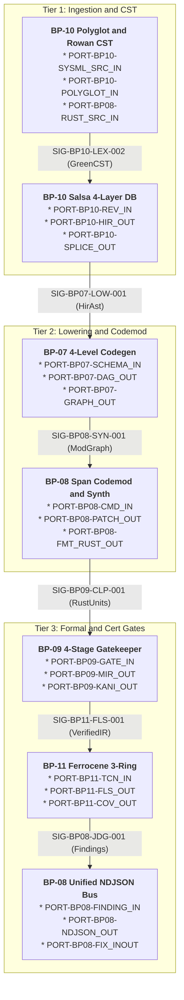
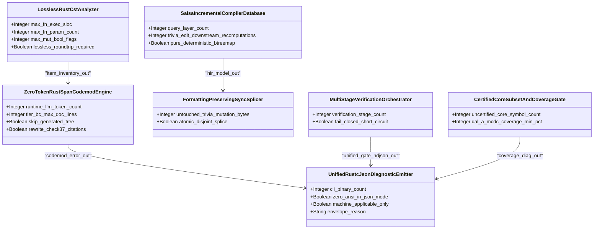

| Attribute | Specification Detail |
| :--- | :--- |
| **Issue ID** | #742 |
| **Title** | Master Signal Flow Dictionary & Safety Invariants |
| **Type** | icd |
| **Interface Level** | Level 1C Logical Interface |
| **Generation Mode** | subagent |
| **Specification Source** | `schema/model.sysml`, `schema/modular_codegen.sysml` |

# Level 1C: Master Signal Flow Dictionary & Safety Invariants

## 1. Executive Summary & Signal Flow Overview

This Level 1C Master Signal Flow Dictionary establishes the deterministic logical signal contracts, typed Rust payload schemas, UTF-8 byte-span invariants, command-line flag grammars, and `rustc`-compatible newline-delimited JSON (NDJSON) wire formats across the `DEAP01-spec-core` Model-Based Systems Engineering (MBSE) compiler architecture (`BP-01` through `BP-11`). All logical signals, ports, and item flows derive deterministically from `.pipeline/upstream/schema/model.sysml`, `.pipeline/upstream/schema/modular_codegen.sysml`, and the canonical blueprint SysML v2 metamodels (`docs/designs/blueprint-07-self-hosting-modular-codegen-compiler.sysml` through `docs/designs/blueprint-11-ferrocene-do178c-do330-3ring-certification-architecture.sysml`).

Every interface boundary across `crates/deap-core/src/sysml_ast/mod.rs`, `crates/deap-core/src/source_ast.rs`, `crates/deap-core/src/diagnostics.rs`, `crates/compile-sysml/src/modular_codegen/mod.rs`, `crates/ingest-sysml/src/translators/mod.rs`, and `crates/verify-baseline/src/runner.rs` enforces three non-negotiable architectural invariants:
1. **Pure Logical & Platform-Independent Typing**: Signals are specified strictly by deterministic data structures (`BTreeMap`, `BTreeSet`, fixed-width primitives, and typed domain `enum` variants), normalized SI units, bounded mathematical intervals, update timing envelopes, and fail-closed safe defaults. Zero physical connectors, zero hardware pinouts, and zero link-layer byte framing are coupled into logical signal definitions.
2. **Half-Open UTF-8 `TextRange` (`[byte_start..byte_end)`) & Lossless CST Integrity**: Every source-location span, bidirectional sync delta, and `MachineApplicable` replacement edit across `BP-08` and `BP-10` obeys `0 <= byte_start <= byte_end <= source.len()` with `str::is_char_boundary` verified at both endpoints and pairwise-disjoint reverse-byte-order splicing.
3. **Unified Single-Line `rustc`-Compatible NDJSON Wire Protocol (`--message-format=json`)**: All five workspace CLIs (`compile-sysml`, `verify-baseline`, `ingest-sysml`, `assemble-conops`, and `reconcile-backlog`) emit single-line `reason: "compiler-message"` JSON records carrying `DEAP-E*` `code` identifiers, `level` severities, `spans`, `suggested_replacement` payloads, and `MachineApplicable` applicability discriminators with zero embedded `0x0A` newline bytes and zero `0x1B` ANSI escape sequences.



## 2. Master Signal Flow Dictionary Table (`BP-01` through `BP-11`)

| Signal ID | Signal Name | Source Port | Dest Port | Data Type | SI Units | Valid Range | Update Rate | Safe Default Value | Schema Citation |
| :--- | :--- | :--- | :--- | :--- | :--- | :--- | :--- | :--- | :--- |
| `SIG-BP01-LNT-001` | CargoManifestLintStream | `PORT-BP01-MANIFEST_IN` | `PORT-BP01-FORBID_CMD_IN` | Record | dimensionless | [1, 64] | Aperiodic [1, 500] ms | RejectMissingForbid | `schema/model.sysml#L1` |
| `SIG-BP01-LNT-002` | RustSourceTokenStream | `PORT-BP01-TOKEN_STREAM_IN` | `PORT-BP01-SCANNER_CMD_IN` | Record | dimensionless | [0, 16777216] | Aperiodic [1, 500] ms | RejectAllowAttr | `schema/model.sysml#L1` |
| `SIG-BP01-LNT-003` | BaselineLintGateVerdict | `PORT-BP01-VERDICT_OUT` | `PORT-BP08-FINDING_IN` | Bool | dimensionless | [false, true] | Aperiodic [1, 500] ms | false | `schema/model.sysml#L1` |
| `SIG-BP01-LNT-004` | CompilerLintDiagnosticPayload | `PORT-BP01-DIAG_OUT` | `PORT-BP08-FINDING_IN` | Record | dimensionless | [0, 4096] | Aperiodic [1, 500] ms | FailClosedDiag | `schema/model.sysml#L1` |
| `SIG-BP02-PUR-001` | WorkspaceSourcePurityAst | `PORT-BP02-WS_AST_IN` | `PORT-BP02-TEST_AST_IN` | Record | dimensionless | [1, 16777216] | Aperiodic [1, 500] ms | RejectImpureAst | `schema/model.sysml#L1` |
| `SIG-BP02-PUR-002` | Check34GateExitStatus | `PORT-BP02-STATUS_OUT` | `PORT-BP08-FINDING_IN` | Int32 | dimensionless | [0, 1] | Aperiodic [1, 500] ms | 1 | `schema/model.sysml#L1` |
| `SIG-BP02-PUR-003` | PurityViolationDiagnostic | `PORT-BP02-PURITY_DIAG_OUT` | `PORT-BP08-FINDING_IN` | Record | dimensionless | [0, 4096] | Aperiodic [1, 500] ms | FailClosedCheck34 | `schema/model.sysml#L1` |
| `SIG-BP03-BIJ-001` | RawSysmlSourcePayload | `PORT-BP03-RAW_SYSML_IN` | `PORT-BP03-TOKEN_CHAN_INOUT` | Record | dimensionless | [1, 16777216] | Aperiodic [1, 500] ms | EmptyBufferAbort | `schema/model.sysml#L1` |
| `SIG-BP03-BIJ-002` | SerializedSysmlCanonicalAst | `PORT-BP03-SERIAL_SYSML_OUT` | `PORT-BP04-SYSML_PKG_IN` | Record | dimensionless | [1, 16777216] | Aperiodic [1, 500] ms | AbortOnRoundtripDiff | `schema/model.sysml#L1` |
| `SIG-BP03-BIJ-003` | BijectiveDiffDiagnostic | `PORT-BP03-BIJ_DIAG_OUT` | `PORT-BP08-FINDING_IN` | Record | dimensionless | [0, 4096] | Aperiodic [1, 500] ms | BijectiveMismatchErr | `schema/model.sysml#L1` |
| `SIG-BP04-FWD-001` | SysmlPackageForwardAst | `PORT-BP04-SYSML_PKG_IN` | `PORT-BP04-AGILE_AST_IN` | Record | dimensionless | [1, 4096] | Aperiodic [1, 1000] ms | RejectUnresolvedPkg | `schema/model.sysml#L1` |
| `SIG-BP04-FWD-002` | LogicalInterconnectMatrixAst | `PORT-BP04-ICD_AST_IN` | `PORT-BP04-ICD_MD_OUT` | Record | dimensionless | [1, 4096] | Aperiodic [1, 1000] ms | RejectDanglingPort | `schema/model.sysml#L1` |
| `SIG-BP04-FWD-003` | MilStd881eWbsExportBundle | `PORT-BP04-WBS_AST_IN` | `PORT-BP04-WBS_EXPORT_OUT` | Record | dimensionless | [1, 4096] | Aperiodic [1, 1000] ms | RejectOrphanWbsNode | `schema/model.sysml#L1` |
| `SIG-BP04-FWD-004` | BidirectionalBacklogSyncState | `PORT-BP04-SPEC_INOUT` | `PORT-BP04-SUBPKG_SYNC_OUT` | Record | dimensionless | [0, 4096] | Aperiodic [1, 1000] ms | RollbackSyncDelta | `schema/model.sysml#L1` |
| `SIG-BP06-AUD-001` | FivePillarTargetAstStream | `PORT-BP06-TARGET_AST_IN` | `PORT-BP06-PILLAR_AST_IN` | Record | dimensionless | [1, 16777216] | Aperiodic [1, 1000] ms | AbortAuditOnParseErr | `schema/model.sysml#L1` |
| `SIG-BP06-AUD-002` | StaticPillarFindingStream | `PORT-BP06-FINDING_OUT` | `PORT-BP06-DOSSIER_IN` | Record | dimensionless | [0, 4096] | Aperiodic [1, 1000] ms | FailClosedFinding | `schema/model.sysml#L1` |
| `SIG-BP06-AUD-003` | VerifiedSevenSectionDossier | `PORT-BP06-DOSSIER_MD_OUT` | `PORT-BP06-CANDIDATE_IN` | Record | dimensionless | [7, 7] | Aperiodic [1, 1000] ms | RejectIncompleteDoc | `schema/model.sysml#L1` |
| `SIG-BP06-AUD-004` | ClosedLoopTrackerReceipt | `PORT-BP06-RECEIPT_OUT` | `PORT-BP06-TRACKER_PUB_OUT` | Record | dimensionless | [1, 999999] | Aperiodic [1, 2000] ms | DryRunHoldPublish | `schema/model.sysml#L1` |
| `SIG-BP07-LOW-001` | SchemaPackageAstStream | `PORT-BP07-PKG_AST_IN` | `PORT-BP07-SCHEMA_IN` | Record | dimensionless | [1, 1024] | Aperiodic [1, 500] ms | AbortedFailClosed | `schema/modular_codegen.sysml#L83` |
| `SIG-BP07-DAG-001` | ModuleDependencyGraphEdges | `PORT-BP07-SCHEMA_IN` | `PORT-BP07-DEP_EDGES_IN` | Record | dimensionless | [1, 3] | Aperiodic [1, 250] ms | RejectedFailClosed | `schema/modular_codegen.sysml#L34` |
| `SIG-BP07-DAG-002` | ValidatedDagTopologicalOrder | `PORT-BP07-TOPO_ORDER_OUT` | `PORT-BP07-VALID_AST_IN` | Record | dimensionless | [1, 4096] | Aperiodic [1, 250] ms | RejectCycleE0702 | `schema/modular_codegen.sysml#L114` |
| `SIG-BP07-PRT-001` | FourLevelLoweredModuleGraph | `PORT-BP07-MOD_GRAPH_OUT` | `PORT-BP07-GRAPH_OUT` | Record | dimensionless | [1, 400] | Aperiodic [1, 500] ms | RejectBoundsE0704 | `schema/modular_codegen.sysml#L52` |
| `SIG-BP07-RST-001` | GeneratedRustTreeManifest | `PORT-BP07-RUST_GRAPH_IN` | `PORT-BP07-RUST_MANIFEST_OUT` | Record | dimensionless | [0, 0] | Aperiodic [1, 500] ms | RejectDriftE0705 | `schema/modular_codegen.sysml#L159` |
| `SIG-BP07-FLT-001` | GeneratedFlutterContractReport | `PORT-BP07-FLUTTER_GRAPH_IN` | `PORT-BP07-FLUTTER_MANIFEST_OUT` | Record | dimensionless | [1, 100] | Aperiodic [1, 500] ms | RejectFacadeOverflow | `schema/modular_codegen.sysml#L164` |
| `SIG-BP07-CMP-001` | AtomicRustModuleTreeCommit | `PORT-BP07-RUST_MANIFEST_OUT` | `PORT-BP07-RUST_TREE_OUT` | Record | dimensionless | [50, 400] | Aperiodic [1, 500] ms | ZeroFilesWritten | `schema/modular_codegen.sysml#L169` |
| `SIG-BP07-CMP-002` | AtomicDartModuleTreeCommit | `PORT-BP07-FLUTTER_MANIFEST_OUT` | `PORT-BP07-FLUTTER_TREE_OUT` | Record | dimensionless | [1, 400] | Aperiodic [1, 500] ms | ZeroFilesWritten | `schema/modular_codegen.sysml#L176` |
| `SIG-BP07-CMP-003` | ModularCodegenDiagnosticStream | `PORT-BP07-MOD_DIAG_OUT` | `PORT-BP08-FINDING_IN` | Record | dimensionless | [701, 705] | Aperiodic [1, 250] ms | EmitDeapE0701 | `schema/modular_codegen.sysml#L143` |
| `SIG-BP08-GOV-001` | CargoTomlAndLockfileBundle | `PORT-BP08-LOCK_IN` | `PORT-BP08-LOCK_RECEIPT_OUT` | Record | dimensionless | [1, 2048] | Aperiodic [1, 500] ms | RejectUnlockedE0804 | `schema/model.sysml#L16` |
| `SIG-BP08-CST-001` | Utf8RustSourceBuffer | `PORT-BP08-RUST_SRC_IN` | `PORT-BP08-ITEM_INV_OUT` | Record | dimensionless | [0, 16777216] | Aperiodic [1, 250] ms | RejectNonUtf8E0803 | `schema/model.sysml#L39` |
| `SIG-BP08-CST-002` | BTreeOrderedItemInventory | `PORT-BP08-ITEM_INV_OUT` | `PORT-BP08-CMD_IN` | Record | dimensionless | [0, 4096] | Aperiodic [1, 250] ms | EmptyBTreeInventory | `schema/model.sysml#L92` |
| `SIG-BP08-CST-003` | DeapV2AstMetricsReport | `PORT-BP08-METRICS_OUT` | `PORT-BP08-FINDING_IN` | Record | dimensionless | [1, 50] | Aperiodic [1, 250] ms | RejectSlocBreach | `schema/model.sysml#L93` |
| `SIG-BP08-CMD-001` | CstCodemodCommandPayload | `PORT-BP08-CMD_IN` | `PORT-BP08-PATCH_OUT` | Enum | dimensionless | [1, 4] | Aperiodic [1, 500] ms | AbortZeroMutation | `schema/model.sysml#L56` |
| `SIG-BP08-CMD-002` | AtomicWorkspacePatchCommit | `PORT-BP08-PATCH_OUT` | `PORT-BP08-RUST_SRC_IN` | Record | dimensionless | [0, 2] | Aperiodic [1, 500] ms | RollbackTempStage | `schema/model.sysml#L116` |
| `SIG-BP08-CMD-003` | CodemodJsonDiagnosticStream | `PORT-BP08-CMD_ERR_OUT` | `PORT-BP08-FINDING_IN` | Record | dimensionless | [801, 804] | Aperiodic [1, 250] ms | EmitDeapE0802 | `schema/model.sysml#L117` |
| `SIG-BP08-SYN-001` | PrettypleaseRustUnitStream | `PORT-BP08-LOWERED_IR_IN` | `PORT-BP08-FMT_RUST_OUT` | Record | dimensionless | [0, 0] | Aperiodic [1, 500] ms | RejectSynParseE0803 | `schema/model.sysml#L48` |
| `SIG-BP08-JDG-001` | DeapDiagnosticFindingInput | `PORT-BP08-FINDING_IN` | `PORT-BP08-NDJSON_OUT` | Record | dimensionless | [1, 5] | Aperiodic [1, 100] ms | EmitCompilerMessage | `schema/model.sysml#L54` |
| `SIG-BP08-JDG-002` | RustcNdjsonLineStream | `PORT-BP08-NDJSON_OUT` | `PORT-BP08-FIX_INOUT` | Record | dimensionless | [0, 0] | Aperiodic [1, 100] ms | ZeroAnsiSingleLine | `schema/model.sysml#L114` |
| `SIG-BP08-JDG-003` | AtomicSpanFixTransaction | `PORT-BP08-FIX_INOUT` | `PORT-BP08-RUST_SRC_IN` | Record | dimensionless | [0, 4096] | Aperiodic [1, 500] ms | MachineApplicableOnly | `schema/model.sysml#L59` |
| `SIG-BP09-ORC-001` | VerificationGateCommand | `PORT-BP09-GATE_IN` | `PORT-BP09-CLP_MANIFEST_IN` | Record | dimensionless | [1, 4] | Aperiodic [1, 500] ms | FailClosedShortCircuit | `schema/model.sysml#L44` |
| `SIG-BP09-ORC-002` | UnifiedFourStageGateNdjson | `PORT-BP09-UNIFIED_NDJSON_OUT` | `PORT-BP08-FINDING_IN` | Record | dimensionless | [900, 905] | Aperiodic [1, 500] ms | FailedClosedJsonDiag | `schema/model.sysml#L98` |
| `SIG-BP09-CLP-001` | CargoAndClippyTomlBundle | `PORT-BP09-CLP_MANIFEST_IN` | `PORT-BP09-CLP_NDJSON_OUT` | Record | dimensionless | [1, 80] | Aperiodic [1, 1000] ms | Deny14TotalFnLints | `schema/model.sysml#L47` |
| `SIG-BP09-CLP-002` | ClippyTotalFunctionNdjson | `PORT-BP09-CLP_NDJSON_OUT` | `PORT-BP09-UNIFIED_NDJSON_OUT` | Record | dimensionless | [0, 5] | Aperiodic [1, 1000] ms | EmitDeapE0900 | `schema/model.sysml#L104` |
| `SIG-BP09-MIR-001` | RustcMiddleMirBodyStream | `PORT-BP09-MIR_GRAPH_IN` | `PORT-BP09-MIR_NDJSON_OUT` | Record | dimensionless | [0, 0] | Aperiodic [1, 2000] ms | RejectRtHeapE0901 | `schema/model.sysml#L35` |
| `SIG-BP09-MIR-002` | DylintMirAllocationNdjson | `PORT-BP09-MIR_NDJSON_OUT` | `PORT-BP09-UNIFIED_NDJSON_OUT` | Record | dimensionless | [901, 902] | Aperiodic [1, 1000] ms | EmitDeapE0902 | `schema/model.sysml#L86` |
| `SIG-BP09-FRB-001` | SysmlPortAndItemFlowIcdAst | `PORT-BP09-ICD_AST_IN` | `PORT-BP09-FRB_OUT` | Record | dimensionless | [0, 4096] | Aperiodic [1, 1000] ms | RejectNonFiniteBound | `schema/model.sysml#L34` |
| `SIG-BP09-FRB-002` | FrbRustAndDartContractTree | `PORT-BP09-FRB_OUT` | `PORT-BP09-MIRI_RECEIPT_OUT` | Record | dimensionless | [0, 0] | Aperiodic [1, 2000] ms | ForbidDomainUnsafe | `schema/model.sysml#L84` |
| `SIG-BP09-FRB-003` | MiriTreeBorrowsAndDartReceipt | `PORT-BP09-MIRI_RECEIPT_OUT` | `PORT-BP09-UNIFIED_NDJSON_OUT` | Record | dimensionless | [0, 0] | Aperiodic [1, 5000] ms | EmitDeapE0903 | `schema/model.sysml#L85` |
| `SIG-BP09-KNI-001` | SysmlConstraintStateStpaIr | `PORT-BP09-SAFETY_AST_IN` | `PORT-BP09-KANI_MOD_OUT` | Record | dimensionless | [1, 64] | Aperiodic [1, 1000] ms | RejectVacuousAssume | `schema/model.sysml#L36` |
| `SIG-BP09-KNI-002` | PrettypleaseKaniProofModule | `PORT-BP09-KANI_MOD_OUT` | `PORT-BP09-CBMC_RECEIPT_OUT` | Record | dimensionless | [1, 64] | Aperiodic [1, 2000] ms | Unwind16Bounded | `schema/model.sysml#L88` |
| `SIG-BP09-KNI-003` | KaniCbmcVerificationReceipt | `PORT-BP09-CBMC_RECEIPT_OUT` | `PORT-BP09-UNIFIED_NDJSON_OUT` | Record | dimensionless | [0, 0] | Aperiodic [1, 5000] ms | EmitDeapE0904 | `schema/model.sysml#L87` |
| `SIG-BP10-LEX-001` | Utf8SysmlSourceBuffer | `PORT-BP10-SYSML_SRC_IN` | `PORT-BP10-GREEN_CST_OUT` | Record | dimensionless | [0, 16777216] | Aperiodic [1, 250] ms | WrapErrorNodeE1001 | `schema/model.sysml#L38` |
| `SIG-BP10-LEX-002` | RowanGreenSysmlTree | `PORT-BP10-GREEN_CST_OUT` | `PORT-BP10-REV_IN` | Record | dimensionless | [1, 64] | Aperiodic [1, 250] ms | RejectDepth65E1002 | `schema/model.sysml#L90` |
| `SIG-BP10-LEX-003` | SysmlCstSyntaxDiagnosticStream | `PORT-BP10-SYNTAX_DIAG_OUT` | `PORT-BP08-FINDING_IN` | Record | dimensionless | [1001, 1002] | Aperiodic [1, 100] ms | EmitDeapE1001 | `schema/model.sysml#L91` |
| `SIG-BP10-SLS-001` | SalsaSourceInputRevision | `PORT-BP10-REV_IN` | `PORT-BP10-HIR_OUT` | Record | dimensionless | [1, 4] | Aperiodic [1, 250] ms | RejectCycleE1004 | `schema/model.sysml#L45` |
| `SIG-BP10-SLS-002` | InternedHirPackageAndSourceMap | `PORT-BP10-HIR_OUT` | `PORT-BP07-PKG_AST_IN` | Record | dimensionless | [0, 65535] | Aperiodic [1, 250] ms | DecoupledSourceMap | `schema/model.sysml#L99` |
| `SIG-BP10-SLS-003` | MemoizedStpaKaniBaselineReceipt | `PORT-BP10-SAFETY_VERIF_OUT` | `PORT-BP09-SAFETY_AST_IN` | Record | dimensionless | [0, 0] | Aperiodic [1, 250] ms | EarlyCutoffZeroRecomp | `schema/model.sysml#L100` |
| `SIG-BP10-SPL-001` | BidirectionalHirDelta | `PORT-BP10-SYNC_DELTA_IN` | `PORT-BP10-SPLICED_OUT` | Record | dimensionless | [0, 0] | Aperiodic [1, 500] ms | RejectOverlapE1003 | `schema/model.sysml#L32` |
| `SIG-BP10-SPL-002` | LosslessSplicedSysmlAndMarkdown | `PORT-BP10-SPLICED_OUT` | `PORT-BP10-SYSML_SRC_IN` | Record | dimensionless | [0, 0] | Aperiodic [1, 500] ms | ZeroTriviaMutation | `schema/model.sysml#L82` |
| `SIG-BP10-SPL-003` | BidirectionalSpliceDiagnosticStream | `PORT-BP10-SPLICE_DIAG_OUT` | `PORT-BP08-FINDING_IN` | Record | dimensionless | [1003, 1003] | Aperiodic [1, 100] ms | EmitDeapE1003 | `schema/model.sysml#L81` |
| `SIG-BP10-PLY-001` | PolyglotSpecSourceBuffer | `PORT-BP10-POLYGLOT_IN` | `PORT-BP10-LOWERED_HIR_OUT` | Record | dimensionless | [1, 5] | Aperiodic [1, 500] ms | RejectMalformedE1005 | `schema/model.sysml#L53` |
| `SIG-BP10-PLY-002` | CanonicalHirDatabaseInput | `PORT-BP10-LOWERED_HIR_OUT` | `PORT-BP10-REV_IN` | Record | dimensionless | [1, 64] | Aperiodic [1, 500] ms | DiscardPartialHir | `schema/model.sysml#L113` |
| `SIG-BP10-PLY-003` | PolyglotIngestDiagnosticStream | `PORT-BP10-INGEST_DIAG_OUT` | `PORT-BP08-FINDING_IN` | Record | dimensionless | [1005, 1005] | Aperiodic [1, 100] ms | EmitDeapE1005 | `schema/model.sysml#L112` |
| `SIG-BP11-TCN-001` | CriticalupAndRustToolchainManifests | `PORT-BP11-TCN_IN` | `PORT-BP11-QUAL_DOSSIER_OUT` | Record | dimensionless | [0, 0] | Aperiodic [1, 500] ms | RejectDriftE1101 | `schema/model.sysml#L29` |
| `SIG-BP11-TCN-002` | Do330ToolQualificationReceipt | `PORT-BP11-QUAL_DOSSIER_OUT` | `PORT-BP11-ASSURANCE_AST_IN` | Record | dimensionless | [0, 0] | Aperiodic [1, 500] ms | HoldUnqualifiedBuild | `schema/model.sysml#L76` |
| `SIG-BP11-TCN-003` | ToolchainDriftDiagnosticStream | `PORT-BP11-TCN_DIAG_OUT` | `PORT-BP08-FINDING_IN` | Record | dimensionless | [1101, 1101] | Aperiodic [1, 100] ms | EmitDeapE1101 | `schema/model.sysml#L77` |
| `SIG-BP11-RNG-001` | SysmlAssuranceAndIcdPackageAst | `PORT-BP11-ASSURANCE_AST_IN` | `PORT-BP11-PARTITION_OUT` | Record | dimensionless | [1, 3] | Aperiodic [1, 500] ms | RejectCouplingE1105 | `schema/model.sysml#L51` |
| `SIG-BP11-RNG-002` | ThreeRingRustAndFlutterTree | `PORT-BP11-PARTITION_OUT` | `PORT-BP11-FLS_GRAPH_IN` | Record | dimensionless | [3, 3] | Aperiodic [1, 1000] ms | RollbackThreeRings | `schema/model.sysml#L110` |
| `SIG-BP11-RNG-003` | ThreeRingPartitionDiagnosticStream | `PORT-BP11-PARTITION_DIAG_OUT` | `PORT-BP08-FINDING_IN` | Record | dimensionless | [1105, 1106] | Aperiodic [1, 100] ms | EmitDeapE1106 | `schema/model.sysml#L109` |
| `SIG-BP11-FLS-001` | SysmlAndRustModuleGraphInput | `PORT-BP11-FLS_GRAPH_IN` | `PORT-BP11-FLS_UNITS_OUT` | Record | dimensionless | [5, 5] | Aperiodic [1, 500] ms | RejectMissingFlsE1102 | `schema/model.sysml#L31` |
| `SIG-BP11-FLS-002` | FlsTaggedRustAndTraceMatrix | `PORT-BP11-FLS_UNITS_OUT` | `PORT-BP11-ELF_PROF_IN` | Record | dimensionless | [0, 0] | Aperiodic [1, 500] ms | ZeroUnmappedFls | `schema/model.sysml#L79` |
| `SIG-BP11-FLS-003` | FlsTraceabilityDiagnosticStream | `PORT-BP11-FLS_DIAG_OUT` | `PORT-BP08-FINDING_IN` | Record | dimensionless | [1102, 1102] | Aperiodic [1, 100] ms | EmitDeapE1102 | `schema/model.sysml#L80` |
| `SIG-BP11-COV-001` | SymbolReportAndLlvmProfdataBundle | `PORT-BP11-ELF_PROF_IN` | `PORT-BP11-TABLE_A7_OUT` | Record | dimensionless | [0, 0] | Aperiodic [1, 2000] ms | RejectStdAllocE1103 | `schema/model.sysml#L17` |
| `SIG-BP11-COV-002` | Do178cTableA7CoverageMatrix | `PORT-BP11-TABLE_A7_OUT` | `PORT-BP08-FINDING_IN` | Record | percent | [100, 100] | Aperiodic [1, 2000] ms | RejectShortfallE1104 | `schema/model.sysml#L64` |
| `SIG-BP11-COV-003` | CoreSubsetAndCoverageDiagnosticStream | `PORT-BP11-COV_DIAG_OUT` | `PORT-BP08-FINDING_IN` | Record | dimensionless | [1103, 1104] | Aperiodic [1, 100] ms | EmitDeapE1104 | `schema/model.sysml#L63` |

## 3. Canonical SysML AST Port & Endpoint Signal Registry (`BP-01` through `BP-11`)

To preserve 100% backward compatibility with `.pipeline/upstream/schema/model.sysml` forward projection across `BP-01` through `BP-06` while binding every `BP-07` through `BP-11` endpoint to its concrete Rust domain payload contract, the complete endpoint registry is maintained below.

| Signal Name | Payload Type | Direction | Source Endpoint | Target Endpoint | Package |
| :--- | :--- | :--- | :--- | :--- | :--- |
| `Boolean` | `Boolean` | `out` | `CompilerLintEnforcementGate.BaselineGateVerdictPort` | `UnifiedRustcJsonDiagnosticEmitter.finding_in` | `BP_01_Compiler_Enforced_Forbid_Lint_Gate_and_Zero_Suppression_AST_Architecture_Blueprint` |
| `Integer` | `Integer` | `out` | `Check34AstPurityAndAntiGamingGate.Check34GateStatusPort` | `UnifiedRustcJsonDiagnosticEmitter.finding_in` | `BP_02_Check_34_AST_Purity_Fail_Closed_IO_and_Anti_Gaming_Test_Gate_Blueprint` |
| `ModularFlutterEmitPort` | `FlutterContractReport` | `inout` | `BP_07_Self_Hosting_4_Level_Modular_Multi_File_Code_Generator_Blueprint.ModularFlutterEmitPort` | `ModularEmitterSuiteSpec.flutter_tree_out` | `BP_07_Self_Hosting_4_Level_Modular_Multi_File_Code_Generator_Blueprint` |
| `ModularFlutterEmitPort` | `FlutterContractReport` | `out` | `ModularEmitterSuiteSpec.flutter_tree_out` | `SelfHostingModularCodegenCompiler.flutter_tree_out` | `BP_07_Self_Hosting_4_Level_Modular_Multi_File_Code_Generator_Blueprint` |
| `ModularRustEmitPort` | `GeneratedTreeManifest` | `inout` | `BP_07_Self_Hosting_4_Level_Modular_Multi_File_Code_Generator_Blueprint.ModularRustEmitPort` | `ModularEmitterSuiteSpec.rust_tree_out` | `BP_07_Self_Hosting_4_Level_Modular_Multi_File_Code_Generator_Blueprint` |
| `ModularRustEmitPort` | `GeneratedTreeManifest` | `out` | `ModularEmitterSuiteSpec.rust_tree_out` | `SelfHostingModularCodegenCompiler.rust_tree_out` | `BP_07_Self_Hosting_4_Level_Modular_Multi_File_Code_Generator_Blueprint` |
| `SchemaPackageAstPort` | `PackageDef` | `in` | `FourLevelLoweringEngineSpec.schema_in` | `TopologicalLayerDagVerifier.dependency_edges_in` | `BP_07_Self_Hosting_4_Level_Modular_Multi_File_Code_Generator_Blueprint` |
| `SchemaPackageAstPort` | `PackageDef` | `inout` | `BP_07_Self_Hosting_4_Level_Modular_Multi_File_Code_Generator_Blueprint.SchemaPackageAstPort` | `FourLevelLoweringEngineSpec.schema_in` | `BP_07_Self_Hosting_4_Level_Modular_Multi_File_Code_Generator_Blueprint` |
| `String` | `String` | `in` | `AgileSpecForwardProjector.packageAstInPort` | `-` | `BP_04_Deterministic_Specification_ICD_and_WBS_Forward_Compiler_Blueprint` |
| `CargoTomlAndLockfile` | `CargoLockBundle` | `in` | `AirGappedCargoLockGovernor.manifest_lock_in` | `AirGappedCargoLockGovernor.lock_receipt_out` | `BP_08_Lossless_Rust_CST_Codemod_Engine_and_Unified_rustc_Compatible_JSON_Diagnostics` |
| `SymbolReportAndLlvmProfdata` | `ElfSymbolAndMcdcBundle` | `in` | `CertifiedCoreSubsetAndCoverageGate.elf_and_profdata_in` | `CertifiedCoreSubsetAndCoverageGate.table_a7_evidence_out` | `BP_11_Ferrocene_Qualified_Toolchain_FLS_Traceability_Structural_Coverage_and_3_Ring_Rust_Flutter_DO_178C_DO_330_Certification_Architecture` |
| `String` | `String` | `in` | `Check34AstPurityAndAntiGamingGate.TestFunctionAstStreamPort` | `-` | `BP_02_Check_34_AST_Purity_Fail_Closed_IO_and_Anti_Gaming_Test_Gate_Blueprint` |
| `String` | `String` | `in` | `Check34AstPurityAndAntiGamingGate.WorkspaceSourceAstPort` | `-` | `BP_02_Check_34_AST_Purity_Fail_Closed_IO_and_Anti_Gaming_Test_Gate_Blueprint` |
| `String` | `String` | `in` | `ClippyAttributeAstScanner.cmd_in` | `-` | `BP_01_Compiler_Enforced_Forbid_Lint_Gate_and_Zero_Suppression_AST_Architecture_Blueprint` |
| `String` | `String` | `in` | `ClosedLoopDefectPublisherGate.dossierCandidateInPort` | `-` | `BP_06_Deterministic_Static_5_Pillar_Code_Auditor_and_Defect_Dossier_Synthesizer_Blueprint` |
| `String` | `String` | `in` | `CompilerLintEnforcementGate.CargoManifestInputPort` | `-` | `BP_01_Compiler_Enforced_Forbid_Lint_Gate_and_Zero_Suppression_AST_Architecture_Blueprint` |
| `String` | `String` | `in` | `CompilerLintEnforcementGate.RustSourceTokenStreamPort` | `-` | `BP_01_Compiler_Enforced_Forbid_Lint_Gate_and_Zero_Suppression_AST_Architecture_Blueprint` |
| `String` | `String` | `in` | `CrateRootAttributeSanitizer.cmd_in` | `-` | `BP_01_Compiler_Enforced_Forbid_Lint_Gate_and_Zero_Suppression_AST_Architecture_Blueprint` |
| `String` | `String` | `in` | `DeterministicDossierSynthesizer.findingInPort` | `-` | `BP_06_Deterministic_Static_5_Pillar_Code_Auditor_and_Defect_Dossier_Synthesizer_Blueprint` |
| `String` | `String` | `in` | `DeterministicSpecIcdWbsForwardCompiler.SysmlPackageAstInputPort` | `-` | `BP_04_Deterministic_Specification_ICD_and_WBS_Forward_Compiler_Blueprint` |
| `String` | `String` | `in` | `DeterministicStaticDefectAuditor.GitHubIssueSsotQueryPort` | `-` | `BP_06_Deterministic_Static_5_Pillar_Code_Auditor_and_Defect_Dossier_Synthesizer_Blueprint` |
| `String` | `String` | `in` | `DeterministicStaticDefectAuditor.TargetSourceAstInputPort` | `-` | `BP_06_Deterministic_Static_5_Pillar_Code_Auditor_and_Defect_Dossier_Synthesizer_Blueprint` |
| `CriticalupAndRustToolchainToml` | `DualToolchainManifestPair` | `in` | `DualModeFerroceneToolchainGate.toolchain_manifests_in` | `DualModeFerroceneToolchainGate.qualification_dossier_out` | `BP_11_Ferrocene_Qualified_Toolchain_FLS_Traceability_Structural_Coverage_and_3_Ring_Rust_Flutter_DO_178C_DO_330_Certification_Architecture` |
| `String` | `String` | `in` | `FivePillarStaticAstAnalyzer.astStreamInPort` | `-` | `BP_06_Deterministic_Static_5_Pillar_Code_Auditor_and_Defect_Dossier_Synthesizer_Blueprint` |
| `SysmlAndRustModuleGraph` | `FlsModuleGraphInput` | `in` | `FlsParagraphTraceabilitySynthesizer.lowered_module_graph_in` | `FlsParagraphTraceabilitySynthesizer.fls_annotated_units_out` | `BP_11_Ferrocene_Qualified_Toolchain_FLS_Traceability_Structural_Coverage_and_3_Ring_Rust_Flutter_DO_178C_DO_330_Certification_Architecture` |
| `BidirectionalHirDelta` | `DisjointCstSplicePlan` | `in` | `FormattingPreservingSyncSplicer.sync_delta_in` | `FormattingPreservingSyncSplicer.spliced_artifact_out` | `BP_10_Incremental_Lossless_SysML_v2_and_Polyglot_Compiler_Engine` |
| `ValidatedPackageAst` | `DagValidatedPackageAst` | `in` | `FourLevelAstPartitionerAndHoister.validated_ast_in` | `FourLevelAstPartitionerAndHoister.module_graph_out` | `BP_07_Self_Hosting_4_Level_Modular_Multi_File_Code_Generator_Blueprint` |
| `SysmlPortAndItemFlowIcd` | `IcdPortGuardBundle` | `in` | `FrbIcdBridgeAndMiriUbGate.sysml_icd_ast_in` | `FrbIcdBridgeAndMiriUbGate.frb_facade_and_dart_out` | `BP_09_Multi_Stage_Compiler_and_Formal_Verification_Gatekeeper` |
| `RustcMiddleMirStream` | `MirRtLoopBodyGraph` | `in` | `IsolatedDylintMirAllocationGate.mir_body_graph_in` | `IsolatedDylintMirAllocationGate.dylint_ndjson_out` | `BP_09_Multi_Stage_Compiler_and_Formal_Verification_Gatekeeper` |
| `SysmlConstraintStateStpaIr` | `KaniSafetyIrBundle` | `in` | `KaniCbmcProofSynthesizer.sysml_safety_ast_in` | `KaniCbmcProofSynthesizer.kani_proof_module_out` | `BP_09_Multi_Stage_Compiler_and_Formal_Verification_Gatekeeper` |
| `String` | `String` | `in` | `LogicalIcdMatrixCompiler.interconnectAstInPort` | `-` | `BP_04_Deterministic_Specification_ICD_and_WBS_Forward_Compiler_Blueprint` |
| `Utf8SysmlSourceBuffer` | `Utf8SysmlSource` | `in` | `LogosRowanSysmlCstEngine.sysml_source_in` | `LogosRowanSysmlCstEngine.green_cst_out` | `BP_10_Incremental_Lossless_SysML_v2_and_Polyglot_Compiler_Engine` |
| `Utf8RustSourceBuffer` | `Utf8RustSource` | `in` | `LosslessRustCstAnalyzer.rust_source_in` | `LosslessRustCstAnalyzer.item_inventory_out` | `BP_08_Lossless_Rust_CST_Codemod_Engine_and_Unified_rustc_Compatible_JSON_Diagnostics` |
| `String` | `String` | `in` | `MermaidUmlDiagramGenerator.umlSpecInPort` | `-` | `BP_06_Deterministic_Static_5_Pillar_Code_Auditor_and_Defect_Dossier_Synthesizer_Blueprint` |
| `String` | `String` | `in` | `MilStd881eWbsExporter.wbsAstMetadataInPort` | `-` | `BP_04_Deterministic_Specification_ICD_and_WBS_Forward_Compiler_Blueprint` |
| `LoweredModuleGraph` | `ModuleGraph` | `in` | `ModularFlutterMultiFileEmitter.flutter_module_graph_in` | `ModularFlutterMultiFileEmitter.flutter_manifest_out` | `BP_07_Self_Hosting_4_Level_Modular_Multi_File_Code_Generator_Blueprint` |
| `LoweredModuleGraph` | `ModuleGraph` | `in` | `ModularRustMultiFileEmitter.rust_module_graph_in` | `ModularRustMultiFileEmitter.rust_manifest_out` | `BP_07_Self_Hosting_4_Level_Modular_Multi_File_Code_Generator_Blueprint` |
| `VerificationGateCommand` | `VerificationGateInvocation` | `in` | `MultiStageVerificationOrchestrator.gate_invocation_in` | `StableClippyTotalFunctionGate.workspace_manifest_in` | `BP_09_Multi_Stage_Compiler_and_Formal_Verification_Gatekeeper` |
| `SalsaSourceInputRevision` | `SalsaSourceRevision` | `in` | `SalsaIncrementalCompilerDatabase.source_revision_in` | `SalsaIncrementalCompilerDatabase.hir_model_out` | `BP_10_Incremental_Lossless_SysML_v2_and_Polyglot_Compiler_Engine` |
| `SysmlV2PackageAst` | `PackageDef` | `in` | `SelfHostingModularCodegenCompiler.package_ast_in` | `TopologicalLayerDagVerifier.dependency_edges_in` | `BP_07_Self_Hosting_4_Level_Modular_Multi_File_Code_Generator_Blueprint` |
| `CargoAndClippyTomlBundle` | `ClippyThresholdPolicy` | `in` | `StableClippyTotalFunctionGate.workspace_manifest_in` | `StableClippyTotalFunctionGate.clippy_ndjson_out` | `BP_09_Multi_Stage_Compiler_and_Formal_Verification_Gatekeeper` |
| `LoweredModuleGraphIr` | `ModuleGraph` | `in` | `StructuredModularCodegenSynthesizer.lowered_ir_in` | `StructuredModularCodegenSynthesizer.formatted_rust_out` | `BP_08_Lossless_Rust_CST_Codemod_Engine_and_Unified_rustc_Compatible_JSON_Diagnostics` |
| `String` | `String` | `in` | `SysmlBijectiveRoundtripCompilerGate.RawSysmlSourceInputPort` | `-` | `BP_03_SysML_v2_AST_Bijective_Roundtrip_and_Token_Stream_Parser_Gate_Blueprint` |
| `String` | `String` | `in` | `TestTargetLintEnforcer.cmd_in` | `-` | `BP_01_Compiler_Enforced_Forbid_Lint_Gate_and_Zero_Suppression_AST_Architecture_Blueprint` |
| `SysmlAssuranceAndIcdPackage` | `ThreeRingPackageSpec` | `in` | `ThreeRingAssurancePartitionCompiler.sysml_assurance_ast_in` | `ThreeRingAssurancePartitionCompiler.partitioned_workspace_out` | `BP_11_Ferrocene_Qualified_Toolchain_FLS_Traceability_Structural_Coverage_and_3_Ring_Rust_Flutter_DO_178C_DO_330_Certification_Architecture` |
| `ModuleDependencyGraph` | `LayerDependencyDag` | `in` | `TopologicalLayerDagVerifier.dependency_edges_in` | `TopologicalLayerDagVerifier.topological_order_out` | `BP_07_Self_Hosting_4_Level_Modular_Multi_File_Code_Generator_Blueprint` |
| `PolyglotSpecBuffer` | `PolyglotSourceInput` | `in` | `TypedPolyglotIngestionFrontend.polyglot_source_in` | `TypedPolyglotIngestionFrontend.lowered_hir_out` | `BP_10_Incremental_Lossless_SysML_v2_and_Polyglot_Compiler_Engine` |
| `DeapDiagnosticFinding` | `DeapDiagnosticFinding` | `in` | `UnifiedRustcJsonDiagnosticEmitter.finding_in` | `UnifiedRustcJsonDiagnosticEmitter.ndjson_out` | `BP_08_Lossless_Rust_CST_Codemod_Engine_and_Unified_rustc_Compatible_JSON_Diagnostics` |
| `String` | `String` | `in` | `WorkspaceManifestForbidGate.cmd_in` | `-` | `BP_01_Compiler_Enforced_Forbid_Lint_Gate_and_Zero_Suppression_AST_Architecture_Blueprint` |
| `CstCodemodCommand` | `CstCodemodCommand` | `in` | `ZeroTokenRustSpanCodemodEngine.codemod_command_in` | `ZeroTokenRustSpanCodemodEngine.atomic_patch_out` | `BP_08_Lossless_Rust_CST_Codemod_Engine_and_Unified_rustc_Compatible_JSON_Diagnostics` |
| `String` | `String` | `inout` | `BidirectionalBacklogReconciler.specDocsInOutPort` | `-` | `BP_04_Deterministic_Specification_ICD_and_WBS_Forward_Compiler_Blueprint` |
| `String` | `String` | `inout` | `SysmlBijectiveRoundtripCompilerGate.TokenStreamChannelPort` | `-` | `BP_03_SysML_v2_AST_Bijective_Roundtrip_and_Token_Stream_Parser_Gate_Blueprint` |
| `AtomicSpanFixTransaction` | `Vec<SpanSpliceEdit>` | `inout` | `UnifiedRustcJsonDiagnosticEmitter.machine_fix_inout` | `LosslessRustCstAnalyzer.rust_source_in` | `BP_08_Lossless_Rust_CST_Codemod_Engine_and_Unified_rustc_Compatible_JSON_Diagnostics` |
| `String` | `String` | `out` | `AgileSpecForwardProjector.specMarkdownOutPort` | `-` | `BP_04_Deterministic_Specification_ICD_and_WBS_Forward_Compiler_Blueprint` |
| `SupplyChainVerificationReceipt` | `SupplyChainReceipt` | `out` | `AirGappedCargoLockGovernor.lock_receipt_out` | `LosslessRustCstAnalyzer.rust_source_in` | `BP_08_Lossless_Rust_CST_Codemod_Engine_and_Unified_rustc_Compatible_JSON_Diagnostics` |
| `String` | `String` | `out` | `BidirectionalBacklogReconciler.subpackageSyncOutPort` | `-` | `BP_04_Deterministic_Specification_ICD_and_WBS_Forward_Compiler_Blueprint` |
| `RustcJsonDiagnosticStream` | `RustcDiagnosticEnvelope` | `out` | `CertifiedCoreSubsetAndCoverageGate.coverage_diag_out` | `UnifiedRustcJsonDiagnosticEmitter.finding_in` | `BP_11_Ferrocene_Qualified_Toolchain_FLS_Traceability_Structural_Coverage_and_3_Ring_Rust_Flutter_DO_178C_DO_330_Certification_Architecture` |
| `Do178cTableA7CoverageMatrix` | `Do178cTableA7Receipt` | `out` | `CertifiedCoreSubsetAndCoverageGate.table_a7_evidence_out` | `ThreeRingAssurancePartitionCompiler.sysml_assurance_ast_in` | `BP_11_Ferrocene_Qualified_Toolchain_FLS_Traceability_Structural_Coverage_and_3_Ring_Rust_Flutter_DO_178C_DO_330_Certification_Architecture` |
| `String` | `String` | `out` | `Check34AstPurityAndAntiGamingGate.PurityViolationDiagnosticPort` | `-` | `BP_02_Check_34_AST_Purity_Fail_Closed_IO_and_Anti_Gaming_Test_Gate_Blueprint` |
| `String` | `String` | `out` | `ClippyAttributeAstScanner.status_out` | `-` | `BP_01_Compiler_Enforced_Forbid_Lint_Gate_and_Zero_Suppression_AST_Architecture_Blueprint` |
| `String` | `String` | `out` | `ClosedLoopDefectPublisherGate.verifiedReceiptOutPort` | `-` | `BP_06_Deterministic_Static_5_Pillar_Code_Auditor_and_Defect_Dossier_Synthesizer_Blueprint` |
| `String` | `String` | `out` | `CompilerLintEnforcementGate.CompilerDiagnosticOutputPort` | `-` | `BP_01_Compiler_Enforced_Forbid_Lint_Gate_and_Zero_Suppression_AST_Architecture_Blueprint` |
| `String` | `String` | `out` | `CrateRootAttributeSanitizer.status_out` | `-` | `BP_01_Compiler_Enforced_Forbid_Lint_Gate_and_Zero_Suppression_AST_Architecture_Blueprint` |
| `String` | `String` | `out` | `DeterministicDossierSynthesizer.dossierMarkdownOutPort` | `-` | `BP_06_Deterministic_Static_5_Pillar_Code_Auditor_and_Defect_Dossier_Synthesizer_Blueprint` |
| `String` | `String` | `out` | `DeterministicSpecIcdWbsForwardCompiler.IcdMatrixArtifactPort` | `-` | `BP_04_Deterministic_Specification_ICD_and_WBS_Forward_Compiler_Blueprint` |
| `String` | `String` | `out` | `DeterministicSpecIcdWbsForwardCompiler.MarkdownSpecSuiteOutputPort` | `-` | `BP_04_Deterministic_Specification_ICD_and_WBS_Forward_Compiler_Blueprint` |
| `String` | `String` | `out` | `DeterministicSpecIcdWbsForwardCompiler.WbsEnterpriseExportPort` | `-` | `BP_04_Deterministic_Specification_ICD_and_WBS_Forward_Compiler_Blueprint` |
| `String` | `String` | `out` | `DeterministicStaticDefectAuditor.ClosedLoopTrackerPublishPort` | `-` | `BP_06_Deterministic_Static_5_Pillar_Code_Auditor_and_Defect_Dossier_Synthesizer_Blueprint` |
| `String` | `String` | `out` | `DeterministicStaticDefectAuditor.DefectDossierArtifactPort` | `-` | `BP_06_Deterministic_Static_5_Pillar_Code_Auditor_and_Defect_Dossier_Synthesizer_Blueprint` |
| `Do330ToolQualificationReceipt` | `Do330QualificationDossier` | `out` | `DualModeFerroceneToolchainGate.qualification_dossier_out` | `ThreeRingAssurancePartitionCompiler.sysml_assurance_ast_in` | `BP_11_Ferrocene_Qualified_Toolchain_FLS_Traceability_Structural_Coverage_and_3_Ring_Rust_Flutter_DO_178C_DO_330_Certification_Architecture` |
| `RustcJsonDiagnosticStream` | `RustcDiagnosticEnvelope` | `out` | `DualModeFerroceneToolchainGate.toolchain_diag_out` | `UnifiedRustcJsonDiagnosticEmitter.finding_in` | `BP_11_Ferrocene_Qualified_Toolchain_FLS_Traceability_Structural_Coverage_and_3_Ring_Rust_Flutter_DO_178C_DO_330_Certification_Architecture` |
| `String` | `String` | `out` | `FivePillarStaticAstAnalyzer.findingStreamOutPort` | `-` | `BP_06_Deterministic_Static_5_Pillar_Code_Auditor_and_Defect_Dossier_Synthesizer_Blueprint` |
| `FlsTaggedRustAndTraceMatrix` | `BTreeMap<String, FlsFiveLinkRecord>` | `out` | `FlsParagraphTraceabilitySynthesizer.fls_annotated_units_out` | `CertifiedCoreSubsetAndCoverageGate.elf_and_profdata_in` | `BP_11_Ferrocene_Qualified_Toolchain_FLS_Traceability_Structural_Coverage_and_3_Ring_Rust_Flutter_DO_178C_DO_330_Certification_Architecture` |
| `RustcJsonDiagnosticStream` | `RustcDiagnosticEnvelope` | `out` | `FlsParagraphTraceabilitySynthesizer.fls_diag_out` | `UnifiedRustcJsonDiagnosticEmitter.finding_in` | `BP_11_Ferrocene_Qualified_Toolchain_FLS_Traceability_Structural_Coverage_and_3_Ring_Rust_Flutter_DO_178C_DO_330_Certification_Architecture` |
| `RustcJsonDiagnosticStream` | `RustcDiagnosticEnvelope` | `out` | `FormattingPreservingSyncSplicer.splice_diag_out` | `UnifiedRustcJsonDiagnosticEmitter.finding_in` | `BP_10_Incremental_Lossless_SysML_v2_and_Polyglot_Compiler_Engine` |
| `LosslessSplicedSysmlAndMarkdown` | `SplicedWorkspaceBundle` | `out` | `FormattingPreservingSyncSplicer.spliced_artifact_out` | `LogosRowanSysmlCstEngine.sysml_source_in` | `BP_10_Incremental_Lossless_SysML_v2_and_Polyglot_Compiler_Engine` |
| `LoweredModuleGraph` | `ModuleGraph` | `out` | `FourLevelAstPartitionerAndHoister.module_graph_out` | `ModularRustMultiFileEmitter.rust_module_graph_in` | `BP_07_Self_Hosting_4_Level_Modular_Multi_File_Code_Generator_Blueprint` |
| `FrbRustAndDartContractTree` | `FrbFacadeAndDartBundle` | `out` | `FrbIcdBridgeAndMiriUbGate.frb_facade_and_dart_out` | `FrbIcdBridgeAndMiriUbGate.miri_and_dart_receipt_out` | `BP_09_Multi_Stage_Compiler_and_Formal_Verification_Gatekeeper` |
| `MiriAndDartVerificationReceipt` | `MiriAndDartReceipt` | `out` | `FrbIcdBridgeAndMiriUbGate.miri_and_dart_receipt_out` | `MultiStageVerificationOrchestrator.unified_gate_ndjson_out` | `BP_09_Multi_Stage_Compiler_and_Formal_Verification_Gatekeeper` |
| `RustcCompilerMessageNdjson` | `RustcDiagnosticEnvelope` | `out` | `IsolatedDylintMirAllocationGate.dylint_ndjson_out` | `MultiStageVerificationOrchestrator.unified_gate_ndjson_out` | `BP_09_Multi_Stage_Compiler_and_Formal_Verification_Gatekeeper` |
| `KaniVerificationReceipt` | `KaniHarnessReceipt` | `out` | `KaniCbmcProofSynthesizer.cbmc_proof_receipt_out` | `MultiStageVerificationOrchestrator.unified_gate_ndjson_out` | `BP_09_Multi_Stage_Compiler_and_Formal_Verification_Gatekeeper` |
| `PrettypleaseKaniRustUnit` | `KaniGeneratedModule` | `out` | `KaniCbmcProofSynthesizer.kani_proof_module_out` | `KaniCbmcProofSynthesizer.cbmc_proof_receipt_out` | `BP_09_Multi_Stage_Compiler_and_Formal_Verification_Gatekeeper` |
| `String` | `String` | `out` | `LogicalIcdMatrixCompiler.icdMarkdownOutPort` | `-` | `BP_04_Deterministic_Specification_ICD_and_WBS_Forward_Compiler_Blueprint` |
| `RowanGreenSysmlTree` | `RowanSysmlParseOutput` | `out` | `LogosRowanSysmlCstEngine.green_cst_out` | `SalsaIncrementalCompilerDatabase.source_revision_in` | `BP_10_Incremental_Lossless_SysML_v2_and_Polyglot_Compiler_Engine` |
| `RustcJsonDiagnosticStream` | `RustcDiagnosticEnvelope` | `out` | `LogosRowanSysmlCstEngine.syntax_diag_out` | `UnifiedRustcJsonDiagnosticEmitter.finding_in` | `BP_10_Incremental_Lossless_SysML_v2_and_Polyglot_Compiler_Engine` |
| `BTreeOrderedItemInventory` | `RustItemInventory` | `out` | `LosslessRustCstAnalyzer.item_inventory_out` | `ZeroTokenRustSpanCodemodEngine.codemod_command_in` | `BP_08_Lossless_Rust_CST_Codemod_Engine_and_Unified_rustc_Compatible_JSON_Diagnostics` |
| `DeapV2AstMetricsReport` | `DeapV2AstMetricsReport` | `out` | `LosslessRustCstAnalyzer.metrics_report_out` | `UnifiedRustcJsonDiagnosticEmitter.finding_in` | `BP_08_Lossless_Rust_CST_Codemod_Engine_and_Unified_rustc_Compatible_JSON_Diagnostics` |
| `String` | `String` | `out` | `MermaidUmlDiagramGenerator.mermaidBlockOutPort` | `-` | `BP_06_Deterministic_Static_5_Pillar_Code_Auditor_and_Defect_Dossier_Synthesizer_Blueprint` |
| `String` | `String` | `out` | `MilStd881eWbsExporter.wbsArtifactsOutPort` | `-` | `BP_04_Deterministic_Specification_ICD_and_WBS_Forward_Compiler_Blueprint` |
| `FlutterContractReport` | `FlutterContractReport` | `out` | `ModularFlutterMultiFileEmitter.flutter_manifest_out` | `SelfHostingModularCodegenCompiler.flutter_tree_out` | `BP_07_Self_Hosting_4_Level_Modular_Multi_File_Code_Generator_Blueprint` |
| `GeneratedTreeManifest` | `GeneratedTreeManifest` | `out` | `ModularRustMultiFileEmitter.rust_manifest_out` | `SelfHostingModularCodegenCompiler.rust_tree_out` | `BP_07_Self_Hosting_4_Level_Modular_Multi_File_Code_Generator_Blueprint` |
| `RustcCompilerMessageNdjson` | `RustcDiagnosticEnvelope` | `out` | `MultiStageVerificationOrchestrator.unified_gate_ndjson_out` | `UnifiedRustcJsonDiagnosticEmitter.finding_in` | `BP_09_Multi_Stage_Compiler_and_Formal_Verification_Gatekeeper` |
| `InternedHirPackageAndSourceMap` | `HirPackageAndSourceMap` | `out` | `SalsaIncrementalCompilerDatabase.hir_model_out` | `SelfHostingModularCodegenCompiler.package_ast_in` | `BP_10_Incremental_Lossless_SysML_v2_and_Polyglot_Compiler_Engine` |
| `MemoizedStpaKaniBaselineReceipt` | `MemoizedSafetyReceipt` | `out` | `SalsaIncrementalCompilerDatabase.safety_verification_out` | `KaniCbmcProofSynthesizer.sysml_safety_ast_in` | `BP_10_Incremental_Lossless_SysML_v2_and_Polyglot_Compiler_Engine` |
| `CompilerDiagnosticStream` | `ModularLoweringError` | `out` | `SelfHostingModularCodegenCompiler.diagnostic_out` | `UnifiedRustcJsonDiagnosticEmitter.finding_in` | `BP_07_Self_Hosting_4_Level_Modular_Multi_File_Code_Generator_Blueprint` |
| `AtomicDartModuleTree` | `FlutterContractReport` | `out` | `SelfHostingModularCodegenCompiler.flutter_tree_out` | `ThreeRingAssurancePartitionCompiler.sysml_assurance_ast_in` | `BP_07_Self_Hosting_4_Level_Modular_Multi_File_Code_Generator_Blueprint` |
| `AtomicRustModuleTree` | `GeneratedTreeManifest` | `out` | `SelfHostingModularCodegenCompiler.rust_tree_out` | `StructuredModularCodegenSynthesizer.lowered_ir_in` | `BP_07_Self_Hosting_4_Level_Modular_Multi_File_Code_Generator_Blueprint` |
| `RustcCompilerMessageNdjson` | `RustcDiagnosticEnvelope` | `out` | `StableClippyTotalFunctionGate.clippy_ndjson_out` | `MultiStageVerificationOrchestrator.unified_gate_ndjson_out` | `BP_09_Multi_Stage_Compiler_and_Formal_Verification_Gatekeeper` |
| `PrettypleaseRustUnit` | `CompilationUnit` | `out` | `StructuredModularCodegenSynthesizer.formatted_rust_out` | `StableClippyTotalFunctionGate.workspace_manifest_in` | `BP_08_Lossless_Rust_CST_Codemod_Engine_and_Unified_rustc_Compatible_JSON_Diagnostics` |
| `String` | `String` | `out` | `SysmlBijectiveRoundtripCompilerGate.BijectiveDiffDiagnosticPort` | `-` | `BP_03_SysML_v2_AST_Bijective_Roundtrip_and_Token_Stream_Parser_Gate_Blueprint` |
| `String` | `String` | `out` | `SysmlBijectiveRoundtripCompilerGate.SerializedSysmlOutputPort` | `-` | `BP_03_SysML_v2_AST_Bijective_Roundtrip_and_Token_Stream_Parser_Gate_Blueprint` |
| `String` | `String` | `out` | `TestTargetLintEnforcer.status_out` | `-` | `BP_01_Compiler_Enforced_Forbid_Lint_Gate_and_Zero_Suppression_AST_Architecture_Blueprint` |
| `RustcJsonDiagnosticStream` | `RustcDiagnosticEnvelope` | `out` | `ThreeRingAssurancePartitionCompiler.partition_diag_out` | `UnifiedRustcJsonDiagnosticEmitter.finding_in` | `BP_11_Ferrocene_Qualified_Toolchain_FLS_Traceability_Structural_Coverage_and_3_Ring_Rust_Flutter_DO_178C_DO_330_Certification_Architecture` |
| `ThreeRingRustAndFlutterTree` | `ThreeRingWorkspacePlan` | `out` | `ThreeRingAssurancePartitionCompiler.partitioned_workspace_out` | `FlsParagraphTraceabilitySynthesizer.lowered_module_graph_in` | `BP_11_Ferrocene_Qualified_Toolchain_FLS_Traceability_Structural_Coverage_and_3_Ring_Rust_Flutter_DO_178C_DO_330_Certification_Architecture` |
| `ValidatedDagOrder` | `Vec<String>` | `out` | `TopologicalLayerDagVerifier.topological_order_out` | `FourLevelAstPartitionerAndHoister.validated_ast_in` | `BP_07_Self_Hosting_4_Level_Modular_Multi_File_Code_Generator_Blueprint` |
| `RustcJsonDiagnosticStream` | `RustcDiagnosticEnvelope` | `out` | `TypedPolyglotIngestionFrontend.ingest_diag_out` | `UnifiedRustcJsonDiagnosticEmitter.finding_in` | `BP_10_Incremental_Lossless_SysML_v2_and_Polyglot_Compiler_Engine` |
| `CanonicalHirDatabaseInput` | `HirPackageAndSourceMap` | `out` | `TypedPolyglotIngestionFrontend.lowered_hir_out` | `SalsaIncrementalCompilerDatabase.source_revision_in` | `BP_10_Incremental_Lossless_SysML_v2_and_Polyglot_Compiler_Engine` |
| `RustcNdjsonLineStream` | `RustcDiagnosticEnvelope` | `out` | `UnifiedRustcJsonDiagnosticEmitter.ndjson_out` | `UnifiedRustcJsonDiagnosticEmitter.machine_fix_inout` | `BP_08_Lossless_Rust_CST_Codemod_Engine_and_Unified_rustc_Compatible_JSON_Diagnostics` |
| `String` | `String` | `out` | `WorkspaceManifestForbidGate.status_out` | `-` | `BP_01_Compiler_Enforced_Forbid_Lint_Gate_and_Zero_Suppression_AST_Architecture_Blueprint` |
| `AtomicWorkspacePatch` | `AtomicCodemodCommit` | `out` | `ZeroTokenRustSpanCodemodEngine.atomic_patch_out` | `LosslessRustCstAnalyzer.rust_source_in` | `BP_08_Lossless_Rust_CST_Codemod_Engine_and_Unified_rustc_Compatible_JSON_Diagnostics` |
| `RustcJsonDiagnosticStream` | `RustcDiagnosticEnvelope` | `out` | `ZeroTokenRustSpanCodemodEngine.codemod_error_out` | `UnifiedRustcJsonDiagnosticEmitter.finding_in` | `BP_08_Lossless_Rust_CST_Codemod_Engine_and_Unified_rustc_Compatible_JSON_Diagnostics` |
| `VerifiedModuleGraphPort` | `ModuleGraph` | `inout` | `BP_07_Self_Hosting_4_Level_Modular_Multi_File_Code_Generator_Blueprint.VerifiedModuleGraphPort` | `ModularRustMultiFileEmitter.rust_module_graph_in` | `BP_07_Self_Hosting_4_Level_Modular_Multi_File_Code_Generator_Blueprint` |
| `VerifiedModuleGraphPort` | `ModuleGraph` | `out` | `FourLevelLoweringEngineSpec.graph_out` | `ModularRustMultiFileEmitter.rust_module_graph_in` | `BP_07_Self_Hosting_4_Level_Modular_Multi_File_Code_Generator_Blueprint` |

## 4. Layer 1: Domain State, Exact Rust Payload Types & UTF-8 `TextRange` Invariants (`BP-07` through `BP-11`)

All signal payloads across `BP-07`, `BP-08`, `BP-09`, `BP-10`, and `BP-11` are realized in `crates/deap-core/src/sysml_ast/mod.rs`, `crates/deap-core/src/source_ast.rs`, `crates/deap-core/src/diagnostics.rs`, `crates/deap-core/src/error.rs`, and `crates/compile-sysml/src/modular_codegen/mod.rs` using ordered deterministic collections (`BTreeMap`, `BTreeSet`) and exhaustive typed `enum` error hierarchies. Unstructured string error returns are prohibited across all public and crate-internal interfaces.



```rust
#![forbid(unsafe_code)]

use std::collections::{BTreeMap, BTreeSet};

pub struct TextRange {
    pub byte_start: u32,
    pub byte_end: u32,
}

pub enum SuggestionApplicability {
    MachineApplicable,
    MaybeIncorrect,
    HasPlaceholders,
    Unspecified,
}

pub struct SpanSpliceEdit {
    pub file_path: String,
    pub range: TextRange,
    pub replacement: String,
    pub applicability: SuggestionApplicability,
}
```

### 4.1 Half-Open UTF-8 `TextRange` (`[byte_start..byte_end)`) Contract (`BP-08` & `BP-10`)

Every CST token span, AST item envelope, bidirectional sync delta, and `rustc`-compatible JSON diagnostic span operates over a half-open UTF-8 byte interval `[byte_start..byte_end)` backed by `TextRange { pub byte_start: u32, pub byte_end: u32 }`:

1. **Monotonic Buffer Containment**: For a UTF-8 source slice `source: &str` with byte length `len = source.len()`, `(byte_start as usize) <= (byte_end as usize)` and `(byte_end as usize) <= len`, where `len <= (u32::MAX as usize)`.
2. **Codepoint Boundary Alignment (`str::is_char_boundary`)**: Both endpoints MUST satisfy `source.is_char_boundary(byte_start as usize) == true` and `source.is_char_boundary(byte_end as usize) == true`. Any mid-codepoint offset immediately aborts before byte slicing and emits `DEAP-E0802` (`BP-08`) or `DEAP-E1003` (`BP-10`).
3. **Outer Trivia & Attribute Completeness**: On `RustItemDescriptor`, `full_range: TextRange` encompasses leading `///` or `doc` attribute docblocks and outer Rust attributes (such as `cfg(test)`, `test`, `rt_loop`, `realises("REQ-0609")`, and `repr(C)`) without truncating leading trivia tokens.
4. **Pairwise Disjointness & Reverse-Byte-Order Splicing**: Given a sorted edit slice `edits: &[SpanSpliceEdit]`, every adjacent pair fetched via `.get(idx)` and `.get(idx.saturating_add(1))` MUST satisfy `left.range.byte_end <= right.range.byte_start`. Edits are applied in strictly descending `byte_start` order so length-changing replacements never shift unapplied byte offsets, followed by full in-memory CST re-parse verification (`ra_ap_syntax::SourceFile::parse` or `LogosRowanSysmlCstEngine`, requiring `errors.is_empty()`).

### 4.2 Exact Rust `struct` and `enum` Signal Payload Schemas (`BP-07` through `BP-11`)

| Blueprint | Rust Type (`struct` / `enum`) | Exact Rust Field / Variant Specification | Governing Signals & Error Codes |
| :--- | :--- | :--- | :--- |
| `BP-07` | `LayerRole` (`enum`, `repr(u8)`) | `Domain = 1`, `Application = 2`, `Presentation = 3` (enforces `importer_tier >= imported_tier` across all directed edges) | `SIG-BP07-DAG-001`, `DEAP-E0703` |
| `BP-07` | `ModularityBounds` (`struct`) | `pub max_file_lines: u32` (`50..=400`), `pub max_items_per_file: u16` (`1..=12`), `pub max_cyclomatic_complexity: u16` (`1..=8`), `pub max_action_steps_per_stage: u16` (`1..=6`), `pub max_transitions_per_handler: u16` (`1..=6`), `pub anf_branch_budget: u16` (`1..=6`) | `SIG-BP07-LOW-001`, `DEAP-E0701` |
| `BP-07` | `CompilationUnit` (`struct`) | `pub relative_path: String`, `pub layer_tier: LayerRole`, `pub item_count: u16`, `pub line_count: u32`, `pub max_function_vg: u16`, `pub rendered_source: String`, `pub unit_sha256: [u8; 32]` | `SIG-BP07-PRT-001`, `DEAP-E0704` |
| `BP-07` | `ModuleGraph` (`struct`) | `pub units: BTreeMap<String, CompilationUnit>`, `pub topological_order: Vec<String>`, `pub dependency_edges: BTreeMap<String, BTreeSet<String>>`, `pub active_level_count: u8` (`== 4`) | `SIG-BP07-DAG-002`, `SIG-BP07-PRT-001`, `DEAP-E0702` |
| `BP-07` | `GeneratedTreeManifest` (`struct`) | `pub tree_sha256_hex: String`, `pub unit_digests: BTreeMap<String, String>`, `pub stage_fixed_point_mismatch_files: usize` (`== 0`), `pub runtime_llm_subagent_count: usize` (`== 0`) | `SIG-BP07-RST-001`, `SIG-BP07-CMP-001`, `DEAP-E0705` |
| `BP-07` | `FlutterContractReport` (`struct`) | `pub dart_tree_sha256_hex: String`, `pub dart_unit_digests: BTreeMap<String, String>`, `pub facade_line_count: u32` (`<= 100`), `pub emit_barrel_reexports: bool` (`true`) | `SIG-BP07-FLT-001`, `SIG-BP07-CMP-002`, `DEAP-E0701` |
| `BP-07` | `ModularLoweringError` (`enum`) | `BoundsEnvelopeInvalid { code: DeapDiagnosticCode, span: TextRange }`, `DependencyCycleDetected { code: DeapDiagnosticCode, cycle: Vec<String>, span: TextRange }`, `UpwardLayerViolation { code: DeapDiagnosticCode, from_tier: LayerRole, to_tier: LayerRole, span: TextRange }`, `UnitBoundsExceeded { code: DeapDiagnosticCode, path: String, lines: u32, items: u16, vg: u16 }`, `FixedPointBootstrapDrift { code: DeapDiagnosticCode, drifted_files: BTreeSet<String> }` | `SIG-BP07-CMP-003`, `DEAP-E0701`..`DEAP-E0705` |
| `BP-08` | `TextRange` (`struct`) | `pub byte_start: u32`, `pub byte_end: u32` (half-open `[byte_start..byte_end)` UTF-8 interval satisfying `str::is_char_boundary`) | `SIG-BP08-CST-001`, `SIG-BP08-JDG-003`, `DEAP-E0802` |
| `BP-08` | `DocTier` (`enum`) | `RustTierA` (7-section DO-178C `pub` contract), `RustTierBC` (`<= 2` lines: `/// <summary>` + `/// Realises: [REQ-*]`), `TestScopeExcluded` (`cfg(test)` and `test` attribute spans) | `SIG-BP08-CST-002`, `SIG-BP08-CMD-002`, `DEAP-E0801` |
| `BP-08` | `RustItemDescriptor` (`struct`) | `pub name: String`, `pub kind: RustItemKind`, `pub visibility: String`, `pub doc_tier: DocTier`, `pub full_range: TextRange`, `pub body_range: TextRange`, `pub line_start: u32`, `pub line_end: u32`, `pub realises_reqs: BTreeSet<String>` | `SIG-BP08-CST-002`, `DEAP-E0801` |
| `BP-08` | `RustItemInventory` (`struct`) | `pub source_path: String`, `pub items: BTreeMap<(u32, String), RustItemDescriptor>`, `pub lossless_roundtrip_verified: bool` (`true`) | `SIG-BP08-CST-002`, `DEAP-E0803` |
| `BP-08` | `FnAstMetrics` (`struct`) | `pub fn_name: String`, `pub span: TextRange`, `pub exec_sloc: u32` (`<= 50` CST / `<= 80` HIR), `pub param_count: u8` (`<= 5` excluding receivers), `pub mut_bool_flags: u8` (`== 0`), `pub max_predicate_arity: u8` (`<= 3`), `pub has_typed_error_return: bool`, `pub has_rt_loop_attr: bool` | `SIG-BP08-CST-003`, `DEAP-E0803` |
| `BP-08` | `DeapV2AstMetricsReport` (`struct`) | `pub source_path: String`, `pub production_exec_sloc: u32`, `pub functions: BTreeMap<String, FnAstMetrics>`, `pub parse_error_count: usize` (`== 0`) | `SIG-BP08-CST-003`, `DEAP-E0803` |
| `BP-08` | `CstCodemodCommand` (`enum`) | `ListRustItems { path: String }`, `ExtractRustModule { from_path: String, to_path: String, items: BTreeSet<String>, rewrite_check37_paths: bool }`, `CompactTierBc { dir_path: String, skip_generated_tree: bool }`, `ApplyMachineFixes { workspace_root: String }` | `SIG-BP08-CMD-001`, `DEAP-E0801`..`DEAP-E0804` |
| `BP-08` | `SpanSpliceEdit` (`struct`) | `pub file_path: String`, `pub range: TextRange`, `pub replacement: String`, `pub applicability: SuggestionApplicability` | `SIG-BP08-CMD-002`, `SIG-BP08-JDG-003`, `DEAP-E0802` |
| `BP-08` | `CodemodError` (`enum`) | `MissingTargetSymbol { code: DeapDiagnosticCode, symbol: String, span: TextRange }`, `OverlappingOrUnalignedSpan { code: DeapDiagnosticCode, left: TextRange, right: TextRange }`, `PostSpliceCstSyntaxError { code: DeapDiagnosticCode, file_path: String, span: TextRange }`, `OfflineLockOrResourceFault { code: DeapDiagnosticCode, detail: String }` | `SIG-BP08-CMD-003`, `SIG-BP08-GOV-001`, `DEAP-E0801`..`DEAP-E0804` |
| `BP-09` | `VerificationStage` (`enum`, `repr(u8)`) | `Stage1StableClippy = 1`, `Stage2DylintMir = 2`, `Stage3FrbAndMiriTreeBorrows = 3`, `Stage4KaniCbmc = 4` | `SIG-BP09-ORC-001`, `DEAP-E0905` |
| `BP-09` | `ClippyThresholdPolicy` (`struct`) | `pub denied_clippy_lint_count: u8` (`== 14`), `pub too_many_lines_threshold: u16` (`1..=80`), `pub too_many_arguments_threshold: u8` (`0..=5`), `pub disallowed_types: BTreeSet<String>` (`>= 3` deterministic container / DFA rules) | `SIG-BP09-CLP-001`, `SIG-BP09-CLP-002`, `DEAP-E0900` |
| `BP-09` | `MirRtLoopBodyGraph` (`struct`) | `pub rt_loop_fns: BTreeMap<String, TextRange>`, `pub transitive_heap_terminators: BTreeMap<String, Vec<String>>` (empty required on `rt_loop` functions), `pub def_req_bindings: BTreeMap<String, BTreeSet<String>>`, `pub active_digest_reqs: BTreeSet<String>` | `SIG-BP09-MIR-001`, `SIG-BP09-MIR-002`, `DEAP-E0901`, `DEAP-E0902` |
| `BP-09` | `MiriAndDartReceipt` (`struct`) | `pub miri_aliasing_model: String` (`"-Zmiri-tree-borrows"`), `pub miri_ub_violations: u32` (`== 0`), `pub leaked_allocations: u32` (`== 0`), `pub dart_analyze_fatal_infos: u32` (`== 0`), `pub domain_forbid_unsafe: bool` (`#![forbid(unsafe_code)]`) | `SIG-BP09-FRB-002`, `SIG-BP09-FRB-003`, `DEAP-E0903` |
| `BP-09` | `KaniHarnessReceipt` (`struct`) | `pub proof_harnesses: BTreeMap<String, u32>` (`kani::proof` harness name -> `kani::unwind(N)` bound in `1..=64`), `pub counterexample_count: u32` (`== 0`), `pub falsified_ucas: BTreeSet<String>` (empty required) | `SIG-BP09-KNI-002`, `SIG-BP09-KNI-003`, `DEAP-E0904` |
| `BP-09` | `VerificationStageError` (`enum`) | `Stage1ClippyDenied { code: DeapDiagnosticCode, span: TextRange }`, `Stage2RtLoopHeapAlloc { code: DeapDiagnosticCode, fn_name: String, span: TextRange }`, `Stage2DanglingReqBinding { code: DeapDiagnosticCode, req_id: String, span: TextRange }`, `Stage3FfiGuardOrMiriUb { code: DeapDiagnosticCode, span: TextRange }`, `Stage4KaniSatCounterexample { code: DeapDiagnosticCode, harness: String, span: TextRange }`, `OrchestratorShortCircuit { code: DeapDiagnosticCode, stage: VerificationStage }` | `SIG-BP09-ORC-002`, `DEAP-E0900`..`DEAP-E0905` |
| `BP-10` | `RowanSysmlParseOutput` (`struct`) | `pub lossless_byte_len: usize`, `pub max_observed_depth: u16` (`<= 64` per `MAX_AST_DEPTH`), `pub error_node_ranges: Vec<TextRange>`, `pub trivia_preserved_exact: bool` (`true`) | `SIG-BP10-LEX-001`, `SIG-BP10-LEX-002`, `DEAP-E1001`, `DEAP-E1002` |
| `BP-10` | `SalsaSourceRevision` (`struct`) | `pub file_id: u32`, `pub durability: SalsaDurabilityTier` (`Low | Medium | High`), `pub query_layer_count: u8` (`== 4`), `pub input_sha256: [u8; 32]`, `pub source_text: String` | `SIG-BP10-SLS-001`, `DEAP-E1004` |
| `BP-10` | `HirPackageAndSourceMap` (`struct`) | `pub trivia_erased_hir_sha256: [u8; 32]`, `pub package_defs: BTreeMap<u32, String>`, `pub def_source_map: BTreeMap<u32, TextRange>`, `pub trivia_edit_downstream_recomputations: u32` (`== 0`) | `SIG-BP10-SLS-002`, `SIG-BP10-SLS-003`, `DEAP-E1004` |
| `BP-10` | `DisjointCstSplicePlan` (`struct`) | `pub file_id: u32`, `pub base_sha256: [u8; 32]`, `pub edits: Vec<SpanSpliceEdit>`, `pub untouched_trivia_mutation_bytes: usize` (`== 0`), `pub stage_fixed_point_mismatch_files: usize` (`== 0`) | `SIG-BP10-SPL-001`, `SIG-BP10-SPL-002`, `DEAP-E1003` |
| `BP-10` | `PolyglotSourceInput` (`struct`) | `pub frontend: PolyglotFrontendKind` (`RustAndDartCode | MarkdownSpecTables | OmgIdl | Rfc7950Yang | OpenApi3JsonYaml`), `pub source_path: String`, `pub utf8_payload: String` | `SIG-BP10-PLY-001`, `SIG-BP10-PLY-002`, `DEAP-E1005` |
| `BP-10` | `IncrementalCompilerError` (`enum`) | `SyntaxRecoveryErrorNode { code: DeapDiagnosticCode, span: TextRange }`, `AstDepthCeilingExceeded { code: DeapDiagnosticCode, depth: u16, max_depth: u16, span: TextRange }`, `OverlappingSyncSplice { code: DeapDiagnosticCode, left: TextRange, right: TextRange }`, `SalsaQueryCycle { code: DeapDiagnosticCode, def_chain: Vec<u32>, span: TextRange }`, `PolyglotLoweringError { code: DeapDiagnosticCode, frontend: PolyglotFrontendKind, span: TextRange }` | `SIG-BP10-LEX-003`, `SIG-BP10-SPL-003`, `SIG-BP10-PLY-003`, `DEAP-E1001`..`DEAP-E1005` |
| `BP-11` | `AssuranceRing` (`enum`, `repr(u8)`) | `Ring1SafetyKernel = 1` (`#![no_std]`, `#![forbid(unsafe_code)]`, certified `core` only), `Ring2FfiGuardBridge = 2` (guarded C-ABI / `flutter_rust_bridge` with `// SAFETY: [SC-*] [FLS: fls_*]`), `Ring3PresentationShell = 3` (isolated presentation shell) | `SIG-BP11-RNG-001`, `SIG-BP11-RNG-002`, `DEAP-E1105` |
| `BP-11` | `DualToolchainManifestPair` (`struct`) | `pub criticalup_release: String`, `pub rust_toolchain_semver: String`, `pub certified_targets: BTreeSet<String>`, `pub max_toolchain_version_drift: u32` (`== 0`), `pub stage_fixed_point_mismatch_files: usize` (`== 0`), `pub offline_locked: bool` (`true`) | `SIG-BP11-TCN-001`, `SIG-BP11-TCN-002`, `DEAP-E1101` |
| `BP-11` | `FlsFiveLinkRecord` (`struct`) | `pub req_id: String`, `pub safety_constraint_id: String`, `pub rust_item_symbol: String`, `pub fls_paragraph_ids: BTreeSet<String>`, `pub kani_and_test_case_ids: BTreeSet<String>` (`trace_chain_depth == 5`, `unmapped_fls_item_count == 0`) | `SIG-BP11-FLS-001`, `SIG-BP11-FLS-002`, `DEAP-E1102` |
| `BP-11` | `Do178cTableA7Receipt` (`struct`) | `pub dal_level: DalLevel`, `pub uncertified_core_symbol_count: usize` (`== 0`), `pub overcounted_span_count: usize` (`== 0`), `pub stmt_covered: u64`, `pub stmt_total: u64`, `pub decision_covered: u64`, `pub decision_total: u64`, `pub mcdc_covered: u64`, `pub mcdc_total: u64`, `pub verified_test_links: BTreeMap<String, BTreeSet<String>>` | `SIG-BP11-COV-001`, `SIG-BP11-COV-002`, `DEAP-E1103`, `DEAP-E1104` |
| `BP-11` | `Ring1MonitorInterlockFrame` (`struct`, `repr(C)`) | `pub seq_id: u64`, `pub frame_sha256: [u8; 32]`, `pub challenge_nonce: u64`, `pub readback_seq_id: u64`, `pub readback_sha256: [u8; 32]`, `pub response_nonce: u64` | `SIG-BP11-RNG-002`, `SIG-BP11-RNG-003`, `DEAP-E1106` |
| `BP-11` | `CertificationGateError` (`enum`) | `ToolchainParityDrift { code: DeapDiagnosticCode, span: TextRange }`, `UnmappedOrInvalidFlsTag { code: DeapDiagnosticCode, fls_id: String, span: TextRange }`, `ProhibitedNonCoreSymbol { code: DeapDiagnosticCode, symbols: BTreeSet<String> }`, `McdcOrTestBindingShortfall { code: DeapDiagnosticCode, span: TextRange }`, `CrossRingDependencyBreach { code: DeapDiagnosticCode, from_ring: AssuranceRing, to_ring: AssuranceRing, span: TextRange }`, `MonitorInterlockReadbackFault { code: DeapDiagnosticCode, expected_seq: u64, observed_seq: u64 }` | `SIG-BP11-TCN-003`, `SIG-BP11-FLS-003`, `SIG-BP11-COV-003`, `SIG-BP11-RNG-003`, `DEAP-E1101`..`DEAP-E1106` |

## 5. Layer 2: Total-Function Logic, Bounded Traversal & State Management Rules

Every signal producer, CST transformer, incremental query, and verification gate across `crates/deap-core/src/source_ast.rs`, `crates/compile-sysml/src/modular_codegen/mod.rs`, `crates/compile-sysml/src/lexer/scanner.rs`, `crates/compile-sysml/src/sync/mod.rs`, `crates/ingest-sysml/src/translators/mod.rs`, and `crates/verify-baseline/src/audit_code.rs` enforces deterministic total-function execution:

1. **Function Size & Arity Envelopes**: Every Rust function satisfies `<= 80` HIR body lines (`clippy.toml` `too-many-lines-threshold = 80`), `<= 50` CST executable lines (`LosslessRustCstAnalyzer.max_fn_exec_sloc = 50`, excluding comments, docblocks, attributes, and `cfg(test)` / `test` attribute items), `<= 5` formal parameters (`too-many-arguments-threshold = 5`, excluding `self`, `&self`, and `&mut self`), `0` local mutable boolean state flags, and `<= 3` unhoisted boolean predicate clauses.
2. **Hard Structural Depth Ceiling (`MAX_AST_DEPTH = 64`)**: All CST/AST walkers across `ra_ap_syntax`, `LogosRowanSysmlCstEngine`, `syn` token-tree validators, and the five `TypedPolyglotIngestionFrontend` translators enforce `MAX_AST_DEPTH = 64` via explicit depth counters or iterative worklists, failing closed with `DEAP-E1002` / `DEAP-E0804` prior to call-stack exhaustion.
3. **Total Slice Indexing & Overflow-Safe Integer Arithmetic**: Direct panicking slice indexing (`slice[idx]`) and unchecked `+`, `-`, `*`, `/` arithmetic are denied at the compiler lint gate (`BP-09` Stage 1). All buffer, line-table, and edit-list lookups use `.get(idx)` returning `Option<&T>`, and all span-delta, line-counter, in-degree, and sequence calculations use `checked_add`, `checked_sub`, `saturating_add`, or `saturating_sub`.
4. **Iterative Kahn DAG & `salsa` Early-Cutoff State Ordering**:
   - `TopologicalLayerDagVerifier` (`BP-07`) executes zero-recursion iterative Kahn topological sorting with lexical `BTreeSet` tie-breaking before `LoweringFourLevels`, transitioning fail-closed on cycle (`DEAP-E0702`) or upward layer import (`DEAP-E0703`).
   - `SalsaIncrementalCompilerDatabase` (`BP-10`) decouples trivia-erased `HirPackage` semantic digests from `DefId`-to-`TextRange` `SourceMap` tables so comment or whitespace edits trigger `0` downstream `SafetyVerificationDatabase` recomputations (`trivia_edit_downstream_recomputations == 0`).
   - `MultiStageVerificationOrchestrator` (`BP-09`) and `ThreeRingAssurancePartitionCompiler` (`BP-11`) enforce strict stage-by-stage fail-closed short-circuiting and Ring-1 `SafetyMonitor` readback parity (`readback_seq_id == seq_id`, `readback_sha256 == frame_sha256`, `response_nonce == challenge_nonce`) before committing any artifact via temp-staged atomic rename.

## 6. Layer 3: Presentation, CLI Flag Grammars & `rustc`-Compatible NDJSON Wire Schema

### 6.1 Deterministic CLI Flag Grammars (`BP-07` through `BP-11`)

| CLI Flag Grammar | Host Binary | Consumed / Emitted Signals | Operational Contract & Transactional Guarantees |
| :--- | :--- | :--- | :--- |
| `--list-rust-items <PATH.rs> [--message-format=json]` | `compile-sysml` | `SIG-BP08-CST-001` -> `SIG-BP08-CST-002` | Parses `<PATH.rs>` losslessly via `ra_ap_syntax::SourceFile::parse` and emits a deterministic `BTreeMap`-ordered `RustItemInventory` (`kind`, `name`, `visibility`, `DocTier`, `full_range` `[byte_start..byte_end)`, `line_start..line_end`, `realises_reqs`) with `0` runtime LLM tokens. |
| `--extract-rust-module --from <MOD_DIR/mod.rs> --to <MOD_DIR/SUB.rs> --items <ITEM_A,ITEM_B,...> [--message-format=json]` | `compile-sysml` | `SIG-BP08-CMD-001` -> `SIG-BP08-CMD-002` / `SIG-BP08-CMD-003` | Verifies `str::is_char_boundary` and pairwise-disjoint `full_range` spans (including leading `///` docblocks and outer Rust attributes), splices items in reverse byte order into `<MOD_DIR/SUB.rs>` with a `DocTier::RustTierA` `//!` header, re-parses both modules for `0` CST syntax errors, and atomically rewrites `<name>.rs` to `<name>/mod.rs` Check-37 citations across `docs/architecture/blueprints/` and `README.md` (failing closed with `DEAP-E0801`..`DEAP-E0803` on missing symbol, span collision, or post-splice syntax error). |
| `--compact-tier-bc <TARGET_DIR> [--message-format=json]` | `compile-sysml` | `SIG-BP08-CMD-001` -> `SIG-BP08-CMD-002` | Traverses `<TARGET_DIR>` deterministically, skipping `crates/compile-sysml/src/modular_codegen/generated/` (`skip_generated_tree == true` to preserve `DEAP-E0705` Stage-1 == Stage-2 SHA-256 identity) and `cfg(test)` / `DocTier::RustTierA` items, compacting legacy 28-line `DocTier::RustTierBC` docblocks to 2-line `/// <summary>` + `/// Realises: [REQ-*]` headers without mutating executable tokens. |
| `--message-format=json [--apply-machine-fixes]` | `compile-sysml`, `verify-baseline`, `ingest-sysml`, `assemble-conops`, `reconcile-backlog` | `SIG-BP08-JDG-001` -> `SIG-BP08-JDG-002` -> `SIG-BP08-JDG-003` | Suppresses all unstructured banners and `0x1B` ANSI escape codes, streaming strictly single-line `reason: "compiler-message"` NDJSON objects to stdout; when `--apply-machine-fixes` is supplied, applies exclusively disjoint child spans tagged `"MachineApplicable"` in reverse byte order and re-verifies zero-error CST syntax before atomic temp-file commit. |
| `--emit-modular-rust <OUT_DIR> --schema <SCHEMA_PATH> [--message-format=json]` | `compile-sysml` | `SIG-BP07-LOW-001` -> `SIG-BP07-CMP-001` | Executes 4-level DAG/layer verification (`DEAP-E0702`, `DEAP-E0703`), facet splitting, stage/handler outlining, ANF subpredicate hoisting, and `syn` + `quote` + `prettyplease` formatting within `ModularityBounds`, committing atomically to `<OUT_DIR>` with `GeneratedTreeManifest`. |
| `--emit-flutter-contracts <APP_DIR> --schema <SCHEMA_PATH> [--message-format=json]` | `compile-sysml` | `SIG-BP07-FLT-001` -> `SIG-BP07-CMP-002` | Emits per-package and per-classifier `.g.dart` view, guarded `flutter_rust_bridge` FFI/DTO (`BP-09` / `BP-11`), seed, and contract test modules plus `<= 100`-LOC barrel facades (`crates/compile-sysml/src/flutter_codegen.rs`) atomically to `<APP_DIR>`. |

### 6.2 `rustc`-Compatible Single-Line NDJSON Wire Schema (`--message-format=json`)

Every diagnostic emitted on `UnifiedRustcJsonDiagnosticEmitter.ndjson_out` (`SIG-BP08-JDG-002`) across all five workspace CLIs conforms to the `rustc` / `cargo check --message-format=json` wire contract implemented in `crates/deap-core/src/diagnostics.rs`:

| JSON Path | Wire Field Type | Normative Constraints & Enumerated Domain |
| :--- | :--- | :--- |
| `reason` | `String` | Constant discriminator `"compiler-message"` matching `rustc` JSON output. |
| `package_id` | `String` | Workspace package coordinate (`"<crate_name> <semver> (path+file://<workspace_rel>)"` or workspace-relative crate ID). |
| `manifest_path` | `String` | Workspace-relative manifest path (e.g., `"crates/compile-sysml/Cargo.toml"`). |
| `message.message` | `String` | Concise single-line printable ASCII diagnostic summary free of `0x0A` and `0x1B` bytes. |
| `message.code` | `Option<DiagnosticCode>` | Object `{"code": "DEAP-E<NNNN>", "explanation": null | "<ascii_ref>"}` covering `DEAP-E0701`..`DEAP-E1106`. |
| `message.level` | `String` (`DiagnosticLevel`) | Enumerated severity: `"error"`, `"warning"`, `"note"`, `"help"`, or `"failure-note"`. |
| `message.spans` | `Vec<DiagnosticSpan>` | Ordered UTF-8 location spans where primary offending spans set `"is_primary": true`. |
| `message.spans[*].file_name` | `String` | Normalized workspace-relative path (never absolute machine paths or `..` traversal). |
| `message.spans[*].byte_start` | `u32` | Inclusive 0-based UTF-8 start byte offset satisfying `source.is_char_boundary(byte_start as usize)`. |
| `message.spans[*].byte_end` | `u32` | Exclusive 0-based UTF-8 end byte offset satisfying `byte_start <= byte_end <= source.len()` and `source.is_char_boundary(byte_end as usize)`. |
| `message.spans[*].line_start` / `line_end` | `u32` | 1-based inclusive line coordinates resolved via `O(log N)` binary search over precomputed monotone line-start tables. |
| `message.spans[*].column_start` / `column_end` | `u32` | 1-based UTF-8 scalar (`char`) column coordinates (`column_start` inclusive, `column_end` exclusive). |
| `message.spans[*].suggested_replacement` | `Option<String>` | Exact UTF-8 replacement string spliced over `[byte_start..byte_end)` by `UnifiedRustcJsonDiagnosticEmitter.machine_fix_inout` (`REQ-0608`, `null` on non-fix spans). |
| `message.spans[*].suggestion_applicability` | `Option<String>` | `"MachineApplicable"` (auto-applied by `--apply-machine-fixes`), `"MaybeIncorrect"`, `"HasPlaceholders"`, or `"Unspecified"`. |
| `message.children` | `Vec<RustcCompilerMessage>` | Attached `"note"` and `"help"` sub-diagnostics carrying `"MachineApplicable"` `suggested_replacement` spans. |

Canonical single-line NDJSON wire frame example (wrapped across lines below solely for specification display; emitted on stdout as one `0x0A`-terminated JSON line):

```json
{"reason":"compiler-message","package_id":"compile-sysml 0.1.0","manifest_path":"crates/compile-sysml/Cargo.toml","message":{"message":"non-deterministic HashMap container denied in total-function domain module","code":{"code":"DEAP-E0900","explanation":null},"level":"error","spans":[{"file_name":"crates/compile-sysml/src/modular_codegen/mod.rs","byte_start":128,"byte_end":153,"line_start":5,"line_end":5,"column_start":5,"column_end":30,"is_primary":true,"text":[{"text":"use std::collections::HashMap;","highlight_start":5,"highlight_end":30}],"label":"disallowed non-deterministic container","suggested_replacement":null,"suggestion_applicability":null}],"children":[{"message":"replace with deterministic BTreeMap","code":null,"level":"help","spans":[{"file_name":"crates/compile-sysml/src/modular_codegen/mod.rs","byte_start":128,"byte_end":153,"line_start":5,"line_end":5,"column_start":5,"column_end":30,"is_primary":true,"text":[],"label":null,"suggested_replacement":"std::collections::BTreeMap","suggestion_applicability":"MachineApplicable"}],"children":[]}],"rendered":null}}
```

## 7. Mathematical Formulations & Safety Invariants

### 7.1 UTF-8 `TextRange` Disjointness, Lossless CST Roundtrip & NDJSON Framing (`BP-08` & `BP-10`)

$$
\begin{aligned}
\mathrm{Lossless}(S) &\iff \bigoplus_{i=1}^{k} \mathrm{bytes}(t_i) = S \land \sum_{i=1}^{k} \lvert r_i \rvert = \lvert S \rvert \land \mathrm{depth}(T_{\mathrm{green}}(S)) \le D_{\max} \\
\mathrm{DisjointUtf8}(S, \mathcal{E}) &\iff \forall i \in \{1, \dots, m\}, \quad 0 \le a_i \le b_i \le \lvert S \rvert \land \mathrm{ boundary}(S, a_i) \land \mathrm{boundary}(S, b_i) \\
&\land \forall i \in \{1, \dots, m - 1\}, \quad b_i \le a_{i+1} \\
\mathrm{ValidNdjson}(d_j) &\iff N_{0\mathrm{x}0\mathrm{A}}(\mathrm{encode}(d_j)) = 0 \land N_{0\mathrm{x}1\mathrm{B}}(\mathrm{encode}(d_j)) = 0
\end{aligned}
$$

- Parameter Definitions & Engineering Units:
- $S$: Input UTF-8 `.rs` or `.sysml` source byte buffer of total length $\lvert S \rvert$ in bytes (`0 <= |S| <= 16777216` bytes).
- $t_i, r_i$: Ordered leaf tokens $t_i$ and half-open byte intervals $r_i = [a_i, b_i)$ in the `rowan` Green concrete syntax tree $T_{\mathrm{green}}(S)$ (dimensionless token index, byte offsets).
- $D_{\max}$: Hard structural AST/CST nesting depth ceiling (`MAX_AST_DEPTH = 64` levels).
- $\mathcal{E}$: Sorted sequence of $m$ `SpanSpliceEdit` operations with half-open byte bounds $[a_i, b_i)$ (`byte_start` $a_i$, `byte_end` $b_i$ in bytes).
- $\mathrm{boundary}(S, x)$: Boolean UTF-8 codepoint boundary predicate corresponding to `str::is_char_boundary(S, x)` (dimensionless boolean).
- $N_{0\mathrm{x}0\mathrm{A}}, N_{0\mathrm{x}1\mathrm{B}}$: Byte-occurrence counts of embedded newline (`0x0A`) and ANSI escape (`0x1B`) octets inside an encoded NDJSON diagnostic frame $d_j$ (`0` bytes required).

### 7.2 4-Level Modularity, Layer Monotonicity, `salsa` Early Cutoff & 3-Ring Verification (`BP-07`, `BP-09`, `BP-10`, `BP-11`)

$$
\begin{aligned}
\mathrm{DagLayerValid}(G) &\iff \big(\forall (u, v) \in E, \; \pi(u) < \pi(v) \land \tau(u) \ge \tau(v)\big) \land \Delta_{\mathrm{stage}}(\mathcal{T}_1, \mathcal{T}_2) = 0 \\
\mathrm{EarlyCutoff}(H_f^{(r)}, H_f^{(r+1)}) &\iff \big(H_f^{(r+1)} = H_f^{(r)} \implies \lvert Q_{\mathrm{recomp}}^{(4)}(r \to r + 1) \rvert = 0\big) \\
\mathrm{Commit}_{R_1}(u_c, \hat{\eta}_t, \hat{h}_t, \hat{q}_t) &\iff \Gamma_{R_2}(u_c, \sigma_t) \land (\hat{\eta}_t = \eta_t) \land (\hat{h}_t = h_t) \land (\hat{q}_t = q_t) \land (C_{\mathrm{mcdc}} = 1)
\end{aligned}
$$

- Parameter Definitions & Engineering Units:
- $G = (V, E)$: Directed module and classifier dependency graph with Kahn topological permutation $\pi : V \to \{1, \dots, \lvert V \rvert\}$ and architectural layer ordinal $\tau : V \to \{1, 2, 3\}$ (`Domain = 1`, `Application = 2`, `Presentation = 3`, dimensionless tier).
- $\Delta_{\mathrm{stage}}(\mathcal{T}_1, \mathcal{T}_2)$: Count of Stage-1 versus Stage-2 self-hosted modular codegen files with unequal SHA-256 digests (`0` files required; violation triggers `DEAP-E0705`).
- $H_f^{(r)}$: Trivia-erased `HirPackage` SHA-256 semantic digest for file $f$ at `salsa` revision $r$, decoupled from `SourceMap` `TextRange` offsets (256-bit digest).
- $Q_{\mathrm{recomp}}^{(4)}(r \to r + 1)$: Set of recomputed Layer-4 `SafetyVerificationDatabase` queries (STPA, Kani CBMC, baseline checks) across a trivia-only revision step (`0` queries).
- $\Gamma_{R_2}(u_c, \sigma_t)$: Ring-2 guarded FFI precondition predicate asserting `u_c.is_finite()`, interval membership $u_c \in [u_{\min}, u_{\max}]$, and admissible `StateDef` mode $\sigma_t$ under `MIRIFLAGS="-Zmiri-tree-borrows"` (`0` UB violations) and `kani::proof` UNSAT verification (`0` counterexamples).
- $\eta_t, h_t, q_t$ and $\hat{\eta}_t, \hat{h}_t, \hat{q}_t$: Ring-1 `SafetyMonitor` issued versus Ring-3 readback challenge nonce ($\eta_t$), frame SHA-256 digest ($h_t$), and monotonic sequence counter ($q_t$, dimensionless integers/digests).
- $C_{\mathrm{mcdc}}$: Exact integer Statement, Decision, and MC/DC structural coverage ratio (`covered == total` and `total > 0`, corresponding to `100` percent for `DalLevel::DalA` with `0` uncertified non-`core` symbols).

## 8. Safety-Critical Signal Allocation & Failure Mode / STPA Hazard Mapping

| Signal ID | Safety Criticality | Hazard / Failure Ref | Safety Constraint | Failsafe Action |
| :--- | :--- | :--- | :--- | :--- |
| `SIG-BP07-DAG-002` | Critical (DAL-A / TQL-4) | **FM-BP07-038** / **SC-BP07-38** | Directed dependency cycles and upward cross-layer imports (`tier(u) < tier(v)`) are strictly prohibited | Abort lowering before filesystem writes, transition to `RejectedFailClosed`, and emit `DEAP-E0702` or `DEAP-E0703` |
| `SIG-BP07-RST-001` | Critical (DAL-A / TQL-4) | **FM-BP07-032** / **SC-BP07-32** | Generated compilation units must obey `<= 400` LOC, `<= 12` items, `<= 8` `vG`, and Stage-1 == Stage-2 SHA-256 fixed-point identity | Prune isolated temp staging directory with zero target writes and emit `DEAP-E0704` or `DEAP-E0705` |
| `SIG-BP08-CST-001` | High (DAL-A / TQL-4) | **FM-BP08-005** / **SC-BP08-05** | Root `rowan` GreenNode byte concatenation must match UTF-8 input bit-for-bit with `exec_sloc <= 50`, `params <= 5`, and `mut_bool_flags == 0` | Reject lossy or malformed CST buffers fail-closed and emit single-line NDJSON `DEAP-E0803` |
| `SIG-BP08-CMD-002` | Critical (DAL-A / TQL-4) | **FM-BP08-018** / **SC-BP08-03** | All `TextRange` splices must satisfy `str::is_char_boundary`, pairwise disjointness, `modular_codegen/generated/` skip, and post-splice zero-error re-parse | Discard in-memory splice buffer, leave workspace and Check-37 citations untouched, and emit `DEAP-E0801`..`DEAP-E0803` |
| `SIG-BP08-JDG-002` | High (TQL-4 / TQL-5) | **FM-BP08-016** / **SC-BP08-16** | Every `--message-format=json` output record must contain zero embedded `0x0A` newlines and zero `0x1B` ANSI escape bytes, restricting auto-fixes to `"MachineApplicable"` | Hold `--apply-machine-fixes` transaction under exclusive stdout lock and emit `DEAP-E0803` on post-fix CST error |
| `SIG-BP09-MIR-001` | Critical (DAL-A) | **FM-BP09-007** / **SC-BP09-07** | Functions marked `rt_loop` must have zero transitive MIR heap allocations/drops and 100% resolved `realises("REQ-*")` digest links | Short-circuit Stage-2 verification immediately and emit `DEAP-E0901` or `DEAP-E0902` |
| `SIG-BP09-FRB-003` | Critical (DAL-A) | **FM-BP09-002** / **SC-BP09-02** | Pure domain crates must enforce `#![forbid(unsafe_code)]`, finite FFI bounds guards, zero Miri Tree Borrows UB violations, and zero `dart analyze --fatal-infos` findings | Block Stage-4 promotion, discard staged FFI/Dart bindings, and emit `DEAP-E0903` |
| `SIG-BP09-KNI-003` | Critical (DAL-A / DO-333) | **FM-BP09-011** / **SC-BP09-11** | Bounded `kani::proof` + `kani::unwind(N)` (`1..=64`) CBMC verification conditions for panics, arithmetic overflow, and STPA `UCA-*` guards must prove `UNSAT` | Fail closed on any `SAT` counterexample or unwinding assertion failure and emit `DEAP-E0904` |
| `SIG-BP10-LEX-002` | High (TQL-4) | **FM-BP10-007** / **SC-BP10-07** | Incremental `logos` + `rowan` CST construction must preserve 100% of trivia bytes, recover incomplete syntax via `ERROR_NODE`, and enforce `MAX_AST_DEPTH <= 64` | Halt CST lowering at depth 65 without stack overflow and emit `DEAP-E1001` or `DEAP-E1002` |
| `SIG-BP10-SLS-002` | High (TQL-4) | **FM-BP10-010** / **SC-BP10-10** | `salsa` `HirDatabase` queries must remain pure `BTreeMap`-ordered functions decoupled from `SourceMap` spans and trap cyclic `DefId` imports deterministically | Intercept query cycle via fail-closed recovery, block stale memo reuse, and emit `DEAP-E1004` |
| `SIG-BP10-SPL-002` | Critical (TQL-4) | **FM-BP10-001** / **SC-BP10-01** | Forward and reverse bidirectional CST splices must mutate zero untouched trivia bytes (`untouched_trivia_mutation_bytes == 0`) | Roll back staged `.sysml` and `.md` files atomically and emit `DEAP-E1003` |
| `SIG-BP11-TCN-002` | Critical (TQL-1 / TQL-5) | **FM-BP11-005** / **SC-BP11-05** | Paired `criticalup.toml` and `rust-toolchain.toml` manifests must exhibit zero version/target drift under `--offline --locked` Stage-1 == Stage-2 fixed-point parity | Abort 3-ring synthesis before partition emission and emit `DEAP-E1101` or `DEAP-E0705` |
| `SIG-BP11-FLS-002` | Critical (DAL-A) | **FM-BP11-009** / **SC-BP11-09** | Every Ring-1 item and Ring-2 `// SAFETY: [SC-*] [FLS: fls_*]` block must resolve all 5 links against the pinned FLS paragraph catalog | Reject unanchored items or unknown `fls_*` identifiers fail-closed and emit `DEAP-E1102` |
| `SIG-BP11-COV-002` | Critical (DAL-A) | **FM-BP11-001** / **SC-BP11-01** | Ring-1 `#![no_std]` ELF/MIR symbol tables must resolve exclusively to certified `core` symbols with exact `100%` integer Statement, Decision, and MC/DC `TEST-* -> REQ-*` coverage | Reject binary attestation on any `std`/`alloc` symbol or MC/DC shortfall and emit `DEAP-E1103` or `DEAP-E1104` |
| `SIG-BP11-RNG-002` | Critical (DAL-A) | **FM-BP11-014** / **SC-BP11-14** | Ring-1 `safety_kernel/` must maintain zero upward imports to Ring-2/Ring-3 and verify exact sequence, SHA-256 frame digest, and challenge-nonce readback | Reject critical command commit, assert safe Ring-1 hold state, and emit `DEAP-E1105` or `DEAP-E1106` |

## 9. Three-Layer Definition of Done Closure Matrix (`BP-07` through `BP-11`)

| Blueprint Scope | Layer 1: Domain State & Data Model | Layer 2: Logic & State Management | Layer 3: Presentation & CLI / NDJSON Interface Binding |
| :--- | :--- | :--- | :--- |
| `BP-07` (`REQ-0607`) | `LayerRole`, `ModularityBounds`, `CompilationUnit`, `ModuleGraph`, `GeneratedTreeManifest`, `FlutterContractReport`, and `ModularLoweringError` in `crates/compile-sysml/src/modular_codegen/mod.rs` using `BTreeMap`/`BTreeSet`. | Iterative Kahn cycle/layer verification (`<= 80` lines, `<= 5` params, `.get()` indexing, `checked_add`/`checked_sub`), 4-level facet/stage/ANF lowering, and Stage-1 == Stage-2 SHA-256 verification. | `compile-sysml --emit-modular-rust` and `--emit-flutter-contracts` (`crates/compile-sysml/src/cli.rs`, `crates/compile-sysml/src/flutter_codegen.rs`) streaming `DEAP-E0701`..`DEAP-E0705` via `--message-format=json`. |
| `BP-08` (`REQ-0608`) | `TextRange` (`[byte_start..byte_end)` with `str::is_char_boundary`), `DocTier`, `RustItemDescriptor`, `RustItemInventory`, `DeapV2AstMetricsReport`, `SpanSpliceEdit`, `RustcDiagnosticEnvelope`, and `CodemodError` in `crates/deap-core/src/source_ast.rs` and `crates/deap-core/src/diagnostics.rs`. | Lossless `ra_ap_syntax` + `rowan` CST roundtrip (`MAX_AST_DEPTH = 64`), `cfg(test)`-excluded `DocTier` and `exec_sloc` accounting, pairwise-disjoint reverse-byte-order splicing, and `modular_codegen/generated/` compaction skip. | `--list-rust-items`, `--extract-rust-module`, `--compact-tier-bc`, `--apply-machine-fixes`, and 5-CLI `--message-format=json` single-line NDJSON emission (`code`, `level`, `spans`, `suggested_replacement`, `"MachineApplicable"`). |
| `BP-09` (`REQ-0609`) | `VerificationStage`, `ClippyThresholdPolicy`, `MirRtLoopBodyGraph`, `MiriAndDartReceipt`, `KaniHarnessReceipt`, and `VerificationStageError` across `crates/deap-core/src/error.rs` and `crates/verify-baseline/src/runner.rs`. | Fail-closed 4-stage sequential orchestrator enforcing 14 denied Clippy total-function lints, iterative `rt_loop` MIR zero-heap worklist audit, Miri Tree Borrows FFI checks, and bounded `kani::unwind(N)` CBMC proofs. | Unified `RustcCompilerMessageNdjson` (`DEAP-E0900`..`DEAP-E0905`) output stream and guarded `#![forbid(unsafe_code)]` domain + `flutter_rust_bridge` Rust/Dart contract facades. |
| `BP-10` (`REQ-0610`) | `RowanSysmlParseOutput`, `SalsaSourceRevision`, `HirPackageAndSourceMap`, `DisjointCstSplicePlan`, `PolyglotSourceInput`, and `IncrementalCompilerError` across `crates/compile-sysml/src/lexer/scanner.rs` and `crates/ingest-sysml/src/translators/mod.rs`. | Linear DFA lexing (`zero_backtracking_lexers == true`), `MAX_AST_DEPTH = 64` `ERROR_NODE` recovery, 4-layer `salsa` early-cutoff memoization (`0` trivia recomputations), cycle recovery, and `0`-byte untouched-trivia bidirectional sync (`crates/compile-sysml/src/sync/mod.rs`). | `--message-format=json` span diagnostics (`DEAP-E1001`..`DEAP-E1005`) across `.sysml` and all 5 polyglot frontends (`code.rs`, `markdown.rs`, `idl.rs`, `yang.rs`, `openapi.rs`). |
| `BP-11` (`REQ-0611`) | `AssuranceRing`, `DualToolchainManifestPair`, `FlsFiveLinkRecord`, `Do178cTableA7Receipt`, `repr(C)` `Ring1MonitorInterlockFrame`, and `CertificationGateError` in `crates/verify-baseline/src/blueprint_gate.rs` and `crates/deap-core/src/digest.rs`. | `--offline --locked` `criticalup.toml` / `rust-toolchain.toml` parity check, 5-link FLS catalog audit, certified `core` ELF symbol allowlist check, zero-overcount integer `100%` MC/DC evaluation, and Ring-1 `SafetyMonitor` sequence/digest/nonce verification. | Partitioned 3-ring workspace artifacts (`safety_kernel/`, `ffi_guard_bridge/`, `app_flutter/`) and single-line `--message-format=json` certification diagnostics (`DEAP-E1101`..`DEAP-E1106`). |

## 10. Source References

Structural Schema: [schema/model.sysml](../../schema/model.sysml)
Modular Codegen Schema: [schema/modular_codegen.sysml](../../schema/modular_codegen.sysml)
Normative Specification: [FAILURE_MODE_REGISTRY.md](../research/FAILURE_MODE_REGISTRY.md)
Blueprint Metamodels (`BP-07`..`BP-11`): `docs/designs/blueprint-07-self-hosting-modular-codegen-compiler.sysml`, `docs/designs/blueprint-08-rust-analyzer-cst-refactoring-and-json-diagnostics.sysml`, `docs/designs/blueprint-09-clippy-dylint-miri-kani-formal-verification-gate.sysml`, `docs/designs/blueprint-10-rowan-salsa-incremental-sysml-compiler.sysml`, `docs/designs/blueprint-11-ferrocene-do178c-do330-3ring-certification-architecture.sysml`
Normative Compiler Modules: `crates/deap-core/src/sysml_ast/mod.rs`, `crates/deap-core/src/source_ast.rs`, `crates/deap-core/src/diagnostics.rs`, `crates/compile-sysml/src/modular_codegen/mod.rs`, `crates/ingest-sysml/src/translators/mod.rs`, `crates/verify-baseline/src/runner.rs`
