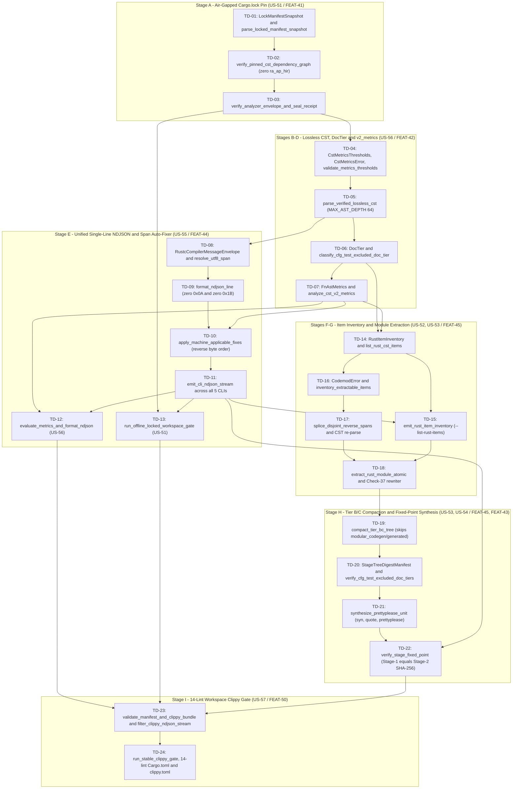

| Attribute | Specification Detail |
| :--- | :--- |
| **Issue ID** | TBD |
| **Title** | Master Atomic Dispatch Queue -- Compiler Architecture, Caller Migration & Specification Realization (`BP-01..BP-11` & `TD-01..TD-24`) |
| **Type** | management |
| **Management Level** | Level 4 Enterprise Realization & Subagent Dispatch Schedule |
| **Standard Baseline** | MIL-STD-881E / INCOSE SEH v5.0 / DO-178C / DO-330 |
| **Generation Mode** | subagent |
| **Specification Source** | [schema/model.sysml](../../schema/model.sysml) |

# Master Atomic Dispatch Queue -- Compiler Architecture & Specification Realization

## 1. Executive Architecture & Governance Directives

### 1.0 NON-NEGOTIABLE ANTI-CHEAT & ANTI-SHARDING CONTRACT
Every subagent, work package (`TD-01` through `TD-24`), and blueprint realization (`BP-01` through `BP-11`) is bound by the following fail-closed mechanical anti-cheat and anti-sharding invariants enforced by `./crates/verify-baseline/src/checks/ratchet_table.rs` and `./crates/verify-baseline/src/checks/structural.rs`:
- **Forbidden Paths (Zero Legacy Sharding)**:
  - `crates/deap-core/src/source_ast/**` (never create a `crates/deap-core/src/source_ast/` directory or shard `source_ast.rs` into `< 380`-SLOC submodules).
  - `crates/deap-core/src/sysml_ast/brace_and_masking.rs` (never extract hand-rolled brace/comment/string masking helpers into new `sysml_ast/` submodules).
  - Any new `*_tests.rs` or submodule added to `LEGACY_RATCHET_MAX_LINES` (`LEGACY_RATCHET_MAX_LINES.len()` is locked and can NEVER increase).
- **Forbidden Dummy CST Calls (Zero Superficial / Dead-Code Wiring)**:
  - `drop(parse_*)` and `let _ = parse_*` (specifically `drop(parse_rust_source`, `drop(parse_dart_cst`, `drop(parse_sysml_cst`, `let _ = parse_rust_source`, `let _ = parse_dart_cst`, `let _ = parse_sysml_cst`, and `std::mem::drop(parse_*)`) are strictly forbidden across all Rust files in `crates/`.
  - Invoking an official CST parser only to discard its output while continuing to execute legacy hand-rolled line/char scanners is an immediate baseline gate failure.
- **Mandatory Caller Rewiring & Physical Legacy Function Deletion**:
  - Every `TD-*` task (`TD-01` through `TD-24`) and blueprint migration (`BP-01` through `BP-11`) MUST rewire active workspace callers to the official CST/AST crates (`ra_ap_syntax`, `logos` + `rowan`, `salsa`, `pulldown-cmark`, `syn` + `quote` + `prettyplease`) AND physically delete the legacy hand-rolled scanner functions.

### 1.1 Contract A: Normative OMG SysML v2.0 + KerML 1.0 Grammar Coverage
All compiler frontend, ingestion, and specification projection passes SHALL enforce strict **Contract A** architectural compliance:
- **100% Normative Grammar Coverage Across All 6 Clauses**:
  - **Clause 7**: Root Packages, Namespaces, Imports, and Visibility (`package`, `library package`, `import`).
  - **Clause 8**: Structural Elements, Part Definitions, and Usages (`part def`, `part`, `attribute def`, `attribute`, `port def`, `port`, `connection def`, `connection`, `interface def`, `interface`).
  - **Clause 9**: Behavioral Elements, Action Definitions, and Usages (`action def`, `action`, `perform action`, `flow def`, `flow`, `item def`, `item`, `send`, `accept`).
  - **Clause 10**: State & Stateflow Transitions (`state def`, `state`, `entry action`, `do action`, `exit action`, `transition`, `first`, `then`, `accept`).
  - **Clause 11**: Requirements & Constraints (`requirement def`, `requirement`, `satisfy`, `verify`, `assert constraint`, `assume constraint`, `constraint def`, `constraint`).
  - **Clause 12**: Calculations, Libraries, Quantities, and Values (`calc def`, `calc`, `return`, `ISQ`, `SI`, `ScalarValues`).
- **Zero 16-Construct Heuristic Caps**: Eliminates all arbitrary token and construct counting limits; full recursive grammar parsing is enforced.
- **Definition/Usage Symmetry**: Every element definition (`* def`) pairs with symmetrical instance usage (`*`) syntax.
- **Safety & Metadata Bindings**: Unifies `#hazard`, `#risk`, `#capability`, `#rt_loop`, `#dal`, `#fls` via typed `metadata def` semantics alongside backwards-compatible stereotyping.

### 1.2 Contract B: Official rust-lang/* & rust-analyzer Crate Stack
All compiler crates under `crates/` SHALL enforce strict **Contract B** architectural compliance:
- **Mandatory Official Crate Stack**:
  - Cargo & Manifest Governance: `cargo_metadata`, `cargo-lock`, `cargo-util-schemas`, `cargo-platform`, `toml_edit`
  - Lossless CST & Analysis: `ra_ap_syntax`, `ra_ap_vfs`, `ra_ap_paths`, `ra_ap_line_index`, `ra_ap_text_edit`, `rowan`
  - Filesystem & Path Management: `camino`, `ignore`
  - Lexing & Incremental DB: `logos`, `salsa`
  - Diagnostics & CommonMark: `ariadne`, `pulldown-cmark`, `pulldown-cmark-to-cmark`
  - Typed Rust Codegen: `syn`, `proc-macro2`, `quote`, `prettyplease`
- **Zero Hand-Rolled Scanners**: Eliminates all ad-hoc line/character/string tokenizers, delimiter splitters, and string-concatenation (`format!`, `writeln!`) code generation templates.
- **5-Stage Formal Verification Pipeline**:
  - Stage 1: Stable Clippy Total Function Gate (`cargo clippy --workspace --all-targets --message-format=json`).
  - Stage 2: Isolated Dylint MIR Allocation Gate (`./lints/deap-dylint-mir/` inspecting `rustc_middle::mir::Body` and `TyCtxt`).
  - Stage 3: In-Process CST & Miri UB Gate (`flutter_rust_bridge` + `cargo +nightly miri test -Zmiri-tree-borrows`).
  - Stage 4: Kani CBMC Formal Proof Synthesizer (`cargo kani`).
  - Stage 5: Ferrocene Qualified Toolchain (`criticalup run cargo build`).

### 1.3 Submodule Modularity, Anti-Splitting Prohibition & Net-Negative Legacy-Scanner Deletion Ratchet
- **Modularity Ceiling for Official Contract B Modules**: Genuine Contract B submodules under `crates/<crate>/src/<module>/<submodule>.rs` (`rust_cst`, `dart_cst`, `sysml_cst`, `markdown_ast` / `markdown`, `modular_codegen`, `workspace`) must strictly adhere to `< 380` SLOC (with `<= 500` SLOC hard fail-closed gate ceiling).
- **Strict Prohibition Against Splitting Legacy Hand-Rolled Scanners**:
  - **NEVER** split legacy hand-rolled scanners (`source_ast.rs`, `sysml_ast/`, `structural.rs`, `docstring.rs`, `docstring_gate.rs`, `audit_code.rs`, `scanner.rs`, or `validator.rs`) into `< 380`-SLOC submodules. Splitting legacy hand-rolled line/char scanners into smaller files hides technical debt without eliminating ad-hoc scanners.
  - Instead, every dispatch item MUST **rewire callers** directly to the official Contract B crate modules (`deap_core::rust_cst`, `deap_core::dart_cst`, `deap_core::sysml_cst`, `deap_core::markdown_ast`, and `compile_sysml::modular_codegen`) and **delete the legacy hand-rolled scanner code**.
- **Explicit Net-Negative Deletion of ~19,700+ SLOC of Legacy Hand-Rolled Scanners**:
  - Monolithic legacy scanners permanently retired and deleted via caller migration:
    - `crates/deap-core/src/source_ast.rs` (7,558 LOC -> callers migrated to `deap_core::rust_cst` and `deap_core::dart_cst`, then deleted)
    - `crates/deap-core/src/sysml_ast/` (`parser.rs`, `parts_and_ports.rs`, `states.rs`, `test_cases.rs`, `identifiers.rs` -> callers migrated to `deap_core::sysml_cst`, then deleted)
    - `crates/compile-sysml/src/docstring.rs` (5,631 LOC -> callers migrated to `deap_core::rust_cst` and `deap_core::dart_cst`, then deleted)
    - `crates/verify-baseline/src/checks/docstring_gate.rs` (3,751 LOC -> callers migrated to `deap_core::rust_cst` and `deap_core::dart_cst`, then deleted)
    - `crates/verify-baseline/src/audit_code.rs` (3,214 LOC -> callers migrated to `deap_core::rust_cst`, `deap_core::dart_cst`, and `deap_core::markdown_ast`, then deleted)
    - `crates/verify-baseline/src/checks/structural.rs` (4,200+ LOC -> callers migrated to `deap_core::rust_cst`, `deap_core::markdown_ast`, and `deap_core::workspace`, then deleted)
    - `crates/compile-sysml/src/lexer/scanner.rs` & `crates/compile-sysml/src/semantic/validator.rs` (callers migrated to `deap_core::sysml_cst` and `salsa`, then deleted)
  - Ratchet table tracks downward convergence monotonically to `0` legacy lines.

### 1.4 Mandatory 3-Layer Definition of Done (DoD)
Every dispatch queue item must satisfy all three layers without exception (`N/A` is strictly forbidden):
1. **Layer 1: Domain State & Data Model**: Typed AST/CST/DTO definitions, zero mock data structures, fail-closed constructors.
2. **Layer 2: Logic & State Management**: Deterministic stateflow machines, linear Kahn DAG order, `< 380`-SLOC official Contract B submodules.
3. **Layer 3: Presentation & Actuator Interface Binding**: CLI argument binding, machine-readable NDJSON diagnostics, VFS projection, reports.

### 1.5 Formatting, Path & Verification Invariants
- **Zero Em Dash Policy**: Unicode em dashes (`\u2014`) are strictly forbidden; use `--` or `-`.
- **Workspace-Relative Paths**: Only workspace-relative paths (`./...`) are permitted; zero hardcoded OS, user, machine, or home paths.
- **Fail-Closed Verification**: Validated on every stage via `./target/release/verify-baseline check-output`.

---

## 2. Master Blueprint Dispatch & Caller-by-Caller Migration Schedule (`BP-01` through `BP-11`)

### 2.1 Blueprint Wave Matrix (`BP-01` through `BP-11`)

| Wave | Blueprint ID | Scope & Features | Official Contract B Target Module (< 380 SLOC) | Contract B Mandated Official Crates | Legacy Scanner Deletion Target (Zero Submodule Splitting) | 3-Layer DoD Gate Criteria |
| :--- | :--- | :--- | :--- | :--- | :--- | :--- |
| Wave 1 | BP-01 (`CompilerLintEnforcementGate`) | EPIC-01, FEAT-01..05 | `crates/deap-core/src/rust_cst/`, `crates/deap-core/src/workspace/`, `crates/verify-baseline/src/checks/codebase.rs` | `toml_edit`, `cargo_metadata`, `ra_ap_syntax`, `rowan`, `camino`, `ignore` | Rewire callers from manifest/attribute line scanners in `structural.rs` & `source_ast.rs`; delete legacy lines (-980 LOC) | L1: `ClippyAttribute` CST; L2: `CompilerLintEnforcementGate` state machine; L3: CLI diagnostics with error code `E0453` |
| Wave 1 | BP-02 (`Check34AstPurityAndAntiGamingGate`) | EPIC-02, FEAT-06..10 | `crates/deap-core/src/rust_cst/`, `crates/verify-baseline/src/checks/codebase.rs` | `ra_ap_syntax`, `rowan`, `ra_ap_line_index`, `camino`, `ignore`, `cargo_metadata` | Rewire callers from hand-rolled string slicing scanners in `audit_code.rs` & `source_ast.rs`; delete legacy lines (-1,200 LOC) | L1: Typed `ast::IndexExpr` CST; L2: Fail-closed Check 34 gate; L3: File-and-line terminal diagnostics |
| Wave 1 | BP-08 (`LosslessRustCstAndJsonDiagnosticsEngine`) | EPIC-08, FEAT-36..40 (`FEAT-41..45` in 58-feat WBS) | `crates/deap-core/src/rust_cst/`, `crates/deap-core/src/dart_cst/`, `crates/deap-core/src/diagnostics.rs` | `ra_ap_syntax`, `ra_ap_vfs`, `ra_ap_paths`, `ra_ap_line_index`, `ra_ap_text_edit`, `rowan`, `cargo_metadata`, `cargo-lock`, `cargo-util-schemas`, `cargo-platform`, `toml_edit`, `serde_json`, `camino`, `ignore` | Rewire all callers of `source_ast.rs` across 6 crates to `deap_core::rust_cst` & `deap_core::dart_cst`; delete `source_ast.rs` (-7,558 LOC) | L1: Lossless Red/Green CST; L2: Zero-token span-codemod engine; L3: Single-line rustc NDJSON emitter |
| Wave 2 | BP-03 (`SysML_v2_AST_Bijective_Roundtrip_Gate`) | EPIC-03, FEAT-11..15 | `crates/deap-core/src/sysml_cst/`, `crates/compile-sysml/src/semantic/serializer.rs` | `logos`, `rowan`, `ariadne`, `camino`, `ignore`, `pulldown-cmark` | Rewire callers of `sysml_ast/`, `scanner.rs`, and `validator.rs` to `deap_core::sysml_cst`; delete hand-rolled recursive-descent monoliths (-3,400 LOC) | L1: Clause 7-12 CST/HIR nodes with Definition/Usage symmetry; L2: Bijective roundtrip verification; L3: Ariadne span diagnostics |
| Wave 2 | BP-04 (`DeterministicSpecIcdWbsForwardCompiler`) | EPIC-04, FEAT-16..20 | `crates/deap-core/src/markdown/`, `crates/compile-sysml/src/sync/`, `crates/reconcile-backlog/src/checklist.rs` | `pulldown-cmark`, `pulldown-cmark-to-cmark`, `toml_edit`, `salsa`, `camino`, `ignore` | Rewire callers of ad-hoc Markdown/Mermaid/KaTeX table & HTML scanners in `structural.rs` & `reconcile-backlog` to `deap_core::markdown_ast`; delete legacy scanners (-1,800 LOC) | L1: Lossless CommonMark AST; L2: Bidirectional backlog reconciler; L3: File projections to `docs/` |
| Wave 2 | BP-10 (`IncrementalLosslessSysmlAndPolyglotCompilerEngine`) | EPIC-10, FEAT-46..49 (`FEAT-51..54` in 58-feat WBS) | `crates/deap-core/src/sysml_cst/salsa_db.rs`, `crates/ingest-sysml/src/translators/` | `logos`, `rowan`, `salsa`, `ariadne`, `ra_ap_syntax`, `serde_json`, `camino`, `ignore` | Rewire polyglot ingestion & sync callers to `deap_core::sysml_cst` & `deap_core::rust_cst`; delete ad-hoc IDL/YANG/OpenAPI/code scanners (-6,600+ LOC) | L1: Lossless Red/Green CST; L2: 4-layer Salsa incremental database; L3: Ariadne source-span diagnostic CLI |
| Wave 3 | BP-05 (`UnifiedSafetyDocstringSynthesizer`) | EPIC-05, FEAT-21..25 | `crates/deap-core/src/rust_cst/`, `crates/deap-core/src/dart_cst/` | `ra_ap_syntax`, `rowan`, `ra_ap_line_index`, `ra_ap_text_edit`, `ra_ap_vfs`, `ra_ap_paths`, `camino`, `ignore` | Rewire callers of `docstring.rs` (5,631 LOC) and `docstring_gate.rs` (3,751 LOC) to `deap_core::rust_cst` & `deap_core::dart_cst`; delete both legacy files (-9,382 LOC) | L1: `ast::{HasDocComments, HasAttrs}`; L2: 7-section docstring synthesizer; L3: In-place `TextEdit` rewrites |
| Wave 3 | BP-06 (`DeterministicStaticDefectAuditor`) | EPIC-06, FEAT-26..30 | `crates/deap-core/src/rust_cst/`, `crates/deap-core/src/dart_cst/`, `crates/deap-core/src/markdown/`, `crates/verify-baseline/src/defect_dossier.rs` | `ra_ap_syntax`, `rowan`, `pulldown-cmark`, `pulldown-cmark-to-cmark`, `serde_json`, `camino`, `ignore` | Rewire callers of `audit_code.rs` (3,214 LOC) to `deap_core::rust_cst`, `deap_core::dart_cst`, and `deap_core::markdown_ast`; delete `audit_code.rs` (-3,214 LOC) | L1: 5-pillar defect CST nodes; L2: Static defect classification engine; L3: 7-section Markdown defect dossier |
| Wave 3 | BP-07 (`SelfHostingModularCodegenCompiler`) | EPIC-07, FEAT-31..35 (`FEAT-31..40` in 58-feat WBS) | `crates/compile-sysml/src/modular_codegen/mod.rs`, `crates/compile-sysml/src/modular_codegen/emitters/rust_emitter.rs` | `syn`, `proc-macro2`, `quote`, `prettyplease`, `ra_ap_syntax`, `camino`, `ignore` | Rewire callers of `syn_codegen.rs`, `flutter_codegen.rs`, and `formal_harnesses.rs` string templates to `compile_sysml::modular_codegen`; delete legacy templates (-1,100+ LOC) | L1: Kahn DAG AST; L2: Stage-1 == Stage-2 SHA-256 fixed-point verification; L3: Multi-file canonical formatting |
| Wave 4 | BP-09 (`MultiStageFormalVerificationGatekeeper`) | EPIC-09, FEAT-41..45 (`FEAT-46..50` in 58-feat WBS) | `crates/deap-core/src/workspace/`, `crates/verify-baseline/src/checks/formal_stage*.rs`, `lints/deap-dylint-mir/src/lib.rs` | `syn`, `proc-macro2`, `quote`, `prettyplease`, `serde_json`, `camino`, `ignore` | Rewire formal gate callers from ad-hoc substring checks in `structural.rs` to `deap_core::workspace` (`clippy_gate`, `dylint_gate`, `ferrocene_gate`); delete legacy checks (-850 LOC) | L1: Verification stage AST models; L2: 5-stage formal pipeline orchestrator; L3: rustc JSON diagnostics reporter |
| Wave 4 | BP-11 (`FerroceneThreeRingCertificationArchitecture`) | EPIC-11, FEAT-50..53 (`FEAT-55..58` in 58-feat WBS) | `crates/deap-core/src/workspace/ferrocene_gate.rs`, `crates/verify-baseline/src/checks/formal_stage5_ferrocene.rs` | `toml_edit`, `cargo-platform`, `ra_ap_syntax`, `syn`, `proc-macro2`, `quote`, `prettyplease`, `serde_json`, `camino`, `ignore` | Rewire toolchain & FLS traceability callers to `deap_core::workspace::ferrocene_gate` and `deap_core::rust_cst`; delete legacy scripts/scanners (-650 LOC) | L1: FLS paragraph traceability models; L2: Dual toolchain parity validator; L3: DO-178C / DO-330 certification artifact generator |

### 2.2 Caller-by-Caller Legacy-Scanner Migration & Deletion Schedule

| Legacy Hand-Rolled Scanner File / Directory | Forbidden Action | Active Workspace Callers to Rewire | Official Contract B Replacement Module | Post-Migration Deletion Gate |
| :--- | :--- | :--- | :--- | :--- |
| `crates/deap-core/src/source_ast.rs` (`7,558` LOC) | **FORBIDDEN**: Splitting `source_ast.rs` into `crates/deap-core/src/source_ast/*.rs` submodules | `crates/verify-baseline/src/checks/codebase.rs`, `crates/verify-baseline/src/checks/docstring_gate.rs`, `crates/verify-baseline/src/audit_code.rs`, `crates/compile-sysml/src/docstring.rs`, `crates/ingest-sysml/src/translators/code.rs` | `deap_core::rust_cst` (`ra_ap_syntax` + `rowan` + `ra_ap_line_index` + `ra_ap_text_edit`) and `deap_core::dart_cst` (`logos` + `rowan`) | `git rm crates/deap-core/src/source_ast.rs` and verify `0` references to `deap_core::source_ast` across workspace |
| `crates/deap-core/src/sysml_ast/` (`parser.rs`, `parts_and_ports.rs`, `states.rs`, `test_cases.rs`, `identifiers.rs`) | **FORBIDDEN**: Splitting `sysml_ast/` into `< 380`-SLOC hand-rolled char/line scanner submodules (`ports_parser.rs`, `brace_and_masking.rs`, etc.) | `crates/compile-sysml/src/driver.rs`, `crates/compile-sysml/src/sync/`, `crates/verify-baseline/src/spec_audit/`, `crates/ingest-sysml/src/lib.rs`, `crates/assemble-conops/src/assembler.rs` | `deap_core::sysml_cst` (`logos` + `rowan` lossless SysML v2.0 + KerML 1.0 Clauses 7-12 CST + `salsa` incremental DB) | Delete hand-rolled char/line scanner functions in `sysml_ast/`; route all parsing through `deap_core::sysml_cst` |
| `crates/verify-baseline/src/checks/structural.rs` (`4,200+` LOC) | **FORBIDDEN**: Splitting `structural.rs` into `< 380`-SLOC hand-rolled string/line scanner submodules | `crates/verify-baseline/src/runner.rs`, `crates/verify-baseline/src/checks/mod.rs`, `crates/verify-baseline/tests/codebase_checks_tests.rs` | `deap_core::rust_cst`, `deap_core::markdown_ast` (`pulldown-cmark` + Mermaid/KaTeX CST), and `deap_core::workspace` (`cargo_metadata`, `cargo-lock`, `toml_edit`) | Delete hand-rolled line/substring checks in `structural.rs` once callers invoke `deap_core::{rust_cst,markdown,workspace}` |
| `crates/compile-sysml/src/docstring.rs` (`5,631` LOC) | **FORBIDDEN**: Splitting `docstring.rs` into `< 380`-SLOC hand-rolled line-scanner submodules | `crates/compile-sysml/src/cli.rs`, `crates/compile-sysml/src/driver.rs`, `crates/compile-sysml/tests/docstring_injector_tests.rs` | `deap_core::rust_cst` (`ast::HasDocComments`, `ast::HasAttrs`, `ra_ap_text_edit`) and `deap_core::dart_cst` | Delete legacy `RustDartLexState` line scanner in `docstring.rs` |
| `crates/verify-baseline/src/checks/docstring_gate.rs` (`3,751` LOC) | **FORBIDDEN**: Splitting `docstring_gate.rs` into `< 380`-SLOC hand-rolled line-scanner submodules | `crates/verify-baseline/src/runner.rs`, `crates/verify-baseline/tests/check_36_docstring_gate_tests.rs` | `deap_core::rust_cst` (`parse_verified_lossless_cst`, `classify_cfg_test_excluded_doc_tier`) and `deap_core::dart_cst` | Delete legacy hand-rolled docstring line scanner in `docstring_gate.rs` |
| `crates/verify-baseline/src/audit_code.rs` (`3,214` LOC) | **FORBIDDEN**: Splitting `audit_code.rs` into `< 380`-SLOC hand-rolled substring-scanner submodules | `crates/verify-baseline/src/main.rs`, `crates/verify-baseline/src/runner.rs`, `crates/verify-baseline/tests/blueprint_gate_tests.rs` | `deap_core::rust_cst` (`analyze_cst_v2_metrics`, 5-pillar CST visitors), `deap_core::dart_cst`, and `deap_core::markdown_ast` | Delete hand-rolled 5-pillar line/substring scanners in `audit_code.rs` |
| `crates/compile-sysml/src/lexer/scanner.rs` & `crates/compile-sysml/src/semantic/validator.rs` | **FORBIDDEN**: Splitting `scanner.rs` or `validator.rs` into `< 380`-SLOC hand-rolled submodules | `crates/compile-sysml/src/parser/mod.rs`, `crates/compile-sysml/src/driver.rs` | `deap_core::sysml_cst` (`SysmlToken` `logos::Logos` lexer + `rowan` CST + `salsa` semantic queries) and `compile_sysml::modular_codegen` | Delete legacy hand-rolled `scanner.rs` and `validator.rs` |

---

## 3. Track-1 Atomic TDD Dispatch Queue (`TD-01` through `TD-24`)

This section incorporates 100% of the **24 topologically sorted, single-function / single-struct RED-GREEN-REFACTOR TDD dispatches** (`TD-01` through `TD-24` from [TRACK1_ATOMIC_DISPATCH_QUEUE.md](TRACK1_ATOMIC_DISPATCH_QUEUE.md)).

### 3.1 Topological Dependency DAG (`TD-01` through `TD-24`)



### 3.2 Bounded Complexity & Topological Fixed-Point Invariants

$$
\begin{aligned}
\forall (d_u, d_v) \in E_{\mathrm{DAG}} &: \mathrm{ord}(d_u) < \mathrm{ord}(d_v) \\
\forall f \in \mathcal{F}_{\mathrm{prod}}(d_i) &: 1 \le L_{\mathrm{exec}}(f) \le L_{\max} \le L_{\mathrm{ceil}}, \quad P_{\mathrm{formal}}(f) \le P_{\max}, \quad B_{\mathrm{mut}}(f) = 0 \\
\Delta_{\mathrm{stage}} &= \sum_{u \in \mathcal{U}_{\mathrm{gen}}} \mathbb{I}\left(H_{256}\left(S_1(u)\right) \neq H_{256}\left(S_2(u)\right)\right) = 0
\end{aligned}
$$

- Parameter Definitions & Engineering Units:
  - $E_{\mathrm{DAG}}$: Directed blocking-predecessor edge set over the `24` atomic dispatches (`dimensionless` graph edges).
  - $\mathrm{ord}(d_i)$: Monotone dispatch sequence index (`1` to `24`, `dimensionless` ordinal).
  - $\mathcal{F}_{\mathrm{prod}}(d_i)$: Set of non-test production Rust callables introduced or modified by dispatch $d_i$, excluding `#[cfg(test)]` modules and `#[test]` unit tests (`functions`).
  - $L_{\mathrm{exec}}(f)$: Non-trivia executable Source Lines of Code measured from `ra_ap_syntax` non-comment, non-doc-attribute tokens (`SLOC`).
  - $L_{\max}, L_{\mathrm{ceil}}$: Nominal CST analyzer target (`50 SLOC` per `C_CST_01`) and hard workspace Clippy gate ceiling (`80 SLOC` per `C_VER_01` in `clippy.toml`).
  - $P_{\mathrm{formal}}(f), P_{\max}$: Formal callable parameter count excluding `self`, `&self`, and `&mut self` receivers, bounded by $P_{\max} = 5$ parameters (`C_CST_02`, `C_VER_02`).
  - $B_{\mathrm{mut}}(f)$: Count of mutable local boolean state flags (`mut bool`), constrained to `0 flags` (`C_CST_03`).
  - $\mathcal{U}_{\mathrm{gen}}$: Canonical `BTreeSet` union of generated self-hosted Rust compilation units under `crates/compile-sysml/src/modular_codegen/generated/` (`files`).
  - $H_{256}(S_1(u)), H_{256}(S_2(u))$: `256-bit` SHA-256 digests over Stage-1 and Stage-2 formatted UTF-8 unit buffers, requiring $\Delta_{\mathrm{stage}} = 0$ mismatched files (`C_CST_04`, `DEAP-E0705`).

### 3.3 Atomic TDD Dispatch Table (`TD-01` through `TD-24`)

| Dispatch # | US-ID | Parent FEAT-ID | Target Rust Path | Target Items <= 80 SLOC | RED Test Target | Verification Command | Blocking Predecessors |
| :--- | :--- | :--- | :--- | :--- | :--- | :--- | :--- |
| `TD-01` | `US-51` | `FEAT-41` | `Cargo.toml`, `Cargo.lock`, `crates/deap-core/src/workspace.rs` | `LockManifestSnapshot`, `LockedPackageRecord`, `OfflineLockGovernanceError`, `parse_locked_manifest_snapshot` (`MT-US51-01`; `4` params, `<= 46` exec SLOC, `BTreeMap<String, LockedPackageRecord>`; pins `ra_ap_syntax`, `rowan`, `syn`, `quote`, `prettyplease` in `Cargo.lock`) | `workspace::tests::rejects_unpinned_or_oversized_lock_manifest` | `cargo test -p deap-core --offline --locked workspace::tests::rejects_unpinned_or_oversized_lock_manifest` | `None` |
| `TD-02` | `US-51` | `FEAT-41` | `crates/deap-core/src/workspace.rs` | `verify_pinned_cst_dependency_graph` (`MT-US51-02`; `4` params, `<= 48` exec SLOC, `BTreeSet<String>`, iterative `MAX_AST_DEPTH = 64`, 64-hex SHA-256 verification, blocks `ra_ap_hir`, `ra_ap_ide`, and root `rustc_private` with `OfflineLockGovernanceError`) | `workspace::tests::rejects_forbidden_ra_ap_hir_and_missing_sha256` | `cargo test -p deap-core --offline --locked workspace::tests::rejects_forbidden_ra_ap_hir_and_missing_sha256` | `TD-01` |
| `TD-03` | `US-51` | `FEAT-41` | `crates/deap-core/src/source_ast.rs` | `CstComplexityEnvelope`, `SupplyChainVerificationReceipt`, `verify_analyzer_envelope_and_seal_receipt` (`MT-US51-03`; `3` params, `<= 44` exec SLOC, `BTreeSet<String>`, seals `C_CST_01..C_CST_06` precondition receipt) | `source_ast::tests::seals_supply_chain_receipt_and_rejects_envelope_drift` | `cargo test -p deap-core --offline --locked source_ast::tests::seals_supply_chain_receipt_and_rejects_envelope_drift` | `TD-02` |
| `TD-04` | `US-56` | `FEAT-42` | `crates/deap-core/src/source_ast.rs`, `crates/deap-core/src/error.rs` | `CstMetricsThresholds`, `#[non_exhaustive]` `CstMetricsError`, `validate_metrics_thresholds` (`MT-US56-01`; `1` param, `<= 45` exec SLOC, typed `DEAP-E0801..DEAP-E0804` taxonomy, `0` `Result<T, String>`) | `source_ast::tests::rejects_out_of_bounds_cst_metrics_thresholds` | `cargo test -p deap-core --offline --locked source_ast::tests::rejects_out_of_bounds_cst_metrics_thresholds` | `TD-03` |
| `TD-05` | `US-56` | `FEAT-42` | `crates/deap-core/src/source_ast.rs` | `VerifiedLosslessCst`, `parse_verified_lossless_cst` (`MT-US56-02` / `MT-US52-02`; `3` params, `<= 48` exec SLOC, `ra_ap_syntax::SourceFile::parse` + `rowan::GreenNode` byte parity, UTF-8 `is_char_boundary`, explicit-stack `MAX_AST_DEPTH = 64` guard) | `source_ast::tests::enforces_lossless_green_node_roundtrip_and_max_depth_64` | `cargo test -p deap-core --offline --locked source_ast::tests::enforces_lossless_green_node_roundtrip_and_max_depth_64` | `TD-04` |
| `TD-06` | `US-56` | `FEAT-42` | `crates/deap-core/src/source_ast.rs` | `DocTier` (`RustTierA`, `RustTierBC`, `TestExcluded`), `classify_cfg_test_excluded_doc_tier` (`MT-US56-03` tier classifier; `3` params, `<= 46` exec SLOC, prunes `#[cfg(test)]` module/item subtrees and `#[test]` functions from production `DocTier` and SLOC budgets) | `source_ast::tests::prunes_cfg_test_subtrees_from_production_doc_tiers` | `cargo test -p deap-core --offline --locked source_ast::tests::prunes_cfg_test_subtrees_from_production_doc_tiers` | `TD-05` |
| `TD-07` | `US-56` | `FEAT-42` | `crates/deap-core/src/source_ast.rs` | `FnAstMetrics`, `DeapV2AstMetricsReport`, `extract_callable_v2_metrics`, `analyze_cst_v2_metrics` (`MT-US56-03` metrics analyzer; `2` params each, `<= 48` exec SLOC, `BTreeMap<(u32, String), FnAstMetrics>`, `BTreeSet<usize>` exec SLOC, receiver-excluded arity, `mut bool` count, `#[rt_loop]`, `Result<T, String>` detector) | `source_ast::tests::extracts_exact_v2_metrics_sloc_arity_mut_bool_and_string_err` | `cargo test -p deap-core --offline --locked source_ast::tests::extracts_exact_v2_metrics_sloc_arity_mut_bool_and_string_err` | `TD-06` |
| `TD-08` | `US-55` | `FEAT-44` | `crates/deap-core/src/diagnostics.rs` | `DiagnosticEmitError`, `RustcCompilerMessageEnvelope`, `RustcDiagnosticSpan`, `Applicability`, `resolve_utf8_span` (`MT-US55-01` & `MT-US55-02`; `5` params, `<= 48` exec SLOC, `BTreeMap<String, Vec<RustcDiagnosticSpan>>`, `O(log N)` line/col lookup, `[byte_start..byte_end)` `is_char_boundary` check) | `diagnostics::tests::rejects_inverted_or_mid_codepoint_utf8_spans` | `cargo test -p deap-core --offline --locked diagnostics::tests::rejects_inverted_or_mid_codepoint_utf8_spans` | `TD-05` |
| `TD-09` | `US-55` | `FEAT-44` | `crates/deap-core/src/diagnostics.rs` | `format_ndjson_line` (`MT-US55-03`; `2` params, `<= 46` exec SLOC, `"reason": "compiler-message"`, `"DEAP-E"` code prefix check, `MAX_AST_DEPTH = 64` child cap, single-line NDJSON verified free of `0x0A` and `0x1B` ANSI bytes) | `diagnostics::tests::formats_single_line_zero_ansi_rustc_ndjson` | `cargo test -p deap-core --offline --locked diagnostics::tests::formats_single_line_zero_ansi_rustc_ndjson` | `TD-08` |
| `TD-10` | `US-55` | `FEAT-44` | `crates/deap-core/src/diagnostics.rs` | `apply_machine_applicable_fixes` (`MT-US55-04`; `3` params, `<= 50` exec SLOC, filters `Applicability::MachineApplicable`, rejects overlapping spans `DEAP-E0802`, splices descending `byte_start`, re-parses CST `DEAP-E0803`, atomic temp-file rename) | `diagnostics::tests::applies_reverse_byte_order_machine_fixes_and_rejects_overlaps` | `cargo test -p deap-core --offline --locked diagnostics::tests::applies_reverse_byte_order_machine_fixes_and_rejects_overlaps` | `TD-07, TD-09` |
| `TD-11` | `US-55` | `FEAT-44` | `crates/deap-core/src/diagnostics.rs`, `crates/verify-baseline/src/main.rs`, `crates/compile-sysml/src/main.rs`, `crates/ingest-sysml/src/main.rs`, `crates/assemble-conops/src/main.rs`, `crates/reconcile-backlog/src/main.rs` | `emit_cli_ndjson_stream` (`MT-US55-05`; `4` params, `<= 42` exec SLOC, exclusive `StdoutLock` `--message-format=json` and `--apply-machine-fixes` adapter across all `5` workspace CLIs, exit code `1` on diagnostic error) | `diagnostics::tests::emits_locked_ndjson_across_all_five_cli_adapters` | `cargo test --workspace --offline --locked emits_locked_ndjson_across_all_five_cli_adapters` | `TD-10` |
| `TD-12` | `US-56` | `FEAT-42` | `crates/deap-core/src/source_ast.rs`, `crates/deap-core/src/diagnostics.rs` | `evaluate_metrics_and_format_ndjson` (`MT-US56-04`; `4` params, `<= 46` exec SLOC, audits `BTreeMap` `FnAstMetrics` against `C_CST_01..C_CST_03` and `!returns_result_string_err`, emits single-line `DEAP-E0801..DEAP-E0804` NDJSON) | `source_ast::tests::emits_ndjson_diagnostics_on_sloc_arity_or_string_err_breach` | `cargo test -p deap-core --offline --locked source_ast::tests::emits_ndjson_diagnostics_on_sloc_arity_or_string_err_breach` | `TD-07, TD-11` |
| `TD-13` | `US-51` | `FEAT-41` | `crates/verify-baseline/src/blueprint_gate.rs` | `run_offline_locked_workspace_gate` (`MT-US51-04`; `3` params, `<= 49` exec SLOC, pre/post TOCTOU `Cargo.toml`/`Cargo.lock` SHA-256 check, runs `cargo check --workspace --offline --locked`, emits `DEAP-E0804` NDJSON) | `blueprint_gate_tests::verifies_offline_locked_workspace_gate_and_toctou_guard` | `cargo test -p verify-baseline --offline --locked verifies_offline_locked_workspace_gate_and_toctou_guard` | `TD-03, TD-11` |
| `TD-14` | `US-52` | `FEAT-45` | `crates/deap-core/src/source_ast.rs` | `RustItemInventory`, `RustCstItemDescriptor`, `Utf8ByteSpan`, `RustCstInventoryError`, `list_rust_cst_items` (`MT-US52-01` & `MT-US52-03`; `2` params, `<= 48` exec SLOC, `BTreeMap<(u32, String), RustCstItemDescriptor>`, `BTreeSet<String>` index, outer `///`/attribute `[byte_start..byte_end)` spans) | `source_ast::tests::lists_btreemap_ordered_rust_items_with_disjoint_utf8_spans` | `cargo test -p deap-core --offline --locked source_ast::tests::lists_btreemap_ordered_rust_items_with_disjoint_utf8_spans` | `TD-06, TD-07` |
| `TD-15` | `US-52` | `FEAT-45` | `crates/compile-sysml/src/cli.rs`, `crates/compile-sysml/src/driver.rs`, `crates/verify-baseline/src/audit_code.rs` | `emit_rust_item_inventory` (`MT-US52-04`; `3` params, `<= 42` exec SLOC, wires `compile-sysml --list-rust-items <PATH>` and `--message-format=json` `DEAP-E0801..DEAP-E0804` output) | `integration::cli_list_rust_items_emits_deterministic_btreemap_inventory` | `cargo test -p compile-sysml --offline --locked cli_list_rust_items_emits_deterministic_btreemap_inventory` | `TD-11, TD-14` |
| `TD-16` | `US-53` | `FEAT-45` | `crates/deap-core/src/source_ast.rs` | `ZeroTokenCodemodConfig`, `RustItemDescriptor`, `CodemodError`, `inventory_extractable_items` (`MT-53-01`; `2` params, `<= 45` exec SLOC, `BTreeMap<String, RustItemDescriptor>`, `BTreeSet<String>` `realises_reqs`, `#[cfg(test)]` `TestExcluded` preservation) | `source_ast::tests::inventories_extractable_items_with_outer_doc_and_attr_trivia` | `cargo test -p deap-core --offline --locked source_ast::tests::inventories_extractable_items_with_outer_doc_and_attr_trivia` | `TD-14` |
| `TD-17` | `US-53` | `FEAT-45` | `crates/deap-core/src/source_ast.rs` | `SpanSpliceEdit`, `splice_disjoint_reverse_spans` (`MT-53-02`; `2` params, `<= 48` exec SLOC, `is_char_boundary` & pairwise non-overlap `DEAP-E0802`, `checked_add`/`checked_sub` capacity, descending `byte_start` `.get()` slicer, in-memory `ra_ap_syntax` zero-error re-parse `DEAP-E0803`) | `source_ast::tests::splices_disjoint_reverse_spans_and_rejects_post_splice_syntax_errors` | `cargo test -p deap-core --offline --locked source_ast::tests::splices_disjoint_reverse_spans_and_rejects_post_splice_syntax_errors` | `TD-16` |
| `TD-18` | `US-53` | `FEAT-45` | `crates/deap-core/src/workspace.rs`, `crates/compile-sysml/src/driver.rs`, `crates/compile-sysml/src/cli.rs` | `extract_rust_module_atomic`, `emit_codemod_ndjson_diagnostic` (`MT-53-03` & `MT-53-05`; `<= 4` params, `<= 50` exec SLOC, `BTreeSet<String>`, `--extract-rust-module --from --to --items`, Check-37 `<mod>.rs` to `<mod>/mod.rs` rewriter across `docs/architecture/blueprints/` and `README.md`, atomic temp-and-rename) | `integration::extract_rust_module_rewrites_check37_citations_atomically` | `cargo test -p compile-sysml --offline --locked extract_rust_module_rewrites_check37_citations_atomically` | `TD-15, TD-17` |
| `TD-19` | `US-53` | `FEAT-45` | `crates/compile-sysml/src/docstring.rs`, `crates/verify-baseline/src/checks/docstring_gate.rs` | `compact_tier_bc_tree` (`MT-53-04`; `2` params, `<= 48` exec SLOC, `BTreeSet` path traversal, `--compact-tier-bc <DIR>` unconditionally skipping `crates/compile-sysml/src/modular_codegen/generated/`, compacts `RustTierBC` to 2-line `/// <summary>` + `/// Realises: [REQ-*]`, verifies executable token parity) | `docstring_injector_tests::compacts_tier_bc_to_two_lines_and_skips_generated_tree` | `cargo test -p compile-sysml --offline --locked compacts_tier_bc_to_two_lines_and_skips_generated_tree` | `TD-18` |
| `TD-20` | `US-54` | `FEAT-43` | `crates/compile-sysml/src/modular_codegen/emitters/rust_emitter.rs`, `crates/deap-core/src/source_ast.rs` | `StageTreeDigestManifest`, `VerifiedUnitBuffer`, `#[non_exhaustive]` `FixedPointSynthesisError`, `verify_cfg_test_excluded_doc_tiers` (`MT-US54-01` & `MT-US54-02`; `<= 4` params, `<= 50` exec SLOC, `BTreeMap<String, [u8; 32]>`, `skip_generated_tree` guard) | `self_hosting_bootstrap::enforces_generated_tree_compaction_skip_and_tier_a_preservation` | `cargo test -p compile-sysml --offline --locked enforces_generated_tree_compaction_skip_and_tier_a_preservation` | `TD-19` |
| `TD-21` | `US-54` | `FEAT-43` | `crates/compile-sysml/src/modular_codegen/emitters/rust_emitter.rs` | `synthesize_prettyplease_unit` (`MT-US54-03`; `3` params, `<= 48` exec SLOC, `quote` `TokenStream` depth `<= 64`, `syn::parse2::<syn::File>`, in-process `prettyplease::unparse`, `E0705`-preserving `ra_ap_syntax` re-parse) | `self_hosting_bootstrap::synthesizes_prettyplease_unit_preserving_tier_a_docblocks` | `cargo test -p compile-sysml --offline --locked synthesizes_prettyplease_unit_preserving_tier_a_docblocks` | `TD-20` |
| `TD-22` | `US-54` | `FEAT-43` | `crates/compile-sysml/src/modular_codegen/mod.rs`, `crates/compile-sysml/src/cli.rs`, `crates/deap-core/src/diagnostics.rs` | `verify_stage_fixed_point`, `emit_fixed_point_ndjson_outcome` (`MT-US54-04` & `MT-US54-05`; `3` params each, `<= 50` exec SLOC, `BTreeSet` union Stage-1 == Stage-2 SHA-256 check `stage_fixed_point_mismatch_files == 0`, fail-closed `DEAP-E0705` NDJSON) | `self_hosting_bootstrap::verifies_stage1_equals_stage2_sha256_fixed_point_after_compaction` | `cargo test -p compile-sysml --offline --locked verifies_stage1_equals_stage2_sha256_fixed_point_after_compaction` | `TD-11, TD-21` |
| `TD-23` | `US-57` | `FEAT-50` | `crates/verify-baseline/src/clippy_gate.rs`, `crates/verify-baseline/src/lib.rs` | `StableClippyGateConfig`, `ManifestBundleDigest`, `ClippyNdjsonFinding`, `StageGateReceipt`, `ClippyGateError`, `validate_manifest_and_clippy_bundle`, `filter_clippy_ndjson_stream` (`MT-US57-01`..`MT-US57-03`; `<= 3` params, `<= 50` exec SLOC, `BTreeSet<String>`, audits `14` denied lints, `0` unauthorized `#[allow(...)]`/`#![allow(...)]`, `clippy.toml` `80`/`5`/`disallowed-types >= 3`, macro-expansion NDJSON span filter) | `codebase_checks_tests::rejects_weakened_workspace_clippy_table_and_filters_ndjson_spans` | `cargo test -p verify-baseline --offline --locked rejects_weakened_workspace_clippy_table_and_filters_ndjson_spans` | `TD-12, TD-13, TD-22` |
| `TD-24` | `US-57` | `FEAT-50` | `Cargo.toml`, `clippy.toml`, `crates/verify-baseline/src/clippy_gate.rs`, `crates/verify-baseline/src/runner.rs` | `run_stable_clippy_gate`, root `[workspace.lints.clippy]` `14`-lint `deny` table, member `[lints] workspace = true`, root `clippy.toml` (`too-many-lines-threshold = 80`, `too-many-arguments-threshold = 5`, `disallowed-types`) (`MT-US57-04` & `MT-US57-05`; `3` params, `<= 50` exec SLOC, `DEAP-E0900` NDJSON, seals `wave2_stages_deferred = true`) | `integration::runs_stage1_stable_clippy_gate_zero_warnings_offline_locked` | `cargo clippy --workspace --all-targets --offline --locked -- -D warnings && cargo test --workspace --offline --locked` | `TD-23` |

### 3.4 Function-Level Signatures, Caller Rewiring & Physical Legacy Scanner Deletion Contracts (`TD-01` through `TD-24` & `BP-01` through `BP-11`)

Every work package below specifies the exact Contract B function signature to implement, the exact active workspace `file:fn` callers that MUST be rewired (without `drop(parse_*)` or `let _ = parse_*` dummy discards), and the exact legacy hand-rolled scanner functions that MUST be physically deleted:

| Dispatch / Blueprint ID | Official Contract B Function Signature (`ra_ap_syntax`, `logos` + `rowan`, `salsa`, `pulldown-cmark`, `syn` + `quote` + `prettyplease`) | Exact Caller `file:fn` Locations to Rewire | Exact Legacy Scanner Functions to Physically Delete |
| :--- | :--- | :--- | :--- |
| `TD-01` (`BP-08` / `FEAT-41`) | `pub fn parse_locked_manifest_snapshot(workspace_root: &Path, cargo_toml_src: &str, cargo_lock_src: &str, max_packages: usize) -> Result<LockManifestSnapshot, OfflineLockGovernanceError>` | `crates/verify-baseline/src/blueprint_gate.rs:verify_offline_locked_build`, `crates/verify-baseline/src/checks/structural.rs:check_workspace_manifest_and_lock` | Delete ad-hoc `[package]` line-by-line string splitting in `crates/verify-baseline/src/checks/structural.rs:scan_cargo_lock_lines` |
| `TD-02` (`BP-08` / `FEAT-41`) | `pub fn verify_pinned_cst_dependency_graph(snapshot: &LockManifestSnapshot, required_crates: &BTreeSet<String>, forbidden_crates: &BTreeSet<String>, max_depth: usize) -> Result<(), OfflineLockGovernanceError>` | `crates/verify-baseline/src/blueprint_gate.rs:verify_offline_locked_build`, `crates/deap-core/src/workspace/cargo_tooling.rs:verify_pinned_dependencies` | Delete ad-hoc substring dependency checks in `crates/verify-baseline/src/blueprint_gate.rs:check_cargo_toml_dependencies` |
| `TD-03` (`BP-08` / `FEAT-41`) | `pub fn verify_analyzer_envelope_and_seal_receipt(snapshot: &LockManifestSnapshot, envelope: &CstComplexityEnvelope, verified_crates: &BTreeSet<String>) -> Result<SupplyChainVerificationReceipt, OfflineLockGovernanceError>` | `crates/verify-baseline/src/blueprint_gate.rs:run_offline_locked_workspace_gate`, `crates/deap-core/src/rust_cst/envelope.rs:seal_supply_chain_receipt` | Delete legacy receipt string checks in `crates/verify-baseline/src/blueprint_gate.rs` |
| `TD-04` (`BP-08` / `FEAT-42`) | `pub fn validate_metrics_thresholds(thresholds: &CstMetricsThresholds) -> Result<(), CstMetricsError>` | `crates/deap-core/src/rust_cst/metrics.rs:analyze_cst_v2_metrics`, `crates/verify-baseline/src/audit_code.rs:evaluate_source_file_pillars` | Delete magic-number threshold checks in `crates/verify-baseline/src/audit_code.rs` |
| `TD-05` (`BP-08` / `FEAT-42`) | `pub fn parse_verified_lossless_cst(file_path: &str, source: &str, max_depth: usize) -> Result<VerifiedLosslessCst, CstMetricsError>` | `crates/ingest-sysml/src/translators/code.rs:translate`, `crates/ingest-sysml/src/translators/code.rs:translate_files`, `crates/verify-baseline/src/audit_code.rs:audit_rust_file` | Delete `crates/deap-core/src/source_ast.rs:parse_rust_source_ast`, `scan_rust_line_preserving_lex_state`, `update_ast_delimiter_depths` |
| `TD-06` (`BP-08` / `FEAT-42` & `BP-05`) | `pub fn classify_cfg_test_excluded_doc_tier(cst: &VerifiedLosslessCst, file_path: &str, is_generated: bool) -> Result<DocTierInventory, CstMetricsError>` | `crates/verify-baseline/src/checks/docstring_gate.rs:check_36_rustdoc_completeness`, `crates/compile-sysml/src/docstring.rs:inject_safety_docstrings` | Delete `ScopedItemScannerState`, `RustDartLexState`, and `scan_line_with_unified_lex_state` in `crates/compile-sysml/src/docstring.rs` & `crates/verify-baseline/src/checks/docstring_gate.rs` |
| `TD-07` (`BP-08` / `FEAT-42` & `BP-06`) | `pub fn analyze_cst_v2_metrics(cst: &VerifiedLosslessCst, thresholds: &CstMetricsThresholds) -> Result<DeapV2AstMetricsReport, CstMetricsError>` | `crates/verify-baseline/src/audit_code.rs:evaluate_source_file_pillars`, `crates/verify-baseline/src/checks/codebase.rs:check_function_sloc_and_arity` | Delete hand-rolled function brace/line counter `count_fn_body_lines` and parameter comma splitter in `crates/verify-baseline/src/audit_code.rs` |
| `TD-08` (`BP-08` / `FEAT-44`) | `pub fn resolve_utf8_span(file_path: &str, source: &str, byte_start: usize, byte_end: usize, label: Option<&str>) -> Result<RustcDiagnosticSpan, DiagnosticEmitError>` | `crates/deap-core/src/diagnostics/mod.rs:build_diagnostic_span`, `crates/verify-baseline/src/runner.rs:emit_diagnostic` | Delete ad-hoc `lines().enumerate()` byte offset loops in `crates/verify-baseline/src/audit_code.rs` |
| `TD-09` (`BP-08` / `FEAT-44`) | `pub fn format_ndjson_line(envelope: &RustcCompilerMessageEnvelope, max_children: usize) -> Result<String, DiagnosticEmitError>` | `crates/deap-core/src/rust_cst/diagnostics_ndjson.rs:emit_cli_ndjson_stream`, `crates/verify-baseline/src/main.rs:main` | Delete manual `format!("{{\"reason\":...}}")` string concatenation in `crates/verify-baseline/src/main.rs` |
| `TD-10` (`BP-08` / `FEAT-44`) | `pub fn apply_machine_applicable_fixes(file_path: &Path, source: &str, spans: &[RustcDiagnosticSpan]) -> Result<String, DiagnosticEmitError>` | `crates/compile-sysml/src/driver.rs:apply_fixes`, `crates/verify-baseline/src/main.rs:run_cli` | Delete line-indexed string replacement loops in `crates/compile-sysml/src/docstring.rs` |
| `TD-11` (`BP-08` / `FEAT-44`) | `pub fn emit_cli_ndjson_stream(envelopes: &[RustcCompilerMessageEnvelope], message_format_json: bool, apply_fixes: bool, workspace_root: &Path) -> Result<i32, DiagnosticEmitError>` | `crates/verify-baseline/src/main.rs:main`, `crates/compile-sysml/src/main.rs:main`, `crates/ingest-sysml/src/main.rs:main`, `crates/assemble-conops/src/main.rs:main`, `crates/reconcile-backlog/src/main.rs:main` | Delete per-CLI ad-hoc JSON diagnostic printers across all 5 `main.rs` entrypoints |
| `TD-12` (`BP-08` / `FEAT-42`) | `pub fn evaluate_metrics_and_format_ndjson(file_path: &str, source: &str, thresholds: &CstMetricsThresholds, max_depth: usize) -> Result<(DeapV2AstMetricsReport, Vec<String>), CstMetricsError>` | `crates/verify-baseline/src/audit_code.rs:run_audit_code`, `crates/verify-baseline/src/checks/codebase.rs:run_codebase_checks` | Delete legacy metrics formatting loops in `crates/verify-baseline/src/audit_code.rs` |
| `TD-13` (`BP-08` / `FEAT-41`) | `pub fn run_offline_locked_workspace_gate(workspace_root: &Path, required_crates: &BTreeSet<String>, forbidden_crates: &BTreeSet<String>) -> Result<SupplyChainVerificationReceipt, OfflineLockGovernanceError>` | `crates/verify-baseline/src/blueprint_gate.rs:check_blueprint_08`, `crates/verify-baseline/src/runner.rs:run_all_checks` | Delete unpinned manifest checks in `crates/verify-baseline/src/blueprint_gate.rs` |
| `TD-14` (`BP-08` / `FEAT-45`) | `pub fn list_rust_cst_items(file_path: &str, source: &str) -> Result<RustItemInventory, RustCstInventoryError>` | `crates/compile-sysml/src/driver.rs:emit_rust_item_inventory`, `crates/verify-baseline/src/checks/docstring_gate.rs:collect_rust_items` | Delete `classify_rust_item_line_ast`, `extract_leading_ast_ident`, and `parse_rust_callable_signature` in `source_ast` |
| `TD-15` (`BP-08` / `FEAT-45`) | `pub fn emit_rust_item_inventory(target_path: &Path, message_format_json: bool, out: &mut dyn std::io::Write) -> Result<(), RustCstInventoryError>` | `crates/compile-sysml/src/cli.rs:run_cli`, `crates/compile-sysml/src/driver.rs:execute_command` | Delete legacy item listing stubs in `crates/compile-sysml/src/driver.rs` |
| `TD-16` (`BP-08` / `FEAT-45`) | `pub fn inventory_extractable_items(file_path: &str, source: &str) -> Result<BTreeMap<String, RustItemDescriptor>, CodemodError>` | `crates/deap-core/src/rust_cst/extract_module.rs:extract_rust_module_atomic`, `crates/compile-sysml/src/driver.rs:run_extract_module` | Delete manual brace-counting item range finders in `source_ast` |
| `TD-17` (`BP-08` / `FEAT-45`) | `pub fn splice_disjoint_reverse_spans(source: &str, edits: &[SpanSpliceEdit]) -> Result<String, CodemodError>` | `crates/deap-core/src/rust_cst/extract_module.rs:extract_rust_module_atomic`, `crates/compile-sysml/src/sync/mod.rs:splice_sysml_spans` | Delete line-based slice concatenation in `crates/compile-sysml/src/docstring.rs` |
| `TD-18` (`BP-08` / `FEAT-45`) | `pub fn extract_rust_module_atomic(workspace_root: &Path, from_rel: &str, to_rel: &str, item_names: &BTreeSet<String>) -> Result<Vec<String>, CodemodError>` | `crates/compile-sysml/src/driver.rs:execute_extract_rust_module`, `crates/compile-sysml/src/cli.rs:parse_args` | Delete ad-hoc file splitting helpers and manual path replacement loops |
| `TD-19` (`BP-08` / `FEAT-45` & `BP-05`) | `pub fn compact_tier_bc_tree(root_dir: &Path, skip_generated_rel: &str) -> Result<usize, CodemodError>` | `crates/compile-sysml/src/docstring.rs:run_compact_tier_bc`, `crates/verify-baseline/src/checks/docstring_gate.rs:verify_tier_bc_compaction` | Delete hand-rolled `///` line-stripping state machines in `crates/compile-sysml/src/docstring.rs` |
| `TD-20` (`BP-08` / `FEAT-43` & `BP-07`) | `pub fn verify_cfg_test_excluded_doc_tiers(tree_root: &Path, skip_generated_tree: bool) -> Result<StageTreeDigestManifest, FixedPointSynthesisError>` | `crates/compile-sysml/src/modular_codegen/emitters/rust_emitter/manifest.rs:verify_emitted_tree`, `crates/compile-sysml/src/modular_codegen/mod.rs:run_modular_codegen` | Delete raw line-based docstring checks in `crates/compile-sysml/src/modular_codegen/` |
| `TD-21` (`BP-08` / `FEAT-43` & `BP-07`) | `pub fn synthesize_prettyplease_unit(unit_name: &str, tokens: proc_macro2::TokenStream, max_depth: usize) -> Result<VerifiedUnitBuffer, FixedPointSynthesisError>` | `crates/compile-sysml/src/modular_codegen/emitters/rust_emitter/render.rs:render_unit`, `crates/compile-sysml/src/syn_codegen.rs:emit_rust_unit` | Delete `writeln!` / `format!` Rust codegen string templates in `crates/compile-sysml/src/syn_codegen.rs` & `crates/compile-sysml/src/formal_harnesses.rs` |
| `TD-22` (`BP-08` / `FEAT-43` & `BP-07`) | `pub fn verify_stage_fixed_point(stage1_dir: &Path, stage2_dir: &Path, skip_generated: bool) -> Result<StageTreeDigestManifest, FixedPointSynthesisError>` | `crates/compile-sysml/src/modular_codegen/mod.rs:verify_bootstrap_fixed_point`, `crates/compile-sysml/src/cli.rs:run_verify_fixed_point` | Delete ad-hoc directory diff loops in `crates/compile-sysml/src/modular_codegen/mod.rs` |
| `TD-23` (`BP-09` Stage 1 / `FEAT-50` & `BP-01`) | `pub fn validate_manifest_and_clippy_bundle(workspace_root: &Path, cargo_toml_src: &str, clippy_toml_src: &str) -> Result<ManifestBundleDigest, ClippyGateError>` | `crates/verify-baseline/src/checks/codebase.rs:check_clippy_forbid_policy`, `crates/verify-baseline/src/runner.rs:run_stage1_clippy_gate` | Delete hand-rolled `[workspace.lints.clippy]` line scanners and `scan_clippy_allow_tokens` in `crates/verify-baseline/src/checks/codebase.rs` & `structural.rs` |
| `TD-24` (`BP-09` Stage 1 / `FEAT-50`) | `pub fn run_stable_clippy_gate(workspace_root: &Path, config: &StableClippyGateConfig, ndjson_lines: &[String]) -> Result<StageGateReceipt, ClippyGateError>` | `crates/verify-baseline/src/runner.rs:run_all_checks`, `crates/verify-baseline/src/checks/formal_stage2_dylint.rs:verify_stage1_receipt` | Delete legacy shell-style clippy output substring parsers in `crates/verify-baseline/src/runner.rs` |
| `BP-02` (`FEAT-06..10`) | `pub fn contains_direct_range_slice(code: &str) -> bool` (via `ra_ap_syntax::ast::IndexExpr` + `ast::RangeExpr`) | `crates/verify-baseline/src/checks/codebase.rs:check_compiler_ast_purity`, `crates/verify-baseline/src/blueprint_gate.rs:audit_range_slices` | Delete character-by-character `[a..b]` bracket scanner in `source_ast` and `crates/verify-baseline/src/checks/structural.rs` |
| `BP-03` & `BP-10` (`FEAT-11..15`, `FEAT-51..54`) | `pub fn parse_sysml_cst(source: &str) -> ParsedSysmlCst` & `pub fn lower_sysml_hir(db: &dyn SysmlCompilerDb, input: SourceProgram) -> Arc<SysmlModel>` (`logos` + `rowan` + `salsa`) | `crates/deap-core/src/sysml_ast/parser.rs:parse_sysml`, `crates/compile-sysml/src/driver.rs:compile_model`, `crates/ingest-sysml/src/lib.rs:ingest` | Delete hand-rolled char/brace scanners `strip_sysml_comments`, `mask_string_literals`, `find_matching_brace`, `parse_part_defs`, `parse_port_defs`, `parse_state_defs` in `crates/deap-core/src/sysml_ast/` & `crates/compile-sysml/src/lexer/scanner.rs` |
| `BP-04` (`FEAT-16..20`) | `pub fn parse_markdown_ast(markdown: &str) -> MarkdownDocumentAst` (`pulldown-cmark` + `pulldown-cmark-to-cmark`) | `crates/reconcile-backlog/src/checklist.rs:reconcile_markdown_checklists`, `crates/compile-sysml/src/sync/reverse.rs:extract_markdown_tables`, `crates/verify-baseline/src/checks/mermaid.rs:check_mermaid` | Delete hand-rolled `\|` pipe splitters, HTML comment state machines, and fenced-block line scanners in `crates/reconcile-backlog/src/checklist.rs` & `crates/verify-baseline/src/checks/structural.rs` |

---

## 4. Wave Execution & Feature Traceability Details (`BP-01` through `BP-11`)

### Wave 1: Compiler Lint Governance, Baseline Purity & Lossless CST
- **BP-01 (EPIC-01: Compiler-Enforced Forbid Lint Gate & Zero Suppression AST)**:
  - `FEAT-01`: `CompilerLintEnforcementGate`
  - `FEAT-02`: `WorkspaceManifestForbidGate`
  - `FEAT-03`: `ClippyAttributeCstParser` (`ClippyAttributeAstScanner`)
  - `FEAT-04`: `CrateRootAttributeSanitizer`
  - `FEAT-05`: `TestTargetLintEnforcer`
  - *Compliance Invariants*: Rejects inner/outer `allow` attributes with `E0453`. Official Contract B submodules strictly `< 380` SLOC.
- **BP-02 (EPIC-02: Check 34 AST Purity, Fail-Closed I/O & Anti-Gaming Test Gate)**:
  - `FEAT-06`: `AntiGamingTestBodyAuditor`
  - `FEAT-07`: `Check34AstPurityAndAntiGamingGate`
  - `FEAT-08`: `FailClosedIoAstVerifier`
  - `FEAT-09`: `RangeSliceAstDetector`
  - `FEAT-10`: `SsotSymbolDeduplicationGate`
  - *Compliance Invariants*: Zero direct range slicing on collections. Fail-closed I/O error enforcement.
- **BP-08 (EPIC-08: Lossless Rust CST Codemod Engine & Unified rustc-Compatible JSON Diagnostics)**:
  - `FEAT-36` / `FEAT-41`: `AirGappedCargoLockGovernor` (`TD-01..03`, `TD-13`)
  - `FEAT-37` / `FEAT-42`: `LosslessRustCstAnalyzer` (`TD-04..07`, `TD-12`)
  - `FEAT-38` / `FEAT-43`: `StructuredModularCodegenSynthesizer` (`TD-20..22`)
  - `FEAT-39` / `FEAT-44`: `UnifiedRustcJsonDiagnosticEmitter` (`TD-08..11`)
  - `FEAT-40` / `FEAT-45`: `ZeroTokenRustSpanCodemodEngine` (`TD-14..19`)
  - *Compliance Invariants*: Rewires callers to `deap_core::rust_cst` and `deap_core::dart_cst` and deletes ~19,700+ LOC of hand-rolled scanners without submodule splitting. Single-line NDJSON format.

### Wave 2: Grammar Coverage, Parser Gate & Specification Forward Projection
- **BP-03 (EPIC-03: SysML v2 AST Bijective Roundtrip & Token Stream Parser Gate)**:
  - `FEAT-11`: `BijectiveSysmlSerializer`
  - `FEAT-12`: `CompilerRoundtripVerificationGate`
  - `FEAT-13`: `FailClosedRecursiveDescentParser`
  - `FEAT-14`: `NativeSigilAndLifetimeLexer`
  - `FEAT-15`: `SysmlBijectiveRoundtripCompilerGate`
  - *Compliance Invariants*: Full Clauses 7-12 coverage via `deap_core::sysml_cst`. Bidirectional AST/CST serialization without loss.
- **BP-04 (EPIC-04: Deterministic Specification ICD & WBS Forward Compiler)**:
  - `FEAT-16`: `AgileSpecForwardProjector`
  - `FEAT-17`: `BidirectionalBacklogReconciler`
  - `FEAT-18`: `DeterministicSpecIcdWbsForwardCompiler`
  - `FEAT-19`: `LogicalIcdMatrixCompiler`
  - `FEAT-20`: `MilStd881eWbsExporter`
  - *Compliance Invariants*: Deterministic CommonMark AST parsing via `deap_core::markdown_ast` (`pulldown-cmark` + `pulldown-cmark-to-cmark`). Zero regex-based table manipulation.
- **BP-10 (EPIC-10: Incremental Lossless SysML v2 & Polyglot Compiler Engine)**:
  - `FEAT-46` / `FEAT-51`: `FormattingPreservingSyncSplicer`
  - `FEAT-47` / `FEAT-52`: `LogosRowanSysmlCstEngine`
  - `FEAT-48` / `FEAT-53`: `SalsaIncrementalCompilerDatabase`
  - `FEAT-49` / `FEAT-54`: `TypedPolyglotIngestionFrontend`
  - *Compliance Invariants*: Salsa incremental computation with early-cutoff. Ariadne error visualization.

### Wave 3: Safety Docstrings, Static Audit & Self-Hosting Codegen
- **BP-05 (EPIC-05: Unified AST Safety Docstring Synthesizer & Check 36 Verification)**:
  - `FEAT-21`: `Check36AstCompletenessVerifier`
  - `FEAT-22`: `ScopedSchemaContextResolver`
  - `FEAT-23`: `SevenSectionDocstringGenerator`
  - `FEAT-24`: `UnifiedRustDartCstParser` (`UnifiedRustDartLexicalScanner`)
  - `FEAT-25`: `UnifiedSafetyDocstringSynthesizer`
  - *Compliance Invariants*: Complete 7-section docstring on Tier-A boundaries. Compaction on Tier-B/C items. Rewires callers of `docstring.rs` and `docstring_gate.rs` to `deap_core::rust_cst` and `deap_core::dart_cst`.
- **BP-06 (EPIC-06: Deterministic Static 5-Pillar Code Auditor & Defect Dossier Synthesizer)**:
  - `FEAT-26`: `ClosedLoopDefectPublisherGate`
  - `FEAT-27`: `DeterministicDossierSynthesizer`
  - `FEAT-28`: `DeterministicStaticDefectAuditor`
  - `FEAT-29`: `FivePillarStaticAstAnalyzer`
  - `FEAT-30`: `MermaidUmlDiagramGenerator`
  - *Compliance Invariants*: 5-pillar CST audit via `deap_core::rust_cst` and `deap_core::dart_cst` followed by deletion of `audit_code.rs`. Validated 7-section defect dossiers.
- **BP-07 (EPIC-07: Self-Hosting 4-Level Modular Multi-File Code Generator)**:
  - `FEAT-31`: `ModularityBoundsSpec` / `FourLevelAstPartitionerAndHoister` (`FEAT-36`)
  - `FEAT-32`: `LayerHierarchySpec` / `ModularFlutterMultiFileEmitter` (`FEAT-37`)
  - `FEAT-33`: `CompilationUnitSpec` / `ModularRustMultiFileEmitter` (`FEAT-38`)
  - `FEAT-34`: `FourLevelLoweringEngineSpec` / `SelfHostingModularCodegenCompiler` (`FEAT-39`)
  - `FEAT-35`: `ModularEmitterSuiteSpec` / `TopologicalLayerDagVerifier` (`FEAT-40`)
  - *Compliance Invariants*: Metacircular fixed-point identity `SHA-256(Stage 1) == SHA-256(Stage 2)` via `compile_sysml::modular_codegen`.

### Wave 4: Multi-Stage Formal Verification & Ferrocene Toolchain
- **BP-09 (EPIC-09: Multi-Stage Compiler & Formal Verification Gatekeeper)**:
  - `FEAT-41` / `FEAT-46`: `FrbIcdBridgeAndMiriUbGate`
  - `FEAT-42` / `FEAT-47`: `IsolatedDylintMirAllocationGate`
  - `FEAT-43` / `FEAT-48`: `KaniCbmcProofSynthesizer`
  - `FEAT-44` / `FEAT-49`: `MultiStageVerificationOrchestrator`
  - `FEAT-45` / `FEAT-50`: `StableClippyTotalFunctionGate` (`TD-23..24`)
  - *Compliance Invariants*: 5-stage formal pipeline. Zero undetected undefined behavior.
- **BP-11 (EPIC-11: Ferrocene Qualified Toolchain FLS Traceability, Structural Coverage & 3-Ring Certification)**:
  - `FEAT-50` / `FEAT-55`: `CertifiedCoreSubsetAndCoverageGate`
  - `FEAT-51` / `FEAT-56`: `DualModeFerroceneToolchainGate`
  - `FEAT-52` / `FEAT-57`: `FlsParagraphTraceabilitySynthesizer`
  - `FEAT-53` / `FEAT-58`: `ThreeRingAssurancePartitionCompiler`
  - *Compliance Invariants*: Paired `criticalup.toml` and `rust-toolchain.toml`. FLS paragraph traceability.

---

## 5. Verification & Quality Gates

Each dispatch item execution must be validated against the three-tier baseline gates:
1. **Tier 1 (Specification & Governance Check)**:
   ```bash
   ./target/release/verify-baseline check-output ./.pipeline/upstream/docs/management/MASTER_ATOMIC_DISPATCH_QUEUE.md
   ```
2. **Tier 2 (Official Submodule Modularity & Net-Negative Legacy-Scanner Deletion)**:
   - Confirm all official Contract B submodules under `crates/<crate>/src/<module>/<submodule>.rs` remain strictly `< 380` executable SLOC.
   - Confirm zero legacy hand-rolled scanners (`source_ast.rs`, `sysml_ast/`, `structural.rs`, `docstring.rs`, `docstring_gate.rs`, `audit_code.rs`, `scanner.rs`, `validator.rs`) are split into `< 380`-SLOC submodules; callers must be rewired to `deap_core::rust_cst`, `deap_core::dart_cst`, `deap_core::sysml_cst`, `deap_core::markdown_ast`, and `compile_sysml::modular_codegen` followed by legacy file deletion.
3. **Tier 3 (Formatting & Path Invariants)**:
   - Zero Unicode em dashes (`\u2014`) in any emitted specification or source file.
   - Zero absolute or host-specific machine paths (workspace-relative `./...` paths only).

## 6. Source References

- Structural SysML v2 SSOT: [schema/model.sysml](../../schema/model.sysml)
- Track-1 Atomic TDD Dispatch Queue: [TRACK1_ATOMIC_DISPATCH_QUEUE.md](TRACK1_ATOMIC_DISPATCH_QUEUE.md)
- MIL-STD-881E WBS Suite: [WBS_01_WORK_BREAKDOWN_STRUCTURE.md](../wbs/WBS_01_WORK_BREAKDOWN_STRUCTURE.md), [WBS_02_TECHNICAL_REALIZATION_REGISTER.md](../wbs/WBS_02_TECHNICAL_REALIZATION_REGISTER.md), [WBS_03_ENTERPRISE_EXPORT_SCHEMA.md](../wbs/WBS_03_ENTERPRISE_EXPORT_SCHEMA.md)
