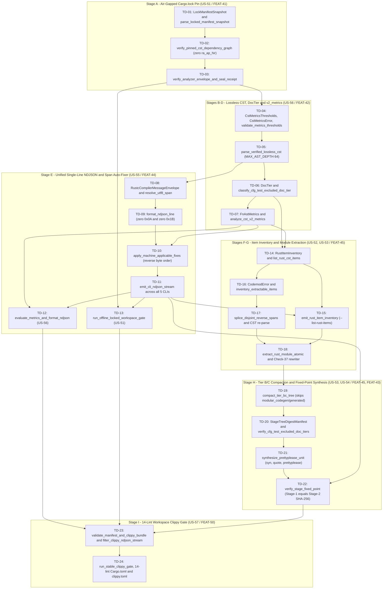

| Attribute | Specification Detail |
| :--- | :--- |
| **Issue ID** | TBD |
| **Title** | Track-1 Atomic TDD Dispatch Queue (`EPIC-08` & `EPIC-09` Stage 1) |
| **Type** | management |
| **Management Level** | Level 4 Enterprise Realization & Subagent Dispatch Schedule |
| **Standard Baseline** | MIL-STD-881E / INCOSE SEH v5.0 / DO-178C / DO-330 |
| **Generation Mode** | subagent |
| **Specification Source** | [schema/model.sysml](../../schema/model.sysml) |

# Track-1 Atomic TDD Dispatch Queue (`EPIC-08` & `EPIC-09` Stage 1)

## 1. Executive Summary & Topological Execution Strategy

This schedule decomposes the **6 Track-1 Features** (`FEAT-41`, `FEAT-42`, `FEAT-43`, `FEAT-44`, `FEAT-45`, and `FEAT-50`) and **7 Track-1 User Stories** (`US-51` through `US-57`) into **24 topologically sorted, single-function / single-struct RED-GREEN-REFACTOR TDD dispatches** (`TD-01` through `TD-24`). Each dispatch executes inside an isolated subagent context targeting a bounded Rust module slice in `deap-core`, `compile-sysml`, `verify-baseline`, `ingest-sysml`, `assemble-conops`, or `reconcile-backlog` without runtime LLM token consumption (`runtime_llm_token_count == 0`).

### Topological Dependency DAG (`TD-01` through `TD-24`)

### Bounded Complexity & Topological Fixed-Point Invariants

Every atomic dispatch $d_i \in \{d_1, \dots, d_{24}\}$ satisfies strict topological precedence, per-callable executable SLOC bounds, formal parameter arity bounds, and Stage-1 to Stage-2 cryptographic fixed-point convergence:

$$
\begin{aligned}
\forall (d_u, d_v) \in E_{\mathrm{DAG}} &: \mathrm{ord}(d_u) < \mathrm{ord}(d_v) \\
\forall f \in \mathcal{F}_{\mathrm{prod}}(d_i) &: 1 \le L_{\mathrm{exec}}(f) \le L_{\max} \le L_{\mathrm{ceil}}, \quad P_{\mathrm{formal}}(f) \le P_{\max}, \quad B_{\mathrm{mut}}(f) = 0 \\
\Delta_{\mathrm{stage}} &= \sum_{u \in \mathcal{U}_{\mathrm{gen}}} \mathbb{I}\left(H_{256}\left(S_1(u)\right) \neq H_{256}\left(S_2(u)\right)\right) = 0
\end{aligned}
$$

- Parameter Definitions & Engineering Units:
  - $E_{\mathrm{DAG}}$: Directed blocking-predecessor edge set over the `24` atomic dispatches (`dimensionless` graph edges).
  - $\mathrm{ord}(d_i)$: Monotone dispatch sequence index (`1` to `24`, `dimensionless` ordinal).
  - $\mathcal{F}_{\mathrm{prod}}(d_i)$: Set of non-test production Rust callables introduced or modified by dispatch $d_i$, excluding `#[cfg(test)]` modules and `#[test]` unit tests (`functions`).
  - $L_{\mathrm{exec}}(f)$: Non-trivia executable Source Lines of Code measured from `ra_ap_syntax` non-comment, non-doc-attribute tokens (`SLOC`).
  - $L_{\max}, L_{\mathrm{ceil}}$: Nominal CST analyzer target (`50 SLOC` per `C_CST_01`) and hard workspace Clippy gate ceiling (`80 SLOC` per `C_VER_01` in `clippy.toml`).
  - $P_{\mathrm{formal}}(f), P_{\max}$: Formal callable parameter count excluding `self`, `&self`, and `&mut self` receivers, bounded by $P_{\max} = 5$ parameters (`C_CST_02`, `C_VER_02`).
  - $B_{\mathrm{mut}}(f)$: Count of mutable local boolean state flags (`mut bool`), constrained to `0 flags` (`C_CST_03`).
  - $\mathcal{U}_{\mathrm{gen}}$: Canonical `BTreeSet` union of generated self-hosted Rust compilation units under `crates/compile-sysml/src/modular_codegen/generated/` (`files`).
  - $H_{256}(S_1(u)), H_{256}(S_2(u))$: `256-bit` SHA-256 digests over Stage-1 and Stage-2 formatted UTF-8 unit buffers, requiring $\Delta_{\mathrm{stage}} = 0$ mismatched files (`C_CST_04`, `DEAP-E0705`).

---

## 2. Master Track-1 Atomic Dispatch Queue (`TD-01` through `TD-24`)

| Dispatch # | US-ID | Parent FEAT-ID | Target Rust Path | Target Items <= 80 SLOC | RED Test Target | Verification Command | Blocking Predecessors |
| :--- | :--- | :--- | :--- | :--- | :--- | :--- | :--- |
| `TD-01` | `US-51` | `FEAT-41` | `Cargo.toml`, `Cargo.lock`, `crates/deap-core/src/workspace.rs` | `LockManifestSnapshot`, `LockedPackageRecord`, `OfflineLockGovernanceError`, `parse_locked_manifest_snapshot` (`MT-US51-01`; `4` params, `<= 46` exec SLOC, `BTreeMap<String, LockedPackageRecord>`; pins `ra_ap_syntax`, `rowan`, `syn`, `quote`, `prettyplease` in `Cargo.lock`) | `workspace::tests::rejects_unpinned_or_oversized_lock_manifest` | `cargo test -p deap-core --offline --locked workspace::tests::rejects_unpinned_or_oversized_lock_manifest` | `None` |
| `TD-02` | `US-51` | `FEAT-41` | `crates/deap-core/src/workspace.rs` | `verify_pinned_cst_dependency_graph` (`MT-US51-02`; `4` params, `<= 48` exec SLOC, `BTreeSet<String>`, iterative `MAX_AST_DEPTH = 64`, 64-hex SHA-256 verification, blocks `ra_ap_hir`, `ra_ap_ide`, and root `rustc_private` with `OfflineLockGovernanceError`) | `workspace::tests::rejects_forbidden_ra_ap_hir_and_missing_sha256` | `cargo test -p deap-core --offline --locked workspace::tests::rejects_forbidden_ra_ap_hir_and_missing_sha256` | `TD-01` |
| `TD-03` | `US-51` | `FEAT-41` | `crates/deap-core/src/source_ast.rs` | `CstComplexityEnvelope`, `SupplyChainVerificationReceipt`, `verify_analyzer_envelope_and_seal_receipt` (`MT-US51-03`; `3` params, `<= 44` exec SLOC, `BTreeSet<String>`, seals `C_CST_01..C_CST_06` precondition receipt) | `source_ast::tests::seals_supply_chain_receipt_and_rejects_envelope_drift` | `cargo test -p deap-core --offline --locked source_ast::tests::seals_supply_chain_receipt_and_rejects_envelope_drift` | `TD-02` |
| `TD-04` | `US-56` | `FEAT-42` | `crates/deap-core/src/source_ast.rs`, `crates/deap-core/src/error.rs` | `CstMetricsThresholds`, `#[non_exhaustive]` `CstMetricsError`, `validate_metrics_thresholds` (`MT-US56-01`; `1` param, `<= 45` exec SLOC, typed `DEAP-E0801..DEAP-E0804` taxonomy, `0` `Result<T, String>`) | `source_ast::tests::rejects_out_of_bounds_cst_metrics_thresholds` | `cargo test -p deap-core --offline --locked source_ast::tests::rejects_out_of_bounds_cst_metrics_thresholds` | `TD-03` |
| `TD-05` | `US-56` | `FEAT-42` | `crates/deap-core/src/source_ast.rs` | `VerifiedLosslessCst`, `parse_verified_lossless_cst` (`MT-US56-02` / `MT-US52-02`; `3` params, `<= 48` exec SLOC, `ra_ap_syntax::SourceFile::parse` + `rowan::GreenNode` byte parity, UTF-8 `is_char_boundary`, explicit-stack `MAX_AST_DEPTH = 64` guard) | `source_ast::tests::enforces_lossless_green_node_roundtrip_and_max_depth_64` | `cargo test -p deap-core --offline --locked source_ast::tests::enforces_lossless_green_node_roundtrip_and_max_depth_64` | `TD-04` |
| `TD-06` | `US-56` | `FEAT-42` | `crates/deap-core/src/source_ast.rs` | `DocTier` (`RustTierA`, `RustTierBC`, `TestExcluded`), `classify_cfg_test_excluded_doc_tier` (`MT-US56-03` tier classifier; `3` params, `<= 46` exec SLOC, prunes `#[cfg(test)]` module/item subtrees and `#[test]` functions from production `DocTier` and SLOC budgets) | `source_ast::tests::prunes_cfg_test_subtrees_from_production_doc_tiers` | `cargo test -p deap-core --offline --locked source_ast::tests::prunes_cfg_test_subtrees_from_production_doc_tiers` | `TD-05` |
| `TD-07` | `US-56` | `FEAT-42` | `crates/deap-core/src/source_ast.rs` | `FnAstMetrics`, `DeapV2AstMetricsReport`, `extract_callable_v2_metrics`, `analyze_cst_v2_metrics` (`MT-US56-03` metrics analyzer; `2` params each, `<= 48` exec SLOC, `BTreeMap<(u32, String), FnAstMetrics>`, `BTreeSet<usize>` exec SLOC, receiver-excluded arity, `mut bool` count, `#[rt_loop]`, `Result<T, String>` detector) | `source_ast::tests::extracts_exact_v2_metrics_sloc_arity_mut_bool_and_string_err` | `cargo test -p deap-core --offline --locked source_ast::tests::extracts_exact_v2_metrics_sloc_arity_mut_bool_and_string_err` | `TD-06` |
| `TD-08` | `US-55` | `FEAT-44` | `crates/deap-core/src/diagnostics.rs` | `DiagnosticEmitError`, `RustcCompilerMessageEnvelope`, `RustcDiagnosticSpan`, `Applicability`, `resolve_utf8_span` (`MT-US55-01` & `MT-US55-02`; `5` params, `<= 48` exec SLOC, `BTreeMap<String, Vec<RustcDiagnosticSpan>>`, `O(log N)` line/col lookup, `[byte_start..byte_end)` `is_char_boundary` check) | `diagnostics::tests::rejects_inverted_or_mid_codepoint_utf8_spans` | `cargo test -p deap-core --offline --locked diagnostics::tests::rejects_inverted_or_mid_codepoint_utf8_spans` | `TD-05` |
| `TD-09` | `US-55` | `FEAT-44` | `crates/deap-core/src/diagnostics.rs` | `format_ndjson_line` (`MT-US55-03`; `2` params, `<= 46` exec SLOC, `"reason": "compiler-message"`, `"DEAP-E"` code prefix check, `MAX_AST_DEPTH = 64` child cap, single-line NDJSON verified free of `0x0A` and `0x1B` ANSI bytes) | `diagnostics::tests::formats_single_line_zero_ansi_rustc_ndjson` | `cargo test -p deap-core --offline --locked diagnostics::tests::formats_single_line_zero_ansi_rustc_ndjson` | `TD-08` |
| `TD-10` | `US-55` | `FEAT-44` | `crates/deap-core/src/diagnostics.rs` | `apply_machine_applicable_fixes` (`MT-US55-04`; `3` params, `<= 50` exec SLOC, filters `Applicability::MachineApplicable`, rejects overlapping spans `DEAP-E0802`, splices descending `byte_start`, re-parses CST `DEAP-E0803`, atomic temp-file rename) | `diagnostics::tests::applies_reverse_byte_order_machine_fixes_and_rejects_overlaps` | `cargo test -p deap-core --offline --locked diagnostics::tests::applies_reverse_byte_order_machine_fixes_and_rejects_overlaps` | `TD-07, TD-09` |
| `TD-11` | `US-55` | `FEAT-44` | `crates/deap-core/src/diagnostics.rs`, `crates/verify-baseline/src/main.rs`, `crates/compile-sysml/src/main.rs`, `crates/ingest-sysml/src/main.rs`, `crates/assemble-conops/src/main.rs`, `crates/reconcile-backlog/src/main.rs` | `emit_cli_ndjson_stream` (`MT-US55-05`; `4` params, `<= 42` exec SLOC, exclusive `StdoutLock` `--message-format=json` and `--apply-machine-fixes` adapter across all `5` workspace CLIs, exit code `1` on diagnostic error) | `diagnostics::tests::emits_locked_ndjson_across_all_five_cli_adapters` | `cargo test --workspace --offline --locked emits_locked_ndjson_across_all_five_cli_adapters` | `TD-10` |
| `TD-12` | `US-56` | `FEAT-42` | `crates/deap-core/src/source_ast.rs`, `crates/deap-core/src/diagnostics.rs` | `evaluate_metrics_and_format_ndjson` (`MT-US56-04`; `4` params, `<= 46` exec SLOC, audits `BTreeMap` `FnAstMetrics` against `C_CST_01..C_CST_03` and `!returns_result_string_err`, emits single-line `DEAP-E0801..DEAP-E0804` NDJSON) | `source_ast::tests::emits_ndjson_diagnostics_on_sloc_arity_or_string_err_breach` | `cargo test -p deap-core --offline --locked source_ast::tests::emits_ndjson_diagnostics_on_sloc_arity_or_string_err_breach` | `TD-07, TD-11` |
| `TD-13` | `US-51` | `FEAT-41` | `crates/verify-baseline/src/blueprint_gate.rs` | `run_offline_locked_workspace_gate` (`MT-US51-04`; `3` params, `<= 49` exec SLOC, pre/post TOCTOU `Cargo.toml`/`Cargo.lock` SHA-256 check, runs `cargo check --workspace --offline --locked`, emits `DEAP-E0804` NDJSON) | `blueprint_gate_tests::verifies_offline_locked_workspace_gate_and_toctou_guard` | `cargo test -p verify-baseline --offline --locked verifies_offline_locked_workspace_gate_and_toctou_guard` | `TD-03, TD-11` |
| `TD-14` | `US-52` | `FEAT-45` | `crates/deap-core/src/source_ast.rs` | `RustItemInventory`, `RustCstItemDescriptor`, `Utf8ByteSpan`, `RustCstInventoryError`, `list_rust_cst_items` (`MT-US52-01` & `MT-US52-03`; `2` params, `<= 48` exec SLOC, `BTreeMap<(u32, String), RustCstItemDescriptor>`, `BTreeSet<String>` index, outer `///`/attribute `[byte_start..byte_end)` spans) | `source_ast::tests::lists_btreemap_ordered_rust_items_with_disjoint_utf8_spans` | `cargo test -p deap-core --offline --locked source_ast::tests::lists_btreemap_ordered_rust_items_with_disjoint_utf8_spans` | `TD-06, TD-07` |
| `TD-15` | `US-52` | `FEAT-45` | `crates/compile-sysml/src/cli.rs`, `crates/compile-sysml/src/driver.rs`, `crates/verify-baseline/src/audit_code.rs` | `emit_rust_item_inventory` (`MT-US52-04`; `3` params, `<= 42` exec SLOC, wires `compile-sysml --list-rust-items <PATH>` and `--message-format=json` `DEAP-E0801..DEAP-E0804` output) | `integration::cli_list_rust_items_emits_deterministic_btreemap_inventory` | `cargo test -p compile-sysml --offline --locked cli_list_rust_items_emits_deterministic_btreemap_inventory` | `TD-11, TD-14` |
| `TD-16` | `US-53` | `FEAT-45` | `crates/deap-core/src/source_ast.rs` | `ZeroTokenCodemodConfig`, `RustItemDescriptor`, `CodemodError`, `inventory_extractable_items` (`MT-53-01`; `2` params, `<= 45` exec SLOC, `BTreeMap<String, RustItemDescriptor>`, `BTreeSet<String>` `realises_reqs`, `#[cfg(test)]` `TestExcluded` preservation) | `source_ast::tests::inventories_extractable_items_with_outer_doc_and_attr_trivia` | `cargo test -p deap-core --offline --locked source_ast::tests::inventories_extractable_items_with_outer_doc_and_attr_trivia` | `TD-14` |
| `TD-17` | `US-53` | `FEAT-45` | `crates/deap-core/src/source_ast.rs` | `SpanSpliceEdit`, `splice_disjoint_reverse_spans` (`MT-53-02`; `2` params, `<= 48` exec SLOC, `is_char_boundary` & pairwise non-overlap `DEAP-E0802`, `checked_add`/`checked_sub` capacity, descending `byte_start` `.get()` slicer, in-memory `ra_ap_syntax` zero-error re-parse `DEAP-E0803`) | `source_ast::tests::splices_disjoint_reverse_spans_and_rejects_post_splice_syntax_errors` | `cargo test -p deap-core --offline --locked source_ast::tests::splices_disjoint_reverse_spans_and_rejects_post_splice_syntax_errors` | `TD-16` |
| `TD-18` | `US-53` | `FEAT-45` | `crates/deap-core/src/workspace.rs`, `crates/compile-sysml/src/driver.rs`, `crates/compile-sysml/src/cli.rs` | `extract_rust_module_atomic`, `emit_codemod_ndjson_diagnostic` (`MT-53-03` & `MT-53-05`; `<= 4` params, `<= 50` exec SLOC, `BTreeSet<String>`, `--extract-rust-module --from --to --items`, Check-37 `<mod>.rs` to `<mod>/mod.rs` rewriter across `docs/architecture/blueprints/` and `README.md`, atomic temp-and-rename) | `integration::extract_rust_module_rewrites_check37_citations_atomically` | `cargo test -p compile-sysml --offline --locked extract_rust_module_rewrites_check37_citations_atomically` | `TD-15, TD-17` |
| `TD-19` | `US-53` | `FEAT-45` | `crates/compile-sysml/src/docstring.rs`, `crates/verify-baseline/src/checks/docstring_gate.rs` | `compact_tier_bc_tree` (`MT-53-04`; `2` params, `<= 48` exec SLOC, `BTreeSet` path traversal, `--compact-tier-bc <DIR>` unconditionally skipping `crates/compile-sysml/src/modular_codegen/generated/`, compacts `RustTierBC` to 2-line `/// 
` + `/// Realises: [REQ-*]`, verifies executable token parity) | `docstring_injector_tests::compacts_tier_bc_to_two_lines_and_skips_generated_tree` | `cargo test -p compile-sysml --offline --locked compacts_tier_bc_to_two_lines_and_skips_generated_tree` | `TD-18` |
| `TD-20` | `US-54` | `FEAT-43` | `crates/compile-sysml/src/modular_codegen/emitters/rust_emitter.rs`, `crates/deap-core/src/source_ast.rs` | `StageTreeDigestManifest`, `VerifiedUnitBuffer`, `#[non_exhaustive]` `FixedPointSynthesisError`, `verify_cfg_test_excluded_doc_tiers` (`MT-US54-01` & `MT-US54-02`; `<= 4` params, `<= 50` exec SLOC, `BTreeMap<String, [u8; 32]>`, `skip_generated_tree` guard) | `self_hosting_bootstrap::enforces_generated_tree_compaction_skip_and_tier_a_preservation` | `cargo test -p compile-sysml --offline --locked enforces_generated_tree_compaction_skip_and_tier_a_preservation` | `TD-19` |
| `TD-21` | `US-54` | `FEAT-43` | `crates/compile-sysml/src/modular_codegen/emitters/rust_emitter.rs` | `synthesize_prettyplease_unit` (`MT-US54-03`; `3` params, `<= 48` exec SLOC, `quote` `TokenStream` depth `<= 64`, `syn::parse2::<syn::File>`, in-process `prettyplease::unparse`, `E0705`-preserving `ra_ap_syntax` re-parse) | `self_hosting_bootstrap::synthesizes_prettyplease_unit_preserving_tier_a_docblocks` | `cargo test -p compile-sysml --offline --locked synthesizes_prettyplease_unit_preserving_tier_a_docblocks` | `TD-20` |
| `TD-22` | `US-54` | `FEAT-43` | `crates/compile-sysml/src/modular_codegen/mod.rs`, `crates/compile-sysml/src/cli.rs`, `crates/deap-core/src/diagnostics.rs` | `verify_stage_fixed_point`, `emit_fixed_point_ndjson_outcome` (`MT-US54-04` & `MT-US54-05`; `3` params each, `<= 50` exec SLOC, `BTreeSet` union Stage-1 == Stage-2 SHA-256 check `stage_fixed_point_mismatch_files == 0`, fail-closed `DEAP-E0705` NDJSON) | `self_hosting_bootstrap::verifies_stage1_equals_stage2_sha256_fixed_point_after_compaction` | `cargo test -p compile-sysml --offline --locked verifies_stage1_equals_stage2_sha256_fixed_point_after_compaction` | `TD-11, TD-21` |
| `TD-23` | `US-57` | `FEAT-50` | `crates/verify-baseline/src/clippy_gate.rs`, `crates/verify-baseline/src/lib.rs` | `StableClippyGateConfig`, `ManifestBundleDigest`, `ClippyNdjsonFinding`, `StageGateReceipt`, `ClippyGateError`, `validate_manifest_and_clippy_bundle`, `filter_clippy_ndjson_stream` (`MT-US57-01`..`MT-US57-03`; `<= 3` params, `<= 50` exec SLOC, `BTreeSet<String>`, audits `14` denied lints, `0` unauthorized `#[allow(...)]`/`#![allow(...)]`, `clippy.toml` `80`/`5`/`disallowed-types >= 3`, macro-expansion NDJSON span filter) | `codebase_checks_tests::rejects_weakened_workspace_clippy_table_and_filters_ndjson_spans` | `cargo test -p verify-baseline --offline --locked rejects_weakened_workspace_clippy_table_and_filters_ndjson_spans` | `TD-12, TD-13, TD-22` |
| `TD-24` | `US-57` | `FEAT-50` | `Cargo.toml`, `clippy.toml`, `crates/verify-baseline/src/clippy_gate.rs`, `crates/verify-baseline/src/runner.rs` | `run_stable_clippy_gate`, root `[workspace.lints.clippy]` `14`-lint `deny` table, member `[lints] workspace = true`, root `clippy.toml` (`too-many-lines-threshold = 80`, `too-many-arguments-threshold = 5`, `disallowed-types`) (`MT-US57-04` & `MT-US57-05`; `3` params, `<= 50` exec SLOC, `DEAP-E0900` NDJSON, seals `wave2_stages_deferred = true`) | `integration::runs_stage1_stable_clippy_gate_zero_warnings_offline_locked` | `cargo clippy --workspace --all-targets --offline --locked -- -D warnings && cargo test --workspace --offline --locked` | `TD-23` |

---

## 3. Universal Subagent Isolation & Total-Function Invariants

Every single-item subagent invoked from `TD-01` through `TD-24` MUST enforce all nine execution constraints:

1. **RED-Before-GREEN Native Rust TDD**: Write the designated `#[test]` unit or integration test inside an auto-cleaned temporary directory or isolated `#[cfg(test)]` module first, demonstrate deterministic RED failure before production implementation, and demonstrate GREEN pass via the exact `--offline --locked` verification command.
2. **Strict Crate Safety Header**: Every touched module compiles under `#![forbid(unsafe_code)]` with zero `#![allow(...)]` or `#[allow(...)]` lint-suppression attributes across library, binary, and test targets.
3. **Executable SLOC & Arity Ceiling**: Every production callable satisfies `<= 50` executable SLOC nominal CST target (`C_CST_01`) and strictly `<= 80` executable SLOC hard Clippy threshold (`C_VER_01`), `<= 5` formal parameters excluding `self` / `&self` / `&mut self` receivers (`C_CST_02`, `C_VER_02`), compound boolean predicate arity `<= 3`, and `0` mutable local boolean flags (`C_CST_03`).
4. **Typed Domain Error Taxonomy**: Every fallible API returns `Result<T, <Domain>Error>` (`OfflineLockGovernanceError`, `CstMetricsError`, `DiagnosticEmitError`, `RustCstInventoryError`, `CodemodError`, `FixedPointSynthesisError`, `ClippyGateError`) mapping 1:1 to `DEAP-E0705`, `DEAP-E0801..DEAP-E0804`, or `DEAP-E0900`. Stringly-typed `Result<T, String>` signatures are forbidden.
5. **Deterministic Ordered Containers**: Use `BTreeMap` and `BTreeSet` exclusively across item inventories, package lock snapshots, span replacement batches, and Stage-1/Stage-2 SHA-256 digest manifests. Non-deterministic `HashMap`, `HashSet`, and backtracking NFA pattern-engine types are banned via `clippy.toml` `disallowed-types`.
6. **Bounds-Safe Indexing & Checked Arithmetic**: Perform all slice and table lookups via `.get(...)`, validate UTF-8 byte spans with `str::is_char_boundary`, enforce `MAX_AST_DEPTH = 64` on iterative syntax/JSON/TOML walks, and compute capacities, offsets, and counters via `checked_add`, `checked_sub`, `saturating_add`, or `saturating_sub` (zero `.unwrap()`, `.expect()`, `panic!()`, or direct `[]` indexing).
7. **Check-36 Tiered Docstring & `#[cfg(test)]` Hygiene**: Preserve 7-section DO-178C `DocTier::RustTierA` docstrings on `pub` items and self-hosted `crates/compile-sysml/src/modular_codegen/generated/` files, compact internal `DocTier::RustTierBC` items to 2-line `/// 
` + `/// Realises: [REQ-*]` headers, and prune `#[cfg(test)]` / `#[test]` subtrees into `DocTier::TestExcluded`.
8. **Check-37 Workspace Citation Integrity**: Refer exclusively to canonical workspace crate paths (`crates/deap-core/src/sysml_ast/mod.rs`, `crates/deap-core/src/source_ast.rs`, `crates/deap-core/src/diagnostics.rs`, `crates/deap-core/src/workspace.rs`, `crates/compile-sysml/src/modular_codegen/mod.rs`, `crates/verify-baseline/src/clippy_gate.rs`) and rewrite `<mod>.rs` citations co-atomically to `<mod>/mod.rs` when directory modules are introduced.
9. **Coordinator-Gated Commits**: Subagents modify only their assigned `Target Rust Path` files and run their scoped `Verification Command`; repository-wide `./target/release/verify-baseline . --no-domain`, release binary rebuilds, and scoped `git commit --only` gates execute exclusively at the Coordinator level.

---

## 4. 3-Layer Definition of Done Closure Matrix (`FEAT-41..45` & `FEAT-50`)

Every Track-1 Feature and User Story closes all three architectural layers without `N/A` exemptions:

| Feature / Story | Dispatches | Layer 1: Domain State & Data Model | Layer 2: Logic & State Management | Layer 3: Presentation & Actuator Interface Binding |
| :--- | :--- | :--- | :--- | :--- |
| `FEAT-41` / `US-51` (`AirGappedCargoLockGovernor`) | `TD-01`, `TD-02`, `TD-03`, `TD-13` | `LockManifestSnapshot`, `LockedPackageRecord`, `CstComplexityEnvelope`, `SupplyChainVerificationReceipt`, `OfflineLockGovernanceError` (`BTreeMap`/`BTreeSet` in `crates/deap-core/src/workspace.rs` & `crates/deap-core/src/source_ast.rs`) | Iterative `MAX_AST_DEPTH = 64` `Cargo.lock` graph walk, 64-hex SHA-256 verification, zero-`ra_ap_hir` firewall, pre/post TOCTOU digest guard gating `Idle -> ParsingLosslessCst` | `manifest_lock_in` / `lock_receipt_out` ports wired to `crates/verify-baseline/src/blueprint_gate.rs` (`cargo check --workspace --offline --locked`) and single-line `DEAP-E0804` NDJSON |
| `FEAT-42` / `US-56` (`LosslessRustCstAnalyzer`) | `TD-04`, `TD-05`, `TD-06`, `TD-07`, `TD-12` | `CstMetricsThresholds`, `VerifiedLosslessCst`, `DocTier` (`RustTierA`, `RustTierBC`, `TestExcluded`), `FnAstMetrics`, `DeapV2AstMetricsReport`, `#[non_exhaustive]` `CstMetricsError` (`crates/deap-core/src/source_ast.rs`) | Lossless `ra_ap_syntax`/`rowan` `GreenNode` byte-parity parser, `#[cfg(test)]`/`#[test]` subtree pruner, receiver-excluded arity, exec SLOC, `mut bool`, `#[rt_loop]`, and `Result<T, String>` analyzer | `rust_source_in`, `item_inventory_out`, `metrics_report_out` ports emitting `BTreeMap` `v2_metrics` reports and single-line `DEAP-E0801..DEAP-E0804` NDJSON diagnostics |
| `FEAT-44` / `US-55` (`UnifiedRustcJsonDiagnosticEmitter`) | `TD-08`, `TD-09`, `TD-10`, `TD-11` | `RustcCompilerMessageEnvelope`, `RustcDiagnosticSpan`, `DiagnosticLevel`, `Applicability`, `DiagnosticEmitError`, `BTreeMap<String, Vec<RustcDiagnosticSpan>>` (`crates/deap-core/src/diagnostics.rs`) | `O(log N)` UTF-8 `[byte_start..byte_end)` line/col resolver, `0x0A`/`0x1B`-free single-line JSON serializer, `MachineApplicable` disjoint span filter, reverse-byte-order splicer & CST re-parse gate | `finding_in`, `ndjson_out`, `machine_fix_inout` ports bound via exclusive `StdoutLock` to `--message-format=json` and `--apply-machine-fixes` across all `5` CLIs (`verify-baseline`, `compile-sysml`, `ingest-sysml`, `assemble-conops`, `reconcile-backlog`) |
| `FEAT-45` / `US-52`, `US-53` (`ZeroTokenRustSpanCodemodEngine`) | `TD-14`, `TD-15`, `TD-16`, `TD-17`, `TD-18`, `TD-19` | `RustItemInventory`, `RustCstItemDescriptor`, `Utf8ByteSpan`, `RustCstInventoryError`, `ZeroTokenCodemodConfig`, `SpanSpliceEdit`, `CodemodError` (`crates/deap-core/src/source_ast.rs`) | Disjoint `[byte_start..byte_end)` span validator, descending `byte_start` slicer, zero-error `ra_ap_syntax` re-parse, `modular_codegen/generated/` compaction skip, 2-line Tier B/C compaction, Check-37 path rewriter | `codemod_command_in`, `atomic_patch_out`, `codemod_error_out` exposed via `compile-sysml --list-rust-items`, `--extract-rust-module`, and `--compact-tier-bc` with atomic temp-file rename and NDJSON error streaming |
| `FEAT-43` / `US-54` (`StructuredModularCodegenSynthesizer`) | `TD-20`, `TD-21`, `TD-22` | `StageTreeDigestManifest` (`BTreeMap<String, [u8; 32]>`), `VerifiedUnitBuffer`, `#[non_exhaustive]` `FixedPointSynthesisError` (`crates/compile-sysml/src/modular_codegen/emitters/rust_emitter.rs`) | `quote` `TokenStream` depth `<= 64` guard, `syn::parse2::<syn::File>` AST check, in-process `prettyplease::unparse`, `BTreeSet` union Stage-1 == Stage-2 SHA-256 fixed-point gate (`stage_fixed_point_mismatch_files == 0`) | `lowered_ir_in` and `formatted_rust_out` bound to `crates/compile-sysml/src/modular_codegen/mod.rs` and `crates/compile-sysml/src/cli.rs` emitting single-line `DEAP-E0705` NDJSON on fixed-point drift |
| `FEAT-50` / `US-57` (`StableClippyTotalFunctionGate`) | `TD-23`, `TD-24` | `StableClippyGateConfig`, `ManifestBundleDigest`, `ClippyNdjsonFinding`, `StageGateReceipt` (`wave2_stages_deferred: bool`), `ClippyGateError` (`crates/verify-baseline/src/clippy_gate.rs`) | Pre-flight `14`-lint `[workspace.lints.clippy]` and `clippy.toml` (`80`-SLOC, `5`-arg, `disallowed-types >= 3`) validator, macro-expansion call-site NDJSON span filter, pre/post `Cargo.lock` SHA-256 check | `workspace_manifest_in` and `clippy_ndjson_out` wired into `crates/verify-baseline/src/runner.rs`, root `Cargo.toml`, and `clippy.toml`, streaming `DEAP-E0900` NDJSON and sealing the Wave-2 handoff receipt |

---

## 5. Explicit Wave-2 Handoff & Toolchain Quarantine Boundary

Completion of `TD-24` (`US-57` / `FEAT-50`) closes **Track-1** by sealing `StageGateReceipt` with `wave2_stages_deferred == true` and all 6 workspace crates compiling at `0` warnings under the `14`-lint `[workspace.lints.clippy]` table (`too-many-lines-threshold = 80`, `too-many-arguments-threshold = 5`). All downstream formal verification, incremental polyglot CST/Salsa, and Ferrocene qualification deliverables are quarantined into **Wave-2**:

| Deferred Scope | Deferred Backlog Items | Wave-2 Capability Summary | Track-1 Quarantine Invariant & Handoff Precondition |
| :--- | :--- | :--- | :--- |
| `BP-09` Stage 2 (`EPIC-09`) | `FEAT-47`, `US-58`, `UC-46`, `UC-47` | Isolated nightly Dylint `rustc_private` MIR zero-allocation prover on `#[rt_loop]` functions (`DEAP-E0901`) and `.digest.json` `[REQ-*]` binding verifier (`DEAP-E0902`) | Quarantined to isolated sub-workspace in Wave-2; root stable `Cargo.toml` and `Cargo.lock` MUST contain `0` nightly `rustc_private` or `dylint` crates during Track-1 (`TD-02` / `TD-24`) |
| `BP-09` Stage 3 (`EPIC-09`) | `FEAT-46`, `US-59`, `US-60`, `UC-48`, `UC-49` | Deterministic `flutter_rust_bridge` FFI facade synthesis with ICD range guards and Miri `-Zmiri-tree-borrows` abstract-machine UB gate (`DEAP-E0903`) | Quarantined to Wave-2; activates only after `TD-24` seals Stage-1 `StageGateReceipt` across all pure-Rust workspace crates |
| `BP-09` Stage 4 (`EPIC-09`) | `FEAT-48`, `FEAT-49`, `US-61`, `US-62`, `UC-50`, `UC-51` | Deterministic `#[cfg(kani)]` CBMC bounded model-checking harness synthesizer (`default_kani_unwind_bound <= 64`, `DEAP-E0904`) and 4-stage `MultiStageVerificationOrchestrator` closure | Quarantined to Wave-2; Track-1 wires Stage-1 `runStableClippyGate` into `crates/verify-baseline/src/runner.rs` without adding Kani/CBMC dependencies to stable `Cargo.lock` |
| `BP-10` (`EPIC-10`) | `FEAT-51..54`, `US-63..67`, `UC-52..58` | Incremental lossless SysML v2 `logos` + `rowan` CST engine, `salsa` early-cutoff incremental database, formatting-preserving bidirectional splicer, and typed 5-frontend polyglot ingestion | Quarantined to Wave-2; builds directly on Track-1 `rowan` Red/Green span splicer (`TD-05`, `TD-17`) and unified 5-CLI NDJSON diagnostic emitter (`TD-08..TD-11`) |
| `BP-11` (`EPIC-11`) | `FEAT-55..58`, `US-68..72`, `UC-59..64` | Dual-mode Ferrocene `criticalup.toml` qualified compiler gate, `[FLS: fls_*]` paragraph synthesizer, MC/DC structural coverage gate, and 3-Ring Rust/Flutter DO-178C / DO-330 partition compiler | Quarantined to Wave-2; consumes Track-1 modular `<= 80`-SLOC total functions (`TD-18..TD-24`) and `[FLS: fls_*]` docstring metadata (`TD-19..TD-21`) as certification baseline |

## 6. Source References

- Structural SysML v2 SSOT: [schema/model.sysml](../../schema/model.sysml)
- Track-1 Epics: [EPIC-08](../epics/EPIC-08-BP_08_Lossless_Rust_CST_Codemod_Engine_and_Unified_rustc_Compatible_JSON_Diagnostics.md), [EPIC-09](../epics/EPIC-09-BP_09_Multi_Stage_Compiler_and_Formal_Verification_Gatekeeper.md)
- Track-1 User Stories: [US-51](../user-stories/US-51-verifyOfflineLockedBuild.md), [US-52](../user-stories/US-52-listRustItems.md), [US-53](../user-stories/US-53-extractRustModule.md), [US-54](../user-stories/US-54-verifyStageFixedPoint.md), [US-55](../user-stories/US-55-formatNdjsonLine.md), [US-56](../user-stories/US-56-analyzeMetrics.md), [US-57](../user-stories/US-57-runStableClippyGate.md)
- MIL-STD-881E WBS Suite: [WBS_01_WORK_BREAKDOWN_STRUCTURE.md](WBS_01_WORK_BREAKDOWN_STRUCTURE.md), [WBS_02_TECHNICAL_REALIZATION_REGISTER.md](WBS_02_TECHNICAL_REALIZATION_REGISTER.md), [WBS_03_ENTERPRISE_EXPORT_SCHEMA.md](WBS_03_ENTERPRISE_EXPORT_SCHEMA.md)
