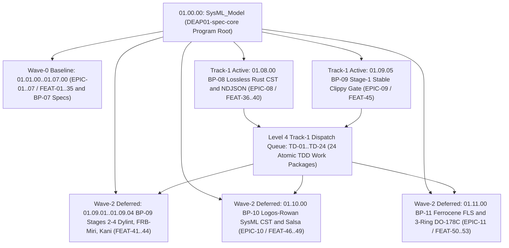

| Attribute | Specification Detail |
| :--- | :--- |
| **Issue ID** | #685..#690, #852..#862 |
| **Title** | WBS_01: MIL-STD-881E Work Breakdown Structure |
| **Type** | management |
| **Management Level** | Level 4 Enterprise Realization |
| **Standard Baseline** | MIL-STD-881E / INCOSE SEH v5.0 |
| **Generation Mode** | subagent |
| **Specification Source** | [schema/model.sysml](../../schema/model.sysml) |

# WBS_01: MIL-STD-881E Work Breakdown Structure

## 1. Executive Summary & Program Execution Wave Architecture

### 1.0 NON-NEGOTIABLE ANTI-CHEAT & ANTI-SHARDING CONTRACT
Every WBS work package (`01.01.01` through `01.11.04` and Level 4 `TD-01` through `TD-24`) is governed by the following mechanical anti-cheat and anti-sharding invariants enforced by `./crates/verify-baseline/src/checks/ratchet_table.rs` and `./crates/verify-baseline/src/checks/structural.rs`:
- **Forbidden Paths**: `crates/deap-core/src/source_ast/**`, `crates/deap-core/src/sysml_ast/brace_and_masking.rs`, and any new `*_tests.rs` or submodule added to `LEGACY_RATCHET_MAX_LINES` (`LEGACY_RATCHET_MAX_LINES.len()` can NEVER increase).
- **Forbidden Dummy CST Calls**: `drop(parse_*)` and `let _ = parse_*` (including `drop(parse_rust_source`, `drop(parse_dart_cst`, `drop(parse_sysml_cst`, `let _ = parse_rust_source`, `let _ = parse_dart_cst`, `let _ = parse_sysml_cst`, and `std::mem::drop(parse_*)`).
- **Mandatory Caller Rewiring & Physical Deletion**: Every `TD-*` task (`TD-01` through `TD-24`) and blueprint realization (`BP-01` through `BP-11`) MUST rewire callers to the official CST/AST crates (`ra_ap_syntax`, `logos` + `rowan`, `salsa`, `pulldown-cmark`, `syn` + `quote` + `prettyplease`) AND physically delete the legacy hand-rolled scanner functions.

This MIL-STD-881E Work Breakdown Structure defines the product-oriented decomposition of the self-hosting `DEAP01-spec-core` SysML v2 compiler, static verification gatekeeper, and multi-stage assurance platform (`01.00.00` `SysML_Model`) across **11 Level 2 Blueprint Subsystems** (`EPIC-01` through `EPIC-11`), **53 Prime Mission Feature Specifications** (`FEAT-01` through `FEAT-53`, plus the 5 `BP-07` domain specification elements corresponding to the 58-node `FEAT-01..58` baseline in `820db8f`), and **24 Level 4 Track-1 Atomic Work Packages** (`TD-01` through `TD-24`), totaling **94 WBS elements**.

Program execution is partitioned into three strict, non-overlapping realization waves governed by [MASTER_ATOMIC_DISPATCH_QUEUE.md](../management/MASTER_ATOMIC_DISPATCH_QUEUE.md) and [TRACK1_ATOMIC_DISPATCH_QUEUE.md](../management/TRACK1_ATOMIC_DISPATCH_QUEUE.md):

1. **Wave-0 Baseline (`01.01.00` through `01.07.10` -- `EPIC-01..07`, `FEAT-01..35` / `820db8f` `FEAT-01..40`, `US-01..52`)**: Delivered and active across the 6 workspace crates (`deap-core`, `compile-sysml`, `verify-baseline`, `ingest-sysml`, `assemble-conops`, `reconcile-backlog`), enforcing compiler lint gates, Check-34 AST purity, bijective SysML v2 round-trip serialization, forward specification/ICD/WBS projection, Check-36 7-section safety docstrings, 5-pillar defect dossier auditing, and self-hosting 4-level modular multi-file code generation.
2. **Track-1 Active Implementation Wave (`01.08.00`..`01.08.05` & `01.09.05` -- `EPIC-08` `FEAT-36..40` / `820db8f` `FEAT-41..45` & `EPIC-09` Stage-1 `FEAT-45` / `820db8f` `FEAT-50`, `US-53..58` & `US-60`)**: Active stable-Rust engineering wave realizing air-gapped `--offline --locked` `Cargo.lock` governance (`ra_ap_syntax`, `rowan`, `syn`, `quote`, `prettyplease` without `ra_ap_hir`), lossless Red/Green Rust CST parsing (`MAX_AST_DEPTH = 64`), `#[cfg(test)]`-excluded `DocTier` and `v2_metrics` analysis, unified single-line zero-ANSI `rustc`-compatible NDJSON diagnostics across all 5 CLIs, zero-LLM-token span codemods (`--list-rust-items`, `--extract-rust-module`, `--compact-tier-bc` skipping `crates/compile-sysml/src/modular_codegen/generated/`), in-process `prettyplease` `E0705`-preserving Stage-1 == Stage-2 SHA-256 fixed-point synthesis, and the 14-lint `[workspace.lints.clippy]` + `clippy.toml` (`80`-SLOC / `5`-arg / `disallowed-types`) Stage-1 total-function gate. Scheduled across `TD-01..TD-24` in [TRACK1_ATOMIC_DISPATCH_QUEUE.md](../management/TRACK1_ATOMIC_DISPATCH_QUEUE.md).
3. **Wave-2 Deferred Formal & Certification Scope (`01.09.01`..`01.09.04`, `01.10.00`..`01.10.04`, `01.11.00`..`01.11.04` -- `FEAT-41..44` & `FEAT-46..53` / `820db8f` `FEAT-46..49` & `FEAT-51..58`, `EPIC-10..11`, `US-59`, `US-61..78`)**: Quarantined from stable Track-1 builds until `TD-24` seals `StageGateReceipt` (`wave2_stages_deferred == true`), keeping root `Cargo.toml` free of nightly `rustc_private`, Dylint, Miri, Kani, and external qualification dependencies during Track-1.
4. **Anti-Submodule-Splitting & Caller-Migration Invariant (`BP-01..BP-11`)**: Across all WBS work packages, splitting legacy hand-rolled scanners (`source_ast.rs`, `sysml_ast/`, `structural.rs`, `docstring.rs`, `docstring_gate.rs`, `audit_code.rs`, `scanner.rs`, `validator.rs`) into `< 380`-SLOC submodules is strictly forbidden. Work packages must rewire callers to the official Contract B crate modules (`deap_core::rust_cst`, `deap_core::dart_cst`, `deap_core::sysml_cst`, `deap_core::markdown_ast`, `compile_sysml::modular_codegen`) and delete the legacy hand-rolled scanner code.

### MIL-STD-881E 100% Decomposition & Node Accounting Identity

$$
\begin{aligned}
N_{\mathrm{total}} &= N_{L1} + N_{L2} + N_{L3} + N_{L4,\mathrm{T1}} \\
N_{L3} &= N_{L3,\mathrm{W0}} + N_{L3,\mathrm{T1}} + N_{L3,\mathrm{W2}}
\end{aligned}
$$

- Parameter Definitions & Engineering Units:
  - $N_{\mathrm{total}}$: Total WBS node population across all exported program schedules (`94 nodes` including Level 1-3 + 24 Level 4 Track-1 work packages).
  - $N_{L1}$: Level 1 Program Root count (`1 node`: `01.00.00`).
  - $N_{L2}$: Level 2 Blueprint Subsystem Segment count (`11 nodes`: `01.01.00` through `01.11.00` corresponding to `EPIC-01..11`).
  - $N_{L3}$: Level 3 Prime Mission Feature & Specification count (`58 nodes`: `53` feature specifications `FEAT-01..53` + `5` `BP-07` domain specification nodes `01.07.06..01.07.10`), partitioned into $N_{L3,\mathrm{W0}} = 40$ Wave-0 Baseline nodes, $N_{L3,\mathrm{T1}} = 6$ Track-1 Active nodes, and $N_{L3,\mathrm{W2}} = 12$ Wave-2 Deferred nodes.
  - $N_{L4,\mathrm{T1}}$: Level 4 Track-1 Atomic Work Package count (`24 nodes`: `TD-01..TD-24`).

---

## 2. MIL-STD-881E Level 1-3 Work Breakdown Structure (`EPIC-01..11` / `FEAT-01..53` & `820db8f` `FEAT-01..58`)

| WBS Code | Level | Element Name | Package | Realized Artifact | Execution Wave | Primary Target Crate / Official Contract B Module |
| :--- | :--- | :--- | :--- | :--- | :--- | :--- |
| `01.00.00` | 1 | `SysML_Model` | `SysML_Model` | `EPIC-01` (`EPIC-01..11`) | Program Root | `crates/{deap-core,compile-sysml,verify-baseline,ingest-sysml,assemble-conops,reconcile-backlog}` |
| `01.01.00` | 2 | `BP_01_Compiler_Enforced_Forbid_Lint_Gate_and_Zero_Suppression_AST_Architecture_Blueprint` | `BP_01_Compiler_Enforced_Forbid_Lint_Gate_and_Zero_Suppression_AST_Architecture_Blueprint` | [EPIC-01](../epics/EPIC-01-BP_01_Compiler_Enforced_Forbid_Lint_Gate_and_Zero_Suppression_AST_Architecture_Blueprint.md) | Wave-0 Baseline | `Cargo.toml`, `crates/deap-core/src/rust_cst/`, `crates/verify-baseline/src/checks/codebase.rs` |
| `01.01.01` | 3 | `CompilerLintEnforcementGate` | `BP_01_Compiler_Enforced_Forbid_Lint_Gate_and_Zero_Suppression_AST_Architecture_Blueprint` | [FEAT-01](../features/FEAT-01-CompilerLintEnforcementGate.md) | Wave-0 Baseline | `crates/verify-baseline/src/checks/codebase.rs` (`deap_core::rust_cst`) |
| `01.01.02` | 3 | `WorkspaceManifestForbidGate` | `BP_01_Compiler_Enforced_Forbid_Lint_Gate_and_Zero_Suppression_AST_Architecture_Blueprint` | [FEAT-02](../features/FEAT-02-WorkspaceManifestForbidGate.md) | Wave-0 Baseline | `Cargo.toml`, `crates/deap-core/src/workspace/`, `crates/verify-baseline/src/checks/codebase.rs` |
| `01.01.03` | 3 | `ClippyAttributeCstParser` (`ClippyAttributeAstScanner`) | `BP_01_Compiler_Enforced_Forbid_Lint_Gate_and_Zero_Suppression_AST_Architecture_Blueprint` | [FEAT-03](../features/FEAT-03-ClippyAttributeCstParser.md) | Wave-0 Baseline | `crates/deap-core/src/rust_cst/`, `crates/verify-baseline/src/checks/codebase.rs` |
| `01.01.04` | 3 | `CrateRootAttributeSanitizer` | `BP_01_Compiler_Enforced_Forbid_Lint_Gate_and_Zero_Suppression_AST_Architecture_Blueprint` | [FEAT-04](../features/FEAT-04-CrateRootAttributeSanitizer.md) | Wave-0 Baseline | `crates/deap-core/src/lib.rs`, `crates/verify-baseline/src/lib.rs` |
| `01.01.05` | 3 | `TestTargetLintEnforcer` | `BP_01_Compiler_Enforced_Forbid_Lint_Gate_and_Zero_Suppression_AST_Architecture_Blueprint` | [FEAT-05](../features/FEAT-05-TestTargetLintEnforcer.md) | Wave-0 Baseline | `crates/verify-baseline/tests/codebase_checks_tests.rs` |
| `01.02.00` | 2 | `BP_02_Check_34_AST_Purity_Fail_Closed_IO_and_Anti_Gaming_Test_Gate_Blueprint` | `BP_02_Check_34_AST_Purity_Fail_Closed_IO_and_Anti_Gaming_Test_Gate_Blueprint` | [EPIC-02](../epics/EPIC-02-BP_02_Check_34_AST_Purity_Fail_Closed_IO_and_Anti_Gaming_Test_Gate_Blueprint.md) | Wave-0 Baseline | `crates/deap-core/src/rust_cst/`, `crates/verify-baseline/src/checks/codebase.rs` |
| `01.02.01` | 3 | `AntiGamingTestBodyAuditor` | `BP_02_Check_34_AST_Purity_Fail_Closed_IO_and_Anti_Gaming_Test_Gate_Blueprint` | [FEAT-06](../features/FEAT-06-AntiGamingTestBodyAuditor.md) | Wave-0 Baseline | `crates/deap-core/src/rust_cst/`, `crates/verify-baseline/src/checks/codebase.rs` |
| `01.02.02` | 3 | `Check34AstPurityAndAntiGamingGate` | `BP_02_Check_34_AST_Purity_Fail_Closed_IO_and_Anti_Gaming_Test_Gate_Blueprint` | [FEAT-07](../features/FEAT-07-Check34AstPurityAndAntiGamingGate.md) | Wave-0 Baseline | `crates/deap-core/src/rust_cst/`, `crates/verify-baseline/src/checks/codebase.rs` |
| `01.02.03` | 3 | `FailClosedIoAstVerifier` | `BP_02_Check_34_AST_Purity_Fail_Closed_IO_and_Anti_Gaming_Test_Gate_Blueprint` | [FEAT-08](../features/FEAT-08-FailClosedIoAstVerifier.md) | Wave-0 Baseline | `crates/deap-core/src/rust_cst/`, `crates/verify-baseline/src/checks/codebase.rs` |
| `01.02.04` | 3 | `RangeSliceAstDetector` | `BP_02_Check_34_AST_Purity_Fail_Closed_IO_and_Anti_Gaming_Test_Gate_Blueprint` | [FEAT-09](../features/FEAT-09-RangeSliceAstDetector.md) | Wave-0 Baseline | `crates/deap-core/src/rust_cst/`, `crates/verify-baseline/src/checks/codebase.rs` |
| `01.02.05` | 3 | `SsotSymbolDeduplicationGate` | `BP_02_Check_34_AST_Purity_Fail_Closed_IO_and_Anti_Gaming_Test_Gate_Blueprint` | [FEAT-10](../features/FEAT-10-SsotSymbolDeduplicationGate.md) | Wave-0 Baseline | `crates/deap-core/src/rust_cst/`, `crates/verify-baseline/src/checks/codebase.rs` |
| `01.03.00` | 2 | `BP_03_SysML_v2_AST_Bijective_Roundtrip_and_Token_Stream_Parser_Gate_Blueprint` | `BP_03_SysML_v2_AST_Bijective_Roundtrip_and_Token_Stream_Parser_Gate_Blueprint` | [EPIC-03](../epics/EPIC-03-BP_03_SysML_v2_AST_Bijective_Roundtrip_and_Token_Stream_Parser_Gate_Blueprint.md) | Wave-0 Baseline | `crates/deap-core/src/sysml_cst/mod.rs`, `crates/compile-sysml/src/parser/mod.rs` |
| `01.03.01` | 3 | `BijectiveSysmlSerializer` | `BP_03_SysML_v2_AST_Bijective_Roundtrip_and_Token_Stream_Parser_Gate_Blueprint` | [FEAT-11](../features/FEAT-11-BijectiveSysmlSerializer.md) | Wave-0 Baseline | `crates/compile-sysml/src/semantic/serializer.rs` (`deap_core::sysml_cst`) |
| `01.03.02` | 3 | `CompilerRoundtripVerificationGate` | `BP_03_SysML_v2_AST_Bijective_Roundtrip_and_Token_Stream_Parser_Gate_Blueprint` | [FEAT-12](../features/FEAT-12-CompilerRoundtripVerificationGate.md) | Wave-0 Baseline | `crates/compile-sysml/src/driver.rs` (`deap_core::sysml_cst`) |
| `01.03.03` | 3 | `FailClosedRecursiveDescentParser` | `BP_03_SysML_v2_AST_Bijective_Roundtrip_and_Token_Stream_Parser_Gate_Blueprint` | [FEAT-13](../features/FEAT-13-FailClosedRecursiveDescentParser.md) | Wave-0 Baseline | `crates/deap-core/src/sysml_cst/mod.rs`, `crates/compile-sysml/src/parser/mod.rs` |
| `01.03.04` | 3 | `NativeSigilAndLifetimeLexer` | `BP_03_SysML_v2_AST_Bijective_Roundtrip_and_Token_Stream_Parser_Gate_Blueprint` | [FEAT-14](../features/FEAT-14-NativeSigilAndLifetimeLexer.md) | Wave-0 Baseline | `crates/deap-core/src/sysml_cst/mod.rs` (`logos::Logos`) |
| `01.03.05` | 3 | `SysmlBijectiveRoundtripCompilerGate` | `BP_03_SysML_v2_AST_Bijective_Roundtrip_and_Token_Stream_Parser_Gate_Blueprint` | [FEAT-15](../features/FEAT-15-SysmlBijectiveRoundtripCompilerGate.md) | Wave-0 Baseline | `crates/deap-core/src/sysml_cst/mod.rs` |
| `01.04.00` | 2 | `BP_04_Deterministic_Specification_ICD_and_WBS_Forward_Compiler_Blueprint` | `BP_04_Deterministic_Specification_ICD_and_WBS_Forward_Compiler_Blueprint` | [EPIC-04](../epics/EPIC-04-BP_04_Deterministic_Specification_ICD_and_WBS_Forward_Compiler_Blueprint.md) | Wave-0 Baseline | `crates/deap-core/src/markdown/`, `crates/compile-sysml/src/sync/mod.rs`, `crates/reconcile-backlog/src/lib.rs` |
| `01.04.01` | 3 | `AgileSpecForwardProjector` | `BP_04_Deterministic_Specification_ICD_and_WBS_Forward_Compiler_Blueprint` | [FEAT-16](../features/FEAT-16-AgileSpecForwardProjector.md) | Wave-0 Baseline | `crates/compile-sysml/src/sync/mod.rs` (`deap_core::markdown_ast`) |
| `01.04.02` | 3 | `BidirectionalBacklogReconciler` | `BP_04_Deterministic_Specification_ICD_and_WBS_Forward_Compiler_Blueprint` | [FEAT-17](../features/FEAT-17-BidirectionalBacklogReconciler.md) | Wave-0 Baseline | `crates/reconcile-backlog/src/checklist.rs` (`deap_core::markdown_ast`) |
| `01.04.03` | 3 | `DeterministicSpecIcdWbsForwardCompiler` | `BP_04_Deterministic_Specification_ICD_and_WBS_Forward_Compiler_Blueprint` | [FEAT-18](../features/FEAT-18-DeterministicSpecIcdWbsForwardCompiler.md) | Wave-0 Baseline | `crates/compile-sysml/src/sync/reverse.rs` (`deap_core::markdown_ast`) |
| `01.04.04` | 3 | `LogicalIcdMatrixCompiler` | `BP_04_Deterministic_Specification_ICD_and_WBS_Forward_Compiler_Blueprint` | [FEAT-19](../features/FEAT-19-LogicalIcdMatrixCompiler.md) | Wave-0 Baseline | `crates/compile-sysml/src/driver.rs` |
| `01.04.05` | 3 | `MilStd881eWbsExporter` | `BP_04_Deterministic_Specification_ICD_and_WBS_Forward_Compiler_Blueprint` | [FEAT-20](../features/FEAT-20-MilStd881eWbsExporter.md) | Wave-0 Baseline | `crates/compile-sysml/src/sync/forward/wbs_emitter.rs`, `crates/verify-baseline/src/checks/wbs_integrity.rs` |
| `01.05.00` | 2 | `BP_05_Unified_AST_Safety_Docstring_Synthesizer_and_Check_36_Verification_Blueprint` | `BP_05_Unified_AST_Safety_Docstring_Synthesizer_and_Check_36_Verification_Blueprint` | [EPIC-05](../epics/EPIC-05-BP_05_Unified_AST_Safety_Docstring_Synthesizer_and_Check_36_Verification_Blueprint.md) | Wave-0 Baseline | `crates/deap-core/src/rust_cst/`, `crates/deap-core/src/dart_cst/` |
| `01.05.01` | 3 | `Check36AstCompletenessVerifier` | `BP_05_Unified_AST_Safety_Docstring_Synthesizer_and_Check_36_Verification_Blueprint` | [FEAT-21](../features/FEAT-21-Check36AstCompletenessVerifier.md) | Wave-0 Baseline | `crates/deap-core/src/rust_cst/`, `crates/verify-baseline/src/checks/docstring_gate.rs` |
| `01.05.02` | 3 | `ScopedSchemaContextResolver` | `BP_05_Unified_AST_Safety_Docstring_Synthesizer_and_Check_36_Verification_Blueprint` | [FEAT-22](../features/FEAT-22-ScopedSchemaContextResolver.md) | Wave-0 Baseline | `crates/deap-core/src/sysml_cst/`, `crates/compile-sysml/src/docstring.rs` |
| `01.05.03` | 3 | `SevenSectionDocstringGenerator` | `BP_05_Unified_AST_Safety_Docstring_Synthesizer_and_Check_36_Verification_Blueprint` | [FEAT-23](../features/FEAT-23-SevenSectionDocstringGenerator.md) | Wave-0 Baseline | `crates/deap-core/src/rust_cst/`, `crates/compile-sysml/src/docstring.rs` |
| `01.05.04` | 3 | `UnifiedRustDartCstParser` (`UnifiedRustDartLexicalScanner`) | `BP_05_Unified_AST_Safety_Docstring_Synthesizer_and_Check_36_Verification_Blueprint` | [FEAT-24](../features/FEAT-24-UnifiedRustDartCstParser.md) | Wave-0 Baseline | `crates/deap-core/src/rust_cst/`, `crates/deap-core/src/dart_cst/` |
| `01.05.05` | 3 | `UnifiedSafetyDocstringSynthesizer` | `BP_05_Unified_AST_Safety_Docstring_Synthesizer_and_Check_36_Verification_Blueprint` | [FEAT-25](../features/FEAT-25-UnifiedSafetyDocstringSynthesizer.md) | Wave-0 Baseline | `crates/deap-core/src/rust_cst/`, `crates/compile-sysml/src/docstring.rs` |
| `01.06.00` | 2 | `BP_06_Deterministic_Static_5_Pillar_Code_Auditor_and_Defect_Dossier_Synthesizer_Blueprint` | `BP_06_Deterministic_Static_5_Pillar_Code_Auditor_and_Defect_Dossier_Synthesizer_Blueprint` | [EPIC-06](../epics/EPIC-06-BP_06_Deterministic_Static_5_Pillar_Code_Auditor_and_Defect_Dossier_Synthesizer_Blueprint.md) | Wave-0 Baseline | `crates/deap-core/src/rust_cst/`, `crates/verify-baseline/src/defect_dossier.rs` |
| `01.06.01` | 3 | `ClosedLoopDefectPublisherGate` | `BP_06_Deterministic_Static_5_Pillar_Code_Auditor_and_Defect_Dossier_Synthesizer_Blueprint` | [FEAT-26](../features/FEAT-26-ClosedLoopDefectPublisherGate.md) | Wave-0 Baseline | `crates/verify-baseline/src/defect_dossier.rs` |
| `01.06.02` | 3 | `DeterministicDossierSynthesizer` | `BP_06_Deterministic_Static_5_Pillar_Code_Auditor_and_Defect_Dossier_Synthesizer_Blueprint` | [FEAT-27](../features/FEAT-27-DeterministicDossierSynthesizer.md) | Wave-0 Baseline | `crates/verify-baseline/src/defect_dossier.rs` (`deap_core::markdown_ast`) |
| `01.06.03` | 3 | `DeterministicStaticDefectAuditor` | `BP_06_Deterministic_Static_5_Pillar_Code_Auditor_and_Defect_Dossier_Synthesizer_Blueprint` | [FEAT-28](../features/FEAT-28-DeterministicStaticDefectAuditor.md) | Wave-0 Baseline | `crates/deap-core/src/rust_cst/`, `crates/verify-baseline/src/audit_code.rs` |
| `01.06.04` | 3 | `FivePillarStaticAstAnalyzer` | `BP_06_Deterministic_Static_5_Pillar_Code_Auditor_and_Defect_Dossier_Synthesizer_Blueprint` | [FEAT-29](../features/FEAT-29-FivePillarStaticAstAnalyzer.md) | Wave-0 Baseline | `crates/deap-core/src/rust_cst/`, `crates/deap-core/src/dart_cst/` |
| `01.06.05` | 3 | `MermaidUmlDiagramGenerator` | `BP_06_Deterministic_Static_5_Pillar_Code_Auditor_and_Defect_Dossier_Synthesizer_Blueprint` | [FEAT-30](../features/FEAT-30-MermaidUmlDiagramGenerator.md) | Wave-0 Baseline | `crates/deap-core/src/markdown/mermaid.rs`, `crates/verify-baseline/src/checks/mermaid.rs` |
| `01.07.00` | 2 | `BP_07_Self_Hosting_4_Level_Modular_Multi_File_Code_Generator_Blueprint` | `BP_07_Self_Hosting_4_Level_Modular_Multi_File_Code_Generator_Blueprint` | [EPIC-07](../epics/EPIC-07-BP_07_Self_Hosting_4_Level_Modular_Multi_File_Code_Generator_Blueprint.md) | Wave-0 Baseline | `crates/compile-sysml/src/modular_codegen/mod.rs` |
| `01.07.01` | 3 | `FourLevelAstPartitionerAndHoister` (`820db8f`: `01.07.06` / `FEAT-36`) | `BP_07_Self_Hosting_4_Level_Modular_Multi_File_Code_Generator_Blueprint` | [FEAT-31](../features/FEAT-31-FourLevelAstPartitionerAndHoister.md) | Wave-0 Baseline | `crates/compile-sysml/src/modular_codegen/lowering/partitioner.rs` |
| `01.07.02` | 3 | `ModularFlutterMultiFileEmitter` (`820db8f`: `01.07.07` / `FEAT-37`) | `BP_07_Self_Hosting_4_Level_Modular_Multi_File_Code_Generator_Blueprint` | [FEAT-32](../features/FEAT-32-ModularFlutterMultiFileEmitter.md) | Wave-0 Baseline | `crates/compile-sysml/src/modular_codegen/emitters/flutter/mod.rs` |
| `01.07.03` | 3 | `ModularRustMultiFileEmitter` (`820db8f`: `01.07.08` / `FEAT-38`) | `BP_07_Self_Hosting_4_Level_Modular_Multi_File_Code_Generator_Blueprint` | [FEAT-33](../features/FEAT-33-ModularRustMultiFileEmitter.md) | Wave-0 Baseline | `crates/compile-sysml/src/modular_codegen/emitters/rust_emitter.rs` |
| `01.07.04` | 3 | `SelfHostingModularCodegenCompiler` (`820db8f`: `01.07.09` / `FEAT-39`) | `BP_07_Self_Hosting_4_Level_Modular_Multi_File_Code_Generator_Blueprint` | [FEAT-34](../features/FEAT-34-SelfHostingModularCodegenCompiler.md) | Wave-0 Baseline | `crates/compile-sysml/src/modular_codegen/generated/mod.rs` |
| `01.07.05` | 3 | `TopologicalLayerDagVerifier` (`820db8f`: `01.07.10` / `FEAT-40`) | `BP_07_Self_Hosting_4_Level_Modular_Multi_File_Code_Generator_Blueprint` | [FEAT-35](../features/FEAT-35-TopologicalLayerDagVerifier.md) | Wave-0 Baseline | `crates/compile-sysml/src/modular_codegen/lowering/dag_verifier.rs` |
| `01.07.06` | 3 | `ModularityBoundsSpec` (`820db8f`: `01.07.01` / `FEAT-31`) | `BP_07_Self_Hosting_4_Level_Modular_Multi_File_Code_Generator_Blueprint` | [FEAT-54](../features/FEAT-54-ModularityBoundsSpec.md) (`#857`) | Wave-0 Baseline | `crates/compile-sysml/src/modular_codegen/domain/bounds.rs` |
| `01.07.07` | 3 | `LayerHierarchySpec` (`820db8f`: `01.07.02` / `FEAT-32`) | `BP_07_Self_Hosting_4_Level_Modular_Multi_File_Code_Generator_Blueprint` | [FEAT-55](../features/FEAT-55-LayerHierarchySpec.md) (`#858`) | Wave-0 Baseline | `crates/compile-sysml/src/modular_codegen/domain/layer_role.rs` |
| `01.07.08` | 3 | `CompilationUnitSpec` (`820db8f`: `01.07.03` / `FEAT-33`) | `BP_07_Self_Hosting_4_Level_Modular_Multi_File_Code_Generator_Blueprint` | [FEAT-56](../features/FEAT-56-CompilationUnitSpec.md) (`#859`) | Wave-0 Baseline | `crates/compile-sysml/src/modular_codegen/domain/module_graph.rs` |
| `01.07.09` | 3 | `FourLevelLoweringEngineSpec` (`820db8f`: `01.07.04` / `FEAT-34`) | `BP_07_Self_Hosting_4_Level_Modular_Multi_File_Code_Generator_Blueprint` | [FEAT-57](../features/FEAT-57-FourLevelLoweringEngineSpec.md) (`#860`) | Wave-0 Baseline | `crates/compile-sysml/src/modular_codegen/lowering/mod.rs` |
| `01.07.10` | 3 | `ModularEmitterSuiteSpec` (`820db8f`: `01.07.05` / `FEAT-35`) | `BP_07_Self_Hosting_4_Level_Modular_Multi_File_Code_Generator_Blueprint` | [FEAT-58](../features/FEAT-58-ModularEmitterSuiteSpec.md) (`#861`) | Wave-0 Baseline | `crates/compile-sysml/src/modular_codegen/emitters/mod.rs` |
| `01.08.00` | 2 | `BP_08_Lossless_Rust_CST_Codemod_Engine_and_Unified_rustc_Compatible_JSON_Diagnostics` | `BP_08_Lossless_Rust_CST_Codemod_Engine_and_Unified_rustc_Compatible_JSON_Diagnostics` | [EPIC-08](../epics/EPIC-08-BP_08_Lossless_Rust_CST_Codemod_Engine_and_Unified_rustc_Compatible_JSON_Diagnostics.md) | **Track-1 Active** | `crates/deap-core/src/{workspace,rust_cst,diagnostics.rs}`, `crates/compile-sysml/src/driver.rs` |
| `01.08.01` | 3 | `AirGappedCargoLockGovernor` (`820db8f`: `FEAT-41`) | `BP_08_Lossless_Rust_CST_Codemod_Engine_and_Unified_rustc_Compatible_JSON_Diagnostics` | [FEAT-36](../features/FEAT-36-AirGappedCargoLockGovernor.md) | **Track-1 Active** | `Cargo.toml`, `Cargo.lock`, `crates/deap-core/src/workspace/`, `crates/verify-baseline/src/blueprint_gate.rs` |
| `01.08.02` | 3 | `LosslessRustCstAnalyzer` (`820db8f`: `FEAT-42`) | `BP_08_Lossless_Rust_CST_Codemod_Engine_and_Unified_rustc_Compatible_JSON_Diagnostics` | [FEAT-37](../features/FEAT-37-LosslessRustCstAnalyzer.md) | **Track-1 Active** | `crates/deap-core/src/rust_cst/`, `crates/deap-core/src/error.rs` |
| `01.08.03` | 3 | `StructuredModularCodegenSynthesizer` (`820db8f`: `FEAT-43`) | `BP_08_Lossless_Rust_CST_Codemod_Engine_and_Unified_rustc_Compatible_JSON_Diagnostics` | [FEAT-38](../features/FEAT-38-StructuredModularCodegenSynthesizer.md) | **Track-1 Active** | `crates/compile-sysml/src/modular_codegen/emitters/rust_emitter.rs`, `crates/compile-sysml/src/modular_codegen/mod.rs` |
| `01.08.04` | 3 | `UnifiedRustcJsonDiagnosticEmitter` (`820db8f`: `FEAT-44`) | `BP_08_Lossless_Rust_CST_Codemod_Engine_and_Unified_rustc_Compatible_JSON_Diagnostics` | [FEAT-39](../features/FEAT-39-UnifiedRustcJsonDiagnosticEmitter.md) | **Track-1 Active** | `crates/deap-core/src/diagnostics.rs` + all `5` CLI `src/main.rs` entrypoints |
| `01.08.05` | 3 | `ZeroTokenRustSpanCodemodEngine` (`820db8f`: `FEAT-45`) | `BP_08_Lossless_Rust_CST_Codemod_Engine_and_Unified_rustc_Compatible_JSON_Diagnostics` | [FEAT-40](../features/FEAT-40-ZeroTokenRustSpanCodemodEngine.md) | **Track-1 Active** | `crates/deap-core/src/rust_cst/`, `crates/compile-sysml/src/{cli.rs,driver.rs}` |
| `01.09.00` | 2 | `BP_09_Multi_Stage_Compiler_and_Formal_Verification_Gatekeeper` | `BP_09_Multi_Stage_Compiler_and_Formal_Verification_Gatekeeper` | [EPIC-09](../epics/EPIC-09-BP_09_Multi_Stage_Compiler_and_Formal_Verification_Gatekeeper.md) | **Split: Stage-1 Track-1 / Stages 2-4 Wave-2** | `crates/deap-core/src/workspace/`, `crates/verify-baseline/src/{clippy_gate.rs,runner.rs}` |
| `01.09.01` | 3 | `FrbIcdBridgeAndMiriUbGate` (`820db8f`: `FEAT-46`) | `BP_09_Multi_Stage_Compiler_and_Formal_Verification_Gatekeeper` | [FEAT-41](../features/FEAT-41-FrbIcdBridgeAndMiriUbGate.md) | Wave-2 Deferred | `crates/verify-baseline/src/checks/formal_stage3_4_miri_kani.rs` (`flutter_rust_bridge` FFI & Miri `-Zmiri-tree-borrows`) |
| `01.09.02` | 3 | `IsolatedDylintMirAllocationGate` (`820db8f`: `FEAT-47`) | `BP_09_Multi_Stage_Compiler_and_Formal_Verification_Gatekeeper` | [FEAT-42](../features/FEAT-42-IsolatedDylintMirAllocationGate.md) | Wave-2 Deferred | `crates/deap-core/src/workspace/dylint_gate.rs`, `crates/verify-baseline/src/checks/formal_stage2_dylint.rs` |
| `01.09.03` | 3 | `KaniCbmcProofSynthesizer` (`820db8f`: `FEAT-48`) | `BP_09_Multi_Stage_Compiler_and_Formal_Verification_Gatekeeper` | [FEAT-43](../features/FEAT-43-KaniCbmcProofSynthesizer.md) | Wave-2 Deferred | `crates/verify-baseline/src/checks/formal_stage3_4_miri_kani.rs` (conditional `#[cfg(kani)]` CBMC proof harnesses) |
| `01.09.04` | 3 | `MultiStageVerificationOrchestrator` (`820db8f`: `FEAT-49`) | `BP_09_Multi_Stage_Compiler_and_Formal_Verification_Gatekeeper` | [FEAT-44](../features/FEAT-44-MultiStageVerificationOrchestrator.md) | Wave-2 Deferred (Stages 2-4) | `crates/verify-baseline/src/runner.rs` (Stage-1 active via `FEAT-45` / `FEAT-50`; Stages 2-4 Wave-2) |
| `01.09.05` | 3 | `StableClippyTotalFunctionGate` (`820db8f`: `FEAT-50`) | `BP_09_Multi_Stage_Compiler_and_Formal_Verification_Gatekeeper` | [FEAT-45](../features/FEAT-45-StableClippyTotalFunctionGate.md) | **Track-1 Active** | `Cargo.toml`, `clippy.toml`, `crates/deap-core/src/workspace/clippy_gate.rs`, `crates/verify-baseline/src/runner.rs` |
| `01.10.00` | 2 | `BP_10_Incremental_Lossless_SysML_v2_and_Polyglot_Compiler_Engine` | `BP_10_Incremental_Lossless_SysML_v2_and_Polyglot_Compiler_Engine` | [EPIC-10](../epics/EPIC-10-BP_10_Incremental_Lossless_SysML_v2_and_Polyglot_Compiler_Engine.md) | Wave-2 Deferred | `crates/deap-core/src/sysml_cst/` (`logos` + `rowan` SysML v2 CST & `salsa` incremental DB) |
| `01.10.01` | 3 | `FormattingPreservingSyncSplicer` (`820db8f`: `FEAT-51`) | `BP_10_Incremental_Lossless_SysML_v2_and_Polyglot_Compiler_Engine` | [FEAT-46](../features/FEAT-46-FormattingPreservingSyncSplicer.md) | Wave-2 Deferred | `crates/deap-core/src/sysml_cst/`, `crates/compile-sysml/src/sync/mod.rs` |
| `01.10.02` | 3 | `LogosRowanSysmlCstEngine` (`820db8f`: `FEAT-52`) | `BP_10_Incremental_Lossless_SysML_v2_and_Polyglot_Compiler_Engine` | [FEAT-47](../features/FEAT-47-LogosRowanSysmlCstEngine.md) | Wave-2 Deferred | `crates/deap-core/src/sysml_cst/mod.rs` |
| `01.10.03` | 3 | `SalsaIncrementalCompilerDatabase` (`820db8f`: `FEAT-53`) | `BP_10_Incremental_Lossless_SysML_v2_and_Polyglot_Compiler_Engine` | [FEAT-48](../features/FEAT-48-SalsaIncrementalCompilerDatabase.md) | Wave-2 Deferred | `crates/deap-core/src/sysml_cst/salsa_db.rs` |
| `01.10.04` | 3 | `TypedPolyglotIngestionFrontend` (`820db8f`: `FEAT-54`) | `BP_10_Incremental_Lossless_SysML_v2_and_Polyglot_Compiler_Engine` | [FEAT-49](../features/FEAT-49-TypedPolyglotIngestionFrontend.md) | Wave-2 Deferred | `crates/ingest-sysml/src/translators/mod.rs` |
| `01.11.00` | 2 | `BP_11_Ferrocene_Qualified_Toolchain_FLS_Traceability_Structural_Coverage_and_3_Ring_Rust_Flutter_DO_178C_DO_330_Certification_Architecture` | `BP_11_Ferrocene_Qualified_Toolchain_FLS_Traceability_Structural_Coverage_and_3_Ring_Rust_Flutter_DO_178C_DO_330_Certification_Architecture` | [EPIC-11](../epics/EPIC-11-BP_11_Ferrocene_Qualified_Toolchain_FLS_Traceability_Structural_Coverage_and_3_Ring_Rust_Flutter_DO_178C_DO_330_Certification_Architecture.md) | Wave-2 Deferred | `crates/deap-core/src/workspace/ferrocene_gate.rs`, `crates/verify-baseline/src/checks/formal_stage5_ferrocene.rs` |
| `01.11.01` | 3 | `CertifiedCoreSubsetAndCoverageGate` (`820db8f`: `FEAT-55`) | `BP_11_Ferrocene_Qualified_Toolchain_FLS_Traceability_Structural_Coverage_and_3_Ring_Rust_Flutter_DO_178C_DO_330_Certification_Architecture` | [FEAT-50](../features/FEAT-50-CertifiedCoreSubsetAndCoverageGate.md) | Wave-2 Deferred | `crates/deap-core/src/workspace/ferrocene_gate.rs` (Ring-1 certified `#![no_std]` subset & MC/DC coverage gate) |
| `01.11.02` | 3 | `DualModeFerroceneToolchainGate` (`820db8f`: `FEAT-56`) | `BP_11_Ferrocene_Qualified_Toolchain_FLS_Traceability_Structural_Coverage_and_3_Ring_Rust_Flutter_DO_178C_DO_330_Certification_Architecture` | [FEAT-51](../features/FEAT-51-DualModeFerroceneToolchainGate.md) | Wave-2 Deferred | `crates/deap-core/src/workspace/ferrocene_gate.rs` (dual-mode `criticalup.toml` / `rust-toolchain.toml` parity gate) |
| `01.11.03` | 3 | `FlsParagraphTraceabilitySynthesizer` (`820db8f`: `FEAT-57`) | `BP_11_Ferrocene_Qualified_Toolchain_FLS_Traceability_Structural_Coverage_and_3_Ring_Rust_Flutter_DO_178C_DO_330_Certification_Architecture` | [FEAT-52](../features/FEAT-52-FlsParagraphTraceabilitySynthesizer.md) | Wave-2 Deferred | `crates/deap-core/src/workspace/ferrocene_gate.rs` (`[FLS: fls_*]` paragraph traceability auditor & synthesizer) |
| `01.11.04` | 3 | `ThreeRingAssurancePartitionCompiler` (`820db8f`: `FEAT-58`) | `BP_11_Ferrocene_Qualified_Toolchain_FLS_Traceability_Structural_Coverage_and_3_Ring_Rust_Flutter_DO_178C_DO_330_Certification_Architecture` | [FEAT-53](../features/FEAT-53-ThreeRingAssurancePartitionCompiler.md) | Wave-2 Deferred | `crates/deap-core/src/workspace/ferrocene_gate.rs` (3-Ring DO-178C / DO-330 workspace partition compiler) |

---

## 3. Level 4 Track-1 Work Package Decomposition (`01.08.01.*`..`01.09.05.*` -> `TD-01..TD-24`)

Each of the 6 Track-1 Level 3 Features decomposes into bounded Level 4 Work Packages mapped 1:1 to [TRACK1_ATOMIC_DISPATCH_QUEUE.md](../management/TRACK1_ATOMIC_DISPATCH_QUEUE.md) and integrated with the 11-Blueprint (`BP-01..11`) realization matrix, specifying exact function signatures, exact caller `file:fn` locations to rewire, and exact legacy functions to physically delete:

| Level 4 WBS Code | Parent WBS | Dispatch ID | User Story | Micro-Task ID | Work Package Deliverable & Exact Function Signature (`<= 80` Exec SLOC, `<= 5` Params) | Exact Caller `file:fn` to Rewire & Legacy Scanner Function to Delete | Target Rust Path |
| :--- | :--- | :--- | :--- | :--- | :--- | :--- | :--- |
| `01.08.01.01` | `01.08.01` | `TD-01` | [US-53](../user-stories/US-53-verify_offline_locked_build.md) (`US-51`) | `MT-US51-01` | `pub fn parse_locked_manifest_snapshot(workspace_root: &Path, cargo_toml_src: &str, cargo_lock_src: &str, max_packages: usize) -> Result<LockManifestSnapshot, OfflineLockGovernanceError>` | Rewire `blueprint_gate.rs:verify_offline_locked_build`; delete `structural.rs:scan_cargo_lock_lines` | `Cargo.toml`, `Cargo.lock`, `crates/deap-core/src/workspace/` |
| `01.08.01.02` | `01.08.01` | `TD-02` | [US-53](../user-stories/US-53-verify_offline_locked_build.md) (`US-51`) | `MT-US51-02` | `pub fn verify_pinned_cst_dependency_graph(snapshot: &LockManifestSnapshot, required_crates: &BTreeSet<String>, forbidden_crates: &BTreeSet<String>, max_depth: usize) -> Result<(), OfflineLockGovernanceError>` | Rewire `blueprint_gate.rs:verify_offline_locked_build`; delete `blueprint_gate.rs:check_cargo_toml_dependencies` | `crates/deap-core/src/workspace/` |
| `01.08.01.03` | `01.08.01` | `TD-03` | [US-53](../user-stories/US-53-verify_offline_locked_build.md) (`US-51`) | `MT-US51-03` | `pub fn verify_analyzer_envelope_and_seal_receipt(snapshot: &LockManifestSnapshot, envelope: &CstComplexityEnvelope, verified_crates: &BTreeSet<String>) -> Result<SupplyChainVerificationReceipt, OfflineLockGovernanceError>` | Rewire `blueprint_gate.rs:run_offline_locked_workspace_gate`; delete legacy receipt substring checks | `crates/deap-core/src/rust_cst/envelope.rs` |
| `01.08.01.04` | `01.08.01` | `TD-13` | [US-53](../user-stories/US-53-verify_offline_locked_build.md) (`US-51`) | `MT-US51-04` | `pub fn run_offline_locked_workspace_gate(workspace_root: &Path, required_crates: &BTreeSet<String>, forbidden_crates: &BTreeSet<String>) -> Result<SupplyChainVerificationReceipt, OfflineLockGovernanceError>` | Rewire `blueprint_gate.rs:check_blueprint_08` & `runner.rs:run_all_checks`; delete unpinned manifest checks | `crates/verify-baseline/src/blueprint_gate.rs` |
| `01.08.02.01` | `01.08.02` | `TD-04` | [US-58](../user-stories/US-58-analyze_metrics.md) (`US-56`) | `MT-US56-01` | `pub fn validate_metrics_thresholds(thresholds: &CstMetricsThresholds) -> Result<(), CstMetricsError>` (`#[non_exhaustive]` `CstMetricsError`) | Rewire `rust_cst/metrics.rs:analyze_cst_v2_metrics` & `audit_code.rs:evaluate_source_file_pillars`; delete magic-number checks | `crates/deap-core/src/rust_cst/thresholds.rs`, `crates/deap-core/src/error.rs` |
| `01.08.02.02` | `01.08.02` | `TD-05` | [US-58](../user-stories/US-58-analyze_metrics.md) (`US-56`) | `MT-US56-02` | `pub fn parse_verified_lossless_cst(file_path: &str, source: &str, max_depth: usize) -> Result<VerifiedLosslessCst, CstMetricsError>` | Rewire `ingest-sysml/src/translators/code.rs:translate` & `audit_code.rs:audit_rust_file`; delete `source_ast.rs:parse_rust_source_ast` & `scan_rust_line_preserving_lex_state` | `crates/deap-core/src/rust_cst/verified_cst.rs` |
| `01.08.02.03` | `01.08.02` | `TD-06` | [US-58](../user-stories/US-58-analyze_metrics.md) (`US-56`) | `MT-US56-03` | `pub fn classify_cfg_test_excluded_doc_tier(cst: &VerifiedLosslessCst, file_path: &str, is_generated: bool) -> Result<DocTierInventory, CstMetricsError>` | Rewire `docstring_gate.rs:check_36_rustdoc_completeness` & `docstring.rs:inject_safety_docstrings`; delete `ScopedItemScannerState` & `RustDartLexState` | `crates/deap-core/src/rust_cst/doc_tier.rs` |
| `01.08.02.04` | `01.08.02` | `TD-07` | [US-58](../user-stories/US-58-analyze_metrics.md) (`US-56`) | `MT-US56-03` | `pub fn analyze_cst_v2_metrics(cst: &VerifiedLosslessCst, thresholds: &CstMetricsThresholds) -> Result<DeapV2AstMetricsReport, CstMetricsError>` | Rewire `audit_code.rs:evaluate_source_file_pillars` & `codebase.rs:check_function_sloc_and_arity`; delete `count_fn_body_lines` | `crates/deap-core/src/rust_cst/metrics.rs` |
| `01.08.02.05` | `01.08.02` | `TD-12` | [US-58](../user-stories/US-58-analyze_metrics.md) (`US-56`) | `MT-US56-04` | `pub fn evaluate_metrics_and_format_ndjson(file_path: &str, source: &str, thresholds: &CstMetricsThresholds, max_depth: usize) -> Result<(DeapV2AstMetricsReport, Vec<String>), CstMetricsError>` | Rewire `audit_code.rs:run_audit_code` & `codebase.rs:run_codebase_checks`; delete legacy metrics loops | `crates/deap-core/src/rust_cst/metrics.rs`, `crates/deap-core/src/diagnostics/` |
| `01.08.03.01` | `01.08.03` | `TD-20` | [US-56](../user-stories/US-56-verify_stage_fixed_point.md) (`US-54`) | `MT-US54-01`, `MT-US54-02` | `pub fn verify_cfg_test_excluded_doc_tiers(tree_root: &Path, skip_generated_tree: bool) -> Result<StageTreeDigestManifest, FixedPointSynthesisError>` | Rewire `rust_emitter/manifest.rs:verify_emitted_tree`; delete raw line-based docstring checks | `crates/compile-sysml/src/modular_codegen/emitters/rust_emitter/` |
| `01.08.03.02` | `01.08.03` | `TD-21` | [US-56](../user-stories/US-56-verify_stage_fixed_point.md) (`US-54`) | `MT-US54-03` | `pub fn synthesize_prettyplease_unit(unit_name: &str, tokens: proc_macro2::TokenStream, max_depth: usize) -> Result<VerifiedUnitBuffer, FixedPointSynthesisError>` | Rewire `rust_emitter/render.rs:render_unit` & `syn_codegen.rs:emit_rust_unit`; delete `writeln!` string templates | `crates/compile-sysml/src/modular_codegen/emitters/rust_emitter/` |
| `01.08.03.03` | `01.08.03` | `TD-22` | [US-56](../user-stories/US-56-verify_stage_fixed_point.md) (`US-54`) | `MT-US54-04`, `MT-US54-05` | `pub fn verify_stage_fixed_point(stage1_dir: &Path, stage2_dir: &Path, skip_generated: bool) -> Result<StageTreeDigestManifest, FixedPointSynthesisError>` | Rewire `modular_codegen/mod.rs:verify_bootstrap_fixed_point` & `cli.rs:run_verify_fixed_point`; delete ad-hoc dir diff loops | `crates/compile-sysml/src/modular_codegen/mod.rs`, `crates/compile-sysml/src/cli.rs` |
| `01.08.04.01` | `01.08.04` | `TD-08` | [US-57](../user-stories/US-57-format_ndjson_line.md) (`US-55`) | `MT-US55-01`, `MT-US55-02` | `pub fn resolve_utf8_span(file_path: &str, source: &str, byte_start: usize, byte_end: usize, label: Option<&str>) -> Result<RustcDiagnosticSpan, DiagnosticEmitError>` | Rewire `diagnostics/mod.rs:build_diagnostic_span` & `runner.rs:emit_diagnostic`; delete `lines().enumerate()` offset loops | `crates/deap-core/src/rust_cst/diagnostics_ndjson.rs` |
| `01.08.04.02` | `01.08.04` | `TD-09` | [US-57](../user-stories/US-57-format_ndjson_line.md) (`US-55`) | `MT-US55-03` | `pub fn format_ndjson_line(envelope: &RustcCompilerMessageEnvelope, max_children: usize) -> Result<String, DiagnosticEmitError>` | Rewire `diagnostics_ndjson.rs:emit_cli_ndjson_stream` & `verify-baseline/src/main.rs:main`; delete manual JSON `format!` strings | `crates/deap-core/src/rust_cst/diagnostics_ndjson.rs` |
| `01.08.04.03` | `01.08.04` | `TD-10` | [US-57](../user-stories/US-57-format_ndjson_line.md) (`US-55`) | `MT-US55-04` | `pub fn apply_machine_applicable_fixes(file_path: &Path, source: &str, spans: &[RustcDiagnosticSpan]) -> Result<String, DiagnosticEmitError>` | Rewire `compile-sysml/src/driver.rs:apply_fixes` & `verify-baseline/src/main.rs:run_cli`; delete line-indexed replacement loops | `crates/deap-core/src/rust_cst/diagnostics_ndjson.rs` |
| `01.08.04.04` | `01.08.04` | `TD-11` | [US-57](../user-stories/US-57-format_ndjson_line.md) (`US-55`) | `MT-US55-05` | `pub fn emit_cli_ndjson_stream(envelopes: &[RustcCompilerMessageEnvelope], message_format_json: bool, apply_fixes: bool, workspace_root: &Path) -> Result<i32, DiagnosticEmitError>` | Rewire `main.rs:main` across all 5 CLIs (`verify-baseline`, `compile-sysml`, `ingest-sysml`, `assemble-conops`, `reconcile-backlog`); delete per-CLI JSON printers | `crates/deap-core/src/rust_cst/diagnostics_ndjson.rs`, `crates/*/src/main.rs` |
| `01.08.05.01` | `01.08.05` | `TD-14` | [US-54](../user-stories/US-54-list_rust_items.md) (`US-52`) | `MT-US52-01`, `MT-US52-03` | `pub fn list_rust_cst_items(file_path: &str, source: &str) -> Result<RustItemInventory, RustCstInventoryError>` | Rewire `driver.rs:emit_rust_item_inventory` & `docstring_gate.rs:collect_rust_items`; delete `classify_rust_item_line_ast` & `parse_rust_callable_signature` | `crates/deap-core/src/rust_cst/items.rs` |
| `01.08.05.02` | `01.08.05` | `TD-15` | [US-54](../user-stories/US-54-list_rust_items.md) (`US-52`) | `MT-US52-04` | `pub fn emit_rust_item_inventory(target_path: &Path, message_format_json: bool, out: &mut dyn std::io::Write) -> Result<(), RustCstInventoryError>` | Rewire `compile-sysml/src/cli.rs:run_cli` & `driver.rs:execute_command`; delete legacy item listing stubs | `crates/compile-sysml/src/{cli.rs,driver.rs}`, `crates/verify-baseline/src/audit_code.rs` |
| `01.08.05.03` | `01.08.05` | `TD-16` | [US-55](../user-stories/US-55-extract_rust_module.md) (`US-53`) | `MT-53-01` | `pub fn inventory_extractable_items(file_path: &str, source: &str) -> Result<BTreeMap<String, RustItemDescriptor>, CodemodError>` | Rewire `extract_module.rs:extract_rust_module_atomic` & `driver.rs:run_extract_module`; delete manual brace-counting item finders | `crates/deap-core/src/rust_cst/extract_module.rs` |
| `01.08.05.04` | `01.08.05` | `TD-17` | [US-55](../user-stories/US-55-extract_rust_module.md) (`US-53`) | `MT-53-02` | `pub fn splice_disjoint_reverse_spans(source: &str, edits: &[SpanSpliceEdit]) -> Result<String, CodemodError>` | Rewire `extract_module.rs:extract_rust_module_atomic` & `sync/mod.rs:splice_sysml_spans`; delete line-based slice concatenation | `crates/deap-core/src/rust_cst/extract_module.rs` |
| `01.08.05.05` | `01.08.05` | `TD-18` | [US-55](../user-stories/US-55-extract_rust_module.md) (`US-53`) | `MT-53-03`, `MT-53-05` | `pub fn extract_rust_module_atomic(workspace_root: &Path, from_rel: &str, to_rel: &str, item_names: &BTreeSet<String>) -> Result<Vec<String>, CodemodError>` | Rewire `driver.rs:execute_extract_rust_module` & `cli.rs:parse_args`; delete ad-hoc file splitting helpers | `crates/deap-core/src/rust_cst/extract_module.rs`, `crates/compile-sysml/src/{driver.rs,cli.rs}` |
| `01.08.05.06` | `01.08.05` | `TD-19` | [US-55](../user-stories/US-55-extract_rust_module.md) (`US-53`) | `MT-53-04` | `pub fn compact_tier_bc_tree(root_dir: &Path, skip_generated_rel: &str) -> Result<usize, CodemodError>` | Rewire `docstring.rs:run_compact_tier_bc` & `docstring_gate.rs:verify_tier_bc_compaction`; delete hand-rolled `///` line-stripping state machines | `crates/compile-sysml/src/docstring.rs`, `crates/verify-baseline/src/checks/docstring_gate.rs` |
| `01.09.05.01` | `01.09.05` | `TD-23` | [US-60](../user-stories/US-60-verify_clippy_policy.md) (`US-57`) | `MT-US57-01`..`MT-US57-03` | `pub fn validate_manifest_and_clippy_bundle(workspace_root: &Path, cargo_toml_src: &str, clippy_toml_src: &str) -> Result<ManifestBundleDigest, ClippyGateError>` | Rewire `codebase.rs:check_clippy_forbid_policy` & `runner.rs:run_stage1_clippy_gate`; delete `scan_clippy_allow_tokens` line scanner | `crates/deap-core/src/workspace/clippy_gate.rs`, `crates/verify-baseline/src/runner.rs` |
| `01.09.05.02` | `01.09.05` | `TD-24` | [US-60](../user-stories/US-60-verify_clippy_policy.md) (`US-57`) | `MT-US57-04`, `MT-US57-05` | `pub fn run_stable_clippy_gate(workspace_root: &Path, config: &StableClippyGateConfig, ndjson_lines: &[String]) -> Result<StageGateReceipt, ClippyGateError>` | Rewire `runner.rs:run_all_checks` & `formal_stage2_dylint.rs:verify_stage1_receipt`; delete shell-style clippy output substring parsers | `Cargo.toml`, `clippy.toml`, `crates/deap-core/src/workspace/clippy_gate.rs`, `crates/verify-baseline/src/runner.rs` |

---

## 4. Explicit Wave-2 Deferral Notes (`FEAT-41..44` / `820db8f` `FEAT-46..49`, `EPIC-10`, `EPIC-11`)

1. **`EPIC-09` Stages 2-4 (`01.09.01`..`01.09.04` -- `FEAT-41..44` / `820db8f` `FEAT-46..49`, `US-59`, `US-61..65`)**: Deferred to Wave-2 so Track-1 executes 100% on the air-gapped stable Rust toolchain. Stage 2 (`FEAT-42` / `FEAT-47` nightly `rustc_private` Dylint MIR zero-allocation and `.digest.json` `[REQ-*]` prover), Stage 3 (`FEAT-41` / `FEAT-46` `flutter_rust_bridge` ICD facade and Miri `-Zmiri-tree-borrows` UB gate), and Stage 4 (`FEAT-43` / `FEAT-48` conditional `#[cfg(kani)]` CBMC model checking + `FEAT-44` / `FEAT-49` multi-stage orchestrator closure) activate only after `01.09.05.02` (`TD-24`) passes across all 6 stable workspace crates.
2. **`EPIC-10` Incremental Lossless SysML v2 & Polyglot Compiler (`01.10.01`..`01.10.04` -- `FEAT-46..49` / `820db8f` `FEAT-51..54`, `US-66..72`)**: Deferred to Wave-2. Consumes Track-1's `rowan` Red/Green span splicing engine (`01.08.02`, `01.08.05`) and unified 5-CLI NDJSON diagnostic emitter (`01.08.04`) as foundational prerequisites before migrating `crates/compile-sysml/src/parser/mod.rs` and `crates/ingest-sysml/src/translators/mod.rs` onto `logos`, `rowan`, and `salsa`.
3. **`EPIC-11` Ferrocene Qualified Toolchain, FLS & 3-Ring DO-178C/DO-330 Certification (`01.11.01`..`01.11.04` -- `FEAT-50..53` / `820db8f` `FEAT-55..58`, `US-73..78`)**: Deferred to Wave-2. Consumes Track-1's `<= 80`-SLOC total functions (`01.09.05`) and Check-36 `[FLS: fls_*]` safety docstring annotations (`01.08.03`, `01.08.05`) before introducing dual-mode `criticalup.toml` / `rust-toolchain.toml` parity gates, MC/DC structural coverage instrumentation, and 3-Ring certification workspace partitioning.

## 5. Source References

- Structural Schema SSOT: [schema/model.sysml](../../schema/model.sysml)
- Technical Realization Register: [WBS_02_TECHNICAL_REALIZATION_REGISTER.md](WBS_02_TECHNICAL_REALIZATION_REGISTER.md)
- Enterprise Export Schema: [WBS_03_ENTERPRISE_EXPORT_SCHEMA.md](WBS_03_ENTERPRISE_EXPORT_SCHEMA.md)
- Track-1 Atomic Dispatch Schedule: [TRACK1_ATOMIC_DISPATCH_QUEUE.md](../management/TRACK1_ATOMIC_DISPATCH_QUEUE.md)
- Master Compiler Migration Dispatch Schedule: [MASTER_ATOMIC_DISPATCH_QUEUE.md](../management/MASTER_ATOMIC_DISPATCH_QUEUE.md)
