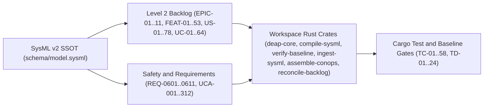

| Attribute | Specification Detail |
| :--- | :--- |
| **Issue ID** | TBD |
| **Title** | WBS_02: Technical Realization Register |
| **Type** | management |
| **Management Level** | Level 4 Enterprise Realization & DO-178C / DO-330 Traceability |
| **Standard Baseline** | MIL-STD-881E / DO-178C Sec. 5.5 / CMMI Level 3 REQM |
| **Generation Mode** | subagent |
| **Specification Source** | [schema/model.sysml](../../schema/model.sysml) |

# WBS_02: Technical Realization Register

## 1. End-to-End Technical Realization Architecture

This Technical Realization Register establishes deterministic, bijective traceability from every SysML v2 `part def` work package in `schema/model.sysml` (`01.01.01` through `01.11.04`) to its realizing Agile Feature (`FEAT-01..53` and the 58-node `FEAT-01..58` baseline from `820db8f`), User Stories (`US-01..78`), Use Cases (`UC-01..64`), normative requirements (`REQ-0601..REQ-0611`), STPA Unsafe Control Actions and Safety Constraints (`UCA-001..UCA-312`, `SC-BP08-01..20`, `SC-BP09-17..20`), concrete workspace Rust modules across `crates/{deap-core,compile-sysml,verify-baseline,ingest-sysml,assemble-conops,reconcile-backlog}` (`deap_core::rust_cst`, `deap_core::dart_cst`, `deap_core::sysml_cst`, `deap_core::markdown_ast`, `compile_sysml::modular_codegen`), and headless `cargo test` verification suites.

### Bijective Realization & Coverage Completeness Formulation

$$
\begin{aligned}
C_{\mathrm{feat}} &= \frac{\left|\left\{w \in \mathcal{W}_{L3} : \rho_{\mathrm{spec}}(w) \neq \emptyset \land \rho_{\mathrm{code}}(w) \neq \emptyset \land \rho_{\mathrm{test}}(w) \neq \emptyset\right\}\right|}{\left|\mathcal{W}_{L3}\right|} = 1 \\
\mathcal{W}_{L3} &= \mathcal{W}_{\mathrm{W0}} \sqcup \mathcal{W}_{\mathrm{T1}} \sqcup \mathcal{W}_{\mathrm{W2}}, \quad \mathcal{W}_{\mathrm{W0}} \cap \mathcal{W}_{\mathrm{T1}} = \emptyset, \quad \mathcal{W}_{\mathrm{T1}} \cap \mathcal{W}_{\mathrm{W2}} = \emptyset
\end{aligned}
$$

- Parameter Definitions & Engineering Units:
  - $C_{\mathrm{feat}}$: Normalized Level 3 feature-to-realization coverage ratio (`1.0`, `dimensionless`, corresponding to `100%` of `58` WBS Level 3 work packages).
  - $\mathcal{W}_{L3}$: Complete set of `58` Level 3 WBS work packages (`01.01.01` through `01.11.04`, `work packages`).
  - $\rho_{\mathrm{spec}}(w), \rho_{\mathrm{code}}(w), \rho_{\mathrm{test}}(w)$: Total mapping functions binding work package $w$ to its Level 2 backlog specification, target workspace Rust module (or quarantined Wave-2 allocation), and formal SysML test case / `cargo test` target (`mappings`).
  - $\mathcal{W}_{\mathrm{W0}}, \mathcal{W}_{\mathrm{T1}}, \mathcal{W}_{\mathrm{W2}}$: Disjoint wave partitions comprising `40` Wave-0 Baseline work packages (`FEAT-01..35` + 5 `BP-07` domain specs), `6` Track-1 Active features (`FEAT-36..40` & `FEAT-45` / `820db8f` `FEAT-41..45` & `FEAT-50`), and `12` Wave-2 Deferred features (`FEAT-41..44` & `FEAT-46..53` / `820db8f` `FEAT-46..49` & `FEAT-51..58`).

---

## 2. Master Technical Realization Register (`FEAT-01..53` & `820db8f` `FEAT-01..58` across `EPIC-01..11`)

| WBS Code | Work Package | Feature ID | User Stories & Use Cases | Requirement & UCA IDs | Test Case IDs | Execution Wave | Target Rust Module Path | Verification Suite |
| :--- | :--- | :--- | :--- | :--- | :--- | :--- | :--- | :--- |
| `01.01.01` | `CompilerLintEnforcementGate` | [FEAT-01](../features/FEAT-01-CompilerLintEnforcementGate.md) | `US-01`, `UC-01` | `REQ-0601`, `UCA-001..UCA-005` (`UCA-001..UCA-312`) | `TC-01`, `TC_REQ_0601_Forbid_Lint_Gate, TC_REQ_0601_Blueprint_Conformance, Test_ExecuteCargoClippyWorkspaceAllTargets, Test_ReadWorkspaceLintsClippyForbidTable, Test_ExecuteVerifyBaselineNoDomain, Test_RunScanClippyAllowTokensOn, Test_ExecuteIngestSysmlSchemaBlueprint01` | Wave-0 Baseline | `crates/verify-baseline/src/checks/codebase.rs` (`deap_core::rust_cst`) | `crates/verify-baseline/tests/codebase_checks_tests.rs` |
| `01.01.02` | `WorkspaceManifestForbidGate` | [FEAT-02](../features/FEAT-02-WorkspaceManifestForbidGate.md) | `US-02`, `UC-01`, `UC-04` | `REQ-0601`, `UCA-006..UCA-010` | `TC-02`, `TC_REQ_0601_Forbid_Lint_Gate, TC_REQ_0601_Blueprint_Conformance, Test_ExecuteCargoClippyWorkspaceAllTargets, Test_ReadWorkspaceLintsClippyForbidTable, Test_ExecuteVerifyBaselineNoDomain, Test_RunScanClippyAllowTokensOn, Test_ExecuteIngestSysmlSchemaBlueprint01` | Wave-0 Baseline | `Cargo.toml`, `crates/deap-core/src/workspace/`, `crates/verify-baseline/src/checks/codebase.rs` | `crates/verify-baseline/tests/codebase_checks_tests.rs` |
| `01.01.03` | `ClippyAttributeCstParser` (`ClippyAttributeAstScanner`) | [FEAT-03](../features/FEAT-03-ClippyAttributeCstParser.md) | `US-04`, `UC-02` | `REQ-0601`, `UCA-011..UCA-015` | `TC-03`, `TC_REQ_0601_Forbid_Lint_Gate, TC_REQ_0601_Blueprint_Conformance, Test_ExecuteCargoClippyWorkspaceAllTargets, Test_ReadWorkspaceLintsClippyForbidTable, Test_ExecuteVerifyBaselineNoDomain, Test_RunScanClippyAllowTokensOn, Test_ExecuteIngestSysmlSchemaBlueprint01` | Wave-0 Baseline | `crates/deap-core/src/rust_cst/`, `crates/verify-baseline/src/checks/codebase.rs` | `crates/verify-baseline/tests/codebase_checks_tests.rs` |
| `01.01.04` | `CrateRootAttributeSanitizer` | [FEAT-04](../features/FEAT-04-CrateRootAttributeSanitizer.md) | `US-03`, `UC-01` | `REQ-0601`, `UCA-016..UCA-020` | `TC-04`, `TC_REQ_0601_Forbid_Lint_Gate, TC_REQ_0601_Blueprint_Conformance, Test_ExecuteCargoClippyWorkspaceAllTargets, Test_ReadWorkspaceLintsClippyForbidTable, Test_ExecuteVerifyBaselineNoDomain, Test_RunScanClippyAllowTokensOn, Test_ExecuteIngestSysmlSchemaBlueprint01` | Wave-0 Baseline | `crates/deap-core/src/lib.rs`, `crates/verify-baseline/src/lib.rs` | `crates/verify-baseline/tests/codebase_checks_tests.rs` |
| `01.01.05` | `TestTargetLintEnforcer` | [FEAT-05](../features/FEAT-05-TestTargetLintEnforcer.md) | `US-05`, `UC-03`, `UC-05` | `REQ-0601`, `UCA-021..UCA-024` | `TC-05`, `TC_REQ_0601_Forbid_Lint_Gate, TC_REQ_0601_Blueprint_Conformance, Test_ExecuteCargoClippyWorkspaceAllTargets, Test_ReadWorkspaceLintsClippyForbidTable, Test_ExecuteVerifyBaselineNoDomain, Test_RunScanClippyAllowTokensOn, Test_ExecuteIngestSysmlSchemaBlueprint01` | Wave-0 Baseline | `crates/verify-baseline/src/checks/codebase.rs` | `crates/verify-baseline/tests/integration.rs` |
| `01.02.01` | `AntiGamingTestBodyAuditor` | [FEAT-06](../features/FEAT-06-AntiGamingTestBodyAuditor.md) | `US-10`, `UC-08` | `REQ-0602`, `UCA-025..UCA-029` | `TC-06`, `TC_REQ_0602_Check34_Purity_Gate, TC_REQ_0602_Blueprint_Conformance, Test_check_compiler_ast_purity, Test_mask_literals_and_comments, Test_contains_direct_range_slice, Test_audit_fail_closed_io_patterns, Test_audit_test_integrity_and_anti_gaming, Test_audit_ssot_symbol_deduplication` | Wave-0 Baseline | `crates/deap-core/src/rust_cst/`, `crates/verify-baseline/src/checks/codebase.rs` | `crates/verify-baseline/tests/codebase_checks_tests.rs` |
| `01.02.02` | `Check34AstPurityAndAntiGamingGate` | [FEAT-07](../features/FEAT-07-Check34AstPurityAndAntiGamingGate.md) | `US-06`, `US-07`, `UC-10` | `REQ-0602`, `UCA-030..UCA-034` | `TC-07`, `TC_REQ_0602_Check34_Purity_Gate, TC_REQ_0602_Blueprint_Conformance, Test_check_compiler_ast_purity, Test_mask_literals_and_comments, Test_contains_direct_range_slice, Test_audit_fail_closed_io_patterns, Test_audit_test_integrity_and_anti_gaming, Test_audit_ssot_symbol_deduplication` | Wave-0 Baseline | `crates/deap-core/src/rust_cst/`, `crates/verify-baseline/src/checks/codebase.rs` | `crates/verify-baseline/tests/codebase_checks_tests.rs` |
| `01.02.03` | `FailClosedIoAstVerifier` | [FEAT-08](../features/FEAT-08-FailClosedIoAstVerifier.md) | `US-09`, `UC-07` | `REQ-0602`, `UCA-035..UCA-039` | `TC-08`, `TC_REQ_0602_Check34_Purity_Gate, TC_REQ_0602_Blueprint_Conformance, Test_check_compiler_ast_purity, Test_mask_literals_and_comments, Test_contains_direct_range_slice, Test_audit_fail_closed_io_patterns, Test_audit_test_integrity_and_anti_gaming, Test_audit_ssot_symbol_deduplication` | Wave-0 Baseline | `crates/deap-core/src/rust_cst/`, `crates/verify-baseline/src/checks/codebase.rs` | `crates/verify-baseline/tests/codebase_checks_tests.rs` |
| `01.02.04` | `RangeSliceAstDetector` | [FEAT-09](../features/FEAT-09-RangeSliceAstDetector.md) | `US-08`, `UC-06` | `REQ-0602`, `UCA-040..UCA-044` | `TC-09`, `TC_REQ_0602_Check34_Purity_Gate, TC_REQ_0602_Blueprint_Conformance, Test_check_compiler_ast_purity, Test_mask_literals_and_comments, Test_contains_direct_range_slice, Test_audit_fail_closed_io_patterns, Test_audit_test_integrity_and_anti_gaming, Test_audit_ssot_symbol_deduplication` | Wave-0 Baseline | `crates/deap-core/src/rust_cst/`, `crates/verify-baseline/src/checks/codebase.rs` | `crates/verify-baseline/tests/codebase_checks_tests.rs` |
| `01.02.05` | `SsotSymbolDeduplicationGate` | [FEAT-10](../features/FEAT-10-SsotSymbolDeduplicationGate.md) | `US-11`, `UC-09` | `REQ-0602`, `UCA-045..UCA-048` | `TC-10`, `TC_REQ_0602_Check34_Purity_Gate, TC_REQ_0602_Blueprint_Conformance, Test_check_compiler_ast_purity, Test_mask_literals_and_comments, Test_contains_direct_range_slice, Test_audit_fail_closed_io_patterns, Test_audit_test_integrity_and_anti_gaming, Test_audit_ssot_symbol_deduplication` | Wave-0 Baseline | `crates/deap-core/src/rust_cst/`, `crates/verify-baseline/src/checks/codebase.rs` | `crates/verify-baseline/tests/codebase_checks_tests.rs` |
| `01.03.01` | `BijectiveSysmlSerializer` | [FEAT-11](../features/FEAT-11-BijectiveSysmlSerializer.md) | `US-16`, `UC-14` | `REQ-0603`, `UCA-049..UCA-053` | `TC-11`, `TC_REQ_0603_Bijective_Roundtrip_Gate, TC_REQ_0603_Blueprint_Conformance, Test_scan_all, Test_parse_package_or_file, Test_ParseTypeExprAndParseTransition, Test_verify_bijective_ast_roundtrip, Test_ast_orig_to_sysml, Test_AssertAstOrigEqualsAstReparsed` | Wave-0 Baseline | `crates/compile-sysml/src/semantic/serializer.rs` (`deap_core::sysml_cst`) | `crates/compile-sysml/tests/integration.rs` |
| `01.03.02` | `CompilerRoundtripVerificationGate` | [FEAT-12](../features/FEAT-12-CompilerRoundtripVerificationGate.md) | `US-15`, `US-17`, `UC-14` | `REQ-0603`, `UCA-054..UCA-058` | `TC-12`, `TC_REQ_0603_Bijective_Roundtrip_Gate, TC_REQ_0603_Blueprint_Conformance, Test_scan_all, Test_parse_package_or_file, Test_ParseTypeExprAndParseTransition, Test_verify_bijective_ast_roundtrip, Test_ast_orig_to_sysml, Test_AssertAstOrigEqualsAstReparsed` | Wave-0 Baseline | `crates/compile-sysml/src/driver.rs` (`deap_core::sysml_cst`) | `crates/compile-sysml/tests/reproducer_tests.rs` |
| `01.03.03` | `FailClosedRecursiveDescentParser` | [FEAT-13](../features/FEAT-13-FailClosedRecursiveDescentParser.md) | `US-13`, `US-14`, `UC-12`, `UC-13` | `REQ-0603`, `UCA-059..UCA-063` | `TC-13`, `TC_REQ_0603_Bijective_Roundtrip_Gate, TC_REQ_0603_Blueprint_Conformance, Test_scan_all, Test_parse_package_or_file, Test_ParseTypeExprAndParseTransition, Test_verify_bijective_ast_roundtrip, Test_ast_orig_to_sysml, Test_AssertAstOrigEqualsAstReparsed` | Wave-0 Baseline | `crates/deap-core/src/sysml_cst/mod.rs`, `crates/compile-sysml/src/parser/mod.rs` | `crates/compile-sysml/tests/multi_file_compilation_tests.rs` |
| `01.03.04` | `NativeSigilAndLifetimeLexer` | [FEAT-14](../features/FEAT-14-NativeSigilAndLifetimeLexer.md) | `US-12`, `UC-11` | `REQ-0603`, `UCA-064..UCA-068` | `TC-14`, `TC_REQ_0603_Bijective_Roundtrip_Gate, TC_REQ_0603_Blueprint_Conformance, Test_scan_all, Test_parse_package_or_file, Test_ParseTypeExprAndParseTransition, Test_verify_bijective_ast_roundtrip, Test_ast_orig_to_sysml, Test_AssertAstOrigEqualsAstReparsed` | Wave-0 Baseline | `crates/deap-core/src/sysml_cst/mod.rs` (`logos::Logos`) | `crates/compile-sysml/tests/integration.rs` |
| `01.03.05` | `SysmlBijectiveRoundtripCompilerGate` | [FEAT-15](../features/FEAT-15-SysmlBijectiveRoundtripCompilerGate.md) | `US-15`, `UC-15` | `REQ-0603`, `UCA-069..UCA-072` | `TC-15`, `TC_REQ_0603_Bijective_Roundtrip_Gate, TC_REQ_0603_Blueprint_Conformance, Test_scan_all, Test_parse_package_or_file, Test_ParseTypeExprAndParseTransition, Test_verify_bijective_ast_roundtrip, Test_ast_orig_to_sysml, Test_AssertAstOrigEqualsAstReparsed` | Wave-0 Baseline | `crates/deap-core/src/sysml_cst/mod.rs`, `crates/ingest-sysml/src/lib.rs` | `crates/ingest-sysml/tests/integration.rs` |
| `01.04.01` | `AgileSpecForwardProjector` | [FEAT-16](../features/FEAT-16-AgileSpecForwardProjector.md) | `US-18`..`US-21`, `UC-16` | `REQ-0604`, `UCA-073..UCA-077` | `TC-16`, `TC_REQ_0604_Forward_Sync_Icd_Wbs, TC_REQ_0604_Blueprint_Conformance, Test_CompileSysmlForwardSyncDocs, Test_ResolveParentEpicByPkgName, Test_BindAllPackageStoriesToUse, Test_EmitSymmetricActionDefSignaturesAndE1, Test_CompileSysmlEmitIcdDocsInterfaces, Test_ProjectNxNConnectionDefMatrixAndFlowDef, Test_CompileSysmlEmitWbsDocsManagement, Test_SynthesizeMilStd881eTreeAnd, Test_ReconcileBacklogReconcileDocsDirDocs, Test_ParseCommonMarkTablesWithInHtml, Test_ReconcileChecklistsWithParentInclusiveEpic, Test_CompileSysmlReverseSyncDocs, Test_MergeExtractedEntitiesIntoOwningSubpackages` | Wave-0 Baseline | `crates/compile-sysml/src/sync/mod.rs` (`deap_core::markdown_ast`) | `crates/compile-sysml/tests/upstream_projection_acceptance_test.rs` |
| `01.04.02` | `BidirectionalBacklogReconciler` | [FEAT-17](../features/FEAT-17-BidirectionalBacklogReconciler.md) | `US-26`..`US-28`, `UC-19` | `REQ-0604`, `UCA-078..UCA-082` | `TC-17`, `TC_REQ_0604_Forward_Sync_Icd_Wbs, TC_REQ_0604_Blueprint_Conformance, Test_CompileSysmlForwardSyncDocs, Test_ResolveParentEpicByPkgName, Test_BindAllPackageStoriesToUse, Test_EmitSymmetricActionDefSignaturesAndE1, Test_CompileSysmlEmitIcdDocsInterfaces, Test_ProjectNxNConnectionDefMatrixAndFlowDef, Test_CompileSysmlEmitWbsDocsManagement, Test_SynthesizeMilStd881eTreeAnd, Test_ReconcileBacklogReconcileDocsDirDocs, Test_ParseCommonMarkTablesWithInHtml, Test_ReconcileChecklistsWithParentInclusiveEpic, Test_CompileSysmlReverseSyncDocs, Test_MergeExtractedEntitiesIntoOwningSubpackages` | Wave-0 Baseline | `crates/reconcile-backlog/src/checklist.rs`, `crates/reconcile-backlog/src/frontmatter.rs` (`deap_core::markdown_ast`) | `crates/reconcile-backlog/tests/reproducer_tests.rs` |
| `01.04.03` | `DeterministicSpecIcdWbsForwardCompiler` | [FEAT-18](../features/FEAT-18-DeterministicSpecIcdWbsForwardCompiler.md) | `US-29`, `US-30`, `UC-20` | `REQ-0604`, `UCA-083..UCA-087` | `TC-18`, `TC_REQ_0604_Forward_Sync_Icd_Wbs, TC_REQ_0604_Blueprint_Conformance, Test_CompileSysmlForwardSyncDocs, Test_ResolveParentEpicByPkgName, Test_BindAllPackageStoriesToUse, Test_EmitSymmetricActionDefSignaturesAndE1, Test_CompileSysmlEmitIcdDocsInterfaces, Test_ProjectNxNConnectionDefMatrixAndFlowDef, Test_CompileSysmlEmitWbsDocsManagement, Test_SynthesizeMilStd881eTreeAnd, Test_ReconcileBacklogReconcileDocsDirDocs, Test_ParseCommonMarkTablesWithInHtml, Test_ReconcileChecklistsWithParentInclusiveEpic, Test_CompileSysmlReverseSyncDocs, Test_MergeExtractedEntitiesIntoOwningSubpackages` | Wave-0 Baseline | `crates/compile-sysml/src/sync/reverse.rs` (`deap_core::markdown_ast`) | `crates/compile-sysml/tests/upstream_projection_acceptance_test.rs` |
| `01.04.04` | `LogicalIcdMatrixCompiler` | [FEAT-19](../features/FEAT-19-LogicalIcdMatrixCompiler.md) | `US-22`, `US-23`, `UC-17` | `REQ-0604`, `UCA-088..UCA-092` | `TC-19`, `TC_REQ_0604_Forward_Sync_Icd_Wbs, TC_REQ_0604_Blueprint_Conformance, Test_CompileSysmlForwardSyncDocs, Test_ResolveParentEpicByPkgName, Test_BindAllPackageStoriesToUse, Test_EmitSymmetricActionDefSignaturesAndE1, Test_CompileSysmlEmitIcdDocsInterfaces, Test_ProjectNxNConnectionDefMatrixAndFlowDef, Test_CompileSysmlEmitWbsDocsManagement, Test_SynthesizeMilStd881eTreeAnd, Test_ReconcileBacklogReconcileDocsDirDocs, Test_ParseCommonMarkTablesWithInHtml, Test_ReconcileChecklistsWithParentInclusiveEpic, Test_CompileSysmlReverseSyncDocs, Test_MergeExtractedEntitiesIntoOwningSubpackages` | Wave-0 Baseline | `crates/compile-sysml/src/driver.rs` | `crates/compile-sysml/tests/upstream_projection_acceptance_test.rs` |
| `01.04.05` | `MilStd881eWbsExporter` | [FEAT-20](../features/FEAT-20-MilStd881eWbsExporter.md) | `US-24`, `US-25`, `UC-18` | `REQ-0604`, `UCA-093..UCA-096` | `TC-20`, `TC_REQ_0604_Forward_Sync_Icd_Wbs, TC_REQ_0604_Blueprint_Conformance, Test_CompileSysmlForwardSyncDocs, Test_ResolveParentEpicByPkgName, Test_BindAllPackageStoriesToUse, Test_EmitSymmetricActionDefSignaturesAndE1, Test_CompileSysmlEmitIcdDocsInterfaces, Test_ProjectNxNConnectionDefMatrixAndFlowDef, Test_CompileSysmlEmitWbsDocsManagement, Test_SynthesizeMilStd881eTreeAnd, Test_ReconcileBacklogReconcileDocsDirDocs, Test_ParseCommonMarkTablesWithInHtml, Test_ReconcileChecklistsWithParentInclusiveEpic, Test_CompileSysmlReverseSyncDocs, Test_MergeExtractedEntitiesIntoOwningSubpackages` | Wave-0 Baseline | `crates/compile-sysml/src/sync/forward/wbs_emitter.rs`, `crates/verify-baseline/src/checks/wbs_integrity.rs` | `crates/compile-sysml/tests/upstream_projection_acceptance_test.rs` |
| `01.05.01` | `Check36AstCompletenessVerifier` | [FEAT-21](../features/FEAT-21-Check36AstCompletenessVerifier.md) | `US-34`, `UC-24` | `REQ-0605`, `UCA-097..UCA-101` | `TC-21`, `TC_REQ_0605_Safety_Docstring_Synthesizer, TC_REQ_0605_Blueprint_Conformance, Test_RunCompileSysmlInjectSafetyDocstrings, Test_ScanSourceLinesViaRustDartLexStateAnd, Test_ResolveSchemaContextViaCollectAll, Test_RunVerifyBaselineNoDomain, Test_TokenizeRsAndDartFilesUsing, Test_RunIngestSysmlSchemaBlueprint05` | Wave-0 Baseline | `crates/deap-core/src/rust_cst/`, `crates/verify-baseline/src/checks/docstring_gate.rs` | `crates/verify-baseline/tests/check_36_docstring_gate_tests.rs` |
| `01.05.02` | `ScopedSchemaContextResolver` | [FEAT-22](../features/FEAT-22-ScopedSchemaContextResolver.md) | `US-33`, `UC-22` | `REQ-0605`, `UCA-102..UCA-106` | `TC-22`, `TC_REQ_0605_Safety_Docstring_Synthesizer, TC_REQ_0605_Blueprint_Conformance, Test_RunCompileSysmlInjectSafetyDocstrings, Test_ScanSourceLinesViaRustDartLexStateAnd, Test_ResolveSchemaContextViaCollectAll, Test_RunVerifyBaselineNoDomain, Test_TokenizeRsAndDartFilesUsing, Test_RunIngestSysmlSchemaBlueprint05` | Wave-0 Baseline | `crates/deap-core/src/sysml_cst/`, `crates/compile-sysml/src/docstring.rs` | `crates/compile-sysml/tests/docstring_injector_tests.rs` |
| `01.05.03` | `SevenSectionDocstringGenerator` | [FEAT-23](../features/FEAT-23-SevenSectionDocstringGenerator.md) | `US-31`, `UC-24` | `REQ-0605`, `UCA-107..UCA-111` | `TC-23`, `TC_REQ_0605_Safety_Docstring_Synthesizer, TC_REQ_0605_Blueprint_Conformance, Test_RunCompileSysmlInjectSafetyDocstrings, Test_ScanSourceLinesViaRustDartLexStateAnd, Test_ResolveSchemaContextViaCollectAll, Test_RunVerifyBaselineNoDomain, Test_TokenizeRsAndDartFilesUsing, Test_RunIngestSysmlSchemaBlueprint05` | Wave-0 Baseline | `crates/deap-core/src/rust_cst/`, `crates/compile-sysml/src/docstring.rs` | `crates/compile-sysml/tests/docstring_injector_tests.rs` |
| `01.05.04` | `UnifiedRustDartCstParser` (`UnifiedRustDartLexicalScanner`) | [FEAT-24](../features/FEAT-24-UnifiedRustDartCstParser.md) | `US-32`, `US-35`, `UC-21`, `UC-23` | `REQ-0605`, `UCA-112..UCA-116` | `TC-24`, `TC_REQ_0605_Safety_Docstring_Synthesizer, TC_REQ_0605_Blueprint_Conformance, Test_RunCompileSysmlInjectSafetyDocstrings, Test_ScanSourceLinesViaRustDartLexStateAnd, Test_ResolveSchemaContextViaCollectAll, Test_RunVerifyBaselineNoDomain, Test_TokenizeRsAndDartFilesUsing, Test_RunIngestSysmlSchemaBlueprint05` | Wave-0 Baseline | `crates/deap-core/src/rust_cst/`, `crates/deap-core/src/dart_cst/` | `crates/verify-baseline/tests/check_36_docstring_gate_tests.rs` |
| `01.05.05` | `UnifiedSafetyDocstringSynthesizer` | [FEAT-25](../features/FEAT-25-UnifiedSafetyDocstringSynthesizer.md) | `US-36`, `UC-25` | `REQ-0605`, `UCA-117..UCA-120` | `TC-25`, `TC_REQ_0605_Safety_Docstring_Synthesizer, TC_REQ_0605_Blueprint_Conformance, Test_RunCompileSysmlInjectSafetyDocstrings, Test_ScanSourceLinesViaRustDartLexStateAnd, Test_ResolveSchemaContextViaCollectAll, Test_RunVerifyBaselineNoDomain, Test_TokenizeRsAndDartFilesUsing, Test_RunIngestSysmlSchemaBlueprint05` | Wave-0 Baseline | `crates/deap-core/src/rust_cst/`, `crates/compile-sysml/src/docstring.rs` | `crates/compile-sysml/tests/docstring_injector_tests.rs` |
| `01.06.01` | `ClosedLoopDefectPublisherGate` | [FEAT-26](../features/FEAT-26-ClosedLoopDefectPublisherGate.md) | `US-43`, `US-44`, `UC-28`, `UC-29` | `REQ-0606`, `UCA-121..UCA-125` | `TC-26`, `TC_REQ_0606_Static_Defect_Auditor, TC_REQ_0606_Blueprint_Conformance, Test_VerifyBaselineAuditCodePathCrates, Test_ParseRustCstAndParseDartCst, Test_EvaluateSourceFilePillarsAcross5, Test_synthesize_defect_dossier_markdown, Test_run_check_defect, Test_Execute12CheckValidateDefectDossier, Test_GhIssueCreateOrGhIssue, Test_GhIssueViewJsonTitleBody` | Wave-0 Baseline | `crates/verify-baseline/src/defect_dossier.rs` | `crates/verify-baseline/tests/defect_dossier_tests.rs` |
| `01.06.02` | `DeterministicDossierSynthesizer` | [FEAT-27](../features/FEAT-27-DeterministicDossierSynthesizer.md) | `US-40`..`US-42`, `UC-27`, `UC-30` | `REQ-0606`, `UCA-126..UCA-130` | `TC-27`, `TC_REQ_0606_Static_Defect_Auditor, TC_REQ_0606_Blueprint_Conformance, Test_VerifyBaselineAuditCodePathCrates, Test_ParseRustCstAndParseDartCst, Test_EvaluateSourceFilePillarsAcross5, Test_synthesize_defect_dossier_markdown, Test_run_check_defect, Test_Execute12CheckValidateDefectDossier, Test_GhIssueCreateOrGhIssue, Test_GhIssueViewJsonTitleBody` | Wave-0 Baseline | `crates/verify-baseline/src/defect_dossier.rs` (`deap_core::markdown_ast`) | `crates/verify-baseline/tests/defect_dossier_tests.rs` |
| `01.06.03` | `DeterministicStaticDefectAuditor` | [FEAT-28](../features/FEAT-28-DeterministicStaticDefectAuditor.md) | `US-37`, `UC-31` | `REQ-0606`, `UCA-131..UCA-135` | `TC-28`, `TC_REQ_0606_Static_Defect_Auditor, TC_REQ_0606_Blueprint_Conformance, Test_VerifyBaselineAuditCodePathCrates, Test_ParseRustCstAndParseDartCst, Test_EvaluateSourceFilePillarsAcross5, Test_synthesize_defect_dossier_markdown, Test_run_check_defect, Test_Execute12CheckValidateDefectDossier, Test_GhIssueCreateOrGhIssue, Test_GhIssueViewJsonTitleBody` | Wave-0 Baseline | `crates/deap-core/src/rust_cst/`, `crates/verify-baseline/src/audit_code.rs` | `crates/verify-baseline/tests/blueprint_gate_tests.rs` |
| `01.06.04` | `FivePillarStaticAstAnalyzer` | [FEAT-29](../features/FEAT-29-FivePillarStaticAstAnalyzer.md) | `US-38`, `US-39`, `UC-26` | `REQ-0606`, `UCA-136..UCA-140` | `TC-29`, `TC_REQ_0606_Static_Defect_Auditor, TC_REQ_0606_Blueprint_Conformance, Test_VerifyBaselineAuditCodePathCrates, Test_ParseRustCstAndParseDartCst, Test_EvaluateSourceFilePillarsAcross5, Test_synthesize_defect_dossier_markdown, Test_run_check_defect, Test_Execute12CheckValidateDefectDossier, Test_GhIssueCreateOrGhIssue, Test_GhIssueViewJsonTitleBody` | Wave-0 Baseline | `crates/deap-core/src/rust_cst/`, `crates/deap-core/src/dart_cst/` | `crates/verify-baseline/tests/codebase_checks_tests.rs` |
| `01.06.05` | `MermaidUmlDiagramGenerator` | [FEAT-30](../features/FEAT-30-MermaidUmlDiagramGenerator.md) | `US-40`, `UC-27` | `REQ-0606`, `UCA-141..UCA-144` | `TC-30`, `TC_REQ_0606_Static_Defect_Auditor, TC_REQ_0606_Blueprint_Conformance, Test_VerifyBaselineAuditCodePathCrates, Test_ParseRustCstAndParseDartCst, Test_EvaluateSourceFilePillarsAcross5, Test_synthesize_defect_dossier_markdown, Test_run_check_defect, Test_Execute12CheckValidateDefectDossier, Test_GhIssueCreateOrGhIssue, Test_GhIssueViewJsonTitleBody` | Wave-0 Baseline | `crates/deap-core/src/markdown/mermaid.rs`, `crates/verify-baseline/src/checks/mermaid.rs` | `crates/verify-baseline/tests/defect_dossier_tests.rs` |
| `01.07.01` | `FourLevelAstPartitionerAndHoister` (`820db8f`: `01.07.06` / `FEAT-36`) | [FEAT-31](../features/FEAT-31-FourLevelAstPartitionerAndHoister.md) | `US-46`, `UC-33` | `REQ-0607`, `UCA-160..UCA-162` | `TC-36`, `TC_REQ_0607_Self_Hosting_Modular_Codegen, TC_REQ_0607_Blueprint_Conformance, Test_verify_dag_and_layers, Test_partition_and_hoist, Test_synthesize_module_tokens, Test_build_syn_file, Test_format_pretty_syn_file, Test_emit_modular_rust_tree, Test_emit_modular_flutter_tree, Test_verify_fixed_point_digest` | Wave-0 Baseline | `crates/compile-sysml/src/modular_codegen/lowering/partitioner.rs` | `crates/compile-sysml/tests/self_hosting_bootstrap.rs` |
| `01.07.02` | `ModularFlutterMultiFileEmitter` (`820db8f`: `01.07.07` / `FEAT-37`) | [FEAT-32](../features/FEAT-32-ModularFlutterMultiFileEmitter.md) | `US-51`, `UC-35` | `REQ-0607`, `UCA-163..UCA-165` | `TC-37`, `TC_REQ_0607_Self_Hosting_Modular_Codegen, TC_REQ_0607_Blueprint_Conformance, Test_verify_dag_and_layers, Test_partition_and_hoist, Test_synthesize_module_tokens, Test_build_syn_file, Test_format_pretty_syn_file, Test_emit_modular_rust_tree, Test_emit_modular_flutter_tree, Test_verify_fixed_point_digest` | Wave-0 Baseline | `crates/compile-sysml/src/modular_codegen/emitters/flutter/mod.rs` | `crates/compile-sysml/tests/flutter_codegen_tests.rs` |
| `01.07.03` | `ModularRustMultiFileEmitter` (`820db8f`: `01.07.08` / `FEAT-38`) | [FEAT-33](../features/FEAT-33-ModularRustMultiFileEmitter.md) | `US-47`..`US-50`, `UC-36` | `REQ-0607`, `UCA-166..UCA-168` | `TC-38`, `TC_REQ_0607_Self_Hosting_Modular_Codegen, TC_REQ_0607_Blueprint_Conformance, Test_verify_dag_and_layers, Test_partition_and_hoist, Test_synthesize_module_tokens, Test_build_syn_file, Test_format_pretty_syn_file, Test_emit_modular_rust_tree, Test_emit_modular_flutter_tree, Test_verify_fixed_point_digest` | Wave-0 Baseline | `crates/compile-sysml/src/modular_codegen/emitters/rust_emitter.rs` | `crates/compile-sysml/tests/self_hosting_bootstrap.rs` |
| `01.07.04` | `SelfHostingModularCodegenCompiler` (`820db8f`: `01.07.09` / `FEAT-39`) | [FEAT-34](../features/FEAT-34-SelfHostingModularCodegenCompiler.md) | `US-52`, `UC-34`, `UC-37` | `REQ-0607`, `UCA-169..UCA-171` | `TC-39`, `TC_REQ_0607_Self_Hosting_Modular_Codegen, TC_REQ_0607_Blueprint_Conformance, Test_verify_dag_and_layers, Test_partition_and_hoist, Test_synthesize_module_tokens, Test_build_syn_file, Test_format_pretty_syn_file, Test_emit_modular_rust_tree, Test_emit_modular_flutter_tree, Test_verify_fixed_point_digest` | Wave-0 Baseline | `crates/compile-sysml/src/modular_codegen/generated/mod.rs` | `crates/compile-sysml/tests/self_hosting_bootstrap.rs` |
| `01.07.05` | `TopologicalLayerDagVerifier` (`820db8f`: `01.07.10` / `FEAT-40`) | [FEAT-35](../features/FEAT-35-TopologicalLayerDagVerifier.md) | `US-45`, `UC-32` | `REQ-0607`, `UCA-172..UCA-176` | `TC-40`, `TC_REQ_0607_Self_Hosting_Modular_Codegen, TC_REQ_0607_Blueprint_Conformance, Test_verify_dag_and_layers, Test_partition_and_hoist, Test_synthesize_module_tokens, Test_build_syn_file, Test_format_pretty_syn_file, Test_emit_modular_rust_tree, Test_emit_modular_flutter_tree, Test_verify_fixed_point_digest` | Wave-0 Baseline | `crates/compile-sysml/src/modular_codegen/lowering/dag_verifier.rs` | `crates/compile-sysml/tests/self_hosting_bootstrap.rs` |
| `01.07.06` | `ModularityBoundsSpec` (`820db8f`: `01.07.01` / `FEAT-31`) | [FEAT-31](../features/FEAT-31-FourLevelAstPartitionerAndHoister.md) | `US-45`, `UC-33` | `REQ-0607`, `UCA-145..UCA-147` | `TC-31` | Wave-0 Baseline | `crates/compile-sysml/src/modular_codegen/domain/bounds.rs` | `crates/compile-sysml/tests/self_hosting_bootstrap.rs` |
| `01.07.07` | `LayerHierarchySpec` (`820db8f`: `01.07.02` / `FEAT-32`) | [FEAT-35](../features/FEAT-35-TopologicalLayerDagVerifier.md) | `US-45`, `UC-32` | `REQ-0607`, `UCA-148..UCA-150` | `TC-32` | Wave-0 Baseline | `crates/compile-sysml/src/modular_codegen/domain/layer_role.rs` | `crates/compile-sysml/tests/self_hosting_bootstrap.rs` |
| `01.07.08` | `CompilationUnitSpec` (`820db8f`: `01.07.03` / `FEAT-33`) | [FEAT-31](../features/FEAT-31-FourLevelAstPartitionerAndHoister.md) | `US-46`, `UC-33` | `REQ-0607`, `UCA-151..UCA-153` | `TC-33` | Wave-0 Baseline | `crates/compile-sysml/src/modular_codegen/domain/module_graph.rs` | `crates/compile-sysml/tests/self_hosting_bootstrap.rs` |
| `01.07.09` | `FourLevelLoweringEngineSpec` (`820db8f`: `01.07.04` / `FEAT-34`) | [FEAT-34](../features/FEAT-34-SelfHostingModularCodegenCompiler.md) | `US-50`, `UC-33` | `REQ-0607`, `UCA-154..UCA-156` | `TC-34` | Wave-0 Baseline | `crates/compile-sysml/src/modular_codegen/lowering/mod.rs` | `crates/compile-sysml/tests/self_hosting_bootstrap.rs` |
| `01.07.10` | `ModularEmitterSuiteSpec` (`820db8f`: `01.07.05` / `FEAT-35`) | [FEAT-33](../features/FEAT-33-ModularRustMultiFileEmitter.md) | `US-47`, `US-48`, `UC-35` | `REQ-0607`, `UCA-157..UCA-159` | `TC-35` | Wave-0 Baseline | `crates/compile-sysml/src/modular_codegen/emitters/mod.rs` | `crates/compile-sysml/tests/self_hosting_bootstrap.rs` |
| `01.08.01` | `AirGappedCargoLockGovernor` (`820db8f`: `FEAT-41`) | [FEAT-36](../features/FEAT-36-AirGappedCargoLockGovernor.md) | [US-53](../user-stories/US-53-verify_offline_locked_build.md) (`US-51`), `UC-44` | `REQ-0608`, `SC-BP08-01..04`, `UCA-177..UCA-181` | `TC-41`, `TC_REQ_0608_Lossless_Rust_Cst_Codemod, TC_REQ_0608_Blueprint_Conformance, Test_verify_offline_locked_build, Test_list_rust_items, Test_extract_rust_module, Test_verify_stage_fixed_point, Test_format_ndjson_line, Test_analyze_metrics` | **Track-1 Active** (`TD-01..03`, `TD-13`) | `Cargo.toml`, `Cargo.lock`, `crates/deap-core/src/workspace/`, `crates/verify-baseline/src/blueprint_gate.rs` | `crates/deap-core/src/workspace/` (`#[cfg(test)]`), `crates/verify-baseline/tests/blueprint_gate_tests.rs` |
| `01.08.02` | `LosslessRustCstAnalyzer` (`820db8f`: `FEAT-42`) | [FEAT-37](../features/FEAT-37-LosslessRustCstAnalyzer.md) | [US-58](../user-stories/US-58-analyze_metrics.md) (`US-56`), `UC-38` | `REQ-0608`, `SC-BP08-05..08`, `UCA-182..UCA-187` | `TC-42`, `TC_REQ_0608_Lossless_Rust_Cst_Codemod, TC_REQ_0608_Blueprint_Conformance, Test_verify_offline_locked_build, Test_list_rust_items, Test_extract_rust_module, Test_verify_stage_fixed_point, Test_format_ndjson_line, Test_analyze_metrics` | **Track-1 Active** (`TD-04..07`, `TD-12`) | `crates/deap-core/src/rust_cst/`, `crates/deap-core/src/error.rs` | `crates/deap-core/src/rust_cst/cst_tests.rs` |
| `01.08.03` | `StructuredModularCodegenSynthesizer` (`820db8f`: `FEAT-43`) | [FEAT-38](../features/FEAT-38-StructuredModularCodegenSynthesizer.md) | [US-56](../user-stories/US-56-verify_stage_fixed_point.md) (`US-54`), `UC-42` | `REQ-0608`, `REQ-0607`, `SC-BP08-09..12`, `UCA-188..UCA-193` | `TC-43`, `TC_REQ_0608_Lossless_Rust_Cst_Codemod, TC_REQ_0608_Blueprint_Conformance, Test_verify_offline_locked_build, Test_list_rust_items, Test_extract_rust_module, Test_verify_stage_fixed_point, Test_format_ndjson_line, Test_analyze_metrics` | **Track-1 Active** (`TD-20..22`) | `crates/compile-sysml/src/modular_codegen/emitters/rust_emitter.rs`, `crates/compile-sysml/src/modular_codegen/mod.rs` | `crates/compile-sysml/tests/self_hosting_bootstrap.rs` |
| `01.08.04` | `UnifiedRustcJsonDiagnosticEmitter` (`820db8f`: `FEAT-44`) | [FEAT-39](../features/FEAT-39-UnifiedRustcJsonDiagnosticEmitter.md) | [US-57](../user-stories/US-57-format_ndjson_line.md) (`US-55`), `UC-43` | `REQ-0608`, `SC-BP08-13..16`, `UCA-194..UCA-199` | `TC-44`, `TC_REQ_0608_Lossless_Rust_Cst_Codemod, TC_REQ_0608_Blueprint_Conformance, Test_verify_offline_locked_build, Test_list_rust_items, Test_extract_rust_module, Test_verify_stage_fixed_point, Test_format_ndjson_line, Test_analyze_metrics` | **Track-1 Active** (`TD-08..11`) | `crates/deap-core/src/diagnostics.rs`, `crates/{verify-baseline,compile-sysml,ingest-sysml,assemble-conops,reconcile-backlog}/src/main.rs` | `crates/deap-core/src/diagnostics.rs` (`#[cfg(test)]`), `crates/verify-baseline/tests/integration.rs` |
| `01.08.05` | `ZeroTokenRustSpanCodemodEngine` (`820db8f`: `FEAT-45`) | [FEAT-40](../features/FEAT-40-ZeroTokenRustSpanCodemodEngine.md) | [US-54](../user-stories/US-54-list_rust_items.md) (`US-52`), [US-55](../user-stories/US-55-extract_rust_module.md) (`US-53`), `UC-39..41` | `REQ-0608`, `SC-BP08-17..20`, `UCA-200..UCA-208` | `TC-45`, `TC_REQ_0608_Lossless_Rust_Cst_Codemod, TC_REQ_0608_Blueprint_Conformance, Test_verify_offline_locked_build, Test_list_rust_items, Test_extract_rust_module, Test_verify_stage_fixed_point, Test_format_ndjson_line, Test_analyze_metrics` | **Track-1 Active** (`TD-14..19`) | `crates/deap-core/src/{rust_cst,workspace}`, `crates/compile-sysml/src/{cli.rs,driver.rs}` | `crates/compile-sysml/tests/{integration.rs,docstring_injector_tests.rs}` |
| `01.09.01` | `FrbIcdBridgeAndMiriUbGate` (`820db8f`: `FEAT-46`) | [FEAT-41](../features/FEAT-41-FrbIcdBridgeAndMiriUbGate.md) | `US-62`, `US-63`, `UC-48`, `UC-49` | `REQ-0609`, `UCA-209..UCA-214` | `TC-46`, `TC_REQ_0609_Multi_Stage_Formal_Gatekeeper, TC_REQ_0609_Blueprint_Conformance, Test_probe_formal_toolchain, Test_verify_clippy_policy, Test_evaluate_stage2_dylint_mir, Test_verify_in_process_cst_syntax, Test_guard_inbound_frb_f64, Test_validate_kani_harness_spec, Test_evaluate_four_stage_gatekeeper` | Wave-2 Deferred (Stage 3) | `crates/verify-baseline/src/checks/formal_stage3_4_miri_kani.rs` | `crates/verify-baseline/tests/integration.rs` |
| `01.09.02` | `IsolatedDylintMirAllocationGate` (`820db8f`: `FEAT-47`) | [FEAT-42](../features/FEAT-42-IsolatedDylintMirAllocationGate.md) | `US-61`, `UC-46`, `UC-47` | `REQ-0609`, `UCA-215..UCA-220` | `TC-47`, `TC_REQ_0609_Multi_Stage_Formal_Gatekeeper, TC_REQ_0609_Blueprint_Conformance, Test_probe_formal_toolchain, Test_verify_clippy_policy, Test_evaluate_stage2_dylint_mir, Test_verify_in_process_cst_syntax, Test_guard_inbound_frb_f64, Test_validate_kani_harness_spec, Test_evaluate_four_stage_gatekeeper` | Wave-2 Deferred (Stage 2) | `crates/deap-core/src/workspace/dylint_gate.rs`, `crates/verify-baseline/src/checks/formal_stage2_dylint.rs` | `crates/verify-baseline/tests/integration.rs` |
| `01.09.03` | `KaniCbmcProofSynthesizer` (`820db8f`: `FEAT-48`) | [FEAT-43](../features/FEAT-43-KaniCbmcProofSynthesizer.md) | `US-64`, `UC-50` | `REQ-0609`, `UCA-221..UCA-226` | `TC-48`, `TC_REQ_0609_Multi_Stage_Formal_Gatekeeper, TC_REQ_0609_Blueprint_Conformance, Test_probe_formal_toolchain, Test_verify_clippy_policy, Test_evaluate_stage2_dylint_mir, Test_verify_in_process_cst_syntax, Test_guard_inbound_frb_f64, Test_validate_kani_harness_spec, Test_evaluate_four_stage_gatekeeper` | Wave-2 Deferred (Stage 4) | `crates/verify-baseline/src/checks/formal_stage3_4_miri_kani.rs` | `crates/verify-baseline/tests/integration.rs` |
| `01.09.04` | `MultiStageVerificationOrchestrator` (`820db8f`: `FEAT-49`) | [FEAT-44](../features/FEAT-44-MultiStageVerificationOrchestrator.md) | `US-59`..`US-65`, `UC-51` | `REQ-0609`, `UCA-227..UCA-232` | `TC-49`, `TC_REQ_0609_Multi_Stage_Formal_Gatekeeper, TC_REQ_0609_Blueprint_Conformance, Test_probe_formal_toolchain, Test_verify_clippy_policy, Test_evaluate_stage2_dylint_mir, Test_verify_in_process_cst_syntax, Test_guard_inbound_frb_f64, Test_validate_kani_harness_spec, Test_evaluate_four_stage_gatekeeper` | Wave-2 Deferred (Stages 2-4) | `crates/verify-baseline/src/runner.rs` (Stage-1 active; Stages 2-4 Wave-2) | `crates/verify-baseline/tests/integration.rs` |
| `01.09.05` | `StableClippyTotalFunctionGate` (`820db8f`: `FEAT-50`) | [FEAT-45](../features/FEAT-45-StableClippyTotalFunctionGate.md) | [US-60](../user-stories/US-60-verify_clippy_policy.md) (`US-57`), `UC-45` | `REQ-0609`, `SC-BP09-17..20`, `UCA-233..UCA-240` | `TC-50`, `TC_REQ_0609_Multi_Stage_Formal_Gatekeeper, TC_REQ_0609_Blueprint_Conformance, Test_probe_formal_toolchain, Test_verify_clippy_policy, Test_evaluate_stage2_dylint_mir, Test_verify_in_process_cst_syntax, Test_guard_inbound_frb_f64, Test_validate_kani_harness_spec, Test_evaluate_four_stage_gatekeeper` | **Track-1 Active** (`TD-23..24`) | `Cargo.toml`, `clippy.toml`, `crates/deap-core/src/workspace/clippy_gate.rs`, `crates/verify-baseline/src/runner.rs` | `crates/verify-baseline/tests/{codebase_checks_tests.rs,integration.rs}` |
| `01.10.01` | `FormattingPreservingSyncSplicer` (`820db8f`: `FEAT-51`) | [FEAT-46](../features/FEAT-46-FormattingPreservingSyncSplicer.md) | `US-71`, `UC-54` | `REQ-0610`, `UCA-241..UCA-246` | `TC-51`, `TC_REQ_0610_Incremental_Sysml_Engine, TC_REQ_0610_Blueprint_Conformance, Test_resolve_polyglot_backend, Test_normalize_line_endings, Test_parse_lossless_sysml_cst, Test_verify_lossless_cst_invariants, Test_evaluate_hir_early_cutoff, Test_apply_formatting_preserving_splices, Test_render_ariadne_diagnostic` | Wave-2 Deferred | `crates/deap-core/src/sysml_cst/`, `crates/compile-sysml/src/sync/mod.rs` | `crates/compile-sysml/tests/integration.rs` |
| `01.10.02` | `LogosRowanSysmlCstEngine` (`820db8f`: `FEAT-52`) | [FEAT-47](../features/FEAT-47-LogosRowanSysmlCstEngine.md) | `US-67`..`US-69`, `UC-52`, `UC-53` | `REQ-0610`, `UCA-247..UCA-252` | `TC-52`, `TC_REQ_0610_Incremental_Sysml_Engine, TC_REQ_0610_Blueprint_Conformance, Test_resolve_polyglot_backend, Test_normalize_line_endings, Test_parse_lossless_sysml_cst, Test_verify_lossless_cst_invariants, Test_evaluate_hir_early_cutoff, Test_apply_formatting_preserving_splices, Test_render_ariadne_diagnostic` | Wave-2 Deferred | `crates/deap-core/src/sysml_cst/mod.rs` | `crates/compile-sysml/tests/multi_file_compilation_tests.rs` |
| `01.10.03` | `SalsaIncrementalCompilerDatabase` (`820db8f`: `FEAT-53`) | [FEAT-48](../features/FEAT-48-SalsaIncrementalCompilerDatabase.md) | `US-70`, `UC-55`, `UC-56` | `REQ-0610`, `UCA-253..UCA-258` | `TC-53`, `TC_REQ_0610_Incremental_Sysml_Engine, TC_REQ_0610_Blueprint_Conformance, Test_resolve_polyglot_backend, Test_normalize_line_endings, Test_parse_lossless_sysml_cst, Test_verify_lossless_cst_invariants, Test_evaluate_hir_early_cutoff, Test_apply_formatting_preserving_splices, Test_render_ariadne_diagnostic` | Wave-2 Deferred | `crates/deap-core/src/sysml_cst/salsa_db.rs` | `crates/compile-sysml/tests/integration.rs` |
| `01.10.04` | `TypedPolyglotIngestionFrontend` (`820db8f`: `FEAT-54`) | [FEAT-49](../features/FEAT-49-TypedPolyglotIngestionFrontend.md) | `US-66`, `US-72`, `UC-57`, `UC-58` | `REQ-0610`, `UCA-259..UCA-264` | `TC-54`, `TC_REQ_0610_Incremental_Sysml_Engine, TC_REQ_0610_Blueprint_Conformance, Test_resolve_polyglot_backend, Test_normalize_line_endings, Test_parse_lossless_sysml_cst, Test_verify_lossless_cst_invariants, Test_evaluate_hir_early_cutoff, Test_apply_formatting_preserving_splices, Test_render_ariadne_diagnostic` | Wave-2 Deferred | `crates/ingest-sysml/src/translators/mod.rs` | `crates/ingest-sysml/tests/code_ingestion_tests.rs` |
| `01.11.01` | `CertifiedCoreSubsetAndCoverageGate` (`820db8f`: `FEAT-55`) | [FEAT-50](../features/FEAT-50-CertifiedCoreSubsetAndCoverageGate.md) | `US-77`, `UC-61` | `REQ-0611`, `UCA-265..UCA-270` | `TC-55`, `TC_REQ_0611_Ferrocene_Three_Ring_Certification, TC_REQ_0611_Blueprint_Conformance, Test_probe_criticalup_toolchain, Test_verify_dual_toolchain_parity, Test_synthesize_three_ring_workspace, Test_verify_fls_traceability_chain, Test_verify_certified_core_and_table_a7_coverage, Test_verify_three_ring_edge_and_monitor_readback` | Wave-2 Deferred | `crates/deap-core/src/workspace/ferrocene_gate.rs` | `crates/verify-baseline/tests/blueprint_gate_tests.rs` |
| `01.11.02` | `DualModeFerroceneToolchainGate` (`820db8f`: `FEAT-56`) | [FEAT-51](../features/FEAT-51-DualModeFerroceneToolchainGate.md) | `US-73`, `US-74`, `UC-59` | `REQ-0611`, `UCA-271..UCA-276` | `TC-56`, `TC_REQ_0611_Ferrocene_Three_Ring_Certification, TC_REQ_0611_Blueprint_Conformance, Test_probe_criticalup_toolchain, Test_verify_dual_toolchain_parity, Test_synthesize_three_ring_workspace, Test_verify_fls_traceability_chain, Test_verify_certified_core_and_table_a7_coverage, Test_verify_three_ring_edge_and_monitor_readback` | Wave-2 Deferred | `crates/deap-core/src/workspace/ferrocene_gate.rs` | `crates/verify-baseline/tests/blueprint_gate_tests.rs` |
| `01.11.03` | `FlsParagraphTraceabilitySynthesizer` (`820db8f`: `FEAT-57`) | [FEAT-52](../features/FEAT-52-FlsParagraphTraceabilitySynthesizer.md) | `US-76`, `UC-60` | `REQ-0611`, `UCA-277..UCA-282` | `TC-57`, `TC_REQ_0611_Ferrocene_Three_Ring_Certification, TC_REQ_0611_Blueprint_Conformance, Test_probe_criticalup_toolchain, Test_verify_dual_toolchain_parity, Test_synthesize_three_ring_workspace, Test_verify_fls_traceability_chain, Test_verify_certified_core_and_table_a7_coverage, Test_verify_three_ring_edge_and_monitor_readback` | Wave-2 Deferred | `crates/deap-core/src/workspace/ferrocene_gate.rs` | `crates/verify-baseline/tests/check_36_docstring_gate_tests.rs` |
| `01.11.04` | `ThreeRingAssurancePartitionCompiler` (`820db8f`: `FEAT-58`) | [FEAT-53](../features/FEAT-53-ThreeRingAssurancePartitionCompiler.md) | `US-75`, `US-78`, `UC-62..64` | `REQ-0611`, `UCA-283..UCA-288` | `TC-58`, `TC_REQ_0611_Ferrocene_Three_Ring_Certification, TC_REQ_0611_Blueprint_Conformance, Test_probe_criticalup_toolchain, Test_verify_dual_toolchain_parity, Test_synthesize_three_ring_workspace, Test_verify_fls_traceability_chain, Test_verify_certified_core_and_table_a7_coverage, Test_verify_three_ring_edge_and_monitor_readback` | Wave-2 Deferred | `crates/deap-core/src/workspace/ferrocene_gate.rs` | `crates/compile-sysml/tests/self_hosting_bootstrap.rs` |

---

## 3. Detailed Track-1 Realization & Diagnostics Allocation (`EPIC-08` & `EPIC-09` Stage 1)

| WBS Code | Feature & SysML Component | Realizing User Stories | SysML Ports (`in` / `out` / `inout`) | Typed Rust Error Enum & Diagnostic Codes | FLS Paragraphs | Atomic TDD Dispatches |
| :--- | :--- | :--- | :--- | :--- | :--- | :--- |
| `01.08.01` | `FEAT-36` / `FEAT-41` (`AirGappedCargoLockGovernor`) | [US-53](../user-stories/US-53-verify_offline_locked_build.md) (`US-51`) | `manifest_lock_in`, `lock_receipt_out` | `OfflineLockGovernanceError` -> `DEAP-E0803`, `DEAP-E0804` | `fls_8tsynkj2cufj`, `fls_qcb1n9c0e5hz`, `fls_izdv9i4spokw`, `fls_pocsh1neugpc` | `TD-01`, `TD-02`, `TD-03`, `TD-13` |
| `01.08.02` | `FEAT-37` / `FEAT-42` (`LosslessRustCstAnalyzer`) | [US-58](../user-stories/US-58-analyze_metrics.md) (`US-56`) | `rust_source_in`, `item_inventory_out`, `metrics_report_out` | `#[non_exhaustive]` `CstMetricsError` -> `DEAP-E0801..DEAP-E0804` | `fls_66m4rnbssgig`, `fls_9ucqbbd0s2yo`, `fls_exe4zodlwfez`, `fls_142vncdktbin`, `fls_ikfvbeewame7`, `fls_nsvzzbldhq53` | `TD-04`, `TD-05`, `TD-06`, `TD-07`, `TD-12` |
| `01.08.04` | `FEAT-39` / `FEAT-44` (`UnifiedRustcJsonDiagnosticEmitter`) | [US-57](../user-stories/US-57-format_ndjson_line.md) (`US-55`) | `finding_in`, `ndjson_out`, `machine_fix_inout` | `DiagnosticEmitError` -> `DEAP-E0801..DEAP-E0804` (`"compiler-message"` single-line zero-ANSI NDJSON across `5` CLIs) | `fls_szibmtfv117b`, `fls_77sc35ddv9e4`, `fls_qcb1n9c0e5hz`, `fls_utuu8mdbuyxm`, `fls_exe4zodlwfez` | `TD-08`, `TD-09`, `TD-10`, `TD-11` |
| `01.08.05` | `FEAT-40` / `FEAT-45` (`ZeroTokenRustSpanCodemodEngine`) | [US-54](../user-stories/US-54-list_rust_items.md) (`US-52`), [US-55](../user-stories/US-55-extract_rust_module.md) (`US-53`) | `codemod_command_in`, `atomic_patch_out`, `codemod_error_out` | `RustCstInventoryError`, `CodemodError` -> `DEAP-E0801..DEAP-E0804`, `DEAP-E0705` | `fls_8tsynkj2cufj`, `fls_qcb1n9c0e5hz`, `fls_lv7w7aalpwm5`, `fls_66m4rnbssgig`, `fls_9ucqbbd0s2yo`, `fls_exe4zodlwfez` | `TD-14`, `TD-15`, `TD-16`, `TD-17`, `TD-18`, `TD-19` |
| `01.08.03` | `FEAT-38` / `FEAT-43` (`StructuredModularCodegenSynthesizer`) | [US-56](../user-stories/US-56-verify_stage_fixed_point.md) (`US-54`) | `lowered_ir_in`, `formatted_rust_out` | `#[non_exhaustive]` `FixedPointSynthesisError` -> `DEAP-E0705`, `DEAP-E0801`, `DEAP-E0803`, `DEAP-E0804` | `fls_9ucqbbd0s2yo`, `fls_utuu8mdbuyxm`, `fls_qcb1n9c0e5hz`, `fls_exe4zodlwfez`, `fls_7bxv8lybxm18` | `TD-20`, `TD-21`, `TD-22` |
| `01.09.05` | `FEAT-45` / `FEAT-50` (`StableClippyTotalFunctionGate`) | [US-60](../user-stories/US-60-verify_clippy_policy.md) (`US-57`) | `workspace_manifest_in`, `clippy_ndjson_out` | `ClippyGateError` -> `DEAP-E0900` (`14` denied Clippy lints, `clippy.toml` `80`/`5`/`disallowed-types`) | `fls_8tsynkj2cufj`, `fls_9ucqbbd0s2yo`, `fls_qcb1n9c0e5hz`, `fls_77sc6hl0v57p`, `fls_exe4zodlwfez` | `TD-23`, `TD-24` |

---

## 4. Wave-2 Deferral & Toolchain Quarantine Governance (`FEAT-41..44` & `FEAT-46..53` / `820db8f` `FEAT-46..49` & `FEAT-51..58`)

- **Stable Workspace Firewall (`FEAT-41..44` / `820db8f` `FEAT-46..49`)**: During Track-1 execution (`TD-01..TD-24`), root `Cargo.toml` and `Cargo.lock` remain strictly stable-toolchain compatible (`--offline --locked`). Nightly `rustc_private` Dylint crates (`FEAT-42` / `FEAT-47`), `flutter_rust_bridge` / Miri `-Zmiri-tree-borrows` harnesses (`FEAT-41` / `FEAT-46`), and CBMC Kani harnesses (`FEAT-43` / `FEAT-48`) are deferred to Wave-2 and gated on `StageGateReceipt` (`wave2_stages_deferred == true`) emitted by `TD-24`.
- **Incremental SysML v2 CST & Salsa Firewall (`EPIC-10` / `FEAT-46..49` / `820db8f` `FEAT-51..54`)**: Deferred until Track-1 proves `rowan` lossless Red/Green span splicing (`TD-05`, `TD-17`) and unified 5-CLI NDJSON diagnostics (`TD-08..TD-11`) in production across Rust CST codemods.
- **Ferrocene DO-178C / DO-330 Certification Firewall (`EPIC-11` / `FEAT-50..53` / `820db8f` `FEAT-55..58`)**: Deferred until Track-1 enforces `<= 80` executable SLOC and `<= 5` formal parameters across all 6 workspace crates under `TD-24`, establishing a clean total-function baseline for Ferrocene MC/DC structural coverage and 3-Ring certification partitioning.
- **Anti-Submodule-Splitting & Caller-Migration Invariant (`BP-01..BP-11`)**: Splitting legacy hand-rolled scanners (`source_ast.rs`, `sysml_ast/`, `structural.rs`, `docstring.rs`, `docstring_gate.rs`, `audit_code.rs`, `scanner.rs`, `validator.rs`) into `< 380`-SLOC submodules is strictly forbidden; callers must be rewired to `deap_core::rust_cst`, `deap_core::dart_cst`, `deap_core::sysml_cst`, `deap_core::markdown_ast`, and `compile_sysml::modular_codegen` followed by deletion.

## 5. Source References

- Structural Schema SSOT: [schema/model.sysml](../../schema/model.sysml)
- MIL-STD-881E WBS Hierarchy: [WBS_01_WORK_BREAKDOWN_STRUCTURE.md](WBS_01_WORK_BREAKDOWN_STRUCTURE.md)
- Enterprise Export Schema: [WBS_03_ENTERPRISE_EXPORT_SCHEMA.md](WBS_03_ENTERPRISE_EXPORT_SCHEMA.md)
- Track-1 Atomic Dispatch Schedule: [TRACK1_ATOMIC_DISPATCH_QUEUE.md](../management/TRACK1_ATOMIC_DISPATCH_QUEUE.md)
- Master Compiler Migration Dispatch Schedule: [MASTER_ATOMIC_DISPATCH_QUEUE.md](../management/MASTER_ATOMIC_DISPATCH_QUEUE.md)
