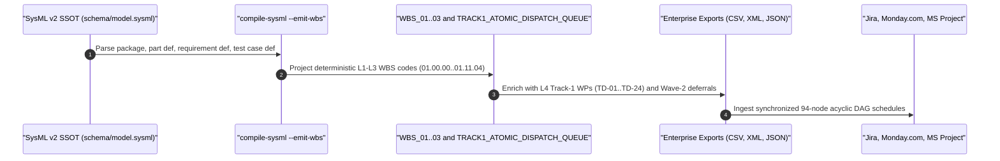

| Attribute | Specification Detail |
| :--- | :--- |
| **Issue ID** | #685..#690, #852..#856 |
| **Title** | WBS_03: Enterprise Export Schema & Multi-Platform Realization Contract |
| **Type** | management |
| **Management Level** | Level 4 Enterprise Realization & PM Toolchain Integration |
| **Standard Baseline** | MIL-STD-881E / RFC 4180 / MSPDI XML / JSON Schema 2020-12 |
| **Generation Mode** | subagent |
| **Specification Source** | [schema/model.sysml](../../schema/model.sysml) |

# WBS_03: Enterprise Export Schema & Multi-Platform Realization Contract

## 1. Enterprise Export Inventory & Node Population Parity

All five enterprise project management exports in `.pipeline/upstream/docs/wbs/exports/` project an identical, deterministically ordered **94-node MIL-STD-881E hierarchy** comprising `1` Program Root (`01.00.00`), `11` Level 2 Blueprint Epics (`01.01.00..01.11.00` / `EPIC-01..11`), `58` Level 3 Features & Domain Specifications (`01.01.01..01.11.04` / `FEAT-01..53` plus the 5 `BP-07` domain specification nodes `01.07.06..01.07.10` from the `FEAT-01..58` baseline), and `24` Level 4 Track-1 Atomic TDD Work Packages (`01.08.01.01..01.09.05.02` / `TD-01..TD-24`).

| Export Target | Relative Path | Format | L1-L3 Nodes | L4 Track-1 WPs | Total Node Count | Schema Contract |
| :--- | :--- | :--- | :--- | :--- | :--- | :--- |
| Jira Software CSV | [exports/wbs_jira.csv](exports/wbs_jira.csv) | RFC 4180 CSV | `70` | `24` | `94` | `14`-column Jira issue, parent, wave, story, path, dispatch, and DAG dependency table |
| Monday.com Work OS CSV | [exports/wbs_monday.csv](exports/wbs_monday.csv) | RFC 4180 CSV | `70` | `24` | `94` | `14`-column Monday board group, wave, UCA/SC, test case, Rust path, and dependency table |
| MS Project CSV | [exports/wbs_msproject.csv](exports/wbs_msproject.csv) | RFC 4180 CSV | `70` | `24` | `94` | `13`-column multi-platform WBS, outline level, duration, predecessor DAG, and toolchain table |
| MS Project MSPDI XML | [exports/wbs_msproject.xml](exports/wbs_msproject.xml) | MSPDI XML | `70` | `24` | `94` | `94` `<Task>` records (`UID` `1..94`) with `<OutlineLevel>`, `<Notes>`, and `<PredecessorLink>` DAG edges |
| WBS JSON AST | [exports/wbs_ast.json](exports/wbs_ast.json) | JSON AST | `70` | `24` | `94` | Superset JSON AST containing `"metadata"`, flat `"nodes"`, recursive `"wbs_tree"`, and `"track1_traceability_matrix"` |
| Track-1 Dispatch Queue | [../management/TRACK1_ATOMIC_DISPATCH_QUEUE.md](../management/TRACK1_ATOMIC_DISPATCH_QUEUE.md) | CommonMark | `0` | `24` | `24` | `8`-column topologically sorted single-item TDD subagent schedule (`TD-01..TD-24`) |
| Master Dispatch Queue | [../management/MASTER_ATOMIC_DISPATCH_QUEUE.md](../management/MASTER_ATOMIC_DISPATCH_QUEUE.md) | CommonMark | `70` | `24` | `94` | `BP-01..BP-11` caller-by-caller migration schedule + `TD-01..TD-24` atomic TDD table |

### Cross-Export Population Parity & Acyclic Schedule Invariant

$$
\begin{aligned}
\left|V_{\mathrm{Jira}}\right| &= \left|V_{\mathrm{Monday}}\right| = \left|V_{\mathrm{MSProj,CSV}}\right| = \left|V_{\mathrm{MSProj,XML}}\right| = \left|V_{\mathrm{JSON}}\right| = N_{\mathrm{total}} \\
\forall (u, v) \in E_{\mathrm{pred}} &: \tau(u) < \tau(v)
\end{aligned}
$$

- Parameter Definitions & Engineering Units:
  - $V_{\mathrm{Jira}}, V_{\mathrm{Monday}}, V_{\mathrm{MSProj,CSV}}, V_{\mathrm{MSProj,XML}}, V_{\mathrm{JSON}}$: Exported WBS vertex sets across all five enterprise serialization formats (`nodes`).
  - $N_{\mathrm{total}}$: Canonical WBS population (`94 nodes` = `70` Level 1-3 nodes + `24` Level 4 Track-1 work packages).
  - $E_{\mathrm{pred}}$: Directed predecessor dependency edge set linking blocking WBS work packages (`edges`).
  - $\tau(w)$: Strict topological rank assigned to node $w$, certifying zero dependency cycles across all schedules (`dimensionless` rank).

---

## 2. Cross-Platform Field Mapping Schema

| Canonical Attribute | `wbs_jira.csv` Column | `wbs_monday.csv` Column | `wbs_msproject.csv` Column | `wbs_msproject.xml` Element | `wbs_ast.json` Property |
| :--- | :--- | :--- | :--- | :--- | :--- |
| Hierarchical Index | `WBS Code` | `WBS Code` | `WBS Code` | `<WBS>` | `wbs_code` |
| Hierarchy Depth (`1..4`) | `Level` | `Level` | `WBS Level` | `<OutlineLevel>` | `level` |
| Deliverable Title | `Summary` | `Name` | `Task Name` | `<Name>` | `element_name` / `name` |
| Tracking Taxonomy | `Issue Type` (`Program`, `Epic`, `Story`, `Sub-task`) | `Group` (Blueprint Package) | `Issue Type` | `
` (`1` or `0`) | `wp_type` |
| Immediate Parent Node | `Parent WBS` | `Group` / WBS prefix | `Parent WBS` | Implicit outline parent | `parent_wbs` / `children` |
| Backlog Identifier | `Feature ID` (`EPIC-*`, `FEAT-*`, `TD-*`) | `Feature ID` | `Labels` | `<Notes>` (`feat_id`) | `feat_id` |
| Program Wave Partition | `Execution Wave` | `Execution Wave` | `Labels` (`wave0`, `track1`, `wave2`) | `<Notes>` (`wave`) | `execution_wave` |
| Schedule Lifecycle State | `Status` | `Status` | `Status` | `<PercentComplete>` | `status` |
| Normative Requirements | `Requirements` (`REQ-0601..0611`) | `Requirement IDs` | `Labels` | `<Notes>` (`reqs`) | `req_ids` |
| Realizing User Stories | `User Stories` (`US-01..78`) | `User Stories` | `Labels` | `<Notes>` (`stories`) | `user_stories` |
| Safety & Verification | Mapped via `Feature ID` | `UCA & Safety Constraints`, `Test Cases` | `Labels` | `<Notes>` (`ucas`, `tc`) | `uca_ids`, `test_cases` |
| Concrete Workspace Target | `Target Rust Paths` | `Target Rust Paths` | `Artifact Path` | `<Notes>` (`path`) | `artifact_path` |
| SysML AST Anchor | `Package` + `Summary` | `Group` + `Name` | `SysML Anchor` | `<Notes>` (`sysml`) | `sysml_anchor` |
| Toolchain Boundary | Derived from `Execution Wave` | Derived from `Execution Wave` | `Toolchain Context` | `<Notes>` (`toolchain`) | `toolchain_context` |
| Predecessor DAG Edges | `Dependencies` | `Dependencies` | `Dependencies` | `<PredecessorLink><PredecessorUID>` | `dependencies` |

---

## 3. Execution Wave & Deferral Status Taxonomy

| Execution Wave | Covered WBS Codes | Jira / Monday / MS Project `Status` | MS Project `% Complete` | Toolchain Context | Programmatic Governance Rule |
| :--- | :--- | :--- | :--- | :--- | :--- |
| `Wave-0 Baseline` | `01.01.00..01.07.10` (`EPIC-01..07`, `FEAT-01..35` / `820db8f` `FEAT-01..40`) | `Done` | `100` | `Rust / Cargo Stable (--offline --locked)` | Active self-hosting Tier-0 compiler and baseline verification checks (`verify-baseline . --no-domain`). |
| `Track-1 Active` | `01.08.00..01.08.05.*`, `01.09.05..01.09.05.*` (`FEAT-36..40` & `FEAT-45` / `820db8f` `FEAT-41..45` & `FEAT-50`, `TD-01..24`) | `To Do (Track-1 Scheduled)` | `0` | `Rust / Cargo Stable (--offline --locked)` | Executed sequentially along the 24-dispatch topological DAG in [TRACK1_ATOMIC_DISPATCH_QUEUE.md](../management/TRACK1_ATOMIC_DISPATCH_QUEUE.md). |
| `Wave-2 Deferred` | `01.09.01..01.09.04` (`FEAT-41..44`), `01.10.00..01.10.04` (`EPIC-10`), `01.11.00..01.11.04` (`EPIC-11`) | `Deferred (Wave-2 Quarantine)` | `0` | `Isolated Wave-2 Nightly / Logos-Salsa / Ferrocene` | Quarantined from root stable `Cargo.toml` until `01.09.05.02` (`TD-24`) seals `StageGateReceipt` (`wave2_stages_deferred == true`). |

## 4. Source References

- Structural Schema SSOT: [schema/model.sysml](../../schema/model.sysml)
- MIL-STD-881E WBS Hierarchy: [WBS_01_WORK_BREAKDOWN_STRUCTURE.md](WBS_01_WORK_BREAKDOWN_STRUCTURE.md)
- Technical Realization Register: [WBS_02_TECHNICAL_REALIZATION_REGISTER.md](WBS_02_TECHNICAL_REALIZATION_REGISTER.md)
- Track-1 Atomic Dispatch Schedule: [../management/TRACK1_ATOMIC_DISPATCH_QUEUE.md](../management/TRACK1_ATOMIC_DISPATCH_QUEUE.md)
- Master Compiler Migration Dispatch Schedule: [../management/MASTER_ATOMIC_DISPATCH_QUEUE.md](../management/MASTER_ATOMIC_DISPATCH_QUEUE.md)
