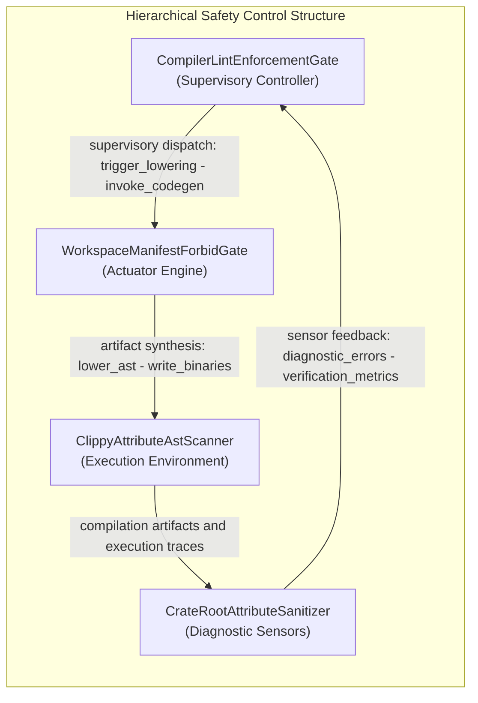

# System Losses, Hazards & Control Structure Topology

## System Losses

| Loss ID | Description |
| :--- | :--- |
| L-1 | Loss of safe function of CompilerLintEnforcementGate |

## System Hazards

| Hazard ID | Associated Control Action | Controller |
| :--- | :--- | :--- |
| H-1 | ExecuteCargoClippyWorkspaceAllTargets | CompilerLintEnforcementGate |
| H-2 | ReadWorkspaceLintsClippyForbidTable | CompilerLintEnforcementGate |
| H-3 | ExecuteVerifyBaselineNoDomain | CompilerLintEnforcementGate |
| H-4 | RunScanClippyAllowTokensOn | CompilerLintEnforcementGate |
| H-5 | ExecuteIngestSysmlSchemaBlueprint01 | CompilerLintEnforcementGate |
| H-6 | check_compiler_ast_purity | CompilerLintEnforcementGate |
| H-7 | mask_literals_and_comments | CompilerLintEnforcementGate |
| H-8 | contains_direct_range_slice | CompilerLintEnforcementGate |
| H-9 | audit_fail_closed_io_patterns | CompilerLintEnforcementGate |
| H-10 | audit_test_integrity_and_anti_gaming | CompilerLintEnforcementGate |
| H-11 | audit_ssot_symbol_deduplication | CompilerLintEnforcementGate |
| H-12 | scan_all | CompilerLintEnforcementGate |
| H-13 | parse_package_or_file | CompilerLintEnforcementGate |
| H-14 | ParseTypeExprAndParseTransition | CompilerLintEnforcementGate |
| H-15 | verify_bijective_ast_roundtrip | CompilerLintEnforcementGate |
| H-16 | ast_orig_to_sysml | CompilerLintEnforcementGate |
| H-17 | AssertAstOrigEqualsAstReparsed | CompilerLintEnforcementGate |
| H-18 | CompileSysmlForwardSyncDocs | CompilerLintEnforcementGate |
| H-19 | ResolveParentEpicByPkgName | CompilerLintEnforcementGate |
| H-20 | BindAllPackageStoriesToUse | CompilerLintEnforcementGate |
| H-21 | EmitSymmetricActionDefSignaturesAndE1 | CompilerLintEnforcementGate |
| H-22 | CompileSysmlEmitIcdDocsInterfaces | CompilerLintEnforcementGate |
| H-23 | ProjectNxNConnectionDefMatrixAndFlowDef | CompilerLintEnforcementGate |
| H-24 | CompileSysmlEmitWbsDocsManagement | CompilerLintEnforcementGate |
| H-25 | SynthesizeMilStd881eTreeAnd | CompilerLintEnforcementGate |
| H-26 | ReconcileBacklogReconcileDocsDirDocs | CompilerLintEnforcementGate |
| H-27 | ParseCommonMarkTablesWithInHtml | CompilerLintEnforcementGate |
| H-28 | ReconcileChecklistsWithParentInclusiveEpic | CompilerLintEnforcementGate |
| H-29 | CompileSysmlReverseSyncDocs | CompilerLintEnforcementGate |
| H-30 | MergeExtractedEntitiesIntoOwningSubpackages | CompilerLintEnforcementGate |
| H-31 | RunCompileSysmlInjectSafetyDocstrings | CompilerLintEnforcementGate |
| H-32 | ScanSourceLinesViaRustDartLexStateAnd | CompilerLintEnforcementGate |
| H-33 | ResolveSchemaContextViaCollectAll | CompilerLintEnforcementGate |
| H-34 | RunVerifyBaselineNoDomain | CompilerLintEnforcementGate |
| H-35 | TokenizeRsAndDartFilesUsing | CompilerLintEnforcementGate |
| H-36 | RunIngestSysmlSchemaBlueprint05 | CompilerLintEnforcementGate |
| H-37 | VerifyBaselineAuditCodePathCrates | CompilerLintEnforcementGate |
| H-38 | ParseRustSourceAstAndParse | CompilerLintEnforcementGate |
| H-39 | EvaluateSourceFilePillarsAcross5 | CompilerLintEnforcementGate |
| H-40 | synthesize_defect_dossier_markdown | CompilerLintEnforcementGate |
| H-41 | run_check_defect | CompilerLintEnforcementGate |
| H-42 | Execute12CheckValidateDefectDossier | CompilerLintEnforcementGate |
| H-43 | GhIssueCreateOrGhIssue | CompilerLintEnforcementGate |
| H-44 | GhIssueViewJsonTitleBody | CompilerLintEnforcementGate |

## Hierarchical Control Structure Topology

