# System Losses, Hazards & Control Structure Topology

## System Losses

| Loss ID | Description |
| :--- | :--- |
| L-1 | Loss of safe function of CompilerLintEnforcementGate |

## System Hazards

| Hazard ID | Associated Control Action | Controller |
| :--- | :--- | :--- |
| H-1 | ExecuteCargoClippyWorkspaceAllTargets | CompilerLintEnforcementGate |
| H-2 | ReadWorkspaceLintsClippyForbidTable | CompilerLintEnforcementGate |
| H-3 | ExecuteVerifyBaselineNoDomain | CompilerLintEnforcementGate |
| H-4 | RunScanClippyAllowTokensOn | CompilerLintEnforcementGate |
| H-5 | ExecuteIngestSysmlSchemaBlueprint01 | CompilerLintEnforcementGate |
| H-6 | check_compiler_ast_purity | CompilerLintEnforcementGate |
| H-7 | mask_literals_and_comments | CompilerLintEnforcementGate |
| H-8 | contains_direct_range_slice | CompilerLintEnforcementGate |
| H-9 | audit_fail_closed_io_patterns | CompilerLintEnforcementGate |
| H-10 | audit_test_integrity_and_anti_gaming | CompilerLintEnforcementGate |
| H-11 | audit_ssot_symbol_deduplication | CompilerLintEnforcementGate |
| H-12 | scan_all | CompilerLintEnforcementGate |
| H-13 | parse_package_or_file | CompilerLintEnforcementGate |
| H-14 | ParseTypeExprAndParseTransition | CompilerLintEnforcementGate |
| H-15 | verify_bijective_ast_roundtrip | CompilerLintEnforcementGate |
| H-16 | ast_orig_to_sysml | CompilerLintEnforcementGate |
| H-17 | AssertAstOrigEqualsAstReparsed | CompilerLintEnforcementGate |
| H-18 | CompileSysmlForwardSyncDocs | CompilerLintEnforcementGate |
| H-19 | ResolveParentEpicByPkgName | CompilerLintEnforcementGate |
| H-20 | BindAllPackageStoriesToUse | CompilerLintEnforcementGate |
| H-21 | EmitSymmetricActionDefSignaturesAndE1 | CompilerLintEnforcementGate |
| H-22 | CompileSysmlEmitIcdDocsInterfaces | CompilerLintEnforcementGate |
| H-23 | ProjectNxNConnectionDefMatrixAndFlowDef | CompilerLintEnforcementGate |
| H-24 | CompileSysmlEmitWbsDocsManagement | CompilerLintEnforcementGate |
| H-25 | SynthesizeMilStd881eTreeAnd | CompilerLintEnforcementGate |
| H-26 | ReconcileBacklogReconcileDocsDirDocs | CompilerLintEnforcementGate |
| H-27 | ParseCommonMarkTablesWithInHtml | CompilerLintEnforcementGate |
| H-28 | ReconcileChecklistsWithParentInclusiveEpic | CompilerLintEnforcementGate |
| H-29 | CompileSysmlReverseSyncDocs | CompilerLintEnforcementGate |
| H-30 | MergeExtractedEntitiesIntoOwningSubpackages | CompilerLintEnforcementGate |
| H-31 | RunCompileSysmlInjectSafetyDocstrings | CompilerLintEnforcementGate |
| H-32 | ParseSourceCstViaRustAndDartCst | CompilerLintEnforcementGate |
| H-33 | ResolveSchemaContextViaCollectAll | CompilerLintEnforcementGate |
| H-34 | RunVerifyBaselineNoDomain | CompilerLintEnforcementGate |
| H-35 | TokenizeRsAndDartFilesUsing | CompilerLintEnforcementGate |
| H-36 | RunIngestSysmlSchemaBlueprint05 | CompilerLintEnforcementGate |
| H-37 | VerifyBaselineAuditCodePathCrates | CompilerLintEnforcementGate |
| H-38 | ParseRustCstAndParseDartCst | CompilerLintEnforcementGate |
| H-39 | EvaluateSourceFilePillarsAcross5 | CompilerLintEnforcementGate |
| H-40 | synthesize_defect_dossier_markdown | CompilerLintEnforcementGate |
| H-41 | run_check_defect | CompilerLintEnforcementGate |
| H-42 | Execute12CheckValidateDefectDossier | CompilerLintEnforcementGate |
| H-43 | GhIssueCreateOrGhIssue | CompilerLintEnforcementGate |
| H-44 | GhIssueViewJsonTitleBody | CompilerLintEnforcementGate |
| H-45 | verify_dag_and_layers | CompilerLintEnforcementGate |
| H-46 | partition_and_hoist | CompilerLintEnforcementGate |
| H-47 | synthesize_module_tokens | CompilerLintEnforcementGate |
| H-48 | build_syn_file | CompilerLintEnforcementGate |
| H-49 | format_pretty_syn_file | CompilerLintEnforcementGate |
| H-50 | emit_modular_rust_tree | CompilerLintEnforcementGate |
| H-51 | emit_modular_flutter_tree | CompilerLintEnforcementGate |
| H-52 | verify_fixed_point_digest | CompilerLintEnforcementGate |
| H-53 | verify_offline_locked_build | CompilerLintEnforcementGate |
| H-54 | list_rust_items | CompilerLintEnforcementGate |
| H-55 | extract_rust_module | CompilerLintEnforcementGate |
| H-56 | verify_stage_fixed_point | CompilerLintEnforcementGate |
| H-57 | format_ndjson_line | CompilerLintEnforcementGate |
| H-58 | analyze_metrics | CompilerLintEnforcementGate |
| H-59 | probe_formal_toolchain | CompilerLintEnforcementGate |
| H-60 | verify_clippy_policy | CompilerLintEnforcementGate |
| H-61 | evaluate_stage2_dylint_mir | CompilerLintEnforcementGate |
| H-62 | verify_in_process_cst_syntax | CompilerLintEnforcementGate |
| H-63 | guard_inbound_frb_f64 | CompilerLintEnforcementGate |
| H-64 | validate_kani_harness_spec | CompilerLintEnforcementGate |
| H-65 | evaluate_four_stage_gatekeeper | CompilerLintEnforcementGate |
| H-66 | resolve_polyglot_backend | CompilerLintEnforcementGate |
| H-67 | normalize_line_endings | CompilerLintEnforcementGate |
| H-68 | parse_lossless_sysml_cst | CompilerLintEnforcementGate |
| H-69 | verify_lossless_cst_invariants | CompilerLintEnforcementGate |
| H-70 | evaluate_hir_early_cutoff | CompilerLintEnforcementGate |
| H-71 | apply_formatting_preserving_splices | CompilerLintEnforcementGate |
| H-72 | render_ariadne_diagnostic | CompilerLintEnforcementGate |
| H-73 | probe_criticalup_toolchain | CompilerLintEnforcementGate |
| H-74 | verify_dual_toolchain_parity | CompilerLintEnforcementGate |
| H-75 | synthesize_three_ring_workspace | CompilerLintEnforcementGate |
| H-76 | verify_fls_traceability_chain | CompilerLintEnforcementGate |
| H-77 | verify_certified_core_and_table_a7_coverage | CompilerLintEnforcementGate |
| H-78 | verify_three_ring_edge_and_monitor_readback | CompilerLintEnforcementGate |
| H-79 | ExecuteFourLevelLoweringPipeline | CompilerLintEnforcementGate |

## Hierarchical Control Structure Topology

```mermaid
graph TD
    subgraph "Hierarchical Safety Control Structure"
        direction TB
        CompilerController["CompilerLintEnforcementGate<br/>(Supervisory Controller)"]
        ActuatorEngine["WorkspaceManifestForbidGate<br/>(Actuator Engine)"]
        ControlledProcess["ClippyAttributeCstParser<br/>(Execution Environment)"]
        DiagnosticSensors["CrateRootAttributeSanitizer<br/>(Diagnostic Sensors)"]

        CompilerController -->|"supervisory dispatch: trigger_lowering - invoke_codegen"| ActuatorEngine
        ActuatorEngine -->|"artifact synthesis: lower_ast - write_binaries"| ControlledProcess
        ControlledProcess -->|"compilation artifacts and execution traces"| DiagnosticSensors
        DiagnosticSensors -->|"sensor feedback: diagnostic_errors - verification_metrics"| CompilerController
        WorkspaceManifestForbidGate["WorkspaceManifestForbidGate"] -->|"BP_01_ManifestToForbidGateConnection"| CompilerLintEnforcementGate["CompilerLintEnforcementGate"]
        AntiGamingTestBodyAuditor["AntiGamingTestBodyAuditor"] -->|"BP_02_AuditorToPurityGateConnection"| Check34AstPurityAndAntiGamingGate["Check34AstPurityAndAntiGamingGate"]
        BijectiveSysmlSerializer["BijectiveSysmlSerializer"] -->|"BP_03_SerializerToRoundtripGateConnection"| SysmlBijectiveRoundtripCompilerGate["SysmlBijectiveRoundtripCompilerGate"]
        BidirectionalBacklogReconciler["BidirectionalBacklogReconciler"] -->|"BP_04_ReconcilerToForwardCompilerConnection"| DeterministicSpecIcdWbsForwardCompiler["DeterministicSpecIcdWbsForwardCompiler"]
        ScopedSchemaContextResolver["ScopedSchemaContextResolver"] -->|"BP_05_ContextToDocstringGeneratorConnection"| SevenSectionDocstringGenerator["SevenSectionDocstringGenerator"]
        DeterministicDossierSynthesizer["DeterministicDossierSynthesizer"] -->|"BP_06_DossierToPublisherGateConnection"| ClosedLoopDefectPublisherGate["ClosedLoopDefectPublisherGate"]
        FourLevelAstPartitionerAndHoister["FourLevelAstPartitionerAndHoister"] -->|"BP_07_PartitionerToRustEmitterConnection"| ModularRustMultiFileEmitter["ModularRustMultiFileEmitter"]
        ZeroTokenRustSpanCodemodEngine["ZeroTokenRustSpanCodemodEngine"] -->|"BP_08_CodemodToDiagnosticEmitterConnection"| UnifiedRustcJsonDiagnosticEmitter["UnifiedRustcJsonDiagnosticEmitter"]
        StableClippyTotalFunctionGate["StableClippyTotalFunctionGate"] -->|"BP_09_ClippyToOrchestratorConnection"| MultiStageVerificationOrchestrator["MultiStageVerificationOrchestrator"]
        TypedPolyglotIngestionFrontend["TypedPolyglotIngestionFrontend"] -->|"BP_10_PolyglotToSalsaDbConnection"| SalsaIncrementalCompilerDatabase["SalsaIncrementalCompilerDatabase"]
        ThreeRingAssurancePartitionCompiler["ThreeRingAssurancePartitionCompiler"] -->|"BP_11_PartitionToFlsTraceabilityConnection"| FlsParagraphTraceabilitySynthesizer["FlsParagraphTraceabilitySynthesizer"]
    end
```

