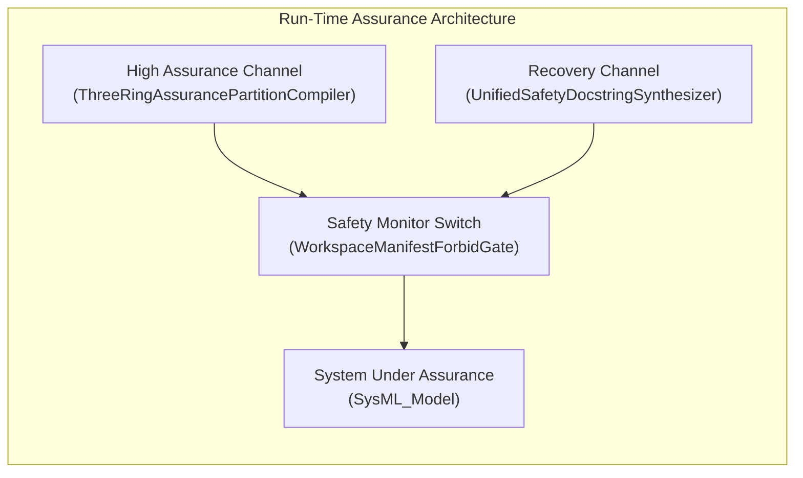

# Run-Time Assurance Architecture & Formal Proof Suite

## Simplex Run-Time Assurance Topology



## Formal Proof Suite

## Theorem T-01 -- ComputeCyclomaticComplexity

### Formal Theorem Statement

$$
\begin{aligned}
    \mathrm{ComputeCyclomaticComplexity} &: \mathrm{decision\_points} + 1
\end{aligned}
$$

### Symbolic Derivation

$$
\begin{aligned}
    \mathrm{ComputeCyclomaticComplexity} &= \mathrm{decision\_points} + 1 \\
\end{aligned}
$$

### Parameter Definitions & Engineering Units Table

| Symbol | Description | Value | Engineering Unit |
| :--- | :--- | :--- | :--- |
| decision_points | AST Calc Input | Symbolic Input (AST CalcParam) | Integer |

### Step-by-Step Numerical Proof Evaluation

$$
\begin{aligned}
    \mathrm{ComputeCyclomaticComplexity} &= \mathrm{decision\_points} + 1 \\
\end{aligned}
$$

### SLDV Temporal Assertion Binding

```matlab
sldv.assert( (decision_points + 1), 'Bind_COMPUTECYCLOMATICCOMPLEXITY_CALC' );
```

## Theorem T-02 -- C_MOD_01

### Formal Theorem Statement

$$
\begin{aligned}
    \mathrm{C\_MOD\_01} &: \mathrm{max\_file\_lines} \ge 50 \land \mathrm{max\_file\_lines} \le 400
\end{aligned}
$$

### Symbolic Derivation

$$
\begin{aligned}
    \mathrm{C\_MOD\_01} &\iff \mathrm{max\_file\_lines} \ge 50 \land \mathrm{max\_file\_lines} \le 400 \\
\end{aligned}
$$

### Parameter Definitions & Engineering Units Table

| Symbol | Description | Value | Engineering Unit |
| :--- | :--- | :--- | :--- |
| `C_MOD_01` | AST Constraint Invariant | `max_file_lines >= 50 and max_file_lines <= 400` | boolean |

### Step-by-Step Numerical Proof Evaluation

$$
\begin{aligned}
    \mathrm{C\_MOD\_01} &\implies \mathrm{max\_file\_lines} \ge 50 \land \mathrm{max\_file\_lines} \le 400 \\
\end{aligned}
$$

### SLDV Temporal Assertion Binding

```matlab
sldv.assert( (max_file_lines >= 50 && max_file_lines <= 400), 'Bind_C_MOD_01_ASSERTION' );
```

## Theorem T-03 -- C_MOD_02

### Formal Theorem Statement

$$
\begin{aligned}
    \mathrm{C\_MOD\_02} &: \mathrm{max\_items\_per\_file} \ge 1 \land \mathrm{max\_items\_per\_file} \le 12
\end{aligned}
$$

### Symbolic Derivation

$$
\begin{aligned}
    \mathrm{C\_MOD\_02} &\iff \mathrm{max\_items\_per\_file} \ge 1 \land \mathrm{max\_items\_per\_file} \le 12 \\
\end{aligned}
$$

### Parameter Definitions & Engineering Units Table

| Symbol | Description | Value | Engineering Unit |
| :--- | :--- | :--- | :--- |
| `C_MOD_02` | AST Constraint Invariant | `max_items_per_file >= 1 and max_items_per_file <= 12` | boolean |

### Step-by-Step Numerical Proof Evaluation

$$
\begin{aligned}
    \mathrm{C\_MOD\_02} &\implies \mathrm{max\_items\_per\_file} \ge 1 \land \mathrm{max\_items\_per\_file} \le 12 \\
\end{aligned}
$$

### SLDV Temporal Assertion Binding

```matlab
sldv.assert( (max_items_per_file >= 1 && max_items_per_file <= 12), 'Bind_C_MOD_02_ASSERTION' );
```

## Theorem T-04 -- C_MOD_03

### Formal Theorem Statement

$$
\begin{aligned}
    \mathrm{C\_MOD\_03} &: \mathrm{max\_cyclomatic\_complexity} \ge 1 \land \mathrm{max\_cyclomatic\_complexity} \le 8
\end{aligned}
$$

### Symbolic Derivation

$$
\begin{aligned}
    \mathrm{C\_MOD\_03} &\iff \mathrm{max\_cyclomatic\_complexity} \ge 1 \land \mathrm{max\_cyclomatic\_complexity} \le 8 \\
\end{aligned}
$$

### Parameter Definitions & Engineering Units Table

| Symbol | Description | Value | Engineering Unit |
| :--- | :--- | :--- | :--- |
| `C_MOD_03` | AST Constraint Invariant | `max_cyclomatic_complexity >= 1 and max_cyclomatic_complexity <= 8` | boolean |

### Step-by-Step Numerical Proof Evaluation

$$
\begin{aligned}
    \mathrm{C\_MOD\_03} &\implies \mathrm{max\_cyclomatic\_complexity} \ge 1 \land \mathrm{max\_cyclomatic\_complexity} \le 8 \\
\end{aligned}
$$

### SLDV Temporal Assertion Binding

```matlab
sldv.assert( (max_cyclomatic_complexity >= 1 && max_cyclomatic_complexity <= 8), 'Bind_C_MOD_03_ASSERTION' );
```

## Theorem T-05 -- C_MOD_04

### Formal Theorem Statement

$$
\begin{aligned}
    \mathrm{C\_MOD\_04} &: \mathrm{stage\_fixed\_point\_mismatch\_files} \ge 0 \land \mathrm{stage\_fixed\_point\_mismatch\_files} \le 0
\end{aligned}
$$

### Symbolic Derivation

$$
\begin{aligned}
    \mathrm{C\_MOD\_04} &\iff \mathrm{stage\_fixed\_point\_mismatch\_files} \ge 0 \land \mathrm{stage\_fixed\_point\_mismatch\_files} \le 0 \\
\end{aligned}
$$

### Parameter Definitions & Engineering Units Table

| Symbol | Description | Value | Engineering Unit |
| :--- | :--- | :--- | :--- |
| `C_MOD_04` | AST Constraint Invariant | `stage_fixed_point_mismatch_files >= 0 and stage_fixed_point_mismatch_files <= 0` | boolean |

### Step-by-Step Numerical Proof Evaluation

$$
\begin{aligned}
    \mathrm{C\_MOD\_04} &\implies \mathrm{stage\_fixed\_point\_mismatch\_files} \ge 0 \land \mathrm{stage\_fixed\_point\_mismatch\_files} \le 0 \\
\end{aligned}
$$

### SLDV Temporal Assertion Binding

```matlab
sldv.assert( (stage_fixed_point_mismatch_files >= 0 && stage_fixed_point_mismatch_files <= 0), 'Bind_C_MOD_04_ASSERTION' );
```

## Theorem T-06 -- C_MOD_05

### Formal Theorem Statement

$$
\begin{aligned}
    \mathrm{C\_MOD\_05} &: \mathrm{runtime\_llm\_subagent\_count} \ge 0 \land \mathrm{runtime\_llm\_subagent\_count} \le 0
\end{aligned}
$$

### Symbolic Derivation

$$
\begin{aligned}
    \mathrm{C\_MOD\_05} &\iff \mathrm{runtime\_llm\_subagent\_count} \ge 0 \land \mathrm{runtime\_llm\_subagent\_count} \le 0 \\
\end{aligned}
$$

### Parameter Definitions & Engineering Units Table

| Symbol | Description | Value | Engineering Unit |
| :--- | :--- | :--- | :--- |
| `C_MOD_05` | AST Constraint Invariant | `runtime_llm_subagent_count >= 0 and runtime_llm_subagent_count <= 0` | boolean |

### Step-by-Step Numerical Proof Evaluation

$$
\begin{aligned}
    \mathrm{C\_MOD\_05} &\implies \mathrm{runtime\_llm\_subagent\_count} \ge 0 \land \mathrm{runtime\_llm\_subagent\_count} \le 0 \\
\end{aligned}
$$

### SLDV Temporal Assertion Binding

```matlab
sldv.assert( (runtime_llm_subagent_count >= 0 && runtime_llm_subagent_count <= 0), 'Bind_C_MOD_05_ASSERTION' );
```

## Theorem T-07 -- ValidBoundsEnvelope

### Formal Theorem Statement

$$
\begin{aligned}
    \mathrm{ValidBoundsEnvelope} &: \mathrm{max\_file\_lines} \ge 50 \land \mathrm{max\_file\_lines} \le 400 \land \mathrm{max\_items\_per\_file} \ge 1 \land \mathrm{max\_items\_per\_file} \le 12 \land \mathrm{max\_cyclomatic\_complexity} \ge 1 \land \mathrm{max\_cyclomatic\_complexity} \le 8 \land \mathrm{max\_action\_steps\_per\_stage} \ge 1 \land \mathrm{max\_action\_steps\_per\_stage} \le 8 \land \mathrm{max\_transitions\_per\_handler} \ge 1 \land \mathrm{max\_transitions\_per\_handler} \le 8
\end{aligned}
$$

### Symbolic Derivation

$$
\begin{aligned}
    \mathrm{ValidBoundsEnvelope} &\iff \mathrm{max\_file\_lines} \ge 50 \land \mathrm{max\_file\_lines} \le 400 \land \mathrm{max\_items\_per\_file} \ge 1 \land \mathrm{max\_items\_per\_file} \le 12 \land \mathrm{max\_cyclomatic\_complexity} \ge 1 \land \mathrm{max\_cyclomatic\_complexity} \le 8 \land \mathrm{max\_action\_steps\_per\_stage} \ge 1 \land \mathrm{max\_action\_steps\_per\_stage} \le 8 \land \mathrm{max\_transitions\_per\_handler} \ge 1 \land \mathrm{max\_transitions\_per\_handler} \le 8 \\
\end{aligned}
$$

### Parameter Definitions & Engineering Units Table

| Symbol | Description | Value | Engineering Unit |
| :--- | :--- | :--- | :--- |
| in max_file_lines | AST Constraint Parameter | Symbolic Bound (AST ConstraintParam) | Integer |
| in max_items_per_file | AST Constraint Parameter | Symbolic Bound (AST ConstraintParam) | Integer |
| in max_cyclomatic_complexity | AST Constraint Parameter | Symbolic Bound (AST ConstraintParam) | Integer |
| in max_action_steps_per_stage | AST Constraint Parameter | Symbolic Bound (AST ConstraintParam) | Integer |
| in max_transitions_per_handler | AST Constraint Parameter | Symbolic Bound (AST ConstraintParam) | Integer |

### Step-by-Step Numerical Proof Evaluation

$$
\begin{aligned}
    \mathrm{ValidBoundsEnvelope} &\implies \mathrm{max\_file\_lines} \ge 50 \land \mathrm{max\_file\_lines} \le 400 \land \mathrm{max\_items\_per\_file} \ge 1 \land \mathrm{max\_items\_per\_file} \le 12 \land \mathrm{max\_cyclomatic\_complexity} \ge 1 \land \mathrm{max\_cyclomatic\_complexity} \le 8 \land \mathrm{max\_action\_steps\_per\_stage} \ge 1 \land \mathrm{max\_action\_steps\_per\_stage} \le 8 \land \mathrm{max\_transitions\_per\_handler} \ge 1 \land \mathrm{max\_transitions\_per\_handler} \le 8 \\
\end{aligned}
$$

### SLDV Temporal Assertion Binding

```matlab
sldv.assert( (max_file_lines >= 50 && max_file_lines <= 400 && max_items_per_file >= 1 && max_items_per_file <= 12 && max_cyclomatic_complexity >= 1 && max_cyclomatic_complexity <= 8 && max_action_steps_per_stage >= 1 && max_action_steps_per_stage <= 8 && max_transitions_per_handler >= 1 && max_transitions_per_handler <= 8), 'Bind_VALIDBOUNDSENVELOPE_ASSERTION' );
```

## Theorem T-08 -- NonUpwardLayerImport

### Formal Theorem Statement

$$
\begin{aligned}
    \mathrm{NonUpwardLayerImport} &: \mathrm{importer\_tier} \ge 1 \land \mathrm{importer\_tier} \le 3 \land \mathrm{imported\_tier} \ge 1 \land \mathrm{imported\_tier} \le 3 \land \mathrm{importer\_tier} \ge \mathrm{imported\_tier}
\end{aligned}
$$

### Symbolic Derivation

$$
\begin{aligned}
    \mathrm{NonUpwardLayerImport} &\iff \mathrm{importer\_tier} \ge 1 \land \mathrm{importer\_tier} \le 3 \land \mathrm{imported\_tier} \ge 1 \land \mathrm{imported\_tier} \le 3 \land \mathrm{importer\_tier} \ge \mathrm{imported\_tier} \\
\end{aligned}
$$

### Parameter Definitions & Engineering Units Table

| Symbol | Description | Value | Engineering Unit |
| :--- | :--- | :--- | :--- |
| in importer_tier | AST Constraint Parameter | Symbolic Bound (AST ConstraintParam) | Integer |
| in imported_tier | AST Constraint Parameter | Symbolic Bound (AST ConstraintParam) | Integer |

### Step-by-Step Numerical Proof Evaluation

$$
\begin{aligned}
    \mathrm{NonUpwardLayerImport} &\implies \mathrm{importer\_tier} \ge 1 \land \mathrm{importer\_tier} \le 3 \land \mathrm{imported\_tier} \ge 1 \land \mathrm{imported\_tier} \le 3 \land \mathrm{importer\_tier} \ge \mathrm{imported\_tier} \\
\end{aligned}
$$

### SLDV Temporal Assertion Binding

```matlab
sldv.assert( (importer_tier >= 1 && importer_tier <= 3 && imported_tier >= 1 && imported_tier <= 3 && importer_tier >= imported_tier), 'Bind_NONUPWARDLAYERIMPORT_ASSERTION' );
```

## Theorem T-09 -- UnitObeysBounds

### Formal Theorem Statement

$$
\begin{aligned}
    \mathrm{UnitObeysBounds} &: \mathrm{line\_count} \ge 1 \land \mathrm{line\_count} \le \mathrm{max\_file\_lines} \land \mathrm{item\_count} \ge 1 \land \mathrm{item\_count} \le \mathrm{max\_items\_per\_file} \land \mathrm{max\_function\_vg} \ge 1 \land \mathrm{max\_function\_vg} \le \mathrm{max\_cyclomatic\_complexity}
\end{aligned}
$$

### Symbolic Derivation

$$
\begin{aligned}
    \mathrm{UnitObeysBounds} &\iff \mathrm{line\_count} \ge 1 \land \mathrm{line\_count} \le \mathrm{max\_file\_lines} \land \mathrm{item\_count} \ge 1 \land \mathrm{item\_count} \le \mathrm{max\_items\_per\_file} \land \mathrm{max\_function\_vg} \ge 1 \land \mathrm{max\_function\_vg} \le \mathrm{max\_cyclomatic\_complexity} \\
\end{aligned}
$$

### Parameter Definitions & Engineering Units Table

| Symbol | Description | Value | Engineering Unit |
| :--- | :--- | :--- | :--- |
| in line_count | AST Constraint Parameter | Symbolic Bound (AST ConstraintParam) | Integer |
| in max_file_lines | AST Constraint Parameter | Symbolic Bound (AST ConstraintParam) | Integer |
| in item_count | AST Constraint Parameter | Symbolic Bound (AST ConstraintParam) | Integer |
| in max_items_per_file | AST Constraint Parameter | Symbolic Bound (AST ConstraintParam) | Integer |
| in max_function_vg | AST Constraint Parameter | Symbolic Bound (AST ConstraintParam) | Integer |
| in max_cyclomatic_complexity | AST Constraint Parameter | Symbolic Bound (AST ConstraintParam) | Integer |

### Step-by-Step Numerical Proof Evaluation

$$
\begin{aligned}
    \mathrm{UnitObeysBounds} &\implies \mathrm{line\_count} \ge 1 \land \mathrm{line\_count} \le \mathrm{max\_file\_lines} \land \mathrm{item\_count} \ge 1 \land \mathrm{item\_count} \le \mathrm{max\_items\_per\_file} \land \mathrm{max\_function\_vg} \ge 1 \land \mathrm{max\_function\_vg} \le \mathrm{max\_cyclomatic\_complexity} \\
\end{aligned}
$$

### SLDV Temporal Assertion Binding

```matlab
sldv.assert( (line_count >= 1 && line_count <= max_file_lines && item_count >= 1 && item_count <= max_items_per_file && max_function_vg >= 1 && max_function_vg <= max_cyclomatic_complexity), 'Bind_UNITOBEYSBOUNDS_ASSERTION' );
```

## Theorem T-10 -- LoweringLevelsComplete

### Formal Theorem Statement

$$
\begin{aligned}
    \mathrm{LoweringLevelsComplete} &: \mathrm{active\_level\_count} = 4
\end{aligned}
$$

### Symbolic Derivation

$$
\begin{aligned}
    \mathrm{LoweringLevelsComplete} &\iff \mathrm{active\_level\_count} = 4 \\
\end{aligned}
$$

### Parameter Definitions & Engineering Units Table

| Symbol | Description | Value | Engineering Unit |
| :--- | :--- | :--- | :--- |
| in active_level_count | AST Constraint Parameter | Symbolic Bound (AST ConstraintParam) | Integer |

### Step-by-Step Numerical Proof Evaluation

$$
\begin{aligned}
    \mathrm{LoweringLevelsComplete} &\implies \mathrm{active\_level\_count} = 4 \\
\end{aligned}
$$

### SLDV Temporal Assertion Binding

```matlab
sldv.assert( (active_level_count == 4), 'Bind_LOWERINGLEVELSCOMPLETE_ASSERTION' );
```

## Theorem T-11 -- FixedPointBootstrapParity

### Formal Theorem Statement

$$
\begin{aligned}
    \mathrm{FixedPointBootstrapParity} &: \mathrm{stage\_mismatch\_files} = 0
\end{aligned}
$$

### Symbolic Derivation

$$
\begin{aligned}
    \mathrm{FixedPointBootstrapParity} &\iff \mathrm{stage\_mismatch\_files} = 0 \\
\end{aligned}
$$

### Parameter Definitions & Engineering Units Table

| Symbol | Description | Value | Engineering Unit |
| :--- | :--- | :--- | :--- |
| in stage_mismatch_files | AST Constraint Parameter | Symbolic Bound (AST ConstraintParam) | Integer |

### Step-by-Step Numerical Proof Evaluation

$$
\begin{aligned}
    \mathrm{FixedPointBootstrapParity} &\implies \mathrm{stage\_mismatch\_files} = 0 \\
\end{aligned}
$$

### SLDV Temporal Assertion Binding

```matlab
sldv.assert( (stage_mismatch_files == 0), 'Bind_FIXEDPOINTBOOTSTRAPPARITY_ASSERTION' );
```

## Theorem T-12 -- C_CST_01

### Formal Theorem Statement

$$
\begin{aligned}
    \mathrm{C\_CST\_01} &: \mathrm{max\_fn\_exec\_sloc} \ge 1 \land \mathrm{max\_fn\_exec\_sloc} \le 50
\end{aligned}
$$

### Symbolic Derivation

$$
\begin{aligned}
    \mathrm{C\_CST\_01} &\iff \mathrm{max\_fn\_exec\_sloc} \ge 1 \land \mathrm{max\_fn\_exec\_sloc} \le 50 \\
\end{aligned}
$$

### Parameter Definitions & Engineering Units Table

| Symbol | Description | Value | Engineering Unit |
| :--- | :--- | :--- | :--- |
| `C_CST_01` | AST Constraint Invariant | `max_fn_exec_sloc >= 1 and max_fn_exec_sloc <= 50` | boolean |

### Step-by-Step Numerical Proof Evaluation

$$
\begin{aligned}
    \mathrm{C\_CST\_01} &\implies \mathrm{max\_fn\_exec\_sloc} \ge 1 \land \mathrm{max\_fn\_exec\_sloc} \le 50 \\
\end{aligned}
$$

### SLDV Temporal Assertion Binding

```matlab
sldv.assert( (max_fn_exec_sloc >= 1 && max_fn_exec_sloc <= 50), 'Bind_C_CST_01_ASSERTION' );
```

## Theorem T-13 -- C_CST_02

### Formal Theorem Statement

$$
\begin{aligned}
    \mathrm{C\_CST\_02} &: \mathrm{max\_fn\_param\_count} \ge 0 \land \mathrm{max\_fn\_param\_count} \le 5
\end{aligned}
$$

### Symbolic Derivation

$$
\begin{aligned}
    \mathrm{C\_CST\_02} &\iff \mathrm{max\_fn\_param\_count} \ge 0 \land \mathrm{max\_fn\_param\_count} \le 5 \\
\end{aligned}
$$

### Parameter Definitions & Engineering Units Table

| Symbol | Description | Value | Engineering Unit |
| :--- | :--- | :--- | :--- |
| `C_CST_02` | AST Constraint Invariant | `max_fn_param_count >= 0 and max_fn_param_count <= 5` | boolean |

### Step-by-Step Numerical Proof Evaluation

$$
\begin{aligned}
    \mathrm{C\_CST\_02} &\implies \mathrm{max\_fn\_param\_count} \ge 0 \land \mathrm{max\_fn\_param\_count} \le 5 \\
\end{aligned}
$$

### SLDV Temporal Assertion Binding

```matlab
sldv.assert( (max_fn_param_count >= 0 && max_fn_param_count <= 5), 'Bind_C_CST_02_ASSERTION' );
```

## Theorem T-14 -- C_CST_03

### Formal Theorem Statement

$$
\begin{aligned}
    \mathrm{C\_CST\_03} &: \mathrm{max\_mut\_bool\_flags} \ge 0 \land \mathrm{max\_mut\_bool\_flags} \le 0
\end{aligned}
$$

### Symbolic Derivation

$$
\begin{aligned}
    \mathrm{C\_CST\_03} &\iff \mathrm{max\_mut\_bool\_flags} \ge 0 \land \mathrm{max\_mut\_bool\_flags} \le 0 \\
\end{aligned}
$$

### Parameter Definitions & Engineering Units Table

| Symbol | Description | Value | Engineering Unit |
| :--- | :--- | :--- | :--- |
| `C_CST_03` | AST Constraint Invariant | `max_mut_bool_flags >= 0 and max_mut_bool_flags <= 0` | boolean |

### Step-by-Step Numerical Proof Evaluation

$$
\begin{aligned}
    \mathrm{C\_CST\_03} &\implies \mathrm{max\_mut\_bool\_flags} \ge 0 \land \mathrm{max\_mut\_bool\_flags} \le 0 \\
\end{aligned}
$$

### SLDV Temporal Assertion Binding

```matlab
sldv.assert( (max_mut_bool_flags >= 0 && max_mut_bool_flags <= 0), 'Bind_C_CST_03_ASSERTION' );
```

## Theorem T-15 -- C_CST_04

### Formal Theorem Statement

$$
\begin{aligned}
    \mathrm{C\_CST\_04} &: \mathrm{stage\_fixed\_point\_mismatch\_files} \ge 0 \land \mathrm{stage\_fixed\_point\_mismatch\_files} \le 0
\end{aligned}
$$

### Symbolic Derivation

$$
\begin{aligned}
    \mathrm{C\_CST\_04} &\iff \mathrm{stage\_fixed\_point\_mismatch\_files} \ge 0 \land \mathrm{stage\_fixed\_point\_mismatch\_files} \le 0 \\
\end{aligned}
$$

### Parameter Definitions & Engineering Units Table

| Symbol | Description | Value | Engineering Unit |
| :--- | :--- | :--- | :--- |
| `C_CST_04` | AST Constraint Invariant | `stage_fixed_point_mismatch_files >= 0 and stage_fixed_point_mismatch_files <= 0` | boolean |

### Step-by-Step Numerical Proof Evaluation

$$
\begin{aligned}
    \mathrm{C\_CST\_04} &\implies \mathrm{stage\_fixed\_point\_mismatch\_files} \ge 0 \land \mathrm{stage\_fixed\_point\_mismatch\_files} \le 0 \\
\end{aligned}
$$

### SLDV Temporal Assertion Binding

```matlab
sldv.assert( (stage_fixed_point_mismatch_files >= 0 && stage_fixed_point_mismatch_files <= 0), 'Bind_C_CST_04_ASSERTION' );
```

## Theorem T-16 -- C_CST_05

### Formal Theorem Statement

$$
\begin{aligned}
    \mathrm{C\_CST\_05} &: \mathrm{runtime\_llm\_token\_count} \ge 0 \land \mathrm{runtime\_llm\_token\_count} \le 0
\end{aligned}
$$

### Symbolic Derivation

$$
\begin{aligned}
    \mathrm{C\_CST\_05} &\iff \mathrm{runtime\_llm\_token\_count} \ge 0 \land \mathrm{runtime\_llm\_token\_count} \le 0 \\
\end{aligned}
$$

### Parameter Definitions & Engineering Units Table

| Symbol | Description | Value | Engineering Unit |
| :--- | :--- | :--- | :--- |
| `C_CST_05` | AST Constraint Invariant | `runtime_llm_token_count >= 0 and runtime_llm_token_count <= 0` | boolean |

### Step-by-Step Numerical Proof Evaluation

$$
\begin{aligned}
    \mathrm{C\_CST\_05} &\implies \mathrm{runtime\_llm\_token\_count} \ge 0 \land \mathrm{runtime\_llm\_token\_count} \le 0 \\
\end{aligned}
$$

### SLDV Temporal Assertion Binding

```matlab
sldv.assert( (runtime_llm_token_count >= 0 && runtime_llm_token_count <= 0), 'Bind_C_CST_05_ASSERTION' );
```

## Theorem T-17 -- C_CST_06

### Formal Theorem Statement

$$
\begin{aligned}
    \mathrm{C\_CST\_06} &: \mathrm{tier\_bc\_max\_doc\_lines} \ge 2 \land \mathrm{tier\_bc\_max\_doc\_lines} \le 2
\end{aligned}
$$

### Symbolic Derivation

$$
\begin{aligned}
    \mathrm{C\_CST\_06} &\iff \mathrm{tier\_bc\_max\_doc\_lines} \ge 2 \land \mathrm{tier\_bc\_max\_doc\_lines} \le 2 \\
\end{aligned}
$$

### Parameter Definitions & Engineering Units Table

| Symbol | Description | Value | Engineering Unit |
| :--- | :--- | :--- | :--- |
| `C_CST_06` | AST Constraint Invariant | `tier_bc_max_doc_lines >= 2 and tier_bc_max_doc_lines <= 2` | boolean |

### Step-by-Step Numerical Proof Evaluation

$$
\begin{aligned}
    \mathrm{C\_CST\_06} &\implies \mathrm{tier\_bc\_max\_doc\_lines} \ge 2 \land \mathrm{tier\_bc\_max\_doc\_lines} \le 2 \\
\end{aligned}
$$

### SLDV Temporal Assertion Binding

```matlab
sldv.assert( (tier_bc_max_doc_lines >= 2 && tier_bc_max_doc_lines <= 2), 'Bind_C_CST_06_ASSERTION' );
```

## Theorem T-18 -- C_VER_01

### Formal Theorem Statement

$$
\begin{aligned}
    \mathrm{C\_VER\_01} &: \mathrm{too\_many\_lines\_threshold} \ge 1 \land \mathrm{too\_many\_lines\_threshold} \le 80
\end{aligned}
$$

### Symbolic Derivation

$$
\begin{aligned}
    \mathrm{C\_VER\_01} &\iff \mathrm{too\_many\_lines\_threshold} \ge 1 \land \mathrm{too\_many\_lines\_threshold} \le 80 \\
\end{aligned}
$$

### Parameter Definitions & Engineering Units Table

| Symbol | Description | Value | Engineering Unit |
| :--- | :--- | :--- | :--- |
| `C_VER_01` | AST Constraint Invariant | `too_many_lines_threshold >= 1 and too_many_lines_threshold <= 80` | boolean |

### Step-by-Step Numerical Proof Evaluation

$$
\begin{aligned}
    \mathrm{C\_VER\_01} &\implies \mathrm{too\_many\_lines\_threshold} \ge 1 \land \mathrm{too\_many\_lines\_threshold} \le 80 \\
\end{aligned}
$$

### SLDV Temporal Assertion Binding

```matlab
sldv.assert( (too_many_lines_threshold >= 1 && too_many_lines_threshold <= 80), 'Bind_C_VER_01_ASSERTION' );
```

## Theorem T-19 -- C_VER_02

### Formal Theorem Statement

$$
\begin{aligned}
    \mathrm{C\_VER\_02} &: \mathrm{too\_many\_arguments\_threshold} \ge 0 \land \mathrm{too\_many\_arguments\_threshold} \le 5
\end{aligned}
$$

### Symbolic Derivation

$$
\begin{aligned}
    \mathrm{C\_VER\_02} &\iff \mathrm{too\_many\_arguments\_threshold} \ge 0 \land \mathrm{too\_many\_arguments\_threshold} \le 5 \\
\end{aligned}
$$

### Parameter Definitions & Engineering Units Table

| Symbol | Description | Value | Engineering Unit |
| :--- | :--- | :--- | :--- |
| `C_VER_02` | AST Constraint Invariant | `too_many_arguments_threshold >= 0 and too_many_arguments_threshold <= 5` | boolean |

### Step-by-Step Numerical Proof Evaluation

$$
\begin{aligned}
    \mathrm{C\_VER\_02} &\implies \mathrm{too\_many\_arguments\_threshold} \ge 0 \land \mathrm{too\_many\_arguments\_threshold} \le 5 \\
\end{aligned}
$$

### SLDV Temporal Assertion Binding

```matlab
sldv.assert( (too_many_arguments_threshold >= 0 && too_many_arguments_threshold <= 5), 'Bind_C_VER_02_ASSERTION' );
```

## Theorem T-20 -- C_VER_03

### Formal Theorem Statement

$$
\begin{aligned}
    \mathrm{C\_VER\_03} &: \mathrm{max\_rt\_heap\_allocations} \ge 0 \land \mathrm{max\_rt\_heap\_allocations} \le 0
\end{aligned}
$$

### Symbolic Derivation

$$
\begin{aligned}
    \mathrm{C\_VER\_03} &\iff \mathrm{max\_rt\_heap\_allocations} \ge 0 \land \mathrm{max\_rt\_heap\_allocations} \le 0 \\
\end{aligned}
$$

### Parameter Definitions & Engineering Units Table

| Symbol | Description | Value | Engineering Unit |
| :--- | :--- | :--- | :--- |
| `C_VER_03` | AST Constraint Invariant | `max_rt_heap_allocations >= 0 and max_rt_heap_allocations <= 0` | boolean |

### Step-by-Step Numerical Proof Evaluation

$$
\begin{aligned}
    \mathrm{C\_VER\_03} &\implies \mathrm{max\_rt\_heap\_allocations} \ge 0 \land \mathrm{max\_rt\_heap\_allocations} \le 0 \\
\end{aligned}
$$

### SLDV Temporal Assertion Binding

```matlab
sldv.assert( (max_rt_heap_allocations >= 0 && max_rt_heap_allocations <= 0), 'Bind_C_VER_03_ASSERTION' );
```

## Theorem T-21 -- C_VER_04

### Formal Theorem Statement

$$
\begin{aligned}
    \mathrm{C\_VER\_04} &: \mathrm{max\_miri\_ub\_violations} \ge 0 \land \mathrm{max\_miri\_ub\_violations} \le 0
\end{aligned}
$$

### Symbolic Derivation

$$
\begin{aligned}
    \mathrm{C\_VER\_04} &\iff \mathrm{max\_miri\_ub\_violations} \ge 0 \land \mathrm{max\_miri\_ub\_violations} \le 0 \\
\end{aligned}
$$

### Parameter Definitions & Engineering Units Table

| Symbol | Description | Value | Engineering Unit |
| :--- | :--- | :--- | :--- |
| `C_VER_04` | AST Constraint Invariant | `max_miri_ub_violations >= 0 and max_miri_ub_violations <= 0` | boolean |

### Step-by-Step Numerical Proof Evaluation

$$
\begin{aligned}
    \mathrm{C\_VER\_04} &\implies \mathrm{max\_miri\_ub\_violations} \ge 0 \land \mathrm{max\_miri\_ub\_violations} \le 0 \\
\end{aligned}
$$

### SLDV Temporal Assertion Binding

```matlab
sldv.assert( (max_miri_ub_violations >= 0 && max_miri_ub_violations <= 0), 'Bind_C_VER_04_ASSERTION' );
```

## Theorem T-22 -- C_VER_05

### Formal Theorem Statement

$$
\begin{aligned}
    \mathrm{C\_VER\_05} &: \mathrm{max\_kani\_counterexamples} \ge 0 \land \mathrm{max\_kani\_counterexamples} \le 0
\end{aligned}
$$

### Symbolic Derivation

$$
\begin{aligned}
    \mathrm{C\_VER\_05} &\iff \mathrm{max\_kani\_counterexamples} \ge 0 \land \mathrm{max\_kani\_counterexamples} \le 0 \\
\end{aligned}
$$

### Parameter Definitions & Engineering Units Table

| Symbol | Description | Value | Engineering Unit |
| :--- | :--- | :--- | :--- |
| `C_VER_05` | AST Constraint Invariant | `max_kani_counterexamples >= 0 and max_kani_counterexamples <= 0` | boolean |

### Step-by-Step Numerical Proof Evaluation

$$
\begin{aligned}
    \mathrm{C\_VER\_05} &\implies \mathrm{max\_kani\_counterexamples} \ge 0 \land \mathrm{max\_kani\_counterexamples} \le 0 \\
\end{aligned}
$$

### SLDV Temporal Assertion Binding

```matlab
sldv.assert( (max_kani_counterexamples >= 0 && max_kani_counterexamples <= 0), 'Bind_C_VER_05_ASSERTION' );
```

## Theorem T-23 -- C_VER_06

### Formal Theorem Statement

$$
\begin{aligned}
    \mathrm{C\_VER\_06} &: \mathrm{default\_kani\_unwind\_bound} \ge 1 \land \mathrm{default\_kani\_unwind\_bound} \le 64
\end{aligned}
$$

### Symbolic Derivation

$$
\begin{aligned}
    \mathrm{C\_VER\_06} &\iff \mathrm{default\_kani\_unwind\_bound} \ge 1 \land \mathrm{default\_kani\_unwind\_bound} \le 64 \\
\end{aligned}
$$

### Parameter Definitions & Engineering Units Table

| Symbol | Description | Value | Engineering Unit |
| :--- | :--- | :--- | :--- |
| `C_VER_06` | AST Constraint Invariant | `default_kani_unwind_bound >= 1 and default_kani_unwind_bound <= 64` | boolean |

### Step-by-Step Numerical Proof Evaluation

$$
\begin{aligned}
    \mathrm{C\_VER\_06} &\implies \mathrm{default\_kani\_unwind\_bound} \ge 1 \land \mathrm{default\_kani\_unwind\_bound} \le 64 \\
\end{aligned}
$$

### SLDV Temporal Assertion Binding

```matlab
sldv.assert( (default_kani_unwind_bound >= 1 && default_kani_unwind_bound <= 64), 'Bind_C_VER_06_ASSERTION' );
```

## Theorem T-24 -- C_INC_01

### Formal Theorem Statement

$$
\begin{aligned}
    \mathrm{C\_INC\_01} &: \mathrm{max\_ast\_depth} \ge 1 \land \mathrm{max\_ast\_depth} \le 64
\end{aligned}
$$

### Symbolic Derivation

$$
\begin{aligned}
    \mathrm{C\_INC\_01} &\iff \mathrm{max\_ast\_depth} \ge 1 \land \mathrm{max\_ast\_depth} \le 64 \\
\end{aligned}
$$

### Parameter Definitions & Engineering Units Table

| Symbol | Description | Value | Engineering Unit |
| :--- | :--- | :--- | :--- |
| `C_INC_01` | AST Constraint Invariant | `max_ast_depth >= 1 and max_ast_depth <= 64` | boolean |

### Step-by-Step Numerical Proof Evaluation

$$
\begin{aligned}
    \mathrm{C\_INC\_01} &\implies \mathrm{max\_ast\_depth} \ge 1 \land \mathrm{max\_ast\_depth} \le 64 \\
\end{aligned}
$$

### SLDV Temporal Assertion Binding

```matlab
sldv.assert( (max_ast_depth >= 1 && max_ast_depth <= 64), 'Bind_C_INC_01_ASSERTION' );
```

## Theorem T-25 -- C_INC_02

### Formal Theorem Statement

$$
\begin{aligned}
    \mathrm{C\_INC\_02} &: \mathrm{untouched\_trivia\_mutation\_bytes} \ge 0 \land \mathrm{untouched\_trivia\_mutation\_bytes} \le 0
\end{aligned}
$$

### Symbolic Derivation

$$
\begin{aligned}
    \mathrm{C\_INC\_02} &\iff \mathrm{untouched\_trivia\_mutation\_bytes} \ge 0 \land \mathrm{untouched\_trivia\_mutation\_bytes} \le 0 \\
\end{aligned}
$$

### Parameter Definitions & Engineering Units Table

| Symbol | Description | Value | Engineering Unit |
| :--- | :--- | :--- | :--- |
| `C_INC_02` | AST Constraint Invariant | `untouched_trivia_mutation_bytes >= 0 and untouched_trivia_mutation_bytes <= 0` | boolean |

### Step-by-Step Numerical Proof Evaluation

$$
\begin{aligned}
    \mathrm{C\_INC\_02} &\implies \mathrm{untouched\_trivia\_mutation\_bytes} \ge 0 \land \mathrm{untouched\_trivia\_mutation\_bytes} \le 0 \\
\end{aligned}
$$

### SLDV Temporal Assertion Binding

```matlab
sldv.assert( (untouched_trivia_mutation_bytes >= 0 && untouched_trivia_mutation_bytes <= 0), 'Bind_C_INC_02_ASSERTION' );
```

## Theorem T-26 -- C_INC_03

### Formal Theorem Statement

$$
\begin{aligned}
    \mathrm{C\_INC\_03} &: \mathrm{stage\_fixed\_point\_mismatch\_files} \ge 0 \land \mathrm{stage\_fixed\_point\_mismatch\_files} \le 0
\end{aligned}
$$

### Symbolic Derivation

$$
\begin{aligned}
    \mathrm{C\_INC\_03} &\iff \mathrm{stage\_fixed\_point\_mismatch\_files} \ge 0 \land \mathrm{stage\_fixed\_point\_mismatch\_files} \le 0 \\
\end{aligned}
$$

### Parameter Definitions & Engineering Units Table

| Symbol | Description | Value | Engineering Unit |
| :--- | :--- | :--- | :--- |
| `C_INC_03` | AST Constraint Invariant | `stage_fixed_point_mismatch_files >= 0 and stage_fixed_point_mismatch_files <= 0` | boolean |

### Step-by-Step Numerical Proof Evaluation

$$
\begin{aligned}
    \mathrm{C\_INC\_03} &\implies \mathrm{stage\_fixed\_point\_mismatch\_files} \ge 0 \land \mathrm{stage\_fixed\_point\_mismatch\_files} \le 0 \\
\end{aligned}
$$

### SLDV Temporal Assertion Binding

```matlab
sldv.assert( (stage_fixed_point_mismatch_files >= 0 && stage_fixed_point_mismatch_files <= 0), 'Bind_C_INC_03_ASSERTION' );
```

## Theorem T-27 -- C_INC_04

### Formal Theorem Statement

$$
\begin{aligned}
    \mathrm{C\_INC\_04} &: \mathrm{query\_layer\_count} \ge 4 \land \mathrm{query\_layer\_count} \le 4
\end{aligned}
$$

### Symbolic Derivation

$$
\begin{aligned}
    \mathrm{C\_INC\_04} &\iff \mathrm{query\_layer\_count} \ge 4 \land \mathrm{query\_layer\_count} \le 4 \\
\end{aligned}
$$

### Parameter Definitions & Engineering Units Table

| Symbol | Description | Value | Engineering Unit |
| :--- | :--- | :--- | :--- |
| `C_INC_04` | AST Constraint Invariant | `query_layer_count >= 4 and query_layer_count <= 4` | boolean |

### Step-by-Step Numerical Proof Evaluation

$$
\begin{aligned}
    \mathrm{C\_INC\_04} &\implies \mathrm{query\_layer\_count} \ge 4 \land \mathrm{query\_layer\_count} \le 4 \\
\end{aligned}
$$

### SLDV Temporal Assertion Binding

```matlab
sldv.assert( (query_layer_count >= 4 && query_layer_count <= 4), 'Bind_C_INC_04_ASSERTION' );
```

## Theorem T-28 -- C_INC_05

### Formal Theorem Statement

$$
\begin{aligned}
    \mathrm{C\_INC\_05} &: \mathrm{trivia\_edit\_downstream\_recomputations} \ge 0 \land \mathrm{trivia\_edit\_downstream\_recomputations} \le 0
\end{aligned}
$$

### Symbolic Derivation

$$
\begin{aligned}
    \mathrm{C\_INC\_05} &\iff \mathrm{trivia\_edit\_downstream\_recomputations} \ge 0 \land \mathrm{trivia\_edit\_downstream\_recomputations} \le 0 \\
\end{aligned}
$$

### Parameter Definitions & Engineering Units Table

| Symbol | Description | Value | Engineering Unit |
| :--- | :--- | :--- | :--- |
| `C_INC_05` | AST Constraint Invariant | `trivia_edit_downstream_recomputations >= 0 and trivia_edit_downstream_recomputations <= 0` | boolean |

### Step-by-Step Numerical Proof Evaluation

$$
\begin{aligned}
    \mathrm{C\_INC\_05} &\implies \mathrm{trivia\_edit\_downstream\_recomputations} \ge 0 \land \mathrm{trivia\_edit\_downstream\_recomputations} \le 0 \\
\end{aligned}
$$

### SLDV Temporal Assertion Binding

```matlab
sldv.assert( (trivia_edit_downstream_recomputations >= 0 && trivia_edit_downstream_recomputations <= 0), 'Bind_C_INC_05_ASSERTION' );
```

## Theorem T-29 -- C_INC_06

### Formal Theorem Statement

$$
\begin{aligned}
    \mathrm{C\_INC\_06} &: \mathrm{polyglot\_frontend\_count} \ge 5 \land \mathrm{polyglot\_frontend\_count} \le 5
\end{aligned}
$$

### Symbolic Derivation

$$
\begin{aligned}
    \mathrm{C\_INC\_06} &\iff \mathrm{polyglot\_frontend\_count} \ge 5 \land \mathrm{polyglot\_frontend\_count} \le 5 \\
\end{aligned}
$$

### Parameter Definitions & Engineering Units Table

| Symbol | Description | Value | Engineering Unit |
| :--- | :--- | :--- | :--- |
| `C_INC_06` | AST Constraint Invariant | `polyglot_frontend_count >= 5 and polyglot_frontend_count <= 5` | boolean |

### Step-by-Step Numerical Proof Evaluation

$$
\begin{aligned}
    \mathrm{C\_INC\_06} &\implies \mathrm{polyglot\_frontend\_count} \ge 5 \land \mathrm{polyglot\_frontend\_count} \le 5 \\
\end{aligned}
$$

### SLDV Temporal Assertion Binding

```matlab
sldv.assert( (polyglot_frontend_count >= 5 && polyglot_frontend_count <= 5), 'Bind_C_INC_06_ASSERTION' );
```

## Theorem T-30 -- C_CERT_01

### Formal Theorem Statement

$$
\begin{aligned}
    \mathrm{C\_CERT\_01} &: \mathrm{max\_toolchain\_version\_drift} \ge 0 \land \mathrm{max\_toolchain\_version\_drift} \le 0
\end{aligned}
$$

### Symbolic Derivation

$$
\begin{aligned}
    \mathrm{C\_CERT\_01} &\iff \mathrm{max\_toolchain\_version\_drift} \ge 0 \land \mathrm{max\_toolchain\_version\_drift} \le 0 \\
\end{aligned}
$$

### Parameter Definitions & Engineering Units Table

| Symbol | Description | Value | Engineering Unit |
| :--- | :--- | :--- | :--- |
| `C_CERT_01` | AST Constraint Invariant | `max_toolchain_version_drift >= 0 and max_toolchain_version_drift <= 0` | boolean |

### Step-by-Step Numerical Proof Evaluation

$$
\begin{aligned}
    \mathrm{C\_CERT\_01} &\implies \mathrm{max\_toolchain\_version\_drift} \ge 0 \land \mathrm{max\_toolchain\_version\_drift} \le 0 \\
\end{aligned}
$$

### SLDV Temporal Assertion Binding

```matlab
sldv.assert( (max_toolchain_version_drift >= 0 && max_toolchain_version_drift <= 0), 'Bind_C_CERT_01_ASSERTION' );
```

## Theorem T-31 -- C_CERT_02

### Formal Theorem Statement

$$
\begin{aligned}
    \mathrm{C\_CERT\_02} &: \mathrm{stage\_fixed\_point\_mismatch\_files} \ge 0 \land \mathrm{stage\_fixed\_point\_mismatch\_files} \le 0
\end{aligned}
$$

### Symbolic Derivation

$$
\begin{aligned}
    \mathrm{C\_CERT\_02} &\iff \mathrm{stage\_fixed\_point\_mismatch\_files} \ge 0 \land \mathrm{stage\_fixed\_point\_mismatch\_files} \le 0 \\
\end{aligned}
$$

### Parameter Definitions & Engineering Units Table

| Symbol | Description | Value | Engineering Unit |
| :--- | :--- | :--- | :--- |
| `C_CERT_02` | AST Constraint Invariant | `stage_fixed_point_mismatch_files >= 0 and stage_fixed_point_mismatch_files <= 0` | boolean |

### Step-by-Step Numerical Proof Evaluation

$$
\begin{aligned}
    \mathrm{C\_CERT\_02} &\implies \mathrm{stage\_fixed\_point\_mismatch\_files} \ge 0 \land \mathrm{stage\_fixed\_point\_mismatch\_files} \le 0 \\
\end{aligned}
$$

### SLDV Temporal Assertion Binding

```matlab
sldv.assert( (stage_fixed_point_mismatch_files >= 0 && stage_fixed_point_mismatch_files <= 0), 'Bind_C_CERT_02_ASSERTION' );
```

## Theorem T-32 -- C_CERT_03

### Formal Theorem Statement

$$
\begin{aligned}
    \mathrm{C\_CERT\_03} &: \mathrm{unmapped\_fls\_item\_count} \ge 0 \land \mathrm{unmapped\_fls\_item\_count} \le 0
\end{aligned}
$$

### Symbolic Derivation

$$
\begin{aligned}
    \mathrm{C\_CERT\_03} &\iff \mathrm{unmapped\_fls\_item\_count} \ge 0 \land \mathrm{unmapped\_fls\_item\_count} \le 0 \\
\end{aligned}
$$

### Parameter Definitions & Engineering Units Table

| Symbol | Description | Value | Engineering Unit |
| :--- | :--- | :--- | :--- |
| `C_CERT_03` | AST Constraint Invariant | `unmapped_fls_item_count >= 0 and unmapped_fls_item_count <= 0` | boolean |

### Step-by-Step Numerical Proof Evaluation

$$
\begin{aligned}
    \mathrm{C\_CERT\_03} &\implies \mathrm{unmapped\_fls\_item\_count} \ge 0 \land \mathrm{unmapped\_fls\_item\_count} \le 0 \\
\end{aligned}
$$

### SLDV Temporal Assertion Binding

```matlab
sldv.assert( (unmapped_fls_item_count >= 0 && unmapped_fls_item_count <= 0), 'Bind_C_CERT_03_ASSERTION' );
```

## Theorem T-33 -- C_CERT_04

### Formal Theorem Statement

$$
\begin{aligned}
    \mathrm{C\_CERT\_04} &: \mathrm{uncertified\_core\_symbol\_count} \ge 0 \land \mathrm{uncertified\_core\_symbol\_count} \le 0
\end{aligned}
$$

### Symbolic Derivation

$$
\begin{aligned}
    \mathrm{C\_CERT\_04} &\iff \mathrm{uncertified\_core\_symbol\_count} \ge 0 \land \mathrm{uncertified\_core\_symbol\_count} \le 0 \\
\end{aligned}
$$

### Parameter Definitions & Engineering Units Table

| Symbol | Description | Value | Engineering Unit |
| :--- | :--- | :--- | :--- |
| `C_CERT_04` | AST Constraint Invariant | `uncertified_core_symbol_count >= 0 and uncertified_core_symbol_count <= 0` | boolean |

### Step-by-Step Numerical Proof Evaluation

$$
\begin{aligned}
    \mathrm{C\_CERT\_04} &\implies \mathrm{uncertified\_core\_symbol\_count} \ge 0 \land \mathrm{uncertified\_core\_symbol\_count} \le 0 \\
\end{aligned}
$$

### SLDV Temporal Assertion Binding

```matlab
sldv.assert( (uncertified_core_symbol_count >= 0 && uncertified_core_symbol_count <= 0), 'Bind_C_CERT_04_ASSERTION' );
```

## Theorem T-34 -- C_CERT_05

### Formal Theorem Statement

$$
\begin{aligned}
    \mathrm{C\_CERT\_05} &: \mathrm{dal\_a\_mcdc\_coverage\_min\_pct} \ge 100 \land \mathrm{dal\_a\_mcdc\_coverage\_min\_pct} \le 100
\end{aligned}
$$

### Symbolic Derivation

$$
\begin{aligned}
    \mathrm{C\_CERT\_05} &\iff \mathrm{dal\_a\_mcdc\_coverage\_min\_pct} \ge 100 \land \mathrm{dal\_a\_mcdc\_coverage\_min\_pct} \le 100 \\
\end{aligned}
$$

### Parameter Definitions & Engineering Units Table

| Symbol | Description | Value | Engineering Unit |
| :--- | :--- | :--- | :--- |
| `C_CERT_05` | AST Constraint Invariant | `dal_a_mcdc_coverage_min_pct >= 100 and dal_a_mcdc_coverage_min_pct <= 100` | boolean |

### Step-by-Step Numerical Proof Evaluation

$$
\begin{aligned}
    \mathrm{C\_CERT\_05} &\implies \mathrm{dal\_a\_mcdc\_coverage\_min\_pct} \ge 100 \land \mathrm{dal\_a\_mcdc\_coverage\_min\_pct} \le 100 \\
\end{aligned}
$$

### SLDV Temporal Assertion Binding

```matlab
sldv.assert( (dal_a_mcdc_coverage_min_pct >= 100 && dal_a_mcdc_coverage_min_pct <= 100), 'Bind_C_CERT_05_ASSERTION' );
```

## Theorem T-35 -- C_CERT_06

### Formal Theorem Statement

$$
\begin{aligned}
    \mathrm{C\_CERT\_06} &: \mathrm{assurance\_ring\_count} \ge 3 \land \mathrm{assurance\_ring\_count} \le 3
\end{aligned}
$$

### Symbolic Derivation

$$
\begin{aligned}
    \mathrm{C\_CERT\_06} &\iff \mathrm{assurance\_ring\_count} \ge 3 \land \mathrm{assurance\_ring\_count} \le 3 \\
\end{aligned}
$$

### Parameter Definitions & Engineering Units Table

| Symbol | Description | Value | Engineering Unit |
| :--- | :--- | :--- | :--- |
| `C_CERT_06` | AST Constraint Invariant | `assurance_ring_count >= 3 and assurance_ring_count <= 3` | boolean |

### Step-by-Step Numerical Proof Evaluation

$$
\begin{aligned}
    \mathrm{C\_CERT\_06} &\implies \mathrm{assurance\_ring\_count} \ge 3 \land \mathrm{assurance\_ring\_count} \le 3 \\
\end{aligned}
$$

### SLDV Temporal Assertion Binding

```matlab
sldv.assert( (assurance_ring_count >= 3 && assurance_ring_count <= 3), 'Bind_C_CERT_06_ASSERTION' );
```

