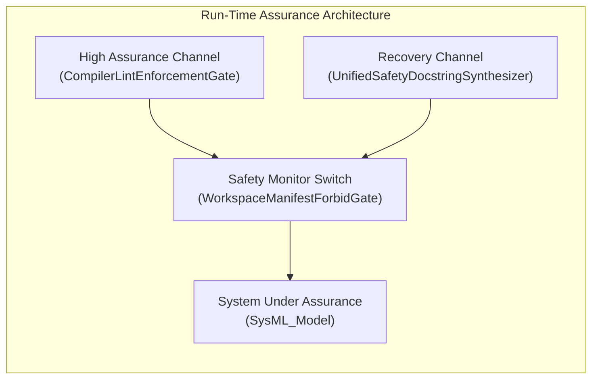

# Run-Time Assurance Architecture & Formal Proof Suite

## Simplex Run-Time Assurance Topology

## Formal Proof Suite

No `calc def` or `constraint def` expressions declared in package `SysML_Model`.

