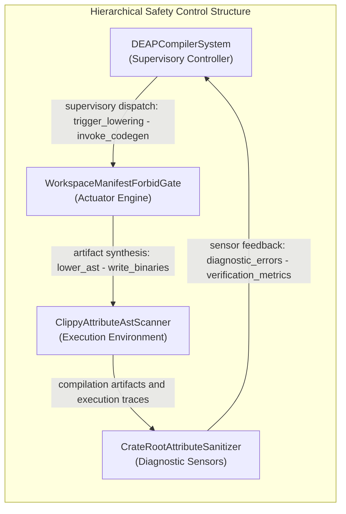
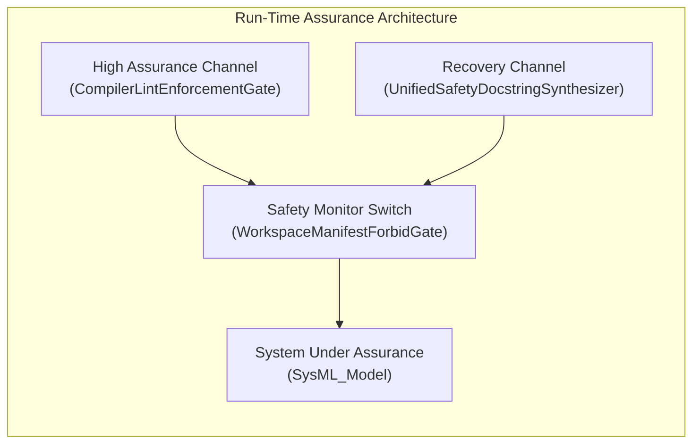

# Unified 8-Pillar STPA Safety & Risk Analysis Matrix

> **Primary Commercial Toolchain Integration Context:** MATLAB / Simulink / Stateflow / Embedded Coder
> **Safety Standards:** ISO/IEC/IEEE 15026-3 | ASTM F3269-17 RTA | MIL-STD-882E | SAE ARP4761 | SORA SAIL

---

## System Losses

| Loss ID | Description |
| :--- | :--- |
| L-1 | Loss of safe function of DEAPCompilerSystem |

## System Hazards

| Hazard ID | Associated Control Action | Controller |
| :--- | :--- | :--- |
| H-1 | Execute | DEAPCompilerSystem |
| H-2 | Read | DEAPCompilerSystem |
| H-3 | Return | DEAPCompilerSystem |
| H-4 | Emit | DEAPCompilerSystem |
| H-5 | Run | DEAPCompilerSystem |
| H-6 | check_compiler_ast_purity | DEAPCompilerSystem |
| H-7 | mask_literals_and_comments | DEAPCompilerSystem |
| H-8 | Masked | DEAPCompilerSystem |
| H-9 | contains_direct_range_slice | DEAPCompilerSystem |
| H-10 | audit_fail_closed_io_patterns | DEAPCompilerSystem |
| H-11 | audit_test_integrity_and_anti_gaming | DEAPCompilerSystem |
| H-12 | C_PURITY_03 | DEAPCompilerSystem |
| H-13 | audit_ssot_symbol_deduplication | DEAPCompilerSystem |
| H-14 | C_PURITY_04 | DEAPCompilerSystem |
| H-15 | Sorted | DEAPCompilerSystem |
| H-16 | scan_all | DEAPCompilerSystem |
| H-17 | Vec | DEAPCompilerSystem |
| H-18 | parse_package_or_file | DEAPCompilerSystem |
| H-19 | parse_type_expr | DEAPCompilerSystem |
| H-20 | Canonical | DEAPCompilerSystem |
| H-21 | verify_bijective_ast_roundtrip | DEAPCompilerSystem |
| H-22 | ast_orig_to_sysml | DEAPCompilerSystem |
| H-23 | Reparsed | DEAPCompilerSystem |
| H-24 | Assert_item | DEAPCompilerSystem |
| H-25 | Ok | DEAPCompilerSystem |
| H-26 | compile_sysml | DEAPCompilerSystem |
| H-27 | Resolve | DEAPCompilerSystem |
| H-28 | Bind | DEAPCompilerSystem |
| H-29 | Emit | DEAPCompilerSystem |
| H-30 | Epics | DEAPCompilerSystem |
| H-31 | Project | DEAPCompilerSystem |
| H-32 | ICD_01 | DEAPCompilerSystem |
| H-33 | Synthesize | DEAPCompilerSystem |
| H-34 | WBS_01_03 | DEAPCompilerSystem |
| H-35 | reconcile_backlog | DEAPCompilerSystem |
| H-36 | Parse | DEAPCompilerSystem |
| H-37 | Reconcile | DEAPCompilerSystem |
| H-38 | Zero | DEAPCompilerSystem |
| H-39 | Merge | DEAPCompilerSystem |
| H-40 | Bit_identical | DEAPCompilerSystem |
| H-41 | Run | DEAPCompilerSystem |
| H-42 | Scan | DEAPCompilerSystem |
| H-43 | Return | DEAPCompilerSystem |
| H-44 | Resolve | DEAPCompilerSystem |
| H-45 | Write | DEAPCompilerSystem |
| H-46 | Tokenize | DEAPCompilerSystem |
| H-47 | Verify_item | DEAPCompilerSystem |
| H-48 | Emit | DEAPCompilerSystem |
| H-49 | verify_baseline | DEAPCompilerSystem |
| H-50 | parse_rust_source_ast | DEAPCompilerSystem |
| H-51 | Deterministic | DEAPCompilerSystem |
| H-52 | evaluate_source_file_pillars | DEAPCompilerSystem |
| H-53 | Line_exact | DEAPCompilerSystem |
| H-54 | synthesize_defect_dossier_markdown | DEAPCompilerSystem |
| H-55 | Compliant | DEAPCompilerSystem |
| H-56 | run_check_defect | DEAPCompilerSystem |
| H-57 | Execute | DEAPCompilerSystem |
| H-58 | gh | DEAPCompilerSystem |
| H-59 | Created | DEAPCompilerSystem |
| H-60 | Live | DEAPCompilerSystem |
| H-61 | CLOSED_LOOP | DEAPCompilerSystem |
| H-62 | Exit_item | DEAPCompilerSystem |

## Hierarchical Control Structure Topology




---

## 4. Unsafe Control Actions (**UCA-1..N**)

Systematic identification across the 4 STPA guide word / failure mode categories:

1. **Not providing causes hazard**
2. **Providing causes hazard**
3. **Too early, too late, or out of order**
4. **Stopped too soon or applied too long**

Cartesian product of controlling part-def control actions across the
four canonical STPA guide-word categories.

| UCA ID | Controller | Control Action | Guide Word | Context | Hazard | Safety Constraint | Severity | SAIL |
| :--- | :--- | :--- | :--- | :--- | :--- | :--- | :--- | :--- |
| UCA-001 | DEAPCompilerSystem | Execute | Not providing | Context for Execute under Not providing | H-1 | SC-001 | PENDING_PARAMETER | PENDING_PARAMETER |
| UCA-002 | DEAPCompilerSystem | Execute | Providing | Context for Execute under Providing | H-1 | SC-002 | PENDING_PARAMETER | PENDING_PARAMETER |
| UCA-003 | DEAPCompilerSystem | Execute | Too early / Too late / Out of order | Context for Execute under Too early / Too late / Out of order | H-1 | SC-003 | PENDING_PARAMETER | PENDING_PARAMETER |
| UCA-004 | DEAPCompilerSystem | Execute | Stopped too soon / Applied too long | Context for Execute under Stopped too soon / Applied too long | H-1 | SC-004 | PENDING_PARAMETER | PENDING_PARAMETER |
| UCA-005 | DEAPCompilerSystem | Read | Not providing | Context for Read under Not providing | H-2 | SC-005 | PENDING_PARAMETER | PENDING_PARAMETER |
| UCA-006 | DEAPCompilerSystem | Read | Providing | Context for Read under Providing | H-2 | SC-006 | PENDING_PARAMETER | PENDING_PARAMETER |
| UCA-007 | DEAPCompilerSystem | Read | Too early / Too late / Out of order | Context for Read under Too early / Too late / Out of order | H-2 | SC-007 | PENDING_PARAMETER | PENDING_PARAMETER |
| UCA-008 | DEAPCompilerSystem | Read | Stopped too soon / Applied too long | Context for Read under Stopped too soon / Applied too long | H-2 | SC-008 | PENDING_PARAMETER | PENDING_PARAMETER |
| UCA-009 | DEAPCompilerSystem | Return | Not providing | Context for Return under Not providing | H-3 | SC-009 | PENDING_PARAMETER | PENDING_PARAMETER |
| UCA-010 | DEAPCompilerSystem | Return | Providing | Context for Return under Providing | H-3 | SC-010 | PENDING_PARAMETER | PENDING_PARAMETER |
| UCA-011 | DEAPCompilerSystem | Return | Too early / Too late / Out of order | Context for Return under Too early / Too late / Out of order | H-3 | SC-011 | PENDING_PARAMETER | PENDING_PARAMETER |
| UCA-012 | DEAPCompilerSystem | Return | Stopped too soon / Applied too long | Context for Return under Stopped too soon / Applied too long | H-3 | SC-012 | PENDING_PARAMETER | PENDING_PARAMETER |
| UCA-013 | DEAPCompilerSystem | Emit | Not providing | Context for Emit under Not providing | H-4 | SC-013 | PENDING_PARAMETER | PENDING_PARAMETER |
| UCA-014 | DEAPCompilerSystem | Emit | Providing | Context for Emit under Providing | H-4 | SC-014 | PENDING_PARAMETER | PENDING_PARAMETER |
| UCA-015 | DEAPCompilerSystem | Emit | Too early / Too late / Out of order | Context for Emit under Too early / Too late / Out of order | H-4 | SC-015 | PENDING_PARAMETER | PENDING_PARAMETER |
| UCA-016 | DEAPCompilerSystem | Emit | Stopped too soon / Applied too long | Context for Emit under Stopped too soon / Applied too long | H-4 | SC-016 | PENDING_PARAMETER | PENDING_PARAMETER |
| UCA-017 | DEAPCompilerSystem | Run | Not providing | Context for Run under Not providing | H-5 | SC-017 | PENDING_PARAMETER | PENDING_PARAMETER |
| UCA-018 | DEAPCompilerSystem | Run | Providing | Context for Run under Providing | H-5 | SC-018 | PENDING_PARAMETER | PENDING_PARAMETER |
| UCA-019 | DEAPCompilerSystem | Run | Too early / Too late / Out of order | Context for Run under Too early / Too late / Out of order | H-5 | SC-019 | PENDING_PARAMETER | PENDING_PARAMETER |
| UCA-020 | DEAPCompilerSystem | Run | Stopped too soon / Applied too long | Context for Run under Stopped too soon / Applied too long | H-5 | SC-020 | PENDING_PARAMETER | PENDING_PARAMETER |
| UCA-021 | DEAPCompilerSystem | check_compiler_ast_purity | Not providing | Context for check_compiler_ast_purity under Not providing | H-6 | SC-021 | PENDING_PARAMETER | PENDING_PARAMETER |
| UCA-022 | DEAPCompilerSystem | check_compiler_ast_purity | Providing | Context for check_compiler_ast_purity under Providing | H-6 | SC-022 | PENDING_PARAMETER | PENDING_PARAMETER |
| UCA-023 | DEAPCompilerSystem | check_compiler_ast_purity | Too early / Too late / Out of order | Context for check_compiler_ast_purity under Too early / Too late / Out of order | H-6 | SC-023 | PENDING_PARAMETER | PENDING_PARAMETER |
| UCA-024 | DEAPCompilerSystem | check_compiler_ast_purity | Stopped too soon / Applied too long | Context for check_compiler_ast_purity under Stopped too soon / Applied too long | H-6 | SC-024 | PENDING_PARAMETER | PENDING_PARAMETER |
| UCA-025 | DEAPCompilerSystem | mask_literals_and_comments | Not providing | Context for mask_literals_and_comments under Not providing | H-7 | SC-025 | PENDING_PARAMETER | PENDING_PARAMETER |
| UCA-026 | DEAPCompilerSystem | mask_literals_and_comments | Providing | Context for mask_literals_and_comments under Providing | H-7 | SC-026 | PENDING_PARAMETER | PENDING_PARAMETER |
| UCA-027 | DEAPCompilerSystem | mask_literals_and_comments | Too early / Too late / Out of order | Context for mask_literals_and_comments under Too early / Too late / Out of order | H-7 | SC-027 | PENDING_PARAMETER | PENDING_PARAMETER |
| UCA-028 | DEAPCompilerSystem | mask_literals_and_comments | Stopped too soon / Applied too long | Context for mask_literals_and_comments under Stopped too soon / Applied too long | H-7 | SC-028 | PENDING_PARAMETER | PENDING_PARAMETER |
| UCA-029 | DEAPCompilerSystem | Masked | Not providing | Context for Masked under Not providing | H-8 | SC-029 | PENDING_PARAMETER | PENDING_PARAMETER |
| UCA-030 | DEAPCompilerSystem | Masked | Providing | Context for Masked under Providing | H-8 | SC-030 | PENDING_PARAMETER | PENDING_PARAMETER |
| UCA-031 | DEAPCompilerSystem | Masked | Too early / Too late / Out of order | Context for Masked under Too early / Too late / Out of order | H-8 | SC-031 | PENDING_PARAMETER | PENDING_PARAMETER |
| UCA-032 | DEAPCompilerSystem | Masked | Stopped too soon / Applied too long | Context for Masked under Stopped too soon / Applied too long | H-8 | SC-032 | PENDING_PARAMETER | PENDING_PARAMETER |
| UCA-033 | DEAPCompilerSystem | contains_direct_range_slice | Not providing | Context for contains_direct_range_slice under Not providing | H-9 | SC-033 | PENDING_PARAMETER | PENDING_PARAMETER |
| UCA-034 | DEAPCompilerSystem | contains_direct_range_slice | Providing | Context for contains_direct_range_slice under Providing | H-9 | SC-034 | PENDING_PARAMETER | PENDING_PARAMETER |
| UCA-035 | DEAPCompilerSystem | contains_direct_range_slice | Too early / Too late / Out of order | Context for contains_direct_range_slice under Too early / Too late / Out of order | H-9 | SC-035 | PENDING_PARAMETER | PENDING_PARAMETER |
| UCA-036 | DEAPCompilerSystem | contains_direct_range_slice | Stopped too soon / Applied too long | Context for contains_direct_range_slice under Stopped too soon / Applied too long | H-9 | SC-036 | PENDING_PARAMETER | PENDING_PARAMETER |
| UCA-037 | DEAPCompilerSystem | audit_fail_closed_io_patterns | Not providing | Context for audit_fail_closed_io_patterns under Not providing | H-10 | SC-037 | PENDING_PARAMETER | PENDING_PARAMETER |
| UCA-038 | DEAPCompilerSystem | audit_fail_closed_io_patterns | Providing | Context for audit_fail_closed_io_patterns under Providing | H-10 | SC-038 | PENDING_PARAMETER | PENDING_PARAMETER |
| UCA-039 | DEAPCompilerSystem | audit_fail_closed_io_patterns | Too early / Too late / Out of order | Context for audit_fail_closed_io_patterns under Too early / Too late / Out of order | H-10 | SC-039 | PENDING_PARAMETER | PENDING_PARAMETER |
| UCA-040 | DEAPCompilerSystem | audit_fail_closed_io_patterns | Stopped too soon / Applied too long | Context for audit_fail_closed_io_patterns under Stopped too soon / Applied too long | H-10 | SC-040 | PENDING_PARAMETER | PENDING_PARAMETER |
| UCA-041 | DEAPCompilerSystem | audit_test_integrity_and_anti_gaming | Not providing | Context for audit_test_integrity_and_anti_gaming under Not providing | H-11 | SC-041 | PENDING_PARAMETER | PENDING_PARAMETER |
| UCA-042 | DEAPCompilerSystem | audit_test_integrity_and_anti_gaming | Providing | Context for audit_test_integrity_and_anti_gaming under Providing | H-11 | SC-042 | PENDING_PARAMETER | PENDING_PARAMETER |
| UCA-043 | DEAPCompilerSystem | audit_test_integrity_and_anti_gaming | Too early / Too late / Out of order | Context for audit_test_integrity_and_anti_gaming under Too early / Too late / Out of order | H-11 | SC-043 | PENDING_PARAMETER | PENDING_PARAMETER |
| UCA-044 | DEAPCompilerSystem | audit_test_integrity_and_anti_gaming | Stopped too soon / Applied too long | Context for audit_test_integrity_and_anti_gaming under Stopped too soon / Applied too long | H-11 | SC-044 | PENDING_PARAMETER | PENDING_PARAMETER |
| UCA-045 | DEAPCompilerSystem | C_PURITY_03 | Not providing | Context for C_PURITY_03 under Not providing | H-12 | SC-045 | PENDING_PARAMETER | PENDING_PARAMETER |
| UCA-046 | DEAPCompilerSystem | C_PURITY_03 | Providing | Context for C_PURITY_03 under Providing | H-12 | SC-046 | PENDING_PARAMETER | PENDING_PARAMETER |
| UCA-047 | DEAPCompilerSystem | C_PURITY_03 | Too early / Too late / Out of order | Context for C_PURITY_03 under Too early / Too late / Out of order | H-12 | SC-047 | PENDING_PARAMETER | PENDING_PARAMETER |
| UCA-048 | DEAPCompilerSystem | C_PURITY_03 | Stopped too soon / Applied too long | Context for C_PURITY_03 under Stopped too soon / Applied too long | H-12 | SC-048 | PENDING_PARAMETER | PENDING_PARAMETER |
| UCA-049 | DEAPCompilerSystem | audit_ssot_symbol_deduplication | Not providing | Context for audit_ssot_symbol_deduplication under Not providing | H-13 | SC-049 | PENDING_PARAMETER | PENDING_PARAMETER |
| UCA-050 | DEAPCompilerSystem | audit_ssot_symbol_deduplication | Providing | Context for audit_ssot_symbol_deduplication under Providing | H-13 | SC-050 | PENDING_PARAMETER | PENDING_PARAMETER |
| UCA-051 | DEAPCompilerSystem | audit_ssot_symbol_deduplication | Too early / Too late / Out of order | Context for audit_ssot_symbol_deduplication under Too early / Too late / Out of order | H-13 | SC-051 | PENDING_PARAMETER | PENDING_PARAMETER |
| UCA-052 | DEAPCompilerSystem | audit_ssot_symbol_deduplication | Stopped too soon / Applied too long | Context for audit_ssot_symbol_deduplication under Stopped too soon / Applied too long | H-13 | SC-052 | PENDING_PARAMETER | PENDING_PARAMETER |
| UCA-053 | DEAPCompilerSystem | C_PURITY_04 | Not providing | Context for C_PURITY_04 under Not providing | H-14 | SC-053 | PENDING_PARAMETER | PENDING_PARAMETER |
| UCA-054 | DEAPCompilerSystem | C_PURITY_04 | Providing | Context for C_PURITY_04 under Providing | H-14 | SC-054 | PENDING_PARAMETER | PENDING_PARAMETER |
| UCA-055 | DEAPCompilerSystem | C_PURITY_04 | Too early / Too late / Out of order | Context for C_PURITY_04 under Too early / Too late / Out of order | H-14 | SC-055 | PENDING_PARAMETER | PENDING_PARAMETER |
| UCA-056 | DEAPCompilerSystem | C_PURITY_04 | Stopped too soon / Applied too long | Context for C_PURITY_04 under Stopped too soon / Applied too long | H-14 | SC-056 | PENDING_PARAMETER | PENDING_PARAMETER |
| UCA-057 | DEAPCompilerSystem | Sorted | Not providing | Context for Sorted under Not providing | H-15 | SC-057 | PENDING_PARAMETER | PENDING_PARAMETER |
| UCA-058 | DEAPCompilerSystem | Sorted | Providing | Context for Sorted under Providing | H-15 | SC-058 | PENDING_PARAMETER | PENDING_PARAMETER |
| UCA-059 | DEAPCompilerSystem | Sorted | Too early / Too late / Out of order | Context for Sorted under Too early / Too late / Out of order | H-15 | SC-059 | PENDING_PARAMETER | PENDING_PARAMETER |
| UCA-060 | DEAPCompilerSystem | Sorted | Stopped too soon / Applied too long | Context for Sorted under Stopped too soon / Applied too long | H-15 | SC-060 | PENDING_PARAMETER | PENDING_PARAMETER |
| UCA-061 | DEAPCompilerSystem | scan_all | Not providing | Context for scan_all under Not providing | H-16 | SC-061 | PENDING_PARAMETER | PENDING_PARAMETER |
| UCA-062 | DEAPCompilerSystem | scan_all | Providing | Context for scan_all under Providing | H-16 | SC-062 | PENDING_PARAMETER | PENDING_PARAMETER |
| UCA-063 | DEAPCompilerSystem | scan_all | Too early / Too late / Out of order | Context for scan_all under Too early / Too late / Out of order | H-16 | SC-063 | PENDING_PARAMETER | PENDING_PARAMETER |
| UCA-064 | DEAPCompilerSystem | scan_all | Stopped too soon / Applied too long | Context for scan_all under Stopped too soon / Applied too long | H-16 | SC-064 | PENDING_PARAMETER | PENDING_PARAMETER |
| UCA-065 | DEAPCompilerSystem | Vec | Not providing | Context for Vec under Not providing | H-17 | SC-065 | PENDING_PARAMETER | PENDING_PARAMETER |
| UCA-066 | DEAPCompilerSystem | Vec | Providing | Context for Vec under Providing | H-17 | SC-066 | PENDING_PARAMETER | PENDING_PARAMETER |
| UCA-067 | DEAPCompilerSystem | Vec | Too early / Too late / Out of order | Context for Vec under Too early / Too late / Out of order | H-17 | SC-067 | PENDING_PARAMETER | PENDING_PARAMETER |
| UCA-068 | DEAPCompilerSystem | Vec | Stopped too soon / Applied too long | Context for Vec under Stopped too soon / Applied too long | H-17 | SC-068 | PENDING_PARAMETER | PENDING_PARAMETER |
| UCA-069 | DEAPCompilerSystem | parse_package_or_file | Not providing | Context for parse_package_or_file under Not providing | H-18 | SC-069 | PENDING_PARAMETER | PENDING_PARAMETER |
| UCA-070 | DEAPCompilerSystem | parse_package_or_file | Providing | Context for parse_package_or_file under Providing | H-18 | SC-070 | PENDING_PARAMETER | PENDING_PARAMETER |
| UCA-071 | DEAPCompilerSystem | parse_package_or_file | Too early / Too late / Out of order | Context for parse_package_or_file under Too early / Too late / Out of order | H-18 | SC-071 | PENDING_PARAMETER | PENDING_PARAMETER |
| UCA-072 | DEAPCompilerSystem | parse_package_or_file | Stopped too soon / Applied too long | Context for parse_package_or_file under Stopped too soon / Applied too long | H-18 | SC-072 | PENDING_PARAMETER | PENDING_PARAMETER |
| UCA-073 | DEAPCompilerSystem | parse_type_expr | Not providing | Context for parse_type_expr under Not providing | H-19 | SC-073 | PENDING_PARAMETER | PENDING_PARAMETER |
| UCA-074 | DEAPCompilerSystem | parse_type_expr | Providing | Context for parse_type_expr under Providing | H-19 | SC-074 | PENDING_PARAMETER | PENDING_PARAMETER |
| UCA-075 | DEAPCompilerSystem | parse_type_expr | Too early / Too late / Out of order | Context for parse_type_expr under Too early / Too late / Out of order | H-19 | SC-075 | PENDING_PARAMETER | PENDING_PARAMETER |
| UCA-076 | DEAPCompilerSystem | parse_type_expr | Stopped too soon / Applied too long | Context for parse_type_expr under Stopped too soon / Applied too long | H-19 | SC-076 | PENDING_PARAMETER | PENDING_PARAMETER |
| UCA-077 | DEAPCompilerSystem | Canonical | Not providing | Context for Canonical under Not providing | H-20 | SC-077 | PENDING_PARAMETER | PENDING_PARAMETER |
| UCA-078 | DEAPCompilerSystem | Canonical | Providing | Context for Canonical under Providing | H-20 | SC-078 | PENDING_PARAMETER | PENDING_PARAMETER |
| UCA-079 | DEAPCompilerSystem | Canonical | Too early / Too late / Out of order | Context for Canonical under Too early / Too late / Out of order | H-20 | SC-079 | PENDING_PARAMETER | PENDING_PARAMETER |
| UCA-080 | DEAPCompilerSystem | Canonical | Stopped too soon / Applied too long | Context for Canonical under Stopped too soon / Applied too long | H-20 | SC-080 | PENDING_PARAMETER | PENDING_PARAMETER |
| UCA-081 | DEAPCompilerSystem | verify_bijective_ast_roundtrip | Not providing | Context for verify_bijective_ast_roundtrip under Not providing | H-21 | SC-081 | PENDING_PARAMETER | PENDING_PARAMETER |
| UCA-082 | DEAPCompilerSystem | verify_bijective_ast_roundtrip | Providing | Context for verify_bijective_ast_roundtrip under Providing | H-21 | SC-082 | PENDING_PARAMETER | PENDING_PARAMETER |
| UCA-083 | DEAPCompilerSystem | verify_bijective_ast_roundtrip | Too early / Too late / Out of order | Context for verify_bijective_ast_roundtrip under Too early / Too late / Out of order | H-21 | SC-083 | PENDING_PARAMETER | PENDING_PARAMETER |
| UCA-084 | DEAPCompilerSystem | verify_bijective_ast_roundtrip | Stopped too soon / Applied too long | Context for verify_bijective_ast_roundtrip under Stopped too soon / Applied too long | H-21 | SC-084 | PENDING_PARAMETER | PENDING_PARAMETER |
| UCA-085 | DEAPCompilerSystem | ast_orig_to_sysml | Not providing | Context for ast_orig_to_sysml under Not providing | H-22 | SC-085 | PENDING_PARAMETER | PENDING_PARAMETER |
| UCA-086 | DEAPCompilerSystem | ast_orig_to_sysml | Providing | Context for ast_orig_to_sysml under Providing | H-22 | SC-086 | PENDING_PARAMETER | PENDING_PARAMETER |
| UCA-087 | DEAPCompilerSystem | ast_orig_to_sysml | Too early / Too late / Out of order | Context for ast_orig_to_sysml under Too early / Too late / Out of order | H-22 | SC-087 | PENDING_PARAMETER | PENDING_PARAMETER |
| UCA-088 | DEAPCompilerSystem | ast_orig_to_sysml | Stopped too soon / Applied too long | Context for ast_orig_to_sysml under Stopped too soon / Applied too long | H-22 | SC-088 | PENDING_PARAMETER | PENDING_PARAMETER |
| UCA-089 | DEAPCompilerSystem | Reparsed | Not providing | Context for Reparsed under Not providing | H-23 | SC-089 | PENDING_PARAMETER | PENDING_PARAMETER |
| UCA-090 | DEAPCompilerSystem | Reparsed | Providing | Context for Reparsed under Providing | H-23 | SC-090 | PENDING_PARAMETER | PENDING_PARAMETER |
| UCA-091 | DEAPCompilerSystem | Reparsed | Too early / Too late / Out of order | Context for Reparsed under Too early / Too late / Out of order | H-23 | SC-091 | PENDING_PARAMETER | PENDING_PARAMETER |
| UCA-092 | DEAPCompilerSystem | Reparsed | Stopped too soon / Applied too long | Context for Reparsed under Stopped too soon / Applied too long | H-23 | SC-092 | PENDING_PARAMETER | PENDING_PARAMETER |
| UCA-093 | DEAPCompilerSystem | Assert_item | Not providing | Context for Assert_item under Not providing | H-24 | SC-093 | PENDING_PARAMETER | PENDING_PARAMETER |
| UCA-094 | DEAPCompilerSystem | Assert_item | Providing | Context for Assert_item under Providing | H-24 | SC-094 | PENDING_PARAMETER | PENDING_PARAMETER |
| UCA-095 | DEAPCompilerSystem | Assert_item | Too early / Too late / Out of order | Context for Assert_item under Too early / Too late / Out of order | H-24 | SC-095 | PENDING_PARAMETER | PENDING_PARAMETER |
| UCA-096 | DEAPCompilerSystem | Assert_item | Stopped too soon / Applied too long | Context for Assert_item under Stopped too soon / Applied too long | H-24 | SC-096 | PENDING_PARAMETER | PENDING_PARAMETER |
| UCA-097 | DEAPCompilerSystem | Ok | Not providing | Context for Ok under Not providing | H-25 | SC-097 | PENDING_PARAMETER | PENDING_PARAMETER |
| UCA-098 | DEAPCompilerSystem | Ok | Providing | Context for Ok under Providing | H-25 | SC-098 | PENDING_PARAMETER | PENDING_PARAMETER |
| UCA-099 | DEAPCompilerSystem | Ok | Too early / Too late / Out of order | Context for Ok under Too early / Too late / Out of order | H-25 | SC-099 | PENDING_PARAMETER | PENDING_PARAMETER |
| UCA-100 | DEAPCompilerSystem | Ok | Stopped too soon / Applied too long | Context for Ok under Stopped too soon / Applied too long | H-25 | SC-100 | PENDING_PARAMETER | PENDING_PARAMETER |
| UCA-101 | DEAPCompilerSystem | compile_sysml | Not providing | Context for compile_sysml under Not providing | H-26 | SC-101 | PENDING_PARAMETER | PENDING_PARAMETER |
| UCA-102 | DEAPCompilerSystem | compile_sysml | Providing | Context for compile_sysml under Providing | H-26 | SC-102 | PENDING_PARAMETER | PENDING_PARAMETER |
| UCA-103 | DEAPCompilerSystem | compile_sysml | Too early / Too late / Out of order | Context for compile_sysml under Too early / Too late / Out of order | H-26 | SC-103 | PENDING_PARAMETER | PENDING_PARAMETER |
| UCA-104 | DEAPCompilerSystem | compile_sysml | Stopped too soon / Applied too long | Context for compile_sysml under Stopped too soon / Applied too long | H-26 | SC-104 | PENDING_PARAMETER | PENDING_PARAMETER |
| UCA-105 | DEAPCompilerSystem | Resolve | Not providing | Context for Resolve under Not providing | H-27 | SC-105 | PENDING_PARAMETER | PENDING_PARAMETER |
| UCA-106 | DEAPCompilerSystem | Resolve | Providing | Context for Resolve under Providing | H-27 | SC-106 | PENDING_PARAMETER | PENDING_PARAMETER |
| UCA-107 | DEAPCompilerSystem | Resolve | Too early / Too late / Out of order | Context for Resolve under Too early / Too late / Out of order | H-27 | SC-107 | PENDING_PARAMETER | PENDING_PARAMETER |
| UCA-108 | DEAPCompilerSystem | Resolve | Stopped too soon / Applied too long | Context for Resolve under Stopped too soon / Applied too long | H-27 | SC-108 | PENDING_PARAMETER | PENDING_PARAMETER |
| UCA-109 | DEAPCompilerSystem | Bind | Not providing | Context for Bind under Not providing | H-28 | SC-109 | PENDING_PARAMETER | PENDING_PARAMETER |
| UCA-110 | DEAPCompilerSystem | Bind | Providing | Context for Bind under Providing | H-28 | SC-110 | PENDING_PARAMETER | PENDING_PARAMETER |
| UCA-111 | DEAPCompilerSystem | Bind | Too early / Too late / Out of order | Context for Bind under Too early / Too late / Out of order | H-28 | SC-111 | PENDING_PARAMETER | PENDING_PARAMETER |
| UCA-112 | DEAPCompilerSystem | Bind | Stopped too soon / Applied too long | Context for Bind under Stopped too soon / Applied too long | H-28 | SC-112 | PENDING_PARAMETER | PENDING_PARAMETER |
| UCA-113 | DEAPCompilerSystem | Emit | Not providing | Context for Emit under Not providing | H-29 | SC-113 | PENDING_PARAMETER | PENDING_PARAMETER |
| UCA-114 | DEAPCompilerSystem | Emit | Providing | Context for Emit under Providing | H-29 | SC-114 | PENDING_PARAMETER | PENDING_PARAMETER |
| UCA-115 | DEAPCompilerSystem | Emit | Too early / Too late / Out of order | Context for Emit under Too early / Too late / Out of order | H-29 | SC-115 | PENDING_PARAMETER | PENDING_PARAMETER |
| UCA-116 | DEAPCompilerSystem | Emit | Stopped too soon / Applied too long | Context for Emit under Stopped too soon / Applied too long | H-29 | SC-116 | PENDING_PARAMETER | PENDING_PARAMETER |
| UCA-117 | DEAPCompilerSystem | Epics | Not providing | Context for Epics under Not providing | H-30 | SC-117 | PENDING_PARAMETER | PENDING_PARAMETER |
| UCA-118 | DEAPCompilerSystem | Epics | Providing | Context for Epics under Providing | H-30 | SC-118 | PENDING_PARAMETER | PENDING_PARAMETER |
| UCA-119 | DEAPCompilerSystem | Epics | Too early / Too late / Out of order | Context for Epics under Too early / Too late / Out of order | H-30 | SC-119 | PENDING_PARAMETER | PENDING_PARAMETER |
| UCA-120 | DEAPCompilerSystem | Epics | Stopped too soon / Applied too long | Context for Epics under Stopped too soon / Applied too long | H-30 | SC-120 | PENDING_PARAMETER | PENDING_PARAMETER |
| UCA-121 | DEAPCompilerSystem | Project | Not providing | Context for Project under Not providing | H-31 | SC-121 | PENDING_PARAMETER | PENDING_PARAMETER |
| UCA-122 | DEAPCompilerSystem | Project | Providing | Context for Project under Providing | H-31 | SC-122 | PENDING_PARAMETER | PENDING_PARAMETER |
| UCA-123 | DEAPCompilerSystem | Project | Too early / Too late / Out of order | Context for Project under Too early / Too late / Out of order | H-31 | SC-123 | PENDING_PARAMETER | PENDING_PARAMETER |
| UCA-124 | DEAPCompilerSystem | Project | Stopped too soon / Applied too long | Context for Project under Stopped too soon / Applied too long | H-31 | SC-124 | PENDING_PARAMETER | PENDING_PARAMETER |
| UCA-125 | DEAPCompilerSystem | ICD_01 | Not providing | Context for ICD_01 under Not providing | H-32 | SC-125 | PENDING_PARAMETER | PENDING_PARAMETER |
| UCA-126 | DEAPCompilerSystem | ICD_01 | Providing | Context for ICD_01 under Providing | H-32 | SC-126 | PENDING_PARAMETER | PENDING_PARAMETER |
| UCA-127 | DEAPCompilerSystem | ICD_01 | Too early / Too late / Out of order | Context for ICD_01 under Too early / Too late / Out of order | H-32 | SC-127 | PENDING_PARAMETER | PENDING_PARAMETER |
| UCA-128 | DEAPCompilerSystem | ICD_01 | Stopped too soon / Applied too long | Context for ICD_01 under Stopped too soon / Applied too long | H-32 | SC-128 | PENDING_PARAMETER | PENDING_PARAMETER |
| UCA-129 | DEAPCompilerSystem | Synthesize | Not providing | Context for Synthesize under Not providing | H-33 | SC-129 | PENDING_PARAMETER | PENDING_PARAMETER |
| UCA-130 | DEAPCompilerSystem | Synthesize | Providing | Context for Synthesize under Providing | H-33 | SC-130 | PENDING_PARAMETER | PENDING_PARAMETER |
| UCA-131 | DEAPCompilerSystem | Synthesize | Too early / Too late / Out of order | Context for Synthesize under Too early / Too late / Out of order | H-33 | SC-131 | PENDING_PARAMETER | PENDING_PARAMETER |
| UCA-132 | DEAPCompilerSystem | Synthesize | Stopped too soon / Applied too long | Context for Synthesize under Stopped too soon / Applied too long | H-33 | SC-132 | PENDING_PARAMETER | PENDING_PARAMETER |
| UCA-133 | DEAPCompilerSystem | WBS_01_03 | Not providing | Context for WBS_01_03 under Not providing | H-34 | SC-133 | PENDING_PARAMETER | PENDING_PARAMETER |
| UCA-134 | DEAPCompilerSystem | WBS_01_03 | Providing | Context for WBS_01_03 under Providing | H-34 | SC-134 | PENDING_PARAMETER | PENDING_PARAMETER |
| UCA-135 | DEAPCompilerSystem | WBS_01_03 | Too early / Too late / Out of order | Context for WBS_01_03 under Too early / Too late / Out of order | H-34 | SC-135 | PENDING_PARAMETER | PENDING_PARAMETER |
| UCA-136 | DEAPCompilerSystem | WBS_01_03 | Stopped too soon / Applied too long | Context for WBS_01_03 under Stopped too soon / Applied too long | H-34 | SC-136 | PENDING_PARAMETER | PENDING_PARAMETER |
| UCA-137 | DEAPCompilerSystem | reconcile_backlog | Not providing | Context for reconcile_backlog under Not providing | H-35 | SC-137 | PENDING_PARAMETER | PENDING_PARAMETER |
| UCA-138 | DEAPCompilerSystem | reconcile_backlog | Providing | Context for reconcile_backlog under Providing | H-35 | SC-138 | PENDING_PARAMETER | PENDING_PARAMETER |
| UCA-139 | DEAPCompilerSystem | reconcile_backlog | Too early / Too late / Out of order | Context for reconcile_backlog under Too early / Too late / Out of order | H-35 | SC-139 | PENDING_PARAMETER | PENDING_PARAMETER |
| UCA-140 | DEAPCompilerSystem | reconcile_backlog | Stopped too soon / Applied too long | Context for reconcile_backlog under Stopped too soon / Applied too long | H-35 | SC-140 | PENDING_PARAMETER | PENDING_PARAMETER |
| UCA-141 | DEAPCompilerSystem | Parse | Not providing | Context for Parse under Not providing | H-36 | SC-141 | PENDING_PARAMETER | PENDING_PARAMETER |
| UCA-142 | DEAPCompilerSystem | Parse | Providing | Context for Parse under Providing | H-36 | SC-142 | PENDING_PARAMETER | PENDING_PARAMETER |
| UCA-143 | DEAPCompilerSystem | Parse | Too early / Too late / Out of order | Context for Parse under Too early / Too late / Out of order | H-36 | SC-143 | PENDING_PARAMETER | PENDING_PARAMETER |
| UCA-144 | DEAPCompilerSystem | Parse | Stopped too soon / Applied too long | Context for Parse under Stopped too soon / Applied too long | H-36 | SC-144 | PENDING_PARAMETER | PENDING_PARAMETER |
| UCA-145 | DEAPCompilerSystem | Reconcile | Not providing | Context for Reconcile under Not providing | H-37 | SC-145 | PENDING_PARAMETER | PENDING_PARAMETER |
| UCA-146 | DEAPCompilerSystem | Reconcile | Providing | Context for Reconcile under Providing | H-37 | SC-146 | PENDING_PARAMETER | PENDING_PARAMETER |
| UCA-147 | DEAPCompilerSystem | Reconcile | Too early / Too late / Out of order | Context for Reconcile under Too early / Too late / Out of order | H-37 | SC-147 | PENDING_PARAMETER | PENDING_PARAMETER |
| UCA-148 | DEAPCompilerSystem | Reconcile | Stopped too soon / Applied too long | Context for Reconcile under Stopped too soon / Applied too long | H-37 | SC-148 | PENDING_PARAMETER | PENDING_PARAMETER |
| UCA-149 | DEAPCompilerSystem | Zero | Not providing | Context for Zero under Not providing | H-38 | SC-149 | PENDING_PARAMETER | PENDING_PARAMETER |
| UCA-150 | DEAPCompilerSystem | Zero | Providing | Context for Zero under Providing | H-38 | SC-150 | PENDING_PARAMETER | PENDING_PARAMETER |
| UCA-151 | DEAPCompilerSystem | Zero | Too early / Too late / Out of order | Context for Zero under Too early / Too late / Out of order | H-38 | SC-151 | PENDING_PARAMETER | PENDING_PARAMETER |
| UCA-152 | DEAPCompilerSystem | Zero | Stopped too soon / Applied too long | Context for Zero under Stopped too soon / Applied too long | H-38 | SC-152 | PENDING_PARAMETER | PENDING_PARAMETER |
| UCA-153 | DEAPCompilerSystem | Merge | Not providing | Context for Merge under Not providing | H-39 | SC-153 | PENDING_PARAMETER | PENDING_PARAMETER |
| UCA-154 | DEAPCompilerSystem | Merge | Providing | Context for Merge under Providing | H-39 | SC-154 | PENDING_PARAMETER | PENDING_PARAMETER |
| UCA-155 | DEAPCompilerSystem | Merge | Too early / Too late / Out of order | Context for Merge under Too early / Too late / Out of order | H-39 | SC-155 | PENDING_PARAMETER | PENDING_PARAMETER |
| UCA-156 | DEAPCompilerSystem | Merge | Stopped too soon / Applied too long | Context for Merge under Stopped too soon / Applied too long | H-39 | SC-156 | PENDING_PARAMETER | PENDING_PARAMETER |
| UCA-157 | DEAPCompilerSystem | Bit_identical | Not providing | Context for Bit_identical under Not providing | H-40 | SC-157 | PENDING_PARAMETER | PENDING_PARAMETER |
| UCA-158 | DEAPCompilerSystem | Bit_identical | Providing | Context for Bit_identical under Providing | H-40 | SC-158 | PENDING_PARAMETER | PENDING_PARAMETER |
| UCA-159 | DEAPCompilerSystem | Bit_identical | Too early / Too late / Out of order | Context for Bit_identical under Too early / Too late / Out of order | H-40 | SC-159 | PENDING_PARAMETER | PENDING_PARAMETER |
| UCA-160 | DEAPCompilerSystem | Bit_identical | Stopped too soon / Applied too long | Context for Bit_identical under Stopped too soon / Applied too long | H-40 | SC-160 | PENDING_PARAMETER | PENDING_PARAMETER |
| UCA-161 | DEAPCompilerSystem | Run | Not providing | Context for Run under Not providing | H-41 | SC-161 | PENDING_PARAMETER | PENDING_PARAMETER |
| UCA-162 | DEAPCompilerSystem | Run | Providing | Context for Run under Providing | H-41 | SC-162 | PENDING_PARAMETER | PENDING_PARAMETER |
| UCA-163 | DEAPCompilerSystem | Run | Too early / Too late / Out of order | Context for Run under Too early / Too late / Out of order | H-41 | SC-163 | PENDING_PARAMETER | PENDING_PARAMETER |
| UCA-164 | DEAPCompilerSystem | Run | Stopped too soon / Applied too long | Context for Run under Stopped too soon / Applied too long | H-41 | SC-164 | PENDING_PARAMETER | PENDING_PARAMETER |
| UCA-165 | DEAPCompilerSystem | Scan | Not providing | Context for Scan under Not providing | H-42 | SC-165 | PENDING_PARAMETER | PENDING_PARAMETER |
| UCA-166 | DEAPCompilerSystem | Scan | Providing | Context for Scan under Providing | H-42 | SC-166 | PENDING_PARAMETER | PENDING_PARAMETER |
| UCA-167 | DEAPCompilerSystem | Scan | Too early / Too late / Out of order | Context for Scan under Too early / Too late / Out of order | H-42 | SC-167 | PENDING_PARAMETER | PENDING_PARAMETER |
| UCA-168 | DEAPCompilerSystem | Scan | Stopped too soon / Applied too long | Context for Scan under Stopped too soon / Applied too long | H-42 | SC-168 | PENDING_PARAMETER | PENDING_PARAMETER |
| UCA-169 | DEAPCompilerSystem | Return | Not providing | Context for Return under Not providing | H-43 | SC-169 | PENDING_PARAMETER | PENDING_PARAMETER |
| UCA-170 | DEAPCompilerSystem | Return | Providing | Context for Return under Providing | H-43 | SC-170 | PENDING_PARAMETER | PENDING_PARAMETER |
| UCA-171 | DEAPCompilerSystem | Return | Too early / Too late / Out of order | Context for Return under Too early / Too late / Out of order | H-43 | SC-171 | PENDING_PARAMETER | PENDING_PARAMETER |
| UCA-172 | DEAPCompilerSystem | Return | Stopped too soon / Applied too long | Context for Return under Stopped too soon / Applied too long | H-43 | SC-172 | PENDING_PARAMETER | PENDING_PARAMETER |
| UCA-173 | DEAPCompilerSystem | Resolve | Not providing | Context for Resolve under Not providing | H-44 | SC-173 | PENDING_PARAMETER | PENDING_PARAMETER |
| UCA-174 | DEAPCompilerSystem | Resolve | Providing | Context for Resolve under Providing | H-44 | SC-174 | PENDING_PARAMETER | PENDING_PARAMETER |
| UCA-175 | DEAPCompilerSystem | Resolve | Too early / Too late / Out of order | Context for Resolve under Too early / Too late / Out of order | H-44 | SC-175 | PENDING_PARAMETER | PENDING_PARAMETER |
| UCA-176 | DEAPCompilerSystem | Resolve | Stopped too soon / Applied too long | Context for Resolve under Stopped too soon / Applied too long | H-44 | SC-176 | PENDING_PARAMETER | PENDING_PARAMETER |
| UCA-177 | DEAPCompilerSystem | Write | Not providing | Context for Write under Not providing | H-45 | SC-177 | PENDING_PARAMETER | PENDING_PARAMETER |
| UCA-178 | DEAPCompilerSystem | Write | Providing | Context for Write under Providing | H-45 | SC-178 | PENDING_PARAMETER | PENDING_PARAMETER |
| UCA-179 | DEAPCompilerSystem | Write | Too early / Too late / Out of order | Context for Write under Too early / Too late / Out of order | H-45 | SC-179 | PENDING_PARAMETER | PENDING_PARAMETER |
| UCA-180 | DEAPCompilerSystem | Write | Stopped too soon / Applied too long | Context for Write under Stopped too soon / Applied too long | H-45 | SC-180 | PENDING_PARAMETER | PENDING_PARAMETER |
| UCA-181 | DEAPCompilerSystem | Tokenize | Not providing | Context for Tokenize under Not providing | H-46 | SC-181 | PENDING_PARAMETER | PENDING_PARAMETER |
| UCA-182 | DEAPCompilerSystem | Tokenize | Providing | Context for Tokenize under Providing | H-46 | SC-182 | PENDING_PARAMETER | PENDING_PARAMETER |
| UCA-183 | DEAPCompilerSystem | Tokenize | Too early / Too late / Out of order | Context for Tokenize under Too early / Too late / Out of order | H-46 | SC-183 | PENDING_PARAMETER | PENDING_PARAMETER |
| UCA-184 | DEAPCompilerSystem | Tokenize | Stopped too soon / Applied too long | Context for Tokenize under Stopped too soon / Applied too long | H-46 | SC-184 | PENDING_PARAMETER | PENDING_PARAMETER |
| UCA-185 | DEAPCompilerSystem | Verify_item | Not providing | Context for Verify_item under Not providing | H-47 | SC-185 | PENDING_PARAMETER | PENDING_PARAMETER |
| UCA-186 | DEAPCompilerSystem | Verify_item | Providing | Context for Verify_item under Providing | H-47 | SC-186 | PENDING_PARAMETER | PENDING_PARAMETER |
| UCA-187 | DEAPCompilerSystem | Verify_item | Too early / Too late / Out of order | Context for Verify_item under Too early / Too late / Out of order | H-47 | SC-187 | PENDING_PARAMETER | PENDING_PARAMETER |
| UCA-188 | DEAPCompilerSystem | Verify_item | Stopped too soon / Applied too long | Context for Verify_item under Stopped too soon / Applied too long | H-47 | SC-188 | PENDING_PARAMETER | PENDING_PARAMETER |
| UCA-189 | DEAPCompilerSystem | Emit | Not providing | Context for Emit under Not providing | H-48 | SC-189 | PENDING_PARAMETER | PENDING_PARAMETER |
| UCA-190 | DEAPCompilerSystem | Emit | Providing | Context for Emit under Providing | H-48 | SC-190 | PENDING_PARAMETER | PENDING_PARAMETER |
| UCA-191 | DEAPCompilerSystem | Emit | Too early / Too late / Out of order | Context for Emit under Too early / Too late / Out of order | H-48 | SC-191 | PENDING_PARAMETER | PENDING_PARAMETER |
| UCA-192 | DEAPCompilerSystem | Emit | Stopped too soon / Applied too long | Context for Emit under Stopped too soon / Applied too long | H-48 | SC-192 | PENDING_PARAMETER | PENDING_PARAMETER |
| UCA-193 | DEAPCompilerSystem | verify_baseline | Not providing | Context for verify_baseline under Not providing | H-49 | SC-193 | PENDING_PARAMETER | PENDING_PARAMETER |
| UCA-194 | DEAPCompilerSystem | verify_baseline | Providing | Context for verify_baseline under Providing | H-49 | SC-194 | PENDING_PARAMETER | PENDING_PARAMETER |
| UCA-195 | DEAPCompilerSystem | verify_baseline | Too early / Too late / Out of order | Context for verify_baseline under Too early / Too late / Out of order | H-49 | SC-195 | PENDING_PARAMETER | PENDING_PARAMETER |
| UCA-196 | DEAPCompilerSystem | verify_baseline | Stopped too soon / Applied too long | Context for verify_baseline under Stopped too soon / Applied too long | H-49 | SC-196 | PENDING_PARAMETER | PENDING_PARAMETER |
| UCA-197 | DEAPCompilerSystem | parse_rust_source_ast | Not providing | Context for parse_rust_source_ast under Not providing | H-50 | SC-197 | PENDING_PARAMETER | PENDING_PARAMETER |
| UCA-198 | DEAPCompilerSystem | parse_rust_source_ast | Providing | Context for parse_rust_source_ast under Providing | H-50 | SC-198 | PENDING_PARAMETER | PENDING_PARAMETER |
| UCA-199 | DEAPCompilerSystem | parse_rust_source_ast | Too early / Too late / Out of order | Context for parse_rust_source_ast under Too early / Too late / Out of order | H-50 | SC-199 | PENDING_PARAMETER | PENDING_PARAMETER |
| UCA-200 | DEAPCompilerSystem | parse_rust_source_ast | Stopped too soon / Applied too long | Context for parse_rust_source_ast under Stopped too soon / Applied too long | H-50 | SC-200 | PENDING_PARAMETER | PENDING_PARAMETER |
| UCA-201 | DEAPCompilerSystem | Deterministic | Not providing | Context for Deterministic under Not providing | H-51 | SC-201 | PENDING_PARAMETER | PENDING_PARAMETER |
| UCA-202 | DEAPCompilerSystem | Deterministic | Providing | Context for Deterministic under Providing | H-51 | SC-202 | PENDING_PARAMETER | PENDING_PARAMETER |
| UCA-203 | DEAPCompilerSystem | Deterministic | Too early / Too late / Out of order | Context for Deterministic under Too early / Too late / Out of order | H-51 | SC-203 | PENDING_PARAMETER | PENDING_PARAMETER |
| UCA-204 | DEAPCompilerSystem | Deterministic | Stopped too soon / Applied too long | Context for Deterministic under Stopped too soon / Applied too long | H-51 | SC-204 | PENDING_PARAMETER | PENDING_PARAMETER |
| UCA-205 | DEAPCompilerSystem | evaluate_source_file_pillars | Not providing | Context for evaluate_source_file_pillars under Not providing | H-52 | SC-205 | PENDING_PARAMETER | PENDING_PARAMETER |
| UCA-206 | DEAPCompilerSystem | evaluate_source_file_pillars | Providing | Context for evaluate_source_file_pillars under Providing | H-52 | SC-206 | PENDING_PARAMETER | PENDING_PARAMETER |
| UCA-207 | DEAPCompilerSystem | evaluate_source_file_pillars | Too early / Too late / Out of order | Context for evaluate_source_file_pillars under Too early / Too late / Out of order | H-52 | SC-207 | PENDING_PARAMETER | PENDING_PARAMETER |
| UCA-208 | DEAPCompilerSystem | evaluate_source_file_pillars | Stopped too soon / Applied too long | Context for evaluate_source_file_pillars under Stopped too soon / Applied too long | H-52 | SC-208 | PENDING_PARAMETER | PENDING_PARAMETER |
| UCA-209 | DEAPCompilerSystem | Line_exact | Not providing | Context for Line_exact under Not providing | H-53 | SC-209 | PENDING_PARAMETER | PENDING_PARAMETER |
| UCA-210 | DEAPCompilerSystem | Line_exact | Providing | Context for Line_exact under Providing | H-53 | SC-210 | PENDING_PARAMETER | PENDING_PARAMETER |
| UCA-211 | DEAPCompilerSystem | Line_exact | Too early / Too late / Out of order | Context for Line_exact under Too early / Too late / Out of order | H-53 | SC-211 | PENDING_PARAMETER | PENDING_PARAMETER |
| UCA-212 | DEAPCompilerSystem | Line_exact | Stopped too soon / Applied too long | Context for Line_exact under Stopped too soon / Applied too long | H-53 | SC-212 | PENDING_PARAMETER | PENDING_PARAMETER |
| UCA-213 | DEAPCompilerSystem | synthesize_defect_dossier_markdown | Not providing | Context for synthesize_defect_dossier_markdown under Not providing | H-54 | SC-213 | PENDING_PARAMETER | PENDING_PARAMETER |
| UCA-214 | DEAPCompilerSystem | synthesize_defect_dossier_markdown | Providing | Context for synthesize_defect_dossier_markdown under Providing | H-54 | SC-214 | PENDING_PARAMETER | PENDING_PARAMETER |
| UCA-215 | DEAPCompilerSystem | synthesize_defect_dossier_markdown | Too early / Too late / Out of order | Context for synthesize_defect_dossier_markdown under Too early / Too late / Out of order | H-54 | SC-215 | PENDING_PARAMETER | PENDING_PARAMETER |
| UCA-216 | DEAPCompilerSystem | synthesize_defect_dossier_markdown | Stopped too soon / Applied too long | Context for synthesize_defect_dossier_markdown under Stopped too soon / Applied too long | H-54 | SC-216 | PENDING_PARAMETER | PENDING_PARAMETER |
| UCA-217 | DEAPCompilerSystem | Compliant | Not providing | Context for Compliant under Not providing | H-55 | SC-217 | PENDING_PARAMETER | PENDING_PARAMETER |
| UCA-218 | DEAPCompilerSystem | Compliant | Providing | Context for Compliant under Providing | H-55 | SC-218 | PENDING_PARAMETER | PENDING_PARAMETER |
| UCA-219 | DEAPCompilerSystem | Compliant | Too early / Too late / Out of order | Context for Compliant under Too early / Too late / Out of order | H-55 | SC-219 | PENDING_PARAMETER | PENDING_PARAMETER |
| UCA-220 | DEAPCompilerSystem | Compliant | Stopped too soon / Applied too long | Context for Compliant under Stopped too soon / Applied too long | H-55 | SC-220 | PENDING_PARAMETER | PENDING_PARAMETER |
| UCA-221 | DEAPCompilerSystem | run_check_defect | Not providing | Context for run_check_defect under Not providing | H-56 | SC-221 | PENDING_PARAMETER | PENDING_PARAMETER |
| UCA-222 | DEAPCompilerSystem | run_check_defect | Providing | Context for run_check_defect under Providing | H-56 | SC-222 | PENDING_PARAMETER | PENDING_PARAMETER |
| UCA-223 | DEAPCompilerSystem | run_check_defect | Too early / Too late / Out of order | Context for run_check_defect under Too early / Too late / Out of order | H-56 | SC-223 | PENDING_PARAMETER | PENDING_PARAMETER |
| UCA-224 | DEAPCompilerSystem | run_check_defect | Stopped too soon / Applied too long | Context for run_check_defect under Stopped too soon / Applied too long | H-56 | SC-224 | PENDING_PARAMETER | PENDING_PARAMETER |
| UCA-225 | DEAPCompilerSystem | Execute | Not providing | Context for Execute under Not providing | H-57 | SC-225 | PENDING_PARAMETER | PENDING_PARAMETER |
| UCA-226 | DEAPCompilerSystem | Execute | Providing | Context for Execute under Providing | H-57 | SC-226 | PENDING_PARAMETER | PENDING_PARAMETER |
| UCA-227 | DEAPCompilerSystem | Execute | Too early / Too late / Out of order | Context for Execute under Too early / Too late / Out of order | H-57 | SC-227 | PENDING_PARAMETER | PENDING_PARAMETER |
| UCA-228 | DEAPCompilerSystem | Execute | Stopped too soon / Applied too long | Context for Execute under Stopped too soon / Applied too long | H-57 | SC-228 | PENDING_PARAMETER | PENDING_PARAMETER |
| UCA-229 | DEAPCompilerSystem | gh | Not providing | Context for gh under Not providing | H-58 | SC-229 | PENDING_PARAMETER | PENDING_PARAMETER |
| UCA-230 | DEAPCompilerSystem | gh | Providing | Context for gh under Providing | H-58 | SC-230 | PENDING_PARAMETER | PENDING_PARAMETER |
| UCA-231 | DEAPCompilerSystem | gh | Too early / Too late / Out of order | Context for gh under Too early / Too late / Out of order | H-58 | SC-231 | PENDING_PARAMETER | PENDING_PARAMETER |
| UCA-232 | DEAPCompilerSystem | gh | Stopped too soon / Applied too long | Context for gh under Stopped too soon / Applied too long | H-58 | SC-232 | PENDING_PARAMETER | PENDING_PARAMETER |
| UCA-233 | DEAPCompilerSystem | Created | Not providing | Context for Created under Not providing | H-59 | SC-233 | PENDING_PARAMETER | PENDING_PARAMETER |
| UCA-234 | DEAPCompilerSystem | Created | Providing | Context for Created under Providing | H-59 | SC-234 | PENDING_PARAMETER | PENDING_PARAMETER |
| UCA-235 | DEAPCompilerSystem | Created | Too early / Too late / Out of order | Context for Created under Too early / Too late / Out of order | H-59 | SC-235 | PENDING_PARAMETER | PENDING_PARAMETER |
| UCA-236 | DEAPCompilerSystem | Created | Stopped too soon / Applied too long | Context for Created under Stopped too soon / Applied too long | H-59 | SC-236 | PENDING_PARAMETER | PENDING_PARAMETER |
| UCA-237 | DEAPCompilerSystem | Live | Not providing | Context for Live under Not providing | H-60 | SC-237 | PENDING_PARAMETER | PENDING_PARAMETER |
| UCA-238 | DEAPCompilerSystem | Live | Providing | Context for Live under Providing | H-60 | SC-238 | PENDING_PARAMETER | PENDING_PARAMETER |
| UCA-239 | DEAPCompilerSystem | Live | Too early / Too late / Out of order | Context for Live under Too early / Too late / Out of order | H-60 | SC-239 | PENDING_PARAMETER | PENDING_PARAMETER |
| UCA-240 | DEAPCompilerSystem | Live | Stopped too soon / Applied too long | Context for Live under Stopped too soon / Applied too long | H-60 | SC-240 | PENDING_PARAMETER | PENDING_PARAMETER |
| UCA-241 | DEAPCompilerSystem | CLOSED_LOOP | Not providing | Context for CLOSED_LOOP under Not providing | H-61 | SC-241 | PENDING_PARAMETER | PENDING_PARAMETER |
| UCA-242 | DEAPCompilerSystem | CLOSED_LOOP | Providing | Context for CLOSED_LOOP under Providing | H-61 | SC-242 | PENDING_PARAMETER | PENDING_PARAMETER |
| UCA-243 | DEAPCompilerSystem | CLOSED_LOOP | Too early / Too late / Out of order | Context for CLOSED_LOOP under Too early / Too late / Out of order | H-61 | SC-243 | PENDING_PARAMETER | PENDING_PARAMETER |
| UCA-244 | DEAPCompilerSystem | CLOSED_LOOP | Stopped too soon / Applied too long | Context for CLOSED_LOOP under Stopped too soon / Applied too long | H-61 | SC-244 | PENDING_PARAMETER | PENDING_PARAMETER |
| UCA-245 | DEAPCompilerSystem | Exit_item | Not providing | Context for Exit_item under Not providing | H-62 | SC-245 | PENDING_PARAMETER | PENDING_PARAMETER |
| UCA-246 | DEAPCompilerSystem | Exit_item | Providing | Context for Exit_item under Providing | H-62 | SC-246 | PENDING_PARAMETER | PENDING_PARAMETER |
| UCA-247 | DEAPCompilerSystem | Exit_item | Too early / Too late / Out of order | Context for Exit_item under Too early / Too late / Out of order | H-62 | SC-247 | PENDING_PARAMETER | PENDING_PARAMETER |
| UCA-248 | DEAPCompilerSystem | Exit_item | Stopped too soon / Applied too long | Context for Exit_item under Stopped too soon / Applied too long | H-62 | SC-248 | PENDING_PARAMETER | PENDING_PARAMETER |


---

## 5. Loss Scenarios (**LS-1..N**) & Causal Factors

| Loss Scenario ID | UCA ID | Controller | Control Action | Scenario | Causal Factor |
| :--- | :--- | :--- | :--- | :--- | :--- |
| LS-001 | UCA-001 | DEAPCompilerSystem | Execute | Loss scenario skeleton for Execute under nondeterministic conditions | PENDING_PARAMETER |
| LS-002 | UCA-002 | DEAPCompilerSystem | Execute | Loss scenario skeleton for Execute under nondeterministic conditions | PENDING_PARAMETER |
| LS-003 | UCA-003 | DEAPCompilerSystem | Execute | Loss scenario skeleton for Execute under nondeterministic conditions | PENDING_PARAMETER |
| LS-004 | UCA-004 | DEAPCompilerSystem | Execute | Loss scenario skeleton for Execute under nondeterministic conditions | PENDING_PARAMETER |
| LS-005 | UCA-005 | DEAPCompilerSystem | Read | Loss scenario skeleton for Read under nondeterministic conditions | PENDING_PARAMETER |
| LS-006 | UCA-006 | DEAPCompilerSystem | Read | Loss scenario skeleton for Read under nondeterministic conditions | PENDING_PARAMETER |
| LS-007 | UCA-007 | DEAPCompilerSystem | Read | Loss scenario skeleton for Read under nondeterministic conditions | PENDING_PARAMETER |
| LS-008 | UCA-008 | DEAPCompilerSystem | Read | Loss scenario skeleton for Read under nondeterministic conditions | PENDING_PARAMETER |
| LS-009 | UCA-009 | DEAPCompilerSystem | Return | Loss scenario skeleton for Return under nondeterministic conditions | PENDING_PARAMETER |
| LS-010 | UCA-010 | DEAPCompilerSystem | Return | Loss scenario skeleton for Return under nondeterministic conditions | PENDING_PARAMETER |
| LS-011 | UCA-011 | DEAPCompilerSystem | Return | Loss scenario skeleton for Return under nondeterministic conditions | PENDING_PARAMETER |
| LS-012 | UCA-012 | DEAPCompilerSystem | Return | Loss scenario skeleton for Return under nondeterministic conditions | PENDING_PARAMETER |
| LS-013 | UCA-013 | DEAPCompilerSystem | Emit | Loss scenario skeleton for Emit under nondeterministic conditions | PENDING_PARAMETER |
| LS-014 | UCA-014 | DEAPCompilerSystem | Emit | Loss scenario skeleton for Emit under nondeterministic conditions | PENDING_PARAMETER |
| LS-015 | UCA-015 | DEAPCompilerSystem | Emit | Loss scenario skeleton for Emit under nondeterministic conditions | PENDING_PARAMETER |
| LS-016 | UCA-016 | DEAPCompilerSystem | Emit | Loss scenario skeleton for Emit under nondeterministic conditions | PENDING_PARAMETER |
| LS-017 | UCA-017 | DEAPCompilerSystem | Run | Loss scenario skeleton for Run under nondeterministic conditions | PENDING_PARAMETER |
| LS-018 | UCA-018 | DEAPCompilerSystem | Run | Loss scenario skeleton for Run under nondeterministic conditions | PENDING_PARAMETER |
| LS-019 | UCA-019 | DEAPCompilerSystem | Run | Loss scenario skeleton for Run under nondeterministic conditions | PENDING_PARAMETER |
| LS-020 | UCA-020 | DEAPCompilerSystem | Run | Loss scenario skeleton for Run under nondeterministic conditions | PENDING_PARAMETER |
| LS-021 | UCA-021 | DEAPCompilerSystem | check_compiler_ast_purity | Loss scenario skeleton for check_compiler_ast_purity under nondeterministic conditions | PENDING_PARAMETER |
| LS-022 | UCA-022 | DEAPCompilerSystem | check_compiler_ast_purity | Loss scenario skeleton for check_compiler_ast_purity under nondeterministic conditions | PENDING_PARAMETER |
| LS-023 | UCA-023 | DEAPCompilerSystem | check_compiler_ast_purity | Loss scenario skeleton for check_compiler_ast_purity under nondeterministic conditions | PENDING_PARAMETER |
| LS-024 | UCA-024 | DEAPCompilerSystem | check_compiler_ast_purity | Loss scenario skeleton for check_compiler_ast_purity under nondeterministic conditions | PENDING_PARAMETER |
| LS-025 | UCA-025 | DEAPCompilerSystem | mask_literals_and_comments | Loss scenario skeleton for mask_literals_and_comments under nondeterministic conditions | PENDING_PARAMETER |
| LS-026 | UCA-026 | DEAPCompilerSystem | mask_literals_and_comments | Loss scenario skeleton for mask_literals_and_comments under nondeterministic conditions | PENDING_PARAMETER |
| LS-027 | UCA-027 | DEAPCompilerSystem | mask_literals_and_comments | Loss scenario skeleton for mask_literals_and_comments under nondeterministic conditions | PENDING_PARAMETER |
| LS-028 | UCA-028 | DEAPCompilerSystem | mask_literals_and_comments | Loss scenario skeleton for mask_literals_and_comments under nondeterministic conditions | PENDING_PARAMETER |
| LS-029 | UCA-029 | DEAPCompilerSystem | Masked | Loss scenario skeleton for Masked under nondeterministic conditions | PENDING_PARAMETER |
| LS-030 | UCA-030 | DEAPCompilerSystem | Masked | Loss scenario skeleton for Masked under nondeterministic conditions | PENDING_PARAMETER |
| LS-031 | UCA-031 | DEAPCompilerSystem | Masked | Loss scenario skeleton for Masked under nondeterministic conditions | PENDING_PARAMETER |
| LS-032 | UCA-032 | DEAPCompilerSystem | Masked | Loss scenario skeleton for Masked under nondeterministic conditions | PENDING_PARAMETER |
| LS-033 | UCA-033 | DEAPCompilerSystem | contains_direct_range_slice | Loss scenario skeleton for contains_direct_range_slice under nondeterministic conditions | PENDING_PARAMETER |
| LS-034 | UCA-034 | DEAPCompilerSystem | contains_direct_range_slice | Loss scenario skeleton for contains_direct_range_slice under nondeterministic conditions | PENDING_PARAMETER |
| LS-035 | UCA-035 | DEAPCompilerSystem | contains_direct_range_slice | Loss scenario skeleton for contains_direct_range_slice under nondeterministic conditions | PENDING_PARAMETER |
| LS-036 | UCA-036 | DEAPCompilerSystem | contains_direct_range_slice | Loss scenario skeleton for contains_direct_range_slice under nondeterministic conditions | PENDING_PARAMETER |
| LS-037 | UCA-037 | DEAPCompilerSystem | audit_fail_closed_io_patterns | Loss scenario skeleton for audit_fail_closed_io_patterns under nondeterministic conditions | PENDING_PARAMETER |
| LS-038 | UCA-038 | DEAPCompilerSystem | audit_fail_closed_io_patterns | Loss scenario skeleton for audit_fail_closed_io_patterns under nondeterministic conditions | PENDING_PARAMETER |
| LS-039 | UCA-039 | DEAPCompilerSystem | audit_fail_closed_io_patterns | Loss scenario skeleton for audit_fail_closed_io_patterns under nondeterministic conditions | PENDING_PARAMETER |
| LS-040 | UCA-040 | DEAPCompilerSystem | audit_fail_closed_io_patterns | Loss scenario skeleton for audit_fail_closed_io_patterns under nondeterministic conditions | PENDING_PARAMETER |
| LS-041 | UCA-041 | DEAPCompilerSystem | audit_test_integrity_and_anti_gaming | Loss scenario skeleton for audit_test_integrity_and_anti_gaming under nondeterministic conditions | PENDING_PARAMETER |
| LS-042 | UCA-042 | DEAPCompilerSystem | audit_test_integrity_and_anti_gaming | Loss scenario skeleton for audit_test_integrity_and_anti_gaming under nondeterministic conditions | PENDING_PARAMETER |
| LS-043 | UCA-043 | DEAPCompilerSystem | audit_test_integrity_and_anti_gaming | Loss scenario skeleton for audit_test_integrity_and_anti_gaming under nondeterministic conditions | PENDING_PARAMETER |
| LS-044 | UCA-044 | DEAPCompilerSystem | audit_test_integrity_and_anti_gaming | Loss scenario skeleton for audit_test_integrity_and_anti_gaming under nondeterministic conditions | PENDING_PARAMETER |
| LS-045 | UCA-045 | DEAPCompilerSystem | C_PURITY_03 | Loss scenario skeleton for C_PURITY_03 under nondeterministic conditions | PENDING_PARAMETER |
| LS-046 | UCA-046 | DEAPCompilerSystem | C_PURITY_03 | Loss scenario skeleton for C_PURITY_03 under nondeterministic conditions | PENDING_PARAMETER |
| LS-047 | UCA-047 | DEAPCompilerSystem | C_PURITY_03 | Loss scenario skeleton for C_PURITY_03 under nondeterministic conditions | PENDING_PARAMETER |
| LS-048 | UCA-048 | DEAPCompilerSystem | C_PURITY_03 | Loss scenario skeleton for C_PURITY_03 under nondeterministic conditions | PENDING_PARAMETER |
| LS-049 | UCA-049 | DEAPCompilerSystem | audit_ssot_symbol_deduplication | Loss scenario skeleton for audit_ssot_symbol_deduplication under nondeterministic conditions | PENDING_PARAMETER |
| LS-050 | UCA-050 | DEAPCompilerSystem | audit_ssot_symbol_deduplication | Loss scenario skeleton for audit_ssot_symbol_deduplication under nondeterministic conditions | PENDING_PARAMETER |
| LS-051 | UCA-051 | DEAPCompilerSystem | audit_ssot_symbol_deduplication | Loss scenario skeleton for audit_ssot_symbol_deduplication under nondeterministic conditions | PENDING_PARAMETER |
| LS-052 | UCA-052 | DEAPCompilerSystem | audit_ssot_symbol_deduplication | Loss scenario skeleton for audit_ssot_symbol_deduplication under nondeterministic conditions | PENDING_PARAMETER |
| LS-053 | UCA-053 | DEAPCompilerSystem | C_PURITY_04 | Loss scenario skeleton for C_PURITY_04 under nondeterministic conditions | PENDING_PARAMETER |
| LS-054 | UCA-054 | DEAPCompilerSystem | C_PURITY_04 | Loss scenario skeleton for C_PURITY_04 under nondeterministic conditions | PENDING_PARAMETER |
| LS-055 | UCA-055 | DEAPCompilerSystem | C_PURITY_04 | Loss scenario skeleton for C_PURITY_04 under nondeterministic conditions | PENDING_PARAMETER |
| LS-056 | UCA-056 | DEAPCompilerSystem | C_PURITY_04 | Loss scenario skeleton for C_PURITY_04 under nondeterministic conditions | PENDING_PARAMETER |
| LS-057 | UCA-057 | DEAPCompilerSystem | Sorted | Loss scenario skeleton for Sorted under nondeterministic conditions | PENDING_PARAMETER |
| LS-058 | UCA-058 | DEAPCompilerSystem | Sorted | Loss scenario skeleton for Sorted under nondeterministic conditions | PENDING_PARAMETER |
| LS-059 | UCA-059 | DEAPCompilerSystem | Sorted | Loss scenario skeleton for Sorted under nondeterministic conditions | PENDING_PARAMETER |
| LS-060 | UCA-060 | DEAPCompilerSystem | Sorted | Loss scenario skeleton for Sorted under nondeterministic conditions | PENDING_PARAMETER |
| LS-061 | UCA-061 | DEAPCompilerSystem | scan_all | Loss scenario skeleton for scan_all under nondeterministic conditions | PENDING_PARAMETER |
| LS-062 | UCA-062 | DEAPCompilerSystem | scan_all | Loss scenario skeleton for scan_all under nondeterministic conditions | PENDING_PARAMETER |
| LS-063 | UCA-063 | DEAPCompilerSystem | scan_all | Loss scenario skeleton for scan_all under nondeterministic conditions | PENDING_PARAMETER |
| LS-064 | UCA-064 | DEAPCompilerSystem | scan_all | Loss scenario skeleton for scan_all under nondeterministic conditions | PENDING_PARAMETER |
| LS-065 | UCA-065 | DEAPCompilerSystem | Vec | Loss scenario skeleton for Vec under nondeterministic conditions | PENDING_PARAMETER |
| LS-066 | UCA-066 | DEAPCompilerSystem | Vec | Loss scenario skeleton for Vec under nondeterministic conditions | PENDING_PARAMETER |
| LS-067 | UCA-067 | DEAPCompilerSystem | Vec | Loss scenario skeleton for Vec under nondeterministic conditions | PENDING_PARAMETER |
| LS-068 | UCA-068 | DEAPCompilerSystem | Vec | Loss scenario skeleton for Vec under nondeterministic conditions | PENDING_PARAMETER |
| LS-069 | UCA-069 | DEAPCompilerSystem | parse_package_or_file | Loss scenario skeleton for parse_package_or_file under nondeterministic conditions | PENDING_PARAMETER |
| LS-070 | UCA-070 | DEAPCompilerSystem | parse_package_or_file | Loss scenario skeleton for parse_package_or_file under nondeterministic conditions | PENDING_PARAMETER |
| LS-071 | UCA-071 | DEAPCompilerSystem | parse_package_or_file | Loss scenario skeleton for parse_package_or_file under nondeterministic conditions | PENDING_PARAMETER |
| LS-072 | UCA-072 | DEAPCompilerSystem | parse_package_or_file | Loss scenario skeleton for parse_package_or_file under nondeterministic conditions | PENDING_PARAMETER |
| LS-073 | UCA-073 | DEAPCompilerSystem | parse_type_expr | Loss scenario skeleton for parse_type_expr under nondeterministic conditions | PENDING_PARAMETER |
| LS-074 | UCA-074 | DEAPCompilerSystem | parse_type_expr | Loss scenario skeleton for parse_type_expr under nondeterministic conditions | PENDING_PARAMETER |
| LS-075 | UCA-075 | DEAPCompilerSystem | parse_type_expr | Loss scenario skeleton for parse_type_expr under nondeterministic conditions | PENDING_PARAMETER |
| LS-076 | UCA-076 | DEAPCompilerSystem | parse_type_expr | Loss scenario skeleton for parse_type_expr under nondeterministic conditions | PENDING_PARAMETER |
| LS-077 | UCA-077 | DEAPCompilerSystem | Canonical | Loss scenario skeleton for Canonical under nondeterministic conditions | PENDING_PARAMETER |
| LS-078 | UCA-078 | DEAPCompilerSystem | Canonical | Loss scenario skeleton for Canonical under nondeterministic conditions | PENDING_PARAMETER |
| LS-079 | UCA-079 | DEAPCompilerSystem | Canonical | Loss scenario skeleton for Canonical under nondeterministic conditions | PENDING_PARAMETER |
| LS-080 | UCA-080 | DEAPCompilerSystem | Canonical | Loss scenario skeleton for Canonical under nondeterministic conditions | PENDING_PARAMETER |
| LS-081 | UCA-081 | DEAPCompilerSystem | verify_bijective_ast_roundtrip | Loss scenario skeleton for verify_bijective_ast_roundtrip under nondeterministic conditions | PENDING_PARAMETER |
| LS-082 | UCA-082 | DEAPCompilerSystem | verify_bijective_ast_roundtrip | Loss scenario skeleton for verify_bijective_ast_roundtrip under nondeterministic conditions | PENDING_PARAMETER |
| LS-083 | UCA-083 | DEAPCompilerSystem | verify_bijective_ast_roundtrip | Loss scenario skeleton for verify_bijective_ast_roundtrip under nondeterministic conditions | PENDING_PARAMETER |
| LS-084 | UCA-084 | DEAPCompilerSystem | verify_bijective_ast_roundtrip | Loss scenario skeleton for verify_bijective_ast_roundtrip under nondeterministic conditions | PENDING_PARAMETER |
| LS-085 | UCA-085 | DEAPCompilerSystem | ast_orig_to_sysml | Loss scenario skeleton for ast_orig_to_sysml under nondeterministic conditions | PENDING_PARAMETER |
| LS-086 | UCA-086 | DEAPCompilerSystem | ast_orig_to_sysml | Loss scenario skeleton for ast_orig_to_sysml under nondeterministic conditions | PENDING_PARAMETER |
| LS-087 | UCA-087 | DEAPCompilerSystem | ast_orig_to_sysml | Loss scenario skeleton for ast_orig_to_sysml under nondeterministic conditions | PENDING_PARAMETER |
| LS-088 | UCA-088 | DEAPCompilerSystem | ast_orig_to_sysml | Loss scenario skeleton for ast_orig_to_sysml under nondeterministic conditions | PENDING_PARAMETER |
| LS-089 | UCA-089 | DEAPCompilerSystem | Reparsed | Loss scenario skeleton for Reparsed under nondeterministic conditions | PENDING_PARAMETER |
| LS-090 | UCA-090 | DEAPCompilerSystem | Reparsed | Loss scenario skeleton for Reparsed under nondeterministic conditions | PENDING_PARAMETER |
| LS-091 | UCA-091 | DEAPCompilerSystem | Reparsed | Loss scenario skeleton for Reparsed under nondeterministic conditions | PENDING_PARAMETER |
| LS-092 | UCA-092 | DEAPCompilerSystem | Reparsed | Loss scenario skeleton for Reparsed under nondeterministic conditions | PENDING_PARAMETER |
| LS-093 | UCA-093 | DEAPCompilerSystem | Assert_item | Loss scenario skeleton for Assert_item under nondeterministic conditions | PENDING_PARAMETER |
| LS-094 | UCA-094 | DEAPCompilerSystem | Assert_item | Loss scenario skeleton for Assert_item under nondeterministic conditions | PENDING_PARAMETER |
| LS-095 | UCA-095 | DEAPCompilerSystem | Assert_item | Loss scenario skeleton for Assert_item under nondeterministic conditions | PENDING_PARAMETER |
| LS-096 | UCA-096 | DEAPCompilerSystem | Assert_item | Loss scenario skeleton for Assert_item under nondeterministic conditions | PENDING_PARAMETER |
| LS-097 | UCA-097 | DEAPCompilerSystem | Ok | Loss scenario skeleton for Ok under nondeterministic conditions | PENDING_PARAMETER |
| LS-098 | UCA-098 | DEAPCompilerSystem | Ok | Loss scenario skeleton for Ok under nondeterministic conditions | PENDING_PARAMETER |
| LS-099 | UCA-099 | DEAPCompilerSystem | Ok | Loss scenario skeleton for Ok under nondeterministic conditions | PENDING_PARAMETER |
| LS-100 | UCA-100 | DEAPCompilerSystem | Ok | Loss scenario skeleton for Ok under nondeterministic conditions | PENDING_PARAMETER |
| LS-101 | UCA-101 | DEAPCompilerSystem | compile_sysml | Loss scenario skeleton for compile_sysml under nondeterministic conditions | PENDING_PARAMETER |
| LS-102 | UCA-102 | DEAPCompilerSystem | compile_sysml | Loss scenario skeleton for compile_sysml under nondeterministic conditions | PENDING_PARAMETER |
| LS-103 | UCA-103 | DEAPCompilerSystem | compile_sysml | Loss scenario skeleton for compile_sysml under nondeterministic conditions | PENDING_PARAMETER |
| LS-104 | UCA-104 | DEAPCompilerSystem | compile_sysml | Loss scenario skeleton for compile_sysml under nondeterministic conditions | PENDING_PARAMETER |
| LS-105 | UCA-105 | DEAPCompilerSystem | Resolve | Loss scenario skeleton for Resolve under nondeterministic conditions | PENDING_PARAMETER |
| LS-106 | UCA-106 | DEAPCompilerSystem | Resolve | Loss scenario skeleton for Resolve under nondeterministic conditions | PENDING_PARAMETER |
| LS-107 | UCA-107 | DEAPCompilerSystem | Resolve | Loss scenario skeleton for Resolve under nondeterministic conditions | PENDING_PARAMETER |
| LS-108 | UCA-108 | DEAPCompilerSystem | Resolve | Loss scenario skeleton for Resolve under nondeterministic conditions | PENDING_PARAMETER |
| LS-109 | UCA-109 | DEAPCompilerSystem | Bind | Loss scenario skeleton for Bind under nondeterministic conditions | PENDING_PARAMETER |
| LS-110 | UCA-110 | DEAPCompilerSystem | Bind | Loss scenario skeleton for Bind under nondeterministic conditions | PENDING_PARAMETER |
| LS-111 | UCA-111 | DEAPCompilerSystem | Bind | Loss scenario skeleton for Bind under nondeterministic conditions | PENDING_PARAMETER |
| LS-112 | UCA-112 | DEAPCompilerSystem | Bind | Loss scenario skeleton for Bind under nondeterministic conditions | PENDING_PARAMETER |
| LS-113 | UCA-113 | DEAPCompilerSystem | Emit | Loss scenario skeleton for Emit under nondeterministic conditions | PENDING_PARAMETER |
| LS-114 | UCA-114 | DEAPCompilerSystem | Emit | Loss scenario skeleton for Emit under nondeterministic conditions | PENDING_PARAMETER |
| LS-115 | UCA-115 | DEAPCompilerSystem | Emit | Loss scenario skeleton for Emit under nondeterministic conditions | PENDING_PARAMETER |
| LS-116 | UCA-116 | DEAPCompilerSystem | Emit | Loss scenario skeleton for Emit under nondeterministic conditions | PENDING_PARAMETER |
| LS-117 | UCA-117 | DEAPCompilerSystem | Epics | Loss scenario skeleton for Epics under nondeterministic conditions | PENDING_PARAMETER |
| LS-118 | UCA-118 | DEAPCompilerSystem | Epics | Loss scenario skeleton for Epics under nondeterministic conditions | PENDING_PARAMETER |
| LS-119 | UCA-119 | DEAPCompilerSystem | Epics | Loss scenario skeleton for Epics under nondeterministic conditions | PENDING_PARAMETER |
| LS-120 | UCA-120 | DEAPCompilerSystem | Epics | Loss scenario skeleton for Epics under nondeterministic conditions | PENDING_PARAMETER |
| LS-121 | UCA-121 | DEAPCompilerSystem | Project | Loss scenario skeleton for Project under nondeterministic conditions | PENDING_PARAMETER |
| LS-122 | UCA-122 | DEAPCompilerSystem | Project | Loss scenario skeleton for Project under nondeterministic conditions | PENDING_PARAMETER |
| LS-123 | UCA-123 | DEAPCompilerSystem | Project | Loss scenario skeleton for Project under nondeterministic conditions | PENDING_PARAMETER |
| LS-124 | UCA-124 | DEAPCompilerSystem | Project | Loss scenario skeleton for Project under nondeterministic conditions | PENDING_PARAMETER |
| LS-125 | UCA-125 | DEAPCompilerSystem | ICD_01 | Loss scenario skeleton for ICD_01 under nondeterministic conditions | PENDING_PARAMETER |
| LS-126 | UCA-126 | DEAPCompilerSystem | ICD_01 | Loss scenario skeleton for ICD_01 under nondeterministic conditions | PENDING_PARAMETER |
| LS-127 | UCA-127 | DEAPCompilerSystem | ICD_01 | Loss scenario skeleton for ICD_01 under nondeterministic conditions | PENDING_PARAMETER |
| LS-128 | UCA-128 | DEAPCompilerSystem | ICD_01 | Loss scenario skeleton for ICD_01 under nondeterministic conditions | PENDING_PARAMETER |
| LS-129 | UCA-129 | DEAPCompilerSystem | Synthesize | Loss scenario skeleton for Synthesize under nondeterministic conditions | PENDING_PARAMETER |
| LS-130 | UCA-130 | DEAPCompilerSystem | Synthesize | Loss scenario skeleton for Synthesize under nondeterministic conditions | PENDING_PARAMETER |
| LS-131 | UCA-131 | DEAPCompilerSystem | Synthesize | Loss scenario skeleton for Synthesize under nondeterministic conditions | PENDING_PARAMETER |
| LS-132 | UCA-132 | DEAPCompilerSystem | Synthesize | Loss scenario skeleton for Synthesize under nondeterministic conditions | PENDING_PARAMETER |
| LS-133 | UCA-133 | DEAPCompilerSystem | WBS_01_03 | Loss scenario skeleton for WBS_01_03 under nondeterministic conditions | PENDING_PARAMETER |
| LS-134 | UCA-134 | DEAPCompilerSystem | WBS_01_03 | Loss scenario skeleton for WBS_01_03 under nondeterministic conditions | PENDING_PARAMETER |
| LS-135 | UCA-135 | DEAPCompilerSystem | WBS_01_03 | Loss scenario skeleton for WBS_01_03 under nondeterministic conditions | PENDING_PARAMETER |
| LS-136 | UCA-136 | DEAPCompilerSystem | WBS_01_03 | Loss scenario skeleton for WBS_01_03 under nondeterministic conditions | PENDING_PARAMETER |
| LS-137 | UCA-137 | DEAPCompilerSystem | reconcile_backlog | Loss scenario skeleton for reconcile_backlog under nondeterministic conditions | PENDING_PARAMETER |
| LS-138 | UCA-138 | DEAPCompilerSystem | reconcile_backlog | Loss scenario skeleton for reconcile_backlog under nondeterministic conditions | PENDING_PARAMETER |
| LS-139 | UCA-139 | DEAPCompilerSystem | reconcile_backlog | Loss scenario skeleton for reconcile_backlog under nondeterministic conditions | PENDING_PARAMETER |
| LS-140 | UCA-140 | DEAPCompilerSystem | reconcile_backlog | Loss scenario skeleton for reconcile_backlog under nondeterministic conditions | PENDING_PARAMETER |
| LS-141 | UCA-141 | DEAPCompilerSystem | Parse | Loss scenario skeleton for Parse under nondeterministic conditions | PENDING_PARAMETER |
| LS-142 | UCA-142 | DEAPCompilerSystem | Parse | Loss scenario skeleton for Parse under nondeterministic conditions | PENDING_PARAMETER |
| LS-143 | UCA-143 | DEAPCompilerSystem | Parse | Loss scenario skeleton for Parse under nondeterministic conditions | PENDING_PARAMETER |
| LS-144 | UCA-144 | DEAPCompilerSystem | Parse | Loss scenario skeleton for Parse under nondeterministic conditions | PENDING_PARAMETER |
| LS-145 | UCA-145 | DEAPCompilerSystem | Reconcile | Loss scenario skeleton for Reconcile under nondeterministic conditions | PENDING_PARAMETER |
| LS-146 | UCA-146 | DEAPCompilerSystem | Reconcile | Loss scenario skeleton for Reconcile under nondeterministic conditions | PENDING_PARAMETER |
| LS-147 | UCA-147 | DEAPCompilerSystem | Reconcile | Loss scenario skeleton for Reconcile under nondeterministic conditions | PENDING_PARAMETER |
| LS-148 | UCA-148 | DEAPCompilerSystem | Reconcile | Loss scenario skeleton for Reconcile under nondeterministic conditions | PENDING_PARAMETER |
| LS-149 | UCA-149 | DEAPCompilerSystem | Zero | Loss scenario skeleton for Zero under nondeterministic conditions | PENDING_PARAMETER |
| LS-150 | UCA-150 | DEAPCompilerSystem | Zero | Loss scenario skeleton for Zero under nondeterministic conditions | PENDING_PARAMETER |
| LS-151 | UCA-151 | DEAPCompilerSystem | Zero | Loss scenario skeleton for Zero under nondeterministic conditions | PENDING_PARAMETER |
| LS-152 | UCA-152 | DEAPCompilerSystem | Zero | Loss scenario skeleton for Zero under nondeterministic conditions | PENDING_PARAMETER |
| LS-153 | UCA-153 | DEAPCompilerSystem | Merge | Loss scenario skeleton for Merge under nondeterministic conditions | PENDING_PARAMETER |
| LS-154 | UCA-154 | DEAPCompilerSystem | Merge | Loss scenario skeleton for Merge under nondeterministic conditions | PENDING_PARAMETER |
| LS-155 | UCA-155 | DEAPCompilerSystem | Merge | Loss scenario skeleton for Merge under nondeterministic conditions | PENDING_PARAMETER |
| LS-156 | UCA-156 | DEAPCompilerSystem | Merge | Loss scenario skeleton for Merge under nondeterministic conditions | PENDING_PARAMETER |
| LS-157 | UCA-157 | DEAPCompilerSystem | Bit_identical | Loss scenario skeleton for Bit_identical under nondeterministic conditions | PENDING_PARAMETER |
| LS-158 | UCA-158 | DEAPCompilerSystem | Bit_identical | Loss scenario skeleton for Bit_identical under nondeterministic conditions | PENDING_PARAMETER |
| LS-159 | UCA-159 | DEAPCompilerSystem | Bit_identical | Loss scenario skeleton for Bit_identical under nondeterministic conditions | PENDING_PARAMETER |
| LS-160 | UCA-160 | DEAPCompilerSystem | Bit_identical | Loss scenario skeleton for Bit_identical under nondeterministic conditions | PENDING_PARAMETER |
| LS-161 | UCA-161 | DEAPCompilerSystem | Run | Loss scenario skeleton for Run under nondeterministic conditions | PENDING_PARAMETER |
| LS-162 | UCA-162 | DEAPCompilerSystem | Run | Loss scenario skeleton for Run under nondeterministic conditions | PENDING_PARAMETER |
| LS-163 | UCA-163 | DEAPCompilerSystem | Run | Loss scenario skeleton for Run under nondeterministic conditions | PENDING_PARAMETER |
| LS-164 | UCA-164 | DEAPCompilerSystem | Run | Loss scenario skeleton for Run under nondeterministic conditions | PENDING_PARAMETER |
| LS-165 | UCA-165 | DEAPCompilerSystem | Scan | Loss scenario skeleton for Scan under nondeterministic conditions | PENDING_PARAMETER |
| LS-166 | UCA-166 | DEAPCompilerSystem | Scan | Loss scenario skeleton for Scan under nondeterministic conditions | PENDING_PARAMETER |
| LS-167 | UCA-167 | DEAPCompilerSystem | Scan | Loss scenario skeleton for Scan under nondeterministic conditions | PENDING_PARAMETER |
| LS-168 | UCA-168 | DEAPCompilerSystem | Scan | Loss scenario skeleton for Scan under nondeterministic conditions | PENDING_PARAMETER |
| LS-169 | UCA-169 | DEAPCompilerSystem | Return | Loss scenario skeleton for Return under nondeterministic conditions | PENDING_PARAMETER |
| LS-170 | UCA-170 | DEAPCompilerSystem | Return | Loss scenario skeleton for Return under nondeterministic conditions | PENDING_PARAMETER |
| LS-171 | UCA-171 | DEAPCompilerSystem | Return | Loss scenario skeleton for Return under nondeterministic conditions | PENDING_PARAMETER |
| LS-172 | UCA-172 | DEAPCompilerSystem | Return | Loss scenario skeleton for Return under nondeterministic conditions | PENDING_PARAMETER |
| LS-173 | UCA-173 | DEAPCompilerSystem | Resolve | Loss scenario skeleton for Resolve under nondeterministic conditions | PENDING_PARAMETER |
| LS-174 | UCA-174 | DEAPCompilerSystem | Resolve | Loss scenario skeleton for Resolve under nondeterministic conditions | PENDING_PARAMETER |
| LS-175 | UCA-175 | DEAPCompilerSystem | Resolve | Loss scenario skeleton for Resolve under nondeterministic conditions | PENDING_PARAMETER |
| LS-176 | UCA-176 | DEAPCompilerSystem | Resolve | Loss scenario skeleton for Resolve under nondeterministic conditions | PENDING_PARAMETER |
| LS-177 | UCA-177 | DEAPCompilerSystem | Write | Loss scenario skeleton for Write under nondeterministic conditions | PENDING_PARAMETER |
| LS-178 | UCA-178 | DEAPCompilerSystem | Write | Loss scenario skeleton for Write under nondeterministic conditions | PENDING_PARAMETER |
| LS-179 | UCA-179 | DEAPCompilerSystem | Write | Loss scenario skeleton for Write under nondeterministic conditions | PENDING_PARAMETER |
| LS-180 | UCA-180 | DEAPCompilerSystem | Write | Loss scenario skeleton for Write under nondeterministic conditions | PENDING_PARAMETER |
| LS-181 | UCA-181 | DEAPCompilerSystem | Tokenize | Loss scenario skeleton for Tokenize under nondeterministic conditions | PENDING_PARAMETER |
| LS-182 | UCA-182 | DEAPCompilerSystem | Tokenize | Loss scenario skeleton for Tokenize under nondeterministic conditions | PENDING_PARAMETER |
| LS-183 | UCA-183 | DEAPCompilerSystem | Tokenize | Loss scenario skeleton for Tokenize under nondeterministic conditions | PENDING_PARAMETER |
| LS-184 | UCA-184 | DEAPCompilerSystem | Tokenize | Loss scenario skeleton for Tokenize under nondeterministic conditions | PENDING_PARAMETER |
| LS-185 | UCA-185 | DEAPCompilerSystem | Verify_item | Loss scenario skeleton for Verify_item under nondeterministic conditions | PENDING_PARAMETER |
| LS-186 | UCA-186 | DEAPCompilerSystem | Verify_item | Loss scenario skeleton for Verify_item under nondeterministic conditions | PENDING_PARAMETER |
| LS-187 | UCA-187 | DEAPCompilerSystem | Verify_item | Loss scenario skeleton for Verify_item under nondeterministic conditions | PENDING_PARAMETER |
| LS-188 | UCA-188 | DEAPCompilerSystem | Verify_item | Loss scenario skeleton for Verify_item under nondeterministic conditions | PENDING_PARAMETER |
| LS-189 | UCA-189 | DEAPCompilerSystem | Emit | Loss scenario skeleton for Emit under nondeterministic conditions | PENDING_PARAMETER |
| LS-190 | UCA-190 | DEAPCompilerSystem | Emit | Loss scenario skeleton for Emit under nondeterministic conditions | PENDING_PARAMETER |
| LS-191 | UCA-191 | DEAPCompilerSystem | Emit | Loss scenario skeleton for Emit under nondeterministic conditions | PENDING_PARAMETER |
| LS-192 | UCA-192 | DEAPCompilerSystem | Emit | Loss scenario skeleton for Emit under nondeterministic conditions | PENDING_PARAMETER |
| LS-193 | UCA-193 | DEAPCompilerSystem | verify_baseline | Loss scenario skeleton for verify_baseline under nondeterministic conditions | PENDING_PARAMETER |
| LS-194 | UCA-194 | DEAPCompilerSystem | verify_baseline | Loss scenario skeleton for verify_baseline under nondeterministic conditions | PENDING_PARAMETER |
| LS-195 | UCA-195 | DEAPCompilerSystem | verify_baseline | Loss scenario skeleton for verify_baseline under nondeterministic conditions | PENDING_PARAMETER |
| LS-196 | UCA-196 | DEAPCompilerSystem | verify_baseline | Loss scenario skeleton for verify_baseline under nondeterministic conditions | PENDING_PARAMETER |
| LS-197 | UCA-197 | DEAPCompilerSystem | parse_rust_source_ast | Loss scenario skeleton for parse_rust_source_ast under nondeterministic conditions | PENDING_PARAMETER |
| LS-198 | UCA-198 | DEAPCompilerSystem | parse_rust_source_ast | Loss scenario skeleton for parse_rust_source_ast under nondeterministic conditions | PENDING_PARAMETER |
| LS-199 | UCA-199 | DEAPCompilerSystem | parse_rust_source_ast | Loss scenario skeleton for parse_rust_source_ast under nondeterministic conditions | PENDING_PARAMETER |
| LS-200 | UCA-200 | DEAPCompilerSystem | parse_rust_source_ast | Loss scenario skeleton for parse_rust_source_ast under nondeterministic conditions | PENDING_PARAMETER |
| LS-201 | UCA-201 | DEAPCompilerSystem | Deterministic | Loss scenario skeleton for Deterministic under nondeterministic conditions | PENDING_PARAMETER |
| LS-202 | UCA-202 | DEAPCompilerSystem | Deterministic | Loss scenario skeleton for Deterministic under nondeterministic conditions | PENDING_PARAMETER |
| LS-203 | UCA-203 | DEAPCompilerSystem | Deterministic | Loss scenario skeleton for Deterministic under nondeterministic conditions | PENDING_PARAMETER |
| LS-204 | UCA-204 | DEAPCompilerSystem | Deterministic | Loss scenario skeleton for Deterministic under nondeterministic conditions | PENDING_PARAMETER |
| LS-205 | UCA-205 | DEAPCompilerSystem | evaluate_source_file_pillars | Loss scenario skeleton for evaluate_source_file_pillars under nondeterministic conditions | PENDING_PARAMETER |
| LS-206 | UCA-206 | DEAPCompilerSystem | evaluate_source_file_pillars | Loss scenario skeleton for evaluate_source_file_pillars under nondeterministic conditions | PENDING_PARAMETER |
| LS-207 | UCA-207 | DEAPCompilerSystem | evaluate_source_file_pillars | Loss scenario skeleton for evaluate_source_file_pillars under nondeterministic conditions | PENDING_PARAMETER |
| LS-208 | UCA-208 | DEAPCompilerSystem | evaluate_source_file_pillars | Loss scenario skeleton for evaluate_source_file_pillars under nondeterministic conditions | PENDING_PARAMETER |
| LS-209 | UCA-209 | DEAPCompilerSystem | Line_exact | Loss scenario skeleton for Line_exact under nondeterministic conditions | PENDING_PARAMETER |
| LS-210 | UCA-210 | DEAPCompilerSystem | Line_exact | Loss scenario skeleton for Line_exact under nondeterministic conditions | PENDING_PARAMETER |
| LS-211 | UCA-211 | DEAPCompilerSystem | Line_exact | Loss scenario skeleton for Line_exact under nondeterministic conditions | PENDING_PARAMETER |
| LS-212 | UCA-212 | DEAPCompilerSystem | Line_exact | Loss scenario skeleton for Line_exact under nondeterministic conditions | PENDING_PARAMETER |
| LS-213 | UCA-213 | DEAPCompilerSystem | synthesize_defect_dossier_markdown | Loss scenario skeleton for synthesize_defect_dossier_markdown under nondeterministic conditions | PENDING_PARAMETER |
| LS-214 | UCA-214 | DEAPCompilerSystem | synthesize_defect_dossier_markdown | Loss scenario skeleton for synthesize_defect_dossier_markdown under nondeterministic conditions | PENDING_PARAMETER |
| LS-215 | UCA-215 | DEAPCompilerSystem | synthesize_defect_dossier_markdown | Loss scenario skeleton for synthesize_defect_dossier_markdown under nondeterministic conditions | PENDING_PARAMETER |
| LS-216 | UCA-216 | DEAPCompilerSystem | synthesize_defect_dossier_markdown | Loss scenario skeleton for synthesize_defect_dossier_markdown under nondeterministic conditions | PENDING_PARAMETER |
| LS-217 | UCA-217 | DEAPCompilerSystem | Compliant | Loss scenario skeleton for Compliant under nondeterministic conditions | PENDING_PARAMETER |
| LS-218 | UCA-218 | DEAPCompilerSystem | Compliant | Loss scenario skeleton for Compliant under nondeterministic conditions | PENDING_PARAMETER |
| LS-219 | UCA-219 | DEAPCompilerSystem | Compliant | Loss scenario skeleton for Compliant under nondeterministic conditions | PENDING_PARAMETER |
| LS-220 | UCA-220 | DEAPCompilerSystem | Compliant | Loss scenario skeleton for Compliant under nondeterministic conditions | PENDING_PARAMETER |
| LS-221 | UCA-221 | DEAPCompilerSystem | run_check_defect | Loss scenario skeleton for run_check_defect under nondeterministic conditions | PENDING_PARAMETER |
| LS-222 | UCA-222 | DEAPCompilerSystem | run_check_defect | Loss scenario skeleton for run_check_defect under nondeterministic conditions | PENDING_PARAMETER |
| LS-223 | UCA-223 | DEAPCompilerSystem | run_check_defect | Loss scenario skeleton for run_check_defect under nondeterministic conditions | PENDING_PARAMETER |
| LS-224 | UCA-224 | DEAPCompilerSystem | run_check_defect | Loss scenario skeleton for run_check_defect under nondeterministic conditions | PENDING_PARAMETER |
| LS-225 | UCA-225 | DEAPCompilerSystem | Execute | Loss scenario skeleton for Execute under nondeterministic conditions | PENDING_PARAMETER |
| LS-226 | UCA-226 | DEAPCompilerSystem | Execute | Loss scenario skeleton for Execute under nondeterministic conditions | PENDING_PARAMETER |
| LS-227 | UCA-227 | DEAPCompilerSystem | Execute | Loss scenario skeleton for Execute under nondeterministic conditions | PENDING_PARAMETER |
| LS-228 | UCA-228 | DEAPCompilerSystem | Execute | Loss scenario skeleton for Execute under nondeterministic conditions | PENDING_PARAMETER |
| LS-229 | UCA-229 | DEAPCompilerSystem | gh | Loss scenario skeleton for gh under nondeterministic conditions | PENDING_PARAMETER |
| LS-230 | UCA-230 | DEAPCompilerSystem | gh | Loss scenario skeleton for gh under nondeterministic conditions | PENDING_PARAMETER |
| LS-231 | UCA-231 | DEAPCompilerSystem | gh | Loss scenario skeleton for gh under nondeterministic conditions | PENDING_PARAMETER |
| LS-232 | UCA-232 | DEAPCompilerSystem | gh | Loss scenario skeleton for gh under nondeterministic conditions | PENDING_PARAMETER |
| LS-233 | UCA-233 | DEAPCompilerSystem | Created | Loss scenario skeleton for Created under nondeterministic conditions | PENDING_PARAMETER |
| LS-234 | UCA-234 | DEAPCompilerSystem | Created | Loss scenario skeleton for Created under nondeterministic conditions | PENDING_PARAMETER |
| LS-235 | UCA-235 | DEAPCompilerSystem | Created | Loss scenario skeleton for Created under nondeterministic conditions | PENDING_PARAMETER |
| LS-236 | UCA-236 | DEAPCompilerSystem | Created | Loss scenario skeleton for Created under nondeterministic conditions | PENDING_PARAMETER |
| LS-237 | UCA-237 | DEAPCompilerSystem | Live | Loss scenario skeleton for Live under nondeterministic conditions | PENDING_PARAMETER |
| LS-238 | UCA-238 | DEAPCompilerSystem | Live | Loss scenario skeleton for Live under nondeterministic conditions | PENDING_PARAMETER |
| LS-239 | UCA-239 | DEAPCompilerSystem | Live | Loss scenario skeleton for Live under nondeterministic conditions | PENDING_PARAMETER |
| LS-240 | UCA-240 | DEAPCompilerSystem | Live | Loss scenario skeleton for Live under nondeterministic conditions | PENDING_PARAMETER |
| LS-241 | UCA-241 | DEAPCompilerSystem | CLOSED_LOOP | Loss scenario skeleton for CLOSED_LOOP under nondeterministic conditions | PENDING_PARAMETER |
| LS-242 | UCA-242 | DEAPCompilerSystem | CLOSED_LOOP | Loss scenario skeleton for CLOSED_LOOP under nondeterministic conditions | PENDING_PARAMETER |
| LS-243 | UCA-243 | DEAPCompilerSystem | CLOSED_LOOP | Loss scenario skeleton for CLOSED_LOOP under nondeterministic conditions | PENDING_PARAMETER |
| LS-244 | UCA-244 | DEAPCompilerSystem | CLOSED_LOOP | Loss scenario skeleton for CLOSED_LOOP under nondeterministic conditions | PENDING_PARAMETER |
| LS-245 | UCA-245 | DEAPCompilerSystem | Exit_item | Loss scenario skeleton for Exit_item under nondeterministic conditions | PENDING_PARAMETER |
| LS-246 | UCA-246 | DEAPCompilerSystem | Exit_item | Loss scenario skeleton for Exit_item under nondeterministic conditions | PENDING_PARAMETER |
| LS-247 | UCA-247 | DEAPCompilerSystem | Exit_item | Loss scenario skeleton for Exit_item under nondeterministic conditions | PENDING_PARAMETER |
| LS-248 | UCA-248 | DEAPCompilerSystem | Exit_item | Loss scenario skeleton for Exit_item under nondeterministic conditions | PENDING_PARAMETER |


---

## 6. Formal Safety Constraints (**SC-1..N**) & Stateflow Synthesis Hooks

The formal safety constraints and Run-Time Assurance supervisory monitors (`RTA`) are synthesized directly into **MATLAB / Simulink / Stateflow** charts for envelope protection and SLDV verification.

## Derived Safety Constraints per Unsafe Control Action

| Safety Constraint ID | UCA ID | Constraint Statement |
| :--- | :--- | :--- |
| SC-001 | UCA-001 | Execute shall remain within safe bounds under Not providing |
| SC-002 | UCA-002 | Execute shall remain within safe bounds under Providing |
| SC-003 | UCA-003 | Execute shall remain within safe bounds under Too early / Too late / Out of order |
| SC-004 | UCA-004 | Execute shall remain within safe bounds under Stopped too soon / Applied too long |
| SC-005 | UCA-005 | Read shall remain within safe bounds under Not providing |
| SC-006 | UCA-006 | Read shall remain within safe bounds under Providing |
| SC-007 | UCA-007 | Read shall remain within safe bounds under Too early / Too late / Out of order |
| SC-008 | UCA-008 | Read shall remain within safe bounds under Stopped too soon / Applied too long |
| SC-009 | UCA-009 | Return shall remain within safe bounds under Not providing |
| SC-010 | UCA-010 | Return shall remain within safe bounds under Providing |
| SC-011 | UCA-011 | Return shall remain within safe bounds under Too early / Too late / Out of order |
| SC-012 | UCA-012 | Return shall remain within safe bounds under Stopped too soon / Applied too long |
| SC-013 | UCA-013 | Emit shall remain within safe bounds under Not providing |
| SC-014 | UCA-014 | Emit shall remain within safe bounds under Providing |
| SC-015 | UCA-015 | Emit shall remain within safe bounds under Too early / Too late / Out of order |
| SC-016 | UCA-016 | Emit shall remain within safe bounds under Stopped too soon / Applied too long |
| SC-017 | UCA-017 | Run shall remain within safe bounds under Not providing |
| SC-018 | UCA-018 | Run shall remain within safe bounds under Providing |
| SC-019 | UCA-019 | Run shall remain within safe bounds under Too early / Too late / Out of order |
| SC-020 | UCA-020 | Run shall remain within safe bounds under Stopped too soon / Applied too long |
| SC-021 | UCA-021 | check_compiler_ast_purity shall remain within safe bounds under Not providing |
| SC-022 | UCA-022 | check_compiler_ast_purity shall remain within safe bounds under Providing |
| SC-023 | UCA-023 | check_compiler_ast_purity shall remain within safe bounds under Too early / Too late / Out of order |
| SC-024 | UCA-024 | check_compiler_ast_purity shall remain within safe bounds under Stopped too soon / Applied too long |
| SC-025 | UCA-025 | mask_literals_and_comments shall remain within safe bounds under Not providing |
| SC-026 | UCA-026 | mask_literals_and_comments shall remain within safe bounds under Providing |
| SC-027 | UCA-027 | mask_literals_and_comments shall remain within safe bounds under Too early / Too late / Out of order |
| SC-028 | UCA-028 | mask_literals_and_comments shall remain within safe bounds under Stopped too soon / Applied too long |
| SC-029 | UCA-029 | Masked shall remain within safe bounds under Not providing |
| SC-030 | UCA-030 | Masked shall remain within safe bounds under Providing |
| SC-031 | UCA-031 | Masked shall remain within safe bounds under Too early / Too late / Out of order |
| SC-032 | UCA-032 | Masked shall remain within safe bounds under Stopped too soon / Applied too long |
| SC-033 | UCA-033 | contains_direct_range_slice shall remain within safe bounds under Not providing |
| SC-034 | UCA-034 | contains_direct_range_slice shall remain within safe bounds under Providing |
| SC-035 | UCA-035 | contains_direct_range_slice shall remain within safe bounds under Too early / Too late / Out of order |
| SC-036 | UCA-036 | contains_direct_range_slice shall remain within safe bounds under Stopped too soon / Applied too long |
| SC-037 | UCA-037 | audit_fail_closed_io_patterns shall remain within safe bounds under Not providing |
| SC-038 | UCA-038 | audit_fail_closed_io_patterns shall remain within safe bounds under Providing |
| SC-039 | UCA-039 | audit_fail_closed_io_patterns shall remain within safe bounds under Too early / Too late / Out of order |
| SC-040 | UCA-040 | audit_fail_closed_io_patterns shall remain within safe bounds under Stopped too soon / Applied too long |
| SC-041 | UCA-041 | audit_test_integrity_and_anti_gaming shall remain within safe bounds under Not providing |
| SC-042 | UCA-042 | audit_test_integrity_and_anti_gaming shall remain within safe bounds under Providing |
| SC-043 | UCA-043 | audit_test_integrity_and_anti_gaming shall remain within safe bounds under Too early / Too late / Out of order |
| SC-044 | UCA-044 | audit_test_integrity_and_anti_gaming shall remain within safe bounds under Stopped too soon / Applied too long |
| SC-045 | UCA-045 | C_PURITY_03 shall remain within safe bounds under Not providing |
| SC-046 | UCA-046 | C_PURITY_03 shall remain within safe bounds under Providing |
| SC-047 | UCA-047 | C_PURITY_03 shall remain within safe bounds under Too early / Too late / Out of order |
| SC-048 | UCA-048 | C_PURITY_03 shall remain within safe bounds under Stopped too soon / Applied too long |
| SC-049 | UCA-049 | audit_ssot_symbol_deduplication shall remain within safe bounds under Not providing |
| SC-050 | UCA-050 | audit_ssot_symbol_deduplication shall remain within safe bounds under Providing |
| SC-051 | UCA-051 | audit_ssot_symbol_deduplication shall remain within safe bounds under Too early / Too late / Out of order |
| SC-052 | UCA-052 | audit_ssot_symbol_deduplication shall remain within safe bounds under Stopped too soon / Applied too long |
| SC-053 | UCA-053 | C_PURITY_04 shall remain within safe bounds under Not providing |
| SC-054 | UCA-054 | C_PURITY_04 shall remain within safe bounds under Providing |
| SC-055 | UCA-055 | C_PURITY_04 shall remain within safe bounds under Too early / Too late / Out of order |
| SC-056 | UCA-056 | C_PURITY_04 shall remain within safe bounds under Stopped too soon / Applied too long |
| SC-057 | UCA-057 | Sorted shall remain within safe bounds under Not providing |
| SC-058 | UCA-058 | Sorted shall remain within safe bounds under Providing |
| SC-059 | UCA-059 | Sorted shall remain within safe bounds under Too early / Too late / Out of order |
| SC-060 | UCA-060 | Sorted shall remain within safe bounds under Stopped too soon / Applied too long |
| SC-061 | UCA-061 | scan_all shall remain within safe bounds under Not providing |
| SC-062 | UCA-062 | scan_all shall remain within safe bounds under Providing |
| SC-063 | UCA-063 | scan_all shall remain within safe bounds under Too early / Too late / Out of order |
| SC-064 | UCA-064 | scan_all shall remain within safe bounds under Stopped too soon / Applied too long |
| SC-065 | UCA-065 | Vec shall remain within safe bounds under Not providing |
| SC-066 | UCA-066 | Vec shall remain within safe bounds under Providing |
| SC-067 | UCA-067 | Vec shall remain within safe bounds under Too early / Too late / Out of order |
| SC-068 | UCA-068 | Vec shall remain within safe bounds under Stopped too soon / Applied too long |
| SC-069 | UCA-069 | parse_package_or_file shall remain within safe bounds under Not providing |
| SC-070 | UCA-070 | parse_package_or_file shall remain within safe bounds under Providing |
| SC-071 | UCA-071 | parse_package_or_file shall remain within safe bounds under Too early / Too late / Out of order |
| SC-072 | UCA-072 | parse_package_or_file shall remain within safe bounds under Stopped too soon / Applied too long |
| SC-073 | UCA-073 | parse_type_expr shall remain within safe bounds under Not providing |
| SC-074 | UCA-074 | parse_type_expr shall remain within safe bounds under Providing |
| SC-075 | UCA-075 | parse_type_expr shall remain within safe bounds under Too early / Too late / Out of order |
| SC-076 | UCA-076 | parse_type_expr shall remain within safe bounds under Stopped too soon / Applied too long |
| SC-077 | UCA-077 | Canonical shall remain within safe bounds under Not providing |
| SC-078 | UCA-078 | Canonical shall remain within safe bounds under Providing |
| SC-079 | UCA-079 | Canonical shall remain within safe bounds under Too early / Too late / Out of order |
| SC-080 | UCA-080 | Canonical shall remain within safe bounds under Stopped too soon / Applied too long |
| SC-081 | UCA-081 | verify_bijective_ast_roundtrip shall remain within safe bounds under Not providing |
| SC-082 | UCA-082 | verify_bijective_ast_roundtrip shall remain within safe bounds under Providing |
| SC-083 | UCA-083 | verify_bijective_ast_roundtrip shall remain within safe bounds under Too early / Too late / Out of order |
| SC-084 | UCA-084 | verify_bijective_ast_roundtrip shall remain within safe bounds under Stopped too soon / Applied too long |
| SC-085 | UCA-085 | ast_orig_to_sysml shall remain within safe bounds under Not providing |
| SC-086 | UCA-086 | ast_orig_to_sysml shall remain within safe bounds under Providing |
| SC-087 | UCA-087 | ast_orig_to_sysml shall remain within safe bounds under Too early / Too late / Out of order |
| SC-088 | UCA-088 | ast_orig_to_sysml shall remain within safe bounds under Stopped too soon / Applied too long |
| SC-089 | UCA-089 | Reparsed shall remain within safe bounds under Not providing |
| SC-090 | UCA-090 | Reparsed shall remain within safe bounds under Providing |
| SC-091 | UCA-091 | Reparsed shall remain within safe bounds under Too early / Too late / Out of order |
| SC-092 | UCA-092 | Reparsed shall remain within safe bounds under Stopped too soon / Applied too long |
| SC-093 | UCA-093 | Assert_item shall remain within safe bounds under Not providing |
| SC-094 | UCA-094 | Assert_item shall remain within safe bounds under Providing |
| SC-095 | UCA-095 | Assert_item shall remain within safe bounds under Too early / Too late / Out of order |
| SC-096 | UCA-096 | Assert_item shall remain within safe bounds under Stopped too soon / Applied too long |
| SC-097 | UCA-097 | Ok shall remain within safe bounds under Not providing |
| SC-098 | UCA-098 | Ok shall remain within safe bounds under Providing |
| SC-099 | UCA-099 | Ok shall remain within safe bounds under Too early / Too late / Out of order |
| SC-100 | UCA-100 | Ok shall remain within safe bounds under Stopped too soon / Applied too long |
| SC-101 | UCA-101 | compile_sysml shall remain within safe bounds under Not providing |
| SC-102 | UCA-102 | compile_sysml shall remain within safe bounds under Providing |
| SC-103 | UCA-103 | compile_sysml shall remain within safe bounds under Too early / Too late / Out of order |
| SC-104 | UCA-104 | compile_sysml shall remain within safe bounds under Stopped too soon / Applied too long |
| SC-105 | UCA-105 | Resolve shall remain within safe bounds under Not providing |
| SC-106 | UCA-106 | Resolve shall remain within safe bounds under Providing |
| SC-107 | UCA-107 | Resolve shall remain within safe bounds under Too early / Too late / Out of order |
| SC-108 | UCA-108 | Resolve shall remain within safe bounds under Stopped too soon / Applied too long |
| SC-109 | UCA-109 | Bind shall remain within safe bounds under Not providing |
| SC-110 | UCA-110 | Bind shall remain within safe bounds under Providing |
| SC-111 | UCA-111 | Bind shall remain within safe bounds under Too early / Too late / Out of order |
| SC-112 | UCA-112 | Bind shall remain within safe bounds under Stopped too soon / Applied too long |
| SC-113 | UCA-113 | Emit shall remain within safe bounds under Not providing |
| SC-114 | UCA-114 | Emit shall remain within safe bounds under Providing |
| SC-115 | UCA-115 | Emit shall remain within safe bounds under Too early / Too late / Out of order |
| SC-116 | UCA-116 | Emit shall remain within safe bounds under Stopped too soon / Applied too long |
| SC-117 | UCA-117 | Epics shall remain within safe bounds under Not providing |
| SC-118 | UCA-118 | Epics shall remain within safe bounds under Providing |
| SC-119 | UCA-119 | Epics shall remain within safe bounds under Too early / Too late / Out of order |
| SC-120 | UCA-120 | Epics shall remain within safe bounds under Stopped too soon / Applied too long |
| SC-121 | UCA-121 | Project shall remain within safe bounds under Not providing |
| SC-122 | UCA-122 | Project shall remain within safe bounds under Providing |
| SC-123 | UCA-123 | Project shall remain within safe bounds under Too early / Too late / Out of order |
| SC-124 | UCA-124 | Project shall remain within safe bounds under Stopped too soon / Applied too long |
| SC-125 | UCA-125 | ICD_01 shall remain within safe bounds under Not providing |
| SC-126 | UCA-126 | ICD_01 shall remain within safe bounds under Providing |
| SC-127 | UCA-127 | ICD_01 shall remain within safe bounds under Too early / Too late / Out of order |
| SC-128 | UCA-128 | ICD_01 shall remain within safe bounds under Stopped too soon / Applied too long |
| SC-129 | UCA-129 | Synthesize shall remain within safe bounds under Not providing |
| SC-130 | UCA-130 | Synthesize shall remain within safe bounds under Providing |
| SC-131 | UCA-131 | Synthesize shall remain within safe bounds under Too early / Too late / Out of order |
| SC-132 | UCA-132 | Synthesize shall remain within safe bounds under Stopped too soon / Applied too long |
| SC-133 | UCA-133 | WBS_01_03 shall remain within safe bounds under Not providing |
| SC-134 | UCA-134 | WBS_01_03 shall remain within safe bounds under Providing |
| SC-135 | UCA-135 | WBS_01_03 shall remain within safe bounds under Too early / Too late / Out of order |
| SC-136 | UCA-136 | WBS_01_03 shall remain within safe bounds under Stopped too soon / Applied too long |
| SC-137 | UCA-137 | reconcile_backlog shall remain within safe bounds under Not providing |
| SC-138 | UCA-138 | reconcile_backlog shall remain within safe bounds under Providing |
| SC-139 | UCA-139 | reconcile_backlog shall remain within safe bounds under Too early / Too late / Out of order |
| SC-140 | UCA-140 | reconcile_backlog shall remain within safe bounds under Stopped too soon / Applied too long |
| SC-141 | UCA-141 | Parse shall remain within safe bounds under Not providing |
| SC-142 | UCA-142 | Parse shall remain within safe bounds under Providing |
| SC-143 | UCA-143 | Parse shall remain within safe bounds under Too early / Too late / Out of order |
| SC-144 | UCA-144 | Parse shall remain within safe bounds under Stopped too soon / Applied too long |
| SC-145 | UCA-145 | Reconcile shall remain within safe bounds under Not providing |
| SC-146 | UCA-146 | Reconcile shall remain within safe bounds under Providing |
| SC-147 | UCA-147 | Reconcile shall remain within safe bounds under Too early / Too late / Out of order |
| SC-148 | UCA-148 | Reconcile shall remain within safe bounds under Stopped too soon / Applied too long |
| SC-149 | UCA-149 | Zero shall remain within safe bounds under Not providing |
| SC-150 | UCA-150 | Zero shall remain within safe bounds under Providing |
| SC-151 | UCA-151 | Zero shall remain within safe bounds under Too early / Too late / Out of order |
| SC-152 | UCA-152 | Zero shall remain within safe bounds under Stopped too soon / Applied too long |
| SC-153 | UCA-153 | Merge shall remain within safe bounds under Not providing |
| SC-154 | UCA-154 | Merge shall remain within safe bounds under Providing |
| SC-155 | UCA-155 | Merge shall remain within safe bounds under Too early / Too late / Out of order |
| SC-156 | UCA-156 | Merge shall remain within safe bounds under Stopped too soon / Applied too long |
| SC-157 | UCA-157 | Bit_identical shall remain within safe bounds under Not providing |
| SC-158 | UCA-158 | Bit_identical shall remain within safe bounds under Providing |
| SC-159 | UCA-159 | Bit_identical shall remain within safe bounds under Too early / Too late / Out of order |
| SC-160 | UCA-160 | Bit_identical shall remain within safe bounds under Stopped too soon / Applied too long |
| SC-161 | UCA-161 | Run shall remain within safe bounds under Not providing |
| SC-162 | UCA-162 | Run shall remain within safe bounds under Providing |
| SC-163 | UCA-163 | Run shall remain within safe bounds under Too early / Too late / Out of order |
| SC-164 | UCA-164 | Run shall remain within safe bounds under Stopped too soon / Applied too long |
| SC-165 | UCA-165 | Scan shall remain within safe bounds under Not providing |
| SC-166 | UCA-166 | Scan shall remain within safe bounds under Providing |
| SC-167 | UCA-167 | Scan shall remain within safe bounds under Too early / Too late / Out of order |
| SC-168 | UCA-168 | Scan shall remain within safe bounds under Stopped too soon / Applied too long |
| SC-169 | UCA-169 | Return shall remain within safe bounds under Not providing |
| SC-170 | UCA-170 | Return shall remain within safe bounds under Providing |
| SC-171 | UCA-171 | Return shall remain within safe bounds under Too early / Too late / Out of order |
| SC-172 | UCA-172 | Return shall remain within safe bounds under Stopped too soon / Applied too long |
| SC-173 | UCA-173 | Resolve shall remain within safe bounds under Not providing |
| SC-174 | UCA-174 | Resolve shall remain within safe bounds under Providing |
| SC-175 | UCA-175 | Resolve shall remain within safe bounds under Too early / Too late / Out of order |
| SC-176 | UCA-176 | Resolve shall remain within safe bounds under Stopped too soon / Applied too long |
| SC-177 | UCA-177 | Write shall remain within safe bounds under Not providing |
| SC-178 | UCA-178 | Write shall remain within safe bounds under Providing |
| SC-179 | UCA-179 | Write shall remain within safe bounds under Too early / Too late / Out of order |
| SC-180 | UCA-180 | Write shall remain within safe bounds under Stopped too soon / Applied too long |
| SC-181 | UCA-181 | Tokenize shall remain within safe bounds under Not providing |
| SC-182 | UCA-182 | Tokenize shall remain within safe bounds under Providing |
| SC-183 | UCA-183 | Tokenize shall remain within safe bounds under Too early / Too late / Out of order |
| SC-184 | UCA-184 | Tokenize shall remain within safe bounds under Stopped too soon / Applied too long |
| SC-185 | UCA-185 | Verify_item shall remain within safe bounds under Not providing |
| SC-186 | UCA-186 | Verify_item shall remain within safe bounds under Providing |
| SC-187 | UCA-187 | Verify_item shall remain within safe bounds under Too early / Too late / Out of order |
| SC-188 | UCA-188 | Verify_item shall remain within safe bounds under Stopped too soon / Applied too long |
| SC-189 | UCA-189 | Emit shall remain within safe bounds under Not providing |
| SC-190 | UCA-190 | Emit shall remain within safe bounds under Providing |
| SC-191 | UCA-191 | Emit shall remain within safe bounds under Too early / Too late / Out of order |
| SC-192 | UCA-192 | Emit shall remain within safe bounds under Stopped too soon / Applied too long |
| SC-193 | UCA-193 | verify_baseline shall remain within safe bounds under Not providing |
| SC-194 | UCA-194 | verify_baseline shall remain within safe bounds under Providing |
| SC-195 | UCA-195 | verify_baseline shall remain within safe bounds under Too early / Too late / Out of order |
| SC-196 | UCA-196 | verify_baseline shall remain within safe bounds under Stopped too soon / Applied too long |
| SC-197 | UCA-197 | parse_rust_source_ast shall remain within safe bounds under Not providing |
| SC-198 | UCA-198 | parse_rust_source_ast shall remain within safe bounds under Providing |
| SC-199 | UCA-199 | parse_rust_source_ast shall remain within safe bounds under Too early / Too late / Out of order |
| SC-200 | UCA-200 | parse_rust_source_ast shall remain within safe bounds under Stopped too soon / Applied too long |
| SC-201 | UCA-201 | Deterministic shall remain within safe bounds under Not providing |
| SC-202 | UCA-202 | Deterministic shall remain within safe bounds under Providing |
| SC-203 | UCA-203 | Deterministic shall remain within safe bounds under Too early / Too late / Out of order |
| SC-204 | UCA-204 | Deterministic shall remain within safe bounds under Stopped too soon / Applied too long |
| SC-205 | UCA-205 | evaluate_source_file_pillars shall remain within safe bounds under Not providing |
| SC-206 | UCA-206 | evaluate_source_file_pillars shall remain within safe bounds under Providing |
| SC-207 | UCA-207 | evaluate_source_file_pillars shall remain within safe bounds under Too early / Too late / Out of order |
| SC-208 | UCA-208 | evaluate_source_file_pillars shall remain within safe bounds under Stopped too soon / Applied too long |
| SC-209 | UCA-209 | Line_exact shall remain within safe bounds under Not providing |
| SC-210 | UCA-210 | Line_exact shall remain within safe bounds under Providing |
| SC-211 | UCA-211 | Line_exact shall remain within safe bounds under Too early / Too late / Out of order |
| SC-212 | UCA-212 | Line_exact shall remain within safe bounds under Stopped too soon / Applied too long |
| SC-213 | UCA-213 | synthesize_defect_dossier_markdown shall remain within safe bounds under Not providing |
| SC-214 | UCA-214 | synthesize_defect_dossier_markdown shall remain within safe bounds under Providing |
| SC-215 | UCA-215 | synthesize_defect_dossier_markdown shall remain within safe bounds under Too early / Too late / Out of order |
| SC-216 | UCA-216 | synthesize_defect_dossier_markdown shall remain within safe bounds under Stopped too soon / Applied too long |
| SC-217 | UCA-217 | Compliant shall remain within safe bounds under Not providing |
| SC-218 | UCA-218 | Compliant shall remain within safe bounds under Providing |
| SC-219 | UCA-219 | Compliant shall remain within safe bounds under Too early / Too late / Out of order |
| SC-220 | UCA-220 | Compliant shall remain within safe bounds under Stopped too soon / Applied too long |
| SC-221 | UCA-221 | run_check_defect shall remain within safe bounds under Not providing |
| SC-222 | UCA-222 | run_check_defect shall remain within safe bounds under Providing |
| SC-223 | UCA-223 | run_check_defect shall remain within safe bounds under Too early / Too late / Out of order |
| SC-224 | UCA-224 | run_check_defect shall remain within safe bounds under Stopped too soon / Applied too long |
| SC-225 | UCA-225 | Execute shall remain within safe bounds under Not providing |
| SC-226 | UCA-226 | Execute shall remain within safe bounds under Providing |
| SC-227 | UCA-227 | Execute shall remain within safe bounds under Too early / Too late / Out of order |
| SC-228 | UCA-228 | Execute shall remain within safe bounds under Stopped too soon / Applied too long |
| SC-229 | UCA-229 | gh shall remain within safe bounds under Not providing |
| SC-230 | UCA-230 | gh shall remain within safe bounds under Providing |
| SC-231 | UCA-231 | gh shall remain within safe bounds under Too early / Too late / Out of order |
| SC-232 | UCA-232 | gh shall remain within safe bounds under Stopped too soon / Applied too long |
| SC-233 | UCA-233 | Created shall remain within safe bounds under Not providing |
| SC-234 | UCA-234 | Created shall remain within safe bounds under Providing |
| SC-235 | UCA-235 | Created shall remain within safe bounds under Too early / Too late / Out of order |
| SC-236 | UCA-236 | Created shall remain within safe bounds under Stopped too soon / Applied too long |
| SC-237 | UCA-237 | Live shall remain within safe bounds under Not providing |
| SC-238 | UCA-238 | Live shall remain within safe bounds under Providing |
| SC-239 | UCA-239 | Live shall remain within safe bounds under Too early / Too late / Out of order |
| SC-240 | UCA-240 | Live shall remain within safe bounds under Stopped too soon / Applied too long |
| SC-241 | UCA-241 | CLOSED_LOOP shall remain within safe bounds under Not providing |
| SC-242 | UCA-242 | CLOSED_LOOP shall remain within safe bounds under Providing |
| SC-243 | UCA-243 | CLOSED_LOOP shall remain within safe bounds under Too early / Too late / Out of order |
| SC-244 | UCA-244 | CLOSED_LOOP shall remain within safe bounds under Stopped too soon / Applied too long |
| SC-245 | UCA-245 | Exit_item shall remain within safe bounds under Not providing |
| SC-246 | UCA-246 | Exit_item shall remain within safe bounds under Providing |
| SC-247 | UCA-247 | Exit_item shall remain within safe bounds under Too early / Too late / Out of order |
| SC-248 | UCA-248 | Exit_item shall remain within safe bounds under Stopped too soon / Applied too long |

## Schema-Declared Constraint Defs (SysML v2 SSOT)

| Constraint Def | Expression |
| :--- | :--- |
| assert_direct_range_slice_count_range | direct_range_slice_count >= 0 and direct_range_slice_count <= 0 |
| assert_fail_open_io_site_count_range | fail_open_io_site_count >= 0 and fail_open_io_site_count <= 0 |
| assert_vacuous_test_count_range | vacuous_test_count >= 0 and vacuous_test_count <= 0 |
| assert_duplicate_sha256_impl_count_range | duplicate_sha256_impl_count >= 0 and duplicate_sha256_impl_count <= 0 |
| assert_duplicate_lexer_impl_count_range | duplicate_lexer_impl_count >= 0 and duplicate_lexer_impl_count <= 0 |
| assert_span_offset_drift_bytes_range | span_offset_drift_bytes >= 0 and span_offset_drift_bytes <= 0 |
| assert_silent_skip_branch_count_range | silent_skip_branch_count >= 0 and silent_skip_branch_count <= 0 |
| assert_dropped_ast_field_count_range | dropped_ast_field_count >= 0 and dropped_ast_field_count <= 0 |
| assert_roundtrip_ast_mismatch_count_range | roundtrip_ast_mismatch_count >= 0 and roundtrip_ast_mismatch_count <= 0 |
| assert_magic_offset_constant_count_range | magic_offset_constant_count >= 0 and magic_offset_constant_count <= 0 |
| assert_lexer_duplication_count_range | lexer_duplication_count >= 0 and lexer_duplication_count <= 0 |
| assert_false_attribution_count_range | false_attribution_count >= 0 and false_attribution_count <= 0 |
| assert_docstring_idempotency_diff_bytes_range | docstring_idempotency_diff_bytes >= 0 and docstring_idempotency_diff_bytes <= 0 |


---

## 7. FMECA Criticality Matrix

The Risk Priority Number is the product of severity (S), occurrence (O)
and detection (D) scores.

| FMECA ID | Component | Failure Mode | Potential Effect | Severity (S) | Occurrence (O) | Detection (D) | RPN (S x O x D) | Mitigation | Derivation Basis |
| :--- | :--- | :--- | :--- | :--- | :--- | :--- | :--- | :--- | :--- |
| FMECA-001 | CompilerLintEnforcementGate | CompilerLintEnforcementGate Port 'CargoManifestInputPort' Interface Bus Dropout / Frame Corruption | CompilerLintEnforcementGate: Loss of inter-subsystem telemetry or command exchange on port 'CargoManifestInputPort' | 8 | 3 | 2 | 48 | CompilerLintEnforcementGate: Dual-redundant serial bus with CRC-32 integrity validation for port 'CargoManifestInputPort' | SSOT |
| FMECA-002 | CompilerLintEnforcementGate | CompilerLintEnforcementGate Degraded State Latch / Transition Lockout | CompilerLintEnforcementGate: Subsystem fails to enter certified operational state | 7 | 2 | 3 | 42 | CompilerLintEnforcementGate: Independent watchdog supervisor with deterministic state-reset vector | Derived |
| FMECA-003 | CompilerLintEnforcementGate | CompilerLintEnforcementGate Actuation Loop Saturation / Command Inversion | CompilerLintEnforcementGate: Uncommanded deflection or delayed actuation response | 9 | 2 | 2 | 36 | CompilerLintEnforcementGate: Dynamic rate limiting and simplex safety-monitor disengagement | Derived |
| FMECA-004 | CompilerLintEnforcementGate | CompilerLintEnforcementGate Attribute 'forbid_unwrap_used' Thermal Headroom Depletion / Brownout | CompilerLintEnforcementGate: Component shutdown or throughput throttling under load affecting 'forbid_unwrap_used' | 6 | 3 | 3 | 54 | CompilerLintEnforcementGate: Passive thermal sink margin and low-voltage cutoff interlock for attribute 'forbid_unwrap_used' | SSOT |
| FMECA-005 | WorkspaceManifestForbidGate | WorkspaceManifestForbidGate Port 'cmd_in' Interface Bus Dropout / Frame Corruption | WorkspaceManifestForbidGate: Loss of inter-subsystem telemetry or command exchange on port 'cmd_in' | 8 | 3 | 2 | 48 | WorkspaceManifestForbidGate: Dual-redundant serial bus with CRC-32 integrity validation for port 'cmd_in' | SSOT |
| FMECA-006 | WorkspaceManifestForbidGate | WorkspaceManifestForbidGate Degraded State Latch / Transition Lockout | WorkspaceManifestForbidGate: Subsystem fails to enter certified operational state | 7 | 2 | 3 | 42 | WorkspaceManifestForbidGate: Independent watchdog supervisor with deterministic state-reset vector | Derived |
| FMECA-007 | WorkspaceManifestForbidGate | WorkspaceManifestForbidGate Actuation Loop Saturation / Command Inversion | WorkspaceManifestForbidGate: Uncommanded deflection or delayed actuation response | 9 | 2 | 2 | 36 | WorkspaceManifestForbidGate: Dynamic rate limiting and simplex safety-monitor disengagement | Derived |
| FMECA-008 | WorkspaceManifestForbidGate | WorkspaceManifestForbidGate Attribute 'quantity' Thermal Headroom Depletion / Brownout | WorkspaceManifestForbidGate: Component shutdown or throughput throttling under load affecting 'quantity' | 6 | 3 | 3 | 54 | WorkspaceManifestForbidGate: Passive thermal sink margin and low-voltage cutoff interlock for attribute 'quantity' | SSOT |
| FMECA-009 | ClippyAttributeAstScanner | ClippyAttributeAstScanner Port 'cmd_in' Interface Bus Dropout / Frame Corruption | ClippyAttributeAstScanner: Loss of inter-subsystem telemetry or command exchange on port 'cmd_in' | 8 | 3 | 2 | 48 | ClippyAttributeAstScanner: Dual-redundant serial bus with CRC-32 integrity validation for port 'cmd_in' | SSOT |
| FMECA-010 | ClippyAttributeAstScanner | ClippyAttributeAstScanner Degraded State Latch / Transition Lockout | ClippyAttributeAstScanner: Subsystem fails to enter certified operational state | 7 | 2 | 3 | 42 | ClippyAttributeAstScanner: Independent watchdog supervisor with deterministic state-reset vector | Derived |
| FMECA-011 | ClippyAttributeAstScanner | ClippyAttributeAstScanner Actuation Loop Saturation / Command Inversion | ClippyAttributeAstScanner: Uncommanded deflection or delayed actuation response | 9 | 2 | 2 | 36 | ClippyAttributeAstScanner: Dynamic rate limiting and simplex safety-monitor disengagement | Derived |
| FMECA-012 | ClippyAttributeAstScanner | ClippyAttributeAstScanner Attribute 'quantity' Thermal Headroom Depletion / Brownout | ClippyAttributeAstScanner: Component shutdown or throughput throttling under load affecting 'quantity' | 6 | 3 | 3 | 54 | ClippyAttributeAstScanner: Passive thermal sink margin and low-voltage cutoff interlock for attribute 'quantity' | SSOT |
| FMECA-013 | CrateRootAttributeSanitizer | CrateRootAttributeSanitizer Port 'cmd_in' Interface Bus Dropout / Frame Corruption | CrateRootAttributeSanitizer: Loss of inter-subsystem telemetry or command exchange on port 'cmd_in' | 8 | 3 | 2 | 48 | CrateRootAttributeSanitizer: Dual-redundant serial bus with CRC-32 integrity validation for port 'cmd_in' | SSOT |
| FMECA-014 | CrateRootAttributeSanitizer | CrateRootAttributeSanitizer Degraded State Latch / Transition Lockout | CrateRootAttributeSanitizer: Subsystem fails to enter certified operational state | 7 | 2 | 3 | 42 | CrateRootAttributeSanitizer: Independent watchdog supervisor with deterministic state-reset vector | Derived |
| FMECA-015 | CrateRootAttributeSanitizer | CrateRootAttributeSanitizer Actuation Loop Saturation / Command Inversion | CrateRootAttributeSanitizer: Uncommanded deflection or delayed actuation response | 9 | 2 | 2 | 36 | CrateRootAttributeSanitizer: Dynamic rate limiting and simplex safety-monitor disengagement | Derived |
| FMECA-016 | CrateRootAttributeSanitizer | CrateRootAttributeSanitizer Attribute 'quantity' Thermal Headroom Depletion / Brownout | CrateRootAttributeSanitizer: Component shutdown or throughput throttling under load affecting 'quantity' | 6 | 3 | 3 | 54 | CrateRootAttributeSanitizer: Passive thermal sink margin and low-voltage cutoff interlock for attribute 'quantity' | SSOT |
| FMECA-017 | TestTargetLintEnforcer | TestTargetLintEnforcer Port 'cmd_in' Interface Bus Dropout / Frame Corruption | TestTargetLintEnforcer: Loss of inter-subsystem telemetry or command exchange on port 'cmd_in' | 8 | 3 | 2 | 48 | TestTargetLintEnforcer: Dual-redundant serial bus with CRC-32 integrity validation for port 'cmd_in' | SSOT |
| FMECA-018 | TestTargetLintEnforcer | TestTargetLintEnforcer Degraded State Latch / Transition Lockout | TestTargetLintEnforcer: Subsystem fails to enter certified operational state | 7 | 2 | 3 | 42 | TestTargetLintEnforcer: Independent watchdog supervisor with deterministic state-reset vector | Derived |
| FMECA-019 | TestTargetLintEnforcer | TestTargetLintEnforcer Actuation Loop Saturation / Command Inversion | TestTargetLintEnforcer: Uncommanded deflection or delayed actuation response | 9 | 2 | 2 | 36 | TestTargetLintEnforcer: Dynamic rate limiting and simplex safety-monitor disengagement | Derived |
| FMECA-020 | TestTargetLintEnforcer | TestTargetLintEnforcer Attribute 'quantity' Thermal Headroom Depletion / Brownout | TestTargetLintEnforcer: Component shutdown or throughput throttling under load affecting 'quantity' | 6 | 3 | 3 | 54 | TestTargetLintEnforcer: Passive thermal sink margin and low-voltage cutoff interlock for attribute 'quantity' | SSOT |
| FMECA-021 | RangeSliceAstDetector | RangeSliceAstDetector Interface Bus Dropout / Frame Corruption | RangeSliceAstDetector: Loss of inter-subsystem telemetry or command exchange | 8 | 3 | 2 | 48 | RangeSliceAstDetector: Dual-redundant serial bus with CRC-32 integrity validation | Derived |
| FMECA-022 | RangeSliceAstDetector | RangeSliceAstDetector Degraded State Latch / Transition Lockout | RangeSliceAstDetector: Subsystem fails to enter certified operational state | 7 | 2 | 3 | 42 | RangeSliceAstDetector: Independent watchdog supervisor with deterministic state-reset vector | Derived |
| FMECA-023 | RangeSliceAstDetector | RangeSliceAstDetector Actuation Loop Saturation / Command Inversion | RangeSliceAstDetector: Uncommanded deflection or delayed actuation response | 9 | 2 | 2 | 36 | RangeSliceAstDetector: Dynamic rate limiting and simplex safety-monitor disengagement | Derived |
| FMECA-024 | RangeSliceAstDetector | RangeSliceAstDetector Attribute 'type' Thermal Headroom Depletion / Brownout | RangeSliceAstDetector: Component shutdown or throughput throttling under load affecting 'type' | 6 | 3 | 3 | 54 | RangeSliceAstDetector: Passive thermal sink margin and low-voltage cutoff interlock for attribute 'type' | SSOT |
| FMECA-025 | FailClosedIoAstVerifier | FailClosedIoAstVerifier Interface Bus Dropout / Frame Corruption | FailClosedIoAstVerifier: Loss of inter-subsystem telemetry or command exchange | 8 | 3 | 2 | 48 | FailClosedIoAstVerifier: Dual-redundant serial bus with CRC-32 integrity validation | Derived |
| FMECA-026 | FailClosedIoAstVerifier | FailClosedIoAstVerifier Degraded State Latch / Transition Lockout | FailClosedIoAstVerifier: Subsystem fails to enter certified operational state | 7 | 2 | 3 | 42 | FailClosedIoAstVerifier: Independent watchdog supervisor with deterministic state-reset vector | Derived |
| FMECA-027 | FailClosedIoAstVerifier | FailClosedIoAstVerifier Actuation Loop Saturation / Command Inversion | FailClosedIoAstVerifier: Uncommanded deflection or delayed actuation response | 9 | 2 | 2 | 36 | FailClosedIoAstVerifier: Dynamic rate limiting and simplex safety-monitor disengagement | Derived |
| FMECA-028 | FailClosedIoAstVerifier | FailClosedIoAstVerifier Attribute 'quantity' Thermal Headroom Depletion / Brownout | FailClosedIoAstVerifier: Component shutdown or throughput throttling under load affecting 'quantity' | 6 | 3 | 3 | 54 | FailClosedIoAstVerifier: Passive thermal sink margin and low-voltage cutoff interlock for attribute 'quantity' | SSOT |
| FMECA-029 | AntiGamingTestBodyAuditor | AntiGamingTestBodyAuditor Interface Bus Dropout / Frame Corruption | AntiGamingTestBodyAuditor: Loss of inter-subsystem telemetry or command exchange | 8 | 3 | 2 | 48 | AntiGamingTestBodyAuditor: Dual-redundant serial bus with CRC-32 integrity validation | Derived |
| FMECA-030 | AntiGamingTestBodyAuditor | AntiGamingTestBodyAuditor Degraded State Latch / Transition Lockout | AntiGamingTestBodyAuditor: Subsystem fails to enter certified operational state | 7 | 2 | 3 | 42 | AntiGamingTestBodyAuditor: Independent watchdog supervisor with deterministic state-reset vector | Derived |
| FMECA-031 | AntiGamingTestBodyAuditor | AntiGamingTestBodyAuditor Actuation Loop Saturation / Command Inversion | AntiGamingTestBodyAuditor: Uncommanded deflection or delayed actuation response | 9 | 2 | 2 | 36 | AntiGamingTestBodyAuditor: Dynamic rate limiting and simplex safety-monitor disengagement | Derived |
| FMECA-032 | AntiGamingTestBodyAuditor | AntiGamingTestBodyAuditor Attribute 'type' Thermal Headroom Depletion / Brownout | AntiGamingTestBodyAuditor: Component shutdown or throughput throttling under load affecting 'type' | 6 | 3 | 3 | 54 | AntiGamingTestBodyAuditor: Passive thermal sink margin and low-voltage cutoff interlock for attribute 'type' | SSOT |
| FMECA-033 | SsotSymbolDeduplicationGate | SsotSymbolDeduplicationGate Interface Bus Dropout / Frame Corruption | SsotSymbolDeduplicationGate: Loss of inter-subsystem telemetry or command exchange | 8 | 3 | 2 | 48 | SsotSymbolDeduplicationGate: Dual-redundant serial bus with CRC-32 integrity validation | Derived |
| FMECA-034 | SsotSymbolDeduplicationGate | SsotSymbolDeduplicationGate Degraded State Latch / Transition Lockout | SsotSymbolDeduplicationGate: Subsystem fails to enter certified operational state | 7 | 2 | 3 | 42 | SsotSymbolDeduplicationGate: Independent watchdog supervisor with deterministic state-reset vector | Derived |
| FMECA-035 | SsotSymbolDeduplicationGate | SsotSymbolDeduplicationGate Actuation Loop Saturation / Command Inversion | SsotSymbolDeduplicationGate: Uncommanded deflection or delayed actuation response | 9 | 2 | 2 | 36 | SsotSymbolDeduplicationGate: Dynamic rate limiting and simplex safety-monitor disengagement | Derived |
| FMECA-036 | SsotSymbolDeduplicationGate | SsotSymbolDeduplicationGate Attribute 'type' Thermal Headroom Depletion / Brownout | SsotSymbolDeduplicationGate: Component shutdown or throughput throttling under load affecting 'type' | 6 | 3 | 3 | 54 | SsotSymbolDeduplicationGate: Passive thermal sink margin and low-voltage cutoff interlock for attribute 'type' | SSOT |
| FMECA-037 | Check34AstPurityAndAntiGamingGate | Check34AstPurityAndAntiGamingGate Port 'WorkspaceSourceAstPort' Interface Bus Dropout / Frame Corruption | Check34AstPurityAndAntiGamingGate: Loss of inter-subsystem telemetry or command exchange on port 'WorkspaceSourceAstPort' | 8 | 3 | 2 | 48 | Check34AstPurityAndAntiGamingGate: Dual-redundant serial bus with CRC-32 integrity validation for port 'WorkspaceSourceAstPort' | SSOT |
| FMECA-038 | Check34AstPurityAndAntiGamingGate | Check34AstPurityAndAntiGamingGate Degraded State Latch / Transition Lockout | Check34AstPurityAndAntiGamingGate: Subsystem fails to enter certified operational state | 7 | 2 | 3 | 42 | Check34AstPurityAndAntiGamingGate: Independent watchdog supervisor with deterministic state-reset vector | Derived |
| FMECA-039 | Check34AstPurityAndAntiGamingGate | Check34AstPurityAndAntiGamingGate Actuation Loop Saturation / Command Inversion | Check34AstPurityAndAntiGamingGate: Uncommanded deflection or delayed actuation response | 9 | 2 | 2 | 36 | Check34AstPurityAndAntiGamingGate: Dynamic rate limiting and simplex safety-monitor disengagement | Derived |
| FMECA-040 | Check34AstPurityAndAntiGamingGate | Check34AstPurityAndAntiGamingGate Attribute 'direct_range_slice_count' Thermal Headroom Depletion / Brownout | Check34AstPurityAndAntiGamingGate: Component shutdown or throughput throttling under load affecting 'direct_range_slice_count' | 6 | 3 | 3 | 54 | Check34AstPurityAndAntiGamingGate: Passive thermal sink margin and low-voltage cutoff interlock for attribute 'direct_range_slice_count' | SSOT |
| FMECA-041 | NativeSigilAndLifetimeLexer | NativeSigilAndLifetimeLexer Interface Bus Dropout / Frame Corruption | NativeSigilAndLifetimeLexer: Loss of inter-subsystem telemetry or command exchange | 8 | 3 | 2 | 48 | NativeSigilAndLifetimeLexer: Dual-redundant serial bus with CRC-32 integrity validation | Derived |
| FMECA-042 | NativeSigilAndLifetimeLexer | NativeSigilAndLifetimeLexer Degraded State Latch / Transition Lockout | NativeSigilAndLifetimeLexer: Subsystem fails to enter certified operational state | 7 | 2 | 3 | 42 | NativeSigilAndLifetimeLexer: Independent watchdog supervisor with deterministic state-reset vector | Derived |
| FMECA-043 | NativeSigilAndLifetimeLexer | NativeSigilAndLifetimeLexer Actuation Loop Saturation / Command Inversion | NativeSigilAndLifetimeLexer: Uncommanded deflection or delayed actuation response | 9 | 2 | 2 | 36 | NativeSigilAndLifetimeLexer: Dynamic rate limiting and simplex safety-monitor disengagement | Derived |
| FMECA-044 | NativeSigilAndLifetimeLexer | NativeSigilAndLifetimeLexer Attribute 'quantity' Thermal Headroom Depletion / Brownout | NativeSigilAndLifetimeLexer: Component shutdown or throughput throttling under load affecting 'quantity' | 6 | 3 | 3 | 54 | NativeSigilAndLifetimeLexer: Passive thermal sink margin and low-voltage cutoff interlock for attribute 'quantity' | SSOT |
| FMECA-045 | FailClosedRecursiveDescentParser | FailClosedRecursiveDescentParser Interface Bus Dropout / Frame Corruption | FailClosedRecursiveDescentParser: Loss of inter-subsystem telemetry or command exchange | 8 | 3 | 2 | 48 | FailClosedRecursiveDescentParser: Dual-redundant serial bus with CRC-32 integrity validation | Derived |
| FMECA-046 | FailClosedRecursiveDescentParser | FailClosedRecursiveDescentParser Degraded State Latch / Transition Lockout | FailClosedRecursiveDescentParser: Subsystem fails to enter certified operational state | 7 | 2 | 3 | 42 | FailClosedRecursiveDescentParser: Independent watchdog supervisor with deterministic state-reset vector | Derived |
| FMECA-047 | FailClosedRecursiveDescentParser | FailClosedRecursiveDescentParser Actuation Loop Saturation / Command Inversion | FailClosedRecursiveDescentParser: Uncommanded deflection or delayed actuation response | 9 | 2 | 2 | 36 | FailClosedRecursiveDescentParser: Dynamic rate limiting and simplex safety-monitor disengagement | Derived |
| FMECA-048 | FailClosedRecursiveDescentParser | FailClosedRecursiveDescentParser Attribute 'quantity' Thermal Headroom Depletion / Brownout | FailClosedRecursiveDescentParser: Component shutdown or throughput throttling under load affecting 'quantity' | 6 | 3 | 3 | 54 | FailClosedRecursiveDescentParser: Passive thermal sink margin and low-voltage cutoff interlock for attribute 'quantity' | SSOT |
| FMECA-049 | BijectiveSysmlSerializer | BijectiveSysmlSerializer Interface Bus Dropout / Frame Corruption | BijectiveSysmlSerializer: Loss of inter-subsystem telemetry or command exchange | 8 | 3 | 2 | 48 | BijectiveSysmlSerializer: Dual-redundant serial bus with CRC-32 integrity validation | Derived |
| FMECA-050 | BijectiveSysmlSerializer | BijectiveSysmlSerializer Degraded State Latch / Transition Lockout | BijectiveSysmlSerializer: Subsystem fails to enter certified operational state | 7 | 2 | 3 | 42 | BijectiveSysmlSerializer: Independent watchdog supervisor with deterministic state-reset vector | Derived |
| FMECA-051 | BijectiveSysmlSerializer | BijectiveSysmlSerializer Actuation Loop Saturation / Command Inversion | BijectiveSysmlSerializer: Uncommanded deflection or delayed actuation response | 9 | 2 | 2 | 36 | BijectiveSysmlSerializer: Dynamic rate limiting and simplex safety-monitor disengagement | Derived |
| FMECA-052 | BijectiveSysmlSerializer | BijectiveSysmlSerializer Attribute 'quantity' Thermal Headroom Depletion / Brownout | BijectiveSysmlSerializer: Component shutdown or throughput throttling under load affecting 'quantity' | 6 | 3 | 3 | 54 | BijectiveSysmlSerializer: Passive thermal sink margin and low-voltage cutoff interlock for attribute 'quantity' | SSOT |
| FMECA-053 | CompilerRoundtripVerificationGate | CompilerRoundtripVerificationGate Interface Bus Dropout / Frame Corruption | CompilerRoundtripVerificationGate: Loss of inter-subsystem telemetry or command exchange | 8 | 3 | 2 | 48 | CompilerRoundtripVerificationGate: Dual-redundant serial bus with CRC-32 integrity validation | Derived |
| FMECA-054 | CompilerRoundtripVerificationGate | CompilerRoundtripVerificationGate Degraded State Latch / Transition Lockout | CompilerRoundtripVerificationGate: Subsystem fails to enter certified operational state | 7 | 2 | 3 | 42 | CompilerRoundtripVerificationGate: Independent watchdog supervisor with deterministic state-reset vector | Derived |
| FMECA-055 | CompilerRoundtripVerificationGate | CompilerRoundtripVerificationGate Actuation Loop Saturation / Command Inversion | CompilerRoundtripVerificationGate: Uncommanded deflection or delayed actuation response | 9 | 2 | 2 | 36 | CompilerRoundtripVerificationGate: Dynamic rate limiting and simplex safety-monitor disengagement | Derived |
| FMECA-056 | CompilerRoundtripVerificationGate | CompilerRoundtripVerificationGate Attribute 'quantity' Thermal Headroom Depletion / Brownout | CompilerRoundtripVerificationGate: Component shutdown or throughput throttling under load affecting 'quantity' | 6 | 3 | 3 | 54 | CompilerRoundtripVerificationGate: Passive thermal sink margin and low-voltage cutoff interlock for attribute 'quantity' | SSOT |
| FMECA-057 | SysmlBijectiveRoundtripCompilerGate | SysmlBijectiveRoundtripCompilerGate Port 'RawSysmlSourceInputPort' Interface Bus Dropout / Frame Corruption | SysmlBijectiveRoundtripCompilerGate: Loss of inter-subsystem telemetry or command exchange on port 'RawSysmlSourceInputPort' | 8 | 3 | 2 | 48 | SysmlBijectiveRoundtripCompilerGate: Dual-redundant serial bus with CRC-32 integrity validation for port 'RawSysmlSourceInputPort' | SSOT |
| FMECA-058 | SysmlBijectiveRoundtripCompilerGate | SysmlBijectiveRoundtripCompilerGate Degraded State Latch / Transition Lockout | SysmlBijectiveRoundtripCompilerGate: Subsystem fails to enter certified operational state | 7 | 2 | 3 | 42 | SysmlBijectiveRoundtripCompilerGate: Independent watchdog supervisor with deterministic state-reset vector | Derived |
| FMECA-059 | SysmlBijectiveRoundtripCompilerGate | SysmlBijectiveRoundtripCompilerGate Actuation Loop Saturation / Command Inversion | SysmlBijectiveRoundtripCompilerGate: Uncommanded deflection or delayed actuation response | 9 | 2 | 2 | 36 | SysmlBijectiveRoundtripCompilerGate: Dynamic rate limiting and simplex safety-monitor disengagement | Derived |
| FMECA-060 | SysmlBijectiveRoundtripCompilerGate | SysmlBijectiveRoundtripCompilerGate Attribute 'span_offset_drift_bytes' Thermal Headroom Depletion / Brownout | SysmlBijectiveRoundtripCompilerGate: Component shutdown or throughput throttling under load affecting 'span_offset_drift_bytes' | 6 | 3 | 3 | 54 | SysmlBijectiveRoundtripCompilerGate: Passive thermal sink margin and low-voltage cutoff interlock for attribute 'span_offset_drift_bytes' | SSOT |
| FMECA-061 | AgileSpecForwardProjector | AgileSpecForwardProjector Port 'packageAstInPort' Interface Bus Dropout / Frame Corruption | AgileSpecForwardProjector: Loss of inter-subsystem telemetry or command exchange on port 'packageAstInPort' | 8 | 3 | 2 | 48 | AgileSpecForwardProjector: Dual-redundant serial bus with CRC-32 integrity validation for port 'packageAstInPort' | SSOT |
| FMECA-062 | AgileSpecForwardProjector | AgileSpecForwardProjector Degraded State Latch / Transition Lockout | AgileSpecForwardProjector: Subsystem fails to enter certified operational state | 7 | 2 | 3 | 42 | AgileSpecForwardProjector: Independent watchdog supervisor with deterministic state-reset vector | Derived |
| FMECA-063 | AgileSpecForwardProjector | AgileSpecForwardProjector Actuation Loop Saturation / Command Inversion | AgileSpecForwardProjector: Uncommanded deflection or delayed actuation response | 9 | 2 | 2 | 36 | AgileSpecForwardProjector: Dynamic rate limiting and simplex safety-monitor disengagement | Derived |
| FMECA-064 | AgileSpecForwardProjector | AgileSpecForwardProjector Attribute 'maxForwardLatencyMs' Thermal Headroom Depletion / Brownout | AgileSpecForwardProjector: Component shutdown or throughput throttling under load affecting 'maxForwardLatencyMs' | 6 | 3 | 3 | 54 | AgileSpecForwardProjector: Passive thermal sink margin and low-voltage cutoff interlock for attribute 'maxForwardLatencyMs' | SSOT |
| FMECA-065 | BidirectionalBacklogReconciler | BidirectionalBacklogReconciler Port 'specDocsInOutPort' Interface Bus Dropout / Frame Corruption | BidirectionalBacklogReconciler: Loss of inter-subsystem telemetry or command exchange on port 'specDocsInOutPort' | 8 | 3 | 2 | 48 | BidirectionalBacklogReconciler: Dual-redundant serial bus with CRC-32 integrity validation for port 'specDocsInOutPort' | SSOT |
| FMECA-066 | BidirectionalBacklogReconciler | BidirectionalBacklogReconciler Degraded State Latch / Transition Lockout | BidirectionalBacklogReconciler: Subsystem fails to enter certified operational state | 7 | 2 | 3 | 42 | BidirectionalBacklogReconciler: Independent watchdog supervisor with deterministic state-reset vector | Derived |
| FMECA-067 | BidirectionalBacklogReconciler | BidirectionalBacklogReconciler Actuation Loop Saturation / Command Inversion | BidirectionalBacklogReconciler: Uncommanded deflection or delayed actuation response | 9 | 2 | 2 | 36 | BidirectionalBacklogReconciler: Dynamic rate limiting and simplex safety-monitor disengagement | Derived |
| FMECA-068 | BidirectionalBacklogReconciler | BidirectionalBacklogReconciler Attribute 'trackHtmlCommentState' Thermal Headroom Depletion / Brownout | BidirectionalBacklogReconciler: Component shutdown or throughput throttling under load affecting 'trackHtmlCommentState' | 6 | 3 | 3 | 54 | BidirectionalBacklogReconciler: Passive thermal sink margin and low-voltage cutoff interlock for attribute 'trackHtmlCommentState' | SSOT |
| FMECA-069 | DeterministicSpecIcdWbsForwardCompiler | DeterministicSpecIcdWbsForwardCompiler Port 'SysmlPackageAstInputPort' Interface Bus Dropout / Frame Corruption | DeterministicSpecIcdWbsForwardCompiler: Loss of inter-subsystem telemetry or command exchange on port 'SysmlPackageAstInputPort' | 8 | 3 | 2 | 48 | DeterministicSpecIcdWbsForwardCompiler: Dual-redundant serial bus with CRC-32 integrity validation for port 'SysmlPackageAstInputPort' | SSOT |
| FMECA-070 | DeterministicSpecIcdWbsForwardCompiler | DeterministicSpecIcdWbsForwardCompiler Degraded State Latch / Transition Lockout | DeterministicSpecIcdWbsForwardCompiler: Subsystem fails to enter certified operational state | 7 | 2 | 3 | 42 | DeterministicSpecIcdWbsForwardCompiler: Independent watchdog supervisor with deterministic state-reset vector | Derived |
| FMECA-071 | DeterministicSpecIcdWbsForwardCompiler | DeterministicSpecIcdWbsForwardCompiler Actuation Loop Saturation / Command Inversion | DeterministicSpecIcdWbsForwardCompiler: Uncommanded deflection or delayed actuation response | 9 | 2 | 2 | 36 | DeterministicSpecIcdWbsForwardCompiler: Dynamic rate limiting and simplex safety-monitor disengagement | Derived |
| FMECA-072 | DeterministicSpecIcdWbsForwardCompiler | DeterministicSpecIcdWbsForwardCompiler Attribute 'llm_subagent_invocation_count' Thermal Headroom Depletion / Brownout | DeterministicSpecIcdWbsForwardCompiler: Component shutdown or throughput throttling under load affecting 'llm_subagent_invocation_count' | 6 | 3 | 3 | 54 | DeterministicSpecIcdWbsForwardCompiler: Passive thermal sink margin and low-voltage cutoff interlock for attribute 'llm_subagent_invocation_count' | SSOT |
| FMECA-073 | LogicalIcdMatrixCompiler | LogicalIcdMatrixCompiler Port 'interconnectAstInPort' Interface Bus Dropout / Frame Corruption | LogicalIcdMatrixCompiler: Loss of inter-subsystem telemetry or command exchange on port 'interconnectAstInPort' | 8 | 3 | 2 | 48 | LogicalIcdMatrixCompiler: Dual-redundant serial bus with CRC-32 integrity validation for port 'interconnectAstInPort' | SSOT |
| FMECA-074 | LogicalIcdMatrixCompiler | LogicalIcdMatrixCompiler Degraded State Latch / Transition Lockout | LogicalIcdMatrixCompiler: Subsystem fails to enter certified operational state | 7 | 2 | 3 | 42 | LogicalIcdMatrixCompiler: Independent watchdog supervisor with deterministic state-reset vector | Derived |
| FMECA-075 | LogicalIcdMatrixCompiler | LogicalIcdMatrixCompiler Actuation Loop Saturation / Command Inversion | LogicalIcdMatrixCompiler: Uncommanded deflection or delayed actuation response | 9 | 2 | 2 | 36 | LogicalIcdMatrixCompiler: Dynamic rate limiting and simplex safety-monitor disengagement | Derived |
| FMECA-076 | LogicalIcdMatrixCompiler | LogicalIcdMatrixCompiler Attribute 'maxIcdLatencyMs' Thermal Headroom Depletion / Brownout | LogicalIcdMatrixCompiler: Component shutdown or throughput throttling under load affecting 'maxIcdLatencyMs' | 6 | 3 | 3 | 54 | LogicalIcdMatrixCompiler: Passive thermal sink margin and low-voltage cutoff interlock for attribute 'maxIcdLatencyMs' | SSOT |
| FMECA-077 | MilStd881eWbsExporter | MilStd881eWbsExporter Port 'wbsAstMetadataInPort' Interface Bus Dropout / Frame Corruption | MilStd881eWbsExporter: Loss of inter-subsystem telemetry or command exchange on port 'wbsAstMetadataInPort' | 8 | 3 | 2 | 48 | MilStd881eWbsExporter: Dual-redundant serial bus with CRC-32 integrity validation for port 'wbsAstMetadataInPort' | SSOT |
| FMECA-078 | MilStd881eWbsExporter | MilStd881eWbsExporter Degraded State Latch / Transition Lockout | MilStd881eWbsExporter: Subsystem fails to enter certified operational state | 7 | 2 | 3 | 42 | MilStd881eWbsExporter: Independent watchdog supervisor with deterministic state-reset vector | Derived |
| FMECA-079 | MilStd881eWbsExporter | MilStd881eWbsExporter Actuation Loop Saturation / Command Inversion | MilStd881eWbsExporter: Uncommanded deflection or delayed actuation response | 9 | 2 | 2 | 36 | MilStd881eWbsExporter: Dynamic rate limiting and simplex safety-monitor disengagement | Derived |
| FMECA-080 | MilStd881eWbsExporter | MilStd881eWbsExporter Attribute 'wbsHierarchyDepth' Thermal Headroom Depletion / Brownout | MilStd881eWbsExporter: Component shutdown or throughput throttling under load affecting 'wbsHierarchyDepth' | 6 | 3 | 3 | 54 | MilStd881eWbsExporter: Passive thermal sink margin and low-voltage cutoff interlock for attribute 'wbsHierarchyDepth' | SSOT |
| FMECA-081 | UnifiedRustDartLexicalScanner | UnifiedRustDartLexicalScanner Interface Bus Dropout / Frame Corruption | UnifiedRustDartLexicalScanner: Loss of inter-subsystem telemetry or command exchange | 8 | 3 | 2 | 48 | UnifiedRustDartLexicalScanner: Dual-redundant serial bus with CRC-32 integrity validation | Derived |
| FMECA-082 | UnifiedRustDartLexicalScanner | UnifiedRustDartLexicalScanner Degraded State Latch / Transition Lockout | UnifiedRustDartLexicalScanner: Subsystem fails to enter certified operational state | 7 | 2 | 3 | 42 | UnifiedRustDartLexicalScanner: Independent watchdog supervisor with deterministic state-reset vector | Derived |
| FMECA-083 | UnifiedRustDartLexicalScanner | UnifiedRustDartLexicalScanner Actuation Loop Saturation / Command Inversion | UnifiedRustDartLexicalScanner: Uncommanded deflection or delayed actuation response | 9 | 2 | 2 | 36 | UnifiedRustDartLexicalScanner: Dynamic rate limiting and simplex safety-monitor disengagement | Derived |
| FMECA-084 | UnifiedRustDartLexicalScanner | UnifiedRustDartLexicalScanner Attribute 'type' Thermal Headroom Depletion / Brownout | UnifiedRustDartLexicalScanner: Component shutdown or throughput throttling under load affecting 'type' | 6 | 3 | 3 | 54 | UnifiedRustDartLexicalScanner: Passive thermal sink margin and low-voltage cutoff interlock for attribute 'type' | SSOT |
| FMECA-085 | ScopedSchemaContextResolver | ScopedSchemaContextResolver Interface Bus Dropout / Frame Corruption | ScopedSchemaContextResolver: Loss of inter-subsystem telemetry or command exchange | 8 | 3 | 2 | 48 | ScopedSchemaContextResolver: Dual-redundant serial bus with CRC-32 integrity validation | Derived |
| FMECA-086 | ScopedSchemaContextResolver | ScopedSchemaContextResolver Degraded State Latch / Transition Lockout | ScopedSchemaContextResolver: Subsystem fails to enter certified operational state | 7 | 2 | 3 | 42 | ScopedSchemaContextResolver: Independent watchdog supervisor with deterministic state-reset vector | Derived |
| FMECA-087 | ScopedSchemaContextResolver | ScopedSchemaContextResolver Actuation Loop Saturation / Command Inversion | ScopedSchemaContextResolver: Uncommanded deflection or delayed actuation response | 9 | 2 | 2 | 36 | ScopedSchemaContextResolver: Dynamic rate limiting and simplex safety-monitor disengagement | Derived |
| FMECA-088 | ScopedSchemaContextResolver | ScopedSchemaContextResolver Attribute 'quantity' Thermal Headroom Depletion / Brownout | ScopedSchemaContextResolver: Component shutdown or throughput throttling under load affecting 'quantity' | 6 | 3 | 3 | 54 | ScopedSchemaContextResolver: Passive thermal sink margin and low-voltage cutoff interlock for attribute 'quantity' | SSOT |
| FMECA-089 | SevenSectionDocstringGenerator | SevenSectionDocstringGenerator Interface Bus Dropout / Frame Corruption | SevenSectionDocstringGenerator: Loss of inter-subsystem telemetry or command exchange | 8 | 3 | 2 | 48 | SevenSectionDocstringGenerator: Dual-redundant serial bus with CRC-32 integrity validation | Derived |
| FMECA-090 | SevenSectionDocstringGenerator | SevenSectionDocstringGenerator Degraded State Latch / Transition Lockout | SevenSectionDocstringGenerator: Subsystem fails to enter certified operational state | 7 | 2 | 3 | 42 | SevenSectionDocstringGenerator: Independent watchdog supervisor with deterministic state-reset vector | Derived |
| FMECA-091 | SevenSectionDocstringGenerator | SevenSectionDocstringGenerator Actuation Loop Saturation / Command Inversion | SevenSectionDocstringGenerator: Uncommanded deflection or delayed actuation response | 9 | 2 | 2 | 36 | SevenSectionDocstringGenerator: Dynamic rate limiting and simplex safety-monitor disengagement | Derived |
| FMECA-092 | SevenSectionDocstringGenerator | SevenSectionDocstringGenerator Attribute 'quantity' Thermal Headroom Depletion / Brownout | SevenSectionDocstringGenerator: Component shutdown or throughput throttling under load affecting 'quantity' | 6 | 3 | 3 | 54 | SevenSectionDocstringGenerator: Passive thermal sink margin and low-voltage cutoff interlock for attribute 'quantity' | SSOT |
| FMECA-093 | Check36AstCompletenessVerifier | Check36AstCompletenessVerifier Interface Bus Dropout / Frame Corruption | Check36AstCompletenessVerifier: Loss of inter-subsystem telemetry or command exchange | 8 | 3 | 2 | 48 | Check36AstCompletenessVerifier: Dual-redundant serial bus with CRC-32 integrity validation | Derived |
| FMECA-094 | Check36AstCompletenessVerifier | Check36AstCompletenessVerifier Degraded State Latch / Transition Lockout | Check36AstCompletenessVerifier: Subsystem fails to enter certified operational state | 7 | 2 | 3 | 42 | Check36AstCompletenessVerifier: Independent watchdog supervisor with deterministic state-reset vector | Derived |
| FMECA-095 | Check36AstCompletenessVerifier | Check36AstCompletenessVerifier Actuation Loop Saturation / Command Inversion | Check36AstCompletenessVerifier: Uncommanded deflection or delayed actuation response | 9 | 2 | 2 | 36 | Check36AstCompletenessVerifier: Dynamic rate limiting and simplex safety-monitor disengagement | Derived |
| FMECA-096 | Check36AstCompletenessVerifier | Check36AstCompletenessVerifier Attribute 'type' Thermal Headroom Depletion / Brownout | Check36AstCompletenessVerifier: Component shutdown or throughput throttling under load affecting 'type' | 6 | 3 | 3 | 54 | Check36AstCompletenessVerifier: Passive thermal sink margin and low-voltage cutoff interlock for attribute 'type' | SSOT |
| FMECA-097 | UnifiedSafetyDocstringSynthesizer | UnifiedSafetyDocstringSynthesizer Port 'SourceCodeFileInputPort' Interface Bus Dropout / Frame Corruption | UnifiedSafetyDocstringSynthesizer: Loss of inter-subsystem telemetry or command exchange on port 'SourceCodeFileInputPort' | 8 | 3 | 2 | 48 | UnifiedSafetyDocstringSynthesizer: Dual-redundant serial bus with CRC-32 integrity validation for port 'SourceCodeFileInputPort' | SSOT |
| FMECA-098 | UnifiedSafetyDocstringSynthesizer | UnifiedSafetyDocstringSynthesizer Degraded State Latch / Transition Lockout | UnifiedSafetyDocstringSynthesizer: Subsystem fails to enter certified operational state | 7 | 2 | 3 | 42 | UnifiedSafetyDocstringSynthesizer: Independent watchdog supervisor with deterministic state-reset vector | Derived |
| FMECA-099 | UnifiedSafetyDocstringSynthesizer | UnifiedSafetyDocstringSynthesizer Actuation Loop Saturation / Command Inversion | UnifiedSafetyDocstringSynthesizer: Uncommanded deflection or delayed actuation response | 9 | 2 | 2 | 36 | UnifiedSafetyDocstringSynthesizer: Dynamic rate limiting and simplex safety-monitor disengagement | Derived |
| FMECA-100 | UnifiedSafetyDocstringSynthesizer | UnifiedSafetyDocstringSynthesizer Attribute 'magic_offset_constant_count' Thermal Headroom Depletion / Brownout | UnifiedSafetyDocstringSynthesizer: Component shutdown or throughput throttling under load affecting 'magic_offset_constant_count' | 6 | 3 | 3 | 54 | UnifiedSafetyDocstringSynthesizer: Passive thermal sink margin and low-voltage cutoff interlock for attribute 'magic_offset_constant_count' | SSOT |
| FMECA-101 | ClosedLoopDefectPublisherGate | ClosedLoopDefectPublisherGate Port 'dossierCandidateInPort' Interface Bus Dropout / Frame Corruption | ClosedLoopDefectPublisherGate: Loss of inter-subsystem telemetry or command exchange on port 'dossierCandidateInPort' | 8 | 3 | 2 | 48 | ClosedLoopDefectPublisherGate: Dual-redundant serial bus with CRC-32 integrity validation for port 'dossierCandidateInPort' | SSOT |
| FMECA-102 | ClosedLoopDefectPublisherGate | ClosedLoopDefectPublisherGate Degraded State Latch / Transition Lockout | ClosedLoopDefectPublisherGate: Subsystem fails to enter certified operational state | 7 | 2 | 3 | 42 | ClosedLoopDefectPublisherGate: Independent watchdog supervisor with deterministic state-reset vector | Derived |
| FMECA-103 | ClosedLoopDefectPublisherGate | ClosedLoopDefectPublisherGate Actuation Loop Saturation / Command Inversion | ClosedLoopDefectPublisherGate: Uncommanded deflection or delayed actuation response | 9 | 2 | 2 | 36 | ClosedLoopDefectPublisherGate: Dynamic rate limiting and simplex safety-monitor disengagement | Derived |
| FMECA-104 | ClosedLoopDefectPublisherGate | ClosedLoopDefectPublisherGate Attribute 'schemaGateCount' Thermal Headroom Depletion / Brownout | ClosedLoopDefectPublisherGate: Component shutdown or throughput throttling under load affecting 'schemaGateCount' | 6 | 3 | 3 | 54 | ClosedLoopDefectPublisherGate: Passive thermal sink margin and low-voltage cutoff interlock for attribute 'schemaGateCount' | SSOT |
| FMECA-105 | DeterministicDossierSynthesizer | DeterministicDossierSynthesizer Port 'findingInPort' Interface Bus Dropout / Frame Corruption | DeterministicDossierSynthesizer: Loss of inter-subsystem telemetry or command exchange on port 'findingInPort' | 8 | 3 | 2 | 48 | DeterministicDossierSynthesizer: Dual-redundant serial bus with CRC-32 integrity validation for port 'findingInPort' | SSOT |
| FMECA-106 | DeterministicDossierSynthesizer | DeterministicDossierSynthesizer Degraded State Latch / Transition Lockout | DeterministicDossierSynthesizer: Subsystem fails to enter certified operational state | 7 | 2 | 3 | 42 | DeterministicDossierSynthesizer: Independent watchdog supervisor with deterministic state-reset vector | Derived |
| FMECA-107 | DeterministicDossierSynthesizer | DeterministicDossierSynthesizer Actuation Loop Saturation / Command Inversion | DeterministicDossierSynthesizer: Uncommanded deflection or delayed actuation response | 9 | 2 | 2 | 36 | DeterministicDossierSynthesizer: Dynamic rate limiting and simplex safety-monitor disengagement | Derived |
| FMECA-108 | DeterministicDossierSynthesizer | DeterministicDossierSynthesizer Attribute 'mandatorySectionCount' Thermal Headroom Depletion / Brownout | DeterministicDossierSynthesizer: Component shutdown or throughput throttling under load affecting 'mandatorySectionCount' | 6 | 3 | 3 | 54 | DeterministicDossierSynthesizer: Passive thermal sink margin and low-voltage cutoff interlock for attribute 'mandatorySectionCount' | SSOT |
| FMECA-109 | DeterministicStaticDefectAuditor | DeterministicStaticDefectAuditor Port 'TargetSourceAstInputPort' Interface Bus Dropout / Frame Corruption | DeterministicStaticDefectAuditor: Loss of inter-subsystem telemetry or command exchange on port 'TargetSourceAstInputPort' | 8 | 3 | 2 | 48 | DeterministicStaticDefectAuditor: Dual-redundant serial bus with CRC-32 integrity validation for port 'TargetSourceAstInputPort' | SSOT |
| FMECA-110 | DeterministicStaticDefectAuditor | DeterministicStaticDefectAuditor Degraded State Latch / Transition Lockout | DeterministicStaticDefectAuditor: Subsystem fails to enter certified operational state | 7 | 2 | 3 | 42 | DeterministicStaticDefectAuditor: Independent watchdog supervisor with deterministic state-reset vector | Derived |
| FMECA-111 | DeterministicStaticDefectAuditor | DeterministicStaticDefectAuditor Actuation Loop Saturation / Command Inversion | DeterministicStaticDefectAuditor: Uncommanded deflection or delayed actuation response | 9 | 2 | 2 | 36 | DeterministicStaticDefectAuditor: Dynamic rate limiting and simplex safety-monitor disengagement | Derived |
| FMECA-112 | DeterministicStaticDefectAuditor | DeterministicStaticDefectAuditor Attribute 'auditor_subagent_count' Thermal Headroom Depletion / Brownout | DeterministicStaticDefectAuditor: Component shutdown or throughput throttling under load affecting 'auditor_subagent_count' | 6 | 3 | 3 | 54 | DeterministicStaticDefectAuditor: Passive thermal sink margin and low-voltage cutoff interlock for attribute 'auditor_subagent_count' | SSOT |
| FMECA-113 | FivePillarStaticAstAnalyzer | FivePillarStaticAstAnalyzer Port 'astStreamInPort' Interface Bus Dropout / Frame Corruption | FivePillarStaticAstAnalyzer: Loss of inter-subsystem telemetry or command exchange on port 'astStreamInPort' | 8 | 3 | 2 | 48 | FivePillarStaticAstAnalyzer: Dual-redundant serial bus with CRC-32 integrity validation for port 'astStreamInPort' | SSOT |
| FMECA-114 | FivePillarStaticAstAnalyzer | FivePillarStaticAstAnalyzer Degraded State Latch / Transition Lockout | FivePillarStaticAstAnalyzer: Subsystem fails to enter certified operational state | 7 | 2 | 3 | 42 | FivePillarStaticAstAnalyzer: Independent watchdog supervisor with deterministic state-reset vector | Derived |
| FMECA-115 | FivePillarStaticAstAnalyzer | FivePillarStaticAstAnalyzer Actuation Loop Saturation / Command Inversion | FivePillarStaticAstAnalyzer: Uncommanded deflection or delayed actuation response | 9 | 2 | 2 | 36 | FivePillarStaticAstAnalyzer: Dynamic rate limiting and simplex safety-monitor disengagement | Derived |
| FMECA-116 | FivePillarStaticAstAnalyzer | FivePillarStaticAstAnalyzer Attribute 'activePillarCount' Thermal Headroom Depletion / Brownout | FivePillarStaticAstAnalyzer: Component shutdown or throughput throttling under load affecting 'activePillarCount' | 6 | 3 | 3 | 54 | FivePillarStaticAstAnalyzer: Passive thermal sink margin and low-voltage cutoff interlock for attribute 'activePillarCount' | SSOT |
| FMECA-117 | MermaidUmlDiagramGenerator | MermaidUmlDiagramGenerator Port 'umlSpecInPort' Interface Bus Dropout / Frame Corruption | MermaidUmlDiagramGenerator: Loss of inter-subsystem telemetry or command exchange on port 'umlSpecInPort' | 8 | 3 | 2 | 48 | MermaidUmlDiagramGenerator: Dual-redundant serial bus with CRC-32 integrity validation for port 'umlSpecInPort' | SSOT |
| FMECA-118 | MermaidUmlDiagramGenerator | MermaidUmlDiagramGenerator Degraded State Latch / Transition Lockout | MermaidUmlDiagramGenerator: Subsystem fails to enter certified operational state | 7 | 2 | 3 | 42 | MermaidUmlDiagramGenerator: Independent watchdog supervisor with deterministic state-reset vector | Derived |
| FMECA-119 | MermaidUmlDiagramGenerator | MermaidUmlDiagramGenerator Actuation Loop Saturation / Command Inversion | MermaidUmlDiagramGenerator: Uncommanded deflection or delayed actuation response | 9 | 2 | 2 | 36 | MermaidUmlDiagramGenerator: Dynamic rate limiting and simplex safety-monitor disengagement | Derived |
| FMECA-120 | MermaidUmlDiagramGenerator | MermaidUmlDiagramGenerator Attribute 'forbidSemicolons' Thermal Headroom Depletion / Brownout | MermaidUmlDiagramGenerator: Component shutdown or throughput throttling under load affecting 'forbidSemicolons' | 6 | 3 | 3 | 54 | MermaidUmlDiagramGenerator: Passive thermal sink margin and low-voltage cutoff interlock for attribute 'forbidSemicolons' | SSOT |


---

## 8. Domain Regulatory Objectives & SORA SAIL Risk Mitigations

| Assessment Field | Value |
| :--- | :--- |
| Ground Risk Class (GRC) | PENDING_PARAMETER |
| Air Risk Class (ARC) | PENDING_PARAMETER |
| Specific Assurance and Integrity Level (SAIL) | PENDING_PARAMETER |

## Operational Safety Objectives

| OSO ID | Objective | Robustness | Integrity | Assurance Level | Evidence |
| :--- | :--- | :--- | :--- | :--- | :--- |
| OBJ-01 | PENDING_PARAMETER | PENDING_PARAMETER | PENDING_PARAMETER | PENDING_PARAMETER | PENDING_PARAMETER |
| OBJ-02 | PENDING_PARAMETER | PENDING_PARAMETER | PENDING_PARAMETER | PENDING_PARAMETER | PENDING_PARAMETER |
| OBJ-03 | PENDING_PARAMETER | PENDING_PARAMETER | PENDING_PARAMETER | PENDING_PARAMETER | PENDING_PARAMETER |
| OBJ-04 | PENDING_PARAMETER | PENDING_PARAMETER | PENDING_PARAMETER | PENDING_PARAMETER | PENDING_PARAMETER |
| OBJ-05 | PENDING_PARAMETER | PENDING_PARAMETER | PENDING_PARAMETER | PENDING_PARAMETER | PENDING_PARAMETER |
| OBJ-06 | PENDING_PARAMETER | PENDING_PARAMETER | PENDING_PARAMETER | PENDING_PARAMETER | PENDING_PARAMETER |
| OBJ-07 | PENDING_PARAMETER | PENDING_PARAMETER | PENDING_PARAMETER | PENDING_PARAMETER | PENDING_PARAMETER |
| OBJ-08 | PENDING_PARAMETER | PENDING_PARAMETER | PENDING_PARAMETER | PENDING_PARAMETER | PENDING_PARAMETER |
| OBJ-09 | PENDING_PARAMETER | PENDING_PARAMETER | PENDING_PARAMETER | PENDING_PARAMETER | PENDING_PARAMETER |
| OBJ-10 | PENDING_PARAMETER | PENDING_PARAMETER | PENDING_PARAMETER | PENDING_PARAMETER | PENDING_PARAMETER |


---

## 9. ASTM F3269-17 Run-Time Assurance (RTA) Architecture & Toolchain Proof Hooks

## Simplex Run-Time Assurance Topology



## Formal Proof Suite

## Theorem T-01 -- assert_direct_range_slice_count_range

### Formal Theorem Statement

$$
\begin{aligned}
    \mathrm{assert\_direct\_range\_slice\_count\_range} &: direct\_range\_slice\_count >= 0 and direct\_range\_slice\_count <= 0
\end{aligned}
$$

### Symbolic Derivation

$$
\begin{aligned}
    \mathrm{assert\_direct\_range\_slice\_count\_range} &\iff direct\_range\_slice\_count >= 0 and direct\_range\_slice\_count <= 0 \\
\end{aligned}
$$

### Parameter Definitions & Engineering Units Table

| Symbol | Description | Value | Engineering Unit |
| :--- | :--- | :--- | :--- |
| `assert_direct_range_slice_count_range` | AST Constraint Invariant | `direct_range_slice_count >= 0 and direct_range_slice_count <= 0` | boolean |

### Step-by-Step Numerical Proof Evaluation

$$
\begin{aligned}
    \mathrm{assert\_direct\_range\_slice\_count\_range} &\implies direct\_range\_slice\_count >= 0 and direct\_range\_slice\_count <= 0 \\
\end{aligned}
$$

### SLDV Temporal Assertion Binding

```matlab
sldv.assert( (direct_range_slice_count >= 0 and direct_range_slice_count <= 0), 'Bind_ASSERT_DIRECT_RANGE_SLICE_COUNT_RANGE_ASSERTION' );
```

## Theorem T-02 -- assert_fail_open_io_site_count_range

### Formal Theorem Statement

$$
\begin{aligned}
    \mathrm{assert\_fail\_open\_io\_site\_count\_range} &: fail\_open\_io\_site\_count >= 0 and fail\_open\_io\_site\_count <= 0
\end{aligned}
$$

### Symbolic Derivation

$$
\begin{aligned}
    \mathrm{assert\_fail\_open\_io\_site\_count\_range} &\iff fail\_open\_io\_site\_count >= 0 and fail\_open\_io\_site\_count <= 0 \\
\end{aligned}
$$

### Parameter Definitions & Engineering Units Table

| Symbol | Description | Value | Engineering Unit |
| :--- | :--- | :--- | :--- |
| `assert_fail_open_io_site_count_range` | AST Constraint Invariant | `fail_open_io_site_count >= 0 and fail_open_io_site_count <= 0` | boolean |

### Step-by-Step Numerical Proof Evaluation

$$
\begin{aligned}
    \mathrm{assert\_fail\_open\_io\_site\_count\_range} &\implies fail\_open\_io\_site\_count >= 0 and fail\_open\_io\_site\_count <= 0 \\
\end{aligned}
$$

### SLDV Temporal Assertion Binding

```matlab
sldv.assert( (fail_open_io_site_count >= 0 and fail_open_io_site_count <= 0), 'Bind_ASSERT_FAIL_OPEN_IO_SITE_COUNT_RANGE_ASSERTION' );
```

## Theorem T-03 -- assert_vacuous_test_count_range

### Formal Theorem Statement

$$
\begin{aligned}
    \mathrm{assert\_vacuous\_test\_count\_range} &: vacuous\_test\_count >= 0 and vacuous\_test\_count <= 0
\end{aligned}
$$

### Symbolic Derivation

$$
\begin{aligned}
    \mathrm{assert\_vacuous\_test\_count\_range} &\iff vacuous\_test\_count >= 0 and vacuous\_test\_count <= 0 \\
\end{aligned}
$$

### Parameter Definitions & Engineering Units Table

| Symbol | Description | Value | Engineering Unit |
| :--- | :--- | :--- | :--- |
| `assert_vacuous_test_count_range` | AST Constraint Invariant | `vacuous_test_count >= 0 and vacuous_test_count <= 0` | boolean |

### Step-by-Step Numerical Proof Evaluation

$$
\begin{aligned}
    \mathrm{assert\_vacuous\_test\_count\_range} &\implies vacuous\_test\_count >= 0 and vacuous\_test\_count <= 0 \\
\end{aligned}
$$

### SLDV Temporal Assertion Binding

```matlab
sldv.assert( (vacuous_test_count >= 0 and vacuous_test_count <= 0), 'Bind_ASSERT_VACUOUS_TEST_COUNT_RANGE_ASSERTION' );
```

## Theorem T-04 -- assert_duplicate_sha256_impl_count_range

### Formal Theorem Statement

$$
\begin{aligned}
    \mathrm{assert\_duplicate\_sha256\_impl\_count\_range} &: duplicate\_sha256\_impl\_count >= 0 and duplicate\_sha256\_impl\_count <= 0
\end{aligned}
$$

### Symbolic Derivation

$$
\begin{aligned}
    \mathrm{assert\_duplicate\_sha256\_impl\_count\_range} &\iff duplicate\_sha256\_impl\_count >= 0 and duplicate\_sha256\_impl\_count <= 0 \\
\end{aligned}
$$

### Parameter Definitions & Engineering Units Table

| Symbol | Description | Value | Engineering Unit |
| :--- | :--- | :--- | :--- |
| `assert_duplicate_sha256_impl_count_range` | AST Constraint Invariant | `duplicate_sha256_impl_count >= 0 and duplicate_sha256_impl_count <= 0` | boolean |

### Step-by-Step Numerical Proof Evaluation

$$
\begin{aligned}
    \mathrm{assert\_duplicate\_sha256\_impl\_count\_range} &\implies duplicate\_sha256\_impl\_count >= 0 and duplicate\_sha256\_impl\_count <= 0 \\
\end{aligned}
$$

### SLDV Temporal Assertion Binding

```matlab
sldv.assert( (duplicate_sha256_impl_count >= 0 and duplicate_sha256_impl_count <= 0), 'Bind_ASSERT_DUPLICATE_SHA256_IMPL_COUNT_RANGE_ASSERTION' );
```

## Theorem T-05 -- assert_duplicate_lexer_impl_count_range

### Formal Theorem Statement

$$
\begin{aligned}
    \mathrm{assert\_duplicate\_lexer\_impl\_count\_range} &: duplicate\_lexer\_impl\_count >= 0 and duplicate\_lexer\_impl\_count <= 0
\end{aligned}
$$

### Symbolic Derivation

$$
\begin{aligned}
    \mathrm{assert\_duplicate\_lexer\_impl\_count\_range} &\iff duplicate\_lexer\_impl\_count >= 0 and duplicate\_lexer\_impl\_count <= 0 \\
\end{aligned}
$$

### Parameter Definitions & Engineering Units Table

| Symbol | Description | Value | Engineering Unit |
| :--- | :--- | :--- | :--- |
| `assert_duplicate_lexer_impl_count_range` | AST Constraint Invariant | `duplicate_lexer_impl_count >= 0 and duplicate_lexer_impl_count <= 0` | boolean |

### Step-by-Step Numerical Proof Evaluation

$$
\begin{aligned}
    \mathrm{assert\_duplicate\_lexer\_impl\_count\_range} &\implies duplicate\_lexer\_impl\_count >= 0 and duplicate\_lexer\_impl\_count <= 0 \\
\end{aligned}
$$

### SLDV Temporal Assertion Binding

```matlab
sldv.assert( (duplicate_lexer_impl_count >= 0 and duplicate_lexer_impl_count <= 0), 'Bind_ASSERT_DUPLICATE_LEXER_IMPL_COUNT_RANGE_ASSERTION' );
```

## Theorem T-06 -- assert_span_offset_drift_bytes_range

### Formal Theorem Statement

$$
\begin{aligned}
    \mathrm{assert\_span\_offset\_drift\_bytes\_range} &: span\_offset\_drift\_bytes >= 0 and span\_offset\_drift\_bytes <= 0
\end{aligned}
$$

### Symbolic Derivation

$$
\begin{aligned}
    \mathrm{assert\_span\_offset\_drift\_bytes\_range} &\iff span\_offset\_drift\_bytes >= 0 and span\_offset\_drift\_bytes <= 0 \\
\end{aligned}
$$

### Parameter Definitions & Engineering Units Table

| Symbol | Description | Value | Engineering Unit |
| :--- | :--- | :--- | :--- |
| `assert_span_offset_drift_bytes_range` | AST Constraint Invariant | `span_offset_drift_bytes >= 0 and span_offset_drift_bytes <= 0` | boolean |

### Step-by-Step Numerical Proof Evaluation

$$
\begin{aligned}
    \mathrm{assert\_span\_offset\_drift\_bytes\_range} &\implies span\_offset\_drift\_bytes >= 0 and span\_offset\_drift\_bytes <= 0 \\
\end{aligned}
$$

### SLDV Temporal Assertion Binding

```matlab
sldv.assert( (span_offset_drift_bytes >= 0 and span_offset_drift_bytes <= 0), 'Bind_ASSERT_SPAN_OFFSET_DRIFT_BYTES_RANGE_ASSERTION' );
```

## Theorem T-07 -- assert_silent_skip_branch_count_range

### Formal Theorem Statement

$$
\begin{aligned}
    \mathrm{assert\_silent\_skip\_branch\_count\_range} &: silent\_skip\_branch\_count >= 0 and silent\_skip\_branch\_count <= 0
\end{aligned}
$$

### Symbolic Derivation

$$
\begin{aligned}
    \mathrm{assert\_silent\_skip\_branch\_count\_range} &\iff silent\_skip\_branch\_count >= 0 and silent\_skip\_branch\_count <= 0 \\
\end{aligned}
$$

### Parameter Definitions & Engineering Units Table

| Symbol | Description | Value | Engineering Unit |
| :--- | :--- | :--- | :--- |
| `assert_silent_skip_branch_count_range` | AST Constraint Invariant | `silent_skip_branch_count >= 0 and silent_skip_branch_count <= 0` | boolean |

### Step-by-Step Numerical Proof Evaluation

$$
\begin{aligned}
    \mathrm{assert\_silent\_skip\_branch\_count\_range} &\implies silent\_skip\_branch\_count >= 0 and silent\_skip\_branch\_count <= 0 \\
\end{aligned}
$$

### SLDV Temporal Assertion Binding

```matlab
sldv.assert( (silent_skip_branch_count >= 0 and silent_skip_branch_count <= 0), 'Bind_ASSERT_SILENT_SKIP_BRANCH_COUNT_RANGE_ASSERTION' );
```

## Theorem T-08 -- assert_dropped_ast_field_count_range

### Formal Theorem Statement

$$
\begin{aligned}
    \mathrm{assert\_dropped\_ast\_field\_count\_range} &: dropped\_ast\_field\_count >= 0 and dropped\_ast\_field\_count <= 0
\end{aligned}
$$

### Symbolic Derivation

$$
\begin{aligned}
    \mathrm{assert\_dropped\_ast\_field\_count\_range} &\iff dropped\_ast\_field\_count >= 0 and dropped\_ast\_field\_count <= 0 \\
\end{aligned}
$$

### Parameter Definitions & Engineering Units Table

| Symbol | Description | Value | Engineering Unit |
| :--- | :--- | :--- | :--- |
| `assert_dropped_ast_field_count_range` | AST Constraint Invariant | `dropped_ast_field_count >= 0 and dropped_ast_field_count <= 0` | boolean |

### Step-by-Step Numerical Proof Evaluation

$$
\begin{aligned}
    \mathrm{assert\_dropped\_ast\_field\_count\_range} &\implies dropped\_ast\_field\_count >= 0 and dropped\_ast\_field\_count <= 0 \\
\end{aligned}
$$

### SLDV Temporal Assertion Binding

```matlab
sldv.assert( (dropped_ast_field_count >= 0 and dropped_ast_field_count <= 0), 'Bind_ASSERT_DROPPED_AST_FIELD_COUNT_RANGE_ASSERTION' );
```

## Theorem T-09 -- assert_roundtrip_ast_mismatch_count_range

### Formal Theorem Statement

$$
\begin{aligned}
    \mathrm{assert\_roundtrip\_ast\_mismatch\_count\_range} &: roundtrip\_ast\_mismatch\_count >= 0 and roundtrip\_ast\_mismatch\_count <= 0
\end{aligned}
$$

### Symbolic Derivation

$$
\begin{aligned}
    \mathrm{assert\_roundtrip\_ast\_mismatch\_count\_range} &\iff roundtrip\_ast\_mismatch\_count >= 0 and roundtrip\_ast\_mismatch\_count <= 0 \\
\end{aligned}
$$

### Parameter Definitions & Engineering Units Table

| Symbol | Description | Value | Engineering Unit |
| :--- | :--- | :--- | :--- |
| `assert_roundtrip_ast_mismatch_count_range` | AST Constraint Invariant | `roundtrip_ast_mismatch_count >= 0 and roundtrip_ast_mismatch_count <= 0` | boolean |

### Step-by-Step Numerical Proof Evaluation

$$
\begin{aligned}
    \mathrm{assert\_roundtrip\_ast\_mismatch\_count\_range} &\implies roundtrip\_ast\_mismatch\_count >= 0 and roundtrip\_ast\_mismatch\_count <= 0 \\
\end{aligned}
$$

### SLDV Temporal Assertion Binding

```matlab
sldv.assert( (roundtrip_ast_mismatch_count >= 0 and roundtrip_ast_mismatch_count <= 0), 'Bind_ASSERT_ROUNDTRIP_AST_MISMATCH_COUNT_RANGE_ASSERTION' );
```

## Theorem T-10 -- assert_magic_offset_constant_count_range

### Formal Theorem Statement

$$
\begin{aligned}
    \mathrm{assert\_magic\_offset\_constant\_count\_range} &: magic\_offset\_constant\_count >= 0 and magic\_offset\_constant\_count <= 0
\end{aligned}
$$

### Symbolic Derivation

$$
\begin{aligned}
    \mathrm{assert\_magic\_offset\_constant\_count\_range} &\iff magic\_offset\_constant\_count >= 0 and magic\_offset\_constant\_count <= 0 \\
\end{aligned}
$$

### Parameter Definitions & Engineering Units Table

| Symbol | Description | Value | Engineering Unit |
| :--- | :--- | :--- | :--- |
| `assert_magic_offset_constant_count_range` | AST Constraint Invariant | `magic_offset_constant_count >= 0 and magic_offset_constant_count <= 0` | boolean |

### Step-by-Step Numerical Proof Evaluation

$$
\begin{aligned}
    \mathrm{assert\_magic\_offset\_constant\_count\_range} &\implies magic\_offset\_constant\_count >= 0 and magic\_offset\_constant\_count <= 0 \\
\end{aligned}
$$

### SLDV Temporal Assertion Binding

```matlab
sldv.assert( (magic_offset_constant_count >= 0 and magic_offset_constant_count <= 0), 'Bind_ASSERT_MAGIC_OFFSET_CONSTANT_COUNT_RANGE_ASSERTION' );
```

## Theorem T-11 -- assert_lexer_duplication_count_range

### Formal Theorem Statement

$$
\begin{aligned}
    \mathrm{assert\_lexer\_duplication\_count\_range} &: lexer\_duplication\_count >= 0 and lexer\_duplication\_count <= 0
\end{aligned}
$$

### Symbolic Derivation

$$
\begin{aligned}
    \mathrm{assert\_lexer\_duplication\_count\_range} &\iff lexer\_duplication\_count >= 0 and lexer\_duplication\_count <= 0 \\
\end{aligned}
$$

### Parameter Definitions & Engineering Units Table

| Symbol | Description | Value | Engineering Unit |
| :--- | :--- | :--- | :--- |
| `assert_lexer_duplication_count_range` | AST Constraint Invariant | `lexer_duplication_count >= 0 and lexer_duplication_count <= 0` | boolean |

### Step-by-Step Numerical Proof Evaluation

$$
\begin{aligned}
    \mathrm{assert\_lexer\_duplication\_count\_range} &\implies lexer\_duplication\_count >= 0 and lexer\_duplication\_count <= 0 \\
\end{aligned}
$$

### SLDV Temporal Assertion Binding

```matlab
sldv.assert( (lexer_duplication_count >= 0 and lexer_duplication_count <= 0), 'Bind_ASSERT_LEXER_DUPLICATION_COUNT_RANGE_ASSERTION' );
```

## Theorem T-12 -- assert_false_attribution_count_range

### Formal Theorem Statement

$$
\begin{aligned}
    \mathrm{assert\_false\_attribution\_count\_range} &: false\_attribution\_count >= 0 and false\_attribution\_count <= 0
\end{aligned}
$$

### Symbolic Derivation

$$
\begin{aligned}
    \mathrm{assert\_false\_attribution\_count\_range} &\iff false\_attribution\_count >= 0 and false\_attribution\_count <= 0 \\
\end{aligned}
$$

### Parameter Definitions & Engineering Units Table

| Symbol | Description | Value | Engineering Unit |
| :--- | :--- | :--- | :--- |
| `assert_false_attribution_count_range` | AST Constraint Invariant | `false_attribution_count >= 0 and false_attribution_count <= 0` | boolean |

### Step-by-Step Numerical Proof Evaluation

$$
\begin{aligned}
    \mathrm{assert\_false\_attribution\_count\_range} &\implies false\_attribution\_count >= 0 and false\_attribution\_count <= 0 \\
\end{aligned}
$$

### SLDV Temporal Assertion Binding

```matlab
sldv.assert( (false_attribution_count >= 0 and false_attribution_count <= 0), 'Bind_ASSERT_FALSE_ATTRIBUTION_COUNT_RANGE_ASSERTION' );
```

## Theorem T-13 -- assert_docstring_idempotency_diff_bytes_range

### Formal Theorem Statement

$$
\begin{aligned}
    \mathrm{assert\_docstring\_idempotency\_diff\_bytes\_range} &: docstring\_idempotency\_diff\_bytes >= 0 and docstring\_idempotency\_diff\_bytes <= 0
\end{aligned}
$$

### Symbolic Derivation

$$
\begin{aligned}
    \mathrm{assert\_docstring\_idempotency\_diff\_bytes\_range} &\iff docstring\_idempotency\_diff\_bytes >= 0 and docstring\_idempotency\_diff\_bytes <= 0 \\
\end{aligned}
$$

### Parameter Definitions & Engineering Units Table

| Symbol | Description | Value | Engineering Unit |
| :--- | :--- | :--- | :--- |
| `assert_docstring_idempotency_diff_bytes_range` | AST Constraint Invariant | `docstring_idempotency_diff_bytes >= 0 and docstring_idempotency_diff_bytes <= 0` | boolean |

### Step-by-Step Numerical Proof Evaluation

$$
\begin{aligned}
    \mathrm{assert\_docstring\_idempotency\_diff\_bytes\_range} &\implies docstring\_idempotency\_diff\_bytes >= 0 and docstring\_idempotency\_diff\_bytes <= 0 \\
\end{aligned}
$$

### SLDV Temporal Assertion Binding

```matlab
sldv.assert( (docstring_idempotency_diff_bytes >= 0 and docstring_idempotency_diff_bytes <= 0), 'Bind_ASSERT_DOCSTRING_IDEMPOTENCY_DIFF_BYTES_RANGE_ASSERTION' );
```

