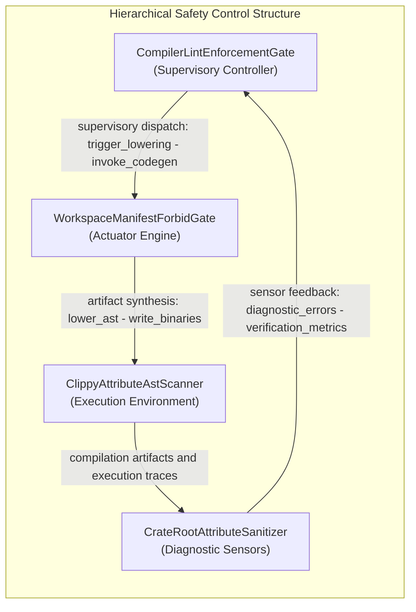
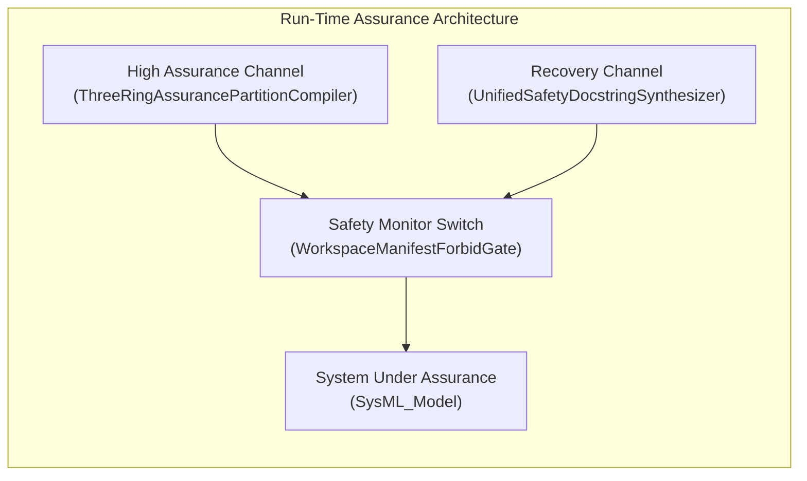

# Unified 8-Pillar STPA Safety & Risk Analysis Matrix

> **Primary Commercial Toolchain Integration Context:** MATLAB / Simulink / Stateflow / Embedded Coder
> **Safety Standards:** ISO/IEC/IEEE 15026-3 | ASTM F3269-17 RTA | MIL-STD-882E | Domain Integrity Framework

---

## System Losses

| Loss ID | Description |
| :--- | :--- |
| L-1 | Loss of safe function of CompilerLintEnforcementGate |

## System Hazards

| Hazard ID | Associated Control Action | Controller |
| :--- | :--- | :--- |
| H-1 | ExecuteCargoClippyWorkspaceAllTargets | CompilerLintEnforcementGate |
| H-2 | ReadWorkspaceLintsClippyForbidTable | CompilerLintEnforcementGate |
| H-3 | ExecuteVerifyBaselineNoDomain | CompilerLintEnforcementGate |
| H-4 | RunScanClippyAllowTokensOn | CompilerLintEnforcementGate |
| H-5 | ExecuteIngestSysmlSchemaBlueprint01 | CompilerLintEnforcementGate |
| H-6 | check_compiler_ast_purity | CompilerLintEnforcementGate |
| H-7 | mask_literals_and_comments | CompilerLintEnforcementGate |
| H-8 | contains_direct_range_slice | CompilerLintEnforcementGate |
| H-9 | audit_fail_closed_io_patterns | CompilerLintEnforcementGate |
| H-10 | audit_test_integrity_and_anti_gaming | CompilerLintEnforcementGate |
| H-11 | audit_ssot_symbol_deduplication | CompilerLintEnforcementGate |
| H-12 | scan_all | CompilerLintEnforcementGate |
| H-13 | parse_package_or_file | CompilerLintEnforcementGate |
| H-14 | ParseTypeExprAndParseTransition | CompilerLintEnforcementGate |
| H-15 | verify_bijective_ast_roundtrip | CompilerLintEnforcementGate |
| H-16 | ast_orig_to_sysml | CompilerLintEnforcementGate |
| H-17 | AssertAstOrigEqualsAstReparsed | CompilerLintEnforcementGate |
| H-18 | CompileSysmlForwardSyncDocs | CompilerLintEnforcementGate |
| H-19 | ResolveParentEpicByPkgName | CompilerLintEnforcementGate |
| H-20 | BindAllPackageStoriesToUse | CompilerLintEnforcementGate |
| H-21 | EmitSymmetricActionDefSignaturesAndE1 | CompilerLintEnforcementGate |
| H-22 | CompileSysmlEmitIcdDocsInterfaces | CompilerLintEnforcementGate |
| H-23 | ProjectNxNConnectionDefMatrixAndFlowDef | CompilerLintEnforcementGate |
| H-24 | CompileSysmlEmitWbsDocsManagement | CompilerLintEnforcementGate |
| H-25 | SynthesizeMilStd881eTreeAnd | CompilerLintEnforcementGate |
| H-26 | ReconcileBacklogReconcileDocsDirDocs | CompilerLintEnforcementGate |
| H-27 | ParseCommonMarkTablesWithInHtml | CompilerLintEnforcementGate |
| H-28 | ReconcileChecklistsWithParentInclusiveEpic | CompilerLintEnforcementGate |
| H-29 | CompileSysmlReverseSyncDocs | CompilerLintEnforcementGate |
| H-30 | MergeExtractedEntitiesIntoOwningSubpackages | CompilerLintEnforcementGate |
| H-31 | RunCompileSysmlInjectSafetyDocstrings | CompilerLintEnforcementGate |
| H-32 | ScanSourceLinesViaRustDartLexStateAnd | CompilerLintEnforcementGate |
| H-33 | ResolveSchemaContextViaCollectAll | CompilerLintEnforcementGate |
| H-34 | RunVerifyBaselineNoDomain | CompilerLintEnforcementGate |
| H-35 | TokenizeRsAndDartFilesUsing | CompilerLintEnforcementGate |
| H-36 | RunIngestSysmlSchemaBlueprint05 | CompilerLintEnforcementGate |
| H-37 | VerifyBaselineAuditCodePathCrates | CompilerLintEnforcementGate |
| H-38 | ParseRustSourceAstAndParse | CompilerLintEnforcementGate |
| H-39 | EvaluateSourceFilePillarsAcross5 | CompilerLintEnforcementGate |
| H-40 | synthesize_defect_dossier_markdown | CompilerLintEnforcementGate |
| H-41 | run_check_defect | CompilerLintEnforcementGate |
| H-42 | Execute12CheckValidateDefectDossier | CompilerLintEnforcementGate |
| H-43 | GhIssueCreateOrGhIssue | CompilerLintEnforcementGate |
| H-44 | GhIssueViewJsonTitleBody | CompilerLintEnforcementGate |
| H-45 | verifyDagAndLayers | CompilerLintEnforcementGate |
| H-46 | partitionAndHoist | CompilerLintEnforcementGate |
| H-47 | emitModularRustTree | CompilerLintEnforcementGate |
| H-48 | emitModularFlutterTree | CompilerLintEnforcementGate |
| H-49 | verifyFixedPointHash | CompilerLintEnforcementGate |
| H-50 | ExecuteFourLevelLoweringPipeline | CompilerLintEnforcementGate |
| H-51 | verifyOfflineLockedBuild | CompilerLintEnforcementGate |
| H-52 | listRustItems | CompilerLintEnforcementGate |
| H-53 | extractRustModule | CompilerLintEnforcementGate |
| H-54 | verifyStageFixedPoint | CompilerLintEnforcementGate |
| H-55 | formatNdjsonLine | CompilerLintEnforcementGate |
| H-56 | analyzeMetrics | CompilerLintEnforcementGate |
| H-57 | runStableClippyGate | CompilerLintEnforcementGate |
| H-58 | verifyMirAllocationsAndReqs | CompilerLintEnforcementGate |
| H-59 | synthesizeFrbIcdFacade | CompilerLintEnforcementGate |
| H-60 | runMiriAndDartGate | CompilerLintEnforcementGate |
| H-61 | synthesizeKaniProofModule | CompilerLintEnforcementGate |
| H-62 | runKaniCbmcProofs | CompilerLintEnforcementGate |
| H-63 | ingestPolyglotToHir | CompilerLintEnforcementGate |
| H-64 | parseLosslessSysmlCst | CompilerLintEnforcementGate |
| H-65 | evaluateSafetyAndEarlyCutoff | CompilerLintEnforcementGate |
| H-66 | computeBidirectionalSplice | CompilerLintEnforcementGate |
| H-67 | verifyPostSpliceCst | CompilerLintEnforcementGate |
| H-68 | verifyToolchainAndStageParity | CompilerLintEnforcementGate |
| H-69 | synthesizeThreeRingWorkspace | CompilerLintEnforcementGate |
| H-70 | attachAndAuditFlsTraceability | CompilerLintEnforcementGate |
| H-71 | auditCoreSubsetAndMcdcCoverage | CompilerLintEnforcementGate |
| H-72 | verifyRingBoundariesAndMonitor | CompilerLintEnforcementGate |

## Hierarchical Control Structure Topology




---

## 4. Unsafe Control Actions (**UCA-1..N**)

Systematic identification across the 4 STPA guide word / failure mode categories:

1. **Not providing causes hazard**
2. **Providing causes hazard**
3. **Too early, too late, or out of order**
4. **Stopped too soon or applied too long**

Cartesian product of controlling part-def control actions across the
four canonical STPA guide-word categories.

| UCA ID | Controller | Control Action | Guide Word | Context | Hazard | Safety Constraint | Severity | Integrity Level |
| :--- | :--- | :--- | :--- | :--- | :--- | :--- | :--- | :--- |
| UCA-001 | CompilerLintEnforcementGate | ExecuteCargoClippyWorkspaceAllTargets | Not providing | CompilerLintEnforcementGate omits ExecuteCargoClippyWorkspaceAllTargets in active operational state across port CargoManifestInputPort while constraint C_MOD_01 (max_file_lines >= 50 and max_file_lines <= 400) demands intervention | H-1 | SC-001 | Catastrophic (Derived) | SIL-3 (Derived) |
| UCA-002 | CompilerLintEnforcementGate | ExecuteCargoClippyWorkspaceAllTargets | Providing | CompilerLintEnforcementGate issues ExecuteCargoClippyWorkspaceAllTargets in active operational state across port RustSourceTokenStreamPort violating constraint C_MOD_02 (max_items_per_file >= 1 and max_items_per_file <= 12) | H-1 | SC-002 | Catastrophic (Derived) | SIL-3 (Derived) |
| UCA-003 | CompilerLintEnforcementGate | ExecuteCargoClippyWorkspaceAllTargets | Too early / Too late / Out of order | CompilerLintEnforcementGate dispatches ExecuteCargoClippyWorkspaceAllTargets out of temporal sequence in active operational state via port CompilerDiagnosticOutputPort relative to constraint C_MOD_03 (max_cyclomatic_complexity >= 1 and max_cyclomatic_complexity <= 8) | H-1 | SC-003 | Critical (Derived) | SIL-2 (Derived) |
| UCA-004 | CompilerLintEnforcementGate | ExecuteCargoClippyWorkspaceAllTargets | Stopped too soon / Applied too long | CompilerLintEnforcementGate prematurely halts or latches ExecuteCargoClippyWorkspaceAllTargets in active operational state on port BaselineGateVerdictPort against constraint C_MOD_04 (stage_fixed_point_mismatch_files >= 0 and stage_fixed_point_mismatch_files <= 0) | H-1 | SC-004 | Critical (Derived) | SIL-2 (Derived) |
| UCA-005 | CompilerLintEnforcementGate | ReadWorkspaceLintsClippyForbidTable | Not providing | CompilerLintEnforcementGate omits ReadWorkspaceLintsClippyForbidTable in active operational state across port CargoManifestInputPort while constraint C_MOD_05 (runtime_llm_subagent_count >= 0 and runtime_llm_subagent_count <= 0) demands intervention | H-2 | SC-005 | Catastrophic (Derived) | SIL-3 (Derived) |
| UCA-006 | CompilerLintEnforcementGate | ReadWorkspaceLintsClippyForbidTable | Providing | CompilerLintEnforcementGate issues ReadWorkspaceLintsClippyForbidTable in active operational state across port RustSourceTokenStreamPort violating constraint ValidBoundsEnvelope (max_file_lines >= 50 and max_file_lines <= 400 and max_items_per_file >= 1 and max_items_per_file <= 12 and max_cyclomatic_complexity >= 1 and max_cyclomatic_complexity <= 8 and max_action_steps_per_stage >= 1 and max_action_steps_per_stage <= 8 and max_transitions_per_handler >= 1 and max_transitions_per_handler <= 8) | H-2 | SC-006 | Catastrophic (Derived) | SIL-3 (Derived) |
| UCA-007 | CompilerLintEnforcementGate | ReadWorkspaceLintsClippyForbidTable | Too early / Too late / Out of order | CompilerLintEnforcementGate dispatches ReadWorkspaceLintsClippyForbidTable out of temporal sequence in active operational state via port CompilerDiagnosticOutputPort relative to constraint NonUpwardLayerImport (importer_tier >= 1 and importer_tier <= 3 and imported_tier >= 1 and imported_tier <= 3 and importer_tier >= imported_tier) | H-2 | SC-007 | Critical (Derived) | SIL-2 (Derived) |
| UCA-008 | CompilerLintEnforcementGate | ReadWorkspaceLintsClippyForbidTable | Stopped too soon / Applied too long | CompilerLintEnforcementGate prematurely halts or latches ReadWorkspaceLintsClippyForbidTable in active operational state on port BaselineGateVerdictPort against constraint UnitObeysBounds (line_count >= 1 and line_count <= max_file_lines and item_count >= 1 and item_count <= max_items_per_file and max_function_vg >= 1 and max_function_vg <= max_cyclomatic_complexity) | H-2 | SC-008 | Critical (Derived) | SIL-2 (Derived) |
| UCA-009 | CompilerLintEnforcementGate | ExecuteVerifyBaselineNoDomain | Not providing | CompilerLintEnforcementGate omits ExecuteVerifyBaselineNoDomain in active operational state across port CargoManifestInputPort while constraint LoweringLevelsComplete (active_level_count == 4) demands intervention | H-3 | SC-009 | Catastrophic (Derived) | SIL-3 (Derived) |
| UCA-010 | CompilerLintEnforcementGate | ExecuteVerifyBaselineNoDomain | Providing | CompilerLintEnforcementGate issues ExecuteVerifyBaselineNoDomain in active operational state across port RustSourceTokenStreamPort violating constraint FixedPointBootstrapParity (stage_mismatch_files == 0) | H-3 | SC-010 | Catastrophic (Derived) | SIL-3 (Derived) |
| UCA-011 | CompilerLintEnforcementGate | ExecuteVerifyBaselineNoDomain | Too early / Too late / Out of order | CompilerLintEnforcementGate dispatches ExecuteVerifyBaselineNoDomain out of temporal sequence in active operational state via port CompilerDiagnosticOutputPort relative to constraint C_CST_01 (max_fn_exec_sloc >= 1 and max_fn_exec_sloc <= 50) | H-3 | SC-011 | Critical (Derived) | SIL-2 (Derived) |
| UCA-012 | CompilerLintEnforcementGate | ExecuteVerifyBaselineNoDomain | Stopped too soon / Applied too long | CompilerLintEnforcementGate prematurely halts or latches ExecuteVerifyBaselineNoDomain in active operational state on port BaselineGateVerdictPort against constraint C_CST_02 (max_fn_param_count >= 0 and max_fn_param_count <= 5) | H-3 | SC-012 | Critical (Derived) | SIL-2 (Derived) |
| UCA-013 | CompilerLintEnforcementGate | RunScanClippyAllowTokensOn | Not providing | CompilerLintEnforcementGate omits RunScanClippyAllowTokensOn in active operational state across port CargoManifestInputPort while constraint C_CST_03 (max_mut_bool_flags >= 0 and max_mut_bool_flags <= 0) demands intervention | H-4 | SC-013 | Catastrophic (Derived) | SIL-3 (Derived) |
| UCA-014 | CompilerLintEnforcementGate | RunScanClippyAllowTokensOn | Providing | CompilerLintEnforcementGate issues RunScanClippyAllowTokensOn in active operational state across port RustSourceTokenStreamPort violating constraint C_CST_04 (stage_fixed_point_mismatch_files >= 0 and stage_fixed_point_mismatch_files <= 0) | H-4 | SC-014 | Catastrophic (Derived) | SIL-3 (Derived) |
| UCA-015 | CompilerLintEnforcementGate | RunScanClippyAllowTokensOn | Too early / Too late / Out of order | CompilerLintEnforcementGate dispatches RunScanClippyAllowTokensOn out of temporal sequence in active operational state via port CompilerDiagnosticOutputPort relative to constraint C_CST_05 (runtime_llm_token_count >= 0 and runtime_llm_token_count <= 0) | H-4 | SC-015 | Critical (Derived) | SIL-2 (Derived) |
| UCA-016 | CompilerLintEnforcementGate | RunScanClippyAllowTokensOn | Stopped too soon / Applied too long | CompilerLintEnforcementGate prematurely halts or latches RunScanClippyAllowTokensOn in active operational state on port BaselineGateVerdictPort against constraint C_CST_06 (tier_bc_max_doc_lines >= 2 and tier_bc_max_doc_lines <= 2) | H-4 | SC-016 | Critical (Derived) | SIL-2 (Derived) |
| UCA-017 | CompilerLintEnforcementGate | ExecuteIngestSysmlSchemaBlueprint01 | Not providing | CompilerLintEnforcementGate omits ExecuteIngestSysmlSchemaBlueprint01 in active operational state across port CargoManifestInputPort while constraint C_VER_01 (too_many_lines_threshold >= 1 and too_many_lines_threshold <= 80) demands intervention | H-5 | SC-017 | Catastrophic (Derived) | SIL-3 (Derived) |
| UCA-018 | CompilerLintEnforcementGate | ExecuteIngestSysmlSchemaBlueprint01 | Providing | CompilerLintEnforcementGate issues ExecuteIngestSysmlSchemaBlueprint01 in active operational state across port RustSourceTokenStreamPort violating constraint C_VER_02 (too_many_arguments_threshold >= 0 and too_many_arguments_threshold <= 5) | H-5 | SC-018 | Catastrophic (Derived) | SIL-3 (Derived) |
| UCA-019 | CompilerLintEnforcementGate | ExecuteIngestSysmlSchemaBlueprint01 | Too early / Too late / Out of order | CompilerLintEnforcementGate dispatches ExecuteIngestSysmlSchemaBlueprint01 out of temporal sequence in active operational state via port CompilerDiagnosticOutputPort relative to constraint C_VER_03 (max_rt_heap_allocations >= 0 and max_rt_heap_allocations <= 0) | H-5 | SC-019 | Critical (Derived) | SIL-2 (Derived) |
| UCA-020 | CompilerLintEnforcementGate | ExecuteIngestSysmlSchemaBlueprint01 | Stopped too soon / Applied too long | CompilerLintEnforcementGate prematurely halts or latches ExecuteIngestSysmlSchemaBlueprint01 in active operational state on port BaselineGateVerdictPort against constraint C_VER_04 (max_miri_ub_violations >= 0 and max_miri_ub_violations <= 0) | H-5 | SC-020 | Critical (Derived) | SIL-2 (Derived) |
| UCA-021 | CompilerLintEnforcementGate | check_compiler_ast_purity | Not providing | CompilerLintEnforcementGate omits check_compiler_ast_purity in active operational state across port CargoManifestInputPort while constraint C_VER_05 (max_kani_counterexamples >= 0 and max_kani_counterexamples <= 0) demands intervention | H-6 | SC-021 | Catastrophic (Derived) | SIL-3 (Derived) |
| UCA-022 | CompilerLintEnforcementGate | check_compiler_ast_purity | Providing | CompilerLintEnforcementGate issues check_compiler_ast_purity in active operational state across port RustSourceTokenStreamPort violating constraint C_VER_06 (default_kani_unwind_bound >= 1 and default_kani_unwind_bound <= 64) | H-6 | SC-022 | Catastrophic (Derived) | SIL-3 (Derived) |
| UCA-023 | CompilerLintEnforcementGate | check_compiler_ast_purity | Too early / Too late / Out of order | CompilerLintEnforcementGate dispatches check_compiler_ast_purity out of temporal sequence in active operational state via port CompilerDiagnosticOutputPort relative to constraint C_INC_01 (max_ast_depth >= 1 and max_ast_depth <= 64) | H-6 | SC-023 | Critical (Derived) | SIL-2 (Derived) |
| UCA-024 | CompilerLintEnforcementGate | check_compiler_ast_purity | Stopped too soon / Applied too long | CompilerLintEnforcementGate prematurely halts or latches check_compiler_ast_purity in active operational state on port BaselineGateVerdictPort against constraint C_INC_02 (untouched_trivia_mutation_bytes >= 0 and untouched_trivia_mutation_bytes <= 0) | H-6 | SC-024 | Critical (Derived) | SIL-2 (Derived) |
| UCA-025 | CompilerLintEnforcementGate | mask_literals_and_comments | Not providing | CompilerLintEnforcementGate omits mask_literals_and_comments in active operational state across port CargoManifestInputPort while constraint C_INC_03 (stage_fixed_point_mismatch_files >= 0 and stage_fixed_point_mismatch_files <= 0) demands intervention | H-7 | SC-025 | Catastrophic (Derived) | SIL-3 (Derived) |
| UCA-026 | CompilerLintEnforcementGate | mask_literals_and_comments | Providing | CompilerLintEnforcementGate issues mask_literals_and_comments in active operational state across port RustSourceTokenStreamPort violating constraint C_INC_04 (query_layer_count >= 4 and query_layer_count <= 4) | H-7 | SC-026 | Catastrophic (Derived) | SIL-3 (Derived) |
| UCA-027 | CompilerLintEnforcementGate | mask_literals_and_comments | Too early / Too late / Out of order | CompilerLintEnforcementGate dispatches mask_literals_and_comments out of temporal sequence in active operational state via port CompilerDiagnosticOutputPort relative to constraint C_INC_05 (trivia_edit_downstream_recomputations >= 0 and trivia_edit_downstream_recomputations <= 0) | H-7 | SC-027 | Critical (Derived) | SIL-2 (Derived) |
| UCA-028 | CompilerLintEnforcementGate | mask_literals_and_comments | Stopped too soon / Applied too long | CompilerLintEnforcementGate prematurely halts or latches mask_literals_and_comments in active operational state on port BaselineGateVerdictPort against constraint C_INC_06 (polyglot_frontend_count >= 5 and polyglot_frontend_count <= 5) | H-7 | SC-028 | Critical (Derived) | SIL-2 (Derived) |
| UCA-029 | CompilerLintEnforcementGate | contains_direct_range_slice | Not providing | CompilerLintEnforcementGate omits contains_direct_range_slice in active operational state across port CargoManifestInputPort while constraint C_CERT_01 (max_toolchain_version_drift >= 0 and max_toolchain_version_drift <= 0) demands intervention | H-8 | SC-029 | Catastrophic (Derived) | SIL-3 (Derived) |
| UCA-030 | CompilerLintEnforcementGate | contains_direct_range_slice | Providing | CompilerLintEnforcementGate issues contains_direct_range_slice in active operational state across port RustSourceTokenStreamPort violating constraint C_CERT_02 (stage_fixed_point_mismatch_files >= 0 and stage_fixed_point_mismatch_files <= 0) | H-8 | SC-030 | Catastrophic (Derived) | SIL-3 (Derived) |
| UCA-031 | CompilerLintEnforcementGate | contains_direct_range_slice | Too early / Too late / Out of order | CompilerLintEnforcementGate dispatches contains_direct_range_slice out of temporal sequence in active operational state via port CompilerDiagnosticOutputPort relative to constraint C_CERT_03 (unmapped_fls_item_count >= 0 and unmapped_fls_item_count <= 0) | H-8 | SC-031 | Critical (Derived) | SIL-2 (Derived) |
| UCA-032 | CompilerLintEnforcementGate | contains_direct_range_slice | Stopped too soon / Applied too long | CompilerLintEnforcementGate prematurely halts or latches contains_direct_range_slice in active operational state on port BaselineGateVerdictPort against constraint C_CERT_04 (uncertified_core_symbol_count >= 0 and uncertified_core_symbol_count <= 0) | H-8 | SC-032 | Critical (Derived) | SIL-2 (Derived) |
| UCA-033 | CompilerLintEnforcementGate | audit_fail_closed_io_patterns | Not providing | CompilerLintEnforcementGate omits audit_fail_closed_io_patterns in active operational state across port CargoManifestInputPort while constraint C_CERT_05 (dal_a_mcdc_coverage_min_pct >= 100 and dal_a_mcdc_coverage_min_pct <= 100) demands intervention | H-9 | SC-033 | Catastrophic (Derived) | SIL-3 (Derived) |
| UCA-034 | CompilerLintEnforcementGate | audit_fail_closed_io_patterns | Providing | CompilerLintEnforcementGate issues audit_fail_closed_io_patterns in active operational state across port RustSourceTokenStreamPort violating constraint C_CERT_06 (assurance_ring_count >= 3 and assurance_ring_count <= 3) | H-9 | SC-034 | Catastrophic (Derived) | SIL-3 (Derived) |
| UCA-035 | CompilerLintEnforcementGate | audit_fail_closed_io_patterns | Too early / Too late / Out of order | CompilerLintEnforcementGate dispatches audit_fail_closed_io_patterns out of temporal sequence in active operational state via port CompilerDiagnosticOutputPort relative to constraint C_MOD_01 (max_file_lines >= 50 and max_file_lines <= 400) | H-9 | SC-035 | Critical (Derived) | SIL-2 (Derived) |
| UCA-036 | CompilerLintEnforcementGate | audit_fail_closed_io_patterns | Stopped too soon / Applied too long | CompilerLintEnforcementGate prematurely halts or latches audit_fail_closed_io_patterns in active operational state on port BaselineGateVerdictPort against constraint C_MOD_02 (max_items_per_file >= 1 and max_items_per_file <= 12) | H-9 | SC-036 | Critical (Derived) | SIL-2 (Derived) |
| UCA-037 | CompilerLintEnforcementGate | audit_test_integrity_and_anti_gaming | Not providing | CompilerLintEnforcementGate omits audit_test_integrity_and_anti_gaming in active operational state across port CargoManifestInputPort while constraint C_MOD_03 (max_cyclomatic_complexity >= 1 and max_cyclomatic_complexity <= 8) demands intervention | H-10 | SC-037 | Catastrophic (Derived) | SIL-3 (Derived) |
| UCA-038 | CompilerLintEnforcementGate | audit_test_integrity_and_anti_gaming | Providing | CompilerLintEnforcementGate issues audit_test_integrity_and_anti_gaming in active operational state across port RustSourceTokenStreamPort violating constraint C_MOD_04 (stage_fixed_point_mismatch_files >= 0 and stage_fixed_point_mismatch_files <= 0) | H-10 | SC-038 | Catastrophic (Derived) | SIL-3 (Derived) |
| UCA-039 | CompilerLintEnforcementGate | audit_test_integrity_and_anti_gaming | Too early / Too late / Out of order | CompilerLintEnforcementGate dispatches audit_test_integrity_and_anti_gaming out of temporal sequence in active operational state via port CompilerDiagnosticOutputPort relative to constraint C_MOD_05 (runtime_llm_subagent_count >= 0 and runtime_llm_subagent_count <= 0) | H-10 | SC-039 | Critical (Derived) | SIL-2 (Derived) |
| UCA-040 | CompilerLintEnforcementGate | audit_test_integrity_and_anti_gaming | Stopped too soon / Applied too long | CompilerLintEnforcementGate prematurely halts or latches audit_test_integrity_and_anti_gaming in active operational state on port BaselineGateVerdictPort against constraint ValidBoundsEnvelope (max_file_lines >= 50 and max_file_lines <= 400 and max_items_per_file >= 1 and max_items_per_file <= 12 and max_cyclomatic_complexity >= 1 and max_cyclomatic_complexity <= 8 and max_action_steps_per_stage >= 1 and max_action_steps_per_stage <= 8 and max_transitions_per_handler >= 1 and max_transitions_per_handler <= 8) | H-10 | SC-040 | Critical (Derived) | SIL-2 (Derived) |
| UCA-041 | CompilerLintEnforcementGate | audit_ssot_symbol_deduplication | Not providing | CompilerLintEnforcementGate omits audit_ssot_symbol_deduplication in active operational state across port CargoManifestInputPort while constraint NonUpwardLayerImport (importer_tier >= 1 and importer_tier <= 3 and imported_tier >= 1 and imported_tier <= 3 and importer_tier >= imported_tier) demands intervention | H-11 | SC-041 | Catastrophic (Derived) | SIL-3 (Derived) |
| UCA-042 | CompilerLintEnforcementGate | audit_ssot_symbol_deduplication | Providing | CompilerLintEnforcementGate issues audit_ssot_symbol_deduplication in active operational state across port RustSourceTokenStreamPort violating constraint UnitObeysBounds (line_count >= 1 and line_count <= max_file_lines and item_count >= 1 and item_count <= max_items_per_file and max_function_vg >= 1 and max_function_vg <= max_cyclomatic_complexity) | H-11 | SC-042 | Catastrophic (Derived) | SIL-3 (Derived) |
| UCA-043 | CompilerLintEnforcementGate | audit_ssot_symbol_deduplication | Too early / Too late / Out of order | CompilerLintEnforcementGate dispatches audit_ssot_symbol_deduplication out of temporal sequence in active operational state via port CompilerDiagnosticOutputPort relative to constraint LoweringLevelsComplete (active_level_count == 4) | H-11 | SC-043 | Critical (Derived) | SIL-2 (Derived) |
| UCA-044 | CompilerLintEnforcementGate | audit_ssot_symbol_deduplication | Stopped too soon / Applied too long | CompilerLintEnforcementGate prematurely halts or latches audit_ssot_symbol_deduplication in active operational state on port BaselineGateVerdictPort against constraint FixedPointBootstrapParity (stage_mismatch_files == 0) | H-11 | SC-044 | Critical (Derived) | SIL-2 (Derived) |
| UCA-045 | CompilerLintEnforcementGate | scan_all | Not providing | CompilerLintEnforcementGate omits scan_all in active operational state across port CargoManifestInputPort while constraint C_CST_01 (max_fn_exec_sloc >= 1 and max_fn_exec_sloc <= 50) demands intervention | H-12 | SC-045 | Catastrophic (Derived) | SIL-3 (Derived) |
| UCA-046 | CompilerLintEnforcementGate | scan_all | Providing | CompilerLintEnforcementGate issues scan_all in active operational state across port RustSourceTokenStreamPort violating constraint C_CST_02 (max_fn_param_count >= 0 and max_fn_param_count <= 5) | H-12 | SC-046 | Catastrophic (Derived) | SIL-3 (Derived) |
| UCA-047 | CompilerLintEnforcementGate | scan_all | Too early / Too late / Out of order | CompilerLintEnforcementGate dispatches scan_all out of temporal sequence in active operational state via port CompilerDiagnosticOutputPort relative to constraint C_CST_03 (max_mut_bool_flags >= 0 and max_mut_bool_flags <= 0) | H-12 | SC-047 | Critical (Derived) | SIL-2 (Derived) |
| UCA-048 | CompilerLintEnforcementGate | scan_all | Stopped too soon / Applied too long | CompilerLintEnforcementGate prematurely halts or latches scan_all in active operational state on port BaselineGateVerdictPort against constraint C_CST_04 (stage_fixed_point_mismatch_files >= 0 and stage_fixed_point_mismatch_files <= 0) | H-12 | SC-048 | Critical (Derived) | SIL-2 (Derived) |
| UCA-049 | CompilerLintEnforcementGate | parse_package_or_file | Not providing | CompilerLintEnforcementGate omits parse_package_or_file in active operational state across port CargoManifestInputPort while constraint C_CST_05 (runtime_llm_token_count >= 0 and runtime_llm_token_count <= 0) demands intervention | H-13 | SC-049 | Catastrophic (Derived) | SIL-3 (Derived) |
| UCA-050 | CompilerLintEnforcementGate | parse_package_or_file | Providing | CompilerLintEnforcementGate issues parse_package_or_file in active operational state across port RustSourceTokenStreamPort violating constraint C_CST_06 (tier_bc_max_doc_lines >= 2 and tier_bc_max_doc_lines <= 2) | H-13 | SC-050 | Catastrophic (Derived) | SIL-3 (Derived) |
| UCA-051 | CompilerLintEnforcementGate | parse_package_or_file | Too early / Too late / Out of order | CompilerLintEnforcementGate dispatches parse_package_or_file out of temporal sequence in active operational state via port CompilerDiagnosticOutputPort relative to constraint C_VER_01 (too_many_lines_threshold >= 1 and too_many_lines_threshold <= 80) | H-13 | SC-051 | Critical (Derived) | SIL-2 (Derived) |
| UCA-052 | CompilerLintEnforcementGate | parse_package_or_file | Stopped too soon / Applied too long | CompilerLintEnforcementGate prematurely halts or latches parse_package_or_file in active operational state on port BaselineGateVerdictPort against constraint C_VER_02 (too_many_arguments_threshold >= 0 and too_many_arguments_threshold <= 5) | H-13 | SC-052 | Critical (Derived) | SIL-2 (Derived) |
| UCA-053 | CompilerLintEnforcementGate | ParseTypeExprAndParseTransition | Not providing | CompilerLintEnforcementGate omits ParseTypeExprAndParseTransition in active operational state across port CargoManifestInputPort while constraint C_VER_03 (max_rt_heap_allocations >= 0 and max_rt_heap_allocations <= 0) demands intervention | H-14 | SC-053 | Catastrophic (Derived) | SIL-3 (Derived) |
| UCA-054 | CompilerLintEnforcementGate | ParseTypeExprAndParseTransition | Providing | CompilerLintEnforcementGate issues ParseTypeExprAndParseTransition in active operational state across port RustSourceTokenStreamPort violating constraint C_VER_04 (max_miri_ub_violations >= 0 and max_miri_ub_violations <= 0) | H-14 | SC-054 | Catastrophic (Derived) | SIL-3 (Derived) |
| UCA-055 | CompilerLintEnforcementGate | ParseTypeExprAndParseTransition | Too early / Too late / Out of order | CompilerLintEnforcementGate dispatches ParseTypeExprAndParseTransition out of temporal sequence in active operational state via port CompilerDiagnosticOutputPort relative to constraint C_VER_05 (max_kani_counterexamples >= 0 and max_kani_counterexamples <= 0) | H-14 | SC-055 | Critical (Derived) | SIL-2 (Derived) |
| UCA-056 | CompilerLintEnforcementGate | ParseTypeExprAndParseTransition | Stopped too soon / Applied too long | CompilerLintEnforcementGate prematurely halts or latches ParseTypeExprAndParseTransition in active operational state on port BaselineGateVerdictPort against constraint C_VER_06 (default_kani_unwind_bound >= 1 and default_kani_unwind_bound <= 64) | H-14 | SC-056 | Critical (Derived) | SIL-2 (Derived) |
| UCA-057 | CompilerLintEnforcementGate | verify_bijective_ast_roundtrip | Not providing | CompilerLintEnforcementGate omits verify_bijective_ast_roundtrip in active operational state across port CargoManifestInputPort while constraint C_INC_01 (max_ast_depth >= 1 and max_ast_depth <= 64) demands intervention | H-15 | SC-057 | Catastrophic (Derived) | SIL-3 (Derived) |
| UCA-058 | CompilerLintEnforcementGate | verify_bijective_ast_roundtrip | Providing | CompilerLintEnforcementGate issues verify_bijective_ast_roundtrip in active operational state across port RustSourceTokenStreamPort violating constraint C_INC_02 (untouched_trivia_mutation_bytes >= 0 and untouched_trivia_mutation_bytes <= 0) | H-15 | SC-058 | Catastrophic (Derived) | SIL-3 (Derived) |
| UCA-059 | CompilerLintEnforcementGate | verify_bijective_ast_roundtrip | Too early / Too late / Out of order | CompilerLintEnforcementGate dispatches verify_bijective_ast_roundtrip out of temporal sequence in active operational state via port CompilerDiagnosticOutputPort relative to constraint C_INC_03 (stage_fixed_point_mismatch_files >= 0 and stage_fixed_point_mismatch_files <= 0) | H-15 | SC-059 | Critical (Derived) | SIL-2 (Derived) |
| UCA-060 | CompilerLintEnforcementGate | verify_bijective_ast_roundtrip | Stopped too soon / Applied too long | CompilerLintEnforcementGate prematurely halts or latches verify_bijective_ast_roundtrip in active operational state on port BaselineGateVerdictPort against constraint C_INC_04 (query_layer_count >= 4 and query_layer_count <= 4) | H-15 | SC-060 | Critical (Derived) | SIL-2 (Derived) |
| UCA-061 | CompilerLintEnforcementGate | ast_orig_to_sysml | Not providing | CompilerLintEnforcementGate omits ast_orig_to_sysml in active operational state across port CargoManifestInputPort while constraint C_INC_05 (trivia_edit_downstream_recomputations >= 0 and trivia_edit_downstream_recomputations <= 0) demands intervention | H-16 | SC-061 | Catastrophic (Derived) | SIL-3 (Derived) |
| UCA-062 | CompilerLintEnforcementGate | ast_orig_to_sysml | Providing | CompilerLintEnforcementGate issues ast_orig_to_sysml in active operational state across port RustSourceTokenStreamPort violating constraint C_INC_06 (polyglot_frontend_count >= 5 and polyglot_frontend_count <= 5) | H-16 | SC-062 | Catastrophic (Derived) | SIL-3 (Derived) |
| UCA-063 | CompilerLintEnforcementGate | ast_orig_to_sysml | Too early / Too late / Out of order | CompilerLintEnforcementGate dispatches ast_orig_to_sysml out of temporal sequence in active operational state via port CompilerDiagnosticOutputPort relative to constraint C_CERT_01 (max_toolchain_version_drift >= 0 and max_toolchain_version_drift <= 0) | H-16 | SC-063 | Critical (Derived) | SIL-2 (Derived) |
| UCA-064 | CompilerLintEnforcementGate | ast_orig_to_sysml | Stopped too soon / Applied too long | CompilerLintEnforcementGate prematurely halts or latches ast_orig_to_sysml in active operational state on port BaselineGateVerdictPort against constraint C_CERT_02 (stage_fixed_point_mismatch_files >= 0 and stage_fixed_point_mismatch_files <= 0) | H-16 | SC-064 | Critical (Derived) | SIL-2 (Derived) |
| UCA-065 | CompilerLintEnforcementGate | AssertAstOrigEqualsAstReparsed | Not providing | CompilerLintEnforcementGate omits AssertAstOrigEqualsAstReparsed in active operational state across port CargoManifestInputPort while constraint C_CERT_03 (unmapped_fls_item_count >= 0 and unmapped_fls_item_count <= 0) demands intervention | H-17 | SC-065 | Catastrophic (Derived) | SIL-3 (Derived) |
| UCA-066 | CompilerLintEnforcementGate | AssertAstOrigEqualsAstReparsed | Providing | CompilerLintEnforcementGate issues AssertAstOrigEqualsAstReparsed in active operational state across port RustSourceTokenStreamPort violating constraint C_CERT_04 (uncertified_core_symbol_count >= 0 and uncertified_core_symbol_count <= 0) | H-17 | SC-066 | Catastrophic (Derived) | SIL-3 (Derived) |
| UCA-067 | CompilerLintEnforcementGate | AssertAstOrigEqualsAstReparsed | Too early / Too late / Out of order | CompilerLintEnforcementGate dispatches AssertAstOrigEqualsAstReparsed out of temporal sequence in active operational state via port CompilerDiagnosticOutputPort relative to constraint C_CERT_05 (dal_a_mcdc_coverage_min_pct >= 100 and dal_a_mcdc_coverage_min_pct <= 100) | H-17 | SC-067 | Critical (Derived) | SIL-2 (Derived) |
| UCA-068 | CompilerLintEnforcementGate | AssertAstOrigEqualsAstReparsed | Stopped too soon / Applied too long | CompilerLintEnforcementGate prematurely halts or latches AssertAstOrigEqualsAstReparsed in active operational state on port BaselineGateVerdictPort against constraint C_CERT_06 (assurance_ring_count >= 3 and assurance_ring_count <= 3) | H-17 | SC-068 | Critical (Derived) | SIL-2 (Derived) |
| UCA-069 | CompilerLintEnforcementGate | CompileSysmlForwardSyncDocs | Not providing | CompilerLintEnforcementGate omits CompileSysmlForwardSyncDocs in active operational state across port CargoManifestInputPort while constraint C_MOD_01 (max_file_lines >= 50 and max_file_lines <= 400) demands intervention | H-18 | SC-069 | Catastrophic (Derived) | SIL-3 (Derived) |
| UCA-070 | CompilerLintEnforcementGate | CompileSysmlForwardSyncDocs | Providing | CompilerLintEnforcementGate issues CompileSysmlForwardSyncDocs in active operational state across port RustSourceTokenStreamPort violating constraint C_MOD_02 (max_items_per_file >= 1 and max_items_per_file <= 12) | H-18 | SC-070 | Catastrophic (Derived) | SIL-3 (Derived) |
| UCA-071 | CompilerLintEnforcementGate | CompileSysmlForwardSyncDocs | Too early / Too late / Out of order | CompilerLintEnforcementGate dispatches CompileSysmlForwardSyncDocs out of temporal sequence in active operational state via port CompilerDiagnosticOutputPort relative to constraint C_MOD_03 (max_cyclomatic_complexity >= 1 and max_cyclomatic_complexity <= 8) | H-18 | SC-071 | Critical (Derived) | SIL-2 (Derived) |
| UCA-072 | CompilerLintEnforcementGate | CompileSysmlForwardSyncDocs | Stopped too soon / Applied too long | CompilerLintEnforcementGate prematurely halts or latches CompileSysmlForwardSyncDocs in active operational state on port BaselineGateVerdictPort against constraint C_MOD_04 (stage_fixed_point_mismatch_files >= 0 and stage_fixed_point_mismatch_files <= 0) | H-18 | SC-072 | Critical (Derived) | SIL-2 (Derived) |
| UCA-073 | CompilerLintEnforcementGate | ResolveParentEpicByPkgName | Not providing | CompilerLintEnforcementGate omits ResolveParentEpicByPkgName in active operational state across port CargoManifestInputPort while constraint C_MOD_05 (runtime_llm_subagent_count >= 0 and runtime_llm_subagent_count <= 0) demands intervention | H-19 | SC-073 | Catastrophic (Derived) | SIL-3 (Derived) |
| UCA-074 | CompilerLintEnforcementGate | ResolveParentEpicByPkgName | Providing | CompilerLintEnforcementGate issues ResolveParentEpicByPkgName in active operational state across port RustSourceTokenStreamPort violating constraint ValidBoundsEnvelope (max_file_lines >= 50 and max_file_lines <= 400 and max_items_per_file >= 1 and max_items_per_file <= 12 and max_cyclomatic_complexity >= 1 and max_cyclomatic_complexity <= 8 and max_action_steps_per_stage >= 1 and max_action_steps_per_stage <= 8 and max_transitions_per_handler >= 1 and max_transitions_per_handler <= 8) | H-19 | SC-074 | Catastrophic (Derived) | SIL-3 (Derived) |
| UCA-075 | CompilerLintEnforcementGate | ResolveParentEpicByPkgName | Too early / Too late / Out of order | CompilerLintEnforcementGate dispatches ResolveParentEpicByPkgName out of temporal sequence in active operational state via port CompilerDiagnosticOutputPort relative to constraint NonUpwardLayerImport (importer_tier >= 1 and importer_tier <= 3 and imported_tier >= 1 and imported_tier <= 3 and importer_tier >= imported_tier) | H-19 | SC-075 | Critical (Derived) | SIL-2 (Derived) |
| UCA-076 | CompilerLintEnforcementGate | ResolveParentEpicByPkgName | Stopped too soon / Applied too long | CompilerLintEnforcementGate prematurely halts or latches ResolveParentEpicByPkgName in active operational state on port BaselineGateVerdictPort against constraint UnitObeysBounds (line_count >= 1 and line_count <= max_file_lines and item_count >= 1 and item_count <= max_items_per_file and max_function_vg >= 1 and max_function_vg <= max_cyclomatic_complexity) | H-19 | SC-076 | Critical (Derived) | SIL-2 (Derived) |
| UCA-077 | CompilerLintEnforcementGate | BindAllPackageStoriesToUse | Not providing | CompilerLintEnforcementGate omits BindAllPackageStoriesToUse in active operational state across port CargoManifestInputPort while constraint LoweringLevelsComplete (active_level_count == 4) demands intervention | H-20 | SC-077 | Catastrophic (Derived) | SIL-3 (Derived) |
| UCA-078 | CompilerLintEnforcementGate | BindAllPackageStoriesToUse | Providing | CompilerLintEnforcementGate issues BindAllPackageStoriesToUse in active operational state across port RustSourceTokenStreamPort violating constraint FixedPointBootstrapParity (stage_mismatch_files == 0) | H-20 | SC-078 | Catastrophic (Derived) | SIL-3 (Derived) |
| UCA-079 | CompilerLintEnforcementGate | BindAllPackageStoriesToUse | Too early / Too late / Out of order | CompilerLintEnforcementGate dispatches BindAllPackageStoriesToUse out of temporal sequence in active operational state via port CompilerDiagnosticOutputPort relative to constraint C_CST_01 (max_fn_exec_sloc >= 1 and max_fn_exec_sloc <= 50) | H-20 | SC-079 | Critical (Derived) | SIL-2 (Derived) |
| UCA-080 | CompilerLintEnforcementGate | BindAllPackageStoriesToUse | Stopped too soon / Applied too long | CompilerLintEnforcementGate prematurely halts or latches BindAllPackageStoriesToUse in active operational state on port BaselineGateVerdictPort against constraint C_CST_02 (max_fn_param_count >= 0 and max_fn_param_count <= 5) | H-20 | SC-080 | Critical (Derived) | SIL-2 (Derived) |
| UCA-081 | CompilerLintEnforcementGate | EmitSymmetricActionDefSignaturesAndE1 | Not providing | CompilerLintEnforcementGate omits EmitSymmetricActionDefSignaturesAndE1 in active operational state across port CargoManifestInputPort while constraint C_CST_03 (max_mut_bool_flags >= 0 and max_mut_bool_flags <= 0) demands intervention | H-21 | SC-081 | Catastrophic (Derived) | SIL-3 (Derived) |
| UCA-082 | CompilerLintEnforcementGate | EmitSymmetricActionDefSignaturesAndE1 | Providing | CompilerLintEnforcementGate issues EmitSymmetricActionDefSignaturesAndE1 in active operational state across port RustSourceTokenStreamPort violating constraint C_CST_04 (stage_fixed_point_mismatch_files >= 0 and stage_fixed_point_mismatch_files <= 0) | H-21 | SC-082 | Catastrophic (Derived) | SIL-3 (Derived) |
| UCA-083 | CompilerLintEnforcementGate | EmitSymmetricActionDefSignaturesAndE1 | Too early / Too late / Out of order | CompilerLintEnforcementGate dispatches EmitSymmetricActionDefSignaturesAndE1 out of temporal sequence in active operational state via port CompilerDiagnosticOutputPort relative to constraint C_CST_05 (runtime_llm_token_count >= 0 and runtime_llm_token_count <= 0) | H-21 | SC-083 | Critical (Derived) | SIL-2 (Derived) |
| UCA-084 | CompilerLintEnforcementGate | EmitSymmetricActionDefSignaturesAndE1 | Stopped too soon / Applied too long | CompilerLintEnforcementGate prematurely halts or latches EmitSymmetricActionDefSignaturesAndE1 in active operational state on port BaselineGateVerdictPort against constraint C_CST_06 (tier_bc_max_doc_lines >= 2 and tier_bc_max_doc_lines <= 2) | H-21 | SC-084 | Critical (Derived) | SIL-2 (Derived) |
| UCA-085 | CompilerLintEnforcementGate | CompileSysmlEmitIcdDocsInterfaces | Not providing | CompilerLintEnforcementGate omits CompileSysmlEmitIcdDocsInterfaces in active operational state across port CargoManifestInputPort while constraint C_VER_01 (too_many_lines_threshold >= 1 and too_many_lines_threshold <= 80) demands intervention | H-22 | SC-085 | Catastrophic (Derived) | SIL-3 (Derived) |
| UCA-086 | CompilerLintEnforcementGate | CompileSysmlEmitIcdDocsInterfaces | Providing | CompilerLintEnforcementGate issues CompileSysmlEmitIcdDocsInterfaces in active operational state across port RustSourceTokenStreamPort violating constraint C_VER_02 (too_many_arguments_threshold >= 0 and too_many_arguments_threshold <= 5) | H-22 | SC-086 | Catastrophic (Derived) | SIL-3 (Derived) |
| UCA-087 | CompilerLintEnforcementGate | CompileSysmlEmitIcdDocsInterfaces | Too early / Too late / Out of order | CompilerLintEnforcementGate dispatches CompileSysmlEmitIcdDocsInterfaces out of temporal sequence in active operational state via port CompilerDiagnosticOutputPort relative to constraint C_VER_03 (max_rt_heap_allocations >= 0 and max_rt_heap_allocations <= 0) | H-22 | SC-087 | Critical (Derived) | SIL-2 (Derived) |
| UCA-088 | CompilerLintEnforcementGate | CompileSysmlEmitIcdDocsInterfaces | Stopped too soon / Applied too long | CompilerLintEnforcementGate prematurely halts or latches CompileSysmlEmitIcdDocsInterfaces in active operational state on port BaselineGateVerdictPort against constraint C_VER_04 (max_miri_ub_violations >= 0 and max_miri_ub_violations <= 0) | H-22 | SC-088 | Critical (Derived) | SIL-2 (Derived) |
| UCA-089 | CompilerLintEnforcementGate | ProjectNxNConnectionDefMatrixAndFlowDef | Not providing | CompilerLintEnforcementGate omits ProjectNxNConnectionDefMatrixAndFlowDef in active operational state across port CargoManifestInputPort while constraint C_VER_05 (max_kani_counterexamples >= 0 and max_kani_counterexamples <= 0) demands intervention | H-23 | SC-089 | Catastrophic (Derived) | SIL-3 (Derived) |
| UCA-090 | CompilerLintEnforcementGate | ProjectNxNConnectionDefMatrixAndFlowDef | Providing | CompilerLintEnforcementGate issues ProjectNxNConnectionDefMatrixAndFlowDef in active operational state across port RustSourceTokenStreamPort violating constraint C_VER_06 (default_kani_unwind_bound >= 1 and default_kani_unwind_bound <= 64) | H-23 | SC-090 | Catastrophic (Derived) | SIL-3 (Derived) |
| UCA-091 | CompilerLintEnforcementGate | ProjectNxNConnectionDefMatrixAndFlowDef | Too early / Too late / Out of order | CompilerLintEnforcementGate dispatches ProjectNxNConnectionDefMatrixAndFlowDef out of temporal sequence in active operational state via port CompilerDiagnosticOutputPort relative to constraint C_INC_01 (max_ast_depth >= 1 and max_ast_depth <= 64) | H-23 | SC-091 | Critical (Derived) | SIL-2 (Derived) |
| UCA-092 | CompilerLintEnforcementGate | ProjectNxNConnectionDefMatrixAndFlowDef | Stopped too soon / Applied too long | CompilerLintEnforcementGate prematurely halts or latches ProjectNxNConnectionDefMatrixAndFlowDef in active operational state on port BaselineGateVerdictPort against constraint C_INC_02 (untouched_trivia_mutation_bytes >= 0 and untouched_trivia_mutation_bytes <= 0) | H-23 | SC-092 | Critical (Derived) | SIL-2 (Derived) |
| UCA-093 | CompilerLintEnforcementGate | CompileSysmlEmitWbsDocsManagement | Not providing | CompilerLintEnforcementGate omits CompileSysmlEmitWbsDocsManagement in active operational state across port CargoManifestInputPort while constraint C_INC_03 (stage_fixed_point_mismatch_files >= 0 and stage_fixed_point_mismatch_files <= 0) demands intervention | H-24 | SC-093 | Catastrophic (Derived) | SIL-3 (Derived) |
| UCA-094 | CompilerLintEnforcementGate | CompileSysmlEmitWbsDocsManagement | Providing | CompilerLintEnforcementGate issues CompileSysmlEmitWbsDocsManagement in active operational state across port RustSourceTokenStreamPort violating constraint C_INC_04 (query_layer_count >= 4 and query_layer_count <= 4) | H-24 | SC-094 | Catastrophic (Derived) | SIL-3 (Derived) |
| UCA-095 | CompilerLintEnforcementGate | CompileSysmlEmitWbsDocsManagement | Too early / Too late / Out of order | CompilerLintEnforcementGate dispatches CompileSysmlEmitWbsDocsManagement out of temporal sequence in active operational state via port CompilerDiagnosticOutputPort relative to constraint C_INC_05 (trivia_edit_downstream_recomputations >= 0 and trivia_edit_downstream_recomputations <= 0) | H-24 | SC-095 | Critical (Derived) | SIL-2 (Derived) |
| UCA-096 | CompilerLintEnforcementGate | CompileSysmlEmitWbsDocsManagement | Stopped too soon / Applied too long | CompilerLintEnforcementGate prematurely halts or latches CompileSysmlEmitWbsDocsManagement in active operational state on port BaselineGateVerdictPort against constraint C_INC_06 (polyglot_frontend_count >= 5 and polyglot_frontend_count <= 5) | H-24 | SC-096 | Critical (Derived) | SIL-2 (Derived) |
| UCA-097 | CompilerLintEnforcementGate | SynthesizeMilStd881eTreeAnd | Not providing | CompilerLintEnforcementGate omits SynthesizeMilStd881eTreeAnd in active operational state across port CargoManifestInputPort while constraint C_CERT_01 (max_toolchain_version_drift >= 0 and max_toolchain_version_drift <= 0) demands intervention | H-25 | SC-097 | Catastrophic (Derived) | SIL-3 (Derived) |
| UCA-098 | CompilerLintEnforcementGate | SynthesizeMilStd881eTreeAnd | Providing | CompilerLintEnforcementGate issues SynthesizeMilStd881eTreeAnd in active operational state across port RustSourceTokenStreamPort violating constraint C_CERT_02 (stage_fixed_point_mismatch_files >= 0 and stage_fixed_point_mismatch_files <= 0) | H-25 | SC-098 | Catastrophic (Derived) | SIL-3 (Derived) |
| UCA-099 | CompilerLintEnforcementGate | SynthesizeMilStd881eTreeAnd | Too early / Too late / Out of order | CompilerLintEnforcementGate dispatches SynthesizeMilStd881eTreeAnd out of temporal sequence in active operational state via port CompilerDiagnosticOutputPort relative to constraint C_CERT_03 (unmapped_fls_item_count >= 0 and unmapped_fls_item_count <= 0) | H-25 | SC-099 | Critical (Derived) | SIL-2 (Derived) |
| UCA-100 | CompilerLintEnforcementGate | SynthesizeMilStd881eTreeAnd | Stopped too soon / Applied too long | CompilerLintEnforcementGate prematurely halts or latches SynthesizeMilStd881eTreeAnd in active operational state on port BaselineGateVerdictPort against constraint C_CERT_04 (uncertified_core_symbol_count >= 0 and uncertified_core_symbol_count <= 0) | H-25 | SC-100 | Critical (Derived) | SIL-2 (Derived) |
| UCA-101 | CompilerLintEnforcementGate | ReconcileBacklogReconcileDocsDirDocs | Not providing | CompilerLintEnforcementGate omits ReconcileBacklogReconcileDocsDirDocs in active operational state across port CargoManifestInputPort while constraint C_CERT_05 (dal_a_mcdc_coverage_min_pct >= 100 and dal_a_mcdc_coverage_min_pct <= 100) demands intervention | H-26 | SC-101 | Catastrophic (Derived) | SIL-3 (Derived) |
| UCA-102 | CompilerLintEnforcementGate | ReconcileBacklogReconcileDocsDirDocs | Providing | CompilerLintEnforcementGate issues ReconcileBacklogReconcileDocsDirDocs in active operational state across port RustSourceTokenStreamPort violating constraint C_CERT_06 (assurance_ring_count >= 3 and assurance_ring_count <= 3) | H-26 | SC-102 | Catastrophic (Derived) | SIL-3 (Derived) |
| UCA-103 | CompilerLintEnforcementGate | ReconcileBacklogReconcileDocsDirDocs | Too early / Too late / Out of order | CompilerLintEnforcementGate dispatches ReconcileBacklogReconcileDocsDirDocs out of temporal sequence in active operational state via port CompilerDiagnosticOutputPort relative to constraint C_MOD_01 (max_file_lines >= 50 and max_file_lines <= 400) | H-26 | SC-103 | Critical (Derived) | SIL-2 (Derived) |
| UCA-104 | CompilerLintEnforcementGate | ReconcileBacklogReconcileDocsDirDocs | Stopped too soon / Applied too long | CompilerLintEnforcementGate prematurely halts or latches ReconcileBacklogReconcileDocsDirDocs in active operational state on port BaselineGateVerdictPort against constraint C_MOD_02 (max_items_per_file >= 1 and max_items_per_file <= 12) | H-26 | SC-104 | Critical (Derived) | SIL-2 (Derived) |
| UCA-105 | CompilerLintEnforcementGate | ParseCommonMarkTablesWithInHtml | Not providing | CompilerLintEnforcementGate omits ParseCommonMarkTablesWithInHtml in active operational state across port CargoManifestInputPort while constraint C_MOD_03 (max_cyclomatic_complexity >= 1 and max_cyclomatic_complexity <= 8) demands intervention | H-27 | SC-105 | Catastrophic (Derived) | SIL-3 (Derived) |
| UCA-106 | CompilerLintEnforcementGate | ParseCommonMarkTablesWithInHtml | Providing | CompilerLintEnforcementGate issues ParseCommonMarkTablesWithInHtml in active operational state across port RustSourceTokenStreamPort violating constraint C_MOD_04 (stage_fixed_point_mismatch_files >= 0 and stage_fixed_point_mismatch_files <= 0) | H-27 | SC-106 | Catastrophic (Derived) | SIL-3 (Derived) |
| UCA-107 | CompilerLintEnforcementGate | ParseCommonMarkTablesWithInHtml | Too early / Too late / Out of order | CompilerLintEnforcementGate dispatches ParseCommonMarkTablesWithInHtml out of temporal sequence in active operational state via port CompilerDiagnosticOutputPort relative to constraint C_MOD_05 (runtime_llm_subagent_count >= 0 and runtime_llm_subagent_count <= 0) | H-27 | SC-107 | Critical (Derived) | SIL-2 (Derived) |
| UCA-108 | CompilerLintEnforcementGate | ParseCommonMarkTablesWithInHtml | Stopped too soon / Applied too long | CompilerLintEnforcementGate prematurely halts or latches ParseCommonMarkTablesWithInHtml in active operational state on port BaselineGateVerdictPort against constraint ValidBoundsEnvelope (max_file_lines >= 50 and max_file_lines <= 400 and max_items_per_file >= 1 and max_items_per_file <= 12 and max_cyclomatic_complexity >= 1 and max_cyclomatic_complexity <= 8 and max_action_steps_per_stage >= 1 and max_action_steps_per_stage <= 8 and max_transitions_per_handler >= 1 and max_transitions_per_handler <= 8) | H-27 | SC-108 | Critical (Derived) | SIL-2 (Derived) |
| UCA-109 | CompilerLintEnforcementGate | ReconcileChecklistsWithParentInclusiveEpic | Not providing | CompilerLintEnforcementGate omits ReconcileChecklistsWithParentInclusiveEpic in active operational state across port CargoManifestInputPort while constraint NonUpwardLayerImport (importer_tier >= 1 and importer_tier <= 3 and imported_tier >= 1 and imported_tier <= 3 and importer_tier >= imported_tier) demands intervention | H-28 | SC-109 | Catastrophic (Derived) | SIL-3 (Derived) |
| UCA-110 | CompilerLintEnforcementGate | ReconcileChecklistsWithParentInclusiveEpic | Providing | CompilerLintEnforcementGate issues ReconcileChecklistsWithParentInclusiveEpic in active operational state across port RustSourceTokenStreamPort violating constraint UnitObeysBounds (line_count >= 1 and line_count <= max_file_lines and item_count >= 1 and item_count <= max_items_per_file and max_function_vg >= 1 and max_function_vg <= max_cyclomatic_complexity) | H-28 | SC-110 | Catastrophic (Derived) | SIL-3 (Derived) |
| UCA-111 | CompilerLintEnforcementGate | ReconcileChecklistsWithParentInclusiveEpic | Too early / Too late / Out of order | CompilerLintEnforcementGate dispatches ReconcileChecklistsWithParentInclusiveEpic out of temporal sequence in active operational state via port CompilerDiagnosticOutputPort relative to constraint LoweringLevelsComplete (active_level_count == 4) | H-28 | SC-111 | Critical (Derived) | SIL-2 (Derived) |
| UCA-112 | CompilerLintEnforcementGate | ReconcileChecklistsWithParentInclusiveEpic | Stopped too soon / Applied too long | CompilerLintEnforcementGate prematurely halts or latches ReconcileChecklistsWithParentInclusiveEpic in active operational state on port BaselineGateVerdictPort against constraint FixedPointBootstrapParity (stage_mismatch_files == 0) | H-28 | SC-112 | Critical (Derived) | SIL-2 (Derived) |
| UCA-113 | CompilerLintEnforcementGate | CompileSysmlReverseSyncDocs | Not providing | CompilerLintEnforcementGate omits CompileSysmlReverseSyncDocs in active operational state across port CargoManifestInputPort while constraint C_CST_01 (max_fn_exec_sloc >= 1 and max_fn_exec_sloc <= 50) demands intervention | H-29 | SC-113 | Catastrophic (Derived) | SIL-3 (Derived) |
| UCA-114 | CompilerLintEnforcementGate | CompileSysmlReverseSyncDocs | Providing | CompilerLintEnforcementGate issues CompileSysmlReverseSyncDocs in active operational state across port RustSourceTokenStreamPort violating constraint C_CST_02 (max_fn_param_count >= 0 and max_fn_param_count <= 5) | H-29 | SC-114 | Catastrophic (Derived) | SIL-3 (Derived) |
| UCA-115 | CompilerLintEnforcementGate | CompileSysmlReverseSyncDocs | Too early / Too late / Out of order | CompilerLintEnforcementGate dispatches CompileSysmlReverseSyncDocs out of temporal sequence in active operational state via port CompilerDiagnosticOutputPort relative to constraint C_CST_03 (max_mut_bool_flags >= 0 and max_mut_bool_flags <= 0) | H-29 | SC-115 | Critical (Derived) | SIL-2 (Derived) |
| UCA-116 | CompilerLintEnforcementGate | CompileSysmlReverseSyncDocs | Stopped too soon / Applied too long | CompilerLintEnforcementGate prematurely halts or latches CompileSysmlReverseSyncDocs in active operational state on port BaselineGateVerdictPort against constraint C_CST_04 (stage_fixed_point_mismatch_files >= 0 and stage_fixed_point_mismatch_files <= 0) | H-29 | SC-116 | Critical (Derived) | SIL-2 (Derived) |
| UCA-117 | CompilerLintEnforcementGate | MergeExtractedEntitiesIntoOwningSubpackages | Not providing | CompilerLintEnforcementGate omits MergeExtractedEntitiesIntoOwningSubpackages in active operational state across port CargoManifestInputPort while constraint C_CST_05 (runtime_llm_token_count >= 0 and runtime_llm_token_count <= 0) demands intervention | H-30 | SC-117 | Catastrophic (Derived) | SIL-3 (Derived) |
| UCA-118 | CompilerLintEnforcementGate | MergeExtractedEntitiesIntoOwningSubpackages | Providing | CompilerLintEnforcementGate issues MergeExtractedEntitiesIntoOwningSubpackages in active operational state across port RustSourceTokenStreamPort violating constraint C_CST_06 (tier_bc_max_doc_lines >= 2 and tier_bc_max_doc_lines <= 2) | H-30 | SC-118 | Catastrophic (Derived) | SIL-3 (Derived) |
| UCA-119 | CompilerLintEnforcementGate | MergeExtractedEntitiesIntoOwningSubpackages | Too early / Too late / Out of order | CompilerLintEnforcementGate dispatches MergeExtractedEntitiesIntoOwningSubpackages out of temporal sequence in active operational state via port CompilerDiagnosticOutputPort relative to constraint C_VER_01 (too_many_lines_threshold >= 1 and too_many_lines_threshold <= 80) | H-30 | SC-119 | Critical (Derived) | SIL-2 (Derived) |
| UCA-120 | CompilerLintEnforcementGate | MergeExtractedEntitiesIntoOwningSubpackages | Stopped too soon / Applied too long | CompilerLintEnforcementGate prematurely halts or latches MergeExtractedEntitiesIntoOwningSubpackages in active operational state on port BaselineGateVerdictPort against constraint C_VER_02 (too_many_arguments_threshold >= 0 and too_many_arguments_threshold <= 5) | H-30 | SC-120 | Critical (Derived) | SIL-2 (Derived) |
| UCA-121 | CompilerLintEnforcementGate | RunCompileSysmlInjectSafetyDocstrings | Not providing | CompilerLintEnforcementGate omits RunCompileSysmlInjectSafetyDocstrings in active operational state across port CargoManifestInputPort while constraint C_VER_03 (max_rt_heap_allocations >= 0 and max_rt_heap_allocations <= 0) demands intervention | H-31 | SC-121 | Catastrophic (Derived) | SIL-3 (Derived) |
| UCA-122 | CompilerLintEnforcementGate | RunCompileSysmlInjectSafetyDocstrings | Providing | CompilerLintEnforcementGate issues RunCompileSysmlInjectSafetyDocstrings in active operational state across port RustSourceTokenStreamPort violating constraint C_VER_04 (max_miri_ub_violations >= 0 and max_miri_ub_violations <= 0) | H-31 | SC-122 | Catastrophic (Derived) | SIL-3 (Derived) |
| UCA-123 | CompilerLintEnforcementGate | RunCompileSysmlInjectSafetyDocstrings | Too early / Too late / Out of order | CompilerLintEnforcementGate dispatches RunCompileSysmlInjectSafetyDocstrings out of temporal sequence in active operational state via port CompilerDiagnosticOutputPort relative to constraint C_VER_05 (max_kani_counterexamples >= 0 and max_kani_counterexamples <= 0) | H-31 | SC-123 | Critical (Derived) | SIL-2 (Derived) |
| UCA-124 | CompilerLintEnforcementGate | RunCompileSysmlInjectSafetyDocstrings | Stopped too soon / Applied too long | CompilerLintEnforcementGate prematurely halts or latches RunCompileSysmlInjectSafetyDocstrings in active operational state on port BaselineGateVerdictPort against constraint C_VER_06 (default_kani_unwind_bound >= 1 and default_kani_unwind_bound <= 64) | H-31 | SC-124 | Critical (Derived) | SIL-2 (Derived) |
| UCA-125 | CompilerLintEnforcementGate | ScanSourceLinesViaRustDartLexStateAnd | Not providing | CompilerLintEnforcementGate omits ScanSourceLinesViaRustDartLexStateAnd in active operational state across port CargoManifestInputPort while constraint C_INC_01 (max_ast_depth >= 1 and max_ast_depth <= 64) demands intervention | H-32 | SC-125 | Catastrophic (Derived) | SIL-3 (Derived) |
| UCA-126 | CompilerLintEnforcementGate | ScanSourceLinesViaRustDartLexStateAnd | Providing | CompilerLintEnforcementGate issues ScanSourceLinesViaRustDartLexStateAnd in active operational state across port RustSourceTokenStreamPort violating constraint C_INC_02 (untouched_trivia_mutation_bytes >= 0 and untouched_trivia_mutation_bytes <= 0) | H-32 | SC-126 | Catastrophic (Derived) | SIL-3 (Derived) |
| UCA-127 | CompilerLintEnforcementGate | ScanSourceLinesViaRustDartLexStateAnd | Too early / Too late / Out of order | CompilerLintEnforcementGate dispatches ScanSourceLinesViaRustDartLexStateAnd out of temporal sequence in active operational state via port CompilerDiagnosticOutputPort relative to constraint C_INC_03 (stage_fixed_point_mismatch_files >= 0 and stage_fixed_point_mismatch_files <= 0) | H-32 | SC-127 | Critical (Derived) | SIL-2 (Derived) |
| UCA-128 | CompilerLintEnforcementGate | ScanSourceLinesViaRustDartLexStateAnd | Stopped too soon / Applied too long | CompilerLintEnforcementGate prematurely halts or latches ScanSourceLinesViaRustDartLexStateAnd in active operational state on port BaselineGateVerdictPort against constraint C_INC_04 (query_layer_count >= 4 and query_layer_count <= 4) | H-32 | SC-128 | Critical (Derived) | SIL-2 (Derived) |
| UCA-129 | CompilerLintEnforcementGate | ResolveSchemaContextViaCollectAll | Not providing | CompilerLintEnforcementGate omits ResolveSchemaContextViaCollectAll in active operational state across port CargoManifestInputPort while constraint C_INC_05 (trivia_edit_downstream_recomputations >= 0 and trivia_edit_downstream_recomputations <= 0) demands intervention | H-33 | SC-129 | Catastrophic (Derived) | SIL-3 (Derived) |
| UCA-130 | CompilerLintEnforcementGate | ResolveSchemaContextViaCollectAll | Providing | CompilerLintEnforcementGate issues ResolveSchemaContextViaCollectAll in active operational state across port RustSourceTokenStreamPort violating constraint C_INC_06 (polyglot_frontend_count >= 5 and polyglot_frontend_count <= 5) | H-33 | SC-130 | Catastrophic (Derived) | SIL-3 (Derived) |
| UCA-131 | CompilerLintEnforcementGate | ResolveSchemaContextViaCollectAll | Too early / Too late / Out of order | CompilerLintEnforcementGate dispatches ResolveSchemaContextViaCollectAll out of temporal sequence in active operational state via port CompilerDiagnosticOutputPort relative to constraint C_CERT_01 (max_toolchain_version_drift >= 0 and max_toolchain_version_drift <= 0) | H-33 | SC-131 | Critical (Derived) | SIL-2 (Derived) |
| UCA-132 | CompilerLintEnforcementGate | ResolveSchemaContextViaCollectAll | Stopped too soon / Applied too long | CompilerLintEnforcementGate prematurely halts or latches ResolveSchemaContextViaCollectAll in active operational state on port BaselineGateVerdictPort against constraint C_CERT_02 (stage_fixed_point_mismatch_files >= 0 and stage_fixed_point_mismatch_files <= 0) | H-33 | SC-132 | Critical (Derived) | SIL-2 (Derived) |
| UCA-133 | CompilerLintEnforcementGate | RunVerifyBaselineNoDomain | Not providing | CompilerLintEnforcementGate omits RunVerifyBaselineNoDomain in active operational state across port CargoManifestInputPort while constraint C_CERT_03 (unmapped_fls_item_count >= 0 and unmapped_fls_item_count <= 0) demands intervention | H-34 | SC-133 | Catastrophic (Derived) | SIL-3 (Derived) |
| UCA-134 | CompilerLintEnforcementGate | RunVerifyBaselineNoDomain | Providing | CompilerLintEnforcementGate issues RunVerifyBaselineNoDomain in active operational state across port RustSourceTokenStreamPort violating constraint C_CERT_04 (uncertified_core_symbol_count >= 0 and uncertified_core_symbol_count <= 0) | H-34 | SC-134 | Catastrophic (Derived) | SIL-3 (Derived) |
| UCA-135 | CompilerLintEnforcementGate | RunVerifyBaselineNoDomain | Too early / Too late / Out of order | CompilerLintEnforcementGate dispatches RunVerifyBaselineNoDomain out of temporal sequence in active operational state via port CompilerDiagnosticOutputPort relative to constraint C_CERT_05 (dal_a_mcdc_coverage_min_pct >= 100 and dal_a_mcdc_coverage_min_pct <= 100) | H-34 | SC-135 | Critical (Derived) | SIL-2 (Derived) |
| UCA-136 | CompilerLintEnforcementGate | RunVerifyBaselineNoDomain | Stopped too soon / Applied too long | CompilerLintEnforcementGate prematurely halts or latches RunVerifyBaselineNoDomain in active operational state on port BaselineGateVerdictPort against constraint C_CERT_06 (assurance_ring_count >= 3 and assurance_ring_count <= 3) | H-34 | SC-136 | Critical (Derived) | SIL-2 (Derived) |
| UCA-137 | CompilerLintEnforcementGate | TokenizeRsAndDartFilesUsing | Not providing | CompilerLintEnforcementGate omits TokenizeRsAndDartFilesUsing in active operational state across port CargoManifestInputPort while constraint C_MOD_01 (max_file_lines >= 50 and max_file_lines <= 400) demands intervention | H-35 | SC-137 | Catastrophic (Derived) | SIL-3 (Derived) |
| UCA-138 | CompilerLintEnforcementGate | TokenizeRsAndDartFilesUsing | Providing | CompilerLintEnforcementGate issues TokenizeRsAndDartFilesUsing in active operational state across port RustSourceTokenStreamPort violating constraint C_MOD_02 (max_items_per_file >= 1 and max_items_per_file <= 12) | H-35 | SC-138 | Catastrophic (Derived) | SIL-3 (Derived) |
| UCA-139 | CompilerLintEnforcementGate | TokenizeRsAndDartFilesUsing | Too early / Too late / Out of order | CompilerLintEnforcementGate dispatches TokenizeRsAndDartFilesUsing out of temporal sequence in active operational state via port CompilerDiagnosticOutputPort relative to constraint C_MOD_03 (max_cyclomatic_complexity >= 1 and max_cyclomatic_complexity <= 8) | H-35 | SC-139 | Critical (Derived) | SIL-2 (Derived) |
| UCA-140 | CompilerLintEnforcementGate | TokenizeRsAndDartFilesUsing | Stopped too soon / Applied too long | CompilerLintEnforcementGate prematurely halts or latches TokenizeRsAndDartFilesUsing in active operational state on port BaselineGateVerdictPort against constraint C_MOD_04 (stage_fixed_point_mismatch_files >= 0 and stage_fixed_point_mismatch_files <= 0) | H-35 | SC-140 | Critical (Derived) | SIL-2 (Derived) |
| UCA-141 | CompilerLintEnforcementGate | RunIngestSysmlSchemaBlueprint05 | Not providing | CompilerLintEnforcementGate omits RunIngestSysmlSchemaBlueprint05 in active operational state across port CargoManifestInputPort while constraint C_MOD_05 (runtime_llm_subagent_count >= 0 and runtime_llm_subagent_count <= 0) demands intervention | H-36 | SC-141 | Catastrophic (Derived) | SIL-3 (Derived) |
| UCA-142 | CompilerLintEnforcementGate | RunIngestSysmlSchemaBlueprint05 | Providing | CompilerLintEnforcementGate issues RunIngestSysmlSchemaBlueprint05 in active operational state across port RustSourceTokenStreamPort violating constraint ValidBoundsEnvelope (max_file_lines >= 50 and max_file_lines <= 400 and max_items_per_file >= 1 and max_items_per_file <= 12 and max_cyclomatic_complexity >= 1 and max_cyclomatic_complexity <= 8 and max_action_steps_per_stage >= 1 and max_action_steps_per_stage <= 8 and max_transitions_per_handler >= 1 and max_transitions_per_handler <= 8) | H-36 | SC-142 | Catastrophic (Derived) | SIL-3 (Derived) |
| UCA-143 | CompilerLintEnforcementGate | RunIngestSysmlSchemaBlueprint05 | Too early / Too late / Out of order | CompilerLintEnforcementGate dispatches RunIngestSysmlSchemaBlueprint05 out of temporal sequence in active operational state via port CompilerDiagnosticOutputPort relative to constraint NonUpwardLayerImport (importer_tier >= 1 and importer_tier <= 3 and imported_tier >= 1 and imported_tier <= 3 and importer_tier >= imported_tier) | H-36 | SC-143 | Critical (Derived) | SIL-2 (Derived) |
| UCA-144 | CompilerLintEnforcementGate | RunIngestSysmlSchemaBlueprint05 | Stopped too soon / Applied too long | CompilerLintEnforcementGate prematurely halts or latches RunIngestSysmlSchemaBlueprint05 in active operational state on port BaselineGateVerdictPort against constraint UnitObeysBounds (line_count >= 1 and line_count <= max_file_lines and item_count >= 1 and item_count <= max_items_per_file and max_function_vg >= 1 and max_function_vg <= max_cyclomatic_complexity) | H-36 | SC-144 | Critical (Derived) | SIL-2 (Derived) |
| UCA-145 | CompilerLintEnforcementGate | VerifyBaselineAuditCodePathCrates | Not providing | CompilerLintEnforcementGate omits VerifyBaselineAuditCodePathCrates in active operational state across port CargoManifestInputPort while constraint LoweringLevelsComplete (active_level_count == 4) demands intervention | H-37 | SC-145 | Catastrophic (Derived) | SIL-3 (Derived) |
| UCA-146 | CompilerLintEnforcementGate | VerifyBaselineAuditCodePathCrates | Providing | CompilerLintEnforcementGate issues VerifyBaselineAuditCodePathCrates in active operational state across port RustSourceTokenStreamPort violating constraint FixedPointBootstrapParity (stage_mismatch_files == 0) | H-37 | SC-146 | Catastrophic (Derived) | SIL-3 (Derived) |
| UCA-147 | CompilerLintEnforcementGate | VerifyBaselineAuditCodePathCrates | Too early / Too late / Out of order | CompilerLintEnforcementGate dispatches VerifyBaselineAuditCodePathCrates out of temporal sequence in active operational state via port CompilerDiagnosticOutputPort relative to constraint C_CST_01 (max_fn_exec_sloc >= 1 and max_fn_exec_sloc <= 50) | H-37 | SC-147 | Critical (Derived) | SIL-2 (Derived) |
| UCA-148 | CompilerLintEnforcementGate | VerifyBaselineAuditCodePathCrates | Stopped too soon / Applied too long | CompilerLintEnforcementGate prematurely halts or latches VerifyBaselineAuditCodePathCrates in active operational state on port BaselineGateVerdictPort against constraint C_CST_02 (max_fn_param_count >= 0 and max_fn_param_count <= 5) | H-37 | SC-148 | Critical (Derived) | SIL-2 (Derived) |
| UCA-149 | CompilerLintEnforcementGate | ParseRustSourceAstAndParse | Not providing | CompilerLintEnforcementGate omits ParseRustSourceAstAndParse in active operational state across port CargoManifestInputPort while constraint C_CST_03 (max_mut_bool_flags >= 0 and max_mut_bool_flags <= 0) demands intervention | H-38 | SC-149 | Catastrophic (Derived) | SIL-3 (Derived) |
| UCA-150 | CompilerLintEnforcementGate | ParseRustSourceAstAndParse | Providing | CompilerLintEnforcementGate issues ParseRustSourceAstAndParse in active operational state across port RustSourceTokenStreamPort violating constraint C_CST_04 (stage_fixed_point_mismatch_files >= 0 and stage_fixed_point_mismatch_files <= 0) | H-38 | SC-150 | Catastrophic (Derived) | SIL-3 (Derived) |
| UCA-151 | CompilerLintEnforcementGate | ParseRustSourceAstAndParse | Too early / Too late / Out of order | CompilerLintEnforcementGate dispatches ParseRustSourceAstAndParse out of temporal sequence in active operational state via port CompilerDiagnosticOutputPort relative to constraint C_CST_05 (runtime_llm_token_count >= 0 and runtime_llm_token_count <= 0) | H-38 | SC-151 | Critical (Derived) | SIL-2 (Derived) |
| UCA-152 | CompilerLintEnforcementGate | ParseRustSourceAstAndParse | Stopped too soon / Applied too long | CompilerLintEnforcementGate prematurely halts or latches ParseRustSourceAstAndParse in active operational state on port BaselineGateVerdictPort against constraint C_CST_06 (tier_bc_max_doc_lines >= 2 and tier_bc_max_doc_lines <= 2) | H-38 | SC-152 | Critical (Derived) | SIL-2 (Derived) |
| UCA-153 | CompilerLintEnforcementGate | EvaluateSourceFilePillarsAcross5 | Not providing | CompilerLintEnforcementGate omits EvaluateSourceFilePillarsAcross5 in active operational state across port CargoManifestInputPort while constraint C_VER_01 (too_many_lines_threshold >= 1 and too_many_lines_threshold <= 80) demands intervention | H-39 | SC-153 | Catastrophic (Derived) | SIL-3 (Derived) |
| UCA-154 | CompilerLintEnforcementGate | EvaluateSourceFilePillarsAcross5 | Providing | CompilerLintEnforcementGate issues EvaluateSourceFilePillarsAcross5 in active operational state across port RustSourceTokenStreamPort violating constraint C_VER_02 (too_many_arguments_threshold >= 0 and too_many_arguments_threshold <= 5) | H-39 | SC-154 | Catastrophic (Derived) | SIL-3 (Derived) |
| UCA-155 | CompilerLintEnforcementGate | EvaluateSourceFilePillarsAcross5 | Too early / Too late / Out of order | CompilerLintEnforcementGate dispatches EvaluateSourceFilePillarsAcross5 out of temporal sequence in active operational state via port CompilerDiagnosticOutputPort relative to constraint C_VER_03 (max_rt_heap_allocations >= 0 and max_rt_heap_allocations <= 0) | H-39 | SC-155 | Critical (Derived) | SIL-2 (Derived) |
| UCA-156 | CompilerLintEnforcementGate | EvaluateSourceFilePillarsAcross5 | Stopped too soon / Applied too long | CompilerLintEnforcementGate prematurely halts or latches EvaluateSourceFilePillarsAcross5 in active operational state on port BaselineGateVerdictPort against constraint C_VER_04 (max_miri_ub_violations >= 0 and max_miri_ub_violations <= 0) | H-39 | SC-156 | Critical (Derived) | SIL-2 (Derived) |
| UCA-157 | CompilerLintEnforcementGate | synthesize_defect_dossier_markdown | Not providing | CompilerLintEnforcementGate omits synthesize_defect_dossier_markdown in active operational state across port CargoManifestInputPort while constraint C_VER_05 (max_kani_counterexamples >= 0 and max_kani_counterexamples <= 0) demands intervention | H-40 | SC-157 | Catastrophic (Derived) | SIL-3 (Derived) |
| UCA-158 | CompilerLintEnforcementGate | synthesize_defect_dossier_markdown | Providing | CompilerLintEnforcementGate issues synthesize_defect_dossier_markdown in active operational state across port RustSourceTokenStreamPort violating constraint C_VER_06 (default_kani_unwind_bound >= 1 and default_kani_unwind_bound <= 64) | H-40 | SC-158 | Catastrophic (Derived) | SIL-3 (Derived) |
| UCA-159 | CompilerLintEnforcementGate | synthesize_defect_dossier_markdown | Too early / Too late / Out of order | CompilerLintEnforcementGate dispatches synthesize_defect_dossier_markdown out of temporal sequence in active operational state via port CompilerDiagnosticOutputPort relative to constraint C_INC_01 (max_ast_depth >= 1 and max_ast_depth <= 64) | H-40 | SC-159 | Critical (Derived) | SIL-2 (Derived) |
| UCA-160 | CompilerLintEnforcementGate | synthesize_defect_dossier_markdown | Stopped too soon / Applied too long | CompilerLintEnforcementGate prematurely halts or latches synthesize_defect_dossier_markdown in active operational state on port BaselineGateVerdictPort against constraint C_INC_02 (untouched_trivia_mutation_bytes >= 0 and untouched_trivia_mutation_bytes <= 0) | H-40 | SC-160 | Critical (Derived) | SIL-2 (Derived) |
| UCA-161 | CompilerLintEnforcementGate | run_check_defect | Not providing | CompilerLintEnforcementGate omits run_check_defect in active operational state across port CargoManifestInputPort while constraint C_INC_03 (stage_fixed_point_mismatch_files >= 0 and stage_fixed_point_mismatch_files <= 0) demands intervention | H-41 | SC-161 | Catastrophic (Derived) | SIL-3 (Derived) |
| UCA-162 | CompilerLintEnforcementGate | run_check_defect | Providing | CompilerLintEnforcementGate issues run_check_defect in active operational state across port RustSourceTokenStreamPort violating constraint C_INC_04 (query_layer_count >= 4 and query_layer_count <= 4) | H-41 | SC-162 | Catastrophic (Derived) | SIL-3 (Derived) |
| UCA-163 | CompilerLintEnforcementGate | run_check_defect | Too early / Too late / Out of order | CompilerLintEnforcementGate dispatches run_check_defect out of temporal sequence in active operational state via port CompilerDiagnosticOutputPort relative to constraint C_INC_05 (trivia_edit_downstream_recomputations >= 0 and trivia_edit_downstream_recomputations <= 0) | H-41 | SC-163 | Critical (Derived) | SIL-2 (Derived) |
| UCA-164 | CompilerLintEnforcementGate | run_check_defect | Stopped too soon / Applied too long | CompilerLintEnforcementGate prematurely halts or latches run_check_defect in active operational state on port BaselineGateVerdictPort against constraint C_INC_06 (polyglot_frontend_count >= 5 and polyglot_frontend_count <= 5) | H-41 | SC-164 | Critical (Derived) | SIL-2 (Derived) |
| UCA-165 | CompilerLintEnforcementGate | Execute12CheckValidateDefectDossier | Not providing | CompilerLintEnforcementGate omits Execute12CheckValidateDefectDossier in active operational state across port CargoManifestInputPort while constraint C_CERT_01 (max_toolchain_version_drift >= 0 and max_toolchain_version_drift <= 0) demands intervention | H-42 | SC-165 | Catastrophic (Derived) | SIL-3 (Derived) |
| UCA-166 | CompilerLintEnforcementGate | Execute12CheckValidateDefectDossier | Providing | CompilerLintEnforcementGate issues Execute12CheckValidateDefectDossier in active operational state across port RustSourceTokenStreamPort violating constraint C_CERT_02 (stage_fixed_point_mismatch_files >= 0 and stage_fixed_point_mismatch_files <= 0) | H-42 | SC-166 | Catastrophic (Derived) | SIL-3 (Derived) |
| UCA-167 | CompilerLintEnforcementGate | Execute12CheckValidateDefectDossier | Too early / Too late / Out of order | CompilerLintEnforcementGate dispatches Execute12CheckValidateDefectDossier out of temporal sequence in active operational state via port CompilerDiagnosticOutputPort relative to constraint C_CERT_03 (unmapped_fls_item_count >= 0 and unmapped_fls_item_count <= 0) | H-42 | SC-167 | Critical (Derived) | SIL-2 (Derived) |
| UCA-168 | CompilerLintEnforcementGate | Execute12CheckValidateDefectDossier | Stopped too soon / Applied too long | CompilerLintEnforcementGate prematurely halts or latches Execute12CheckValidateDefectDossier in active operational state on port BaselineGateVerdictPort against constraint C_CERT_04 (uncertified_core_symbol_count >= 0 and uncertified_core_symbol_count <= 0) | H-42 | SC-168 | Critical (Derived) | SIL-2 (Derived) |
| UCA-169 | CompilerLintEnforcementGate | GhIssueCreateOrGhIssue | Not providing | CompilerLintEnforcementGate omits GhIssueCreateOrGhIssue in active operational state across port CargoManifestInputPort while constraint C_CERT_05 (dal_a_mcdc_coverage_min_pct >= 100 and dal_a_mcdc_coverage_min_pct <= 100) demands intervention | H-43 | SC-169 | Catastrophic (Derived) | SIL-3 (Derived) |
| UCA-170 | CompilerLintEnforcementGate | GhIssueCreateOrGhIssue | Providing | CompilerLintEnforcementGate issues GhIssueCreateOrGhIssue in active operational state across port RustSourceTokenStreamPort violating constraint C_CERT_06 (assurance_ring_count >= 3 and assurance_ring_count <= 3) | H-43 | SC-170 | Catastrophic (Derived) | SIL-3 (Derived) |
| UCA-171 | CompilerLintEnforcementGate | GhIssueCreateOrGhIssue | Too early / Too late / Out of order | CompilerLintEnforcementGate dispatches GhIssueCreateOrGhIssue out of temporal sequence in active operational state via port CompilerDiagnosticOutputPort relative to constraint C_MOD_01 (max_file_lines >= 50 and max_file_lines <= 400) | H-43 | SC-171 | Critical (Derived) | SIL-2 (Derived) |
| UCA-172 | CompilerLintEnforcementGate | GhIssueCreateOrGhIssue | Stopped too soon / Applied too long | CompilerLintEnforcementGate prematurely halts or latches GhIssueCreateOrGhIssue in active operational state on port BaselineGateVerdictPort against constraint C_MOD_02 (max_items_per_file >= 1 and max_items_per_file <= 12) | H-43 | SC-172 | Critical (Derived) | SIL-2 (Derived) |
| UCA-173 | CompilerLintEnforcementGate | GhIssueViewJsonTitleBody | Not providing | CompilerLintEnforcementGate omits GhIssueViewJsonTitleBody in active operational state across port CargoManifestInputPort while constraint C_MOD_03 (max_cyclomatic_complexity >= 1 and max_cyclomatic_complexity <= 8) demands intervention | H-44 | SC-173 | Catastrophic (Derived) | SIL-3 (Derived) |
| UCA-174 | CompilerLintEnforcementGate | GhIssueViewJsonTitleBody | Providing | CompilerLintEnforcementGate issues GhIssueViewJsonTitleBody in active operational state across port RustSourceTokenStreamPort violating constraint C_MOD_04 (stage_fixed_point_mismatch_files >= 0 and stage_fixed_point_mismatch_files <= 0) | H-44 | SC-174 | Catastrophic (Derived) | SIL-3 (Derived) |
| UCA-175 | CompilerLintEnforcementGate | GhIssueViewJsonTitleBody | Too early / Too late / Out of order | CompilerLintEnforcementGate dispatches GhIssueViewJsonTitleBody out of temporal sequence in active operational state via port CompilerDiagnosticOutputPort relative to constraint C_MOD_05 (runtime_llm_subagent_count >= 0 and runtime_llm_subagent_count <= 0) | H-44 | SC-175 | Critical (Derived) | SIL-2 (Derived) |
| UCA-176 | CompilerLintEnforcementGate | GhIssueViewJsonTitleBody | Stopped too soon / Applied too long | CompilerLintEnforcementGate prematurely halts or latches GhIssueViewJsonTitleBody in active operational state on port BaselineGateVerdictPort against constraint ValidBoundsEnvelope (max_file_lines >= 50 and max_file_lines <= 400 and max_items_per_file >= 1 and max_items_per_file <= 12 and max_cyclomatic_complexity >= 1 and max_cyclomatic_complexity <= 8 and max_action_steps_per_stage >= 1 and max_action_steps_per_stage <= 8 and max_transitions_per_handler >= 1 and max_transitions_per_handler <= 8) | H-44 | SC-176 | Critical (Derived) | SIL-2 (Derived) |
| UCA-177 | CompilerLintEnforcementGate | verifyDagAndLayers | Not providing | CompilerLintEnforcementGate omits verifyDagAndLayers in active operational state across port CargoManifestInputPort while constraint NonUpwardLayerImport (importer_tier >= 1 and importer_tier <= 3 and imported_tier >= 1 and imported_tier <= 3 and importer_tier >= imported_tier) demands intervention | H-45 | SC-177 | Catastrophic (Derived) | SIL-3 (Derived) |
| UCA-178 | CompilerLintEnforcementGate | verifyDagAndLayers | Providing | CompilerLintEnforcementGate issues verifyDagAndLayers in active operational state across port RustSourceTokenStreamPort violating constraint UnitObeysBounds (line_count >= 1 and line_count <= max_file_lines and item_count >= 1 and item_count <= max_items_per_file and max_function_vg >= 1 and max_function_vg <= max_cyclomatic_complexity) | H-45 | SC-178 | Catastrophic (Derived) | SIL-3 (Derived) |
| UCA-179 | CompilerLintEnforcementGate | verifyDagAndLayers | Too early / Too late / Out of order | CompilerLintEnforcementGate dispatches verifyDagAndLayers out of temporal sequence in active operational state via port CompilerDiagnosticOutputPort relative to constraint LoweringLevelsComplete (active_level_count == 4) | H-45 | SC-179 | Critical (Derived) | SIL-2 (Derived) |
| UCA-180 | CompilerLintEnforcementGate | verifyDagAndLayers | Stopped too soon / Applied too long | CompilerLintEnforcementGate prematurely halts or latches verifyDagAndLayers in active operational state on port BaselineGateVerdictPort against constraint FixedPointBootstrapParity (stage_mismatch_files == 0) | H-45 | SC-180 | Critical (Derived) | SIL-2 (Derived) |
| UCA-181 | CompilerLintEnforcementGate | partitionAndHoist | Not providing | CompilerLintEnforcementGate omits partitionAndHoist in active operational state across port CargoManifestInputPort while constraint C_CST_01 (max_fn_exec_sloc >= 1 and max_fn_exec_sloc <= 50) demands intervention | H-46 | SC-181 | Catastrophic (Derived) | SIL-3 (Derived) |
| UCA-182 | CompilerLintEnforcementGate | partitionAndHoist | Providing | CompilerLintEnforcementGate issues partitionAndHoist in active operational state across port RustSourceTokenStreamPort violating constraint C_CST_02 (max_fn_param_count >= 0 and max_fn_param_count <= 5) | H-46 | SC-182 | Catastrophic (Derived) | SIL-3 (Derived) |
| UCA-183 | CompilerLintEnforcementGate | partitionAndHoist | Too early / Too late / Out of order | CompilerLintEnforcementGate dispatches partitionAndHoist out of temporal sequence in active operational state via port CompilerDiagnosticOutputPort relative to constraint C_CST_03 (max_mut_bool_flags >= 0 and max_mut_bool_flags <= 0) | H-46 | SC-183 | Critical (Derived) | SIL-2 (Derived) |
| UCA-184 | CompilerLintEnforcementGate | partitionAndHoist | Stopped too soon / Applied too long | CompilerLintEnforcementGate prematurely halts or latches partitionAndHoist in active operational state on port BaselineGateVerdictPort against constraint C_CST_04 (stage_fixed_point_mismatch_files >= 0 and stage_fixed_point_mismatch_files <= 0) | H-46 | SC-184 | Critical (Derived) | SIL-2 (Derived) |
| UCA-185 | CompilerLintEnforcementGate | emitModularRustTree | Not providing | CompilerLintEnforcementGate omits emitModularRustTree in active operational state across port CargoManifestInputPort while constraint C_CST_05 (runtime_llm_token_count >= 0 and runtime_llm_token_count <= 0) demands intervention | H-47 | SC-185 | Catastrophic (Derived) | SIL-3 (Derived) |
| UCA-186 | CompilerLintEnforcementGate | emitModularRustTree | Providing | CompilerLintEnforcementGate issues emitModularRustTree in active operational state across port RustSourceTokenStreamPort violating constraint C_CST_06 (tier_bc_max_doc_lines >= 2 and tier_bc_max_doc_lines <= 2) | H-47 | SC-186 | Catastrophic (Derived) | SIL-3 (Derived) |
| UCA-187 | CompilerLintEnforcementGate | emitModularRustTree | Too early / Too late / Out of order | CompilerLintEnforcementGate dispatches emitModularRustTree out of temporal sequence in active operational state via port CompilerDiagnosticOutputPort relative to constraint C_VER_01 (too_many_lines_threshold >= 1 and too_many_lines_threshold <= 80) | H-47 | SC-187 | Critical (Derived) | SIL-2 (Derived) |
| UCA-188 | CompilerLintEnforcementGate | emitModularRustTree | Stopped too soon / Applied too long | CompilerLintEnforcementGate prematurely halts or latches emitModularRustTree in active operational state on port BaselineGateVerdictPort against constraint C_VER_02 (too_many_arguments_threshold >= 0 and too_many_arguments_threshold <= 5) | H-47 | SC-188 | Critical (Derived) | SIL-2 (Derived) |
| UCA-189 | CompilerLintEnforcementGate | emitModularFlutterTree | Not providing | CompilerLintEnforcementGate omits emitModularFlutterTree in active operational state across port CargoManifestInputPort while constraint C_VER_03 (max_rt_heap_allocations >= 0 and max_rt_heap_allocations <= 0) demands intervention | H-48 | SC-189 | Catastrophic (Derived) | SIL-3 (Derived) |
| UCA-190 | CompilerLintEnforcementGate | emitModularFlutterTree | Providing | CompilerLintEnforcementGate issues emitModularFlutterTree in active operational state across port RustSourceTokenStreamPort violating constraint C_VER_04 (max_miri_ub_violations >= 0 and max_miri_ub_violations <= 0) | H-48 | SC-190 | Catastrophic (Derived) | SIL-3 (Derived) |
| UCA-191 | CompilerLintEnforcementGate | emitModularFlutterTree | Too early / Too late / Out of order | CompilerLintEnforcementGate dispatches emitModularFlutterTree out of temporal sequence in active operational state via port CompilerDiagnosticOutputPort relative to constraint C_VER_05 (max_kani_counterexamples >= 0 and max_kani_counterexamples <= 0) | H-48 | SC-191 | Critical (Derived) | SIL-2 (Derived) |
| UCA-192 | CompilerLintEnforcementGate | emitModularFlutterTree | Stopped too soon / Applied too long | CompilerLintEnforcementGate prematurely halts or latches emitModularFlutterTree in active operational state on port BaselineGateVerdictPort against constraint C_VER_06 (default_kani_unwind_bound >= 1 and default_kani_unwind_bound <= 64) | H-48 | SC-192 | Critical (Derived) | SIL-2 (Derived) |
| UCA-193 | CompilerLintEnforcementGate | verifyFixedPointHash | Not providing | CompilerLintEnforcementGate omits verifyFixedPointHash in active operational state across port CargoManifestInputPort while constraint C_INC_01 (max_ast_depth >= 1 and max_ast_depth <= 64) demands intervention | H-49 | SC-193 | Catastrophic (Derived) | SIL-3 (Derived) |
| UCA-194 | CompilerLintEnforcementGate | verifyFixedPointHash | Providing | CompilerLintEnforcementGate issues verifyFixedPointHash in active operational state across port RustSourceTokenStreamPort violating constraint C_INC_02 (untouched_trivia_mutation_bytes >= 0 and untouched_trivia_mutation_bytes <= 0) | H-49 | SC-194 | Catastrophic (Derived) | SIL-3 (Derived) |
| UCA-195 | CompilerLintEnforcementGate | verifyFixedPointHash | Too early / Too late / Out of order | CompilerLintEnforcementGate dispatches verifyFixedPointHash out of temporal sequence in active operational state via port CompilerDiagnosticOutputPort relative to constraint C_INC_03 (stage_fixed_point_mismatch_files >= 0 and stage_fixed_point_mismatch_files <= 0) | H-49 | SC-195 | Critical (Derived) | SIL-2 (Derived) |
| UCA-196 | CompilerLintEnforcementGate | verifyFixedPointHash | Stopped too soon / Applied too long | CompilerLintEnforcementGate prematurely halts or latches verifyFixedPointHash in active operational state on port BaselineGateVerdictPort against constraint C_INC_04 (query_layer_count >= 4 and query_layer_count <= 4) | H-49 | SC-196 | Critical (Derived) | SIL-2 (Derived) |
| UCA-197 | CompilerLintEnforcementGate | ExecuteFourLevelLoweringPipeline | Not providing | CompilerLintEnforcementGate omits ExecuteFourLevelLoweringPipeline in active operational state across port CargoManifestInputPort while constraint C_INC_05 (trivia_edit_downstream_recomputations >= 0 and trivia_edit_downstream_recomputations <= 0) demands intervention | H-50 | SC-197 | Catastrophic (Derived) | SIL-3 (Derived) |
| UCA-198 | CompilerLintEnforcementGate | ExecuteFourLevelLoweringPipeline | Providing | CompilerLintEnforcementGate issues ExecuteFourLevelLoweringPipeline in active operational state across port RustSourceTokenStreamPort violating constraint C_INC_06 (polyglot_frontend_count >= 5 and polyglot_frontend_count <= 5) | H-50 | SC-198 | Catastrophic (Derived) | SIL-3 (Derived) |
| UCA-199 | CompilerLintEnforcementGate | ExecuteFourLevelLoweringPipeline | Too early / Too late / Out of order | CompilerLintEnforcementGate dispatches ExecuteFourLevelLoweringPipeline out of temporal sequence in active operational state via port CompilerDiagnosticOutputPort relative to constraint C_CERT_01 (max_toolchain_version_drift >= 0 and max_toolchain_version_drift <= 0) | H-50 | SC-199 | Critical (Derived) | SIL-2 (Derived) |
| UCA-200 | CompilerLintEnforcementGate | ExecuteFourLevelLoweringPipeline | Stopped too soon / Applied too long | CompilerLintEnforcementGate prematurely halts or latches ExecuteFourLevelLoweringPipeline in active operational state on port BaselineGateVerdictPort against constraint C_CERT_02 (stage_fixed_point_mismatch_files >= 0 and stage_fixed_point_mismatch_files <= 0) | H-50 | SC-200 | Critical (Derived) | SIL-2 (Derived) |
| UCA-201 | CompilerLintEnforcementGate | verifyOfflineLockedBuild | Not providing | CompilerLintEnforcementGate omits verifyOfflineLockedBuild in active operational state across port CargoManifestInputPort while constraint C_CERT_03 (unmapped_fls_item_count >= 0 and unmapped_fls_item_count <= 0) demands intervention | H-51 | SC-201 | Catastrophic (Derived) | SIL-3 (Derived) |
| UCA-202 | CompilerLintEnforcementGate | verifyOfflineLockedBuild | Providing | CompilerLintEnforcementGate issues verifyOfflineLockedBuild in active operational state across port RustSourceTokenStreamPort violating constraint C_CERT_04 (uncertified_core_symbol_count >= 0 and uncertified_core_symbol_count <= 0) | H-51 | SC-202 | Catastrophic (Derived) | SIL-3 (Derived) |
| UCA-203 | CompilerLintEnforcementGate | verifyOfflineLockedBuild | Too early / Too late / Out of order | CompilerLintEnforcementGate dispatches verifyOfflineLockedBuild out of temporal sequence in active operational state via port CompilerDiagnosticOutputPort relative to constraint C_CERT_05 (dal_a_mcdc_coverage_min_pct >= 100 and dal_a_mcdc_coverage_min_pct <= 100) | H-51 | SC-203 | Critical (Derived) | SIL-2 (Derived) |
| UCA-204 | CompilerLintEnforcementGate | verifyOfflineLockedBuild | Stopped too soon / Applied too long | CompilerLintEnforcementGate prematurely halts or latches verifyOfflineLockedBuild in active operational state on port BaselineGateVerdictPort against constraint C_CERT_06 (assurance_ring_count >= 3 and assurance_ring_count <= 3) | H-51 | SC-204 | Critical (Derived) | SIL-2 (Derived) |
| UCA-205 | CompilerLintEnforcementGate | listRustItems | Not providing | CompilerLintEnforcementGate omits listRustItems in active operational state across port CargoManifestInputPort while constraint C_MOD_01 (max_file_lines >= 50 and max_file_lines <= 400) demands intervention | H-52 | SC-205 | Catastrophic (Derived) | SIL-3 (Derived) |
| UCA-206 | CompilerLintEnforcementGate | listRustItems | Providing | CompilerLintEnforcementGate issues listRustItems in active operational state across port RustSourceTokenStreamPort violating constraint C_MOD_02 (max_items_per_file >= 1 and max_items_per_file <= 12) | H-52 | SC-206 | Catastrophic (Derived) | SIL-3 (Derived) |
| UCA-207 | CompilerLintEnforcementGate | listRustItems | Too early / Too late / Out of order | CompilerLintEnforcementGate dispatches listRustItems out of temporal sequence in active operational state via port CompilerDiagnosticOutputPort relative to constraint C_MOD_03 (max_cyclomatic_complexity >= 1 and max_cyclomatic_complexity <= 8) | H-52 | SC-207 | Critical (Derived) | SIL-2 (Derived) |
| UCA-208 | CompilerLintEnforcementGate | listRustItems | Stopped too soon / Applied too long | CompilerLintEnforcementGate prematurely halts or latches listRustItems in active operational state on port BaselineGateVerdictPort against constraint C_MOD_04 (stage_fixed_point_mismatch_files >= 0 and stage_fixed_point_mismatch_files <= 0) | H-52 | SC-208 | Critical (Derived) | SIL-2 (Derived) |
| UCA-209 | CompilerLintEnforcementGate | extractRustModule | Not providing | CompilerLintEnforcementGate omits extractRustModule in active operational state across port CargoManifestInputPort while constraint C_MOD_05 (runtime_llm_subagent_count >= 0 and runtime_llm_subagent_count <= 0) demands intervention | H-53 | SC-209 | Catastrophic (Derived) | SIL-3 (Derived) |
| UCA-210 | CompilerLintEnforcementGate | extractRustModule | Providing | CompilerLintEnforcementGate issues extractRustModule in active operational state across port RustSourceTokenStreamPort violating constraint ValidBoundsEnvelope (max_file_lines >= 50 and max_file_lines <= 400 and max_items_per_file >= 1 and max_items_per_file <= 12 and max_cyclomatic_complexity >= 1 and max_cyclomatic_complexity <= 8 and max_action_steps_per_stage >= 1 and max_action_steps_per_stage <= 8 and max_transitions_per_handler >= 1 and max_transitions_per_handler <= 8) | H-53 | SC-210 | Catastrophic (Derived) | SIL-3 (Derived) |
| UCA-211 | CompilerLintEnforcementGate | extractRustModule | Too early / Too late / Out of order | CompilerLintEnforcementGate dispatches extractRustModule out of temporal sequence in active operational state via port CompilerDiagnosticOutputPort relative to constraint NonUpwardLayerImport (importer_tier >= 1 and importer_tier <= 3 and imported_tier >= 1 and imported_tier <= 3 and importer_tier >= imported_tier) | H-53 | SC-211 | Critical (Derived) | SIL-2 (Derived) |
| UCA-212 | CompilerLintEnforcementGate | extractRustModule | Stopped too soon / Applied too long | CompilerLintEnforcementGate prematurely halts or latches extractRustModule in active operational state on port BaselineGateVerdictPort against constraint UnitObeysBounds (line_count >= 1 and line_count <= max_file_lines and item_count >= 1 and item_count <= max_items_per_file and max_function_vg >= 1 and max_function_vg <= max_cyclomatic_complexity) | H-53 | SC-212 | Critical (Derived) | SIL-2 (Derived) |
| UCA-213 | CompilerLintEnforcementGate | verifyStageFixedPoint | Not providing | CompilerLintEnforcementGate omits verifyStageFixedPoint in active operational state across port CargoManifestInputPort while constraint LoweringLevelsComplete (active_level_count == 4) demands intervention | H-54 | SC-213 | Catastrophic (Derived) | SIL-3 (Derived) |
| UCA-214 | CompilerLintEnforcementGate | verifyStageFixedPoint | Providing | CompilerLintEnforcementGate issues verifyStageFixedPoint in active operational state across port RustSourceTokenStreamPort violating constraint FixedPointBootstrapParity (stage_mismatch_files == 0) | H-54 | SC-214 | Catastrophic (Derived) | SIL-3 (Derived) |
| UCA-215 | CompilerLintEnforcementGate | verifyStageFixedPoint | Too early / Too late / Out of order | CompilerLintEnforcementGate dispatches verifyStageFixedPoint out of temporal sequence in active operational state via port CompilerDiagnosticOutputPort relative to constraint C_CST_01 (max_fn_exec_sloc >= 1 and max_fn_exec_sloc <= 50) | H-54 | SC-215 | Critical (Derived) | SIL-2 (Derived) |
| UCA-216 | CompilerLintEnforcementGate | verifyStageFixedPoint | Stopped too soon / Applied too long | CompilerLintEnforcementGate prematurely halts or latches verifyStageFixedPoint in active operational state on port BaselineGateVerdictPort against constraint C_CST_02 (max_fn_param_count >= 0 and max_fn_param_count <= 5) | H-54 | SC-216 | Critical (Derived) | SIL-2 (Derived) |
| UCA-217 | CompilerLintEnforcementGate | formatNdjsonLine | Not providing | CompilerLintEnforcementGate omits formatNdjsonLine in active operational state across port CargoManifestInputPort while constraint C_CST_03 (max_mut_bool_flags >= 0 and max_mut_bool_flags <= 0) demands intervention | H-55 | SC-217 | Catastrophic (Derived) | SIL-3 (Derived) |
| UCA-218 | CompilerLintEnforcementGate | formatNdjsonLine | Providing | CompilerLintEnforcementGate issues formatNdjsonLine in active operational state across port RustSourceTokenStreamPort violating constraint C_CST_04 (stage_fixed_point_mismatch_files >= 0 and stage_fixed_point_mismatch_files <= 0) | H-55 | SC-218 | Catastrophic (Derived) | SIL-3 (Derived) |
| UCA-219 | CompilerLintEnforcementGate | formatNdjsonLine | Too early / Too late / Out of order | CompilerLintEnforcementGate dispatches formatNdjsonLine out of temporal sequence in active operational state via port CompilerDiagnosticOutputPort relative to constraint C_CST_05 (runtime_llm_token_count >= 0 and runtime_llm_token_count <= 0) | H-55 | SC-219 | Critical (Derived) | SIL-2 (Derived) |
| UCA-220 | CompilerLintEnforcementGate | formatNdjsonLine | Stopped too soon / Applied too long | CompilerLintEnforcementGate prematurely halts or latches formatNdjsonLine in active operational state on port BaselineGateVerdictPort against constraint C_CST_06 (tier_bc_max_doc_lines >= 2 and tier_bc_max_doc_lines <= 2) | H-55 | SC-220 | Critical (Derived) | SIL-2 (Derived) |
| UCA-221 | CompilerLintEnforcementGate | analyzeMetrics | Not providing | CompilerLintEnforcementGate omits analyzeMetrics in active operational state across port CargoManifestInputPort while constraint C_VER_01 (too_many_lines_threshold >= 1 and too_many_lines_threshold <= 80) demands intervention | H-56 | SC-221 | Catastrophic (Derived) | SIL-3 (Derived) |
| UCA-222 | CompilerLintEnforcementGate | analyzeMetrics | Providing | CompilerLintEnforcementGate issues analyzeMetrics in active operational state across port RustSourceTokenStreamPort violating constraint C_VER_02 (too_many_arguments_threshold >= 0 and too_many_arguments_threshold <= 5) | H-56 | SC-222 | Catastrophic (Derived) | SIL-3 (Derived) |
| UCA-223 | CompilerLintEnforcementGate | analyzeMetrics | Too early / Too late / Out of order | CompilerLintEnforcementGate dispatches analyzeMetrics out of temporal sequence in active operational state via port CompilerDiagnosticOutputPort relative to constraint C_VER_03 (max_rt_heap_allocations >= 0 and max_rt_heap_allocations <= 0) | H-56 | SC-223 | Critical (Derived) | SIL-2 (Derived) |
| UCA-224 | CompilerLintEnforcementGate | analyzeMetrics | Stopped too soon / Applied too long | CompilerLintEnforcementGate prematurely halts or latches analyzeMetrics in active operational state on port BaselineGateVerdictPort against constraint C_VER_04 (max_miri_ub_violations >= 0 and max_miri_ub_violations <= 0) | H-56 | SC-224 | Critical (Derived) | SIL-2 (Derived) |
| UCA-225 | CompilerLintEnforcementGate | runStableClippyGate | Not providing | CompilerLintEnforcementGate omits runStableClippyGate in active operational state across port CargoManifestInputPort while constraint C_VER_05 (max_kani_counterexamples >= 0 and max_kani_counterexamples <= 0) demands intervention | H-57 | SC-225 | Catastrophic (Derived) | SIL-3 (Derived) |
| UCA-226 | CompilerLintEnforcementGate | runStableClippyGate | Providing | CompilerLintEnforcementGate issues runStableClippyGate in active operational state across port RustSourceTokenStreamPort violating constraint C_VER_06 (default_kani_unwind_bound >= 1 and default_kani_unwind_bound <= 64) | H-57 | SC-226 | Catastrophic (Derived) | SIL-3 (Derived) |
| UCA-227 | CompilerLintEnforcementGate | runStableClippyGate | Too early / Too late / Out of order | CompilerLintEnforcementGate dispatches runStableClippyGate out of temporal sequence in active operational state via port CompilerDiagnosticOutputPort relative to constraint C_INC_01 (max_ast_depth >= 1 and max_ast_depth <= 64) | H-57 | SC-227 | Critical (Derived) | SIL-2 (Derived) |
| UCA-228 | CompilerLintEnforcementGate | runStableClippyGate | Stopped too soon / Applied too long | CompilerLintEnforcementGate prematurely halts or latches runStableClippyGate in active operational state on port BaselineGateVerdictPort against constraint C_INC_02 (untouched_trivia_mutation_bytes >= 0 and untouched_trivia_mutation_bytes <= 0) | H-57 | SC-228 | Critical (Derived) | SIL-2 (Derived) |
| UCA-229 | CompilerLintEnforcementGate | verifyMirAllocationsAndReqs | Not providing | CompilerLintEnforcementGate omits verifyMirAllocationsAndReqs in active operational state across port CargoManifestInputPort while constraint C_INC_03 (stage_fixed_point_mismatch_files >= 0 and stage_fixed_point_mismatch_files <= 0) demands intervention | H-58 | SC-229 | Catastrophic (Derived) | SIL-3 (Derived) |
| UCA-230 | CompilerLintEnforcementGate | verifyMirAllocationsAndReqs | Providing | CompilerLintEnforcementGate issues verifyMirAllocationsAndReqs in active operational state across port RustSourceTokenStreamPort violating constraint C_INC_04 (query_layer_count >= 4 and query_layer_count <= 4) | H-58 | SC-230 | Catastrophic (Derived) | SIL-3 (Derived) |
| UCA-231 | CompilerLintEnforcementGate | verifyMirAllocationsAndReqs | Too early / Too late / Out of order | CompilerLintEnforcementGate dispatches verifyMirAllocationsAndReqs out of temporal sequence in active operational state via port CompilerDiagnosticOutputPort relative to constraint C_INC_05 (trivia_edit_downstream_recomputations >= 0 and trivia_edit_downstream_recomputations <= 0) | H-58 | SC-231 | Critical (Derived) | SIL-2 (Derived) |
| UCA-232 | CompilerLintEnforcementGate | verifyMirAllocationsAndReqs | Stopped too soon / Applied too long | CompilerLintEnforcementGate prematurely halts or latches verifyMirAllocationsAndReqs in active operational state on port BaselineGateVerdictPort against constraint C_INC_06 (polyglot_frontend_count >= 5 and polyglot_frontend_count <= 5) | H-58 | SC-232 | Critical (Derived) | SIL-2 (Derived) |
| UCA-233 | CompilerLintEnforcementGate | synthesizeFrbIcdFacade | Not providing | CompilerLintEnforcementGate omits synthesizeFrbIcdFacade in active operational state across port CargoManifestInputPort while constraint C_CERT_01 (max_toolchain_version_drift >= 0 and max_toolchain_version_drift <= 0) demands intervention | H-59 | SC-233 | Catastrophic (Derived) | SIL-3 (Derived) |
| UCA-234 | CompilerLintEnforcementGate | synthesizeFrbIcdFacade | Providing | CompilerLintEnforcementGate issues synthesizeFrbIcdFacade in active operational state across port RustSourceTokenStreamPort violating constraint C_CERT_02 (stage_fixed_point_mismatch_files >= 0 and stage_fixed_point_mismatch_files <= 0) | H-59 | SC-234 | Catastrophic (Derived) | SIL-3 (Derived) |
| UCA-235 | CompilerLintEnforcementGate | synthesizeFrbIcdFacade | Too early / Too late / Out of order | CompilerLintEnforcementGate dispatches synthesizeFrbIcdFacade out of temporal sequence in active operational state via port CompilerDiagnosticOutputPort relative to constraint C_CERT_03 (unmapped_fls_item_count >= 0 and unmapped_fls_item_count <= 0) | H-59 | SC-235 | Critical (Derived) | SIL-2 (Derived) |
| UCA-236 | CompilerLintEnforcementGate | synthesizeFrbIcdFacade | Stopped too soon / Applied too long | CompilerLintEnforcementGate prematurely halts or latches synthesizeFrbIcdFacade in active operational state on port BaselineGateVerdictPort against constraint C_CERT_04 (uncertified_core_symbol_count >= 0 and uncertified_core_symbol_count <= 0) | H-59 | SC-236 | Critical (Derived) | SIL-2 (Derived) |
| UCA-237 | CompilerLintEnforcementGate | runMiriAndDartGate | Not providing | CompilerLintEnforcementGate omits runMiriAndDartGate in active operational state across port CargoManifestInputPort while constraint C_CERT_05 (dal_a_mcdc_coverage_min_pct >= 100 and dal_a_mcdc_coverage_min_pct <= 100) demands intervention | H-60 | SC-237 | Catastrophic (Derived) | SIL-3 (Derived) |
| UCA-238 | CompilerLintEnforcementGate | runMiriAndDartGate | Providing | CompilerLintEnforcementGate issues runMiriAndDartGate in active operational state across port RustSourceTokenStreamPort violating constraint C_CERT_06 (assurance_ring_count >= 3 and assurance_ring_count <= 3) | H-60 | SC-238 | Catastrophic (Derived) | SIL-3 (Derived) |
| UCA-239 | CompilerLintEnforcementGate | runMiriAndDartGate | Too early / Too late / Out of order | CompilerLintEnforcementGate dispatches runMiriAndDartGate out of temporal sequence in active operational state via port CompilerDiagnosticOutputPort relative to constraint C_MOD_01 (max_file_lines >= 50 and max_file_lines <= 400) | H-60 | SC-239 | Critical (Derived) | SIL-2 (Derived) |
| UCA-240 | CompilerLintEnforcementGate | runMiriAndDartGate | Stopped too soon / Applied too long | CompilerLintEnforcementGate prematurely halts or latches runMiriAndDartGate in active operational state on port BaselineGateVerdictPort against constraint C_MOD_02 (max_items_per_file >= 1 and max_items_per_file <= 12) | H-60 | SC-240 | Critical (Derived) | SIL-2 (Derived) |
| UCA-241 | CompilerLintEnforcementGate | synthesizeKaniProofModule | Not providing | CompilerLintEnforcementGate omits synthesizeKaniProofModule in active operational state across port CargoManifestInputPort while constraint C_MOD_03 (max_cyclomatic_complexity >= 1 and max_cyclomatic_complexity <= 8) demands intervention | H-61 | SC-241 | Catastrophic (Derived) | SIL-3 (Derived) |
| UCA-242 | CompilerLintEnforcementGate | synthesizeKaniProofModule | Providing | CompilerLintEnforcementGate issues synthesizeKaniProofModule in active operational state across port RustSourceTokenStreamPort violating constraint C_MOD_04 (stage_fixed_point_mismatch_files >= 0 and stage_fixed_point_mismatch_files <= 0) | H-61 | SC-242 | Catastrophic (Derived) | SIL-3 (Derived) |
| UCA-243 | CompilerLintEnforcementGate | synthesizeKaniProofModule | Too early / Too late / Out of order | CompilerLintEnforcementGate dispatches synthesizeKaniProofModule out of temporal sequence in active operational state via port CompilerDiagnosticOutputPort relative to constraint C_MOD_05 (runtime_llm_subagent_count >= 0 and runtime_llm_subagent_count <= 0) | H-61 | SC-243 | Critical (Derived) | SIL-2 (Derived) |
| UCA-244 | CompilerLintEnforcementGate | synthesizeKaniProofModule | Stopped too soon / Applied too long | CompilerLintEnforcementGate prematurely halts or latches synthesizeKaniProofModule in active operational state on port BaselineGateVerdictPort against constraint ValidBoundsEnvelope (max_file_lines >= 50 and max_file_lines <= 400 and max_items_per_file >= 1 and max_items_per_file <= 12 and max_cyclomatic_complexity >= 1 and max_cyclomatic_complexity <= 8 and max_action_steps_per_stage >= 1 and max_action_steps_per_stage <= 8 and max_transitions_per_handler >= 1 and max_transitions_per_handler <= 8) | H-61 | SC-244 | Critical (Derived) | SIL-2 (Derived) |
| UCA-245 | CompilerLintEnforcementGate | runKaniCbmcProofs | Not providing | CompilerLintEnforcementGate omits runKaniCbmcProofs in active operational state across port CargoManifestInputPort while constraint NonUpwardLayerImport (importer_tier >= 1 and importer_tier <= 3 and imported_tier >= 1 and imported_tier <= 3 and importer_tier >= imported_tier) demands intervention | H-62 | SC-245 | Catastrophic (Derived) | SIL-3 (Derived) |
| UCA-246 | CompilerLintEnforcementGate | runKaniCbmcProofs | Providing | CompilerLintEnforcementGate issues runKaniCbmcProofs in active operational state across port RustSourceTokenStreamPort violating constraint UnitObeysBounds (line_count >= 1 and line_count <= max_file_lines and item_count >= 1 and item_count <= max_items_per_file and max_function_vg >= 1 and max_function_vg <= max_cyclomatic_complexity) | H-62 | SC-246 | Catastrophic (Derived) | SIL-3 (Derived) |
| UCA-247 | CompilerLintEnforcementGate | runKaniCbmcProofs | Too early / Too late / Out of order | CompilerLintEnforcementGate dispatches runKaniCbmcProofs out of temporal sequence in active operational state via port CompilerDiagnosticOutputPort relative to constraint LoweringLevelsComplete (active_level_count == 4) | H-62 | SC-247 | Critical (Derived) | SIL-2 (Derived) |
| UCA-248 | CompilerLintEnforcementGate | runKaniCbmcProofs | Stopped too soon / Applied too long | CompilerLintEnforcementGate prematurely halts or latches runKaniCbmcProofs in active operational state on port BaselineGateVerdictPort against constraint FixedPointBootstrapParity (stage_mismatch_files == 0) | H-62 | SC-248 | Critical (Derived) | SIL-2 (Derived) |
| UCA-249 | CompilerLintEnforcementGate | ingestPolyglotToHir | Not providing | CompilerLintEnforcementGate omits ingestPolyglotToHir in active operational state across port CargoManifestInputPort while constraint C_CST_01 (max_fn_exec_sloc >= 1 and max_fn_exec_sloc <= 50) demands intervention | H-63 | SC-249 | Catastrophic (Derived) | SIL-3 (Derived) |
| UCA-250 | CompilerLintEnforcementGate | ingestPolyglotToHir | Providing | CompilerLintEnforcementGate issues ingestPolyglotToHir in active operational state across port RustSourceTokenStreamPort violating constraint C_CST_02 (max_fn_param_count >= 0 and max_fn_param_count <= 5) | H-63 | SC-250 | Catastrophic (Derived) | SIL-3 (Derived) |
| UCA-251 | CompilerLintEnforcementGate | ingestPolyglotToHir | Too early / Too late / Out of order | CompilerLintEnforcementGate dispatches ingestPolyglotToHir out of temporal sequence in active operational state via port CompilerDiagnosticOutputPort relative to constraint C_CST_03 (max_mut_bool_flags >= 0 and max_mut_bool_flags <= 0) | H-63 | SC-251 | Critical (Derived) | SIL-2 (Derived) |
| UCA-252 | CompilerLintEnforcementGate | ingestPolyglotToHir | Stopped too soon / Applied too long | CompilerLintEnforcementGate prematurely halts or latches ingestPolyglotToHir in active operational state on port BaselineGateVerdictPort against constraint C_CST_04 (stage_fixed_point_mismatch_files >= 0 and stage_fixed_point_mismatch_files <= 0) | H-63 | SC-252 | Critical (Derived) | SIL-2 (Derived) |
| UCA-253 | CompilerLintEnforcementGate | parseLosslessSysmlCst | Not providing | CompilerLintEnforcementGate omits parseLosslessSysmlCst in active operational state across port CargoManifestInputPort while constraint C_CST_05 (runtime_llm_token_count >= 0 and runtime_llm_token_count <= 0) demands intervention | H-64 | SC-253 | Catastrophic (Derived) | SIL-3 (Derived) |
| UCA-254 | CompilerLintEnforcementGate | parseLosslessSysmlCst | Providing | CompilerLintEnforcementGate issues parseLosslessSysmlCst in active operational state across port RustSourceTokenStreamPort violating constraint C_CST_06 (tier_bc_max_doc_lines >= 2 and tier_bc_max_doc_lines <= 2) | H-64 | SC-254 | Catastrophic (Derived) | SIL-3 (Derived) |
| UCA-255 | CompilerLintEnforcementGate | parseLosslessSysmlCst | Too early / Too late / Out of order | CompilerLintEnforcementGate dispatches parseLosslessSysmlCst out of temporal sequence in active operational state via port CompilerDiagnosticOutputPort relative to constraint C_VER_01 (too_many_lines_threshold >= 1 and too_many_lines_threshold <= 80) | H-64 | SC-255 | Critical (Derived) | SIL-2 (Derived) |
| UCA-256 | CompilerLintEnforcementGate | parseLosslessSysmlCst | Stopped too soon / Applied too long | CompilerLintEnforcementGate prematurely halts or latches parseLosslessSysmlCst in active operational state on port BaselineGateVerdictPort against constraint C_VER_02 (too_many_arguments_threshold >= 0 and too_many_arguments_threshold <= 5) | H-64 | SC-256 | Critical (Derived) | SIL-2 (Derived) |
| UCA-257 | CompilerLintEnforcementGate | evaluateSafetyAndEarlyCutoff | Not providing | CompilerLintEnforcementGate omits evaluateSafetyAndEarlyCutoff in active operational state across port CargoManifestInputPort while constraint C_VER_03 (max_rt_heap_allocations >= 0 and max_rt_heap_allocations <= 0) demands intervention | H-65 | SC-257 | Catastrophic (Derived) | SIL-3 (Derived) |
| UCA-258 | CompilerLintEnforcementGate | evaluateSafetyAndEarlyCutoff | Providing | CompilerLintEnforcementGate issues evaluateSafetyAndEarlyCutoff in active operational state across port RustSourceTokenStreamPort violating constraint C_VER_04 (max_miri_ub_violations >= 0 and max_miri_ub_violations <= 0) | H-65 | SC-258 | Catastrophic (Derived) | SIL-3 (Derived) |
| UCA-259 | CompilerLintEnforcementGate | evaluateSafetyAndEarlyCutoff | Too early / Too late / Out of order | CompilerLintEnforcementGate dispatches evaluateSafetyAndEarlyCutoff out of temporal sequence in active operational state via port CompilerDiagnosticOutputPort relative to constraint C_VER_05 (max_kani_counterexamples >= 0 and max_kani_counterexamples <= 0) | H-65 | SC-259 | Critical (Derived) | SIL-2 (Derived) |
| UCA-260 | CompilerLintEnforcementGate | evaluateSafetyAndEarlyCutoff | Stopped too soon / Applied too long | CompilerLintEnforcementGate prematurely halts or latches evaluateSafetyAndEarlyCutoff in active operational state on port BaselineGateVerdictPort against constraint C_VER_06 (default_kani_unwind_bound >= 1 and default_kani_unwind_bound <= 64) | H-65 | SC-260 | Critical (Derived) | SIL-2 (Derived) |
| UCA-261 | CompilerLintEnforcementGate | computeBidirectionalSplice | Not providing | CompilerLintEnforcementGate omits computeBidirectionalSplice in active operational state across port CargoManifestInputPort while constraint C_INC_01 (max_ast_depth >= 1 and max_ast_depth <= 64) demands intervention | H-66 | SC-261 | Catastrophic (Derived) | SIL-3 (Derived) |
| UCA-262 | CompilerLintEnforcementGate | computeBidirectionalSplice | Providing | CompilerLintEnforcementGate issues computeBidirectionalSplice in active operational state across port RustSourceTokenStreamPort violating constraint C_INC_02 (untouched_trivia_mutation_bytes >= 0 and untouched_trivia_mutation_bytes <= 0) | H-66 | SC-262 | Catastrophic (Derived) | SIL-3 (Derived) |
| UCA-263 | CompilerLintEnforcementGate | computeBidirectionalSplice | Too early / Too late / Out of order | CompilerLintEnforcementGate dispatches computeBidirectionalSplice out of temporal sequence in active operational state via port CompilerDiagnosticOutputPort relative to constraint C_INC_03 (stage_fixed_point_mismatch_files >= 0 and stage_fixed_point_mismatch_files <= 0) | H-66 | SC-263 | Critical (Derived) | SIL-2 (Derived) |
| UCA-264 | CompilerLintEnforcementGate | computeBidirectionalSplice | Stopped too soon / Applied too long | CompilerLintEnforcementGate prematurely halts or latches computeBidirectionalSplice in active operational state on port BaselineGateVerdictPort against constraint C_INC_04 (query_layer_count >= 4 and query_layer_count <= 4) | H-66 | SC-264 | Critical (Derived) | SIL-2 (Derived) |
| UCA-265 | CompilerLintEnforcementGate | verifyPostSpliceCst | Not providing | CompilerLintEnforcementGate omits verifyPostSpliceCst in active operational state across port CargoManifestInputPort while constraint C_INC_05 (trivia_edit_downstream_recomputations >= 0 and trivia_edit_downstream_recomputations <= 0) demands intervention | H-67 | SC-265 | Catastrophic (Derived) | SIL-3 (Derived) |
| UCA-266 | CompilerLintEnforcementGate | verifyPostSpliceCst | Providing | CompilerLintEnforcementGate issues verifyPostSpliceCst in active operational state across port RustSourceTokenStreamPort violating constraint C_INC_06 (polyglot_frontend_count >= 5 and polyglot_frontend_count <= 5) | H-67 | SC-266 | Catastrophic (Derived) | SIL-3 (Derived) |
| UCA-267 | CompilerLintEnforcementGate | verifyPostSpliceCst | Too early / Too late / Out of order | CompilerLintEnforcementGate dispatches verifyPostSpliceCst out of temporal sequence in active operational state via port CompilerDiagnosticOutputPort relative to constraint C_CERT_01 (max_toolchain_version_drift >= 0 and max_toolchain_version_drift <= 0) | H-67 | SC-267 | Critical (Derived) | SIL-2 (Derived) |
| UCA-268 | CompilerLintEnforcementGate | verifyPostSpliceCst | Stopped too soon / Applied too long | CompilerLintEnforcementGate prematurely halts or latches verifyPostSpliceCst in active operational state on port BaselineGateVerdictPort against constraint C_CERT_02 (stage_fixed_point_mismatch_files >= 0 and stage_fixed_point_mismatch_files <= 0) | H-67 | SC-268 | Critical (Derived) | SIL-2 (Derived) |
| UCA-269 | CompilerLintEnforcementGate | verifyToolchainAndStageParity | Not providing | CompilerLintEnforcementGate omits verifyToolchainAndStageParity in active operational state across port CargoManifestInputPort while constraint C_CERT_03 (unmapped_fls_item_count >= 0 and unmapped_fls_item_count <= 0) demands intervention | H-68 | SC-269 | Catastrophic (Derived) | SIL-3 (Derived) |
| UCA-270 | CompilerLintEnforcementGate | verifyToolchainAndStageParity | Providing | CompilerLintEnforcementGate issues verifyToolchainAndStageParity in active operational state across port RustSourceTokenStreamPort violating constraint C_CERT_04 (uncertified_core_symbol_count >= 0 and uncertified_core_symbol_count <= 0) | H-68 | SC-270 | Catastrophic (Derived) | SIL-3 (Derived) |
| UCA-271 | CompilerLintEnforcementGate | verifyToolchainAndStageParity | Too early / Too late / Out of order | CompilerLintEnforcementGate dispatches verifyToolchainAndStageParity out of temporal sequence in active operational state via port CompilerDiagnosticOutputPort relative to constraint C_CERT_05 (dal_a_mcdc_coverage_min_pct >= 100 and dal_a_mcdc_coverage_min_pct <= 100) | H-68 | SC-271 | Critical (Derived) | SIL-2 (Derived) |
| UCA-272 | CompilerLintEnforcementGate | verifyToolchainAndStageParity | Stopped too soon / Applied too long | CompilerLintEnforcementGate prematurely halts or latches verifyToolchainAndStageParity in active operational state on port BaselineGateVerdictPort against constraint C_CERT_06 (assurance_ring_count >= 3 and assurance_ring_count <= 3) | H-68 | SC-272 | Critical (Derived) | SIL-2 (Derived) |
| UCA-273 | CompilerLintEnforcementGate | synthesizeThreeRingWorkspace | Not providing | CompilerLintEnforcementGate omits synthesizeThreeRingWorkspace in active operational state across port CargoManifestInputPort while constraint C_MOD_01 (max_file_lines >= 50 and max_file_lines <= 400) demands intervention | H-69 | SC-273 | Catastrophic (Derived) | SIL-3 (Derived) |
| UCA-274 | CompilerLintEnforcementGate | synthesizeThreeRingWorkspace | Providing | CompilerLintEnforcementGate issues synthesizeThreeRingWorkspace in active operational state across port RustSourceTokenStreamPort violating constraint C_MOD_02 (max_items_per_file >= 1 and max_items_per_file <= 12) | H-69 | SC-274 | Catastrophic (Derived) | SIL-3 (Derived) |
| UCA-275 | CompilerLintEnforcementGate | synthesizeThreeRingWorkspace | Too early / Too late / Out of order | CompilerLintEnforcementGate dispatches synthesizeThreeRingWorkspace out of temporal sequence in active operational state via port CompilerDiagnosticOutputPort relative to constraint C_MOD_03 (max_cyclomatic_complexity >= 1 and max_cyclomatic_complexity <= 8) | H-69 | SC-275 | Critical (Derived) | SIL-2 (Derived) |
| UCA-276 | CompilerLintEnforcementGate | synthesizeThreeRingWorkspace | Stopped too soon / Applied too long | CompilerLintEnforcementGate prematurely halts or latches synthesizeThreeRingWorkspace in active operational state on port BaselineGateVerdictPort against constraint C_MOD_04 (stage_fixed_point_mismatch_files >= 0 and stage_fixed_point_mismatch_files <= 0) | H-69 | SC-276 | Critical (Derived) | SIL-2 (Derived) |
| UCA-277 | CompilerLintEnforcementGate | attachAndAuditFlsTraceability | Not providing | CompilerLintEnforcementGate omits attachAndAuditFlsTraceability in active operational state across port CargoManifestInputPort while constraint C_MOD_05 (runtime_llm_subagent_count >= 0 and runtime_llm_subagent_count <= 0) demands intervention | H-70 | SC-277 | Catastrophic (Derived) | SIL-3 (Derived) |
| UCA-278 | CompilerLintEnforcementGate | attachAndAuditFlsTraceability | Providing | CompilerLintEnforcementGate issues attachAndAuditFlsTraceability in active operational state across port RustSourceTokenStreamPort violating constraint ValidBoundsEnvelope (max_file_lines >= 50 and max_file_lines <= 400 and max_items_per_file >= 1 and max_items_per_file <= 12 and max_cyclomatic_complexity >= 1 and max_cyclomatic_complexity <= 8 and max_action_steps_per_stage >= 1 and max_action_steps_per_stage <= 8 and max_transitions_per_handler >= 1 and max_transitions_per_handler <= 8) | H-70 | SC-278 | Catastrophic (Derived) | SIL-3 (Derived) |
| UCA-279 | CompilerLintEnforcementGate | attachAndAuditFlsTraceability | Too early / Too late / Out of order | CompilerLintEnforcementGate dispatches attachAndAuditFlsTraceability out of temporal sequence in active operational state via port CompilerDiagnosticOutputPort relative to constraint NonUpwardLayerImport (importer_tier >= 1 and importer_tier <= 3 and imported_tier >= 1 and imported_tier <= 3 and importer_tier >= imported_tier) | H-70 | SC-279 | Critical (Derived) | SIL-2 (Derived) |
| UCA-280 | CompilerLintEnforcementGate | attachAndAuditFlsTraceability | Stopped too soon / Applied too long | CompilerLintEnforcementGate prematurely halts or latches attachAndAuditFlsTraceability in active operational state on port BaselineGateVerdictPort against constraint UnitObeysBounds (line_count >= 1 and line_count <= max_file_lines and item_count >= 1 and item_count <= max_items_per_file and max_function_vg >= 1 and max_function_vg <= max_cyclomatic_complexity) | H-70 | SC-280 | Critical (Derived) | SIL-2 (Derived) |
| UCA-281 | CompilerLintEnforcementGate | auditCoreSubsetAndMcdcCoverage | Not providing | CompilerLintEnforcementGate omits auditCoreSubsetAndMcdcCoverage in active operational state across port CargoManifestInputPort while constraint LoweringLevelsComplete (active_level_count == 4) demands intervention | H-71 | SC-281 | Catastrophic (Derived) | SIL-3 (Derived) |
| UCA-282 | CompilerLintEnforcementGate | auditCoreSubsetAndMcdcCoverage | Providing | CompilerLintEnforcementGate issues auditCoreSubsetAndMcdcCoverage in active operational state across port RustSourceTokenStreamPort violating constraint FixedPointBootstrapParity (stage_mismatch_files == 0) | H-71 | SC-282 | Catastrophic (Derived) | SIL-3 (Derived) |
| UCA-283 | CompilerLintEnforcementGate | auditCoreSubsetAndMcdcCoverage | Too early / Too late / Out of order | CompilerLintEnforcementGate dispatches auditCoreSubsetAndMcdcCoverage out of temporal sequence in active operational state via port CompilerDiagnosticOutputPort relative to constraint C_CST_01 (max_fn_exec_sloc >= 1 and max_fn_exec_sloc <= 50) | H-71 | SC-283 | Critical (Derived) | SIL-2 (Derived) |
| UCA-284 | CompilerLintEnforcementGate | auditCoreSubsetAndMcdcCoverage | Stopped too soon / Applied too long | CompilerLintEnforcementGate prematurely halts or latches auditCoreSubsetAndMcdcCoverage in active operational state on port BaselineGateVerdictPort against constraint C_CST_02 (max_fn_param_count >= 0 and max_fn_param_count <= 5) | H-71 | SC-284 | Critical (Derived) | SIL-2 (Derived) |
| UCA-285 | CompilerLintEnforcementGate | verifyRingBoundariesAndMonitor | Not providing | CompilerLintEnforcementGate omits verifyRingBoundariesAndMonitor in active operational state across port CargoManifestInputPort while constraint C_CST_03 (max_mut_bool_flags >= 0 and max_mut_bool_flags <= 0) demands intervention | H-72 | SC-285 | Catastrophic (Derived) | SIL-3 (Derived) |
| UCA-286 | CompilerLintEnforcementGate | verifyRingBoundariesAndMonitor | Providing | CompilerLintEnforcementGate issues verifyRingBoundariesAndMonitor in active operational state across port RustSourceTokenStreamPort violating constraint C_CST_04 (stage_fixed_point_mismatch_files >= 0 and stage_fixed_point_mismatch_files <= 0) | H-72 | SC-286 | Catastrophic (Derived) | SIL-3 (Derived) |
| UCA-287 | CompilerLintEnforcementGate | verifyRingBoundariesAndMonitor | Too early / Too late / Out of order | CompilerLintEnforcementGate dispatches verifyRingBoundariesAndMonitor out of temporal sequence in active operational state via port CompilerDiagnosticOutputPort relative to constraint C_CST_05 (runtime_llm_token_count >= 0 and runtime_llm_token_count <= 0) | H-72 | SC-287 | Critical (Derived) | SIL-2 (Derived) |
| UCA-288 | CompilerLintEnforcementGate | verifyRingBoundariesAndMonitor | Stopped too soon / Applied too long | CompilerLintEnforcementGate prematurely halts or latches verifyRingBoundariesAndMonitor in active operational state on port BaselineGateVerdictPort against constraint C_CST_06 (tier_bc_max_doc_lines >= 2 and tier_bc_max_doc_lines <= 2) | H-72 | SC-288 | Critical (Derived) | SIL-2 (Derived) |


---

## 5. Loss Scenarios (**LS-1..N**) & Causal Factors

STPA control-loop loss scenario analysis synthesizing Class-1 controller process-model flaws and Class-2 control-path, feedback, and execution degradations from SysML v2 AST structure.

| Loss Scenario ID | UCA ID | Scenario Class | Controller | Control Action | Scenario | Causal Factor | Safety Constraint Mitigation |
| :--- | :--- | :--- | :--- | :--- | :--- | :--- | :--- |
| LS-001 | UCA-001 | Class-1 (Controller / Process-Model Flaw) | CompilerLintEnforcementGate | ExecuteCargoClippyWorkspaceAllTargets | CompilerLintEnforcementGate omits ExecuteCargoClippyWorkspaceAllTargets while in active operational mode with attribute forbid_unwrap_used=true under ConstraintDef C_MOD_01 (max_file_lines >= 50 and max_file_lines <= 400) | Stale process-model belief in CompilerLintEnforcementGate during active operational mode due to unrefreshed attribute forbid_unwrap_used=true on port CargoManifestInputPort (Derived: STPA Class-1) | Enforce SC-001 and ConstraintDef C_MOD_01 (max_file_lines >= 50 and max_file_lines <= 400) with state-consistency check on port CargoManifestInputPort before suppressing ExecuteCargoClippyWorkspaceAllTargets |
| LS-002 | UCA-001 | Class-2 (Control-Path / Feedback / Execution Degradation) | CompilerLintEnforcementGate | ExecuteCargoClippyWorkspaceAllTargets | CompilerLintEnforcementGate command or feedback for ExecuteCargoClippyWorkspaceAllTargets drops across port RustSourceTokenStreamPort and CompilerLintEnforcementGate interface port RustSourceTokenStreamPort while ConstraintDef C_MOD_01 (max_file_lines >= 50 and max_file_lines <= 400) requires dispatch | Feedback dropout or execution path stall across port RustSourceTokenStreamPort and CompilerLintEnforcementGate interface port RustSourceTokenStreamPort masking attribute forbid_unwrap_used=true threshold (Derived: STPA Class-2) | Enforce SC-001 and ConstraintDef C_MOD_01 (max_file_lines >= 50 and max_file_lines <= 400) via closed-loop delivery confirmation across port RustSourceTokenStreamPort |
| LS-003 | UCA-002 | Class-1 (Controller / Process-Model Flaw) | CompilerLintEnforcementGate | ExecuteCargoClippyWorkspaceAllTargets | CompilerLintEnforcementGate erroneously issues ExecuteCargoClippyWorkspaceAllTargets while in active operational mode violating attribute forbid_expect_used=true and ConstraintDef C_MOD_02 (max_items_per_file >= 1 and max_items_per_file <= 12) | Corrupted process-model transition into active operational mode or invalid attribute forbid_expect_used=true evaluation on port RustSourceTokenStreamPort in CompilerLintEnforcementGate (Derived: STPA Class-1) | Enforce SC-002 precondition gate on ConstraintDef C_MOD_02 (max_items_per_file >= 1 and max_items_per_file <= 12) and active operational mode prior to ExecuteCargoClippyWorkspaceAllTargets |
| LS-004 | UCA-002 | Class-2 (Control-Path / Feedback / Execution Degradation) | CompilerLintEnforcementGate | ExecuteCargoClippyWorkspaceAllTargets | Spurious or corrupted ExecuteCargoClippyWorkspaceAllTargets execution propagates from CompilerLintEnforcementGate across port CompilerDiagnosticOutputPort and CompilerLintEnforcementGate interface port CompilerDiagnosticOutputPort against ConstraintDef C_MOD_02 (max_items_per_file >= 1 and max_items_per_file <= 12) | Corrupted ingress feedback on port RustSourceTokenStreamPort or unguarded channel transit over CompilerLintEnforcementGate interface port CompilerDiagnosticOutputPort distorting attribute forbid_expect_used=true (Derived: STPA Class-2) | Enforce SC-002 runtime boundary monitor for ConstraintDef C_MOD_02 (max_items_per_file >= 1 and max_items_per_file <= 12) across port CompilerDiagnosticOutputPort |
| LS-005 | UCA-003 | Class-1 (Controller / Process-Model Flaw) | CompilerLintEnforcementGate | ExecuteCargoClippyWorkspaceAllTargets | CompilerLintEnforcementGate dispatches ExecuteCargoClippyWorkspaceAllTargets out of temporal sequence relative to active operational mode and attribute forbid_panic=true under ConstraintDef C_MOD_03 (max_cyclomatic_complexity >= 1 and max_cyclomatic_complexity <= 8) | Premature or delayed mode transition across active operational mode and attribute forbid_panic=true triggered by out-of-order input on port CompilerDiagnosticOutputPort (Derived: STPA Class-1) | Enforce SC-003 temporal ordering invariant from ConstraintDef C_MOD_03 (max_cyclomatic_complexity >= 1 and max_cyclomatic_complexity <= 8) in CompilerLintEnforcementGate |
| LS-006 | UCA-003 | Class-2 (Control-Path / Feedback / Execution Degradation) | CompilerLintEnforcementGate | ExecuteCargoClippyWorkspaceAllTargets | CompilerLintEnforcementGate dispatch of ExecuteCargoClippyWorkspaceAllTargets experiences transport skew across port BaselineGateVerdictPort and CompilerLintEnforcementGate interface port BaselineGateVerdictPort violating ConstraintDef C_MOD_03 (max_cyclomatic_complexity >= 1 and max_cyclomatic_complexity <= 8) | Queueing delay, jitter, or message reordering across port BaselineGateVerdictPort and CompilerLintEnforcementGate interface port BaselineGateVerdictPort exceeding attribute forbid_panic=true (Derived: STPA Class-2) | Enforce SC-003 bounded-skew interlock for ConstraintDef C_MOD_03 (max_cyclomatic_complexity >= 1 and max_cyclomatic_complexity <= 8) across port BaselineGateVerdictPort |
| LS-007 | UCA-004 | Class-1 (Controller / Process-Model Flaw) | CompilerLintEnforcementGate | ExecuteCargoClippyWorkspaceAllTargets | CompilerLintEnforcementGate terminates ExecuteCargoClippyWorkspaceAllTargets prematurely or latches execution in active operational mode against attribute forbid_indexing_slicing=true and ConstraintDef C_MOD_04 (stage_fixed_point_mismatch_files >= 0 and stage_fixed_point_mismatch_files <= 0) | Miscalibrated completion predicate on attribute forbid_indexing_slicing=true in active operational mode due to stale feedback on port BaselineGateVerdictPort (Derived: STPA Class-1) | Enforce SC-004 duration and termination predicate bound via ConstraintDef C_MOD_04 (stage_fixed_point_mismatch_files >= 0 and stage_fixed_point_mismatch_files <= 0) in CompilerLintEnforcementGate |
| LS-008 | UCA-004 | Class-2 (Control-Path / Feedback / Execution Degradation) | CompilerLintEnforcementGate | ExecuteCargoClippyWorkspaceAllTargets | CompilerLintEnforcementGate execution of ExecuteCargoClippyWorkspaceAllTargets stalls early or remains latched across port CargoManifestInputPort and CompilerLintEnforcementGate interface port CargoManifestInputPort beyond ConstraintDef C_MOD_04 (stage_fixed_point_mismatch_files >= 0 and stage_fixed_point_mismatch_files <= 0) | Lost completion acknowledgment or stuck execution channel on port CargoManifestInputPort and CompilerLintEnforcementGate interface port CargoManifestInputPort drifting attribute forbid_indexing_slicing=true (Derived: STPA Class-2) | Enforce SC-004 bounded-hold cutoff monitor for ConstraintDef C_MOD_04 (stage_fixed_point_mismatch_files >= 0 and stage_fixed_point_mismatch_files <= 0) on port CargoManifestInputPort |
| LS-009 | UCA-005 | Class-1 (Controller / Process-Model Flaw) | CompilerLintEnforcementGate | ReadWorkspaceLintsClippyForbidTable | CompilerLintEnforcementGate omits ReadWorkspaceLintsClippyForbidTable while in active operational mode with attribute forbid_disallowed_types=true under ConstraintDef C_MOD_05 (runtime_llm_subagent_count >= 0 and runtime_llm_subagent_count <= 0) | Stale process-model belief in CompilerLintEnforcementGate during active operational mode due to unrefreshed attribute forbid_disallowed_types=true on port CargoManifestInputPort (Derived: STPA Class-1) | Enforce SC-005 and ConstraintDef C_MOD_05 (runtime_llm_subagent_count >= 0 and runtime_llm_subagent_count <= 0) with state-consistency check on port CargoManifestInputPort before suppressing ReadWorkspaceLintsClippyForbidTable |
| LS-010 | UCA-005 | Class-2 (Control-Path / Feedback / Execution Degradation) | CompilerLintEnforcementGate | ReadWorkspaceLintsClippyForbidTable | CompilerLintEnforcementGate command or feedback for ReadWorkspaceLintsClippyForbidTable drops across port RustSourceTokenStreamPort and CompilerLintEnforcementGate interface port RustSourceTokenStreamPort while ConstraintDef C_MOD_05 (runtime_llm_subagent_count >= 0 and runtime_llm_subagent_count <= 0) requires dispatch | Feedback dropout or execution path stall across port RustSourceTokenStreamPort and CompilerLintEnforcementGate interface port RustSourceTokenStreamPort masking attribute forbid_disallowed_types=true threshold (Derived: STPA Class-2) | Enforce SC-005 and ConstraintDef C_MOD_05 (runtime_llm_subagent_count >= 0 and runtime_llm_subagent_count <= 0) via closed-loop delivery confirmation across port RustSourceTokenStreamPort |
| LS-011 | UCA-006 | Class-1 (Controller / Process-Model Flaw) | CompilerLintEnforcementGate | ReadWorkspaceLintsClippyForbidTable | CompilerLintEnforcementGate erroneously issues ReadWorkspaceLintsClippyForbidTable while in active operational mode violating attribute forbid_type_complexity=true and ConstraintDef ValidBoundsEnvelope (max_file_lines >= 50 and max_file_lines <= 400 and max_items_per_file >= 1 and max_items_per_file <= 12 and max_cyclomatic_complexity >= 1 and max_cyclomatic_complexity <= 8 and max_action_steps_per_stage >= 1 and max_action_steps_per_stage <= 8 and max_transitions_per_handler >= 1 and max_transitions_per_handler <= 8) | Corrupted process-model transition into active operational mode or invalid attribute forbid_type_complexity=true evaluation on port RustSourceTokenStreamPort in CompilerLintEnforcementGate (Derived: STPA Class-1) | Enforce SC-006 precondition gate on ConstraintDef ValidBoundsEnvelope (max_file_lines >= 50 and max_file_lines <= 400 and max_items_per_file >= 1 and max_items_per_file <= 12 and max_cyclomatic_complexity >= 1 and max_cyclomatic_complexity <= 8 and max_action_steps_per_stage >= 1 and max_action_steps_per_stage <= 8 and max_transitions_per_handler >= 1 and max_transitions_per_handler <= 8) and active operational mode prior to ReadWorkspaceLintsClippyForbidTable |
| LS-012 | UCA-006 | Class-2 (Control-Path / Feedback / Execution Degradation) | CompilerLintEnforcementGate | ReadWorkspaceLintsClippyForbidTable | Spurious or corrupted ReadWorkspaceLintsClippyForbidTable execution propagates from CompilerLintEnforcementGate across port CompilerDiagnosticOutputPort and CompilerLintEnforcementGate interface port CompilerDiagnosticOutputPort against ConstraintDef ValidBoundsEnvelope (max_file_lines >= 50 and max_file_lines <= 400 and max_items_per_file >= 1 and max_items_per_file <= 12 and max_cyclomatic_complexity >= 1 and max_cyclomatic_complexity <= 8 and max_action_steps_per_stage >= 1 and max_action_steps_per_stage <= 8 and max_transitions_per_handler >= 1 and max_transitions_per_handler <= 8) | Corrupted ingress feedback on port RustSourceTokenStreamPort or unguarded channel transit over CompilerLintEnforcementGate interface port CompilerDiagnosticOutputPort distorting attribute forbid_type_complexity=true (Derived: STPA Class-2) | Enforce SC-006 runtime boundary monitor for ConstraintDef ValidBoundsEnvelope (max_file_lines >= 50 and max_file_lines <= 400 and max_items_per_file >= 1 and max_items_per_file <= 12 and max_cyclomatic_complexity >= 1 and max_cyclomatic_complexity <= 8 and max_action_steps_per_stage >= 1 and max_action_steps_per_stage <= 8 and max_transitions_per_handler >= 1 and max_transitions_per_handler <= 8) across port CompilerDiagnosticOutputPort |
| LS-013 | UCA-007 | Class-1 (Controller / Process-Model Flaw) | CompilerLintEnforcementGate | ReadWorkspaceLintsClippyForbidTable | CompilerLintEnforcementGate dispatches ReadWorkspaceLintsClippyForbidTable out of temporal sequence relative to active operational mode and attribute allowed_suppression_count=0 under ConstraintDef NonUpwardLayerImport (importer_tier >= 1 and importer_tier <= 3 and imported_tier >= 1 and imported_tier <= 3 and importer_tier >= imported_tier) | Premature or delayed mode transition across active operational mode and attribute allowed_suppression_count=0 triggered by out-of-order input on port CompilerDiagnosticOutputPort (Derived: STPA Class-1) | Enforce SC-007 temporal ordering invariant from ConstraintDef NonUpwardLayerImport (importer_tier >= 1 and importer_tier <= 3 and imported_tier >= 1 and imported_tier <= 3 and importer_tier >= imported_tier) in CompilerLintEnforcementGate |
| LS-014 | UCA-007 | Class-2 (Control-Path / Feedback / Execution Degradation) | CompilerLintEnforcementGate | ReadWorkspaceLintsClippyForbidTable | CompilerLintEnforcementGate dispatch of ReadWorkspaceLintsClippyForbidTable experiences transport skew across port BaselineGateVerdictPort and CompilerLintEnforcementGate interface port BaselineGateVerdictPort violating ConstraintDef NonUpwardLayerImport (importer_tier >= 1 and importer_tier <= 3 and imported_tier >= 1 and imported_tier <= 3 and importer_tier >= imported_tier) | Queueing delay, jitter, or message reordering across port BaselineGateVerdictPort and CompilerLintEnforcementGate interface port BaselineGateVerdictPort exceeding attribute allowed_suppression_count=0 (Derived: STPA Class-2) | Enforce SC-007 bounded-skew interlock for ConstraintDef NonUpwardLayerImport (importer_tier >= 1 and importer_tier <= 3 and imported_tier >= 1 and imported_tier <= 3 and importer_tier >= imported_tier) across port BaselineGateVerdictPort |
| LS-015 | UCA-008 | Class-1 (Controller / Process-Model Flaw) | CompilerLintEnforcementGate | ReadWorkspaceLintsClippyForbidTable | CompilerLintEnforcementGate terminates ReadWorkspaceLintsClippyForbidTable prematurely or latches execution in active operational mode against attribute forbid_rule_coverage=100 and ConstraintDef UnitObeysBounds (line_count >= 1 and line_count <= max_file_lines and item_count >= 1 and item_count <= max_items_per_file and max_function_vg >= 1 and max_function_vg <= max_cyclomatic_complexity) | Miscalibrated completion predicate on attribute forbid_rule_coverage=100 in active operational mode due to stale feedback on port BaselineGateVerdictPort (Derived: STPA Class-1) | Enforce SC-008 duration and termination predicate bound via ConstraintDef UnitObeysBounds (line_count >= 1 and line_count <= max_file_lines and item_count >= 1 and item_count <= max_items_per_file and max_function_vg >= 1 and max_function_vg <= max_cyclomatic_complexity) in CompilerLintEnforcementGate |
| LS-016 | UCA-008 | Class-2 (Control-Path / Feedback / Execution Degradation) | CompilerLintEnforcementGate | ReadWorkspaceLintsClippyForbidTable | CompilerLintEnforcementGate execution of ReadWorkspaceLintsClippyForbidTable stalls early or remains latched across port CargoManifestInputPort and CompilerLintEnforcementGate interface port CargoManifestInputPort beyond ConstraintDef UnitObeysBounds (line_count >= 1 and line_count <= max_file_lines and item_count >= 1 and item_count <= max_items_per_file and max_function_vg >= 1 and max_function_vg <= max_cyclomatic_complexity) | Lost completion acknowledgment or stuck execution channel on port CargoManifestInputPort and CompilerLintEnforcementGate interface port CargoManifestInputPort drifting attribute forbid_rule_coverage=100 (Derived: STPA Class-2) | Enforce SC-008 bounded-hold cutoff monitor for ConstraintDef UnitObeysBounds (line_count >= 1 and line_count <= max_file_lines and item_count >= 1 and item_count <= max_items_per_file and max_function_vg >= 1 and max_function_vg <= max_cyclomatic_complexity) on port CargoManifestInputPort |
| LS-017 | UCA-009 | Class-1 (Controller / Process-Model Flaw) | CompilerLintEnforcementGate | ExecuteVerifyBaselineNoDomain | CompilerLintEnforcementGate omits ExecuteVerifyBaselineNoDomain while in active operational mode with attribute crates_enforced_count=6 under ConstraintDef LoweringLevelsComplete (active_level_count == 4) | Stale process-model belief in CompilerLintEnforcementGate during active operational mode due to unrefreshed attribute crates_enforced_count=6 on port CargoManifestInputPort (Derived: STPA Class-1) | Enforce SC-009 and ConstraintDef LoweringLevelsComplete (active_level_count == 4) with state-consistency check on port CargoManifestInputPort before suppressing ExecuteVerifyBaselineNoDomain |
| LS-018 | UCA-009 | Class-2 (Control-Path / Feedback / Execution Degradation) | CompilerLintEnforcementGate | ExecuteVerifyBaselineNoDomain | CompilerLintEnforcementGate command or feedback for ExecuteVerifyBaselineNoDomain drops across port RustSourceTokenStreamPort and CompilerLintEnforcementGate interface port RustSourceTokenStreamPort while ConstraintDef LoweringLevelsComplete (active_level_count == 4) requires dispatch | Feedback dropout or execution path stall across port RustSourceTokenStreamPort and CompilerLintEnforcementGate interface port RustSourceTokenStreamPort masking attribute crates_enforced_count=6 threshold (Derived: STPA Class-2) | Enforce SC-009 and ConstraintDef LoweringLevelsComplete (active_level_count == 4) via closed-loop delivery confirmation across port RustSourceTokenStreamPort |
| LS-019 | UCA-010 | Class-1 (Controller / Process-Model Flaw) | CompilerLintEnforcementGate | ExecuteVerifyBaselineNoDomain | CompilerLintEnforcementGate erroneously issues ExecuteVerifyBaselineNoDomain while in active operational mode violating attribute forbid_unwrap_used=true and ConstraintDef FixedPointBootstrapParity (stage_mismatch_files == 0) | Corrupted process-model transition into active operational mode or invalid attribute forbid_unwrap_used=true evaluation on port RustSourceTokenStreamPort in CompilerLintEnforcementGate (Derived: STPA Class-1) | Enforce SC-010 precondition gate on ConstraintDef FixedPointBootstrapParity (stage_mismatch_files == 0) and active operational mode prior to ExecuteVerifyBaselineNoDomain |
| LS-020 | UCA-010 | Class-2 (Control-Path / Feedback / Execution Degradation) | CompilerLintEnforcementGate | ExecuteVerifyBaselineNoDomain | Spurious or corrupted ExecuteVerifyBaselineNoDomain execution propagates from CompilerLintEnforcementGate across port CompilerDiagnosticOutputPort and CompilerLintEnforcementGate interface port CompilerDiagnosticOutputPort against ConstraintDef FixedPointBootstrapParity (stage_mismatch_files == 0) | Corrupted ingress feedback on port RustSourceTokenStreamPort or unguarded channel transit over CompilerLintEnforcementGate interface port CompilerDiagnosticOutputPort distorting attribute forbid_unwrap_used=true (Derived: STPA Class-2) | Enforce SC-010 runtime boundary monitor for ConstraintDef FixedPointBootstrapParity (stage_mismatch_files == 0) across port CompilerDiagnosticOutputPort |
| LS-021 | UCA-011 | Class-1 (Controller / Process-Model Flaw) | CompilerLintEnforcementGate | ExecuteVerifyBaselineNoDomain | CompilerLintEnforcementGate dispatches ExecuteVerifyBaselineNoDomain out of temporal sequence relative to active operational mode and attribute forbid_expect_used=true under ConstraintDef C_CST_01 (max_fn_exec_sloc >= 1 and max_fn_exec_sloc <= 50) | Premature or delayed mode transition across active operational mode and attribute forbid_expect_used=true triggered by out-of-order input on port CompilerDiagnosticOutputPort (Derived: STPA Class-1) | Enforce SC-011 temporal ordering invariant from ConstraintDef C_CST_01 (max_fn_exec_sloc >= 1 and max_fn_exec_sloc <= 50) in CompilerLintEnforcementGate |
| LS-022 | UCA-011 | Class-2 (Control-Path / Feedback / Execution Degradation) | CompilerLintEnforcementGate | ExecuteVerifyBaselineNoDomain | CompilerLintEnforcementGate dispatch of ExecuteVerifyBaselineNoDomain experiences transport skew across port BaselineGateVerdictPort and CompilerLintEnforcementGate interface port BaselineGateVerdictPort violating ConstraintDef C_CST_01 (max_fn_exec_sloc >= 1 and max_fn_exec_sloc <= 50) | Queueing delay, jitter, or message reordering across port BaselineGateVerdictPort and CompilerLintEnforcementGate interface port BaselineGateVerdictPort exceeding attribute forbid_expect_used=true (Derived: STPA Class-2) | Enforce SC-011 bounded-skew interlock for ConstraintDef C_CST_01 (max_fn_exec_sloc >= 1 and max_fn_exec_sloc <= 50) across port BaselineGateVerdictPort |
| LS-023 | UCA-012 | Class-1 (Controller / Process-Model Flaw) | CompilerLintEnforcementGate | ExecuteVerifyBaselineNoDomain | CompilerLintEnforcementGate terminates ExecuteVerifyBaselineNoDomain prematurely or latches execution in active operational mode against attribute forbid_panic=true and ConstraintDef C_CST_02 (max_fn_param_count >= 0 and max_fn_param_count <= 5) | Miscalibrated completion predicate on attribute forbid_panic=true in active operational mode due to stale feedback on port BaselineGateVerdictPort (Derived: STPA Class-1) | Enforce SC-012 duration and termination predicate bound via ConstraintDef C_CST_02 (max_fn_param_count >= 0 and max_fn_param_count <= 5) in CompilerLintEnforcementGate |
| LS-024 | UCA-012 | Class-2 (Control-Path / Feedback / Execution Degradation) | CompilerLintEnforcementGate | ExecuteVerifyBaselineNoDomain | CompilerLintEnforcementGate execution of ExecuteVerifyBaselineNoDomain stalls early or remains latched across port CargoManifestInputPort and CompilerLintEnforcementGate interface port CargoManifestInputPort beyond ConstraintDef C_CST_02 (max_fn_param_count >= 0 and max_fn_param_count <= 5) | Lost completion acknowledgment or stuck execution channel on port CargoManifestInputPort and CompilerLintEnforcementGate interface port CargoManifestInputPort drifting attribute forbid_panic=true (Derived: STPA Class-2) | Enforce SC-012 bounded-hold cutoff monitor for ConstraintDef C_CST_02 (max_fn_param_count >= 0 and max_fn_param_count <= 5) on port CargoManifestInputPort |
| LS-025 | UCA-013 | Class-1 (Controller / Process-Model Flaw) | CompilerLintEnforcementGate | RunScanClippyAllowTokensOn | CompilerLintEnforcementGate omits RunScanClippyAllowTokensOn while in active operational mode with attribute forbid_indexing_slicing=true under ConstraintDef C_CST_03 (max_mut_bool_flags >= 0 and max_mut_bool_flags <= 0) | Stale process-model belief in CompilerLintEnforcementGate during active operational mode due to unrefreshed attribute forbid_indexing_slicing=true on port CargoManifestInputPort (Derived: STPA Class-1) | Enforce SC-013 and ConstraintDef C_CST_03 (max_mut_bool_flags >= 0 and max_mut_bool_flags <= 0) with state-consistency check on port CargoManifestInputPort before suppressing RunScanClippyAllowTokensOn |
| LS-026 | UCA-013 | Class-2 (Control-Path / Feedback / Execution Degradation) | CompilerLintEnforcementGate | RunScanClippyAllowTokensOn | CompilerLintEnforcementGate command or feedback for RunScanClippyAllowTokensOn drops across port RustSourceTokenStreamPort and CompilerLintEnforcementGate interface port RustSourceTokenStreamPort while ConstraintDef C_CST_03 (max_mut_bool_flags >= 0 and max_mut_bool_flags <= 0) requires dispatch | Feedback dropout or execution path stall across port RustSourceTokenStreamPort and CompilerLintEnforcementGate interface port RustSourceTokenStreamPort masking attribute forbid_indexing_slicing=true threshold (Derived: STPA Class-2) | Enforce SC-013 and ConstraintDef C_CST_03 (max_mut_bool_flags >= 0 and max_mut_bool_flags <= 0) via closed-loop delivery confirmation across port RustSourceTokenStreamPort |
| LS-027 | UCA-014 | Class-1 (Controller / Process-Model Flaw) | CompilerLintEnforcementGate | RunScanClippyAllowTokensOn | CompilerLintEnforcementGate erroneously issues RunScanClippyAllowTokensOn while in active operational mode violating attribute forbid_disallowed_types=true and ConstraintDef C_CST_04 (stage_fixed_point_mismatch_files >= 0 and stage_fixed_point_mismatch_files <= 0) | Corrupted process-model transition into active operational mode or invalid attribute forbid_disallowed_types=true evaluation on port RustSourceTokenStreamPort in CompilerLintEnforcementGate (Derived: STPA Class-1) | Enforce SC-014 precondition gate on ConstraintDef C_CST_04 (stage_fixed_point_mismatch_files >= 0 and stage_fixed_point_mismatch_files <= 0) and active operational mode prior to RunScanClippyAllowTokensOn |
| LS-028 | UCA-014 | Class-2 (Control-Path / Feedback / Execution Degradation) | CompilerLintEnforcementGate | RunScanClippyAllowTokensOn | Spurious or corrupted RunScanClippyAllowTokensOn execution propagates from CompilerLintEnforcementGate across port CompilerDiagnosticOutputPort and CompilerLintEnforcementGate interface port CompilerDiagnosticOutputPort against ConstraintDef C_CST_04 (stage_fixed_point_mismatch_files >= 0 and stage_fixed_point_mismatch_files <= 0) | Corrupted ingress feedback on port RustSourceTokenStreamPort or unguarded channel transit over CompilerLintEnforcementGate interface port CompilerDiagnosticOutputPort distorting attribute forbid_disallowed_types=true (Derived: STPA Class-2) | Enforce SC-014 runtime boundary monitor for ConstraintDef C_CST_04 (stage_fixed_point_mismatch_files >= 0 and stage_fixed_point_mismatch_files <= 0) across port CompilerDiagnosticOutputPort |
| LS-029 | UCA-015 | Class-1 (Controller / Process-Model Flaw) | CompilerLintEnforcementGate | RunScanClippyAllowTokensOn | CompilerLintEnforcementGate dispatches RunScanClippyAllowTokensOn out of temporal sequence relative to active operational mode and attribute forbid_type_complexity=true under ConstraintDef C_CST_05 (runtime_llm_token_count >= 0 and runtime_llm_token_count <= 0) | Premature or delayed mode transition across active operational mode and attribute forbid_type_complexity=true triggered by out-of-order input on port CompilerDiagnosticOutputPort (Derived: STPA Class-1) | Enforce SC-015 temporal ordering invariant from ConstraintDef C_CST_05 (runtime_llm_token_count >= 0 and runtime_llm_token_count <= 0) in CompilerLintEnforcementGate |
| LS-030 | UCA-015 | Class-2 (Control-Path / Feedback / Execution Degradation) | CompilerLintEnforcementGate | RunScanClippyAllowTokensOn | CompilerLintEnforcementGate dispatch of RunScanClippyAllowTokensOn experiences transport skew across port BaselineGateVerdictPort and CompilerLintEnforcementGate interface port BaselineGateVerdictPort violating ConstraintDef C_CST_05 (runtime_llm_token_count >= 0 and runtime_llm_token_count <= 0) | Queueing delay, jitter, or message reordering across port BaselineGateVerdictPort and CompilerLintEnforcementGate interface port BaselineGateVerdictPort exceeding attribute forbid_type_complexity=true (Derived: STPA Class-2) | Enforce SC-015 bounded-skew interlock for ConstraintDef C_CST_05 (runtime_llm_token_count >= 0 and runtime_llm_token_count <= 0) across port BaselineGateVerdictPort |
| LS-031 | UCA-016 | Class-1 (Controller / Process-Model Flaw) | CompilerLintEnforcementGate | RunScanClippyAllowTokensOn | CompilerLintEnforcementGate terminates RunScanClippyAllowTokensOn prematurely or latches execution in active operational mode against attribute allowed_suppression_count=0 and ConstraintDef C_CST_06 (tier_bc_max_doc_lines >= 2 and tier_bc_max_doc_lines <= 2) | Miscalibrated completion predicate on attribute allowed_suppression_count=0 in active operational mode due to stale feedback on port BaselineGateVerdictPort (Derived: STPA Class-1) | Enforce SC-016 duration and termination predicate bound via ConstraintDef C_CST_06 (tier_bc_max_doc_lines >= 2 and tier_bc_max_doc_lines <= 2) in CompilerLintEnforcementGate |
| LS-032 | UCA-016 | Class-2 (Control-Path / Feedback / Execution Degradation) | CompilerLintEnforcementGate | RunScanClippyAllowTokensOn | CompilerLintEnforcementGate execution of RunScanClippyAllowTokensOn stalls early or remains latched across port CargoManifestInputPort and CompilerLintEnforcementGate interface port CargoManifestInputPort beyond ConstraintDef C_CST_06 (tier_bc_max_doc_lines >= 2 and tier_bc_max_doc_lines <= 2) | Lost completion acknowledgment or stuck execution channel on port CargoManifestInputPort and CompilerLintEnforcementGate interface port CargoManifestInputPort drifting attribute allowed_suppression_count=0 (Derived: STPA Class-2) | Enforce SC-016 bounded-hold cutoff monitor for ConstraintDef C_CST_06 (tier_bc_max_doc_lines >= 2 and tier_bc_max_doc_lines <= 2) on port CargoManifestInputPort |
| LS-033 | UCA-017 | Class-1 (Controller / Process-Model Flaw) | CompilerLintEnforcementGate | ExecuteIngestSysmlSchemaBlueprint01 | CompilerLintEnforcementGate omits ExecuteIngestSysmlSchemaBlueprint01 while in active operational mode with attribute forbid_rule_coverage=100 under ConstraintDef C_VER_01 (too_many_lines_threshold >= 1 and too_many_lines_threshold <= 80) | Stale process-model belief in CompilerLintEnforcementGate during active operational mode due to unrefreshed attribute forbid_rule_coverage=100 on port CargoManifestInputPort (Derived: STPA Class-1) | Enforce SC-017 and ConstraintDef C_VER_01 (too_many_lines_threshold >= 1 and too_many_lines_threshold <= 80) with state-consistency check on port CargoManifestInputPort before suppressing ExecuteIngestSysmlSchemaBlueprint01 |
| LS-034 | UCA-017 | Class-2 (Control-Path / Feedback / Execution Degradation) | CompilerLintEnforcementGate | ExecuteIngestSysmlSchemaBlueprint01 | CompilerLintEnforcementGate command or feedback for ExecuteIngestSysmlSchemaBlueprint01 drops across port RustSourceTokenStreamPort and CompilerLintEnforcementGate interface port RustSourceTokenStreamPort while ConstraintDef C_VER_01 (too_many_lines_threshold >= 1 and too_many_lines_threshold <= 80) requires dispatch | Feedback dropout or execution path stall across port RustSourceTokenStreamPort and CompilerLintEnforcementGate interface port RustSourceTokenStreamPort masking attribute forbid_rule_coverage=100 threshold (Derived: STPA Class-2) | Enforce SC-017 and ConstraintDef C_VER_01 (too_many_lines_threshold >= 1 and too_many_lines_threshold <= 80) via closed-loop delivery confirmation across port RustSourceTokenStreamPort |
| LS-035 | UCA-018 | Class-1 (Controller / Process-Model Flaw) | CompilerLintEnforcementGate | ExecuteIngestSysmlSchemaBlueprint01 | CompilerLintEnforcementGate erroneously issues ExecuteIngestSysmlSchemaBlueprint01 while in active operational mode violating attribute crates_enforced_count=6 and ConstraintDef C_VER_02 (too_many_arguments_threshold >= 0 and too_many_arguments_threshold <= 5) | Corrupted process-model transition into active operational mode or invalid attribute crates_enforced_count=6 evaluation on port RustSourceTokenStreamPort in CompilerLintEnforcementGate (Derived: STPA Class-1) | Enforce SC-018 precondition gate on ConstraintDef C_VER_02 (too_many_arguments_threshold >= 0 and too_many_arguments_threshold <= 5) and active operational mode prior to ExecuteIngestSysmlSchemaBlueprint01 |
| LS-036 | UCA-018 | Class-2 (Control-Path / Feedback / Execution Degradation) | CompilerLintEnforcementGate | ExecuteIngestSysmlSchemaBlueprint01 | Spurious or corrupted ExecuteIngestSysmlSchemaBlueprint01 execution propagates from CompilerLintEnforcementGate across port CompilerDiagnosticOutputPort and CompilerLintEnforcementGate interface port CompilerDiagnosticOutputPort against ConstraintDef C_VER_02 (too_many_arguments_threshold >= 0 and too_many_arguments_threshold <= 5) | Corrupted ingress feedback on port RustSourceTokenStreamPort or unguarded channel transit over CompilerLintEnforcementGate interface port CompilerDiagnosticOutputPort distorting attribute crates_enforced_count=6 (Derived: STPA Class-2) | Enforce SC-018 runtime boundary monitor for ConstraintDef C_VER_02 (too_many_arguments_threshold >= 0 and too_many_arguments_threshold <= 5) across port CompilerDiagnosticOutputPort |
| LS-037 | UCA-019 | Class-1 (Controller / Process-Model Flaw) | CompilerLintEnforcementGate | ExecuteIngestSysmlSchemaBlueprint01 | CompilerLintEnforcementGate dispatches ExecuteIngestSysmlSchemaBlueprint01 out of temporal sequence relative to active operational mode and attribute forbid_unwrap_used=true under ConstraintDef C_VER_03 (max_rt_heap_allocations >= 0 and max_rt_heap_allocations <= 0) | Premature or delayed mode transition across active operational mode and attribute forbid_unwrap_used=true triggered by out-of-order input on port CompilerDiagnosticOutputPort (Derived: STPA Class-1) | Enforce SC-019 temporal ordering invariant from ConstraintDef C_VER_03 (max_rt_heap_allocations >= 0 and max_rt_heap_allocations <= 0) in CompilerLintEnforcementGate |
| LS-038 | UCA-019 | Class-2 (Control-Path / Feedback / Execution Degradation) | CompilerLintEnforcementGate | ExecuteIngestSysmlSchemaBlueprint01 | CompilerLintEnforcementGate dispatch of ExecuteIngestSysmlSchemaBlueprint01 experiences transport skew across port BaselineGateVerdictPort and CompilerLintEnforcementGate interface port BaselineGateVerdictPort violating ConstraintDef C_VER_03 (max_rt_heap_allocations >= 0 and max_rt_heap_allocations <= 0) | Queueing delay, jitter, or message reordering across port BaselineGateVerdictPort and CompilerLintEnforcementGate interface port BaselineGateVerdictPort exceeding attribute forbid_unwrap_used=true (Derived: STPA Class-2) | Enforce SC-019 bounded-skew interlock for ConstraintDef C_VER_03 (max_rt_heap_allocations >= 0 and max_rt_heap_allocations <= 0) across port BaselineGateVerdictPort |
| LS-039 | UCA-020 | Class-1 (Controller / Process-Model Flaw) | CompilerLintEnforcementGate | ExecuteIngestSysmlSchemaBlueprint01 | CompilerLintEnforcementGate terminates ExecuteIngestSysmlSchemaBlueprint01 prematurely or latches execution in active operational mode against attribute forbid_expect_used=true and ConstraintDef C_VER_04 (max_miri_ub_violations >= 0 and max_miri_ub_violations <= 0) | Miscalibrated completion predicate on attribute forbid_expect_used=true in active operational mode due to stale feedback on port BaselineGateVerdictPort (Derived: STPA Class-1) | Enforce SC-020 duration and termination predicate bound via ConstraintDef C_VER_04 (max_miri_ub_violations >= 0 and max_miri_ub_violations <= 0) in CompilerLintEnforcementGate |
| LS-040 | UCA-020 | Class-2 (Control-Path / Feedback / Execution Degradation) | CompilerLintEnforcementGate | ExecuteIngestSysmlSchemaBlueprint01 | CompilerLintEnforcementGate execution of ExecuteIngestSysmlSchemaBlueprint01 stalls early or remains latched across port CargoManifestInputPort and CompilerLintEnforcementGate interface port CargoManifestInputPort beyond ConstraintDef C_VER_04 (max_miri_ub_violations >= 0 and max_miri_ub_violations <= 0) | Lost completion acknowledgment or stuck execution channel on port CargoManifestInputPort and CompilerLintEnforcementGate interface port CargoManifestInputPort drifting attribute forbid_expect_used=true (Derived: STPA Class-2) | Enforce SC-020 bounded-hold cutoff monitor for ConstraintDef C_VER_04 (max_miri_ub_violations >= 0 and max_miri_ub_violations <= 0) on port CargoManifestInputPort |
| LS-041 | UCA-021 | Class-1 (Controller / Process-Model Flaw) | CompilerLintEnforcementGate | check_compiler_ast_purity | CompilerLintEnforcementGate omits check_compiler_ast_purity while in active operational mode with attribute forbid_panic=true under ConstraintDef C_VER_05 (max_kani_counterexamples >= 0 and max_kani_counterexamples <= 0) | Stale process-model belief in CompilerLintEnforcementGate during active operational mode due to unrefreshed attribute forbid_panic=true on port CargoManifestInputPort (Derived: STPA Class-1) | Enforce SC-021 and ConstraintDef C_VER_05 (max_kani_counterexamples >= 0 and max_kani_counterexamples <= 0) with state-consistency check on port CargoManifestInputPort before suppressing check_compiler_ast_purity |
| LS-042 | UCA-021 | Class-2 (Control-Path / Feedback / Execution Degradation) | CompilerLintEnforcementGate | check_compiler_ast_purity | CompilerLintEnforcementGate command or feedback for check_compiler_ast_purity drops across port RustSourceTokenStreamPort and CompilerLintEnforcementGate interface port RustSourceTokenStreamPort while ConstraintDef C_VER_05 (max_kani_counterexamples >= 0 and max_kani_counterexamples <= 0) requires dispatch | Feedback dropout or execution path stall across port RustSourceTokenStreamPort and CompilerLintEnforcementGate interface port RustSourceTokenStreamPort masking attribute forbid_panic=true threshold (Derived: STPA Class-2) | Enforce SC-021 and ConstraintDef C_VER_05 (max_kani_counterexamples >= 0 and max_kani_counterexamples <= 0) via closed-loop delivery confirmation across port RustSourceTokenStreamPort |
| LS-043 | UCA-022 | Class-1 (Controller / Process-Model Flaw) | CompilerLintEnforcementGate | check_compiler_ast_purity | CompilerLintEnforcementGate erroneously issues check_compiler_ast_purity while in active operational mode violating attribute forbid_indexing_slicing=true and ConstraintDef C_VER_06 (default_kani_unwind_bound >= 1 and default_kani_unwind_bound <= 64) | Corrupted process-model transition into active operational mode or invalid attribute forbid_indexing_slicing=true evaluation on port RustSourceTokenStreamPort in CompilerLintEnforcementGate (Derived: STPA Class-1) | Enforce SC-022 precondition gate on ConstraintDef C_VER_06 (default_kani_unwind_bound >= 1 and default_kani_unwind_bound <= 64) and active operational mode prior to check_compiler_ast_purity |
| LS-044 | UCA-022 | Class-2 (Control-Path / Feedback / Execution Degradation) | CompilerLintEnforcementGate | check_compiler_ast_purity | Spurious or corrupted check_compiler_ast_purity execution propagates from CompilerLintEnforcementGate across port CompilerDiagnosticOutputPort and CompilerLintEnforcementGate interface port CompilerDiagnosticOutputPort against ConstraintDef C_VER_06 (default_kani_unwind_bound >= 1 and default_kani_unwind_bound <= 64) | Corrupted ingress feedback on port RustSourceTokenStreamPort or unguarded channel transit over CompilerLintEnforcementGate interface port CompilerDiagnosticOutputPort distorting attribute forbid_indexing_slicing=true (Derived: STPA Class-2) | Enforce SC-022 runtime boundary monitor for ConstraintDef C_VER_06 (default_kani_unwind_bound >= 1 and default_kani_unwind_bound <= 64) across port CompilerDiagnosticOutputPort |
| LS-045 | UCA-023 | Class-1 (Controller / Process-Model Flaw) | CompilerLintEnforcementGate | check_compiler_ast_purity | CompilerLintEnforcementGate dispatches check_compiler_ast_purity out of temporal sequence relative to active operational mode and attribute forbid_disallowed_types=true under ConstraintDef C_INC_01 (max_ast_depth >= 1 and max_ast_depth <= 64) | Premature or delayed mode transition across active operational mode and attribute forbid_disallowed_types=true triggered by out-of-order input on port CompilerDiagnosticOutputPort (Derived: STPA Class-1) | Enforce SC-023 temporal ordering invariant from ConstraintDef C_INC_01 (max_ast_depth >= 1 and max_ast_depth <= 64) in CompilerLintEnforcementGate |
| LS-046 | UCA-023 | Class-2 (Control-Path / Feedback / Execution Degradation) | CompilerLintEnforcementGate | check_compiler_ast_purity | CompilerLintEnforcementGate dispatch of check_compiler_ast_purity experiences transport skew across port BaselineGateVerdictPort and CompilerLintEnforcementGate interface port BaselineGateVerdictPort violating ConstraintDef C_INC_01 (max_ast_depth >= 1 and max_ast_depth <= 64) | Queueing delay, jitter, or message reordering across port BaselineGateVerdictPort and CompilerLintEnforcementGate interface port BaselineGateVerdictPort exceeding attribute forbid_disallowed_types=true (Derived: STPA Class-2) | Enforce SC-023 bounded-skew interlock for ConstraintDef C_INC_01 (max_ast_depth >= 1 and max_ast_depth <= 64) across port BaselineGateVerdictPort |
| LS-047 | UCA-024 | Class-1 (Controller / Process-Model Flaw) | CompilerLintEnforcementGate | check_compiler_ast_purity | CompilerLintEnforcementGate terminates check_compiler_ast_purity prematurely or latches execution in active operational mode against attribute forbid_type_complexity=true and ConstraintDef C_INC_02 (untouched_trivia_mutation_bytes >= 0 and untouched_trivia_mutation_bytes <= 0) | Miscalibrated completion predicate on attribute forbid_type_complexity=true in active operational mode due to stale feedback on port BaselineGateVerdictPort (Derived: STPA Class-1) | Enforce SC-024 duration and termination predicate bound via ConstraintDef C_INC_02 (untouched_trivia_mutation_bytes >= 0 and untouched_trivia_mutation_bytes <= 0) in CompilerLintEnforcementGate |
| LS-048 | UCA-024 | Class-2 (Control-Path / Feedback / Execution Degradation) | CompilerLintEnforcementGate | check_compiler_ast_purity | CompilerLintEnforcementGate execution of check_compiler_ast_purity stalls early or remains latched across port CargoManifestInputPort and CompilerLintEnforcementGate interface port CargoManifestInputPort beyond ConstraintDef C_INC_02 (untouched_trivia_mutation_bytes >= 0 and untouched_trivia_mutation_bytes <= 0) | Lost completion acknowledgment or stuck execution channel on port CargoManifestInputPort and CompilerLintEnforcementGate interface port CargoManifestInputPort drifting attribute forbid_type_complexity=true (Derived: STPA Class-2) | Enforce SC-024 bounded-hold cutoff monitor for ConstraintDef C_INC_02 (untouched_trivia_mutation_bytes >= 0 and untouched_trivia_mutation_bytes <= 0) on port CargoManifestInputPort |
| LS-049 | UCA-025 | Class-1 (Controller / Process-Model Flaw) | CompilerLintEnforcementGate | mask_literals_and_comments | CompilerLintEnforcementGate omits mask_literals_and_comments while in active operational mode with attribute allowed_suppression_count=0 under ConstraintDef C_INC_03 (stage_fixed_point_mismatch_files >= 0 and stage_fixed_point_mismatch_files <= 0) | Stale process-model belief in CompilerLintEnforcementGate during active operational mode due to unrefreshed attribute allowed_suppression_count=0 on port CargoManifestInputPort (Derived: STPA Class-1) | Enforce SC-025 and ConstraintDef C_INC_03 (stage_fixed_point_mismatch_files >= 0 and stage_fixed_point_mismatch_files <= 0) with state-consistency check on port CargoManifestInputPort before suppressing mask_literals_and_comments |
| LS-050 | UCA-025 | Class-2 (Control-Path / Feedback / Execution Degradation) | CompilerLintEnforcementGate | mask_literals_and_comments | CompilerLintEnforcementGate command or feedback for mask_literals_and_comments drops across port RustSourceTokenStreamPort and CompilerLintEnforcementGate interface port RustSourceTokenStreamPort while ConstraintDef C_INC_03 (stage_fixed_point_mismatch_files >= 0 and stage_fixed_point_mismatch_files <= 0) requires dispatch | Feedback dropout or execution path stall across port RustSourceTokenStreamPort and CompilerLintEnforcementGate interface port RustSourceTokenStreamPort masking attribute allowed_suppression_count=0 threshold (Derived: STPA Class-2) | Enforce SC-025 and ConstraintDef C_INC_03 (stage_fixed_point_mismatch_files >= 0 and stage_fixed_point_mismatch_files <= 0) via closed-loop delivery confirmation across port RustSourceTokenStreamPort |
| LS-051 | UCA-026 | Class-1 (Controller / Process-Model Flaw) | CompilerLintEnforcementGate | mask_literals_and_comments | CompilerLintEnforcementGate erroneously issues mask_literals_and_comments while in active operational mode violating attribute forbid_rule_coverage=100 and ConstraintDef C_INC_04 (query_layer_count >= 4 and query_layer_count <= 4) | Corrupted process-model transition into active operational mode or invalid attribute forbid_rule_coverage=100 evaluation on port RustSourceTokenStreamPort in CompilerLintEnforcementGate (Derived: STPA Class-1) | Enforce SC-026 precondition gate on ConstraintDef C_INC_04 (query_layer_count >= 4 and query_layer_count <= 4) and active operational mode prior to mask_literals_and_comments |
| LS-052 | UCA-026 | Class-2 (Control-Path / Feedback / Execution Degradation) | CompilerLintEnforcementGate | mask_literals_and_comments | Spurious or corrupted mask_literals_and_comments execution propagates from CompilerLintEnforcementGate across port CompilerDiagnosticOutputPort and CompilerLintEnforcementGate interface port CompilerDiagnosticOutputPort against ConstraintDef C_INC_04 (query_layer_count >= 4 and query_layer_count <= 4) | Corrupted ingress feedback on port RustSourceTokenStreamPort or unguarded channel transit over CompilerLintEnforcementGate interface port CompilerDiagnosticOutputPort distorting attribute forbid_rule_coverage=100 (Derived: STPA Class-2) | Enforce SC-026 runtime boundary monitor for ConstraintDef C_INC_04 (query_layer_count >= 4 and query_layer_count <= 4) across port CompilerDiagnosticOutputPort |
| LS-053 | UCA-027 | Class-1 (Controller / Process-Model Flaw) | CompilerLintEnforcementGate | mask_literals_and_comments | CompilerLintEnforcementGate dispatches mask_literals_and_comments out of temporal sequence relative to active operational mode and attribute crates_enforced_count=6 under ConstraintDef C_INC_05 (trivia_edit_downstream_recomputations >= 0 and trivia_edit_downstream_recomputations <= 0) | Premature or delayed mode transition across active operational mode and attribute crates_enforced_count=6 triggered by out-of-order input on port CompilerDiagnosticOutputPort (Derived: STPA Class-1) | Enforce SC-027 temporal ordering invariant from ConstraintDef C_INC_05 (trivia_edit_downstream_recomputations >= 0 and trivia_edit_downstream_recomputations <= 0) in CompilerLintEnforcementGate |
| LS-054 | UCA-027 | Class-2 (Control-Path / Feedback / Execution Degradation) | CompilerLintEnforcementGate | mask_literals_and_comments | CompilerLintEnforcementGate dispatch of mask_literals_and_comments experiences transport skew across port BaselineGateVerdictPort and CompilerLintEnforcementGate interface port BaselineGateVerdictPort violating ConstraintDef C_INC_05 (trivia_edit_downstream_recomputations >= 0 and trivia_edit_downstream_recomputations <= 0) | Queueing delay, jitter, or message reordering across port BaselineGateVerdictPort and CompilerLintEnforcementGate interface port BaselineGateVerdictPort exceeding attribute crates_enforced_count=6 (Derived: STPA Class-2) | Enforce SC-027 bounded-skew interlock for ConstraintDef C_INC_05 (trivia_edit_downstream_recomputations >= 0 and trivia_edit_downstream_recomputations <= 0) across port BaselineGateVerdictPort |
| LS-055 | UCA-028 | Class-1 (Controller / Process-Model Flaw) | CompilerLintEnforcementGate | mask_literals_and_comments | CompilerLintEnforcementGate terminates mask_literals_and_comments prematurely or latches execution in active operational mode against attribute forbid_unwrap_used=true and ConstraintDef C_INC_06 (polyglot_frontend_count >= 5 and polyglot_frontend_count <= 5) | Miscalibrated completion predicate on attribute forbid_unwrap_used=true in active operational mode due to stale feedback on port BaselineGateVerdictPort (Derived: STPA Class-1) | Enforce SC-028 duration and termination predicate bound via ConstraintDef C_INC_06 (polyglot_frontend_count >= 5 and polyglot_frontend_count <= 5) in CompilerLintEnforcementGate |
| LS-056 | UCA-028 | Class-2 (Control-Path / Feedback / Execution Degradation) | CompilerLintEnforcementGate | mask_literals_and_comments | CompilerLintEnforcementGate execution of mask_literals_and_comments stalls early or remains latched across port CargoManifestInputPort and CompilerLintEnforcementGate interface port CargoManifestInputPort beyond ConstraintDef C_INC_06 (polyglot_frontend_count >= 5 and polyglot_frontend_count <= 5) | Lost completion acknowledgment or stuck execution channel on port CargoManifestInputPort and CompilerLintEnforcementGate interface port CargoManifestInputPort drifting attribute forbid_unwrap_used=true (Derived: STPA Class-2) | Enforce SC-028 bounded-hold cutoff monitor for ConstraintDef C_INC_06 (polyglot_frontend_count >= 5 and polyglot_frontend_count <= 5) on port CargoManifestInputPort |
| LS-057 | UCA-029 | Class-1 (Controller / Process-Model Flaw) | CompilerLintEnforcementGate | contains_direct_range_slice | CompilerLintEnforcementGate omits contains_direct_range_slice while in active operational mode with attribute forbid_expect_used=true under ConstraintDef C_CERT_01 (max_toolchain_version_drift >= 0 and max_toolchain_version_drift <= 0) | Stale process-model belief in CompilerLintEnforcementGate during active operational mode due to unrefreshed attribute forbid_expect_used=true on port CargoManifestInputPort (Derived: STPA Class-1) | Enforce SC-029 and ConstraintDef C_CERT_01 (max_toolchain_version_drift >= 0 and max_toolchain_version_drift <= 0) with state-consistency check on port CargoManifestInputPort before suppressing contains_direct_range_slice |
| LS-058 | UCA-029 | Class-2 (Control-Path / Feedback / Execution Degradation) | CompilerLintEnforcementGate | contains_direct_range_slice | CompilerLintEnforcementGate command or feedback for contains_direct_range_slice drops across port RustSourceTokenStreamPort and CompilerLintEnforcementGate interface port RustSourceTokenStreamPort while ConstraintDef C_CERT_01 (max_toolchain_version_drift >= 0 and max_toolchain_version_drift <= 0) requires dispatch | Feedback dropout or execution path stall across port RustSourceTokenStreamPort and CompilerLintEnforcementGate interface port RustSourceTokenStreamPort masking attribute forbid_expect_used=true threshold (Derived: STPA Class-2) | Enforce SC-029 and ConstraintDef C_CERT_01 (max_toolchain_version_drift >= 0 and max_toolchain_version_drift <= 0) via closed-loop delivery confirmation across port RustSourceTokenStreamPort |
| LS-059 | UCA-030 | Class-1 (Controller / Process-Model Flaw) | CompilerLintEnforcementGate | contains_direct_range_slice | CompilerLintEnforcementGate erroneously issues contains_direct_range_slice while in active operational mode violating attribute forbid_panic=true and ConstraintDef C_CERT_02 (stage_fixed_point_mismatch_files >= 0 and stage_fixed_point_mismatch_files <= 0) | Corrupted process-model transition into active operational mode or invalid attribute forbid_panic=true evaluation on port RustSourceTokenStreamPort in CompilerLintEnforcementGate (Derived: STPA Class-1) | Enforce SC-030 precondition gate on ConstraintDef C_CERT_02 (stage_fixed_point_mismatch_files >= 0 and stage_fixed_point_mismatch_files <= 0) and active operational mode prior to contains_direct_range_slice |
| LS-060 | UCA-030 | Class-2 (Control-Path / Feedback / Execution Degradation) | CompilerLintEnforcementGate | contains_direct_range_slice | Spurious or corrupted contains_direct_range_slice execution propagates from CompilerLintEnforcementGate across port CompilerDiagnosticOutputPort and CompilerLintEnforcementGate interface port CompilerDiagnosticOutputPort against ConstraintDef C_CERT_02 (stage_fixed_point_mismatch_files >= 0 and stage_fixed_point_mismatch_files <= 0) | Corrupted ingress feedback on port RustSourceTokenStreamPort or unguarded channel transit over CompilerLintEnforcementGate interface port CompilerDiagnosticOutputPort distorting attribute forbid_panic=true (Derived: STPA Class-2) | Enforce SC-030 runtime boundary monitor for ConstraintDef C_CERT_02 (stage_fixed_point_mismatch_files >= 0 and stage_fixed_point_mismatch_files <= 0) across port CompilerDiagnosticOutputPort |
| LS-061 | UCA-031 | Class-1 (Controller / Process-Model Flaw) | CompilerLintEnforcementGate | contains_direct_range_slice | CompilerLintEnforcementGate dispatches contains_direct_range_slice out of temporal sequence relative to active operational mode and attribute forbid_indexing_slicing=true under ConstraintDef C_CERT_03 (unmapped_fls_item_count >= 0 and unmapped_fls_item_count <= 0) | Premature or delayed mode transition across active operational mode and attribute forbid_indexing_slicing=true triggered by out-of-order input on port CompilerDiagnosticOutputPort (Derived: STPA Class-1) | Enforce SC-031 temporal ordering invariant from ConstraintDef C_CERT_03 (unmapped_fls_item_count >= 0 and unmapped_fls_item_count <= 0) in CompilerLintEnforcementGate |
| LS-062 | UCA-031 | Class-2 (Control-Path / Feedback / Execution Degradation) | CompilerLintEnforcementGate | contains_direct_range_slice | CompilerLintEnforcementGate dispatch of contains_direct_range_slice experiences transport skew across port BaselineGateVerdictPort and CompilerLintEnforcementGate interface port BaselineGateVerdictPort violating ConstraintDef C_CERT_03 (unmapped_fls_item_count >= 0 and unmapped_fls_item_count <= 0) | Queueing delay, jitter, or message reordering across port BaselineGateVerdictPort and CompilerLintEnforcementGate interface port BaselineGateVerdictPort exceeding attribute forbid_indexing_slicing=true (Derived: STPA Class-2) | Enforce SC-031 bounded-skew interlock for ConstraintDef C_CERT_03 (unmapped_fls_item_count >= 0 and unmapped_fls_item_count <= 0) across port BaselineGateVerdictPort |
| LS-063 | UCA-032 | Class-1 (Controller / Process-Model Flaw) | CompilerLintEnforcementGate | contains_direct_range_slice | CompilerLintEnforcementGate terminates contains_direct_range_slice prematurely or latches execution in active operational mode against attribute forbid_disallowed_types=true and ConstraintDef C_CERT_04 (uncertified_core_symbol_count >= 0 and uncertified_core_symbol_count <= 0) | Miscalibrated completion predicate on attribute forbid_disallowed_types=true in active operational mode due to stale feedback on port BaselineGateVerdictPort (Derived: STPA Class-1) | Enforce SC-032 duration and termination predicate bound via ConstraintDef C_CERT_04 (uncertified_core_symbol_count >= 0 and uncertified_core_symbol_count <= 0) in CompilerLintEnforcementGate |
| LS-064 | UCA-032 | Class-2 (Control-Path / Feedback / Execution Degradation) | CompilerLintEnforcementGate | contains_direct_range_slice | CompilerLintEnforcementGate execution of contains_direct_range_slice stalls early or remains latched across port CargoManifestInputPort and CompilerLintEnforcementGate interface port CargoManifestInputPort beyond ConstraintDef C_CERT_04 (uncertified_core_symbol_count >= 0 and uncertified_core_symbol_count <= 0) | Lost completion acknowledgment or stuck execution channel on port CargoManifestInputPort and CompilerLintEnforcementGate interface port CargoManifestInputPort drifting attribute forbid_disallowed_types=true (Derived: STPA Class-2) | Enforce SC-032 bounded-hold cutoff monitor for ConstraintDef C_CERT_04 (uncertified_core_symbol_count >= 0 and uncertified_core_symbol_count <= 0) on port CargoManifestInputPort |
| LS-065 | UCA-033 | Class-1 (Controller / Process-Model Flaw) | CompilerLintEnforcementGate | audit_fail_closed_io_patterns | CompilerLintEnforcementGate omits audit_fail_closed_io_patterns while in active operational mode with attribute forbid_type_complexity=true under ConstraintDef C_CERT_05 (dal_a_mcdc_coverage_min_pct >= 100 and dal_a_mcdc_coverage_min_pct <= 100) | Stale process-model belief in CompilerLintEnforcementGate during active operational mode due to unrefreshed attribute forbid_type_complexity=true on port CargoManifestInputPort (Derived: STPA Class-1) | Enforce SC-033 and ConstraintDef C_CERT_05 (dal_a_mcdc_coverage_min_pct >= 100 and dal_a_mcdc_coverage_min_pct <= 100) with state-consistency check on port CargoManifestInputPort before suppressing audit_fail_closed_io_patterns |
| LS-066 | UCA-033 | Class-2 (Control-Path / Feedback / Execution Degradation) | CompilerLintEnforcementGate | audit_fail_closed_io_patterns | CompilerLintEnforcementGate command or feedback for audit_fail_closed_io_patterns drops across port RustSourceTokenStreamPort and CompilerLintEnforcementGate interface port RustSourceTokenStreamPort while ConstraintDef C_CERT_05 (dal_a_mcdc_coverage_min_pct >= 100 and dal_a_mcdc_coverage_min_pct <= 100) requires dispatch | Feedback dropout or execution path stall across port RustSourceTokenStreamPort and CompilerLintEnforcementGate interface port RustSourceTokenStreamPort masking attribute forbid_type_complexity=true threshold (Derived: STPA Class-2) | Enforce SC-033 and ConstraintDef C_CERT_05 (dal_a_mcdc_coverage_min_pct >= 100 and dal_a_mcdc_coverage_min_pct <= 100) via closed-loop delivery confirmation across port RustSourceTokenStreamPort |
| LS-067 | UCA-034 | Class-1 (Controller / Process-Model Flaw) | CompilerLintEnforcementGate | audit_fail_closed_io_patterns | CompilerLintEnforcementGate erroneously issues audit_fail_closed_io_patterns while in active operational mode violating attribute allowed_suppression_count=0 and ConstraintDef C_CERT_06 (assurance_ring_count >= 3 and assurance_ring_count <= 3) | Corrupted process-model transition into active operational mode or invalid attribute allowed_suppression_count=0 evaluation on port RustSourceTokenStreamPort in CompilerLintEnforcementGate (Derived: STPA Class-1) | Enforce SC-034 precondition gate on ConstraintDef C_CERT_06 (assurance_ring_count >= 3 and assurance_ring_count <= 3) and active operational mode prior to audit_fail_closed_io_patterns |
| LS-068 | UCA-034 | Class-2 (Control-Path / Feedback / Execution Degradation) | CompilerLintEnforcementGate | audit_fail_closed_io_patterns | Spurious or corrupted audit_fail_closed_io_patterns execution propagates from CompilerLintEnforcementGate across port CompilerDiagnosticOutputPort and CompilerLintEnforcementGate interface port CompilerDiagnosticOutputPort against ConstraintDef C_CERT_06 (assurance_ring_count >= 3 and assurance_ring_count <= 3) | Corrupted ingress feedback on port RustSourceTokenStreamPort or unguarded channel transit over CompilerLintEnforcementGate interface port CompilerDiagnosticOutputPort distorting attribute allowed_suppression_count=0 (Derived: STPA Class-2) | Enforce SC-034 runtime boundary monitor for ConstraintDef C_CERT_06 (assurance_ring_count >= 3 and assurance_ring_count <= 3) across port CompilerDiagnosticOutputPort |
| LS-069 | UCA-035 | Class-1 (Controller / Process-Model Flaw) | CompilerLintEnforcementGate | audit_fail_closed_io_patterns | CompilerLintEnforcementGate dispatches audit_fail_closed_io_patterns out of temporal sequence relative to active operational mode and attribute forbid_rule_coverage=100 under ConstraintDef C_MOD_01 (max_file_lines >= 50 and max_file_lines <= 400) | Premature or delayed mode transition across active operational mode and attribute forbid_rule_coverage=100 triggered by out-of-order input on port CompilerDiagnosticOutputPort (Derived: STPA Class-1) | Enforce SC-035 temporal ordering invariant from ConstraintDef C_MOD_01 (max_file_lines >= 50 and max_file_lines <= 400) in CompilerLintEnforcementGate |
| LS-070 | UCA-035 | Class-2 (Control-Path / Feedback / Execution Degradation) | CompilerLintEnforcementGate | audit_fail_closed_io_patterns | CompilerLintEnforcementGate dispatch of audit_fail_closed_io_patterns experiences transport skew across port BaselineGateVerdictPort and CompilerLintEnforcementGate interface port BaselineGateVerdictPort violating ConstraintDef C_MOD_01 (max_file_lines >= 50 and max_file_lines <= 400) | Queueing delay, jitter, or message reordering across port BaselineGateVerdictPort and CompilerLintEnforcementGate interface port BaselineGateVerdictPort exceeding attribute forbid_rule_coverage=100 (Derived: STPA Class-2) | Enforce SC-035 bounded-skew interlock for ConstraintDef C_MOD_01 (max_file_lines >= 50 and max_file_lines <= 400) across port BaselineGateVerdictPort |
| LS-071 | UCA-036 | Class-1 (Controller / Process-Model Flaw) | CompilerLintEnforcementGate | audit_fail_closed_io_patterns | CompilerLintEnforcementGate terminates audit_fail_closed_io_patterns prematurely or latches execution in active operational mode against attribute crates_enforced_count=6 and ConstraintDef C_MOD_02 (max_items_per_file >= 1 and max_items_per_file <= 12) | Miscalibrated completion predicate on attribute crates_enforced_count=6 in active operational mode due to stale feedback on port BaselineGateVerdictPort (Derived: STPA Class-1) | Enforce SC-036 duration and termination predicate bound via ConstraintDef C_MOD_02 (max_items_per_file >= 1 and max_items_per_file <= 12) in CompilerLintEnforcementGate |
| LS-072 | UCA-036 | Class-2 (Control-Path / Feedback / Execution Degradation) | CompilerLintEnforcementGate | audit_fail_closed_io_patterns | CompilerLintEnforcementGate execution of audit_fail_closed_io_patterns stalls early or remains latched across port CargoManifestInputPort and CompilerLintEnforcementGate interface port CargoManifestInputPort beyond ConstraintDef C_MOD_02 (max_items_per_file >= 1 and max_items_per_file <= 12) | Lost completion acknowledgment or stuck execution channel on port CargoManifestInputPort and CompilerLintEnforcementGate interface port CargoManifestInputPort drifting attribute crates_enforced_count=6 (Derived: STPA Class-2) | Enforce SC-036 bounded-hold cutoff monitor for ConstraintDef C_MOD_02 (max_items_per_file >= 1 and max_items_per_file <= 12) on port CargoManifestInputPort |
| LS-073 | UCA-037 | Class-1 (Controller / Process-Model Flaw) | CompilerLintEnforcementGate | audit_test_integrity_and_anti_gaming | CompilerLintEnforcementGate omits audit_test_integrity_and_anti_gaming while in active operational mode with attribute forbid_unwrap_used=true under ConstraintDef C_MOD_03 (max_cyclomatic_complexity >= 1 and max_cyclomatic_complexity <= 8) | Stale process-model belief in CompilerLintEnforcementGate during active operational mode due to unrefreshed attribute forbid_unwrap_used=true on port CargoManifestInputPort (Derived: STPA Class-1) | Enforce SC-037 and ConstraintDef C_MOD_03 (max_cyclomatic_complexity >= 1 and max_cyclomatic_complexity <= 8) with state-consistency check on port CargoManifestInputPort before suppressing audit_test_integrity_and_anti_gaming |
| LS-074 | UCA-037 | Class-2 (Control-Path / Feedback / Execution Degradation) | CompilerLintEnforcementGate | audit_test_integrity_and_anti_gaming | CompilerLintEnforcementGate command or feedback for audit_test_integrity_and_anti_gaming drops across port RustSourceTokenStreamPort and CompilerLintEnforcementGate interface port RustSourceTokenStreamPort while ConstraintDef C_MOD_03 (max_cyclomatic_complexity >= 1 and max_cyclomatic_complexity <= 8) requires dispatch | Feedback dropout or execution path stall across port RustSourceTokenStreamPort and CompilerLintEnforcementGate interface port RustSourceTokenStreamPort masking attribute forbid_unwrap_used=true threshold (Derived: STPA Class-2) | Enforce SC-037 and ConstraintDef C_MOD_03 (max_cyclomatic_complexity >= 1 and max_cyclomatic_complexity <= 8) via closed-loop delivery confirmation across port RustSourceTokenStreamPort |
| LS-075 | UCA-038 | Class-1 (Controller / Process-Model Flaw) | CompilerLintEnforcementGate | audit_test_integrity_and_anti_gaming | CompilerLintEnforcementGate erroneously issues audit_test_integrity_and_anti_gaming while in active operational mode violating attribute forbid_expect_used=true and ConstraintDef C_MOD_04 (stage_fixed_point_mismatch_files >= 0 and stage_fixed_point_mismatch_files <= 0) | Corrupted process-model transition into active operational mode or invalid attribute forbid_expect_used=true evaluation on port RustSourceTokenStreamPort in CompilerLintEnforcementGate (Derived: STPA Class-1) | Enforce SC-038 precondition gate on ConstraintDef C_MOD_04 (stage_fixed_point_mismatch_files >= 0 and stage_fixed_point_mismatch_files <= 0) and active operational mode prior to audit_test_integrity_and_anti_gaming |
| LS-076 | UCA-038 | Class-2 (Control-Path / Feedback / Execution Degradation) | CompilerLintEnforcementGate | audit_test_integrity_and_anti_gaming | Spurious or corrupted audit_test_integrity_and_anti_gaming execution propagates from CompilerLintEnforcementGate across port CompilerDiagnosticOutputPort and CompilerLintEnforcementGate interface port CompilerDiagnosticOutputPort against ConstraintDef C_MOD_04 (stage_fixed_point_mismatch_files >= 0 and stage_fixed_point_mismatch_files <= 0) | Corrupted ingress feedback on port RustSourceTokenStreamPort or unguarded channel transit over CompilerLintEnforcementGate interface port CompilerDiagnosticOutputPort distorting attribute forbid_expect_used=true (Derived: STPA Class-2) | Enforce SC-038 runtime boundary monitor for ConstraintDef C_MOD_04 (stage_fixed_point_mismatch_files >= 0 and stage_fixed_point_mismatch_files <= 0) across port CompilerDiagnosticOutputPort |
| LS-077 | UCA-039 | Class-1 (Controller / Process-Model Flaw) | CompilerLintEnforcementGate | audit_test_integrity_and_anti_gaming | CompilerLintEnforcementGate dispatches audit_test_integrity_and_anti_gaming out of temporal sequence relative to active operational mode and attribute forbid_panic=true under ConstraintDef C_MOD_05 (runtime_llm_subagent_count >= 0 and runtime_llm_subagent_count <= 0) | Premature or delayed mode transition across active operational mode and attribute forbid_panic=true triggered by out-of-order input on port CompilerDiagnosticOutputPort (Derived: STPA Class-1) | Enforce SC-039 temporal ordering invariant from ConstraintDef C_MOD_05 (runtime_llm_subagent_count >= 0 and runtime_llm_subagent_count <= 0) in CompilerLintEnforcementGate |
| LS-078 | UCA-039 | Class-2 (Control-Path / Feedback / Execution Degradation) | CompilerLintEnforcementGate | audit_test_integrity_and_anti_gaming | CompilerLintEnforcementGate dispatch of audit_test_integrity_and_anti_gaming experiences transport skew across port BaselineGateVerdictPort and CompilerLintEnforcementGate interface port BaselineGateVerdictPort violating ConstraintDef C_MOD_05 (runtime_llm_subagent_count >= 0 and runtime_llm_subagent_count <= 0) | Queueing delay, jitter, or message reordering across port BaselineGateVerdictPort and CompilerLintEnforcementGate interface port BaselineGateVerdictPort exceeding attribute forbid_panic=true (Derived: STPA Class-2) | Enforce SC-039 bounded-skew interlock for ConstraintDef C_MOD_05 (runtime_llm_subagent_count >= 0 and runtime_llm_subagent_count <= 0) across port BaselineGateVerdictPort |
| LS-079 | UCA-040 | Class-1 (Controller / Process-Model Flaw) | CompilerLintEnforcementGate | audit_test_integrity_and_anti_gaming | CompilerLintEnforcementGate terminates audit_test_integrity_and_anti_gaming prematurely or latches execution in active operational mode against attribute forbid_indexing_slicing=true and ConstraintDef ValidBoundsEnvelope (max_file_lines >= 50 and max_file_lines <= 400 and max_items_per_file >= 1 and max_items_per_file <= 12 and max_cyclomatic_complexity >= 1 and max_cyclomatic_complexity <= 8 and max_action_steps_per_stage >= 1 and max_action_steps_per_stage <= 8 and max_transitions_per_handler >= 1 and max_transitions_per_handler <= 8) | Miscalibrated completion predicate on attribute forbid_indexing_slicing=true in active operational mode due to stale feedback on port BaselineGateVerdictPort (Derived: STPA Class-1) | Enforce SC-040 duration and termination predicate bound via ConstraintDef ValidBoundsEnvelope (max_file_lines >= 50 and max_file_lines <= 400 and max_items_per_file >= 1 and max_items_per_file <= 12 and max_cyclomatic_complexity >= 1 and max_cyclomatic_complexity <= 8 and max_action_steps_per_stage >= 1 and max_action_steps_per_stage <= 8 and max_transitions_per_handler >= 1 and max_transitions_per_handler <= 8) in CompilerLintEnforcementGate |
| LS-080 | UCA-040 | Class-2 (Control-Path / Feedback / Execution Degradation) | CompilerLintEnforcementGate | audit_test_integrity_and_anti_gaming | CompilerLintEnforcementGate execution of audit_test_integrity_and_anti_gaming stalls early or remains latched across port CargoManifestInputPort and CompilerLintEnforcementGate interface port CargoManifestInputPort beyond ConstraintDef ValidBoundsEnvelope (max_file_lines >= 50 and max_file_lines <= 400 and max_items_per_file >= 1 and max_items_per_file <= 12 and max_cyclomatic_complexity >= 1 and max_cyclomatic_complexity <= 8 and max_action_steps_per_stage >= 1 and max_action_steps_per_stage <= 8 and max_transitions_per_handler >= 1 and max_transitions_per_handler <= 8) | Lost completion acknowledgment or stuck execution channel on port CargoManifestInputPort and CompilerLintEnforcementGate interface port CargoManifestInputPort drifting attribute forbid_indexing_slicing=true (Derived: STPA Class-2) | Enforce SC-040 bounded-hold cutoff monitor for ConstraintDef ValidBoundsEnvelope (max_file_lines >= 50 and max_file_lines <= 400 and max_items_per_file >= 1 and max_items_per_file <= 12 and max_cyclomatic_complexity >= 1 and max_cyclomatic_complexity <= 8 and max_action_steps_per_stage >= 1 and max_action_steps_per_stage <= 8 and max_transitions_per_handler >= 1 and max_transitions_per_handler <= 8) on port CargoManifestInputPort |
| LS-081 | UCA-041 | Class-1 (Controller / Process-Model Flaw) | CompilerLintEnforcementGate | audit_ssot_symbol_deduplication | CompilerLintEnforcementGate omits audit_ssot_symbol_deduplication while in active operational mode with attribute forbid_disallowed_types=true under ConstraintDef NonUpwardLayerImport (importer_tier >= 1 and importer_tier <= 3 and imported_tier >= 1 and imported_tier <= 3 and importer_tier >= imported_tier) | Stale process-model belief in CompilerLintEnforcementGate during active operational mode due to unrefreshed attribute forbid_disallowed_types=true on port CargoManifestInputPort (Derived: STPA Class-1) | Enforce SC-041 and ConstraintDef NonUpwardLayerImport (importer_tier >= 1 and importer_tier <= 3 and imported_tier >= 1 and imported_tier <= 3 and importer_tier >= imported_tier) with state-consistency check on port CargoManifestInputPort before suppressing audit_ssot_symbol_deduplication |
| LS-082 | UCA-041 | Class-2 (Control-Path / Feedback / Execution Degradation) | CompilerLintEnforcementGate | audit_ssot_symbol_deduplication | CompilerLintEnforcementGate command or feedback for audit_ssot_symbol_deduplication drops across port RustSourceTokenStreamPort and CompilerLintEnforcementGate interface port RustSourceTokenStreamPort while ConstraintDef NonUpwardLayerImport (importer_tier >= 1 and importer_tier <= 3 and imported_tier >= 1 and imported_tier <= 3 and importer_tier >= imported_tier) requires dispatch | Feedback dropout or execution path stall across port RustSourceTokenStreamPort and CompilerLintEnforcementGate interface port RustSourceTokenStreamPort masking attribute forbid_disallowed_types=true threshold (Derived: STPA Class-2) | Enforce SC-041 and ConstraintDef NonUpwardLayerImport (importer_tier >= 1 and importer_tier <= 3 and imported_tier >= 1 and imported_tier <= 3 and importer_tier >= imported_tier) via closed-loop delivery confirmation across port RustSourceTokenStreamPort |
| LS-083 | UCA-042 | Class-1 (Controller / Process-Model Flaw) | CompilerLintEnforcementGate | audit_ssot_symbol_deduplication | CompilerLintEnforcementGate erroneously issues audit_ssot_symbol_deduplication while in active operational mode violating attribute forbid_type_complexity=true and ConstraintDef UnitObeysBounds (line_count >= 1 and line_count <= max_file_lines and item_count >= 1 and item_count <= max_items_per_file and max_function_vg >= 1 and max_function_vg <= max_cyclomatic_complexity) | Corrupted process-model transition into active operational mode or invalid attribute forbid_type_complexity=true evaluation on port RustSourceTokenStreamPort in CompilerLintEnforcementGate (Derived: STPA Class-1) | Enforce SC-042 precondition gate on ConstraintDef UnitObeysBounds (line_count >= 1 and line_count <= max_file_lines and item_count >= 1 and item_count <= max_items_per_file and max_function_vg >= 1 and max_function_vg <= max_cyclomatic_complexity) and active operational mode prior to audit_ssot_symbol_deduplication |
| LS-084 | UCA-042 | Class-2 (Control-Path / Feedback / Execution Degradation) | CompilerLintEnforcementGate | audit_ssot_symbol_deduplication | Spurious or corrupted audit_ssot_symbol_deduplication execution propagates from CompilerLintEnforcementGate across port CompilerDiagnosticOutputPort and CompilerLintEnforcementGate interface port CompilerDiagnosticOutputPort against ConstraintDef UnitObeysBounds (line_count >= 1 and line_count <= max_file_lines and item_count >= 1 and item_count <= max_items_per_file and max_function_vg >= 1 and max_function_vg <= max_cyclomatic_complexity) | Corrupted ingress feedback on port RustSourceTokenStreamPort or unguarded channel transit over CompilerLintEnforcementGate interface port CompilerDiagnosticOutputPort distorting attribute forbid_type_complexity=true (Derived: STPA Class-2) | Enforce SC-042 runtime boundary monitor for ConstraintDef UnitObeysBounds (line_count >= 1 and line_count <= max_file_lines and item_count >= 1 and item_count <= max_items_per_file and max_function_vg >= 1 and max_function_vg <= max_cyclomatic_complexity) across port CompilerDiagnosticOutputPort |
| LS-085 | UCA-043 | Class-1 (Controller / Process-Model Flaw) | CompilerLintEnforcementGate | audit_ssot_symbol_deduplication | CompilerLintEnforcementGate dispatches audit_ssot_symbol_deduplication out of temporal sequence relative to active operational mode and attribute allowed_suppression_count=0 under ConstraintDef LoweringLevelsComplete (active_level_count == 4) | Premature or delayed mode transition across active operational mode and attribute allowed_suppression_count=0 triggered by out-of-order input on port CompilerDiagnosticOutputPort (Derived: STPA Class-1) | Enforce SC-043 temporal ordering invariant from ConstraintDef LoweringLevelsComplete (active_level_count == 4) in CompilerLintEnforcementGate |
| LS-086 | UCA-043 | Class-2 (Control-Path / Feedback / Execution Degradation) | CompilerLintEnforcementGate | audit_ssot_symbol_deduplication | CompilerLintEnforcementGate dispatch of audit_ssot_symbol_deduplication experiences transport skew across port BaselineGateVerdictPort and CompilerLintEnforcementGate interface port BaselineGateVerdictPort violating ConstraintDef LoweringLevelsComplete (active_level_count == 4) | Queueing delay, jitter, or message reordering across port BaselineGateVerdictPort and CompilerLintEnforcementGate interface port BaselineGateVerdictPort exceeding attribute allowed_suppression_count=0 (Derived: STPA Class-2) | Enforce SC-043 bounded-skew interlock for ConstraintDef LoweringLevelsComplete (active_level_count == 4) across port BaselineGateVerdictPort |
| LS-087 | UCA-044 | Class-1 (Controller / Process-Model Flaw) | CompilerLintEnforcementGate | audit_ssot_symbol_deduplication | CompilerLintEnforcementGate terminates audit_ssot_symbol_deduplication prematurely or latches execution in active operational mode against attribute forbid_rule_coverage=100 and ConstraintDef FixedPointBootstrapParity (stage_mismatch_files == 0) | Miscalibrated completion predicate on attribute forbid_rule_coverage=100 in active operational mode due to stale feedback on port BaselineGateVerdictPort (Derived: STPA Class-1) | Enforce SC-044 duration and termination predicate bound via ConstraintDef FixedPointBootstrapParity (stage_mismatch_files == 0) in CompilerLintEnforcementGate |
| LS-088 | UCA-044 | Class-2 (Control-Path / Feedback / Execution Degradation) | CompilerLintEnforcementGate | audit_ssot_symbol_deduplication | CompilerLintEnforcementGate execution of audit_ssot_symbol_deduplication stalls early or remains latched across port CargoManifestInputPort and CompilerLintEnforcementGate interface port CargoManifestInputPort beyond ConstraintDef FixedPointBootstrapParity (stage_mismatch_files == 0) | Lost completion acknowledgment or stuck execution channel on port CargoManifestInputPort and CompilerLintEnforcementGate interface port CargoManifestInputPort drifting attribute forbid_rule_coverage=100 (Derived: STPA Class-2) | Enforce SC-044 bounded-hold cutoff monitor for ConstraintDef FixedPointBootstrapParity (stage_mismatch_files == 0) on port CargoManifestInputPort |
| LS-089 | UCA-045 | Class-1 (Controller / Process-Model Flaw) | CompilerLintEnforcementGate | scan_all | CompilerLintEnforcementGate omits scan_all while in active operational mode with attribute crates_enforced_count=6 under ConstraintDef C_CST_01 (max_fn_exec_sloc >= 1 and max_fn_exec_sloc <= 50) | Stale process-model belief in CompilerLintEnforcementGate during active operational mode due to unrefreshed attribute crates_enforced_count=6 on port CargoManifestInputPort (Derived: STPA Class-1) | Enforce SC-045 and ConstraintDef C_CST_01 (max_fn_exec_sloc >= 1 and max_fn_exec_sloc <= 50) with state-consistency check on port CargoManifestInputPort before suppressing scan_all |
| LS-090 | UCA-045 | Class-2 (Control-Path / Feedback / Execution Degradation) | CompilerLintEnforcementGate | scan_all | CompilerLintEnforcementGate command or feedback for scan_all drops across port RustSourceTokenStreamPort and CompilerLintEnforcementGate interface port RustSourceTokenStreamPort while ConstraintDef C_CST_01 (max_fn_exec_sloc >= 1 and max_fn_exec_sloc <= 50) requires dispatch | Feedback dropout or execution path stall across port RustSourceTokenStreamPort and CompilerLintEnforcementGate interface port RustSourceTokenStreamPort masking attribute crates_enforced_count=6 threshold (Derived: STPA Class-2) | Enforce SC-045 and ConstraintDef C_CST_01 (max_fn_exec_sloc >= 1 and max_fn_exec_sloc <= 50) via closed-loop delivery confirmation across port RustSourceTokenStreamPort |
| LS-091 | UCA-046 | Class-1 (Controller / Process-Model Flaw) | CompilerLintEnforcementGate | scan_all | CompilerLintEnforcementGate erroneously issues scan_all while in active operational mode violating attribute forbid_unwrap_used=true and ConstraintDef C_CST_02 (max_fn_param_count >= 0 and max_fn_param_count <= 5) | Corrupted process-model transition into active operational mode or invalid attribute forbid_unwrap_used=true evaluation on port RustSourceTokenStreamPort in CompilerLintEnforcementGate (Derived: STPA Class-1) | Enforce SC-046 precondition gate on ConstraintDef C_CST_02 (max_fn_param_count >= 0 and max_fn_param_count <= 5) and active operational mode prior to scan_all |
| LS-092 | UCA-046 | Class-2 (Control-Path / Feedback / Execution Degradation) | CompilerLintEnforcementGate | scan_all | Spurious or corrupted scan_all execution propagates from CompilerLintEnforcementGate across port CompilerDiagnosticOutputPort and CompilerLintEnforcementGate interface port CompilerDiagnosticOutputPort against ConstraintDef C_CST_02 (max_fn_param_count >= 0 and max_fn_param_count <= 5) | Corrupted ingress feedback on port RustSourceTokenStreamPort or unguarded channel transit over CompilerLintEnforcementGate interface port CompilerDiagnosticOutputPort distorting attribute forbid_unwrap_used=true (Derived: STPA Class-2) | Enforce SC-046 runtime boundary monitor for ConstraintDef C_CST_02 (max_fn_param_count >= 0 and max_fn_param_count <= 5) across port CompilerDiagnosticOutputPort |
| LS-093 | UCA-047 | Class-1 (Controller / Process-Model Flaw) | CompilerLintEnforcementGate | scan_all | CompilerLintEnforcementGate dispatches scan_all out of temporal sequence relative to active operational mode and attribute forbid_expect_used=true under ConstraintDef C_CST_03 (max_mut_bool_flags >= 0 and max_mut_bool_flags <= 0) | Premature or delayed mode transition across active operational mode and attribute forbid_expect_used=true triggered by out-of-order input on port CompilerDiagnosticOutputPort (Derived: STPA Class-1) | Enforce SC-047 temporal ordering invariant from ConstraintDef C_CST_03 (max_mut_bool_flags >= 0 and max_mut_bool_flags <= 0) in CompilerLintEnforcementGate |
| LS-094 | UCA-047 | Class-2 (Control-Path / Feedback / Execution Degradation) | CompilerLintEnforcementGate | scan_all | CompilerLintEnforcementGate dispatch of scan_all experiences transport skew across port BaselineGateVerdictPort and CompilerLintEnforcementGate interface port BaselineGateVerdictPort violating ConstraintDef C_CST_03 (max_mut_bool_flags >= 0 and max_mut_bool_flags <= 0) | Queueing delay, jitter, or message reordering across port BaselineGateVerdictPort and CompilerLintEnforcementGate interface port BaselineGateVerdictPort exceeding attribute forbid_expect_used=true (Derived: STPA Class-2) | Enforce SC-047 bounded-skew interlock for ConstraintDef C_CST_03 (max_mut_bool_flags >= 0 and max_mut_bool_flags <= 0) across port BaselineGateVerdictPort |
| LS-095 | UCA-048 | Class-1 (Controller / Process-Model Flaw) | CompilerLintEnforcementGate | scan_all | CompilerLintEnforcementGate terminates scan_all prematurely or latches execution in active operational mode against attribute forbid_panic=true and ConstraintDef C_CST_04 (stage_fixed_point_mismatch_files >= 0 and stage_fixed_point_mismatch_files <= 0) | Miscalibrated completion predicate on attribute forbid_panic=true in active operational mode due to stale feedback on port BaselineGateVerdictPort (Derived: STPA Class-1) | Enforce SC-048 duration and termination predicate bound via ConstraintDef C_CST_04 (stage_fixed_point_mismatch_files >= 0 and stage_fixed_point_mismatch_files <= 0) in CompilerLintEnforcementGate |
| LS-096 | UCA-048 | Class-2 (Control-Path / Feedback / Execution Degradation) | CompilerLintEnforcementGate | scan_all | CompilerLintEnforcementGate execution of scan_all stalls early or remains latched across port CargoManifestInputPort and CompilerLintEnforcementGate interface port CargoManifestInputPort beyond ConstraintDef C_CST_04 (stage_fixed_point_mismatch_files >= 0 and stage_fixed_point_mismatch_files <= 0) | Lost completion acknowledgment or stuck execution channel on port CargoManifestInputPort and CompilerLintEnforcementGate interface port CargoManifestInputPort drifting attribute forbid_panic=true (Derived: STPA Class-2) | Enforce SC-048 bounded-hold cutoff monitor for ConstraintDef C_CST_04 (stage_fixed_point_mismatch_files >= 0 and stage_fixed_point_mismatch_files <= 0) on port CargoManifestInputPort |
| LS-097 | UCA-049 | Class-1 (Controller / Process-Model Flaw) | CompilerLintEnforcementGate | parse_package_or_file | CompilerLintEnforcementGate omits parse_package_or_file while in active operational mode with attribute forbid_indexing_slicing=true under ConstraintDef C_CST_05 (runtime_llm_token_count >= 0 and runtime_llm_token_count <= 0) | Stale process-model belief in CompilerLintEnforcementGate during active operational mode due to unrefreshed attribute forbid_indexing_slicing=true on port CargoManifestInputPort (Derived: STPA Class-1) | Enforce SC-049 and ConstraintDef C_CST_05 (runtime_llm_token_count >= 0 and runtime_llm_token_count <= 0) with state-consistency check on port CargoManifestInputPort before suppressing parse_package_or_file |
| LS-098 | UCA-049 | Class-2 (Control-Path / Feedback / Execution Degradation) | CompilerLintEnforcementGate | parse_package_or_file | CompilerLintEnforcementGate command or feedback for parse_package_or_file drops across port RustSourceTokenStreamPort and CompilerLintEnforcementGate interface port RustSourceTokenStreamPort while ConstraintDef C_CST_05 (runtime_llm_token_count >= 0 and runtime_llm_token_count <= 0) requires dispatch | Feedback dropout or execution path stall across port RustSourceTokenStreamPort and CompilerLintEnforcementGate interface port RustSourceTokenStreamPort masking attribute forbid_indexing_slicing=true threshold (Derived: STPA Class-2) | Enforce SC-049 and ConstraintDef C_CST_05 (runtime_llm_token_count >= 0 and runtime_llm_token_count <= 0) via closed-loop delivery confirmation across port RustSourceTokenStreamPort |
| LS-099 | UCA-050 | Class-1 (Controller / Process-Model Flaw) | CompilerLintEnforcementGate | parse_package_or_file | CompilerLintEnforcementGate erroneously issues parse_package_or_file while in active operational mode violating attribute forbid_disallowed_types=true and ConstraintDef C_CST_06 (tier_bc_max_doc_lines >= 2 and tier_bc_max_doc_lines <= 2) | Corrupted process-model transition into active operational mode or invalid attribute forbid_disallowed_types=true evaluation on port RustSourceTokenStreamPort in CompilerLintEnforcementGate (Derived: STPA Class-1) | Enforce SC-050 precondition gate on ConstraintDef C_CST_06 (tier_bc_max_doc_lines >= 2 and tier_bc_max_doc_lines <= 2) and active operational mode prior to parse_package_or_file |
| LS-100 | UCA-050 | Class-2 (Control-Path / Feedback / Execution Degradation) | CompilerLintEnforcementGate | parse_package_or_file | Spurious or corrupted parse_package_or_file execution propagates from CompilerLintEnforcementGate across port CompilerDiagnosticOutputPort and CompilerLintEnforcementGate interface port CompilerDiagnosticOutputPort against ConstraintDef C_CST_06 (tier_bc_max_doc_lines >= 2 and tier_bc_max_doc_lines <= 2) | Corrupted ingress feedback on port RustSourceTokenStreamPort or unguarded channel transit over CompilerLintEnforcementGate interface port CompilerDiagnosticOutputPort distorting attribute forbid_disallowed_types=true (Derived: STPA Class-2) | Enforce SC-050 runtime boundary monitor for ConstraintDef C_CST_06 (tier_bc_max_doc_lines >= 2 and tier_bc_max_doc_lines <= 2) across port CompilerDiagnosticOutputPort |
| LS-101 | UCA-051 | Class-1 (Controller / Process-Model Flaw) | CompilerLintEnforcementGate | parse_package_or_file | CompilerLintEnforcementGate dispatches parse_package_or_file out of temporal sequence relative to active operational mode and attribute forbid_type_complexity=true under ConstraintDef C_VER_01 (too_many_lines_threshold >= 1 and too_many_lines_threshold <= 80) | Premature or delayed mode transition across active operational mode and attribute forbid_type_complexity=true triggered by out-of-order input on port CompilerDiagnosticOutputPort (Derived: STPA Class-1) | Enforce SC-051 temporal ordering invariant from ConstraintDef C_VER_01 (too_many_lines_threshold >= 1 and too_many_lines_threshold <= 80) in CompilerLintEnforcementGate |
| LS-102 | UCA-051 | Class-2 (Control-Path / Feedback / Execution Degradation) | CompilerLintEnforcementGate | parse_package_or_file | CompilerLintEnforcementGate dispatch of parse_package_or_file experiences transport skew across port BaselineGateVerdictPort and CompilerLintEnforcementGate interface port BaselineGateVerdictPort violating ConstraintDef C_VER_01 (too_many_lines_threshold >= 1 and too_many_lines_threshold <= 80) | Queueing delay, jitter, or message reordering across port BaselineGateVerdictPort and CompilerLintEnforcementGate interface port BaselineGateVerdictPort exceeding attribute forbid_type_complexity=true (Derived: STPA Class-2) | Enforce SC-051 bounded-skew interlock for ConstraintDef C_VER_01 (too_many_lines_threshold >= 1 and too_many_lines_threshold <= 80) across port BaselineGateVerdictPort |
| LS-103 | UCA-052 | Class-1 (Controller / Process-Model Flaw) | CompilerLintEnforcementGate | parse_package_or_file | CompilerLintEnforcementGate terminates parse_package_or_file prematurely or latches execution in active operational mode against attribute allowed_suppression_count=0 and ConstraintDef C_VER_02 (too_many_arguments_threshold >= 0 and too_many_arguments_threshold <= 5) | Miscalibrated completion predicate on attribute allowed_suppression_count=0 in active operational mode due to stale feedback on port BaselineGateVerdictPort (Derived: STPA Class-1) | Enforce SC-052 duration and termination predicate bound via ConstraintDef C_VER_02 (too_many_arguments_threshold >= 0 and too_many_arguments_threshold <= 5) in CompilerLintEnforcementGate |
| LS-104 | UCA-052 | Class-2 (Control-Path / Feedback / Execution Degradation) | CompilerLintEnforcementGate | parse_package_or_file | CompilerLintEnforcementGate execution of parse_package_or_file stalls early or remains latched across port CargoManifestInputPort and CompilerLintEnforcementGate interface port CargoManifestInputPort beyond ConstraintDef C_VER_02 (too_many_arguments_threshold >= 0 and too_many_arguments_threshold <= 5) | Lost completion acknowledgment or stuck execution channel on port CargoManifestInputPort and CompilerLintEnforcementGate interface port CargoManifestInputPort drifting attribute allowed_suppression_count=0 (Derived: STPA Class-2) | Enforce SC-052 bounded-hold cutoff monitor for ConstraintDef C_VER_02 (too_many_arguments_threshold >= 0 and too_many_arguments_threshold <= 5) on port CargoManifestInputPort |
| LS-105 | UCA-053 | Class-1 (Controller / Process-Model Flaw) | CompilerLintEnforcementGate | ParseTypeExprAndParseTransition | CompilerLintEnforcementGate omits ParseTypeExprAndParseTransition while in active operational mode with attribute forbid_rule_coverage=100 under ConstraintDef C_VER_03 (max_rt_heap_allocations >= 0 and max_rt_heap_allocations <= 0) | Stale process-model belief in CompilerLintEnforcementGate during active operational mode due to unrefreshed attribute forbid_rule_coverage=100 on port CargoManifestInputPort (Derived: STPA Class-1) | Enforce SC-053 and ConstraintDef C_VER_03 (max_rt_heap_allocations >= 0 and max_rt_heap_allocations <= 0) with state-consistency check on port CargoManifestInputPort before suppressing ParseTypeExprAndParseTransition |
| LS-106 | UCA-053 | Class-2 (Control-Path / Feedback / Execution Degradation) | CompilerLintEnforcementGate | ParseTypeExprAndParseTransition | CompilerLintEnforcementGate command or feedback for ParseTypeExprAndParseTransition drops across port RustSourceTokenStreamPort and CompilerLintEnforcementGate interface port RustSourceTokenStreamPort while ConstraintDef C_VER_03 (max_rt_heap_allocations >= 0 and max_rt_heap_allocations <= 0) requires dispatch | Feedback dropout or execution path stall across port RustSourceTokenStreamPort and CompilerLintEnforcementGate interface port RustSourceTokenStreamPort masking attribute forbid_rule_coverage=100 threshold (Derived: STPA Class-2) | Enforce SC-053 and ConstraintDef C_VER_03 (max_rt_heap_allocations >= 0 and max_rt_heap_allocations <= 0) via closed-loop delivery confirmation across port RustSourceTokenStreamPort |
| LS-107 | UCA-054 | Class-1 (Controller / Process-Model Flaw) | CompilerLintEnforcementGate | ParseTypeExprAndParseTransition | CompilerLintEnforcementGate erroneously issues ParseTypeExprAndParseTransition while in active operational mode violating attribute crates_enforced_count=6 and ConstraintDef C_VER_04 (max_miri_ub_violations >= 0 and max_miri_ub_violations <= 0) | Corrupted process-model transition into active operational mode or invalid attribute crates_enforced_count=6 evaluation on port RustSourceTokenStreamPort in CompilerLintEnforcementGate (Derived: STPA Class-1) | Enforce SC-054 precondition gate on ConstraintDef C_VER_04 (max_miri_ub_violations >= 0 and max_miri_ub_violations <= 0) and active operational mode prior to ParseTypeExprAndParseTransition |
| LS-108 | UCA-054 | Class-2 (Control-Path / Feedback / Execution Degradation) | CompilerLintEnforcementGate | ParseTypeExprAndParseTransition | Spurious or corrupted ParseTypeExprAndParseTransition execution propagates from CompilerLintEnforcementGate across port CompilerDiagnosticOutputPort and CompilerLintEnforcementGate interface port CompilerDiagnosticOutputPort against ConstraintDef C_VER_04 (max_miri_ub_violations >= 0 and max_miri_ub_violations <= 0) | Corrupted ingress feedback on port RustSourceTokenStreamPort or unguarded channel transit over CompilerLintEnforcementGate interface port CompilerDiagnosticOutputPort distorting attribute crates_enforced_count=6 (Derived: STPA Class-2) | Enforce SC-054 runtime boundary monitor for ConstraintDef C_VER_04 (max_miri_ub_violations >= 0 and max_miri_ub_violations <= 0) across port CompilerDiagnosticOutputPort |
| LS-109 | UCA-055 | Class-1 (Controller / Process-Model Flaw) | CompilerLintEnforcementGate | ParseTypeExprAndParseTransition | CompilerLintEnforcementGate dispatches ParseTypeExprAndParseTransition out of temporal sequence relative to active operational mode and attribute forbid_unwrap_used=true under ConstraintDef C_VER_05 (max_kani_counterexamples >= 0 and max_kani_counterexamples <= 0) | Premature or delayed mode transition across active operational mode and attribute forbid_unwrap_used=true triggered by out-of-order input on port CompilerDiagnosticOutputPort (Derived: STPA Class-1) | Enforce SC-055 temporal ordering invariant from ConstraintDef C_VER_05 (max_kani_counterexamples >= 0 and max_kani_counterexamples <= 0) in CompilerLintEnforcementGate |
| LS-110 | UCA-055 | Class-2 (Control-Path / Feedback / Execution Degradation) | CompilerLintEnforcementGate | ParseTypeExprAndParseTransition | CompilerLintEnforcementGate dispatch of ParseTypeExprAndParseTransition experiences transport skew across port BaselineGateVerdictPort and CompilerLintEnforcementGate interface port BaselineGateVerdictPort violating ConstraintDef C_VER_05 (max_kani_counterexamples >= 0 and max_kani_counterexamples <= 0) | Queueing delay, jitter, or message reordering across port BaselineGateVerdictPort and CompilerLintEnforcementGate interface port BaselineGateVerdictPort exceeding attribute forbid_unwrap_used=true (Derived: STPA Class-2) | Enforce SC-055 bounded-skew interlock for ConstraintDef C_VER_05 (max_kani_counterexamples >= 0 and max_kani_counterexamples <= 0) across port BaselineGateVerdictPort |
| LS-111 | UCA-056 | Class-1 (Controller / Process-Model Flaw) | CompilerLintEnforcementGate | ParseTypeExprAndParseTransition | CompilerLintEnforcementGate terminates ParseTypeExprAndParseTransition prematurely or latches execution in active operational mode against attribute forbid_expect_used=true and ConstraintDef C_VER_06 (default_kani_unwind_bound >= 1 and default_kani_unwind_bound <= 64) | Miscalibrated completion predicate on attribute forbid_expect_used=true in active operational mode due to stale feedback on port BaselineGateVerdictPort (Derived: STPA Class-1) | Enforce SC-056 duration and termination predicate bound via ConstraintDef C_VER_06 (default_kani_unwind_bound >= 1 and default_kani_unwind_bound <= 64) in CompilerLintEnforcementGate |
| LS-112 | UCA-056 | Class-2 (Control-Path / Feedback / Execution Degradation) | CompilerLintEnforcementGate | ParseTypeExprAndParseTransition | CompilerLintEnforcementGate execution of ParseTypeExprAndParseTransition stalls early or remains latched across port CargoManifestInputPort and CompilerLintEnforcementGate interface port CargoManifestInputPort beyond ConstraintDef C_VER_06 (default_kani_unwind_bound >= 1 and default_kani_unwind_bound <= 64) | Lost completion acknowledgment or stuck execution channel on port CargoManifestInputPort and CompilerLintEnforcementGate interface port CargoManifestInputPort drifting attribute forbid_expect_used=true (Derived: STPA Class-2) | Enforce SC-056 bounded-hold cutoff monitor for ConstraintDef C_VER_06 (default_kani_unwind_bound >= 1 and default_kani_unwind_bound <= 64) on port CargoManifestInputPort |
| LS-113 | UCA-057 | Class-1 (Controller / Process-Model Flaw) | CompilerLintEnforcementGate | verify_bijective_ast_roundtrip | CompilerLintEnforcementGate omits verify_bijective_ast_roundtrip while in active operational mode with attribute forbid_panic=true under ConstraintDef C_INC_01 (max_ast_depth >= 1 and max_ast_depth <= 64) | Stale process-model belief in CompilerLintEnforcementGate during active operational mode due to unrefreshed attribute forbid_panic=true on port CargoManifestInputPort (Derived: STPA Class-1) | Enforce SC-057 and ConstraintDef C_INC_01 (max_ast_depth >= 1 and max_ast_depth <= 64) with state-consistency check on port CargoManifestInputPort before suppressing verify_bijective_ast_roundtrip |
| LS-114 | UCA-057 | Class-2 (Control-Path / Feedback / Execution Degradation) | CompilerLintEnforcementGate | verify_bijective_ast_roundtrip | CompilerLintEnforcementGate command or feedback for verify_bijective_ast_roundtrip drops across port RustSourceTokenStreamPort and CompilerLintEnforcementGate interface port RustSourceTokenStreamPort while ConstraintDef C_INC_01 (max_ast_depth >= 1 and max_ast_depth <= 64) requires dispatch | Feedback dropout or execution path stall across port RustSourceTokenStreamPort and CompilerLintEnforcementGate interface port RustSourceTokenStreamPort masking attribute forbid_panic=true threshold (Derived: STPA Class-2) | Enforce SC-057 and ConstraintDef C_INC_01 (max_ast_depth >= 1 and max_ast_depth <= 64) via closed-loop delivery confirmation across port RustSourceTokenStreamPort |
| LS-115 | UCA-058 | Class-1 (Controller / Process-Model Flaw) | CompilerLintEnforcementGate | verify_bijective_ast_roundtrip | CompilerLintEnforcementGate erroneously issues verify_bijective_ast_roundtrip while in active operational mode violating attribute forbid_indexing_slicing=true and ConstraintDef C_INC_02 (untouched_trivia_mutation_bytes >= 0 and untouched_trivia_mutation_bytes <= 0) | Corrupted process-model transition into active operational mode or invalid attribute forbid_indexing_slicing=true evaluation on port RustSourceTokenStreamPort in CompilerLintEnforcementGate (Derived: STPA Class-1) | Enforce SC-058 precondition gate on ConstraintDef C_INC_02 (untouched_trivia_mutation_bytes >= 0 and untouched_trivia_mutation_bytes <= 0) and active operational mode prior to verify_bijective_ast_roundtrip |
| LS-116 | UCA-058 | Class-2 (Control-Path / Feedback / Execution Degradation) | CompilerLintEnforcementGate | verify_bijective_ast_roundtrip | Spurious or corrupted verify_bijective_ast_roundtrip execution propagates from CompilerLintEnforcementGate across port CompilerDiagnosticOutputPort and CompilerLintEnforcementGate interface port CompilerDiagnosticOutputPort against ConstraintDef C_INC_02 (untouched_trivia_mutation_bytes >= 0 and untouched_trivia_mutation_bytes <= 0) | Corrupted ingress feedback on port RustSourceTokenStreamPort or unguarded channel transit over CompilerLintEnforcementGate interface port CompilerDiagnosticOutputPort distorting attribute forbid_indexing_slicing=true (Derived: STPA Class-2) | Enforce SC-058 runtime boundary monitor for ConstraintDef C_INC_02 (untouched_trivia_mutation_bytes >= 0 and untouched_trivia_mutation_bytes <= 0) across port CompilerDiagnosticOutputPort |
| LS-117 | UCA-059 | Class-1 (Controller / Process-Model Flaw) | CompilerLintEnforcementGate | verify_bijective_ast_roundtrip | CompilerLintEnforcementGate dispatches verify_bijective_ast_roundtrip out of temporal sequence relative to active operational mode and attribute forbid_disallowed_types=true under ConstraintDef C_INC_03 (stage_fixed_point_mismatch_files >= 0 and stage_fixed_point_mismatch_files <= 0) | Premature or delayed mode transition across active operational mode and attribute forbid_disallowed_types=true triggered by out-of-order input on port CompilerDiagnosticOutputPort (Derived: STPA Class-1) | Enforce SC-059 temporal ordering invariant from ConstraintDef C_INC_03 (stage_fixed_point_mismatch_files >= 0 and stage_fixed_point_mismatch_files <= 0) in CompilerLintEnforcementGate |
| LS-118 | UCA-059 | Class-2 (Control-Path / Feedback / Execution Degradation) | CompilerLintEnforcementGate | verify_bijective_ast_roundtrip | CompilerLintEnforcementGate dispatch of verify_bijective_ast_roundtrip experiences transport skew across port BaselineGateVerdictPort and CompilerLintEnforcementGate interface port BaselineGateVerdictPort violating ConstraintDef C_INC_03 (stage_fixed_point_mismatch_files >= 0 and stage_fixed_point_mismatch_files <= 0) | Queueing delay, jitter, or message reordering across port BaselineGateVerdictPort and CompilerLintEnforcementGate interface port BaselineGateVerdictPort exceeding attribute forbid_disallowed_types=true (Derived: STPA Class-2) | Enforce SC-059 bounded-skew interlock for ConstraintDef C_INC_03 (stage_fixed_point_mismatch_files >= 0 and stage_fixed_point_mismatch_files <= 0) across port BaselineGateVerdictPort |
| LS-119 | UCA-060 | Class-1 (Controller / Process-Model Flaw) | CompilerLintEnforcementGate | verify_bijective_ast_roundtrip | CompilerLintEnforcementGate terminates verify_bijective_ast_roundtrip prematurely or latches execution in active operational mode against attribute forbid_type_complexity=true and ConstraintDef C_INC_04 (query_layer_count >= 4 and query_layer_count <= 4) | Miscalibrated completion predicate on attribute forbid_type_complexity=true in active operational mode due to stale feedback on port BaselineGateVerdictPort (Derived: STPA Class-1) | Enforce SC-060 duration and termination predicate bound via ConstraintDef C_INC_04 (query_layer_count >= 4 and query_layer_count <= 4) in CompilerLintEnforcementGate |
| LS-120 | UCA-060 | Class-2 (Control-Path / Feedback / Execution Degradation) | CompilerLintEnforcementGate | verify_bijective_ast_roundtrip | CompilerLintEnforcementGate execution of verify_bijective_ast_roundtrip stalls early or remains latched across port CargoManifestInputPort and CompilerLintEnforcementGate interface port CargoManifestInputPort beyond ConstraintDef C_INC_04 (query_layer_count >= 4 and query_layer_count <= 4) | Lost completion acknowledgment or stuck execution channel on port CargoManifestInputPort and CompilerLintEnforcementGate interface port CargoManifestInputPort drifting attribute forbid_type_complexity=true (Derived: STPA Class-2) | Enforce SC-060 bounded-hold cutoff monitor for ConstraintDef C_INC_04 (query_layer_count >= 4 and query_layer_count <= 4) on port CargoManifestInputPort |
| LS-121 | UCA-061 | Class-1 (Controller / Process-Model Flaw) | CompilerLintEnforcementGate | ast_orig_to_sysml | CompilerLintEnforcementGate omits ast_orig_to_sysml while in active operational mode with attribute allowed_suppression_count=0 under ConstraintDef C_INC_05 (trivia_edit_downstream_recomputations >= 0 and trivia_edit_downstream_recomputations <= 0) | Stale process-model belief in CompilerLintEnforcementGate during active operational mode due to unrefreshed attribute allowed_suppression_count=0 on port CargoManifestInputPort (Derived: STPA Class-1) | Enforce SC-061 and ConstraintDef C_INC_05 (trivia_edit_downstream_recomputations >= 0 and trivia_edit_downstream_recomputations <= 0) with state-consistency check on port CargoManifestInputPort before suppressing ast_orig_to_sysml |
| LS-122 | UCA-061 | Class-2 (Control-Path / Feedback / Execution Degradation) | CompilerLintEnforcementGate | ast_orig_to_sysml | CompilerLintEnforcementGate command or feedback for ast_orig_to_sysml drops across port RustSourceTokenStreamPort and CompilerLintEnforcementGate interface port RustSourceTokenStreamPort while ConstraintDef C_INC_05 (trivia_edit_downstream_recomputations >= 0 and trivia_edit_downstream_recomputations <= 0) requires dispatch | Feedback dropout or execution path stall across port RustSourceTokenStreamPort and CompilerLintEnforcementGate interface port RustSourceTokenStreamPort masking attribute allowed_suppression_count=0 threshold (Derived: STPA Class-2) | Enforce SC-061 and ConstraintDef C_INC_05 (trivia_edit_downstream_recomputations >= 0 and trivia_edit_downstream_recomputations <= 0) via closed-loop delivery confirmation across port RustSourceTokenStreamPort |
| LS-123 | UCA-062 | Class-1 (Controller / Process-Model Flaw) | CompilerLintEnforcementGate | ast_orig_to_sysml | CompilerLintEnforcementGate erroneously issues ast_orig_to_sysml while in active operational mode violating attribute forbid_rule_coverage=100 and ConstraintDef C_INC_06 (polyglot_frontend_count >= 5 and polyglot_frontend_count <= 5) | Corrupted process-model transition into active operational mode or invalid attribute forbid_rule_coverage=100 evaluation on port RustSourceTokenStreamPort in CompilerLintEnforcementGate (Derived: STPA Class-1) | Enforce SC-062 precondition gate on ConstraintDef C_INC_06 (polyglot_frontend_count >= 5 and polyglot_frontend_count <= 5) and active operational mode prior to ast_orig_to_sysml |
| LS-124 | UCA-062 | Class-2 (Control-Path / Feedback / Execution Degradation) | CompilerLintEnforcementGate | ast_orig_to_sysml | Spurious or corrupted ast_orig_to_sysml execution propagates from CompilerLintEnforcementGate across port CompilerDiagnosticOutputPort and CompilerLintEnforcementGate interface port CompilerDiagnosticOutputPort against ConstraintDef C_INC_06 (polyglot_frontend_count >= 5 and polyglot_frontend_count <= 5) | Corrupted ingress feedback on port RustSourceTokenStreamPort or unguarded channel transit over CompilerLintEnforcementGate interface port CompilerDiagnosticOutputPort distorting attribute forbid_rule_coverage=100 (Derived: STPA Class-2) | Enforce SC-062 runtime boundary monitor for ConstraintDef C_INC_06 (polyglot_frontend_count >= 5 and polyglot_frontend_count <= 5) across port CompilerDiagnosticOutputPort |
| LS-125 | UCA-063 | Class-1 (Controller / Process-Model Flaw) | CompilerLintEnforcementGate | ast_orig_to_sysml | CompilerLintEnforcementGate dispatches ast_orig_to_sysml out of temporal sequence relative to active operational mode and attribute crates_enforced_count=6 under ConstraintDef C_CERT_01 (max_toolchain_version_drift >= 0 and max_toolchain_version_drift <= 0) | Premature or delayed mode transition across active operational mode and attribute crates_enforced_count=6 triggered by out-of-order input on port CompilerDiagnosticOutputPort (Derived: STPA Class-1) | Enforce SC-063 temporal ordering invariant from ConstraintDef C_CERT_01 (max_toolchain_version_drift >= 0 and max_toolchain_version_drift <= 0) in CompilerLintEnforcementGate |
| LS-126 | UCA-063 | Class-2 (Control-Path / Feedback / Execution Degradation) | CompilerLintEnforcementGate | ast_orig_to_sysml | CompilerLintEnforcementGate dispatch of ast_orig_to_sysml experiences transport skew across port BaselineGateVerdictPort and CompilerLintEnforcementGate interface port BaselineGateVerdictPort violating ConstraintDef C_CERT_01 (max_toolchain_version_drift >= 0 and max_toolchain_version_drift <= 0) | Queueing delay, jitter, or message reordering across port BaselineGateVerdictPort and CompilerLintEnforcementGate interface port BaselineGateVerdictPort exceeding attribute crates_enforced_count=6 (Derived: STPA Class-2) | Enforce SC-063 bounded-skew interlock for ConstraintDef C_CERT_01 (max_toolchain_version_drift >= 0 and max_toolchain_version_drift <= 0) across port BaselineGateVerdictPort |
| LS-127 | UCA-064 | Class-1 (Controller / Process-Model Flaw) | CompilerLintEnforcementGate | ast_orig_to_sysml | CompilerLintEnforcementGate terminates ast_orig_to_sysml prematurely or latches execution in active operational mode against attribute forbid_unwrap_used=true and ConstraintDef C_CERT_02 (stage_fixed_point_mismatch_files >= 0 and stage_fixed_point_mismatch_files <= 0) | Miscalibrated completion predicate on attribute forbid_unwrap_used=true in active operational mode due to stale feedback on port BaselineGateVerdictPort (Derived: STPA Class-1) | Enforce SC-064 duration and termination predicate bound via ConstraintDef C_CERT_02 (stage_fixed_point_mismatch_files >= 0 and stage_fixed_point_mismatch_files <= 0) in CompilerLintEnforcementGate |
| LS-128 | UCA-064 | Class-2 (Control-Path / Feedback / Execution Degradation) | CompilerLintEnforcementGate | ast_orig_to_sysml | CompilerLintEnforcementGate execution of ast_orig_to_sysml stalls early or remains latched across port CargoManifestInputPort and CompilerLintEnforcementGate interface port CargoManifestInputPort beyond ConstraintDef C_CERT_02 (stage_fixed_point_mismatch_files >= 0 and stage_fixed_point_mismatch_files <= 0) | Lost completion acknowledgment or stuck execution channel on port CargoManifestInputPort and CompilerLintEnforcementGate interface port CargoManifestInputPort drifting attribute forbid_unwrap_used=true (Derived: STPA Class-2) | Enforce SC-064 bounded-hold cutoff monitor for ConstraintDef C_CERT_02 (stage_fixed_point_mismatch_files >= 0 and stage_fixed_point_mismatch_files <= 0) on port CargoManifestInputPort |
| LS-129 | UCA-065 | Class-1 (Controller / Process-Model Flaw) | CompilerLintEnforcementGate | AssertAstOrigEqualsAstReparsed | CompilerLintEnforcementGate omits AssertAstOrigEqualsAstReparsed while in active operational mode with attribute forbid_expect_used=true under ConstraintDef C_CERT_03 (unmapped_fls_item_count >= 0 and unmapped_fls_item_count <= 0) | Stale process-model belief in CompilerLintEnforcementGate during active operational mode due to unrefreshed attribute forbid_expect_used=true on port CargoManifestInputPort (Derived: STPA Class-1) | Enforce SC-065 and ConstraintDef C_CERT_03 (unmapped_fls_item_count >= 0 and unmapped_fls_item_count <= 0) with state-consistency check on port CargoManifestInputPort before suppressing AssertAstOrigEqualsAstReparsed |
| LS-130 | UCA-065 | Class-2 (Control-Path / Feedback / Execution Degradation) | CompilerLintEnforcementGate | AssertAstOrigEqualsAstReparsed | CompilerLintEnforcementGate command or feedback for AssertAstOrigEqualsAstReparsed drops across port RustSourceTokenStreamPort and CompilerLintEnforcementGate interface port RustSourceTokenStreamPort while ConstraintDef C_CERT_03 (unmapped_fls_item_count >= 0 and unmapped_fls_item_count <= 0) requires dispatch | Feedback dropout or execution path stall across port RustSourceTokenStreamPort and CompilerLintEnforcementGate interface port RustSourceTokenStreamPort masking attribute forbid_expect_used=true threshold (Derived: STPA Class-2) | Enforce SC-065 and ConstraintDef C_CERT_03 (unmapped_fls_item_count >= 0 and unmapped_fls_item_count <= 0) via closed-loop delivery confirmation across port RustSourceTokenStreamPort |
| LS-131 | UCA-066 | Class-1 (Controller / Process-Model Flaw) | CompilerLintEnforcementGate | AssertAstOrigEqualsAstReparsed | CompilerLintEnforcementGate erroneously issues AssertAstOrigEqualsAstReparsed while in active operational mode violating attribute forbid_panic=true and ConstraintDef C_CERT_04 (uncertified_core_symbol_count >= 0 and uncertified_core_symbol_count <= 0) | Corrupted process-model transition into active operational mode or invalid attribute forbid_panic=true evaluation on port RustSourceTokenStreamPort in CompilerLintEnforcementGate (Derived: STPA Class-1) | Enforce SC-066 precondition gate on ConstraintDef C_CERT_04 (uncertified_core_symbol_count >= 0 and uncertified_core_symbol_count <= 0) and active operational mode prior to AssertAstOrigEqualsAstReparsed |
| LS-132 | UCA-066 | Class-2 (Control-Path / Feedback / Execution Degradation) | CompilerLintEnforcementGate | AssertAstOrigEqualsAstReparsed | Spurious or corrupted AssertAstOrigEqualsAstReparsed execution propagates from CompilerLintEnforcementGate across port CompilerDiagnosticOutputPort and CompilerLintEnforcementGate interface port CompilerDiagnosticOutputPort against ConstraintDef C_CERT_04 (uncertified_core_symbol_count >= 0 and uncertified_core_symbol_count <= 0) | Corrupted ingress feedback on port RustSourceTokenStreamPort or unguarded channel transit over CompilerLintEnforcementGate interface port CompilerDiagnosticOutputPort distorting attribute forbid_panic=true (Derived: STPA Class-2) | Enforce SC-066 runtime boundary monitor for ConstraintDef C_CERT_04 (uncertified_core_symbol_count >= 0 and uncertified_core_symbol_count <= 0) across port CompilerDiagnosticOutputPort |
| LS-133 | UCA-067 | Class-1 (Controller / Process-Model Flaw) | CompilerLintEnforcementGate | AssertAstOrigEqualsAstReparsed | CompilerLintEnforcementGate dispatches AssertAstOrigEqualsAstReparsed out of temporal sequence relative to active operational mode and attribute forbid_indexing_slicing=true under ConstraintDef C_CERT_05 (dal_a_mcdc_coverage_min_pct >= 100 and dal_a_mcdc_coverage_min_pct <= 100) | Premature or delayed mode transition across active operational mode and attribute forbid_indexing_slicing=true triggered by out-of-order input on port CompilerDiagnosticOutputPort (Derived: STPA Class-1) | Enforce SC-067 temporal ordering invariant from ConstraintDef C_CERT_05 (dal_a_mcdc_coverage_min_pct >= 100 and dal_a_mcdc_coverage_min_pct <= 100) in CompilerLintEnforcementGate |
| LS-134 | UCA-067 | Class-2 (Control-Path / Feedback / Execution Degradation) | CompilerLintEnforcementGate | AssertAstOrigEqualsAstReparsed | CompilerLintEnforcementGate dispatch of AssertAstOrigEqualsAstReparsed experiences transport skew across port BaselineGateVerdictPort and CompilerLintEnforcementGate interface port BaselineGateVerdictPort violating ConstraintDef C_CERT_05 (dal_a_mcdc_coverage_min_pct >= 100 and dal_a_mcdc_coverage_min_pct <= 100) | Queueing delay, jitter, or message reordering across port BaselineGateVerdictPort and CompilerLintEnforcementGate interface port BaselineGateVerdictPort exceeding attribute forbid_indexing_slicing=true (Derived: STPA Class-2) | Enforce SC-067 bounded-skew interlock for ConstraintDef C_CERT_05 (dal_a_mcdc_coverage_min_pct >= 100 and dal_a_mcdc_coverage_min_pct <= 100) across port BaselineGateVerdictPort |
| LS-135 | UCA-068 | Class-1 (Controller / Process-Model Flaw) | CompilerLintEnforcementGate | AssertAstOrigEqualsAstReparsed | CompilerLintEnforcementGate terminates AssertAstOrigEqualsAstReparsed prematurely or latches execution in active operational mode against attribute forbid_disallowed_types=true and ConstraintDef C_CERT_06 (assurance_ring_count >= 3 and assurance_ring_count <= 3) | Miscalibrated completion predicate on attribute forbid_disallowed_types=true in active operational mode due to stale feedback on port BaselineGateVerdictPort (Derived: STPA Class-1) | Enforce SC-068 duration and termination predicate bound via ConstraintDef C_CERT_06 (assurance_ring_count >= 3 and assurance_ring_count <= 3) in CompilerLintEnforcementGate |
| LS-136 | UCA-068 | Class-2 (Control-Path / Feedback / Execution Degradation) | CompilerLintEnforcementGate | AssertAstOrigEqualsAstReparsed | CompilerLintEnforcementGate execution of AssertAstOrigEqualsAstReparsed stalls early or remains latched across port CargoManifestInputPort and CompilerLintEnforcementGate interface port CargoManifestInputPort beyond ConstraintDef C_CERT_06 (assurance_ring_count >= 3 and assurance_ring_count <= 3) | Lost completion acknowledgment or stuck execution channel on port CargoManifestInputPort and CompilerLintEnforcementGate interface port CargoManifestInputPort drifting attribute forbid_disallowed_types=true (Derived: STPA Class-2) | Enforce SC-068 bounded-hold cutoff monitor for ConstraintDef C_CERT_06 (assurance_ring_count >= 3 and assurance_ring_count <= 3) on port CargoManifestInputPort |
| LS-137 | UCA-069 | Class-1 (Controller / Process-Model Flaw) | CompilerLintEnforcementGate | CompileSysmlForwardSyncDocs | CompilerLintEnforcementGate omits CompileSysmlForwardSyncDocs while in active operational mode with attribute forbid_type_complexity=true under ConstraintDef C_MOD_01 (max_file_lines >= 50 and max_file_lines <= 400) | Stale process-model belief in CompilerLintEnforcementGate during active operational mode due to unrefreshed attribute forbid_type_complexity=true on port CargoManifestInputPort (Derived: STPA Class-1) | Enforce SC-069 and ConstraintDef C_MOD_01 (max_file_lines >= 50 and max_file_lines <= 400) with state-consistency check on port CargoManifestInputPort before suppressing CompileSysmlForwardSyncDocs |
| LS-138 | UCA-069 | Class-2 (Control-Path / Feedback / Execution Degradation) | CompilerLintEnforcementGate | CompileSysmlForwardSyncDocs | CompilerLintEnforcementGate command or feedback for CompileSysmlForwardSyncDocs drops across port RustSourceTokenStreamPort and CompilerLintEnforcementGate interface port RustSourceTokenStreamPort while ConstraintDef C_MOD_01 (max_file_lines >= 50 and max_file_lines <= 400) requires dispatch | Feedback dropout or execution path stall across port RustSourceTokenStreamPort and CompilerLintEnforcementGate interface port RustSourceTokenStreamPort masking attribute forbid_type_complexity=true threshold (Derived: STPA Class-2) | Enforce SC-069 and ConstraintDef C_MOD_01 (max_file_lines >= 50 and max_file_lines <= 400) via closed-loop delivery confirmation across port RustSourceTokenStreamPort |
| LS-139 | UCA-070 | Class-1 (Controller / Process-Model Flaw) | CompilerLintEnforcementGate | CompileSysmlForwardSyncDocs | CompilerLintEnforcementGate erroneously issues CompileSysmlForwardSyncDocs while in active operational mode violating attribute allowed_suppression_count=0 and ConstraintDef C_MOD_02 (max_items_per_file >= 1 and max_items_per_file <= 12) | Corrupted process-model transition into active operational mode or invalid attribute allowed_suppression_count=0 evaluation on port RustSourceTokenStreamPort in CompilerLintEnforcementGate (Derived: STPA Class-1) | Enforce SC-070 precondition gate on ConstraintDef C_MOD_02 (max_items_per_file >= 1 and max_items_per_file <= 12) and active operational mode prior to CompileSysmlForwardSyncDocs |
| LS-140 | UCA-070 | Class-2 (Control-Path / Feedback / Execution Degradation) | CompilerLintEnforcementGate | CompileSysmlForwardSyncDocs | Spurious or corrupted CompileSysmlForwardSyncDocs execution propagates from CompilerLintEnforcementGate across port CompilerDiagnosticOutputPort and CompilerLintEnforcementGate interface port CompilerDiagnosticOutputPort against ConstraintDef C_MOD_02 (max_items_per_file >= 1 and max_items_per_file <= 12) | Corrupted ingress feedback on port RustSourceTokenStreamPort or unguarded channel transit over CompilerLintEnforcementGate interface port CompilerDiagnosticOutputPort distorting attribute allowed_suppression_count=0 (Derived: STPA Class-2) | Enforce SC-070 runtime boundary monitor for ConstraintDef C_MOD_02 (max_items_per_file >= 1 and max_items_per_file <= 12) across port CompilerDiagnosticOutputPort |
| LS-141 | UCA-071 | Class-1 (Controller / Process-Model Flaw) | CompilerLintEnforcementGate | CompileSysmlForwardSyncDocs | CompilerLintEnforcementGate dispatches CompileSysmlForwardSyncDocs out of temporal sequence relative to active operational mode and attribute forbid_rule_coverage=100 under ConstraintDef C_MOD_03 (max_cyclomatic_complexity >= 1 and max_cyclomatic_complexity <= 8) | Premature or delayed mode transition across active operational mode and attribute forbid_rule_coverage=100 triggered by out-of-order input on port CompilerDiagnosticOutputPort (Derived: STPA Class-1) | Enforce SC-071 temporal ordering invariant from ConstraintDef C_MOD_03 (max_cyclomatic_complexity >= 1 and max_cyclomatic_complexity <= 8) in CompilerLintEnforcementGate |
| LS-142 | UCA-071 | Class-2 (Control-Path / Feedback / Execution Degradation) | CompilerLintEnforcementGate | CompileSysmlForwardSyncDocs | CompilerLintEnforcementGate dispatch of CompileSysmlForwardSyncDocs experiences transport skew across port BaselineGateVerdictPort and CompilerLintEnforcementGate interface port BaselineGateVerdictPort violating ConstraintDef C_MOD_03 (max_cyclomatic_complexity >= 1 and max_cyclomatic_complexity <= 8) | Queueing delay, jitter, or message reordering across port BaselineGateVerdictPort and CompilerLintEnforcementGate interface port BaselineGateVerdictPort exceeding attribute forbid_rule_coverage=100 (Derived: STPA Class-2) | Enforce SC-071 bounded-skew interlock for ConstraintDef C_MOD_03 (max_cyclomatic_complexity >= 1 and max_cyclomatic_complexity <= 8) across port BaselineGateVerdictPort |
| LS-143 | UCA-072 | Class-1 (Controller / Process-Model Flaw) | CompilerLintEnforcementGate | CompileSysmlForwardSyncDocs | CompilerLintEnforcementGate terminates CompileSysmlForwardSyncDocs prematurely or latches execution in active operational mode against attribute crates_enforced_count=6 and ConstraintDef C_MOD_04 (stage_fixed_point_mismatch_files >= 0 and stage_fixed_point_mismatch_files <= 0) | Miscalibrated completion predicate on attribute crates_enforced_count=6 in active operational mode due to stale feedback on port BaselineGateVerdictPort (Derived: STPA Class-1) | Enforce SC-072 duration and termination predicate bound via ConstraintDef C_MOD_04 (stage_fixed_point_mismatch_files >= 0 and stage_fixed_point_mismatch_files <= 0) in CompilerLintEnforcementGate |
| LS-144 | UCA-072 | Class-2 (Control-Path / Feedback / Execution Degradation) | CompilerLintEnforcementGate | CompileSysmlForwardSyncDocs | CompilerLintEnforcementGate execution of CompileSysmlForwardSyncDocs stalls early or remains latched across port CargoManifestInputPort and CompilerLintEnforcementGate interface port CargoManifestInputPort beyond ConstraintDef C_MOD_04 (stage_fixed_point_mismatch_files >= 0 and stage_fixed_point_mismatch_files <= 0) | Lost completion acknowledgment or stuck execution channel on port CargoManifestInputPort and CompilerLintEnforcementGate interface port CargoManifestInputPort drifting attribute crates_enforced_count=6 (Derived: STPA Class-2) | Enforce SC-072 bounded-hold cutoff monitor for ConstraintDef C_MOD_04 (stage_fixed_point_mismatch_files >= 0 and stage_fixed_point_mismatch_files <= 0) on port CargoManifestInputPort |
| LS-145 | UCA-073 | Class-1 (Controller / Process-Model Flaw) | CompilerLintEnforcementGate | ResolveParentEpicByPkgName | CompilerLintEnforcementGate omits ResolveParentEpicByPkgName while in active operational mode with attribute forbid_unwrap_used=true under ConstraintDef C_MOD_05 (runtime_llm_subagent_count >= 0 and runtime_llm_subagent_count <= 0) | Stale process-model belief in CompilerLintEnforcementGate during active operational mode due to unrefreshed attribute forbid_unwrap_used=true on port CargoManifestInputPort (Derived: STPA Class-1) | Enforce SC-073 and ConstraintDef C_MOD_05 (runtime_llm_subagent_count >= 0 and runtime_llm_subagent_count <= 0) with state-consistency check on port CargoManifestInputPort before suppressing ResolveParentEpicByPkgName |
| LS-146 | UCA-073 | Class-2 (Control-Path / Feedback / Execution Degradation) | CompilerLintEnforcementGate | ResolveParentEpicByPkgName | CompilerLintEnforcementGate command or feedback for ResolveParentEpicByPkgName drops across port RustSourceTokenStreamPort and CompilerLintEnforcementGate interface port RustSourceTokenStreamPort while ConstraintDef C_MOD_05 (runtime_llm_subagent_count >= 0 and runtime_llm_subagent_count <= 0) requires dispatch | Feedback dropout or execution path stall across port RustSourceTokenStreamPort and CompilerLintEnforcementGate interface port RustSourceTokenStreamPort masking attribute forbid_unwrap_used=true threshold (Derived: STPA Class-2) | Enforce SC-073 and ConstraintDef C_MOD_05 (runtime_llm_subagent_count >= 0 and runtime_llm_subagent_count <= 0) via closed-loop delivery confirmation across port RustSourceTokenStreamPort |
| LS-147 | UCA-074 | Class-1 (Controller / Process-Model Flaw) | CompilerLintEnforcementGate | ResolveParentEpicByPkgName | CompilerLintEnforcementGate erroneously issues ResolveParentEpicByPkgName while in active operational mode violating attribute forbid_expect_used=true and ConstraintDef ValidBoundsEnvelope (max_file_lines >= 50 and max_file_lines <= 400 and max_items_per_file >= 1 and max_items_per_file <= 12 and max_cyclomatic_complexity >= 1 and max_cyclomatic_complexity <= 8 and max_action_steps_per_stage >= 1 and max_action_steps_per_stage <= 8 and max_transitions_per_handler >= 1 and max_transitions_per_handler <= 8) | Corrupted process-model transition into active operational mode or invalid attribute forbid_expect_used=true evaluation on port RustSourceTokenStreamPort in CompilerLintEnforcementGate (Derived: STPA Class-1) | Enforce SC-074 precondition gate on ConstraintDef ValidBoundsEnvelope (max_file_lines >= 50 and max_file_lines <= 400 and max_items_per_file >= 1 and max_items_per_file <= 12 and max_cyclomatic_complexity >= 1 and max_cyclomatic_complexity <= 8 and max_action_steps_per_stage >= 1 and max_action_steps_per_stage <= 8 and max_transitions_per_handler >= 1 and max_transitions_per_handler <= 8) and active operational mode prior to ResolveParentEpicByPkgName |
| LS-148 | UCA-074 | Class-2 (Control-Path / Feedback / Execution Degradation) | CompilerLintEnforcementGate | ResolveParentEpicByPkgName | Spurious or corrupted ResolveParentEpicByPkgName execution propagates from CompilerLintEnforcementGate across port CompilerDiagnosticOutputPort and CompilerLintEnforcementGate interface port CompilerDiagnosticOutputPort against ConstraintDef ValidBoundsEnvelope (max_file_lines >= 50 and max_file_lines <= 400 and max_items_per_file >= 1 and max_items_per_file <= 12 and max_cyclomatic_complexity >= 1 and max_cyclomatic_complexity <= 8 and max_action_steps_per_stage >= 1 and max_action_steps_per_stage <= 8 and max_transitions_per_handler >= 1 and max_transitions_per_handler <= 8) | Corrupted ingress feedback on port RustSourceTokenStreamPort or unguarded channel transit over CompilerLintEnforcementGate interface port CompilerDiagnosticOutputPort distorting attribute forbid_expect_used=true (Derived: STPA Class-2) | Enforce SC-074 runtime boundary monitor for ConstraintDef ValidBoundsEnvelope (max_file_lines >= 50 and max_file_lines <= 400 and max_items_per_file >= 1 and max_items_per_file <= 12 and max_cyclomatic_complexity >= 1 and max_cyclomatic_complexity <= 8 and max_action_steps_per_stage >= 1 and max_action_steps_per_stage <= 8 and max_transitions_per_handler >= 1 and max_transitions_per_handler <= 8) across port CompilerDiagnosticOutputPort |
| LS-149 | UCA-075 | Class-1 (Controller / Process-Model Flaw) | CompilerLintEnforcementGate | ResolveParentEpicByPkgName | CompilerLintEnforcementGate dispatches ResolveParentEpicByPkgName out of temporal sequence relative to active operational mode and attribute forbid_panic=true under ConstraintDef NonUpwardLayerImport (importer_tier >= 1 and importer_tier <= 3 and imported_tier >= 1 and imported_tier <= 3 and importer_tier >= imported_tier) | Premature or delayed mode transition across active operational mode and attribute forbid_panic=true triggered by out-of-order input on port CompilerDiagnosticOutputPort (Derived: STPA Class-1) | Enforce SC-075 temporal ordering invariant from ConstraintDef NonUpwardLayerImport (importer_tier >= 1 and importer_tier <= 3 and imported_tier >= 1 and imported_tier <= 3 and importer_tier >= imported_tier) in CompilerLintEnforcementGate |
| LS-150 | UCA-075 | Class-2 (Control-Path / Feedback / Execution Degradation) | CompilerLintEnforcementGate | ResolveParentEpicByPkgName | CompilerLintEnforcementGate dispatch of ResolveParentEpicByPkgName experiences transport skew across port BaselineGateVerdictPort and CompilerLintEnforcementGate interface port BaselineGateVerdictPort violating ConstraintDef NonUpwardLayerImport (importer_tier >= 1 and importer_tier <= 3 and imported_tier >= 1 and imported_tier <= 3 and importer_tier >= imported_tier) | Queueing delay, jitter, or message reordering across port BaselineGateVerdictPort and CompilerLintEnforcementGate interface port BaselineGateVerdictPort exceeding attribute forbid_panic=true (Derived: STPA Class-2) | Enforce SC-075 bounded-skew interlock for ConstraintDef NonUpwardLayerImport (importer_tier >= 1 and importer_tier <= 3 and imported_tier >= 1 and imported_tier <= 3 and importer_tier >= imported_tier) across port BaselineGateVerdictPort |
| LS-151 | UCA-076 | Class-1 (Controller / Process-Model Flaw) | CompilerLintEnforcementGate | ResolveParentEpicByPkgName | CompilerLintEnforcementGate terminates ResolveParentEpicByPkgName prematurely or latches execution in active operational mode against attribute forbid_indexing_slicing=true and ConstraintDef UnitObeysBounds (line_count >= 1 and line_count <= max_file_lines and item_count >= 1 and item_count <= max_items_per_file and max_function_vg >= 1 and max_function_vg <= max_cyclomatic_complexity) | Miscalibrated completion predicate on attribute forbid_indexing_slicing=true in active operational mode due to stale feedback on port BaselineGateVerdictPort (Derived: STPA Class-1) | Enforce SC-076 duration and termination predicate bound via ConstraintDef UnitObeysBounds (line_count >= 1 and line_count <= max_file_lines and item_count >= 1 and item_count <= max_items_per_file and max_function_vg >= 1 and max_function_vg <= max_cyclomatic_complexity) in CompilerLintEnforcementGate |
| LS-152 | UCA-076 | Class-2 (Control-Path / Feedback / Execution Degradation) | CompilerLintEnforcementGate | ResolveParentEpicByPkgName | CompilerLintEnforcementGate execution of ResolveParentEpicByPkgName stalls early or remains latched across port CargoManifestInputPort and CompilerLintEnforcementGate interface port CargoManifestInputPort beyond ConstraintDef UnitObeysBounds (line_count >= 1 and line_count <= max_file_lines and item_count >= 1 and item_count <= max_items_per_file and max_function_vg >= 1 and max_function_vg <= max_cyclomatic_complexity) | Lost completion acknowledgment or stuck execution channel on port CargoManifestInputPort and CompilerLintEnforcementGate interface port CargoManifestInputPort drifting attribute forbid_indexing_slicing=true (Derived: STPA Class-2) | Enforce SC-076 bounded-hold cutoff monitor for ConstraintDef UnitObeysBounds (line_count >= 1 and line_count <= max_file_lines and item_count >= 1 and item_count <= max_items_per_file and max_function_vg >= 1 and max_function_vg <= max_cyclomatic_complexity) on port CargoManifestInputPort |
| LS-153 | UCA-077 | Class-1 (Controller / Process-Model Flaw) | CompilerLintEnforcementGate | BindAllPackageStoriesToUse | CompilerLintEnforcementGate omits BindAllPackageStoriesToUse while in active operational mode with attribute forbid_disallowed_types=true under ConstraintDef LoweringLevelsComplete (active_level_count == 4) | Stale process-model belief in CompilerLintEnforcementGate during active operational mode due to unrefreshed attribute forbid_disallowed_types=true on port CargoManifestInputPort (Derived: STPA Class-1) | Enforce SC-077 and ConstraintDef LoweringLevelsComplete (active_level_count == 4) with state-consistency check on port CargoManifestInputPort before suppressing BindAllPackageStoriesToUse |
| LS-154 | UCA-077 | Class-2 (Control-Path / Feedback / Execution Degradation) | CompilerLintEnforcementGate | BindAllPackageStoriesToUse | CompilerLintEnforcementGate command or feedback for BindAllPackageStoriesToUse drops across port RustSourceTokenStreamPort and CompilerLintEnforcementGate interface port RustSourceTokenStreamPort while ConstraintDef LoweringLevelsComplete (active_level_count == 4) requires dispatch | Feedback dropout or execution path stall across port RustSourceTokenStreamPort and CompilerLintEnforcementGate interface port RustSourceTokenStreamPort masking attribute forbid_disallowed_types=true threshold (Derived: STPA Class-2) | Enforce SC-077 and ConstraintDef LoweringLevelsComplete (active_level_count == 4) via closed-loop delivery confirmation across port RustSourceTokenStreamPort |
| LS-155 | UCA-078 | Class-1 (Controller / Process-Model Flaw) | CompilerLintEnforcementGate | BindAllPackageStoriesToUse | CompilerLintEnforcementGate erroneously issues BindAllPackageStoriesToUse while in active operational mode violating attribute forbid_type_complexity=true and ConstraintDef FixedPointBootstrapParity (stage_mismatch_files == 0) | Corrupted process-model transition into active operational mode or invalid attribute forbid_type_complexity=true evaluation on port RustSourceTokenStreamPort in CompilerLintEnforcementGate (Derived: STPA Class-1) | Enforce SC-078 precondition gate on ConstraintDef FixedPointBootstrapParity (stage_mismatch_files == 0) and active operational mode prior to BindAllPackageStoriesToUse |
| LS-156 | UCA-078 | Class-2 (Control-Path / Feedback / Execution Degradation) | CompilerLintEnforcementGate | BindAllPackageStoriesToUse | Spurious or corrupted BindAllPackageStoriesToUse execution propagates from CompilerLintEnforcementGate across port CompilerDiagnosticOutputPort and CompilerLintEnforcementGate interface port CompilerDiagnosticOutputPort against ConstraintDef FixedPointBootstrapParity (stage_mismatch_files == 0) | Corrupted ingress feedback on port RustSourceTokenStreamPort or unguarded channel transit over CompilerLintEnforcementGate interface port CompilerDiagnosticOutputPort distorting attribute forbid_type_complexity=true (Derived: STPA Class-2) | Enforce SC-078 runtime boundary monitor for ConstraintDef FixedPointBootstrapParity (stage_mismatch_files == 0) across port CompilerDiagnosticOutputPort |
| LS-157 | UCA-079 | Class-1 (Controller / Process-Model Flaw) | CompilerLintEnforcementGate | BindAllPackageStoriesToUse | CompilerLintEnforcementGate dispatches BindAllPackageStoriesToUse out of temporal sequence relative to active operational mode and attribute allowed_suppression_count=0 under ConstraintDef C_CST_01 (max_fn_exec_sloc >= 1 and max_fn_exec_sloc <= 50) | Premature or delayed mode transition across active operational mode and attribute allowed_suppression_count=0 triggered by out-of-order input on port CompilerDiagnosticOutputPort (Derived: STPA Class-1) | Enforce SC-079 temporal ordering invariant from ConstraintDef C_CST_01 (max_fn_exec_sloc >= 1 and max_fn_exec_sloc <= 50) in CompilerLintEnforcementGate |
| LS-158 | UCA-079 | Class-2 (Control-Path / Feedback / Execution Degradation) | CompilerLintEnforcementGate | BindAllPackageStoriesToUse | CompilerLintEnforcementGate dispatch of BindAllPackageStoriesToUse experiences transport skew across port BaselineGateVerdictPort and CompilerLintEnforcementGate interface port BaselineGateVerdictPort violating ConstraintDef C_CST_01 (max_fn_exec_sloc >= 1 and max_fn_exec_sloc <= 50) | Queueing delay, jitter, or message reordering across port BaselineGateVerdictPort and CompilerLintEnforcementGate interface port BaselineGateVerdictPort exceeding attribute allowed_suppression_count=0 (Derived: STPA Class-2) | Enforce SC-079 bounded-skew interlock for ConstraintDef C_CST_01 (max_fn_exec_sloc >= 1 and max_fn_exec_sloc <= 50) across port BaselineGateVerdictPort |
| LS-159 | UCA-080 | Class-1 (Controller / Process-Model Flaw) | CompilerLintEnforcementGate | BindAllPackageStoriesToUse | CompilerLintEnforcementGate terminates BindAllPackageStoriesToUse prematurely or latches execution in active operational mode against attribute forbid_rule_coverage=100 and ConstraintDef C_CST_02 (max_fn_param_count >= 0 and max_fn_param_count <= 5) | Miscalibrated completion predicate on attribute forbid_rule_coverage=100 in active operational mode due to stale feedback on port BaselineGateVerdictPort (Derived: STPA Class-1) | Enforce SC-080 duration and termination predicate bound via ConstraintDef C_CST_02 (max_fn_param_count >= 0 and max_fn_param_count <= 5) in CompilerLintEnforcementGate |
| LS-160 | UCA-080 | Class-2 (Control-Path / Feedback / Execution Degradation) | CompilerLintEnforcementGate | BindAllPackageStoriesToUse | CompilerLintEnforcementGate execution of BindAllPackageStoriesToUse stalls early or remains latched across port CargoManifestInputPort and CompilerLintEnforcementGate interface port CargoManifestInputPort beyond ConstraintDef C_CST_02 (max_fn_param_count >= 0 and max_fn_param_count <= 5) | Lost completion acknowledgment or stuck execution channel on port CargoManifestInputPort and CompilerLintEnforcementGate interface port CargoManifestInputPort drifting attribute forbid_rule_coverage=100 (Derived: STPA Class-2) | Enforce SC-080 bounded-hold cutoff monitor for ConstraintDef C_CST_02 (max_fn_param_count >= 0 and max_fn_param_count <= 5) on port CargoManifestInputPort |
| LS-161 | UCA-081 | Class-1 (Controller / Process-Model Flaw) | CompilerLintEnforcementGate | EmitSymmetricActionDefSignaturesAndE1 | CompilerLintEnforcementGate omits EmitSymmetricActionDefSignaturesAndE1 while in active operational mode with attribute crates_enforced_count=6 under ConstraintDef C_CST_03 (max_mut_bool_flags >= 0 and max_mut_bool_flags <= 0) | Stale process-model belief in CompilerLintEnforcementGate during active operational mode due to unrefreshed attribute crates_enforced_count=6 on port CargoManifestInputPort (Derived: STPA Class-1) | Enforce SC-081 and ConstraintDef C_CST_03 (max_mut_bool_flags >= 0 and max_mut_bool_flags <= 0) with state-consistency check on port CargoManifestInputPort before suppressing EmitSymmetricActionDefSignaturesAndE1 |
| LS-162 | UCA-081 | Class-2 (Control-Path / Feedback / Execution Degradation) | CompilerLintEnforcementGate | EmitSymmetricActionDefSignaturesAndE1 | CompilerLintEnforcementGate command or feedback for EmitSymmetricActionDefSignaturesAndE1 drops across port RustSourceTokenStreamPort and CompilerLintEnforcementGate interface port RustSourceTokenStreamPort while ConstraintDef C_CST_03 (max_mut_bool_flags >= 0 and max_mut_bool_flags <= 0) requires dispatch | Feedback dropout or execution path stall across port RustSourceTokenStreamPort and CompilerLintEnforcementGate interface port RustSourceTokenStreamPort masking attribute crates_enforced_count=6 threshold (Derived: STPA Class-2) | Enforce SC-081 and ConstraintDef C_CST_03 (max_mut_bool_flags >= 0 and max_mut_bool_flags <= 0) via closed-loop delivery confirmation across port RustSourceTokenStreamPort |
| LS-163 | UCA-082 | Class-1 (Controller / Process-Model Flaw) | CompilerLintEnforcementGate | EmitSymmetricActionDefSignaturesAndE1 | CompilerLintEnforcementGate erroneously issues EmitSymmetricActionDefSignaturesAndE1 while in active operational mode violating attribute forbid_unwrap_used=true and ConstraintDef C_CST_04 (stage_fixed_point_mismatch_files >= 0 and stage_fixed_point_mismatch_files <= 0) | Corrupted process-model transition into active operational mode or invalid attribute forbid_unwrap_used=true evaluation on port RustSourceTokenStreamPort in CompilerLintEnforcementGate (Derived: STPA Class-1) | Enforce SC-082 precondition gate on ConstraintDef C_CST_04 (stage_fixed_point_mismatch_files >= 0 and stage_fixed_point_mismatch_files <= 0) and active operational mode prior to EmitSymmetricActionDefSignaturesAndE1 |
| LS-164 | UCA-082 | Class-2 (Control-Path / Feedback / Execution Degradation) | CompilerLintEnforcementGate | EmitSymmetricActionDefSignaturesAndE1 | Spurious or corrupted EmitSymmetricActionDefSignaturesAndE1 execution propagates from CompilerLintEnforcementGate across port CompilerDiagnosticOutputPort and CompilerLintEnforcementGate interface port CompilerDiagnosticOutputPort against ConstraintDef C_CST_04 (stage_fixed_point_mismatch_files >= 0 and stage_fixed_point_mismatch_files <= 0) | Corrupted ingress feedback on port RustSourceTokenStreamPort or unguarded channel transit over CompilerLintEnforcementGate interface port CompilerDiagnosticOutputPort distorting attribute forbid_unwrap_used=true (Derived: STPA Class-2) | Enforce SC-082 runtime boundary monitor for ConstraintDef C_CST_04 (stage_fixed_point_mismatch_files >= 0 and stage_fixed_point_mismatch_files <= 0) across port CompilerDiagnosticOutputPort |
| LS-165 | UCA-083 | Class-1 (Controller / Process-Model Flaw) | CompilerLintEnforcementGate | EmitSymmetricActionDefSignaturesAndE1 | CompilerLintEnforcementGate dispatches EmitSymmetricActionDefSignaturesAndE1 out of temporal sequence relative to active operational mode and attribute forbid_expect_used=true under ConstraintDef C_CST_05 (runtime_llm_token_count >= 0 and runtime_llm_token_count <= 0) | Premature or delayed mode transition across active operational mode and attribute forbid_expect_used=true triggered by out-of-order input on port CompilerDiagnosticOutputPort (Derived: STPA Class-1) | Enforce SC-083 temporal ordering invariant from ConstraintDef C_CST_05 (runtime_llm_token_count >= 0 and runtime_llm_token_count <= 0) in CompilerLintEnforcementGate |
| LS-166 | UCA-083 | Class-2 (Control-Path / Feedback / Execution Degradation) | CompilerLintEnforcementGate | EmitSymmetricActionDefSignaturesAndE1 | CompilerLintEnforcementGate dispatch of EmitSymmetricActionDefSignaturesAndE1 experiences transport skew across port BaselineGateVerdictPort and CompilerLintEnforcementGate interface port BaselineGateVerdictPort violating ConstraintDef C_CST_05 (runtime_llm_token_count >= 0 and runtime_llm_token_count <= 0) | Queueing delay, jitter, or message reordering across port BaselineGateVerdictPort and CompilerLintEnforcementGate interface port BaselineGateVerdictPort exceeding attribute forbid_expect_used=true (Derived: STPA Class-2) | Enforce SC-083 bounded-skew interlock for ConstraintDef C_CST_05 (runtime_llm_token_count >= 0 and runtime_llm_token_count <= 0) across port BaselineGateVerdictPort |
| LS-167 | UCA-084 | Class-1 (Controller / Process-Model Flaw) | CompilerLintEnforcementGate | EmitSymmetricActionDefSignaturesAndE1 | CompilerLintEnforcementGate terminates EmitSymmetricActionDefSignaturesAndE1 prematurely or latches execution in active operational mode against attribute forbid_panic=true and ConstraintDef C_CST_06 (tier_bc_max_doc_lines >= 2 and tier_bc_max_doc_lines <= 2) | Miscalibrated completion predicate on attribute forbid_panic=true in active operational mode due to stale feedback on port BaselineGateVerdictPort (Derived: STPA Class-1) | Enforce SC-084 duration and termination predicate bound via ConstraintDef C_CST_06 (tier_bc_max_doc_lines >= 2 and tier_bc_max_doc_lines <= 2) in CompilerLintEnforcementGate |
| LS-168 | UCA-084 | Class-2 (Control-Path / Feedback / Execution Degradation) | CompilerLintEnforcementGate | EmitSymmetricActionDefSignaturesAndE1 | CompilerLintEnforcementGate execution of EmitSymmetricActionDefSignaturesAndE1 stalls early or remains latched across port CargoManifestInputPort and CompilerLintEnforcementGate interface port CargoManifestInputPort beyond ConstraintDef C_CST_06 (tier_bc_max_doc_lines >= 2 and tier_bc_max_doc_lines <= 2) | Lost completion acknowledgment or stuck execution channel on port CargoManifestInputPort and CompilerLintEnforcementGate interface port CargoManifestInputPort drifting attribute forbid_panic=true (Derived: STPA Class-2) | Enforce SC-084 bounded-hold cutoff monitor for ConstraintDef C_CST_06 (tier_bc_max_doc_lines >= 2 and tier_bc_max_doc_lines <= 2) on port CargoManifestInputPort |
| LS-169 | UCA-085 | Class-1 (Controller / Process-Model Flaw) | CompilerLintEnforcementGate | CompileSysmlEmitIcdDocsInterfaces | CompilerLintEnforcementGate omits CompileSysmlEmitIcdDocsInterfaces while in active operational mode with attribute forbid_indexing_slicing=true under ConstraintDef C_VER_01 (too_many_lines_threshold >= 1 and too_many_lines_threshold <= 80) | Stale process-model belief in CompilerLintEnforcementGate during active operational mode due to unrefreshed attribute forbid_indexing_slicing=true on port CargoManifestInputPort (Derived: STPA Class-1) | Enforce SC-085 and ConstraintDef C_VER_01 (too_many_lines_threshold >= 1 and too_many_lines_threshold <= 80) with state-consistency check on port CargoManifestInputPort before suppressing CompileSysmlEmitIcdDocsInterfaces |
| LS-170 | UCA-085 | Class-2 (Control-Path / Feedback / Execution Degradation) | CompilerLintEnforcementGate | CompileSysmlEmitIcdDocsInterfaces | CompilerLintEnforcementGate command or feedback for CompileSysmlEmitIcdDocsInterfaces drops across port RustSourceTokenStreamPort and CompilerLintEnforcementGate interface port RustSourceTokenStreamPort while ConstraintDef C_VER_01 (too_many_lines_threshold >= 1 and too_many_lines_threshold <= 80) requires dispatch | Feedback dropout or execution path stall across port RustSourceTokenStreamPort and CompilerLintEnforcementGate interface port RustSourceTokenStreamPort masking attribute forbid_indexing_slicing=true threshold (Derived: STPA Class-2) | Enforce SC-085 and ConstraintDef C_VER_01 (too_many_lines_threshold >= 1 and too_many_lines_threshold <= 80) via closed-loop delivery confirmation across port RustSourceTokenStreamPort |
| LS-171 | UCA-086 | Class-1 (Controller / Process-Model Flaw) | CompilerLintEnforcementGate | CompileSysmlEmitIcdDocsInterfaces | CompilerLintEnforcementGate erroneously issues CompileSysmlEmitIcdDocsInterfaces while in active operational mode violating attribute forbid_disallowed_types=true and ConstraintDef C_VER_02 (too_many_arguments_threshold >= 0 and too_many_arguments_threshold <= 5) | Corrupted process-model transition into active operational mode or invalid attribute forbid_disallowed_types=true evaluation on port RustSourceTokenStreamPort in CompilerLintEnforcementGate (Derived: STPA Class-1) | Enforce SC-086 precondition gate on ConstraintDef C_VER_02 (too_many_arguments_threshold >= 0 and too_many_arguments_threshold <= 5) and active operational mode prior to CompileSysmlEmitIcdDocsInterfaces |
| LS-172 | UCA-086 | Class-2 (Control-Path / Feedback / Execution Degradation) | CompilerLintEnforcementGate | CompileSysmlEmitIcdDocsInterfaces | Spurious or corrupted CompileSysmlEmitIcdDocsInterfaces execution propagates from CompilerLintEnforcementGate across port CompilerDiagnosticOutputPort and CompilerLintEnforcementGate interface port CompilerDiagnosticOutputPort against ConstraintDef C_VER_02 (too_many_arguments_threshold >= 0 and too_many_arguments_threshold <= 5) | Corrupted ingress feedback on port RustSourceTokenStreamPort or unguarded channel transit over CompilerLintEnforcementGate interface port CompilerDiagnosticOutputPort distorting attribute forbid_disallowed_types=true (Derived: STPA Class-2) | Enforce SC-086 runtime boundary monitor for ConstraintDef C_VER_02 (too_many_arguments_threshold >= 0 and too_many_arguments_threshold <= 5) across port CompilerDiagnosticOutputPort |
| LS-173 | UCA-087 | Class-1 (Controller / Process-Model Flaw) | CompilerLintEnforcementGate | CompileSysmlEmitIcdDocsInterfaces | CompilerLintEnforcementGate dispatches CompileSysmlEmitIcdDocsInterfaces out of temporal sequence relative to active operational mode and attribute forbid_type_complexity=true under ConstraintDef C_VER_03 (max_rt_heap_allocations >= 0 and max_rt_heap_allocations <= 0) | Premature or delayed mode transition across active operational mode and attribute forbid_type_complexity=true triggered by out-of-order input on port CompilerDiagnosticOutputPort (Derived: STPA Class-1) | Enforce SC-087 temporal ordering invariant from ConstraintDef C_VER_03 (max_rt_heap_allocations >= 0 and max_rt_heap_allocations <= 0) in CompilerLintEnforcementGate |
| LS-174 | UCA-087 | Class-2 (Control-Path / Feedback / Execution Degradation) | CompilerLintEnforcementGate | CompileSysmlEmitIcdDocsInterfaces | CompilerLintEnforcementGate dispatch of CompileSysmlEmitIcdDocsInterfaces experiences transport skew across port BaselineGateVerdictPort and CompilerLintEnforcementGate interface port BaselineGateVerdictPort violating ConstraintDef C_VER_03 (max_rt_heap_allocations >= 0 and max_rt_heap_allocations <= 0) | Queueing delay, jitter, or message reordering across port BaselineGateVerdictPort and CompilerLintEnforcementGate interface port BaselineGateVerdictPort exceeding attribute forbid_type_complexity=true (Derived: STPA Class-2) | Enforce SC-087 bounded-skew interlock for ConstraintDef C_VER_03 (max_rt_heap_allocations >= 0 and max_rt_heap_allocations <= 0) across port BaselineGateVerdictPort |
| LS-175 | UCA-088 | Class-1 (Controller / Process-Model Flaw) | CompilerLintEnforcementGate | CompileSysmlEmitIcdDocsInterfaces | CompilerLintEnforcementGate terminates CompileSysmlEmitIcdDocsInterfaces prematurely or latches execution in active operational mode against attribute allowed_suppression_count=0 and ConstraintDef C_VER_04 (max_miri_ub_violations >= 0 and max_miri_ub_violations <= 0) | Miscalibrated completion predicate on attribute allowed_suppression_count=0 in active operational mode due to stale feedback on port BaselineGateVerdictPort (Derived: STPA Class-1) | Enforce SC-088 duration and termination predicate bound via ConstraintDef C_VER_04 (max_miri_ub_violations >= 0 and max_miri_ub_violations <= 0) in CompilerLintEnforcementGate |
| LS-176 | UCA-088 | Class-2 (Control-Path / Feedback / Execution Degradation) | CompilerLintEnforcementGate | CompileSysmlEmitIcdDocsInterfaces | CompilerLintEnforcementGate execution of CompileSysmlEmitIcdDocsInterfaces stalls early or remains latched across port CargoManifestInputPort and CompilerLintEnforcementGate interface port CargoManifestInputPort beyond ConstraintDef C_VER_04 (max_miri_ub_violations >= 0 and max_miri_ub_violations <= 0) | Lost completion acknowledgment or stuck execution channel on port CargoManifestInputPort and CompilerLintEnforcementGate interface port CargoManifestInputPort drifting attribute allowed_suppression_count=0 (Derived: STPA Class-2) | Enforce SC-088 bounded-hold cutoff monitor for ConstraintDef C_VER_04 (max_miri_ub_violations >= 0 and max_miri_ub_violations <= 0) on port CargoManifestInputPort |
| LS-177 | UCA-089 | Class-1 (Controller / Process-Model Flaw) | CompilerLintEnforcementGate | ProjectNxNConnectionDefMatrixAndFlowDef | CompilerLintEnforcementGate omits ProjectNxNConnectionDefMatrixAndFlowDef while in active operational mode with attribute forbid_rule_coverage=100 under ConstraintDef C_VER_05 (max_kani_counterexamples >= 0 and max_kani_counterexamples <= 0) | Stale process-model belief in CompilerLintEnforcementGate during active operational mode due to unrefreshed attribute forbid_rule_coverage=100 on port CargoManifestInputPort (Derived: STPA Class-1) | Enforce SC-089 and ConstraintDef C_VER_05 (max_kani_counterexamples >= 0 and max_kani_counterexamples <= 0) with state-consistency check on port CargoManifestInputPort before suppressing ProjectNxNConnectionDefMatrixAndFlowDef |
| LS-178 | UCA-089 | Class-2 (Control-Path / Feedback / Execution Degradation) | CompilerLintEnforcementGate | ProjectNxNConnectionDefMatrixAndFlowDef | CompilerLintEnforcementGate command or feedback for ProjectNxNConnectionDefMatrixAndFlowDef drops across port RustSourceTokenStreamPort and CompilerLintEnforcementGate interface port RustSourceTokenStreamPort while ConstraintDef C_VER_05 (max_kani_counterexamples >= 0 and max_kani_counterexamples <= 0) requires dispatch | Feedback dropout or execution path stall across port RustSourceTokenStreamPort and CompilerLintEnforcementGate interface port RustSourceTokenStreamPort masking attribute forbid_rule_coverage=100 threshold (Derived: STPA Class-2) | Enforce SC-089 and ConstraintDef C_VER_05 (max_kani_counterexamples >= 0 and max_kani_counterexamples <= 0) via closed-loop delivery confirmation across port RustSourceTokenStreamPort |
| LS-179 | UCA-090 | Class-1 (Controller / Process-Model Flaw) | CompilerLintEnforcementGate | ProjectNxNConnectionDefMatrixAndFlowDef | CompilerLintEnforcementGate erroneously issues ProjectNxNConnectionDefMatrixAndFlowDef while in active operational mode violating attribute crates_enforced_count=6 and ConstraintDef C_VER_06 (default_kani_unwind_bound >= 1 and default_kani_unwind_bound <= 64) | Corrupted process-model transition into active operational mode or invalid attribute crates_enforced_count=6 evaluation on port RustSourceTokenStreamPort in CompilerLintEnforcementGate (Derived: STPA Class-1) | Enforce SC-090 precondition gate on ConstraintDef C_VER_06 (default_kani_unwind_bound >= 1 and default_kani_unwind_bound <= 64) and active operational mode prior to ProjectNxNConnectionDefMatrixAndFlowDef |
| LS-180 | UCA-090 | Class-2 (Control-Path / Feedback / Execution Degradation) | CompilerLintEnforcementGate | ProjectNxNConnectionDefMatrixAndFlowDef | Spurious or corrupted ProjectNxNConnectionDefMatrixAndFlowDef execution propagates from CompilerLintEnforcementGate across port CompilerDiagnosticOutputPort and CompilerLintEnforcementGate interface port CompilerDiagnosticOutputPort against ConstraintDef C_VER_06 (default_kani_unwind_bound >= 1 and default_kani_unwind_bound <= 64) | Corrupted ingress feedback on port RustSourceTokenStreamPort or unguarded channel transit over CompilerLintEnforcementGate interface port CompilerDiagnosticOutputPort distorting attribute crates_enforced_count=6 (Derived: STPA Class-2) | Enforce SC-090 runtime boundary monitor for ConstraintDef C_VER_06 (default_kani_unwind_bound >= 1 and default_kani_unwind_bound <= 64) across port CompilerDiagnosticOutputPort |
| LS-181 | UCA-091 | Class-1 (Controller / Process-Model Flaw) | CompilerLintEnforcementGate | ProjectNxNConnectionDefMatrixAndFlowDef | CompilerLintEnforcementGate dispatches ProjectNxNConnectionDefMatrixAndFlowDef out of temporal sequence relative to active operational mode and attribute forbid_unwrap_used=true under ConstraintDef C_INC_01 (max_ast_depth >= 1 and max_ast_depth <= 64) | Premature or delayed mode transition across active operational mode and attribute forbid_unwrap_used=true triggered by out-of-order input on port CompilerDiagnosticOutputPort (Derived: STPA Class-1) | Enforce SC-091 temporal ordering invariant from ConstraintDef C_INC_01 (max_ast_depth >= 1 and max_ast_depth <= 64) in CompilerLintEnforcementGate |
| LS-182 | UCA-091 | Class-2 (Control-Path / Feedback / Execution Degradation) | CompilerLintEnforcementGate | ProjectNxNConnectionDefMatrixAndFlowDef | CompilerLintEnforcementGate dispatch of ProjectNxNConnectionDefMatrixAndFlowDef experiences transport skew across port BaselineGateVerdictPort and CompilerLintEnforcementGate interface port BaselineGateVerdictPort violating ConstraintDef C_INC_01 (max_ast_depth >= 1 and max_ast_depth <= 64) | Queueing delay, jitter, or message reordering across port BaselineGateVerdictPort and CompilerLintEnforcementGate interface port BaselineGateVerdictPort exceeding attribute forbid_unwrap_used=true (Derived: STPA Class-2) | Enforce SC-091 bounded-skew interlock for ConstraintDef C_INC_01 (max_ast_depth >= 1 and max_ast_depth <= 64) across port BaselineGateVerdictPort |
| LS-183 | UCA-092 | Class-1 (Controller / Process-Model Flaw) | CompilerLintEnforcementGate | ProjectNxNConnectionDefMatrixAndFlowDef | CompilerLintEnforcementGate terminates ProjectNxNConnectionDefMatrixAndFlowDef prematurely or latches execution in active operational mode against attribute forbid_expect_used=true and ConstraintDef C_INC_02 (untouched_trivia_mutation_bytes >= 0 and untouched_trivia_mutation_bytes <= 0) | Miscalibrated completion predicate on attribute forbid_expect_used=true in active operational mode due to stale feedback on port BaselineGateVerdictPort (Derived: STPA Class-1) | Enforce SC-092 duration and termination predicate bound via ConstraintDef C_INC_02 (untouched_trivia_mutation_bytes >= 0 and untouched_trivia_mutation_bytes <= 0) in CompilerLintEnforcementGate |
| LS-184 | UCA-092 | Class-2 (Control-Path / Feedback / Execution Degradation) | CompilerLintEnforcementGate | ProjectNxNConnectionDefMatrixAndFlowDef | CompilerLintEnforcementGate execution of ProjectNxNConnectionDefMatrixAndFlowDef stalls early or remains latched across port CargoManifestInputPort and CompilerLintEnforcementGate interface port CargoManifestInputPort beyond ConstraintDef C_INC_02 (untouched_trivia_mutation_bytes >= 0 and untouched_trivia_mutation_bytes <= 0) | Lost completion acknowledgment or stuck execution channel on port CargoManifestInputPort and CompilerLintEnforcementGate interface port CargoManifestInputPort drifting attribute forbid_expect_used=true (Derived: STPA Class-2) | Enforce SC-092 bounded-hold cutoff monitor for ConstraintDef C_INC_02 (untouched_trivia_mutation_bytes >= 0 and untouched_trivia_mutation_bytes <= 0) on port CargoManifestInputPort |
| LS-185 | UCA-093 | Class-1 (Controller / Process-Model Flaw) | CompilerLintEnforcementGate | CompileSysmlEmitWbsDocsManagement | CompilerLintEnforcementGate omits CompileSysmlEmitWbsDocsManagement while in active operational mode with attribute forbid_panic=true under ConstraintDef C_INC_03 (stage_fixed_point_mismatch_files >= 0 and stage_fixed_point_mismatch_files <= 0) | Stale process-model belief in CompilerLintEnforcementGate during active operational mode due to unrefreshed attribute forbid_panic=true on port CargoManifestInputPort (Derived: STPA Class-1) | Enforce SC-093 and ConstraintDef C_INC_03 (stage_fixed_point_mismatch_files >= 0 and stage_fixed_point_mismatch_files <= 0) with state-consistency check on port CargoManifestInputPort before suppressing CompileSysmlEmitWbsDocsManagement |
| LS-186 | UCA-093 | Class-2 (Control-Path / Feedback / Execution Degradation) | CompilerLintEnforcementGate | CompileSysmlEmitWbsDocsManagement | CompilerLintEnforcementGate command or feedback for CompileSysmlEmitWbsDocsManagement drops across port RustSourceTokenStreamPort and CompilerLintEnforcementGate interface port RustSourceTokenStreamPort while ConstraintDef C_INC_03 (stage_fixed_point_mismatch_files >= 0 and stage_fixed_point_mismatch_files <= 0) requires dispatch | Feedback dropout or execution path stall across port RustSourceTokenStreamPort and CompilerLintEnforcementGate interface port RustSourceTokenStreamPort masking attribute forbid_panic=true threshold (Derived: STPA Class-2) | Enforce SC-093 and ConstraintDef C_INC_03 (stage_fixed_point_mismatch_files >= 0 and stage_fixed_point_mismatch_files <= 0) via closed-loop delivery confirmation across port RustSourceTokenStreamPort |
| LS-187 | UCA-094 | Class-1 (Controller / Process-Model Flaw) | CompilerLintEnforcementGate | CompileSysmlEmitWbsDocsManagement | CompilerLintEnforcementGate erroneously issues CompileSysmlEmitWbsDocsManagement while in active operational mode violating attribute forbid_indexing_slicing=true and ConstraintDef C_INC_04 (query_layer_count >= 4 and query_layer_count <= 4) | Corrupted process-model transition into active operational mode or invalid attribute forbid_indexing_slicing=true evaluation on port RustSourceTokenStreamPort in CompilerLintEnforcementGate (Derived: STPA Class-1) | Enforce SC-094 precondition gate on ConstraintDef C_INC_04 (query_layer_count >= 4 and query_layer_count <= 4) and active operational mode prior to CompileSysmlEmitWbsDocsManagement |
| LS-188 | UCA-094 | Class-2 (Control-Path / Feedback / Execution Degradation) | CompilerLintEnforcementGate | CompileSysmlEmitWbsDocsManagement | Spurious or corrupted CompileSysmlEmitWbsDocsManagement execution propagates from CompilerLintEnforcementGate across port CompilerDiagnosticOutputPort and CompilerLintEnforcementGate interface port CompilerDiagnosticOutputPort against ConstraintDef C_INC_04 (query_layer_count >= 4 and query_layer_count <= 4) | Corrupted ingress feedback on port RustSourceTokenStreamPort or unguarded channel transit over CompilerLintEnforcementGate interface port CompilerDiagnosticOutputPort distorting attribute forbid_indexing_slicing=true (Derived: STPA Class-2) | Enforce SC-094 runtime boundary monitor for ConstraintDef C_INC_04 (query_layer_count >= 4 and query_layer_count <= 4) across port CompilerDiagnosticOutputPort |
| LS-189 | UCA-095 | Class-1 (Controller / Process-Model Flaw) | CompilerLintEnforcementGate | CompileSysmlEmitWbsDocsManagement | CompilerLintEnforcementGate dispatches CompileSysmlEmitWbsDocsManagement out of temporal sequence relative to active operational mode and attribute forbid_disallowed_types=true under ConstraintDef C_INC_05 (trivia_edit_downstream_recomputations >= 0 and trivia_edit_downstream_recomputations <= 0) | Premature or delayed mode transition across active operational mode and attribute forbid_disallowed_types=true triggered by out-of-order input on port CompilerDiagnosticOutputPort (Derived: STPA Class-1) | Enforce SC-095 temporal ordering invariant from ConstraintDef C_INC_05 (trivia_edit_downstream_recomputations >= 0 and trivia_edit_downstream_recomputations <= 0) in CompilerLintEnforcementGate |
| LS-190 | UCA-095 | Class-2 (Control-Path / Feedback / Execution Degradation) | CompilerLintEnforcementGate | CompileSysmlEmitWbsDocsManagement | CompilerLintEnforcementGate dispatch of CompileSysmlEmitWbsDocsManagement experiences transport skew across port BaselineGateVerdictPort and CompilerLintEnforcementGate interface port BaselineGateVerdictPort violating ConstraintDef C_INC_05 (trivia_edit_downstream_recomputations >= 0 and trivia_edit_downstream_recomputations <= 0) | Queueing delay, jitter, or message reordering across port BaselineGateVerdictPort and CompilerLintEnforcementGate interface port BaselineGateVerdictPort exceeding attribute forbid_disallowed_types=true (Derived: STPA Class-2) | Enforce SC-095 bounded-skew interlock for ConstraintDef C_INC_05 (trivia_edit_downstream_recomputations >= 0 and trivia_edit_downstream_recomputations <= 0) across port BaselineGateVerdictPort |
| LS-191 | UCA-096 | Class-1 (Controller / Process-Model Flaw) | CompilerLintEnforcementGate | CompileSysmlEmitWbsDocsManagement | CompilerLintEnforcementGate terminates CompileSysmlEmitWbsDocsManagement prematurely or latches execution in active operational mode against attribute forbid_type_complexity=true and ConstraintDef C_INC_06 (polyglot_frontend_count >= 5 and polyglot_frontend_count <= 5) | Miscalibrated completion predicate on attribute forbid_type_complexity=true in active operational mode due to stale feedback on port BaselineGateVerdictPort (Derived: STPA Class-1) | Enforce SC-096 duration and termination predicate bound via ConstraintDef C_INC_06 (polyglot_frontend_count >= 5 and polyglot_frontend_count <= 5) in CompilerLintEnforcementGate |
| LS-192 | UCA-096 | Class-2 (Control-Path / Feedback / Execution Degradation) | CompilerLintEnforcementGate | CompileSysmlEmitWbsDocsManagement | CompilerLintEnforcementGate execution of CompileSysmlEmitWbsDocsManagement stalls early or remains latched across port CargoManifestInputPort and CompilerLintEnforcementGate interface port CargoManifestInputPort beyond ConstraintDef C_INC_06 (polyglot_frontend_count >= 5 and polyglot_frontend_count <= 5) | Lost completion acknowledgment or stuck execution channel on port CargoManifestInputPort and CompilerLintEnforcementGate interface port CargoManifestInputPort drifting attribute forbid_type_complexity=true (Derived: STPA Class-2) | Enforce SC-096 bounded-hold cutoff monitor for ConstraintDef C_INC_06 (polyglot_frontend_count >= 5 and polyglot_frontend_count <= 5) on port CargoManifestInputPort |
| LS-193 | UCA-097 | Class-1 (Controller / Process-Model Flaw) | CompilerLintEnforcementGate | SynthesizeMilStd881eTreeAnd | CompilerLintEnforcementGate omits SynthesizeMilStd881eTreeAnd while in active operational mode with attribute allowed_suppression_count=0 under ConstraintDef C_CERT_01 (max_toolchain_version_drift >= 0 and max_toolchain_version_drift <= 0) | Stale process-model belief in CompilerLintEnforcementGate during active operational mode due to unrefreshed attribute allowed_suppression_count=0 on port CargoManifestInputPort (Derived: STPA Class-1) | Enforce SC-097 and ConstraintDef C_CERT_01 (max_toolchain_version_drift >= 0 and max_toolchain_version_drift <= 0) with state-consistency check on port CargoManifestInputPort before suppressing SynthesizeMilStd881eTreeAnd |
| LS-194 | UCA-097 | Class-2 (Control-Path / Feedback / Execution Degradation) | CompilerLintEnforcementGate | SynthesizeMilStd881eTreeAnd | CompilerLintEnforcementGate command or feedback for SynthesizeMilStd881eTreeAnd drops across port RustSourceTokenStreamPort and CompilerLintEnforcementGate interface port RustSourceTokenStreamPort while ConstraintDef C_CERT_01 (max_toolchain_version_drift >= 0 and max_toolchain_version_drift <= 0) requires dispatch | Feedback dropout or execution path stall across port RustSourceTokenStreamPort and CompilerLintEnforcementGate interface port RustSourceTokenStreamPort masking attribute allowed_suppression_count=0 threshold (Derived: STPA Class-2) | Enforce SC-097 and ConstraintDef C_CERT_01 (max_toolchain_version_drift >= 0 and max_toolchain_version_drift <= 0) via closed-loop delivery confirmation across port RustSourceTokenStreamPort |
| LS-195 | UCA-098 | Class-1 (Controller / Process-Model Flaw) | CompilerLintEnforcementGate | SynthesizeMilStd881eTreeAnd | CompilerLintEnforcementGate erroneously issues SynthesizeMilStd881eTreeAnd while in active operational mode violating attribute forbid_rule_coverage=100 and ConstraintDef C_CERT_02 (stage_fixed_point_mismatch_files >= 0 and stage_fixed_point_mismatch_files <= 0) | Corrupted process-model transition into active operational mode or invalid attribute forbid_rule_coverage=100 evaluation on port RustSourceTokenStreamPort in CompilerLintEnforcementGate (Derived: STPA Class-1) | Enforce SC-098 precondition gate on ConstraintDef C_CERT_02 (stage_fixed_point_mismatch_files >= 0 and stage_fixed_point_mismatch_files <= 0) and active operational mode prior to SynthesizeMilStd881eTreeAnd |
| LS-196 | UCA-098 | Class-2 (Control-Path / Feedback / Execution Degradation) | CompilerLintEnforcementGate | SynthesizeMilStd881eTreeAnd | Spurious or corrupted SynthesizeMilStd881eTreeAnd execution propagates from CompilerLintEnforcementGate across port CompilerDiagnosticOutputPort and CompilerLintEnforcementGate interface port CompilerDiagnosticOutputPort against ConstraintDef C_CERT_02 (stage_fixed_point_mismatch_files >= 0 and stage_fixed_point_mismatch_files <= 0) | Corrupted ingress feedback on port RustSourceTokenStreamPort or unguarded channel transit over CompilerLintEnforcementGate interface port CompilerDiagnosticOutputPort distorting attribute forbid_rule_coverage=100 (Derived: STPA Class-2) | Enforce SC-098 runtime boundary monitor for ConstraintDef C_CERT_02 (stage_fixed_point_mismatch_files >= 0 and stage_fixed_point_mismatch_files <= 0) across port CompilerDiagnosticOutputPort |
| LS-197 | UCA-099 | Class-1 (Controller / Process-Model Flaw) | CompilerLintEnforcementGate | SynthesizeMilStd881eTreeAnd | CompilerLintEnforcementGate dispatches SynthesizeMilStd881eTreeAnd out of temporal sequence relative to active operational mode and attribute crates_enforced_count=6 under ConstraintDef C_CERT_03 (unmapped_fls_item_count >= 0 and unmapped_fls_item_count <= 0) | Premature or delayed mode transition across active operational mode and attribute crates_enforced_count=6 triggered by out-of-order input on port CompilerDiagnosticOutputPort (Derived: STPA Class-1) | Enforce SC-099 temporal ordering invariant from ConstraintDef C_CERT_03 (unmapped_fls_item_count >= 0 and unmapped_fls_item_count <= 0) in CompilerLintEnforcementGate |
| LS-198 | UCA-099 | Class-2 (Control-Path / Feedback / Execution Degradation) | CompilerLintEnforcementGate | SynthesizeMilStd881eTreeAnd | CompilerLintEnforcementGate dispatch of SynthesizeMilStd881eTreeAnd experiences transport skew across port BaselineGateVerdictPort and CompilerLintEnforcementGate interface port BaselineGateVerdictPort violating ConstraintDef C_CERT_03 (unmapped_fls_item_count >= 0 and unmapped_fls_item_count <= 0) | Queueing delay, jitter, or message reordering across port BaselineGateVerdictPort and CompilerLintEnforcementGate interface port BaselineGateVerdictPort exceeding attribute crates_enforced_count=6 (Derived: STPA Class-2) | Enforce SC-099 bounded-skew interlock for ConstraintDef C_CERT_03 (unmapped_fls_item_count >= 0 and unmapped_fls_item_count <= 0) across port BaselineGateVerdictPort |
| LS-199 | UCA-100 | Class-1 (Controller / Process-Model Flaw) | CompilerLintEnforcementGate | SynthesizeMilStd881eTreeAnd | CompilerLintEnforcementGate terminates SynthesizeMilStd881eTreeAnd prematurely or latches execution in active operational mode against attribute forbid_unwrap_used=true and ConstraintDef C_CERT_04 (uncertified_core_symbol_count >= 0 and uncertified_core_symbol_count <= 0) | Miscalibrated completion predicate on attribute forbid_unwrap_used=true in active operational mode due to stale feedback on port BaselineGateVerdictPort (Derived: STPA Class-1) | Enforce SC-100 duration and termination predicate bound via ConstraintDef C_CERT_04 (uncertified_core_symbol_count >= 0 and uncertified_core_symbol_count <= 0) in CompilerLintEnforcementGate |
| LS-200 | UCA-100 | Class-2 (Control-Path / Feedback / Execution Degradation) | CompilerLintEnforcementGate | SynthesizeMilStd881eTreeAnd | CompilerLintEnforcementGate execution of SynthesizeMilStd881eTreeAnd stalls early or remains latched across port CargoManifestInputPort and CompilerLintEnforcementGate interface port CargoManifestInputPort beyond ConstraintDef C_CERT_04 (uncertified_core_symbol_count >= 0 and uncertified_core_symbol_count <= 0) | Lost completion acknowledgment or stuck execution channel on port CargoManifestInputPort and CompilerLintEnforcementGate interface port CargoManifestInputPort drifting attribute forbid_unwrap_used=true (Derived: STPA Class-2) | Enforce SC-100 bounded-hold cutoff monitor for ConstraintDef C_CERT_04 (uncertified_core_symbol_count >= 0 and uncertified_core_symbol_count <= 0) on port CargoManifestInputPort |
| LS-201 | UCA-101 | Class-1 (Controller / Process-Model Flaw) | CompilerLintEnforcementGate | ReconcileBacklogReconcileDocsDirDocs | CompilerLintEnforcementGate omits ReconcileBacklogReconcileDocsDirDocs while in active operational mode with attribute forbid_expect_used=true under ConstraintDef C_CERT_05 (dal_a_mcdc_coverage_min_pct >= 100 and dal_a_mcdc_coverage_min_pct <= 100) | Stale process-model belief in CompilerLintEnforcementGate during active operational mode due to unrefreshed attribute forbid_expect_used=true on port CargoManifestInputPort (Derived: STPA Class-1) | Enforce SC-101 and ConstraintDef C_CERT_05 (dal_a_mcdc_coverage_min_pct >= 100 and dal_a_mcdc_coverage_min_pct <= 100) with state-consistency check on port CargoManifestInputPort before suppressing ReconcileBacklogReconcileDocsDirDocs |
| LS-202 | UCA-101 | Class-2 (Control-Path / Feedback / Execution Degradation) | CompilerLintEnforcementGate | ReconcileBacklogReconcileDocsDirDocs | CompilerLintEnforcementGate command or feedback for ReconcileBacklogReconcileDocsDirDocs drops across port RustSourceTokenStreamPort and CompilerLintEnforcementGate interface port RustSourceTokenStreamPort while ConstraintDef C_CERT_05 (dal_a_mcdc_coverage_min_pct >= 100 and dal_a_mcdc_coverage_min_pct <= 100) requires dispatch | Feedback dropout or execution path stall across port RustSourceTokenStreamPort and CompilerLintEnforcementGate interface port RustSourceTokenStreamPort masking attribute forbid_expect_used=true threshold (Derived: STPA Class-2) | Enforce SC-101 and ConstraintDef C_CERT_05 (dal_a_mcdc_coverage_min_pct >= 100 and dal_a_mcdc_coverage_min_pct <= 100) via closed-loop delivery confirmation across port RustSourceTokenStreamPort |
| LS-203 | UCA-102 | Class-1 (Controller / Process-Model Flaw) | CompilerLintEnforcementGate | ReconcileBacklogReconcileDocsDirDocs | CompilerLintEnforcementGate erroneously issues ReconcileBacklogReconcileDocsDirDocs while in active operational mode violating attribute forbid_panic=true and ConstraintDef C_CERT_06 (assurance_ring_count >= 3 and assurance_ring_count <= 3) | Corrupted process-model transition into active operational mode or invalid attribute forbid_panic=true evaluation on port RustSourceTokenStreamPort in CompilerLintEnforcementGate (Derived: STPA Class-1) | Enforce SC-102 precondition gate on ConstraintDef C_CERT_06 (assurance_ring_count >= 3 and assurance_ring_count <= 3) and active operational mode prior to ReconcileBacklogReconcileDocsDirDocs |
| LS-204 | UCA-102 | Class-2 (Control-Path / Feedback / Execution Degradation) | CompilerLintEnforcementGate | ReconcileBacklogReconcileDocsDirDocs | Spurious or corrupted ReconcileBacklogReconcileDocsDirDocs execution propagates from CompilerLintEnforcementGate across port CompilerDiagnosticOutputPort and CompilerLintEnforcementGate interface port CompilerDiagnosticOutputPort against ConstraintDef C_CERT_06 (assurance_ring_count >= 3 and assurance_ring_count <= 3) | Corrupted ingress feedback on port RustSourceTokenStreamPort or unguarded channel transit over CompilerLintEnforcementGate interface port CompilerDiagnosticOutputPort distorting attribute forbid_panic=true (Derived: STPA Class-2) | Enforce SC-102 runtime boundary monitor for ConstraintDef C_CERT_06 (assurance_ring_count >= 3 and assurance_ring_count <= 3) across port CompilerDiagnosticOutputPort |
| LS-205 | UCA-103 | Class-1 (Controller / Process-Model Flaw) | CompilerLintEnforcementGate | ReconcileBacklogReconcileDocsDirDocs | CompilerLintEnforcementGate dispatches ReconcileBacklogReconcileDocsDirDocs out of temporal sequence relative to active operational mode and attribute forbid_indexing_slicing=true under ConstraintDef C_MOD_01 (max_file_lines >= 50 and max_file_lines <= 400) | Premature or delayed mode transition across active operational mode and attribute forbid_indexing_slicing=true triggered by out-of-order input on port CompilerDiagnosticOutputPort (Derived: STPA Class-1) | Enforce SC-103 temporal ordering invariant from ConstraintDef C_MOD_01 (max_file_lines >= 50 and max_file_lines <= 400) in CompilerLintEnforcementGate |
| LS-206 | UCA-103 | Class-2 (Control-Path / Feedback / Execution Degradation) | CompilerLintEnforcementGate | ReconcileBacklogReconcileDocsDirDocs | CompilerLintEnforcementGate dispatch of ReconcileBacklogReconcileDocsDirDocs experiences transport skew across port BaselineGateVerdictPort and CompilerLintEnforcementGate interface port BaselineGateVerdictPort violating ConstraintDef C_MOD_01 (max_file_lines >= 50 and max_file_lines <= 400) | Queueing delay, jitter, or message reordering across port BaselineGateVerdictPort and CompilerLintEnforcementGate interface port BaselineGateVerdictPort exceeding attribute forbid_indexing_slicing=true (Derived: STPA Class-2) | Enforce SC-103 bounded-skew interlock for ConstraintDef C_MOD_01 (max_file_lines >= 50 and max_file_lines <= 400) across port BaselineGateVerdictPort |
| LS-207 | UCA-104 | Class-1 (Controller / Process-Model Flaw) | CompilerLintEnforcementGate | ReconcileBacklogReconcileDocsDirDocs | CompilerLintEnforcementGate terminates ReconcileBacklogReconcileDocsDirDocs prematurely or latches execution in active operational mode against attribute forbid_disallowed_types=true and ConstraintDef C_MOD_02 (max_items_per_file >= 1 and max_items_per_file <= 12) | Miscalibrated completion predicate on attribute forbid_disallowed_types=true in active operational mode due to stale feedback on port BaselineGateVerdictPort (Derived: STPA Class-1) | Enforce SC-104 duration and termination predicate bound via ConstraintDef C_MOD_02 (max_items_per_file >= 1 and max_items_per_file <= 12) in CompilerLintEnforcementGate |
| LS-208 | UCA-104 | Class-2 (Control-Path / Feedback / Execution Degradation) | CompilerLintEnforcementGate | ReconcileBacklogReconcileDocsDirDocs | CompilerLintEnforcementGate execution of ReconcileBacklogReconcileDocsDirDocs stalls early or remains latched across port CargoManifestInputPort and CompilerLintEnforcementGate interface port CargoManifestInputPort beyond ConstraintDef C_MOD_02 (max_items_per_file >= 1 and max_items_per_file <= 12) | Lost completion acknowledgment or stuck execution channel on port CargoManifestInputPort and CompilerLintEnforcementGate interface port CargoManifestInputPort drifting attribute forbid_disallowed_types=true (Derived: STPA Class-2) | Enforce SC-104 bounded-hold cutoff monitor for ConstraintDef C_MOD_02 (max_items_per_file >= 1 and max_items_per_file <= 12) on port CargoManifestInputPort |
| LS-209 | UCA-105 | Class-1 (Controller / Process-Model Flaw) | CompilerLintEnforcementGate | ParseCommonMarkTablesWithInHtml | CompilerLintEnforcementGate omits ParseCommonMarkTablesWithInHtml while in active operational mode with attribute forbid_type_complexity=true under ConstraintDef C_MOD_03 (max_cyclomatic_complexity >= 1 and max_cyclomatic_complexity <= 8) | Stale process-model belief in CompilerLintEnforcementGate during active operational mode due to unrefreshed attribute forbid_type_complexity=true on port CargoManifestInputPort (Derived: STPA Class-1) | Enforce SC-105 and ConstraintDef C_MOD_03 (max_cyclomatic_complexity >= 1 and max_cyclomatic_complexity <= 8) with state-consistency check on port CargoManifestInputPort before suppressing ParseCommonMarkTablesWithInHtml |
| LS-210 | UCA-105 | Class-2 (Control-Path / Feedback / Execution Degradation) | CompilerLintEnforcementGate | ParseCommonMarkTablesWithInHtml | CompilerLintEnforcementGate command or feedback for ParseCommonMarkTablesWithInHtml drops across port RustSourceTokenStreamPort and CompilerLintEnforcementGate interface port RustSourceTokenStreamPort while ConstraintDef C_MOD_03 (max_cyclomatic_complexity >= 1 and max_cyclomatic_complexity <= 8) requires dispatch | Feedback dropout or execution path stall across port RustSourceTokenStreamPort and CompilerLintEnforcementGate interface port RustSourceTokenStreamPort masking attribute forbid_type_complexity=true threshold (Derived: STPA Class-2) | Enforce SC-105 and ConstraintDef C_MOD_03 (max_cyclomatic_complexity >= 1 and max_cyclomatic_complexity <= 8) via closed-loop delivery confirmation across port RustSourceTokenStreamPort |
| LS-211 | UCA-106 | Class-1 (Controller / Process-Model Flaw) | CompilerLintEnforcementGate | ParseCommonMarkTablesWithInHtml | CompilerLintEnforcementGate erroneously issues ParseCommonMarkTablesWithInHtml while in active operational mode violating attribute allowed_suppression_count=0 and ConstraintDef C_MOD_04 (stage_fixed_point_mismatch_files >= 0 and stage_fixed_point_mismatch_files <= 0) | Corrupted process-model transition into active operational mode or invalid attribute allowed_suppression_count=0 evaluation on port RustSourceTokenStreamPort in CompilerLintEnforcementGate (Derived: STPA Class-1) | Enforce SC-106 precondition gate on ConstraintDef C_MOD_04 (stage_fixed_point_mismatch_files >= 0 and stage_fixed_point_mismatch_files <= 0) and active operational mode prior to ParseCommonMarkTablesWithInHtml |
| LS-212 | UCA-106 | Class-2 (Control-Path / Feedback / Execution Degradation) | CompilerLintEnforcementGate | ParseCommonMarkTablesWithInHtml | Spurious or corrupted ParseCommonMarkTablesWithInHtml execution propagates from CompilerLintEnforcementGate across port CompilerDiagnosticOutputPort and CompilerLintEnforcementGate interface port CompilerDiagnosticOutputPort against ConstraintDef C_MOD_04 (stage_fixed_point_mismatch_files >= 0 and stage_fixed_point_mismatch_files <= 0) | Corrupted ingress feedback on port RustSourceTokenStreamPort or unguarded channel transit over CompilerLintEnforcementGate interface port CompilerDiagnosticOutputPort distorting attribute allowed_suppression_count=0 (Derived: STPA Class-2) | Enforce SC-106 runtime boundary monitor for ConstraintDef C_MOD_04 (stage_fixed_point_mismatch_files >= 0 and stage_fixed_point_mismatch_files <= 0) across port CompilerDiagnosticOutputPort |
| LS-213 | UCA-107 | Class-1 (Controller / Process-Model Flaw) | CompilerLintEnforcementGate | ParseCommonMarkTablesWithInHtml | CompilerLintEnforcementGate dispatches ParseCommonMarkTablesWithInHtml out of temporal sequence relative to active operational mode and attribute forbid_rule_coverage=100 under ConstraintDef C_MOD_05 (runtime_llm_subagent_count >= 0 and runtime_llm_subagent_count <= 0) | Premature or delayed mode transition across active operational mode and attribute forbid_rule_coverage=100 triggered by out-of-order input on port CompilerDiagnosticOutputPort (Derived: STPA Class-1) | Enforce SC-107 temporal ordering invariant from ConstraintDef C_MOD_05 (runtime_llm_subagent_count >= 0 and runtime_llm_subagent_count <= 0) in CompilerLintEnforcementGate |
| LS-214 | UCA-107 | Class-2 (Control-Path / Feedback / Execution Degradation) | CompilerLintEnforcementGate | ParseCommonMarkTablesWithInHtml | CompilerLintEnforcementGate dispatch of ParseCommonMarkTablesWithInHtml experiences transport skew across port BaselineGateVerdictPort and CompilerLintEnforcementGate interface port BaselineGateVerdictPort violating ConstraintDef C_MOD_05 (runtime_llm_subagent_count >= 0 and runtime_llm_subagent_count <= 0) | Queueing delay, jitter, or message reordering across port BaselineGateVerdictPort and CompilerLintEnforcementGate interface port BaselineGateVerdictPort exceeding attribute forbid_rule_coverage=100 (Derived: STPA Class-2) | Enforce SC-107 bounded-skew interlock for ConstraintDef C_MOD_05 (runtime_llm_subagent_count >= 0 and runtime_llm_subagent_count <= 0) across port BaselineGateVerdictPort |
| LS-215 | UCA-108 | Class-1 (Controller / Process-Model Flaw) | CompilerLintEnforcementGate | ParseCommonMarkTablesWithInHtml | CompilerLintEnforcementGate terminates ParseCommonMarkTablesWithInHtml prematurely or latches execution in active operational mode against attribute crates_enforced_count=6 and ConstraintDef ValidBoundsEnvelope (max_file_lines >= 50 and max_file_lines <= 400 and max_items_per_file >= 1 and max_items_per_file <= 12 and max_cyclomatic_complexity >= 1 and max_cyclomatic_complexity <= 8 and max_action_steps_per_stage >= 1 and max_action_steps_per_stage <= 8 and max_transitions_per_handler >= 1 and max_transitions_per_handler <= 8) | Miscalibrated completion predicate on attribute crates_enforced_count=6 in active operational mode due to stale feedback on port BaselineGateVerdictPort (Derived: STPA Class-1) | Enforce SC-108 duration and termination predicate bound via ConstraintDef ValidBoundsEnvelope (max_file_lines >= 50 and max_file_lines <= 400 and max_items_per_file >= 1 and max_items_per_file <= 12 and max_cyclomatic_complexity >= 1 and max_cyclomatic_complexity <= 8 and max_action_steps_per_stage >= 1 and max_action_steps_per_stage <= 8 and max_transitions_per_handler >= 1 and max_transitions_per_handler <= 8) in CompilerLintEnforcementGate |
| LS-216 | UCA-108 | Class-2 (Control-Path / Feedback / Execution Degradation) | CompilerLintEnforcementGate | ParseCommonMarkTablesWithInHtml | CompilerLintEnforcementGate execution of ParseCommonMarkTablesWithInHtml stalls early or remains latched across port CargoManifestInputPort and CompilerLintEnforcementGate interface port CargoManifestInputPort beyond ConstraintDef ValidBoundsEnvelope (max_file_lines >= 50 and max_file_lines <= 400 and max_items_per_file >= 1 and max_items_per_file <= 12 and max_cyclomatic_complexity >= 1 and max_cyclomatic_complexity <= 8 and max_action_steps_per_stage >= 1 and max_action_steps_per_stage <= 8 and max_transitions_per_handler >= 1 and max_transitions_per_handler <= 8) | Lost completion acknowledgment or stuck execution channel on port CargoManifestInputPort and CompilerLintEnforcementGate interface port CargoManifestInputPort drifting attribute crates_enforced_count=6 (Derived: STPA Class-2) | Enforce SC-108 bounded-hold cutoff monitor for ConstraintDef ValidBoundsEnvelope (max_file_lines >= 50 and max_file_lines <= 400 and max_items_per_file >= 1 and max_items_per_file <= 12 and max_cyclomatic_complexity >= 1 and max_cyclomatic_complexity <= 8 and max_action_steps_per_stage >= 1 and max_action_steps_per_stage <= 8 and max_transitions_per_handler >= 1 and max_transitions_per_handler <= 8) on port CargoManifestInputPort |
| LS-217 | UCA-109 | Class-1 (Controller / Process-Model Flaw) | CompilerLintEnforcementGate | ReconcileChecklistsWithParentInclusiveEpic | CompilerLintEnforcementGate omits ReconcileChecklistsWithParentInclusiveEpic while in active operational mode with attribute forbid_unwrap_used=true under ConstraintDef NonUpwardLayerImport (importer_tier >= 1 and importer_tier <= 3 and imported_tier >= 1 and imported_tier <= 3 and importer_tier >= imported_tier) | Stale process-model belief in CompilerLintEnforcementGate during active operational mode due to unrefreshed attribute forbid_unwrap_used=true on port CargoManifestInputPort (Derived: STPA Class-1) | Enforce SC-109 and ConstraintDef NonUpwardLayerImport (importer_tier >= 1 and importer_tier <= 3 and imported_tier >= 1 and imported_tier <= 3 and importer_tier >= imported_tier) with state-consistency check on port CargoManifestInputPort before suppressing ReconcileChecklistsWithParentInclusiveEpic |
| LS-218 | UCA-109 | Class-2 (Control-Path / Feedback / Execution Degradation) | CompilerLintEnforcementGate | ReconcileChecklistsWithParentInclusiveEpic | CompilerLintEnforcementGate command or feedback for ReconcileChecklistsWithParentInclusiveEpic drops across port RustSourceTokenStreamPort and CompilerLintEnforcementGate interface port RustSourceTokenStreamPort while ConstraintDef NonUpwardLayerImport (importer_tier >= 1 and importer_tier <= 3 and imported_tier >= 1 and imported_tier <= 3 and importer_tier >= imported_tier) requires dispatch | Feedback dropout or execution path stall across port RustSourceTokenStreamPort and CompilerLintEnforcementGate interface port RustSourceTokenStreamPort masking attribute forbid_unwrap_used=true threshold (Derived: STPA Class-2) | Enforce SC-109 and ConstraintDef NonUpwardLayerImport (importer_tier >= 1 and importer_tier <= 3 and imported_tier >= 1 and imported_tier <= 3 and importer_tier >= imported_tier) via closed-loop delivery confirmation across port RustSourceTokenStreamPort |
| LS-219 | UCA-110 | Class-1 (Controller / Process-Model Flaw) | CompilerLintEnforcementGate | ReconcileChecklistsWithParentInclusiveEpic | CompilerLintEnforcementGate erroneously issues ReconcileChecklistsWithParentInclusiveEpic while in active operational mode violating attribute forbid_expect_used=true and ConstraintDef UnitObeysBounds (line_count >= 1 and line_count <= max_file_lines and item_count >= 1 and item_count <= max_items_per_file and max_function_vg >= 1 and max_function_vg <= max_cyclomatic_complexity) | Corrupted process-model transition into active operational mode or invalid attribute forbid_expect_used=true evaluation on port RustSourceTokenStreamPort in CompilerLintEnforcementGate (Derived: STPA Class-1) | Enforce SC-110 precondition gate on ConstraintDef UnitObeysBounds (line_count >= 1 and line_count <= max_file_lines and item_count >= 1 and item_count <= max_items_per_file and max_function_vg >= 1 and max_function_vg <= max_cyclomatic_complexity) and active operational mode prior to ReconcileChecklistsWithParentInclusiveEpic |
| LS-220 | UCA-110 | Class-2 (Control-Path / Feedback / Execution Degradation) | CompilerLintEnforcementGate | ReconcileChecklistsWithParentInclusiveEpic | Spurious or corrupted ReconcileChecklistsWithParentInclusiveEpic execution propagates from CompilerLintEnforcementGate across port CompilerDiagnosticOutputPort and CompilerLintEnforcementGate interface port CompilerDiagnosticOutputPort against ConstraintDef UnitObeysBounds (line_count >= 1 and line_count <= max_file_lines and item_count >= 1 and item_count <= max_items_per_file and max_function_vg >= 1 and max_function_vg <= max_cyclomatic_complexity) | Corrupted ingress feedback on port RustSourceTokenStreamPort or unguarded channel transit over CompilerLintEnforcementGate interface port CompilerDiagnosticOutputPort distorting attribute forbid_expect_used=true (Derived: STPA Class-2) | Enforce SC-110 runtime boundary monitor for ConstraintDef UnitObeysBounds (line_count >= 1 and line_count <= max_file_lines and item_count >= 1 and item_count <= max_items_per_file and max_function_vg >= 1 and max_function_vg <= max_cyclomatic_complexity) across port CompilerDiagnosticOutputPort |
| LS-221 | UCA-111 | Class-1 (Controller / Process-Model Flaw) | CompilerLintEnforcementGate | ReconcileChecklistsWithParentInclusiveEpic | CompilerLintEnforcementGate dispatches ReconcileChecklistsWithParentInclusiveEpic out of temporal sequence relative to active operational mode and attribute forbid_panic=true under ConstraintDef LoweringLevelsComplete (active_level_count == 4) | Premature or delayed mode transition across active operational mode and attribute forbid_panic=true triggered by out-of-order input on port CompilerDiagnosticOutputPort (Derived: STPA Class-1) | Enforce SC-111 temporal ordering invariant from ConstraintDef LoweringLevelsComplete (active_level_count == 4) in CompilerLintEnforcementGate |
| LS-222 | UCA-111 | Class-2 (Control-Path / Feedback / Execution Degradation) | CompilerLintEnforcementGate | ReconcileChecklistsWithParentInclusiveEpic | CompilerLintEnforcementGate dispatch of ReconcileChecklistsWithParentInclusiveEpic experiences transport skew across port BaselineGateVerdictPort and CompilerLintEnforcementGate interface port BaselineGateVerdictPort violating ConstraintDef LoweringLevelsComplete (active_level_count == 4) | Queueing delay, jitter, or message reordering across port BaselineGateVerdictPort and CompilerLintEnforcementGate interface port BaselineGateVerdictPort exceeding attribute forbid_panic=true (Derived: STPA Class-2) | Enforce SC-111 bounded-skew interlock for ConstraintDef LoweringLevelsComplete (active_level_count == 4) across port BaselineGateVerdictPort |
| LS-223 | UCA-112 | Class-1 (Controller / Process-Model Flaw) | CompilerLintEnforcementGate | ReconcileChecklistsWithParentInclusiveEpic | CompilerLintEnforcementGate terminates ReconcileChecklistsWithParentInclusiveEpic prematurely or latches execution in active operational mode against attribute forbid_indexing_slicing=true and ConstraintDef FixedPointBootstrapParity (stage_mismatch_files == 0) | Miscalibrated completion predicate on attribute forbid_indexing_slicing=true in active operational mode due to stale feedback on port BaselineGateVerdictPort (Derived: STPA Class-1) | Enforce SC-112 duration and termination predicate bound via ConstraintDef FixedPointBootstrapParity (stage_mismatch_files == 0) in CompilerLintEnforcementGate |
| LS-224 | UCA-112 | Class-2 (Control-Path / Feedback / Execution Degradation) | CompilerLintEnforcementGate | ReconcileChecklistsWithParentInclusiveEpic | CompilerLintEnforcementGate execution of ReconcileChecklistsWithParentInclusiveEpic stalls early or remains latched across port CargoManifestInputPort and CompilerLintEnforcementGate interface port CargoManifestInputPort beyond ConstraintDef FixedPointBootstrapParity (stage_mismatch_files == 0) | Lost completion acknowledgment or stuck execution channel on port CargoManifestInputPort and CompilerLintEnforcementGate interface port CargoManifestInputPort drifting attribute forbid_indexing_slicing=true (Derived: STPA Class-2) | Enforce SC-112 bounded-hold cutoff monitor for ConstraintDef FixedPointBootstrapParity (stage_mismatch_files == 0) on port CargoManifestInputPort |
| LS-225 | UCA-113 | Class-1 (Controller / Process-Model Flaw) | CompilerLintEnforcementGate | CompileSysmlReverseSyncDocs | CompilerLintEnforcementGate omits CompileSysmlReverseSyncDocs while in active operational mode with attribute forbid_disallowed_types=true under ConstraintDef C_CST_01 (max_fn_exec_sloc >= 1 and max_fn_exec_sloc <= 50) | Stale process-model belief in CompilerLintEnforcementGate during active operational mode due to unrefreshed attribute forbid_disallowed_types=true on port CargoManifestInputPort (Derived: STPA Class-1) | Enforce SC-113 and ConstraintDef C_CST_01 (max_fn_exec_sloc >= 1 and max_fn_exec_sloc <= 50) with state-consistency check on port CargoManifestInputPort before suppressing CompileSysmlReverseSyncDocs |
| LS-226 | UCA-113 | Class-2 (Control-Path / Feedback / Execution Degradation) | CompilerLintEnforcementGate | CompileSysmlReverseSyncDocs | CompilerLintEnforcementGate command or feedback for CompileSysmlReverseSyncDocs drops across port RustSourceTokenStreamPort and CompilerLintEnforcementGate interface port RustSourceTokenStreamPort while ConstraintDef C_CST_01 (max_fn_exec_sloc >= 1 and max_fn_exec_sloc <= 50) requires dispatch | Feedback dropout or execution path stall across port RustSourceTokenStreamPort and CompilerLintEnforcementGate interface port RustSourceTokenStreamPort masking attribute forbid_disallowed_types=true threshold (Derived: STPA Class-2) | Enforce SC-113 and ConstraintDef C_CST_01 (max_fn_exec_sloc >= 1 and max_fn_exec_sloc <= 50) via closed-loop delivery confirmation across port RustSourceTokenStreamPort |
| LS-227 | UCA-114 | Class-1 (Controller / Process-Model Flaw) | CompilerLintEnforcementGate | CompileSysmlReverseSyncDocs | CompilerLintEnforcementGate erroneously issues CompileSysmlReverseSyncDocs while in active operational mode violating attribute forbid_type_complexity=true and ConstraintDef C_CST_02 (max_fn_param_count >= 0 and max_fn_param_count <= 5) | Corrupted process-model transition into active operational mode or invalid attribute forbid_type_complexity=true evaluation on port RustSourceTokenStreamPort in CompilerLintEnforcementGate (Derived: STPA Class-1) | Enforce SC-114 precondition gate on ConstraintDef C_CST_02 (max_fn_param_count >= 0 and max_fn_param_count <= 5) and active operational mode prior to CompileSysmlReverseSyncDocs |
| LS-228 | UCA-114 | Class-2 (Control-Path / Feedback / Execution Degradation) | CompilerLintEnforcementGate | CompileSysmlReverseSyncDocs | Spurious or corrupted CompileSysmlReverseSyncDocs execution propagates from CompilerLintEnforcementGate across port CompilerDiagnosticOutputPort and CompilerLintEnforcementGate interface port CompilerDiagnosticOutputPort against ConstraintDef C_CST_02 (max_fn_param_count >= 0 and max_fn_param_count <= 5) | Corrupted ingress feedback on port RustSourceTokenStreamPort or unguarded channel transit over CompilerLintEnforcementGate interface port CompilerDiagnosticOutputPort distorting attribute forbid_type_complexity=true (Derived: STPA Class-2) | Enforce SC-114 runtime boundary monitor for ConstraintDef C_CST_02 (max_fn_param_count >= 0 and max_fn_param_count <= 5) across port CompilerDiagnosticOutputPort |
| LS-229 | UCA-115 | Class-1 (Controller / Process-Model Flaw) | CompilerLintEnforcementGate | CompileSysmlReverseSyncDocs | CompilerLintEnforcementGate dispatches CompileSysmlReverseSyncDocs out of temporal sequence relative to active operational mode and attribute allowed_suppression_count=0 under ConstraintDef C_CST_03 (max_mut_bool_flags >= 0 and max_mut_bool_flags <= 0) | Premature or delayed mode transition across active operational mode and attribute allowed_suppression_count=0 triggered by out-of-order input on port CompilerDiagnosticOutputPort (Derived: STPA Class-1) | Enforce SC-115 temporal ordering invariant from ConstraintDef C_CST_03 (max_mut_bool_flags >= 0 and max_mut_bool_flags <= 0) in CompilerLintEnforcementGate |
| LS-230 | UCA-115 | Class-2 (Control-Path / Feedback / Execution Degradation) | CompilerLintEnforcementGate | CompileSysmlReverseSyncDocs | CompilerLintEnforcementGate dispatch of CompileSysmlReverseSyncDocs experiences transport skew across port BaselineGateVerdictPort and CompilerLintEnforcementGate interface port BaselineGateVerdictPort violating ConstraintDef C_CST_03 (max_mut_bool_flags >= 0 and max_mut_bool_flags <= 0) | Queueing delay, jitter, or message reordering across port BaselineGateVerdictPort and CompilerLintEnforcementGate interface port BaselineGateVerdictPort exceeding attribute allowed_suppression_count=0 (Derived: STPA Class-2) | Enforce SC-115 bounded-skew interlock for ConstraintDef C_CST_03 (max_mut_bool_flags >= 0 and max_mut_bool_flags <= 0) across port BaselineGateVerdictPort |
| LS-231 | UCA-116 | Class-1 (Controller / Process-Model Flaw) | CompilerLintEnforcementGate | CompileSysmlReverseSyncDocs | CompilerLintEnforcementGate terminates CompileSysmlReverseSyncDocs prematurely or latches execution in active operational mode against attribute forbid_rule_coverage=100 and ConstraintDef C_CST_04 (stage_fixed_point_mismatch_files >= 0 and stage_fixed_point_mismatch_files <= 0) | Miscalibrated completion predicate on attribute forbid_rule_coverage=100 in active operational mode due to stale feedback on port BaselineGateVerdictPort (Derived: STPA Class-1) | Enforce SC-116 duration and termination predicate bound via ConstraintDef C_CST_04 (stage_fixed_point_mismatch_files >= 0 and stage_fixed_point_mismatch_files <= 0) in CompilerLintEnforcementGate |
| LS-232 | UCA-116 | Class-2 (Control-Path / Feedback / Execution Degradation) | CompilerLintEnforcementGate | CompileSysmlReverseSyncDocs | CompilerLintEnforcementGate execution of CompileSysmlReverseSyncDocs stalls early or remains latched across port CargoManifestInputPort and CompilerLintEnforcementGate interface port CargoManifestInputPort beyond ConstraintDef C_CST_04 (stage_fixed_point_mismatch_files >= 0 and stage_fixed_point_mismatch_files <= 0) | Lost completion acknowledgment or stuck execution channel on port CargoManifestInputPort and CompilerLintEnforcementGate interface port CargoManifestInputPort drifting attribute forbid_rule_coverage=100 (Derived: STPA Class-2) | Enforce SC-116 bounded-hold cutoff monitor for ConstraintDef C_CST_04 (stage_fixed_point_mismatch_files >= 0 and stage_fixed_point_mismatch_files <= 0) on port CargoManifestInputPort |
| LS-233 | UCA-117 | Class-1 (Controller / Process-Model Flaw) | CompilerLintEnforcementGate | MergeExtractedEntitiesIntoOwningSubpackages | CompilerLintEnforcementGate omits MergeExtractedEntitiesIntoOwningSubpackages while in active operational mode with attribute crates_enforced_count=6 under ConstraintDef C_CST_05 (runtime_llm_token_count >= 0 and runtime_llm_token_count <= 0) | Stale process-model belief in CompilerLintEnforcementGate during active operational mode due to unrefreshed attribute crates_enforced_count=6 on port CargoManifestInputPort (Derived: STPA Class-1) | Enforce SC-117 and ConstraintDef C_CST_05 (runtime_llm_token_count >= 0 and runtime_llm_token_count <= 0) with state-consistency check on port CargoManifestInputPort before suppressing MergeExtractedEntitiesIntoOwningSubpackages |
| LS-234 | UCA-117 | Class-2 (Control-Path / Feedback / Execution Degradation) | CompilerLintEnforcementGate | MergeExtractedEntitiesIntoOwningSubpackages | CompilerLintEnforcementGate command or feedback for MergeExtractedEntitiesIntoOwningSubpackages drops across port RustSourceTokenStreamPort and CompilerLintEnforcementGate interface port RustSourceTokenStreamPort while ConstraintDef C_CST_05 (runtime_llm_token_count >= 0 and runtime_llm_token_count <= 0) requires dispatch | Feedback dropout or execution path stall across port RustSourceTokenStreamPort and CompilerLintEnforcementGate interface port RustSourceTokenStreamPort masking attribute crates_enforced_count=6 threshold (Derived: STPA Class-2) | Enforce SC-117 and ConstraintDef C_CST_05 (runtime_llm_token_count >= 0 and runtime_llm_token_count <= 0) via closed-loop delivery confirmation across port RustSourceTokenStreamPort |
| LS-235 | UCA-118 | Class-1 (Controller / Process-Model Flaw) | CompilerLintEnforcementGate | MergeExtractedEntitiesIntoOwningSubpackages | CompilerLintEnforcementGate erroneously issues MergeExtractedEntitiesIntoOwningSubpackages while in active operational mode violating attribute forbid_unwrap_used=true and ConstraintDef C_CST_06 (tier_bc_max_doc_lines >= 2 and tier_bc_max_doc_lines <= 2) | Corrupted process-model transition into active operational mode or invalid attribute forbid_unwrap_used=true evaluation on port RustSourceTokenStreamPort in CompilerLintEnforcementGate (Derived: STPA Class-1) | Enforce SC-118 precondition gate on ConstraintDef C_CST_06 (tier_bc_max_doc_lines >= 2 and tier_bc_max_doc_lines <= 2) and active operational mode prior to MergeExtractedEntitiesIntoOwningSubpackages |
| LS-236 | UCA-118 | Class-2 (Control-Path / Feedback / Execution Degradation) | CompilerLintEnforcementGate | MergeExtractedEntitiesIntoOwningSubpackages | Spurious or corrupted MergeExtractedEntitiesIntoOwningSubpackages execution propagates from CompilerLintEnforcementGate across port CompilerDiagnosticOutputPort and CompilerLintEnforcementGate interface port CompilerDiagnosticOutputPort against ConstraintDef C_CST_06 (tier_bc_max_doc_lines >= 2 and tier_bc_max_doc_lines <= 2) | Corrupted ingress feedback on port RustSourceTokenStreamPort or unguarded channel transit over CompilerLintEnforcementGate interface port CompilerDiagnosticOutputPort distorting attribute forbid_unwrap_used=true (Derived: STPA Class-2) | Enforce SC-118 runtime boundary monitor for ConstraintDef C_CST_06 (tier_bc_max_doc_lines >= 2 and tier_bc_max_doc_lines <= 2) across port CompilerDiagnosticOutputPort |
| LS-237 | UCA-119 | Class-1 (Controller / Process-Model Flaw) | CompilerLintEnforcementGate | MergeExtractedEntitiesIntoOwningSubpackages | CompilerLintEnforcementGate dispatches MergeExtractedEntitiesIntoOwningSubpackages out of temporal sequence relative to active operational mode and attribute forbid_expect_used=true under ConstraintDef C_VER_01 (too_many_lines_threshold >= 1 and too_many_lines_threshold <= 80) | Premature or delayed mode transition across active operational mode and attribute forbid_expect_used=true triggered by out-of-order input on port CompilerDiagnosticOutputPort (Derived: STPA Class-1) | Enforce SC-119 temporal ordering invariant from ConstraintDef C_VER_01 (too_many_lines_threshold >= 1 and too_many_lines_threshold <= 80) in CompilerLintEnforcementGate |
| LS-238 | UCA-119 | Class-2 (Control-Path / Feedback / Execution Degradation) | CompilerLintEnforcementGate | MergeExtractedEntitiesIntoOwningSubpackages | CompilerLintEnforcementGate dispatch of MergeExtractedEntitiesIntoOwningSubpackages experiences transport skew across port BaselineGateVerdictPort and CompilerLintEnforcementGate interface port BaselineGateVerdictPort violating ConstraintDef C_VER_01 (too_many_lines_threshold >= 1 and too_many_lines_threshold <= 80) | Queueing delay, jitter, or message reordering across port BaselineGateVerdictPort and CompilerLintEnforcementGate interface port BaselineGateVerdictPort exceeding attribute forbid_expect_used=true (Derived: STPA Class-2) | Enforce SC-119 bounded-skew interlock for ConstraintDef C_VER_01 (too_many_lines_threshold >= 1 and too_many_lines_threshold <= 80) across port BaselineGateVerdictPort |
| LS-239 | UCA-120 | Class-1 (Controller / Process-Model Flaw) | CompilerLintEnforcementGate | MergeExtractedEntitiesIntoOwningSubpackages | CompilerLintEnforcementGate terminates MergeExtractedEntitiesIntoOwningSubpackages prematurely or latches execution in active operational mode against attribute forbid_panic=true and ConstraintDef C_VER_02 (too_many_arguments_threshold >= 0 and too_many_arguments_threshold <= 5) | Miscalibrated completion predicate on attribute forbid_panic=true in active operational mode due to stale feedback on port BaselineGateVerdictPort (Derived: STPA Class-1) | Enforce SC-120 duration and termination predicate bound via ConstraintDef C_VER_02 (too_many_arguments_threshold >= 0 and too_many_arguments_threshold <= 5) in CompilerLintEnforcementGate |
| LS-240 | UCA-120 | Class-2 (Control-Path / Feedback / Execution Degradation) | CompilerLintEnforcementGate | MergeExtractedEntitiesIntoOwningSubpackages | CompilerLintEnforcementGate execution of MergeExtractedEntitiesIntoOwningSubpackages stalls early or remains latched across port CargoManifestInputPort and CompilerLintEnforcementGate interface port CargoManifestInputPort beyond ConstraintDef C_VER_02 (too_many_arguments_threshold >= 0 and too_many_arguments_threshold <= 5) | Lost completion acknowledgment or stuck execution channel on port CargoManifestInputPort and CompilerLintEnforcementGate interface port CargoManifestInputPort drifting attribute forbid_panic=true (Derived: STPA Class-2) | Enforce SC-120 bounded-hold cutoff monitor for ConstraintDef C_VER_02 (too_many_arguments_threshold >= 0 and too_many_arguments_threshold <= 5) on port CargoManifestInputPort |
| LS-241 | UCA-121 | Class-1 (Controller / Process-Model Flaw) | CompilerLintEnforcementGate | RunCompileSysmlInjectSafetyDocstrings | CompilerLintEnforcementGate omits RunCompileSysmlInjectSafetyDocstrings while in active operational mode with attribute forbid_indexing_slicing=true under ConstraintDef C_VER_03 (max_rt_heap_allocations >= 0 and max_rt_heap_allocations <= 0) | Stale process-model belief in CompilerLintEnforcementGate during active operational mode due to unrefreshed attribute forbid_indexing_slicing=true on port CargoManifestInputPort (Derived: STPA Class-1) | Enforce SC-121 and ConstraintDef C_VER_03 (max_rt_heap_allocations >= 0 and max_rt_heap_allocations <= 0) with state-consistency check on port CargoManifestInputPort before suppressing RunCompileSysmlInjectSafetyDocstrings |
| LS-242 | UCA-121 | Class-2 (Control-Path / Feedback / Execution Degradation) | CompilerLintEnforcementGate | RunCompileSysmlInjectSafetyDocstrings | CompilerLintEnforcementGate command or feedback for RunCompileSysmlInjectSafetyDocstrings drops across port RustSourceTokenStreamPort and CompilerLintEnforcementGate interface port RustSourceTokenStreamPort while ConstraintDef C_VER_03 (max_rt_heap_allocations >= 0 and max_rt_heap_allocations <= 0) requires dispatch | Feedback dropout or execution path stall across port RustSourceTokenStreamPort and CompilerLintEnforcementGate interface port RustSourceTokenStreamPort masking attribute forbid_indexing_slicing=true threshold (Derived: STPA Class-2) | Enforce SC-121 and ConstraintDef C_VER_03 (max_rt_heap_allocations >= 0 and max_rt_heap_allocations <= 0) via closed-loop delivery confirmation across port RustSourceTokenStreamPort |
| LS-243 | UCA-122 | Class-1 (Controller / Process-Model Flaw) | CompilerLintEnforcementGate | RunCompileSysmlInjectSafetyDocstrings | CompilerLintEnforcementGate erroneously issues RunCompileSysmlInjectSafetyDocstrings while in active operational mode violating attribute forbid_disallowed_types=true and ConstraintDef C_VER_04 (max_miri_ub_violations >= 0 and max_miri_ub_violations <= 0) | Corrupted process-model transition into active operational mode or invalid attribute forbid_disallowed_types=true evaluation on port RustSourceTokenStreamPort in CompilerLintEnforcementGate (Derived: STPA Class-1) | Enforce SC-122 precondition gate on ConstraintDef C_VER_04 (max_miri_ub_violations >= 0 and max_miri_ub_violations <= 0) and active operational mode prior to RunCompileSysmlInjectSafetyDocstrings |
| LS-244 | UCA-122 | Class-2 (Control-Path / Feedback / Execution Degradation) | CompilerLintEnforcementGate | RunCompileSysmlInjectSafetyDocstrings | Spurious or corrupted RunCompileSysmlInjectSafetyDocstrings execution propagates from CompilerLintEnforcementGate across port CompilerDiagnosticOutputPort and CompilerLintEnforcementGate interface port CompilerDiagnosticOutputPort against ConstraintDef C_VER_04 (max_miri_ub_violations >= 0 and max_miri_ub_violations <= 0) | Corrupted ingress feedback on port RustSourceTokenStreamPort or unguarded channel transit over CompilerLintEnforcementGate interface port CompilerDiagnosticOutputPort distorting attribute forbid_disallowed_types=true (Derived: STPA Class-2) | Enforce SC-122 runtime boundary monitor for ConstraintDef C_VER_04 (max_miri_ub_violations >= 0 and max_miri_ub_violations <= 0) across port CompilerDiagnosticOutputPort |
| LS-245 | UCA-123 | Class-1 (Controller / Process-Model Flaw) | CompilerLintEnforcementGate | RunCompileSysmlInjectSafetyDocstrings | CompilerLintEnforcementGate dispatches RunCompileSysmlInjectSafetyDocstrings out of temporal sequence relative to active operational mode and attribute forbid_type_complexity=true under ConstraintDef C_VER_05 (max_kani_counterexamples >= 0 and max_kani_counterexamples <= 0) | Premature or delayed mode transition across active operational mode and attribute forbid_type_complexity=true triggered by out-of-order input on port CompilerDiagnosticOutputPort (Derived: STPA Class-1) | Enforce SC-123 temporal ordering invariant from ConstraintDef C_VER_05 (max_kani_counterexamples >= 0 and max_kani_counterexamples <= 0) in CompilerLintEnforcementGate |
| LS-246 | UCA-123 | Class-2 (Control-Path / Feedback / Execution Degradation) | CompilerLintEnforcementGate | RunCompileSysmlInjectSafetyDocstrings | CompilerLintEnforcementGate dispatch of RunCompileSysmlInjectSafetyDocstrings experiences transport skew across port BaselineGateVerdictPort and CompilerLintEnforcementGate interface port BaselineGateVerdictPort violating ConstraintDef C_VER_05 (max_kani_counterexamples >= 0 and max_kani_counterexamples <= 0) | Queueing delay, jitter, or message reordering across port BaselineGateVerdictPort and CompilerLintEnforcementGate interface port BaselineGateVerdictPort exceeding attribute forbid_type_complexity=true (Derived: STPA Class-2) | Enforce SC-123 bounded-skew interlock for ConstraintDef C_VER_05 (max_kani_counterexamples >= 0 and max_kani_counterexamples <= 0) across port BaselineGateVerdictPort |
| LS-247 | UCA-124 | Class-1 (Controller / Process-Model Flaw) | CompilerLintEnforcementGate | RunCompileSysmlInjectSafetyDocstrings | CompilerLintEnforcementGate terminates RunCompileSysmlInjectSafetyDocstrings prematurely or latches execution in active operational mode against attribute allowed_suppression_count=0 and ConstraintDef C_VER_06 (default_kani_unwind_bound >= 1 and default_kani_unwind_bound <= 64) | Miscalibrated completion predicate on attribute allowed_suppression_count=0 in active operational mode due to stale feedback on port BaselineGateVerdictPort (Derived: STPA Class-1) | Enforce SC-124 duration and termination predicate bound via ConstraintDef C_VER_06 (default_kani_unwind_bound >= 1 and default_kani_unwind_bound <= 64) in CompilerLintEnforcementGate |
| LS-248 | UCA-124 | Class-2 (Control-Path / Feedback / Execution Degradation) | CompilerLintEnforcementGate | RunCompileSysmlInjectSafetyDocstrings | CompilerLintEnforcementGate execution of RunCompileSysmlInjectSafetyDocstrings stalls early or remains latched across port CargoManifestInputPort and CompilerLintEnforcementGate interface port CargoManifestInputPort beyond ConstraintDef C_VER_06 (default_kani_unwind_bound >= 1 and default_kani_unwind_bound <= 64) | Lost completion acknowledgment or stuck execution channel on port CargoManifestInputPort and CompilerLintEnforcementGate interface port CargoManifestInputPort drifting attribute allowed_suppression_count=0 (Derived: STPA Class-2) | Enforce SC-124 bounded-hold cutoff monitor for ConstraintDef C_VER_06 (default_kani_unwind_bound >= 1 and default_kani_unwind_bound <= 64) on port CargoManifestInputPort |
| LS-249 | UCA-125 | Class-1 (Controller / Process-Model Flaw) | CompilerLintEnforcementGate | ScanSourceLinesViaRustDartLexStateAnd | CompilerLintEnforcementGate omits ScanSourceLinesViaRustDartLexStateAnd while in active operational mode with attribute forbid_rule_coverage=100 under ConstraintDef C_INC_01 (max_ast_depth >= 1 and max_ast_depth <= 64) | Stale process-model belief in CompilerLintEnforcementGate during active operational mode due to unrefreshed attribute forbid_rule_coverage=100 on port CargoManifestInputPort (Derived: STPA Class-1) | Enforce SC-125 and ConstraintDef C_INC_01 (max_ast_depth >= 1 and max_ast_depth <= 64) with state-consistency check on port CargoManifestInputPort before suppressing ScanSourceLinesViaRustDartLexStateAnd |
| LS-250 | UCA-125 | Class-2 (Control-Path / Feedback / Execution Degradation) | CompilerLintEnforcementGate | ScanSourceLinesViaRustDartLexStateAnd | CompilerLintEnforcementGate command or feedback for ScanSourceLinesViaRustDartLexStateAnd drops across port RustSourceTokenStreamPort and CompilerLintEnforcementGate interface port RustSourceTokenStreamPort while ConstraintDef C_INC_01 (max_ast_depth >= 1 and max_ast_depth <= 64) requires dispatch | Feedback dropout or execution path stall across port RustSourceTokenStreamPort and CompilerLintEnforcementGate interface port RustSourceTokenStreamPort masking attribute forbid_rule_coverage=100 threshold (Derived: STPA Class-2) | Enforce SC-125 and ConstraintDef C_INC_01 (max_ast_depth >= 1 and max_ast_depth <= 64) via closed-loop delivery confirmation across port RustSourceTokenStreamPort |
| LS-251 | UCA-126 | Class-1 (Controller / Process-Model Flaw) | CompilerLintEnforcementGate | ScanSourceLinesViaRustDartLexStateAnd | CompilerLintEnforcementGate erroneously issues ScanSourceLinesViaRustDartLexStateAnd while in active operational mode violating attribute crates_enforced_count=6 and ConstraintDef C_INC_02 (untouched_trivia_mutation_bytes >= 0 and untouched_trivia_mutation_bytes <= 0) | Corrupted process-model transition into active operational mode or invalid attribute crates_enforced_count=6 evaluation on port RustSourceTokenStreamPort in CompilerLintEnforcementGate (Derived: STPA Class-1) | Enforce SC-126 precondition gate on ConstraintDef C_INC_02 (untouched_trivia_mutation_bytes >= 0 and untouched_trivia_mutation_bytes <= 0) and active operational mode prior to ScanSourceLinesViaRustDartLexStateAnd |
| LS-252 | UCA-126 | Class-2 (Control-Path / Feedback / Execution Degradation) | CompilerLintEnforcementGate | ScanSourceLinesViaRustDartLexStateAnd | Spurious or corrupted ScanSourceLinesViaRustDartLexStateAnd execution propagates from CompilerLintEnforcementGate across port CompilerDiagnosticOutputPort and CompilerLintEnforcementGate interface port CompilerDiagnosticOutputPort against ConstraintDef C_INC_02 (untouched_trivia_mutation_bytes >= 0 and untouched_trivia_mutation_bytes <= 0) | Corrupted ingress feedback on port RustSourceTokenStreamPort or unguarded channel transit over CompilerLintEnforcementGate interface port CompilerDiagnosticOutputPort distorting attribute crates_enforced_count=6 (Derived: STPA Class-2) | Enforce SC-126 runtime boundary monitor for ConstraintDef C_INC_02 (untouched_trivia_mutation_bytes >= 0 and untouched_trivia_mutation_bytes <= 0) across port CompilerDiagnosticOutputPort |
| LS-253 | UCA-127 | Class-1 (Controller / Process-Model Flaw) | CompilerLintEnforcementGate | ScanSourceLinesViaRustDartLexStateAnd | CompilerLintEnforcementGate dispatches ScanSourceLinesViaRustDartLexStateAnd out of temporal sequence relative to active operational mode and attribute forbid_unwrap_used=true under ConstraintDef C_INC_03 (stage_fixed_point_mismatch_files >= 0 and stage_fixed_point_mismatch_files <= 0) | Premature or delayed mode transition across active operational mode and attribute forbid_unwrap_used=true triggered by out-of-order input on port CompilerDiagnosticOutputPort (Derived: STPA Class-1) | Enforce SC-127 temporal ordering invariant from ConstraintDef C_INC_03 (stage_fixed_point_mismatch_files >= 0 and stage_fixed_point_mismatch_files <= 0) in CompilerLintEnforcementGate |
| LS-254 | UCA-127 | Class-2 (Control-Path / Feedback / Execution Degradation) | CompilerLintEnforcementGate | ScanSourceLinesViaRustDartLexStateAnd | CompilerLintEnforcementGate dispatch of ScanSourceLinesViaRustDartLexStateAnd experiences transport skew across port BaselineGateVerdictPort and CompilerLintEnforcementGate interface port BaselineGateVerdictPort violating ConstraintDef C_INC_03 (stage_fixed_point_mismatch_files >= 0 and stage_fixed_point_mismatch_files <= 0) | Queueing delay, jitter, or message reordering across port BaselineGateVerdictPort and CompilerLintEnforcementGate interface port BaselineGateVerdictPort exceeding attribute forbid_unwrap_used=true (Derived: STPA Class-2) | Enforce SC-127 bounded-skew interlock for ConstraintDef C_INC_03 (stage_fixed_point_mismatch_files >= 0 and stage_fixed_point_mismatch_files <= 0) across port BaselineGateVerdictPort |
| LS-255 | UCA-128 | Class-1 (Controller / Process-Model Flaw) | CompilerLintEnforcementGate | ScanSourceLinesViaRustDartLexStateAnd | CompilerLintEnforcementGate terminates ScanSourceLinesViaRustDartLexStateAnd prematurely or latches execution in active operational mode against attribute forbid_expect_used=true and ConstraintDef C_INC_04 (query_layer_count >= 4 and query_layer_count <= 4) | Miscalibrated completion predicate on attribute forbid_expect_used=true in active operational mode due to stale feedback on port BaselineGateVerdictPort (Derived: STPA Class-1) | Enforce SC-128 duration and termination predicate bound via ConstraintDef C_INC_04 (query_layer_count >= 4 and query_layer_count <= 4) in CompilerLintEnforcementGate |
| LS-256 | UCA-128 | Class-2 (Control-Path / Feedback / Execution Degradation) | CompilerLintEnforcementGate | ScanSourceLinesViaRustDartLexStateAnd | CompilerLintEnforcementGate execution of ScanSourceLinesViaRustDartLexStateAnd stalls early or remains latched across port CargoManifestInputPort and CompilerLintEnforcementGate interface port CargoManifestInputPort beyond ConstraintDef C_INC_04 (query_layer_count >= 4 and query_layer_count <= 4) | Lost completion acknowledgment or stuck execution channel on port CargoManifestInputPort and CompilerLintEnforcementGate interface port CargoManifestInputPort drifting attribute forbid_expect_used=true (Derived: STPA Class-2) | Enforce SC-128 bounded-hold cutoff monitor for ConstraintDef C_INC_04 (query_layer_count >= 4 and query_layer_count <= 4) on port CargoManifestInputPort |
| LS-257 | UCA-129 | Class-1 (Controller / Process-Model Flaw) | CompilerLintEnforcementGate | ResolveSchemaContextViaCollectAll | CompilerLintEnforcementGate omits ResolveSchemaContextViaCollectAll while in active operational mode with attribute forbid_panic=true under ConstraintDef C_INC_05 (trivia_edit_downstream_recomputations >= 0 and trivia_edit_downstream_recomputations <= 0) | Stale process-model belief in CompilerLintEnforcementGate during active operational mode due to unrefreshed attribute forbid_panic=true on port CargoManifestInputPort (Derived: STPA Class-1) | Enforce SC-129 and ConstraintDef C_INC_05 (trivia_edit_downstream_recomputations >= 0 and trivia_edit_downstream_recomputations <= 0) with state-consistency check on port CargoManifestInputPort before suppressing ResolveSchemaContextViaCollectAll |
| LS-258 | UCA-129 | Class-2 (Control-Path / Feedback / Execution Degradation) | CompilerLintEnforcementGate | ResolveSchemaContextViaCollectAll | CompilerLintEnforcementGate command or feedback for ResolveSchemaContextViaCollectAll drops across port RustSourceTokenStreamPort and CompilerLintEnforcementGate interface port RustSourceTokenStreamPort while ConstraintDef C_INC_05 (trivia_edit_downstream_recomputations >= 0 and trivia_edit_downstream_recomputations <= 0) requires dispatch | Feedback dropout or execution path stall across port RustSourceTokenStreamPort and CompilerLintEnforcementGate interface port RustSourceTokenStreamPort masking attribute forbid_panic=true threshold (Derived: STPA Class-2) | Enforce SC-129 and ConstraintDef C_INC_05 (trivia_edit_downstream_recomputations >= 0 and trivia_edit_downstream_recomputations <= 0) via closed-loop delivery confirmation across port RustSourceTokenStreamPort |
| LS-259 | UCA-130 | Class-1 (Controller / Process-Model Flaw) | CompilerLintEnforcementGate | ResolveSchemaContextViaCollectAll | CompilerLintEnforcementGate erroneously issues ResolveSchemaContextViaCollectAll while in active operational mode violating attribute forbid_indexing_slicing=true and ConstraintDef C_INC_06 (polyglot_frontend_count >= 5 and polyglot_frontend_count <= 5) | Corrupted process-model transition into active operational mode or invalid attribute forbid_indexing_slicing=true evaluation on port RustSourceTokenStreamPort in CompilerLintEnforcementGate (Derived: STPA Class-1) | Enforce SC-130 precondition gate on ConstraintDef C_INC_06 (polyglot_frontend_count >= 5 and polyglot_frontend_count <= 5) and active operational mode prior to ResolveSchemaContextViaCollectAll |
| LS-260 | UCA-130 | Class-2 (Control-Path / Feedback / Execution Degradation) | CompilerLintEnforcementGate | ResolveSchemaContextViaCollectAll | Spurious or corrupted ResolveSchemaContextViaCollectAll execution propagates from CompilerLintEnforcementGate across port CompilerDiagnosticOutputPort and CompilerLintEnforcementGate interface port CompilerDiagnosticOutputPort against ConstraintDef C_INC_06 (polyglot_frontend_count >= 5 and polyglot_frontend_count <= 5) | Corrupted ingress feedback on port RustSourceTokenStreamPort or unguarded channel transit over CompilerLintEnforcementGate interface port CompilerDiagnosticOutputPort distorting attribute forbid_indexing_slicing=true (Derived: STPA Class-2) | Enforce SC-130 runtime boundary monitor for ConstraintDef C_INC_06 (polyglot_frontend_count >= 5 and polyglot_frontend_count <= 5) across port CompilerDiagnosticOutputPort |
| LS-261 | UCA-131 | Class-1 (Controller / Process-Model Flaw) | CompilerLintEnforcementGate | ResolveSchemaContextViaCollectAll | CompilerLintEnforcementGate dispatches ResolveSchemaContextViaCollectAll out of temporal sequence relative to active operational mode and attribute forbid_disallowed_types=true under ConstraintDef C_CERT_01 (max_toolchain_version_drift >= 0 and max_toolchain_version_drift <= 0) | Premature or delayed mode transition across active operational mode and attribute forbid_disallowed_types=true triggered by out-of-order input on port CompilerDiagnosticOutputPort (Derived: STPA Class-1) | Enforce SC-131 temporal ordering invariant from ConstraintDef C_CERT_01 (max_toolchain_version_drift >= 0 and max_toolchain_version_drift <= 0) in CompilerLintEnforcementGate |
| LS-262 | UCA-131 | Class-2 (Control-Path / Feedback / Execution Degradation) | CompilerLintEnforcementGate | ResolveSchemaContextViaCollectAll | CompilerLintEnforcementGate dispatch of ResolveSchemaContextViaCollectAll experiences transport skew across port BaselineGateVerdictPort and CompilerLintEnforcementGate interface port BaselineGateVerdictPort violating ConstraintDef C_CERT_01 (max_toolchain_version_drift >= 0 and max_toolchain_version_drift <= 0) | Queueing delay, jitter, or message reordering across port BaselineGateVerdictPort and CompilerLintEnforcementGate interface port BaselineGateVerdictPort exceeding attribute forbid_disallowed_types=true (Derived: STPA Class-2) | Enforce SC-131 bounded-skew interlock for ConstraintDef C_CERT_01 (max_toolchain_version_drift >= 0 and max_toolchain_version_drift <= 0) across port BaselineGateVerdictPort |
| LS-263 | UCA-132 | Class-1 (Controller / Process-Model Flaw) | CompilerLintEnforcementGate | ResolveSchemaContextViaCollectAll | CompilerLintEnforcementGate terminates ResolveSchemaContextViaCollectAll prematurely or latches execution in active operational mode against attribute forbid_type_complexity=true and ConstraintDef C_CERT_02 (stage_fixed_point_mismatch_files >= 0 and stage_fixed_point_mismatch_files <= 0) | Miscalibrated completion predicate on attribute forbid_type_complexity=true in active operational mode due to stale feedback on port BaselineGateVerdictPort (Derived: STPA Class-1) | Enforce SC-132 duration and termination predicate bound via ConstraintDef C_CERT_02 (stage_fixed_point_mismatch_files >= 0 and stage_fixed_point_mismatch_files <= 0) in CompilerLintEnforcementGate |
| LS-264 | UCA-132 | Class-2 (Control-Path / Feedback / Execution Degradation) | CompilerLintEnforcementGate | ResolveSchemaContextViaCollectAll | CompilerLintEnforcementGate execution of ResolveSchemaContextViaCollectAll stalls early or remains latched across port CargoManifestInputPort and CompilerLintEnforcementGate interface port CargoManifestInputPort beyond ConstraintDef C_CERT_02 (stage_fixed_point_mismatch_files >= 0 and stage_fixed_point_mismatch_files <= 0) | Lost completion acknowledgment or stuck execution channel on port CargoManifestInputPort and CompilerLintEnforcementGate interface port CargoManifestInputPort drifting attribute forbid_type_complexity=true (Derived: STPA Class-2) | Enforce SC-132 bounded-hold cutoff monitor for ConstraintDef C_CERT_02 (stage_fixed_point_mismatch_files >= 0 and stage_fixed_point_mismatch_files <= 0) on port CargoManifestInputPort |
| LS-265 | UCA-133 | Class-1 (Controller / Process-Model Flaw) | CompilerLintEnforcementGate | RunVerifyBaselineNoDomain | CompilerLintEnforcementGate omits RunVerifyBaselineNoDomain while in active operational mode with attribute allowed_suppression_count=0 under ConstraintDef C_CERT_03 (unmapped_fls_item_count >= 0 and unmapped_fls_item_count <= 0) | Stale process-model belief in CompilerLintEnforcementGate during active operational mode due to unrefreshed attribute allowed_suppression_count=0 on port CargoManifestInputPort (Derived: STPA Class-1) | Enforce SC-133 and ConstraintDef C_CERT_03 (unmapped_fls_item_count >= 0 and unmapped_fls_item_count <= 0) with state-consistency check on port CargoManifestInputPort before suppressing RunVerifyBaselineNoDomain |
| LS-266 | UCA-133 | Class-2 (Control-Path / Feedback / Execution Degradation) | CompilerLintEnforcementGate | RunVerifyBaselineNoDomain | CompilerLintEnforcementGate command or feedback for RunVerifyBaselineNoDomain drops across port RustSourceTokenStreamPort and CompilerLintEnforcementGate interface port RustSourceTokenStreamPort while ConstraintDef C_CERT_03 (unmapped_fls_item_count >= 0 and unmapped_fls_item_count <= 0) requires dispatch | Feedback dropout or execution path stall across port RustSourceTokenStreamPort and CompilerLintEnforcementGate interface port RustSourceTokenStreamPort masking attribute allowed_suppression_count=0 threshold (Derived: STPA Class-2) | Enforce SC-133 and ConstraintDef C_CERT_03 (unmapped_fls_item_count >= 0 and unmapped_fls_item_count <= 0) via closed-loop delivery confirmation across port RustSourceTokenStreamPort |
| LS-267 | UCA-134 | Class-1 (Controller / Process-Model Flaw) | CompilerLintEnforcementGate | RunVerifyBaselineNoDomain | CompilerLintEnforcementGate erroneously issues RunVerifyBaselineNoDomain while in active operational mode violating attribute forbid_rule_coverage=100 and ConstraintDef C_CERT_04 (uncertified_core_symbol_count >= 0 and uncertified_core_symbol_count <= 0) | Corrupted process-model transition into active operational mode or invalid attribute forbid_rule_coverage=100 evaluation on port RustSourceTokenStreamPort in CompilerLintEnforcementGate (Derived: STPA Class-1) | Enforce SC-134 precondition gate on ConstraintDef C_CERT_04 (uncertified_core_symbol_count >= 0 and uncertified_core_symbol_count <= 0) and active operational mode prior to RunVerifyBaselineNoDomain |
| LS-268 | UCA-134 | Class-2 (Control-Path / Feedback / Execution Degradation) | CompilerLintEnforcementGate | RunVerifyBaselineNoDomain | Spurious or corrupted RunVerifyBaselineNoDomain execution propagates from CompilerLintEnforcementGate across port CompilerDiagnosticOutputPort and CompilerLintEnforcementGate interface port CompilerDiagnosticOutputPort against ConstraintDef C_CERT_04 (uncertified_core_symbol_count >= 0 and uncertified_core_symbol_count <= 0) | Corrupted ingress feedback on port RustSourceTokenStreamPort or unguarded channel transit over CompilerLintEnforcementGate interface port CompilerDiagnosticOutputPort distorting attribute forbid_rule_coverage=100 (Derived: STPA Class-2) | Enforce SC-134 runtime boundary monitor for ConstraintDef C_CERT_04 (uncertified_core_symbol_count >= 0 and uncertified_core_symbol_count <= 0) across port CompilerDiagnosticOutputPort |
| LS-269 | UCA-135 | Class-1 (Controller / Process-Model Flaw) | CompilerLintEnforcementGate | RunVerifyBaselineNoDomain | CompilerLintEnforcementGate dispatches RunVerifyBaselineNoDomain out of temporal sequence relative to active operational mode and attribute crates_enforced_count=6 under ConstraintDef C_CERT_05 (dal_a_mcdc_coverage_min_pct >= 100 and dal_a_mcdc_coverage_min_pct <= 100) | Premature or delayed mode transition across active operational mode and attribute crates_enforced_count=6 triggered by out-of-order input on port CompilerDiagnosticOutputPort (Derived: STPA Class-1) | Enforce SC-135 temporal ordering invariant from ConstraintDef C_CERT_05 (dal_a_mcdc_coverage_min_pct >= 100 and dal_a_mcdc_coverage_min_pct <= 100) in CompilerLintEnforcementGate |
| LS-270 | UCA-135 | Class-2 (Control-Path / Feedback / Execution Degradation) | CompilerLintEnforcementGate | RunVerifyBaselineNoDomain | CompilerLintEnforcementGate dispatch of RunVerifyBaselineNoDomain experiences transport skew across port BaselineGateVerdictPort and CompilerLintEnforcementGate interface port BaselineGateVerdictPort violating ConstraintDef C_CERT_05 (dal_a_mcdc_coverage_min_pct >= 100 and dal_a_mcdc_coverage_min_pct <= 100) | Queueing delay, jitter, or message reordering across port BaselineGateVerdictPort and CompilerLintEnforcementGate interface port BaselineGateVerdictPort exceeding attribute crates_enforced_count=6 (Derived: STPA Class-2) | Enforce SC-135 bounded-skew interlock for ConstraintDef C_CERT_05 (dal_a_mcdc_coverage_min_pct >= 100 and dal_a_mcdc_coverage_min_pct <= 100) across port BaselineGateVerdictPort |
| LS-271 | UCA-136 | Class-1 (Controller / Process-Model Flaw) | CompilerLintEnforcementGate | RunVerifyBaselineNoDomain | CompilerLintEnforcementGate terminates RunVerifyBaselineNoDomain prematurely or latches execution in active operational mode against attribute forbid_unwrap_used=true and ConstraintDef C_CERT_06 (assurance_ring_count >= 3 and assurance_ring_count <= 3) | Miscalibrated completion predicate on attribute forbid_unwrap_used=true in active operational mode due to stale feedback on port BaselineGateVerdictPort (Derived: STPA Class-1) | Enforce SC-136 duration and termination predicate bound via ConstraintDef C_CERT_06 (assurance_ring_count >= 3 and assurance_ring_count <= 3) in CompilerLintEnforcementGate |
| LS-272 | UCA-136 | Class-2 (Control-Path / Feedback / Execution Degradation) | CompilerLintEnforcementGate | RunVerifyBaselineNoDomain | CompilerLintEnforcementGate execution of RunVerifyBaselineNoDomain stalls early or remains latched across port CargoManifestInputPort and CompilerLintEnforcementGate interface port CargoManifestInputPort beyond ConstraintDef C_CERT_06 (assurance_ring_count >= 3 and assurance_ring_count <= 3) | Lost completion acknowledgment or stuck execution channel on port CargoManifestInputPort and CompilerLintEnforcementGate interface port CargoManifestInputPort drifting attribute forbid_unwrap_used=true (Derived: STPA Class-2) | Enforce SC-136 bounded-hold cutoff monitor for ConstraintDef C_CERT_06 (assurance_ring_count >= 3 and assurance_ring_count <= 3) on port CargoManifestInputPort |
| LS-273 | UCA-137 | Class-1 (Controller / Process-Model Flaw) | CompilerLintEnforcementGate | TokenizeRsAndDartFilesUsing | CompilerLintEnforcementGate omits TokenizeRsAndDartFilesUsing while in active operational mode with attribute forbid_expect_used=true under ConstraintDef C_MOD_01 (max_file_lines >= 50 and max_file_lines <= 400) | Stale process-model belief in CompilerLintEnforcementGate during active operational mode due to unrefreshed attribute forbid_expect_used=true on port CargoManifestInputPort (Derived: STPA Class-1) | Enforce SC-137 and ConstraintDef C_MOD_01 (max_file_lines >= 50 and max_file_lines <= 400) with state-consistency check on port CargoManifestInputPort before suppressing TokenizeRsAndDartFilesUsing |
| LS-274 | UCA-137 | Class-2 (Control-Path / Feedback / Execution Degradation) | CompilerLintEnforcementGate | TokenizeRsAndDartFilesUsing | CompilerLintEnforcementGate command or feedback for TokenizeRsAndDartFilesUsing drops across port RustSourceTokenStreamPort and CompilerLintEnforcementGate interface port RustSourceTokenStreamPort while ConstraintDef C_MOD_01 (max_file_lines >= 50 and max_file_lines <= 400) requires dispatch | Feedback dropout or execution path stall across port RustSourceTokenStreamPort and CompilerLintEnforcementGate interface port RustSourceTokenStreamPort masking attribute forbid_expect_used=true threshold (Derived: STPA Class-2) | Enforce SC-137 and ConstraintDef C_MOD_01 (max_file_lines >= 50 and max_file_lines <= 400) via closed-loop delivery confirmation across port RustSourceTokenStreamPort |
| LS-275 | UCA-138 | Class-1 (Controller / Process-Model Flaw) | CompilerLintEnforcementGate | TokenizeRsAndDartFilesUsing | CompilerLintEnforcementGate erroneously issues TokenizeRsAndDartFilesUsing while in active operational mode violating attribute forbid_panic=true and ConstraintDef C_MOD_02 (max_items_per_file >= 1 and max_items_per_file <= 12) | Corrupted process-model transition into active operational mode or invalid attribute forbid_panic=true evaluation on port RustSourceTokenStreamPort in CompilerLintEnforcementGate (Derived: STPA Class-1) | Enforce SC-138 precondition gate on ConstraintDef C_MOD_02 (max_items_per_file >= 1 and max_items_per_file <= 12) and active operational mode prior to TokenizeRsAndDartFilesUsing |
| LS-276 | UCA-138 | Class-2 (Control-Path / Feedback / Execution Degradation) | CompilerLintEnforcementGate | TokenizeRsAndDartFilesUsing | Spurious or corrupted TokenizeRsAndDartFilesUsing execution propagates from CompilerLintEnforcementGate across port CompilerDiagnosticOutputPort and CompilerLintEnforcementGate interface port CompilerDiagnosticOutputPort against ConstraintDef C_MOD_02 (max_items_per_file >= 1 and max_items_per_file <= 12) | Corrupted ingress feedback on port RustSourceTokenStreamPort or unguarded channel transit over CompilerLintEnforcementGate interface port CompilerDiagnosticOutputPort distorting attribute forbid_panic=true (Derived: STPA Class-2) | Enforce SC-138 runtime boundary monitor for ConstraintDef C_MOD_02 (max_items_per_file >= 1 and max_items_per_file <= 12) across port CompilerDiagnosticOutputPort |
| LS-277 | UCA-139 | Class-1 (Controller / Process-Model Flaw) | CompilerLintEnforcementGate | TokenizeRsAndDartFilesUsing | CompilerLintEnforcementGate dispatches TokenizeRsAndDartFilesUsing out of temporal sequence relative to active operational mode and attribute forbid_indexing_slicing=true under ConstraintDef C_MOD_03 (max_cyclomatic_complexity >= 1 and max_cyclomatic_complexity <= 8) | Premature or delayed mode transition across active operational mode and attribute forbid_indexing_slicing=true triggered by out-of-order input on port CompilerDiagnosticOutputPort (Derived: STPA Class-1) | Enforce SC-139 temporal ordering invariant from ConstraintDef C_MOD_03 (max_cyclomatic_complexity >= 1 and max_cyclomatic_complexity <= 8) in CompilerLintEnforcementGate |
| LS-278 | UCA-139 | Class-2 (Control-Path / Feedback / Execution Degradation) | CompilerLintEnforcementGate | TokenizeRsAndDartFilesUsing | CompilerLintEnforcementGate dispatch of TokenizeRsAndDartFilesUsing experiences transport skew across port BaselineGateVerdictPort and CompilerLintEnforcementGate interface port BaselineGateVerdictPort violating ConstraintDef C_MOD_03 (max_cyclomatic_complexity >= 1 and max_cyclomatic_complexity <= 8) | Queueing delay, jitter, or message reordering across port BaselineGateVerdictPort and CompilerLintEnforcementGate interface port BaselineGateVerdictPort exceeding attribute forbid_indexing_slicing=true (Derived: STPA Class-2) | Enforce SC-139 bounded-skew interlock for ConstraintDef C_MOD_03 (max_cyclomatic_complexity >= 1 and max_cyclomatic_complexity <= 8) across port BaselineGateVerdictPort |
| LS-279 | UCA-140 | Class-1 (Controller / Process-Model Flaw) | CompilerLintEnforcementGate | TokenizeRsAndDartFilesUsing | CompilerLintEnforcementGate terminates TokenizeRsAndDartFilesUsing prematurely or latches execution in active operational mode against attribute forbid_disallowed_types=true and ConstraintDef C_MOD_04 (stage_fixed_point_mismatch_files >= 0 and stage_fixed_point_mismatch_files <= 0) | Miscalibrated completion predicate on attribute forbid_disallowed_types=true in active operational mode due to stale feedback on port BaselineGateVerdictPort (Derived: STPA Class-1) | Enforce SC-140 duration and termination predicate bound via ConstraintDef C_MOD_04 (stage_fixed_point_mismatch_files >= 0 and stage_fixed_point_mismatch_files <= 0) in CompilerLintEnforcementGate |
| LS-280 | UCA-140 | Class-2 (Control-Path / Feedback / Execution Degradation) | CompilerLintEnforcementGate | TokenizeRsAndDartFilesUsing | CompilerLintEnforcementGate execution of TokenizeRsAndDartFilesUsing stalls early or remains latched across port CargoManifestInputPort and CompilerLintEnforcementGate interface port CargoManifestInputPort beyond ConstraintDef C_MOD_04 (stage_fixed_point_mismatch_files >= 0 and stage_fixed_point_mismatch_files <= 0) | Lost completion acknowledgment or stuck execution channel on port CargoManifestInputPort and CompilerLintEnforcementGate interface port CargoManifestInputPort drifting attribute forbid_disallowed_types=true (Derived: STPA Class-2) | Enforce SC-140 bounded-hold cutoff monitor for ConstraintDef C_MOD_04 (stage_fixed_point_mismatch_files >= 0 and stage_fixed_point_mismatch_files <= 0) on port CargoManifestInputPort |
| LS-281 | UCA-141 | Class-1 (Controller / Process-Model Flaw) | CompilerLintEnforcementGate | RunIngestSysmlSchemaBlueprint05 | CompilerLintEnforcementGate omits RunIngestSysmlSchemaBlueprint05 while in active operational mode with attribute forbid_type_complexity=true under ConstraintDef C_MOD_05 (runtime_llm_subagent_count >= 0 and runtime_llm_subagent_count <= 0) | Stale process-model belief in CompilerLintEnforcementGate during active operational mode due to unrefreshed attribute forbid_type_complexity=true on port CargoManifestInputPort (Derived: STPA Class-1) | Enforce SC-141 and ConstraintDef C_MOD_05 (runtime_llm_subagent_count >= 0 and runtime_llm_subagent_count <= 0) with state-consistency check on port CargoManifestInputPort before suppressing RunIngestSysmlSchemaBlueprint05 |
| LS-282 | UCA-141 | Class-2 (Control-Path / Feedback / Execution Degradation) | CompilerLintEnforcementGate | RunIngestSysmlSchemaBlueprint05 | CompilerLintEnforcementGate command or feedback for RunIngestSysmlSchemaBlueprint05 drops across port RustSourceTokenStreamPort and CompilerLintEnforcementGate interface port RustSourceTokenStreamPort while ConstraintDef C_MOD_05 (runtime_llm_subagent_count >= 0 and runtime_llm_subagent_count <= 0) requires dispatch | Feedback dropout or execution path stall across port RustSourceTokenStreamPort and CompilerLintEnforcementGate interface port RustSourceTokenStreamPort masking attribute forbid_type_complexity=true threshold (Derived: STPA Class-2) | Enforce SC-141 and ConstraintDef C_MOD_05 (runtime_llm_subagent_count >= 0 and runtime_llm_subagent_count <= 0) via closed-loop delivery confirmation across port RustSourceTokenStreamPort |
| LS-283 | UCA-142 | Class-1 (Controller / Process-Model Flaw) | CompilerLintEnforcementGate | RunIngestSysmlSchemaBlueprint05 | CompilerLintEnforcementGate erroneously issues RunIngestSysmlSchemaBlueprint05 while in active operational mode violating attribute allowed_suppression_count=0 and ConstraintDef ValidBoundsEnvelope (max_file_lines >= 50 and max_file_lines <= 400 and max_items_per_file >= 1 and max_items_per_file <= 12 and max_cyclomatic_complexity >= 1 and max_cyclomatic_complexity <= 8 and max_action_steps_per_stage >= 1 and max_action_steps_per_stage <= 8 and max_transitions_per_handler >= 1 and max_transitions_per_handler <= 8) | Corrupted process-model transition into active operational mode or invalid attribute allowed_suppression_count=0 evaluation on port RustSourceTokenStreamPort in CompilerLintEnforcementGate (Derived: STPA Class-1) | Enforce SC-142 precondition gate on ConstraintDef ValidBoundsEnvelope (max_file_lines >= 50 and max_file_lines <= 400 and max_items_per_file >= 1 and max_items_per_file <= 12 and max_cyclomatic_complexity >= 1 and max_cyclomatic_complexity <= 8 and max_action_steps_per_stage >= 1 and max_action_steps_per_stage <= 8 and max_transitions_per_handler >= 1 and max_transitions_per_handler <= 8) and active operational mode prior to RunIngestSysmlSchemaBlueprint05 |
| LS-284 | UCA-142 | Class-2 (Control-Path / Feedback / Execution Degradation) | CompilerLintEnforcementGate | RunIngestSysmlSchemaBlueprint05 | Spurious or corrupted RunIngestSysmlSchemaBlueprint05 execution propagates from CompilerLintEnforcementGate across port CompilerDiagnosticOutputPort and CompilerLintEnforcementGate interface port CompilerDiagnosticOutputPort against ConstraintDef ValidBoundsEnvelope (max_file_lines >= 50 and max_file_lines <= 400 and max_items_per_file >= 1 and max_items_per_file <= 12 and max_cyclomatic_complexity >= 1 and max_cyclomatic_complexity <= 8 and max_action_steps_per_stage >= 1 and max_action_steps_per_stage <= 8 and max_transitions_per_handler >= 1 and max_transitions_per_handler <= 8) | Corrupted ingress feedback on port RustSourceTokenStreamPort or unguarded channel transit over CompilerLintEnforcementGate interface port CompilerDiagnosticOutputPort distorting attribute allowed_suppression_count=0 (Derived: STPA Class-2) | Enforce SC-142 runtime boundary monitor for ConstraintDef ValidBoundsEnvelope (max_file_lines >= 50 and max_file_lines <= 400 and max_items_per_file >= 1 and max_items_per_file <= 12 and max_cyclomatic_complexity >= 1 and max_cyclomatic_complexity <= 8 and max_action_steps_per_stage >= 1 and max_action_steps_per_stage <= 8 and max_transitions_per_handler >= 1 and max_transitions_per_handler <= 8) across port CompilerDiagnosticOutputPort |
| LS-285 | UCA-143 | Class-1 (Controller / Process-Model Flaw) | CompilerLintEnforcementGate | RunIngestSysmlSchemaBlueprint05 | CompilerLintEnforcementGate dispatches RunIngestSysmlSchemaBlueprint05 out of temporal sequence relative to active operational mode and attribute forbid_rule_coverage=100 under ConstraintDef NonUpwardLayerImport (importer_tier >= 1 and importer_tier <= 3 and imported_tier >= 1 and imported_tier <= 3 and importer_tier >= imported_tier) | Premature or delayed mode transition across active operational mode and attribute forbid_rule_coverage=100 triggered by out-of-order input on port CompilerDiagnosticOutputPort (Derived: STPA Class-1) | Enforce SC-143 temporal ordering invariant from ConstraintDef NonUpwardLayerImport (importer_tier >= 1 and importer_tier <= 3 and imported_tier >= 1 and imported_tier <= 3 and importer_tier >= imported_tier) in CompilerLintEnforcementGate |
| LS-286 | UCA-143 | Class-2 (Control-Path / Feedback / Execution Degradation) | CompilerLintEnforcementGate | RunIngestSysmlSchemaBlueprint05 | CompilerLintEnforcementGate dispatch of RunIngestSysmlSchemaBlueprint05 experiences transport skew across port BaselineGateVerdictPort and CompilerLintEnforcementGate interface port BaselineGateVerdictPort violating ConstraintDef NonUpwardLayerImport (importer_tier >= 1 and importer_tier <= 3 and imported_tier >= 1 and imported_tier <= 3 and importer_tier >= imported_tier) | Queueing delay, jitter, or message reordering across port BaselineGateVerdictPort and CompilerLintEnforcementGate interface port BaselineGateVerdictPort exceeding attribute forbid_rule_coverage=100 (Derived: STPA Class-2) | Enforce SC-143 bounded-skew interlock for ConstraintDef NonUpwardLayerImport (importer_tier >= 1 and importer_tier <= 3 and imported_tier >= 1 and imported_tier <= 3 and importer_tier >= imported_tier) across port BaselineGateVerdictPort |
| LS-287 | UCA-144 | Class-1 (Controller / Process-Model Flaw) | CompilerLintEnforcementGate | RunIngestSysmlSchemaBlueprint05 | CompilerLintEnforcementGate terminates RunIngestSysmlSchemaBlueprint05 prematurely or latches execution in active operational mode against attribute crates_enforced_count=6 and ConstraintDef UnitObeysBounds (line_count >= 1 and line_count <= max_file_lines and item_count >= 1 and item_count <= max_items_per_file and max_function_vg >= 1 and max_function_vg <= max_cyclomatic_complexity) | Miscalibrated completion predicate on attribute crates_enforced_count=6 in active operational mode due to stale feedback on port BaselineGateVerdictPort (Derived: STPA Class-1) | Enforce SC-144 duration and termination predicate bound via ConstraintDef UnitObeysBounds (line_count >= 1 and line_count <= max_file_lines and item_count >= 1 and item_count <= max_items_per_file and max_function_vg >= 1 and max_function_vg <= max_cyclomatic_complexity) in CompilerLintEnforcementGate |
| LS-288 | UCA-144 | Class-2 (Control-Path / Feedback / Execution Degradation) | CompilerLintEnforcementGate | RunIngestSysmlSchemaBlueprint05 | CompilerLintEnforcementGate execution of RunIngestSysmlSchemaBlueprint05 stalls early or remains latched across port CargoManifestInputPort and CompilerLintEnforcementGate interface port CargoManifestInputPort beyond ConstraintDef UnitObeysBounds (line_count >= 1 and line_count <= max_file_lines and item_count >= 1 and item_count <= max_items_per_file and max_function_vg >= 1 and max_function_vg <= max_cyclomatic_complexity) | Lost completion acknowledgment or stuck execution channel on port CargoManifestInputPort and CompilerLintEnforcementGate interface port CargoManifestInputPort drifting attribute crates_enforced_count=6 (Derived: STPA Class-2) | Enforce SC-144 bounded-hold cutoff monitor for ConstraintDef UnitObeysBounds (line_count >= 1 and line_count <= max_file_lines and item_count >= 1 and item_count <= max_items_per_file and max_function_vg >= 1 and max_function_vg <= max_cyclomatic_complexity) on port CargoManifestInputPort |
| LS-289 | UCA-145 | Class-1 (Controller / Process-Model Flaw) | CompilerLintEnforcementGate | VerifyBaselineAuditCodePathCrates | CompilerLintEnforcementGate omits VerifyBaselineAuditCodePathCrates while in active operational mode with attribute forbid_unwrap_used=true under ConstraintDef LoweringLevelsComplete (active_level_count == 4) | Stale process-model belief in CompilerLintEnforcementGate during active operational mode due to unrefreshed attribute forbid_unwrap_used=true on port CargoManifestInputPort (Derived: STPA Class-1) | Enforce SC-145 and ConstraintDef LoweringLevelsComplete (active_level_count == 4) with state-consistency check on port CargoManifestInputPort before suppressing VerifyBaselineAuditCodePathCrates |
| LS-290 | UCA-145 | Class-2 (Control-Path / Feedback / Execution Degradation) | CompilerLintEnforcementGate | VerifyBaselineAuditCodePathCrates | CompilerLintEnforcementGate command or feedback for VerifyBaselineAuditCodePathCrates drops across port RustSourceTokenStreamPort and CompilerLintEnforcementGate interface port RustSourceTokenStreamPort while ConstraintDef LoweringLevelsComplete (active_level_count == 4) requires dispatch | Feedback dropout or execution path stall across port RustSourceTokenStreamPort and CompilerLintEnforcementGate interface port RustSourceTokenStreamPort masking attribute forbid_unwrap_used=true threshold (Derived: STPA Class-2) | Enforce SC-145 and ConstraintDef LoweringLevelsComplete (active_level_count == 4) via closed-loop delivery confirmation across port RustSourceTokenStreamPort |
| LS-291 | UCA-146 | Class-1 (Controller / Process-Model Flaw) | CompilerLintEnforcementGate | VerifyBaselineAuditCodePathCrates | CompilerLintEnforcementGate erroneously issues VerifyBaselineAuditCodePathCrates while in active operational mode violating attribute forbid_expect_used=true and ConstraintDef FixedPointBootstrapParity (stage_mismatch_files == 0) | Corrupted process-model transition into active operational mode or invalid attribute forbid_expect_used=true evaluation on port RustSourceTokenStreamPort in CompilerLintEnforcementGate (Derived: STPA Class-1) | Enforce SC-146 precondition gate on ConstraintDef FixedPointBootstrapParity (stage_mismatch_files == 0) and active operational mode prior to VerifyBaselineAuditCodePathCrates |
| LS-292 | UCA-146 | Class-2 (Control-Path / Feedback / Execution Degradation) | CompilerLintEnforcementGate | VerifyBaselineAuditCodePathCrates | Spurious or corrupted VerifyBaselineAuditCodePathCrates execution propagates from CompilerLintEnforcementGate across port CompilerDiagnosticOutputPort and CompilerLintEnforcementGate interface port CompilerDiagnosticOutputPort against ConstraintDef FixedPointBootstrapParity (stage_mismatch_files == 0) | Corrupted ingress feedback on port RustSourceTokenStreamPort or unguarded channel transit over CompilerLintEnforcementGate interface port CompilerDiagnosticOutputPort distorting attribute forbid_expect_used=true (Derived: STPA Class-2) | Enforce SC-146 runtime boundary monitor for ConstraintDef FixedPointBootstrapParity (stage_mismatch_files == 0) across port CompilerDiagnosticOutputPort |
| LS-293 | UCA-147 | Class-1 (Controller / Process-Model Flaw) | CompilerLintEnforcementGate | VerifyBaselineAuditCodePathCrates | CompilerLintEnforcementGate dispatches VerifyBaselineAuditCodePathCrates out of temporal sequence relative to active operational mode and attribute forbid_panic=true under ConstraintDef C_CST_01 (max_fn_exec_sloc >= 1 and max_fn_exec_sloc <= 50) | Premature or delayed mode transition across active operational mode and attribute forbid_panic=true triggered by out-of-order input on port CompilerDiagnosticOutputPort (Derived: STPA Class-1) | Enforce SC-147 temporal ordering invariant from ConstraintDef C_CST_01 (max_fn_exec_sloc >= 1 and max_fn_exec_sloc <= 50) in CompilerLintEnforcementGate |
| LS-294 | UCA-147 | Class-2 (Control-Path / Feedback / Execution Degradation) | CompilerLintEnforcementGate | VerifyBaselineAuditCodePathCrates | CompilerLintEnforcementGate dispatch of VerifyBaselineAuditCodePathCrates experiences transport skew across port BaselineGateVerdictPort and CompilerLintEnforcementGate interface port BaselineGateVerdictPort violating ConstraintDef C_CST_01 (max_fn_exec_sloc >= 1 and max_fn_exec_sloc <= 50) | Queueing delay, jitter, or message reordering across port BaselineGateVerdictPort and CompilerLintEnforcementGate interface port BaselineGateVerdictPort exceeding attribute forbid_panic=true (Derived: STPA Class-2) | Enforce SC-147 bounded-skew interlock for ConstraintDef C_CST_01 (max_fn_exec_sloc >= 1 and max_fn_exec_sloc <= 50) across port BaselineGateVerdictPort |
| LS-295 | UCA-148 | Class-1 (Controller / Process-Model Flaw) | CompilerLintEnforcementGate | VerifyBaselineAuditCodePathCrates | CompilerLintEnforcementGate terminates VerifyBaselineAuditCodePathCrates prematurely or latches execution in active operational mode against attribute forbid_indexing_slicing=true and ConstraintDef C_CST_02 (max_fn_param_count >= 0 and max_fn_param_count <= 5) | Miscalibrated completion predicate on attribute forbid_indexing_slicing=true in active operational mode due to stale feedback on port BaselineGateVerdictPort (Derived: STPA Class-1) | Enforce SC-148 duration and termination predicate bound via ConstraintDef C_CST_02 (max_fn_param_count >= 0 and max_fn_param_count <= 5) in CompilerLintEnforcementGate |
| LS-296 | UCA-148 | Class-2 (Control-Path / Feedback / Execution Degradation) | CompilerLintEnforcementGate | VerifyBaselineAuditCodePathCrates | CompilerLintEnforcementGate execution of VerifyBaselineAuditCodePathCrates stalls early or remains latched across port CargoManifestInputPort and CompilerLintEnforcementGate interface port CargoManifestInputPort beyond ConstraintDef C_CST_02 (max_fn_param_count >= 0 and max_fn_param_count <= 5) | Lost completion acknowledgment or stuck execution channel on port CargoManifestInputPort and CompilerLintEnforcementGate interface port CargoManifestInputPort drifting attribute forbid_indexing_slicing=true (Derived: STPA Class-2) | Enforce SC-148 bounded-hold cutoff monitor for ConstraintDef C_CST_02 (max_fn_param_count >= 0 and max_fn_param_count <= 5) on port CargoManifestInputPort |
| LS-297 | UCA-149 | Class-1 (Controller / Process-Model Flaw) | CompilerLintEnforcementGate | ParseRustSourceAstAndParse | CompilerLintEnforcementGate omits ParseRustSourceAstAndParse while in active operational mode with attribute forbid_disallowed_types=true under ConstraintDef C_CST_03 (max_mut_bool_flags >= 0 and max_mut_bool_flags <= 0) | Stale process-model belief in CompilerLintEnforcementGate during active operational mode due to unrefreshed attribute forbid_disallowed_types=true on port CargoManifestInputPort (Derived: STPA Class-1) | Enforce SC-149 and ConstraintDef C_CST_03 (max_mut_bool_flags >= 0 and max_mut_bool_flags <= 0) with state-consistency check on port CargoManifestInputPort before suppressing ParseRustSourceAstAndParse |
| LS-298 | UCA-149 | Class-2 (Control-Path / Feedback / Execution Degradation) | CompilerLintEnforcementGate | ParseRustSourceAstAndParse | CompilerLintEnforcementGate command or feedback for ParseRustSourceAstAndParse drops across port RustSourceTokenStreamPort and CompilerLintEnforcementGate interface port RustSourceTokenStreamPort while ConstraintDef C_CST_03 (max_mut_bool_flags >= 0 and max_mut_bool_flags <= 0) requires dispatch | Feedback dropout or execution path stall across port RustSourceTokenStreamPort and CompilerLintEnforcementGate interface port RustSourceTokenStreamPort masking attribute forbid_disallowed_types=true threshold (Derived: STPA Class-2) | Enforce SC-149 and ConstraintDef C_CST_03 (max_mut_bool_flags >= 0 and max_mut_bool_flags <= 0) via closed-loop delivery confirmation across port RustSourceTokenStreamPort |
| LS-299 | UCA-150 | Class-1 (Controller / Process-Model Flaw) | CompilerLintEnforcementGate | ParseRustSourceAstAndParse | CompilerLintEnforcementGate erroneously issues ParseRustSourceAstAndParse while in active operational mode violating attribute forbid_type_complexity=true and ConstraintDef C_CST_04 (stage_fixed_point_mismatch_files >= 0 and stage_fixed_point_mismatch_files <= 0) | Corrupted process-model transition into active operational mode or invalid attribute forbid_type_complexity=true evaluation on port RustSourceTokenStreamPort in CompilerLintEnforcementGate (Derived: STPA Class-1) | Enforce SC-150 precondition gate on ConstraintDef C_CST_04 (stage_fixed_point_mismatch_files >= 0 and stage_fixed_point_mismatch_files <= 0) and active operational mode prior to ParseRustSourceAstAndParse |
| LS-300 | UCA-150 | Class-2 (Control-Path / Feedback / Execution Degradation) | CompilerLintEnforcementGate | ParseRustSourceAstAndParse | Spurious or corrupted ParseRustSourceAstAndParse execution propagates from CompilerLintEnforcementGate across port CompilerDiagnosticOutputPort and CompilerLintEnforcementGate interface port CompilerDiagnosticOutputPort against ConstraintDef C_CST_04 (stage_fixed_point_mismatch_files >= 0 and stage_fixed_point_mismatch_files <= 0) | Corrupted ingress feedback on port RustSourceTokenStreamPort or unguarded channel transit over CompilerLintEnforcementGate interface port CompilerDiagnosticOutputPort distorting attribute forbid_type_complexity=true (Derived: STPA Class-2) | Enforce SC-150 runtime boundary monitor for ConstraintDef C_CST_04 (stage_fixed_point_mismatch_files >= 0 and stage_fixed_point_mismatch_files <= 0) across port CompilerDiagnosticOutputPort |
| LS-301 | UCA-151 | Class-1 (Controller / Process-Model Flaw) | CompilerLintEnforcementGate | ParseRustSourceAstAndParse | CompilerLintEnforcementGate dispatches ParseRustSourceAstAndParse out of temporal sequence relative to active operational mode and attribute allowed_suppression_count=0 under ConstraintDef C_CST_05 (runtime_llm_token_count >= 0 and runtime_llm_token_count <= 0) | Premature or delayed mode transition across active operational mode and attribute allowed_suppression_count=0 triggered by out-of-order input on port CompilerDiagnosticOutputPort (Derived: STPA Class-1) | Enforce SC-151 temporal ordering invariant from ConstraintDef C_CST_05 (runtime_llm_token_count >= 0 and runtime_llm_token_count <= 0) in CompilerLintEnforcementGate |
| LS-302 | UCA-151 | Class-2 (Control-Path / Feedback / Execution Degradation) | CompilerLintEnforcementGate | ParseRustSourceAstAndParse | CompilerLintEnforcementGate dispatch of ParseRustSourceAstAndParse experiences transport skew across port BaselineGateVerdictPort and CompilerLintEnforcementGate interface port BaselineGateVerdictPort violating ConstraintDef C_CST_05 (runtime_llm_token_count >= 0 and runtime_llm_token_count <= 0) | Queueing delay, jitter, or message reordering across port BaselineGateVerdictPort and CompilerLintEnforcementGate interface port BaselineGateVerdictPort exceeding attribute allowed_suppression_count=0 (Derived: STPA Class-2) | Enforce SC-151 bounded-skew interlock for ConstraintDef C_CST_05 (runtime_llm_token_count >= 0 and runtime_llm_token_count <= 0) across port BaselineGateVerdictPort |
| LS-303 | UCA-152 | Class-1 (Controller / Process-Model Flaw) | CompilerLintEnforcementGate | ParseRustSourceAstAndParse | CompilerLintEnforcementGate terminates ParseRustSourceAstAndParse prematurely or latches execution in active operational mode against attribute forbid_rule_coverage=100 and ConstraintDef C_CST_06 (tier_bc_max_doc_lines >= 2 and tier_bc_max_doc_lines <= 2) | Miscalibrated completion predicate on attribute forbid_rule_coverage=100 in active operational mode due to stale feedback on port BaselineGateVerdictPort (Derived: STPA Class-1) | Enforce SC-152 duration and termination predicate bound via ConstraintDef C_CST_06 (tier_bc_max_doc_lines >= 2 and tier_bc_max_doc_lines <= 2) in CompilerLintEnforcementGate |
| LS-304 | UCA-152 | Class-2 (Control-Path / Feedback / Execution Degradation) | CompilerLintEnforcementGate | ParseRustSourceAstAndParse | CompilerLintEnforcementGate execution of ParseRustSourceAstAndParse stalls early or remains latched across port CargoManifestInputPort and CompilerLintEnforcementGate interface port CargoManifestInputPort beyond ConstraintDef C_CST_06 (tier_bc_max_doc_lines >= 2 and tier_bc_max_doc_lines <= 2) | Lost completion acknowledgment or stuck execution channel on port CargoManifestInputPort and CompilerLintEnforcementGate interface port CargoManifestInputPort drifting attribute forbid_rule_coverage=100 (Derived: STPA Class-2) | Enforce SC-152 bounded-hold cutoff monitor for ConstraintDef C_CST_06 (tier_bc_max_doc_lines >= 2 and tier_bc_max_doc_lines <= 2) on port CargoManifestInputPort |
| LS-305 | UCA-153 | Class-1 (Controller / Process-Model Flaw) | CompilerLintEnforcementGate | EvaluateSourceFilePillarsAcross5 | CompilerLintEnforcementGate omits EvaluateSourceFilePillarsAcross5 while in active operational mode with attribute crates_enforced_count=6 under ConstraintDef C_VER_01 (too_many_lines_threshold >= 1 and too_many_lines_threshold <= 80) | Stale process-model belief in CompilerLintEnforcementGate during active operational mode due to unrefreshed attribute crates_enforced_count=6 on port CargoManifestInputPort (Derived: STPA Class-1) | Enforce SC-153 and ConstraintDef C_VER_01 (too_many_lines_threshold >= 1 and too_many_lines_threshold <= 80) with state-consistency check on port CargoManifestInputPort before suppressing EvaluateSourceFilePillarsAcross5 |
| LS-306 | UCA-153 | Class-2 (Control-Path / Feedback / Execution Degradation) | CompilerLintEnforcementGate | EvaluateSourceFilePillarsAcross5 | CompilerLintEnforcementGate command or feedback for EvaluateSourceFilePillarsAcross5 drops across port RustSourceTokenStreamPort and CompilerLintEnforcementGate interface port RustSourceTokenStreamPort while ConstraintDef C_VER_01 (too_many_lines_threshold >= 1 and too_many_lines_threshold <= 80) requires dispatch | Feedback dropout or execution path stall across port RustSourceTokenStreamPort and CompilerLintEnforcementGate interface port RustSourceTokenStreamPort masking attribute crates_enforced_count=6 threshold (Derived: STPA Class-2) | Enforce SC-153 and ConstraintDef C_VER_01 (too_many_lines_threshold >= 1 and too_many_lines_threshold <= 80) via closed-loop delivery confirmation across port RustSourceTokenStreamPort |
| LS-307 | UCA-154 | Class-1 (Controller / Process-Model Flaw) | CompilerLintEnforcementGate | EvaluateSourceFilePillarsAcross5 | CompilerLintEnforcementGate erroneously issues EvaluateSourceFilePillarsAcross5 while in active operational mode violating attribute forbid_unwrap_used=true and ConstraintDef C_VER_02 (too_many_arguments_threshold >= 0 and too_many_arguments_threshold <= 5) | Corrupted process-model transition into active operational mode or invalid attribute forbid_unwrap_used=true evaluation on port RustSourceTokenStreamPort in CompilerLintEnforcementGate (Derived: STPA Class-1) | Enforce SC-154 precondition gate on ConstraintDef C_VER_02 (too_many_arguments_threshold >= 0 and too_many_arguments_threshold <= 5) and active operational mode prior to EvaluateSourceFilePillarsAcross5 |
| LS-308 | UCA-154 | Class-2 (Control-Path / Feedback / Execution Degradation) | CompilerLintEnforcementGate | EvaluateSourceFilePillarsAcross5 | Spurious or corrupted EvaluateSourceFilePillarsAcross5 execution propagates from CompilerLintEnforcementGate across port CompilerDiagnosticOutputPort and CompilerLintEnforcementGate interface port CompilerDiagnosticOutputPort against ConstraintDef C_VER_02 (too_many_arguments_threshold >= 0 and too_many_arguments_threshold <= 5) | Corrupted ingress feedback on port RustSourceTokenStreamPort or unguarded channel transit over CompilerLintEnforcementGate interface port CompilerDiagnosticOutputPort distorting attribute forbid_unwrap_used=true (Derived: STPA Class-2) | Enforce SC-154 runtime boundary monitor for ConstraintDef C_VER_02 (too_many_arguments_threshold >= 0 and too_many_arguments_threshold <= 5) across port CompilerDiagnosticOutputPort |
| LS-309 | UCA-155 | Class-1 (Controller / Process-Model Flaw) | CompilerLintEnforcementGate | EvaluateSourceFilePillarsAcross5 | CompilerLintEnforcementGate dispatches EvaluateSourceFilePillarsAcross5 out of temporal sequence relative to active operational mode and attribute forbid_expect_used=true under ConstraintDef C_VER_03 (max_rt_heap_allocations >= 0 and max_rt_heap_allocations <= 0) | Premature or delayed mode transition across active operational mode and attribute forbid_expect_used=true triggered by out-of-order input on port CompilerDiagnosticOutputPort (Derived: STPA Class-1) | Enforce SC-155 temporal ordering invariant from ConstraintDef C_VER_03 (max_rt_heap_allocations >= 0 and max_rt_heap_allocations <= 0) in CompilerLintEnforcementGate |
| LS-310 | UCA-155 | Class-2 (Control-Path / Feedback / Execution Degradation) | CompilerLintEnforcementGate | EvaluateSourceFilePillarsAcross5 | CompilerLintEnforcementGate dispatch of EvaluateSourceFilePillarsAcross5 experiences transport skew across port BaselineGateVerdictPort and CompilerLintEnforcementGate interface port BaselineGateVerdictPort violating ConstraintDef C_VER_03 (max_rt_heap_allocations >= 0 and max_rt_heap_allocations <= 0) | Queueing delay, jitter, or message reordering across port BaselineGateVerdictPort and CompilerLintEnforcementGate interface port BaselineGateVerdictPort exceeding attribute forbid_expect_used=true (Derived: STPA Class-2) | Enforce SC-155 bounded-skew interlock for ConstraintDef C_VER_03 (max_rt_heap_allocations >= 0 and max_rt_heap_allocations <= 0) across port BaselineGateVerdictPort |
| LS-311 | UCA-156 | Class-1 (Controller / Process-Model Flaw) | CompilerLintEnforcementGate | EvaluateSourceFilePillarsAcross5 | CompilerLintEnforcementGate terminates EvaluateSourceFilePillarsAcross5 prematurely or latches execution in active operational mode against attribute forbid_panic=true and ConstraintDef C_VER_04 (max_miri_ub_violations >= 0 and max_miri_ub_violations <= 0) | Miscalibrated completion predicate on attribute forbid_panic=true in active operational mode due to stale feedback on port BaselineGateVerdictPort (Derived: STPA Class-1) | Enforce SC-156 duration and termination predicate bound via ConstraintDef C_VER_04 (max_miri_ub_violations >= 0 and max_miri_ub_violations <= 0) in CompilerLintEnforcementGate |
| LS-312 | UCA-156 | Class-2 (Control-Path / Feedback / Execution Degradation) | CompilerLintEnforcementGate | EvaluateSourceFilePillarsAcross5 | CompilerLintEnforcementGate execution of EvaluateSourceFilePillarsAcross5 stalls early or remains latched across port CargoManifestInputPort and CompilerLintEnforcementGate interface port CargoManifestInputPort beyond ConstraintDef C_VER_04 (max_miri_ub_violations >= 0 and max_miri_ub_violations <= 0) | Lost completion acknowledgment or stuck execution channel on port CargoManifestInputPort and CompilerLintEnforcementGate interface port CargoManifestInputPort drifting attribute forbid_panic=true (Derived: STPA Class-2) | Enforce SC-156 bounded-hold cutoff monitor for ConstraintDef C_VER_04 (max_miri_ub_violations >= 0 and max_miri_ub_violations <= 0) on port CargoManifestInputPort |
| LS-313 | UCA-157 | Class-1 (Controller / Process-Model Flaw) | CompilerLintEnforcementGate | synthesize_defect_dossier_markdown | CompilerLintEnforcementGate omits synthesize_defect_dossier_markdown while in active operational mode with attribute forbid_indexing_slicing=true under ConstraintDef C_VER_05 (max_kani_counterexamples >= 0 and max_kani_counterexamples <= 0) | Stale process-model belief in CompilerLintEnforcementGate during active operational mode due to unrefreshed attribute forbid_indexing_slicing=true on port CargoManifestInputPort (Derived: STPA Class-1) | Enforce SC-157 and ConstraintDef C_VER_05 (max_kani_counterexamples >= 0 and max_kani_counterexamples <= 0) with state-consistency check on port CargoManifestInputPort before suppressing synthesize_defect_dossier_markdown |
| LS-314 | UCA-157 | Class-2 (Control-Path / Feedback / Execution Degradation) | CompilerLintEnforcementGate | synthesize_defect_dossier_markdown | CompilerLintEnforcementGate command or feedback for synthesize_defect_dossier_markdown drops across port RustSourceTokenStreamPort and CompilerLintEnforcementGate interface port RustSourceTokenStreamPort while ConstraintDef C_VER_05 (max_kani_counterexamples >= 0 and max_kani_counterexamples <= 0) requires dispatch | Feedback dropout or execution path stall across port RustSourceTokenStreamPort and CompilerLintEnforcementGate interface port RustSourceTokenStreamPort masking attribute forbid_indexing_slicing=true threshold (Derived: STPA Class-2) | Enforce SC-157 and ConstraintDef C_VER_05 (max_kani_counterexamples >= 0 and max_kani_counterexamples <= 0) via closed-loop delivery confirmation across port RustSourceTokenStreamPort |
| LS-315 | UCA-158 | Class-1 (Controller / Process-Model Flaw) | CompilerLintEnforcementGate | synthesize_defect_dossier_markdown | CompilerLintEnforcementGate erroneously issues synthesize_defect_dossier_markdown while in active operational mode violating attribute forbid_disallowed_types=true and ConstraintDef C_VER_06 (default_kani_unwind_bound >= 1 and default_kani_unwind_bound <= 64) | Corrupted process-model transition into active operational mode or invalid attribute forbid_disallowed_types=true evaluation on port RustSourceTokenStreamPort in CompilerLintEnforcementGate (Derived: STPA Class-1) | Enforce SC-158 precondition gate on ConstraintDef C_VER_06 (default_kani_unwind_bound >= 1 and default_kani_unwind_bound <= 64) and active operational mode prior to synthesize_defect_dossier_markdown |
| LS-316 | UCA-158 | Class-2 (Control-Path / Feedback / Execution Degradation) | CompilerLintEnforcementGate | synthesize_defect_dossier_markdown | Spurious or corrupted synthesize_defect_dossier_markdown execution propagates from CompilerLintEnforcementGate across port CompilerDiagnosticOutputPort and CompilerLintEnforcementGate interface port CompilerDiagnosticOutputPort against ConstraintDef C_VER_06 (default_kani_unwind_bound >= 1 and default_kani_unwind_bound <= 64) | Corrupted ingress feedback on port RustSourceTokenStreamPort or unguarded channel transit over CompilerLintEnforcementGate interface port CompilerDiagnosticOutputPort distorting attribute forbid_disallowed_types=true (Derived: STPA Class-2) | Enforce SC-158 runtime boundary monitor for ConstraintDef C_VER_06 (default_kani_unwind_bound >= 1 and default_kani_unwind_bound <= 64) across port CompilerDiagnosticOutputPort |
| LS-317 | UCA-159 | Class-1 (Controller / Process-Model Flaw) | CompilerLintEnforcementGate | synthesize_defect_dossier_markdown | CompilerLintEnforcementGate dispatches synthesize_defect_dossier_markdown out of temporal sequence relative to active operational mode and attribute forbid_type_complexity=true under ConstraintDef C_INC_01 (max_ast_depth >= 1 and max_ast_depth <= 64) | Premature or delayed mode transition across active operational mode and attribute forbid_type_complexity=true triggered by out-of-order input on port CompilerDiagnosticOutputPort (Derived: STPA Class-1) | Enforce SC-159 temporal ordering invariant from ConstraintDef C_INC_01 (max_ast_depth >= 1 and max_ast_depth <= 64) in CompilerLintEnforcementGate |
| LS-318 | UCA-159 | Class-2 (Control-Path / Feedback / Execution Degradation) | CompilerLintEnforcementGate | synthesize_defect_dossier_markdown | CompilerLintEnforcementGate dispatch of synthesize_defect_dossier_markdown experiences transport skew across port BaselineGateVerdictPort and CompilerLintEnforcementGate interface port BaselineGateVerdictPort violating ConstraintDef C_INC_01 (max_ast_depth >= 1 and max_ast_depth <= 64) | Queueing delay, jitter, or message reordering across port BaselineGateVerdictPort and CompilerLintEnforcementGate interface port BaselineGateVerdictPort exceeding attribute forbid_type_complexity=true (Derived: STPA Class-2) | Enforce SC-159 bounded-skew interlock for ConstraintDef C_INC_01 (max_ast_depth >= 1 and max_ast_depth <= 64) across port BaselineGateVerdictPort |
| LS-319 | UCA-160 | Class-1 (Controller / Process-Model Flaw) | CompilerLintEnforcementGate | synthesize_defect_dossier_markdown | CompilerLintEnforcementGate terminates synthesize_defect_dossier_markdown prematurely or latches execution in active operational mode against attribute allowed_suppression_count=0 and ConstraintDef C_INC_02 (untouched_trivia_mutation_bytes >= 0 and untouched_trivia_mutation_bytes <= 0) | Miscalibrated completion predicate on attribute allowed_suppression_count=0 in active operational mode due to stale feedback on port BaselineGateVerdictPort (Derived: STPA Class-1) | Enforce SC-160 duration and termination predicate bound via ConstraintDef C_INC_02 (untouched_trivia_mutation_bytes >= 0 and untouched_trivia_mutation_bytes <= 0) in CompilerLintEnforcementGate |
| LS-320 | UCA-160 | Class-2 (Control-Path / Feedback / Execution Degradation) | CompilerLintEnforcementGate | synthesize_defect_dossier_markdown | CompilerLintEnforcementGate execution of synthesize_defect_dossier_markdown stalls early or remains latched across port CargoManifestInputPort and CompilerLintEnforcementGate interface port CargoManifestInputPort beyond ConstraintDef C_INC_02 (untouched_trivia_mutation_bytes >= 0 and untouched_trivia_mutation_bytes <= 0) | Lost completion acknowledgment or stuck execution channel on port CargoManifestInputPort and CompilerLintEnforcementGate interface port CargoManifestInputPort drifting attribute allowed_suppression_count=0 (Derived: STPA Class-2) | Enforce SC-160 bounded-hold cutoff monitor for ConstraintDef C_INC_02 (untouched_trivia_mutation_bytes >= 0 and untouched_trivia_mutation_bytes <= 0) on port CargoManifestInputPort |
| LS-321 | UCA-161 | Class-1 (Controller / Process-Model Flaw) | CompilerLintEnforcementGate | run_check_defect | CompilerLintEnforcementGate omits run_check_defect while in active operational mode with attribute forbid_rule_coverage=100 under ConstraintDef C_INC_03 (stage_fixed_point_mismatch_files >= 0 and stage_fixed_point_mismatch_files <= 0) | Stale process-model belief in CompilerLintEnforcementGate during active operational mode due to unrefreshed attribute forbid_rule_coverage=100 on port CargoManifestInputPort (Derived: STPA Class-1) | Enforce SC-161 and ConstraintDef C_INC_03 (stage_fixed_point_mismatch_files >= 0 and stage_fixed_point_mismatch_files <= 0) with state-consistency check on port CargoManifestInputPort before suppressing run_check_defect |
| LS-322 | UCA-161 | Class-2 (Control-Path / Feedback / Execution Degradation) | CompilerLintEnforcementGate | run_check_defect | CompilerLintEnforcementGate command or feedback for run_check_defect drops across port RustSourceTokenStreamPort and CompilerLintEnforcementGate interface port RustSourceTokenStreamPort while ConstraintDef C_INC_03 (stage_fixed_point_mismatch_files >= 0 and stage_fixed_point_mismatch_files <= 0) requires dispatch | Feedback dropout or execution path stall across port RustSourceTokenStreamPort and CompilerLintEnforcementGate interface port RustSourceTokenStreamPort masking attribute forbid_rule_coverage=100 threshold (Derived: STPA Class-2) | Enforce SC-161 and ConstraintDef C_INC_03 (stage_fixed_point_mismatch_files >= 0 and stage_fixed_point_mismatch_files <= 0) via closed-loop delivery confirmation across port RustSourceTokenStreamPort |
| LS-323 | UCA-162 | Class-1 (Controller / Process-Model Flaw) | CompilerLintEnforcementGate | run_check_defect | CompilerLintEnforcementGate erroneously issues run_check_defect while in active operational mode violating attribute crates_enforced_count=6 and ConstraintDef C_INC_04 (query_layer_count >= 4 and query_layer_count <= 4) | Corrupted process-model transition into active operational mode or invalid attribute crates_enforced_count=6 evaluation on port RustSourceTokenStreamPort in CompilerLintEnforcementGate (Derived: STPA Class-1) | Enforce SC-162 precondition gate on ConstraintDef C_INC_04 (query_layer_count >= 4 and query_layer_count <= 4) and active operational mode prior to run_check_defect |
| LS-324 | UCA-162 | Class-2 (Control-Path / Feedback / Execution Degradation) | CompilerLintEnforcementGate | run_check_defect | Spurious or corrupted run_check_defect execution propagates from CompilerLintEnforcementGate across port CompilerDiagnosticOutputPort and CompilerLintEnforcementGate interface port CompilerDiagnosticOutputPort against ConstraintDef C_INC_04 (query_layer_count >= 4 and query_layer_count <= 4) | Corrupted ingress feedback on port RustSourceTokenStreamPort or unguarded channel transit over CompilerLintEnforcementGate interface port CompilerDiagnosticOutputPort distorting attribute crates_enforced_count=6 (Derived: STPA Class-2) | Enforce SC-162 runtime boundary monitor for ConstraintDef C_INC_04 (query_layer_count >= 4 and query_layer_count <= 4) across port CompilerDiagnosticOutputPort |
| LS-325 | UCA-163 | Class-1 (Controller / Process-Model Flaw) | CompilerLintEnforcementGate | run_check_defect | CompilerLintEnforcementGate dispatches run_check_defect out of temporal sequence relative to active operational mode and attribute forbid_unwrap_used=true under ConstraintDef C_INC_05 (trivia_edit_downstream_recomputations >= 0 and trivia_edit_downstream_recomputations <= 0) | Premature or delayed mode transition across active operational mode and attribute forbid_unwrap_used=true triggered by out-of-order input on port CompilerDiagnosticOutputPort (Derived: STPA Class-1) | Enforce SC-163 temporal ordering invariant from ConstraintDef C_INC_05 (trivia_edit_downstream_recomputations >= 0 and trivia_edit_downstream_recomputations <= 0) in CompilerLintEnforcementGate |
| LS-326 | UCA-163 | Class-2 (Control-Path / Feedback / Execution Degradation) | CompilerLintEnforcementGate | run_check_defect | CompilerLintEnforcementGate dispatch of run_check_defect experiences transport skew across port BaselineGateVerdictPort and CompilerLintEnforcementGate interface port BaselineGateVerdictPort violating ConstraintDef C_INC_05 (trivia_edit_downstream_recomputations >= 0 and trivia_edit_downstream_recomputations <= 0) | Queueing delay, jitter, or message reordering across port BaselineGateVerdictPort and CompilerLintEnforcementGate interface port BaselineGateVerdictPort exceeding attribute forbid_unwrap_used=true (Derived: STPA Class-2) | Enforce SC-163 bounded-skew interlock for ConstraintDef C_INC_05 (trivia_edit_downstream_recomputations >= 0 and trivia_edit_downstream_recomputations <= 0) across port BaselineGateVerdictPort |
| LS-327 | UCA-164 | Class-1 (Controller / Process-Model Flaw) | CompilerLintEnforcementGate | run_check_defect | CompilerLintEnforcementGate terminates run_check_defect prematurely or latches execution in active operational mode against attribute forbid_expect_used=true and ConstraintDef C_INC_06 (polyglot_frontend_count >= 5 and polyglot_frontend_count <= 5) | Miscalibrated completion predicate on attribute forbid_expect_used=true in active operational mode due to stale feedback on port BaselineGateVerdictPort (Derived: STPA Class-1) | Enforce SC-164 duration and termination predicate bound via ConstraintDef C_INC_06 (polyglot_frontend_count >= 5 and polyglot_frontend_count <= 5) in CompilerLintEnforcementGate |
| LS-328 | UCA-164 | Class-2 (Control-Path / Feedback / Execution Degradation) | CompilerLintEnforcementGate | run_check_defect | CompilerLintEnforcementGate execution of run_check_defect stalls early or remains latched across port CargoManifestInputPort and CompilerLintEnforcementGate interface port CargoManifestInputPort beyond ConstraintDef C_INC_06 (polyglot_frontend_count >= 5 and polyglot_frontend_count <= 5) | Lost completion acknowledgment or stuck execution channel on port CargoManifestInputPort and CompilerLintEnforcementGate interface port CargoManifestInputPort drifting attribute forbid_expect_used=true (Derived: STPA Class-2) | Enforce SC-164 bounded-hold cutoff monitor for ConstraintDef C_INC_06 (polyglot_frontend_count >= 5 and polyglot_frontend_count <= 5) on port CargoManifestInputPort |
| LS-329 | UCA-165 | Class-1 (Controller / Process-Model Flaw) | CompilerLintEnforcementGate | Execute12CheckValidateDefectDossier | CompilerLintEnforcementGate omits Execute12CheckValidateDefectDossier while in active operational mode with attribute forbid_panic=true under ConstraintDef C_CERT_01 (max_toolchain_version_drift >= 0 and max_toolchain_version_drift <= 0) | Stale process-model belief in CompilerLintEnforcementGate during active operational mode due to unrefreshed attribute forbid_panic=true on port CargoManifestInputPort (Derived: STPA Class-1) | Enforce SC-165 and ConstraintDef C_CERT_01 (max_toolchain_version_drift >= 0 and max_toolchain_version_drift <= 0) with state-consistency check on port CargoManifestInputPort before suppressing Execute12CheckValidateDefectDossier |
| LS-330 | UCA-165 | Class-2 (Control-Path / Feedback / Execution Degradation) | CompilerLintEnforcementGate | Execute12CheckValidateDefectDossier | CompilerLintEnforcementGate command or feedback for Execute12CheckValidateDefectDossier drops across port RustSourceTokenStreamPort and CompilerLintEnforcementGate interface port RustSourceTokenStreamPort while ConstraintDef C_CERT_01 (max_toolchain_version_drift >= 0 and max_toolchain_version_drift <= 0) requires dispatch | Feedback dropout or execution path stall across port RustSourceTokenStreamPort and CompilerLintEnforcementGate interface port RustSourceTokenStreamPort masking attribute forbid_panic=true threshold (Derived: STPA Class-2) | Enforce SC-165 and ConstraintDef C_CERT_01 (max_toolchain_version_drift >= 0 and max_toolchain_version_drift <= 0) via closed-loop delivery confirmation across port RustSourceTokenStreamPort |
| LS-331 | UCA-166 | Class-1 (Controller / Process-Model Flaw) | CompilerLintEnforcementGate | Execute12CheckValidateDefectDossier | CompilerLintEnforcementGate erroneously issues Execute12CheckValidateDefectDossier while in active operational mode violating attribute forbid_indexing_slicing=true and ConstraintDef C_CERT_02 (stage_fixed_point_mismatch_files >= 0 and stage_fixed_point_mismatch_files <= 0) | Corrupted process-model transition into active operational mode or invalid attribute forbid_indexing_slicing=true evaluation on port RustSourceTokenStreamPort in CompilerLintEnforcementGate (Derived: STPA Class-1) | Enforce SC-166 precondition gate on ConstraintDef C_CERT_02 (stage_fixed_point_mismatch_files >= 0 and stage_fixed_point_mismatch_files <= 0) and active operational mode prior to Execute12CheckValidateDefectDossier |
| LS-332 | UCA-166 | Class-2 (Control-Path / Feedback / Execution Degradation) | CompilerLintEnforcementGate | Execute12CheckValidateDefectDossier | Spurious or corrupted Execute12CheckValidateDefectDossier execution propagates from CompilerLintEnforcementGate across port CompilerDiagnosticOutputPort and CompilerLintEnforcementGate interface port CompilerDiagnosticOutputPort against ConstraintDef C_CERT_02 (stage_fixed_point_mismatch_files >= 0 and stage_fixed_point_mismatch_files <= 0) | Corrupted ingress feedback on port RustSourceTokenStreamPort or unguarded channel transit over CompilerLintEnforcementGate interface port CompilerDiagnosticOutputPort distorting attribute forbid_indexing_slicing=true (Derived: STPA Class-2) | Enforce SC-166 runtime boundary monitor for ConstraintDef C_CERT_02 (stage_fixed_point_mismatch_files >= 0 and stage_fixed_point_mismatch_files <= 0) across port CompilerDiagnosticOutputPort |
| LS-333 | UCA-167 | Class-1 (Controller / Process-Model Flaw) | CompilerLintEnforcementGate | Execute12CheckValidateDefectDossier | CompilerLintEnforcementGate dispatches Execute12CheckValidateDefectDossier out of temporal sequence relative to active operational mode and attribute forbid_disallowed_types=true under ConstraintDef C_CERT_03 (unmapped_fls_item_count >= 0 and unmapped_fls_item_count <= 0) | Premature or delayed mode transition across active operational mode and attribute forbid_disallowed_types=true triggered by out-of-order input on port CompilerDiagnosticOutputPort (Derived: STPA Class-1) | Enforce SC-167 temporal ordering invariant from ConstraintDef C_CERT_03 (unmapped_fls_item_count >= 0 and unmapped_fls_item_count <= 0) in CompilerLintEnforcementGate |
| LS-334 | UCA-167 | Class-2 (Control-Path / Feedback / Execution Degradation) | CompilerLintEnforcementGate | Execute12CheckValidateDefectDossier | CompilerLintEnforcementGate dispatch of Execute12CheckValidateDefectDossier experiences transport skew across port BaselineGateVerdictPort and CompilerLintEnforcementGate interface port BaselineGateVerdictPort violating ConstraintDef C_CERT_03 (unmapped_fls_item_count >= 0 and unmapped_fls_item_count <= 0) | Queueing delay, jitter, or message reordering across port BaselineGateVerdictPort and CompilerLintEnforcementGate interface port BaselineGateVerdictPort exceeding attribute forbid_disallowed_types=true (Derived: STPA Class-2) | Enforce SC-167 bounded-skew interlock for ConstraintDef C_CERT_03 (unmapped_fls_item_count >= 0 and unmapped_fls_item_count <= 0) across port BaselineGateVerdictPort |
| LS-335 | UCA-168 | Class-1 (Controller / Process-Model Flaw) | CompilerLintEnforcementGate | Execute12CheckValidateDefectDossier | CompilerLintEnforcementGate terminates Execute12CheckValidateDefectDossier prematurely or latches execution in active operational mode against attribute forbid_type_complexity=true and ConstraintDef C_CERT_04 (uncertified_core_symbol_count >= 0 and uncertified_core_symbol_count <= 0) | Miscalibrated completion predicate on attribute forbid_type_complexity=true in active operational mode due to stale feedback on port BaselineGateVerdictPort (Derived: STPA Class-1) | Enforce SC-168 duration and termination predicate bound via ConstraintDef C_CERT_04 (uncertified_core_symbol_count >= 0 and uncertified_core_symbol_count <= 0) in CompilerLintEnforcementGate |
| LS-336 | UCA-168 | Class-2 (Control-Path / Feedback / Execution Degradation) | CompilerLintEnforcementGate | Execute12CheckValidateDefectDossier | CompilerLintEnforcementGate execution of Execute12CheckValidateDefectDossier stalls early or remains latched across port CargoManifestInputPort and CompilerLintEnforcementGate interface port CargoManifestInputPort beyond ConstraintDef C_CERT_04 (uncertified_core_symbol_count >= 0 and uncertified_core_symbol_count <= 0) | Lost completion acknowledgment or stuck execution channel on port CargoManifestInputPort and CompilerLintEnforcementGate interface port CargoManifestInputPort drifting attribute forbid_type_complexity=true (Derived: STPA Class-2) | Enforce SC-168 bounded-hold cutoff monitor for ConstraintDef C_CERT_04 (uncertified_core_symbol_count >= 0 and uncertified_core_symbol_count <= 0) on port CargoManifestInputPort |
| LS-337 | UCA-169 | Class-1 (Controller / Process-Model Flaw) | CompilerLintEnforcementGate | GhIssueCreateOrGhIssue | CompilerLintEnforcementGate omits GhIssueCreateOrGhIssue while in active operational mode with attribute allowed_suppression_count=0 under ConstraintDef C_CERT_05 (dal_a_mcdc_coverage_min_pct >= 100 and dal_a_mcdc_coverage_min_pct <= 100) | Stale process-model belief in CompilerLintEnforcementGate during active operational mode due to unrefreshed attribute allowed_suppression_count=0 on port CargoManifestInputPort (Derived: STPA Class-1) | Enforce SC-169 and ConstraintDef C_CERT_05 (dal_a_mcdc_coverage_min_pct >= 100 and dal_a_mcdc_coverage_min_pct <= 100) with state-consistency check on port CargoManifestInputPort before suppressing GhIssueCreateOrGhIssue |
| LS-338 | UCA-169 | Class-2 (Control-Path / Feedback / Execution Degradation) | CompilerLintEnforcementGate | GhIssueCreateOrGhIssue | CompilerLintEnforcementGate command or feedback for GhIssueCreateOrGhIssue drops across port RustSourceTokenStreamPort and CompilerLintEnforcementGate interface port RustSourceTokenStreamPort while ConstraintDef C_CERT_05 (dal_a_mcdc_coverage_min_pct >= 100 and dal_a_mcdc_coverage_min_pct <= 100) requires dispatch | Feedback dropout or execution path stall across port RustSourceTokenStreamPort and CompilerLintEnforcementGate interface port RustSourceTokenStreamPort masking attribute allowed_suppression_count=0 threshold (Derived: STPA Class-2) | Enforce SC-169 and ConstraintDef C_CERT_05 (dal_a_mcdc_coverage_min_pct >= 100 and dal_a_mcdc_coverage_min_pct <= 100) via closed-loop delivery confirmation across port RustSourceTokenStreamPort |
| LS-339 | UCA-170 | Class-1 (Controller / Process-Model Flaw) | CompilerLintEnforcementGate | GhIssueCreateOrGhIssue | CompilerLintEnforcementGate erroneously issues GhIssueCreateOrGhIssue while in active operational mode violating attribute forbid_rule_coverage=100 and ConstraintDef C_CERT_06 (assurance_ring_count >= 3 and assurance_ring_count <= 3) | Corrupted process-model transition into active operational mode or invalid attribute forbid_rule_coverage=100 evaluation on port RustSourceTokenStreamPort in CompilerLintEnforcementGate (Derived: STPA Class-1) | Enforce SC-170 precondition gate on ConstraintDef C_CERT_06 (assurance_ring_count >= 3 and assurance_ring_count <= 3) and active operational mode prior to GhIssueCreateOrGhIssue |
| LS-340 | UCA-170 | Class-2 (Control-Path / Feedback / Execution Degradation) | CompilerLintEnforcementGate | GhIssueCreateOrGhIssue | Spurious or corrupted GhIssueCreateOrGhIssue execution propagates from CompilerLintEnforcementGate across port CompilerDiagnosticOutputPort and CompilerLintEnforcementGate interface port CompilerDiagnosticOutputPort against ConstraintDef C_CERT_06 (assurance_ring_count >= 3 and assurance_ring_count <= 3) | Corrupted ingress feedback on port RustSourceTokenStreamPort or unguarded channel transit over CompilerLintEnforcementGate interface port CompilerDiagnosticOutputPort distorting attribute forbid_rule_coverage=100 (Derived: STPA Class-2) | Enforce SC-170 runtime boundary monitor for ConstraintDef C_CERT_06 (assurance_ring_count >= 3 and assurance_ring_count <= 3) across port CompilerDiagnosticOutputPort |
| LS-341 | UCA-171 | Class-1 (Controller / Process-Model Flaw) | CompilerLintEnforcementGate | GhIssueCreateOrGhIssue | CompilerLintEnforcementGate dispatches GhIssueCreateOrGhIssue out of temporal sequence relative to active operational mode and attribute crates_enforced_count=6 under ConstraintDef C_MOD_01 (max_file_lines >= 50 and max_file_lines <= 400) | Premature or delayed mode transition across active operational mode and attribute crates_enforced_count=6 triggered by out-of-order input on port CompilerDiagnosticOutputPort (Derived: STPA Class-1) | Enforce SC-171 temporal ordering invariant from ConstraintDef C_MOD_01 (max_file_lines >= 50 and max_file_lines <= 400) in CompilerLintEnforcementGate |
| LS-342 | UCA-171 | Class-2 (Control-Path / Feedback / Execution Degradation) | CompilerLintEnforcementGate | GhIssueCreateOrGhIssue | CompilerLintEnforcementGate dispatch of GhIssueCreateOrGhIssue experiences transport skew across port BaselineGateVerdictPort and CompilerLintEnforcementGate interface port BaselineGateVerdictPort violating ConstraintDef C_MOD_01 (max_file_lines >= 50 and max_file_lines <= 400) | Queueing delay, jitter, or message reordering across port BaselineGateVerdictPort and CompilerLintEnforcementGate interface port BaselineGateVerdictPort exceeding attribute crates_enforced_count=6 (Derived: STPA Class-2) | Enforce SC-171 bounded-skew interlock for ConstraintDef C_MOD_01 (max_file_lines >= 50 and max_file_lines <= 400) across port BaselineGateVerdictPort |
| LS-343 | UCA-172 | Class-1 (Controller / Process-Model Flaw) | CompilerLintEnforcementGate | GhIssueCreateOrGhIssue | CompilerLintEnforcementGate terminates GhIssueCreateOrGhIssue prematurely or latches execution in active operational mode against attribute forbid_unwrap_used=true and ConstraintDef C_MOD_02 (max_items_per_file >= 1 and max_items_per_file <= 12) | Miscalibrated completion predicate on attribute forbid_unwrap_used=true in active operational mode due to stale feedback on port BaselineGateVerdictPort (Derived: STPA Class-1) | Enforce SC-172 duration and termination predicate bound via ConstraintDef C_MOD_02 (max_items_per_file >= 1 and max_items_per_file <= 12) in CompilerLintEnforcementGate |
| LS-344 | UCA-172 | Class-2 (Control-Path / Feedback / Execution Degradation) | CompilerLintEnforcementGate | GhIssueCreateOrGhIssue | CompilerLintEnforcementGate execution of GhIssueCreateOrGhIssue stalls early or remains latched across port CargoManifestInputPort and CompilerLintEnforcementGate interface port CargoManifestInputPort beyond ConstraintDef C_MOD_02 (max_items_per_file >= 1 and max_items_per_file <= 12) | Lost completion acknowledgment or stuck execution channel on port CargoManifestInputPort and CompilerLintEnforcementGate interface port CargoManifestInputPort drifting attribute forbid_unwrap_used=true (Derived: STPA Class-2) | Enforce SC-172 bounded-hold cutoff monitor for ConstraintDef C_MOD_02 (max_items_per_file >= 1 and max_items_per_file <= 12) on port CargoManifestInputPort |
| LS-345 | UCA-173 | Class-1 (Controller / Process-Model Flaw) | CompilerLintEnforcementGate | GhIssueViewJsonTitleBody | CompilerLintEnforcementGate omits GhIssueViewJsonTitleBody while in active operational mode with attribute forbid_expect_used=true under ConstraintDef C_MOD_03 (max_cyclomatic_complexity >= 1 and max_cyclomatic_complexity <= 8) | Stale process-model belief in CompilerLintEnforcementGate during active operational mode due to unrefreshed attribute forbid_expect_used=true on port CargoManifestInputPort (Derived: STPA Class-1) | Enforce SC-173 and ConstraintDef C_MOD_03 (max_cyclomatic_complexity >= 1 and max_cyclomatic_complexity <= 8) with state-consistency check on port CargoManifestInputPort before suppressing GhIssueViewJsonTitleBody |
| LS-346 | UCA-173 | Class-2 (Control-Path / Feedback / Execution Degradation) | CompilerLintEnforcementGate | GhIssueViewJsonTitleBody | CompilerLintEnforcementGate command or feedback for GhIssueViewJsonTitleBody drops across port RustSourceTokenStreamPort and CompilerLintEnforcementGate interface port RustSourceTokenStreamPort while ConstraintDef C_MOD_03 (max_cyclomatic_complexity >= 1 and max_cyclomatic_complexity <= 8) requires dispatch | Feedback dropout or execution path stall across port RustSourceTokenStreamPort and CompilerLintEnforcementGate interface port RustSourceTokenStreamPort masking attribute forbid_expect_used=true threshold (Derived: STPA Class-2) | Enforce SC-173 and ConstraintDef C_MOD_03 (max_cyclomatic_complexity >= 1 and max_cyclomatic_complexity <= 8) via closed-loop delivery confirmation across port RustSourceTokenStreamPort |
| LS-347 | UCA-174 | Class-1 (Controller / Process-Model Flaw) | CompilerLintEnforcementGate | GhIssueViewJsonTitleBody | CompilerLintEnforcementGate erroneously issues GhIssueViewJsonTitleBody while in active operational mode violating attribute forbid_panic=true and ConstraintDef C_MOD_04 (stage_fixed_point_mismatch_files >= 0 and stage_fixed_point_mismatch_files <= 0) | Corrupted process-model transition into active operational mode or invalid attribute forbid_panic=true evaluation on port RustSourceTokenStreamPort in CompilerLintEnforcementGate (Derived: STPA Class-1) | Enforce SC-174 precondition gate on ConstraintDef C_MOD_04 (stage_fixed_point_mismatch_files >= 0 and stage_fixed_point_mismatch_files <= 0) and active operational mode prior to GhIssueViewJsonTitleBody |
| LS-348 | UCA-174 | Class-2 (Control-Path / Feedback / Execution Degradation) | CompilerLintEnforcementGate | GhIssueViewJsonTitleBody | Spurious or corrupted GhIssueViewJsonTitleBody execution propagates from CompilerLintEnforcementGate across port CompilerDiagnosticOutputPort and CompilerLintEnforcementGate interface port CompilerDiagnosticOutputPort against ConstraintDef C_MOD_04 (stage_fixed_point_mismatch_files >= 0 and stage_fixed_point_mismatch_files <= 0) | Corrupted ingress feedback on port RustSourceTokenStreamPort or unguarded channel transit over CompilerLintEnforcementGate interface port CompilerDiagnosticOutputPort distorting attribute forbid_panic=true (Derived: STPA Class-2) | Enforce SC-174 runtime boundary monitor for ConstraintDef C_MOD_04 (stage_fixed_point_mismatch_files >= 0 and stage_fixed_point_mismatch_files <= 0) across port CompilerDiagnosticOutputPort |
| LS-349 | UCA-175 | Class-1 (Controller / Process-Model Flaw) | CompilerLintEnforcementGate | GhIssueViewJsonTitleBody | CompilerLintEnforcementGate dispatches GhIssueViewJsonTitleBody out of temporal sequence relative to active operational mode and attribute forbid_indexing_slicing=true under ConstraintDef C_MOD_05 (runtime_llm_subagent_count >= 0 and runtime_llm_subagent_count <= 0) | Premature or delayed mode transition across active operational mode and attribute forbid_indexing_slicing=true triggered by out-of-order input on port CompilerDiagnosticOutputPort (Derived: STPA Class-1) | Enforce SC-175 temporal ordering invariant from ConstraintDef C_MOD_05 (runtime_llm_subagent_count >= 0 and runtime_llm_subagent_count <= 0) in CompilerLintEnforcementGate |
| LS-350 | UCA-175 | Class-2 (Control-Path / Feedback / Execution Degradation) | CompilerLintEnforcementGate | GhIssueViewJsonTitleBody | CompilerLintEnforcementGate dispatch of GhIssueViewJsonTitleBody experiences transport skew across port BaselineGateVerdictPort and CompilerLintEnforcementGate interface port BaselineGateVerdictPort violating ConstraintDef C_MOD_05 (runtime_llm_subagent_count >= 0 and runtime_llm_subagent_count <= 0) | Queueing delay, jitter, or message reordering across port BaselineGateVerdictPort and CompilerLintEnforcementGate interface port BaselineGateVerdictPort exceeding attribute forbid_indexing_slicing=true (Derived: STPA Class-2) | Enforce SC-175 bounded-skew interlock for ConstraintDef C_MOD_05 (runtime_llm_subagent_count >= 0 and runtime_llm_subagent_count <= 0) across port BaselineGateVerdictPort |
| LS-351 | UCA-176 | Class-1 (Controller / Process-Model Flaw) | CompilerLintEnforcementGate | GhIssueViewJsonTitleBody | CompilerLintEnforcementGate terminates GhIssueViewJsonTitleBody prematurely or latches execution in active operational mode against attribute forbid_disallowed_types=true and ConstraintDef ValidBoundsEnvelope (max_file_lines >= 50 and max_file_lines <= 400 and max_items_per_file >= 1 and max_items_per_file <= 12 and max_cyclomatic_complexity >= 1 and max_cyclomatic_complexity <= 8 and max_action_steps_per_stage >= 1 and max_action_steps_per_stage <= 8 and max_transitions_per_handler >= 1 and max_transitions_per_handler <= 8) | Miscalibrated completion predicate on attribute forbid_disallowed_types=true in active operational mode due to stale feedback on port BaselineGateVerdictPort (Derived: STPA Class-1) | Enforce SC-176 duration and termination predicate bound via ConstraintDef ValidBoundsEnvelope (max_file_lines >= 50 and max_file_lines <= 400 and max_items_per_file >= 1 and max_items_per_file <= 12 and max_cyclomatic_complexity >= 1 and max_cyclomatic_complexity <= 8 and max_action_steps_per_stage >= 1 and max_action_steps_per_stage <= 8 and max_transitions_per_handler >= 1 and max_transitions_per_handler <= 8) in CompilerLintEnforcementGate |
| LS-352 | UCA-176 | Class-2 (Control-Path / Feedback / Execution Degradation) | CompilerLintEnforcementGate | GhIssueViewJsonTitleBody | CompilerLintEnforcementGate execution of GhIssueViewJsonTitleBody stalls early or remains latched across port CargoManifestInputPort and CompilerLintEnforcementGate interface port CargoManifestInputPort beyond ConstraintDef ValidBoundsEnvelope (max_file_lines >= 50 and max_file_lines <= 400 and max_items_per_file >= 1 and max_items_per_file <= 12 and max_cyclomatic_complexity >= 1 and max_cyclomatic_complexity <= 8 and max_action_steps_per_stage >= 1 and max_action_steps_per_stage <= 8 and max_transitions_per_handler >= 1 and max_transitions_per_handler <= 8) | Lost completion acknowledgment or stuck execution channel on port CargoManifestInputPort and CompilerLintEnforcementGate interface port CargoManifestInputPort drifting attribute forbid_disallowed_types=true (Derived: STPA Class-2) | Enforce SC-176 bounded-hold cutoff monitor for ConstraintDef ValidBoundsEnvelope (max_file_lines >= 50 and max_file_lines <= 400 and max_items_per_file >= 1 and max_items_per_file <= 12 and max_cyclomatic_complexity >= 1 and max_cyclomatic_complexity <= 8 and max_action_steps_per_stage >= 1 and max_action_steps_per_stage <= 8 and max_transitions_per_handler >= 1 and max_transitions_per_handler <= 8) on port CargoManifestInputPort |
| LS-353 | UCA-177 | Class-1 (Controller / Process-Model Flaw) | CompilerLintEnforcementGate | verifyDagAndLayers | CompilerLintEnforcementGate omits verifyDagAndLayers while in active operational mode with attribute forbid_type_complexity=true under ConstraintDef NonUpwardLayerImport (importer_tier >= 1 and importer_tier <= 3 and imported_tier >= 1 and imported_tier <= 3 and importer_tier >= imported_tier) | Stale process-model belief in CompilerLintEnforcementGate during active operational mode due to unrefreshed attribute forbid_type_complexity=true on port CargoManifestInputPort (Derived: STPA Class-1) | Enforce SC-177 and ConstraintDef NonUpwardLayerImport (importer_tier >= 1 and importer_tier <= 3 and imported_tier >= 1 and imported_tier <= 3 and importer_tier >= imported_tier) with state-consistency check on port CargoManifestInputPort before suppressing verifyDagAndLayers |
| LS-354 | UCA-177 | Class-2 (Control-Path / Feedback / Execution Degradation) | CompilerLintEnforcementGate | verifyDagAndLayers | CompilerLintEnforcementGate command or feedback for verifyDagAndLayers drops across port RustSourceTokenStreamPort and CompilerLintEnforcementGate interface port RustSourceTokenStreamPort while ConstraintDef NonUpwardLayerImport (importer_tier >= 1 and importer_tier <= 3 and imported_tier >= 1 and imported_tier <= 3 and importer_tier >= imported_tier) requires dispatch | Feedback dropout or execution path stall across port RustSourceTokenStreamPort and CompilerLintEnforcementGate interface port RustSourceTokenStreamPort masking attribute forbid_type_complexity=true threshold (Derived: STPA Class-2) | Enforce SC-177 and ConstraintDef NonUpwardLayerImport (importer_tier >= 1 and importer_tier <= 3 and imported_tier >= 1 and imported_tier <= 3 and importer_tier >= imported_tier) via closed-loop delivery confirmation across port RustSourceTokenStreamPort |
| LS-355 | UCA-178 | Class-1 (Controller / Process-Model Flaw) | CompilerLintEnforcementGate | verifyDagAndLayers | CompilerLintEnforcementGate erroneously issues verifyDagAndLayers while in active operational mode violating attribute allowed_suppression_count=0 and ConstraintDef UnitObeysBounds (line_count >= 1 and line_count <= max_file_lines and item_count >= 1 and item_count <= max_items_per_file and max_function_vg >= 1 and max_function_vg <= max_cyclomatic_complexity) | Corrupted process-model transition into active operational mode or invalid attribute allowed_suppression_count=0 evaluation on port RustSourceTokenStreamPort in CompilerLintEnforcementGate (Derived: STPA Class-1) | Enforce SC-178 precondition gate on ConstraintDef UnitObeysBounds (line_count >= 1 and line_count <= max_file_lines and item_count >= 1 and item_count <= max_items_per_file and max_function_vg >= 1 and max_function_vg <= max_cyclomatic_complexity) and active operational mode prior to verifyDagAndLayers |
| LS-356 | UCA-178 | Class-2 (Control-Path / Feedback / Execution Degradation) | CompilerLintEnforcementGate | verifyDagAndLayers | Spurious or corrupted verifyDagAndLayers execution propagates from CompilerLintEnforcementGate across port CompilerDiagnosticOutputPort and CompilerLintEnforcementGate interface port CompilerDiagnosticOutputPort against ConstraintDef UnitObeysBounds (line_count >= 1 and line_count <= max_file_lines and item_count >= 1 and item_count <= max_items_per_file and max_function_vg >= 1 and max_function_vg <= max_cyclomatic_complexity) | Corrupted ingress feedback on port RustSourceTokenStreamPort or unguarded channel transit over CompilerLintEnforcementGate interface port CompilerDiagnosticOutputPort distorting attribute allowed_suppression_count=0 (Derived: STPA Class-2) | Enforce SC-178 runtime boundary monitor for ConstraintDef UnitObeysBounds (line_count >= 1 and line_count <= max_file_lines and item_count >= 1 and item_count <= max_items_per_file and max_function_vg >= 1 and max_function_vg <= max_cyclomatic_complexity) across port CompilerDiagnosticOutputPort |
| LS-357 | UCA-179 | Class-1 (Controller / Process-Model Flaw) | CompilerLintEnforcementGate | verifyDagAndLayers | CompilerLintEnforcementGate dispatches verifyDagAndLayers out of temporal sequence relative to active operational mode and attribute forbid_rule_coverage=100 under ConstraintDef LoweringLevelsComplete (active_level_count == 4) | Premature or delayed mode transition across active operational mode and attribute forbid_rule_coverage=100 triggered by out-of-order input on port CompilerDiagnosticOutputPort (Derived: STPA Class-1) | Enforce SC-179 temporal ordering invariant from ConstraintDef LoweringLevelsComplete (active_level_count == 4) in CompilerLintEnforcementGate |
| LS-358 | UCA-179 | Class-2 (Control-Path / Feedback / Execution Degradation) | CompilerLintEnforcementGate | verifyDagAndLayers | CompilerLintEnforcementGate dispatch of verifyDagAndLayers experiences transport skew across port BaselineGateVerdictPort and CompilerLintEnforcementGate interface port BaselineGateVerdictPort violating ConstraintDef LoweringLevelsComplete (active_level_count == 4) | Queueing delay, jitter, or message reordering across port BaselineGateVerdictPort and CompilerLintEnforcementGate interface port BaselineGateVerdictPort exceeding attribute forbid_rule_coverage=100 (Derived: STPA Class-2) | Enforce SC-179 bounded-skew interlock for ConstraintDef LoweringLevelsComplete (active_level_count == 4) across port BaselineGateVerdictPort |
| LS-359 | UCA-180 | Class-1 (Controller / Process-Model Flaw) | CompilerLintEnforcementGate | verifyDagAndLayers | CompilerLintEnforcementGate terminates verifyDagAndLayers prematurely or latches execution in active operational mode against attribute crates_enforced_count=6 and ConstraintDef FixedPointBootstrapParity (stage_mismatch_files == 0) | Miscalibrated completion predicate on attribute crates_enforced_count=6 in active operational mode due to stale feedback on port BaselineGateVerdictPort (Derived: STPA Class-1) | Enforce SC-180 duration and termination predicate bound via ConstraintDef FixedPointBootstrapParity (stage_mismatch_files == 0) in CompilerLintEnforcementGate |
| LS-360 | UCA-180 | Class-2 (Control-Path / Feedback / Execution Degradation) | CompilerLintEnforcementGate | verifyDagAndLayers | CompilerLintEnforcementGate execution of verifyDagAndLayers stalls early or remains latched across port CargoManifestInputPort and CompilerLintEnforcementGate interface port CargoManifestInputPort beyond ConstraintDef FixedPointBootstrapParity (stage_mismatch_files == 0) | Lost completion acknowledgment or stuck execution channel on port CargoManifestInputPort and CompilerLintEnforcementGate interface port CargoManifestInputPort drifting attribute crates_enforced_count=6 (Derived: STPA Class-2) | Enforce SC-180 bounded-hold cutoff monitor for ConstraintDef FixedPointBootstrapParity (stage_mismatch_files == 0) on port CargoManifestInputPort |
| LS-361 | UCA-181 | Class-1 (Controller / Process-Model Flaw) | CompilerLintEnforcementGate | partitionAndHoist | CompilerLintEnforcementGate omits partitionAndHoist while in active operational mode with attribute forbid_unwrap_used=true under ConstraintDef C_CST_01 (max_fn_exec_sloc >= 1 and max_fn_exec_sloc <= 50) | Stale process-model belief in CompilerLintEnforcementGate during active operational mode due to unrefreshed attribute forbid_unwrap_used=true on port CargoManifestInputPort (Derived: STPA Class-1) | Enforce SC-181 and ConstraintDef C_CST_01 (max_fn_exec_sloc >= 1 and max_fn_exec_sloc <= 50) with state-consistency check on port CargoManifestInputPort before suppressing partitionAndHoist |
| LS-362 | UCA-181 | Class-2 (Control-Path / Feedback / Execution Degradation) | CompilerLintEnforcementGate | partitionAndHoist | CompilerLintEnforcementGate command or feedback for partitionAndHoist drops across port RustSourceTokenStreamPort and CompilerLintEnforcementGate interface port RustSourceTokenStreamPort while ConstraintDef C_CST_01 (max_fn_exec_sloc >= 1 and max_fn_exec_sloc <= 50) requires dispatch | Feedback dropout or execution path stall across port RustSourceTokenStreamPort and CompilerLintEnforcementGate interface port RustSourceTokenStreamPort masking attribute forbid_unwrap_used=true threshold (Derived: STPA Class-2) | Enforce SC-181 and ConstraintDef C_CST_01 (max_fn_exec_sloc >= 1 and max_fn_exec_sloc <= 50) via closed-loop delivery confirmation across port RustSourceTokenStreamPort |
| LS-363 | UCA-182 | Class-1 (Controller / Process-Model Flaw) | CompilerLintEnforcementGate | partitionAndHoist | CompilerLintEnforcementGate erroneously issues partitionAndHoist while in active operational mode violating attribute forbid_expect_used=true and ConstraintDef C_CST_02 (max_fn_param_count >= 0 and max_fn_param_count <= 5) | Corrupted process-model transition into active operational mode or invalid attribute forbid_expect_used=true evaluation on port RustSourceTokenStreamPort in CompilerLintEnforcementGate (Derived: STPA Class-1) | Enforce SC-182 precondition gate on ConstraintDef C_CST_02 (max_fn_param_count >= 0 and max_fn_param_count <= 5) and active operational mode prior to partitionAndHoist |
| LS-364 | UCA-182 | Class-2 (Control-Path / Feedback / Execution Degradation) | CompilerLintEnforcementGate | partitionAndHoist | Spurious or corrupted partitionAndHoist execution propagates from CompilerLintEnforcementGate across port CompilerDiagnosticOutputPort and CompilerLintEnforcementGate interface port CompilerDiagnosticOutputPort against ConstraintDef C_CST_02 (max_fn_param_count >= 0 and max_fn_param_count <= 5) | Corrupted ingress feedback on port RustSourceTokenStreamPort or unguarded channel transit over CompilerLintEnforcementGate interface port CompilerDiagnosticOutputPort distorting attribute forbid_expect_used=true (Derived: STPA Class-2) | Enforce SC-182 runtime boundary monitor for ConstraintDef C_CST_02 (max_fn_param_count >= 0 and max_fn_param_count <= 5) across port CompilerDiagnosticOutputPort |
| LS-365 | UCA-183 | Class-1 (Controller / Process-Model Flaw) | CompilerLintEnforcementGate | partitionAndHoist | CompilerLintEnforcementGate dispatches partitionAndHoist out of temporal sequence relative to active operational mode and attribute forbid_panic=true under ConstraintDef C_CST_03 (max_mut_bool_flags >= 0 and max_mut_bool_flags <= 0) | Premature or delayed mode transition across active operational mode and attribute forbid_panic=true triggered by out-of-order input on port CompilerDiagnosticOutputPort (Derived: STPA Class-1) | Enforce SC-183 temporal ordering invariant from ConstraintDef C_CST_03 (max_mut_bool_flags >= 0 and max_mut_bool_flags <= 0) in CompilerLintEnforcementGate |
| LS-366 | UCA-183 | Class-2 (Control-Path / Feedback / Execution Degradation) | CompilerLintEnforcementGate | partitionAndHoist | CompilerLintEnforcementGate dispatch of partitionAndHoist experiences transport skew across port BaselineGateVerdictPort and CompilerLintEnforcementGate interface port BaselineGateVerdictPort violating ConstraintDef C_CST_03 (max_mut_bool_flags >= 0 and max_mut_bool_flags <= 0) | Queueing delay, jitter, or message reordering across port BaselineGateVerdictPort and CompilerLintEnforcementGate interface port BaselineGateVerdictPort exceeding attribute forbid_panic=true (Derived: STPA Class-2) | Enforce SC-183 bounded-skew interlock for ConstraintDef C_CST_03 (max_mut_bool_flags >= 0 and max_mut_bool_flags <= 0) across port BaselineGateVerdictPort |
| LS-367 | UCA-184 | Class-1 (Controller / Process-Model Flaw) | CompilerLintEnforcementGate | partitionAndHoist | CompilerLintEnforcementGate terminates partitionAndHoist prematurely or latches execution in active operational mode against attribute forbid_indexing_slicing=true and ConstraintDef C_CST_04 (stage_fixed_point_mismatch_files >= 0 and stage_fixed_point_mismatch_files <= 0) | Miscalibrated completion predicate on attribute forbid_indexing_slicing=true in active operational mode due to stale feedback on port BaselineGateVerdictPort (Derived: STPA Class-1) | Enforce SC-184 duration and termination predicate bound via ConstraintDef C_CST_04 (stage_fixed_point_mismatch_files >= 0 and stage_fixed_point_mismatch_files <= 0) in CompilerLintEnforcementGate |
| LS-368 | UCA-184 | Class-2 (Control-Path / Feedback / Execution Degradation) | CompilerLintEnforcementGate | partitionAndHoist | CompilerLintEnforcementGate execution of partitionAndHoist stalls early or remains latched across port CargoManifestInputPort and CompilerLintEnforcementGate interface port CargoManifestInputPort beyond ConstraintDef C_CST_04 (stage_fixed_point_mismatch_files >= 0 and stage_fixed_point_mismatch_files <= 0) | Lost completion acknowledgment or stuck execution channel on port CargoManifestInputPort and CompilerLintEnforcementGate interface port CargoManifestInputPort drifting attribute forbid_indexing_slicing=true (Derived: STPA Class-2) | Enforce SC-184 bounded-hold cutoff monitor for ConstraintDef C_CST_04 (stage_fixed_point_mismatch_files >= 0 and stage_fixed_point_mismatch_files <= 0) on port CargoManifestInputPort |
| LS-369 | UCA-185 | Class-1 (Controller / Process-Model Flaw) | CompilerLintEnforcementGate | emitModularRustTree | CompilerLintEnforcementGate omits emitModularRustTree while in active operational mode with attribute forbid_disallowed_types=true under ConstraintDef C_CST_05 (runtime_llm_token_count >= 0 and runtime_llm_token_count <= 0) | Stale process-model belief in CompilerLintEnforcementGate during active operational mode due to unrefreshed attribute forbid_disallowed_types=true on port CargoManifestInputPort (Derived: STPA Class-1) | Enforce SC-185 and ConstraintDef C_CST_05 (runtime_llm_token_count >= 0 and runtime_llm_token_count <= 0) with state-consistency check on port CargoManifestInputPort before suppressing emitModularRustTree |
| LS-370 | UCA-185 | Class-2 (Control-Path / Feedback / Execution Degradation) | CompilerLintEnforcementGate | emitModularRustTree | CompilerLintEnforcementGate command or feedback for emitModularRustTree drops across port RustSourceTokenStreamPort and CompilerLintEnforcementGate interface port RustSourceTokenStreamPort while ConstraintDef C_CST_05 (runtime_llm_token_count >= 0 and runtime_llm_token_count <= 0) requires dispatch | Feedback dropout or execution path stall across port RustSourceTokenStreamPort and CompilerLintEnforcementGate interface port RustSourceTokenStreamPort masking attribute forbid_disallowed_types=true threshold (Derived: STPA Class-2) | Enforce SC-185 and ConstraintDef C_CST_05 (runtime_llm_token_count >= 0 and runtime_llm_token_count <= 0) via closed-loop delivery confirmation across port RustSourceTokenStreamPort |
| LS-371 | UCA-186 | Class-1 (Controller / Process-Model Flaw) | CompilerLintEnforcementGate | emitModularRustTree | CompilerLintEnforcementGate erroneously issues emitModularRustTree while in active operational mode violating attribute forbid_type_complexity=true and ConstraintDef C_CST_06 (tier_bc_max_doc_lines >= 2 and tier_bc_max_doc_lines <= 2) | Corrupted process-model transition into active operational mode or invalid attribute forbid_type_complexity=true evaluation on port RustSourceTokenStreamPort in CompilerLintEnforcementGate (Derived: STPA Class-1) | Enforce SC-186 precondition gate on ConstraintDef C_CST_06 (tier_bc_max_doc_lines >= 2 and tier_bc_max_doc_lines <= 2) and active operational mode prior to emitModularRustTree |
| LS-372 | UCA-186 | Class-2 (Control-Path / Feedback / Execution Degradation) | CompilerLintEnforcementGate | emitModularRustTree | Spurious or corrupted emitModularRustTree execution propagates from CompilerLintEnforcementGate across port CompilerDiagnosticOutputPort and CompilerLintEnforcementGate interface port CompilerDiagnosticOutputPort against ConstraintDef C_CST_06 (tier_bc_max_doc_lines >= 2 and tier_bc_max_doc_lines <= 2) | Corrupted ingress feedback on port RustSourceTokenStreamPort or unguarded channel transit over CompilerLintEnforcementGate interface port CompilerDiagnosticOutputPort distorting attribute forbid_type_complexity=true (Derived: STPA Class-2) | Enforce SC-186 runtime boundary monitor for ConstraintDef C_CST_06 (tier_bc_max_doc_lines >= 2 and tier_bc_max_doc_lines <= 2) across port CompilerDiagnosticOutputPort |
| LS-373 | UCA-187 | Class-1 (Controller / Process-Model Flaw) | CompilerLintEnforcementGate | emitModularRustTree | CompilerLintEnforcementGate dispatches emitModularRustTree out of temporal sequence relative to active operational mode and attribute allowed_suppression_count=0 under ConstraintDef C_VER_01 (too_many_lines_threshold >= 1 and too_many_lines_threshold <= 80) | Premature or delayed mode transition across active operational mode and attribute allowed_suppression_count=0 triggered by out-of-order input on port CompilerDiagnosticOutputPort (Derived: STPA Class-1) | Enforce SC-187 temporal ordering invariant from ConstraintDef C_VER_01 (too_many_lines_threshold >= 1 and too_many_lines_threshold <= 80) in CompilerLintEnforcementGate |
| LS-374 | UCA-187 | Class-2 (Control-Path / Feedback / Execution Degradation) | CompilerLintEnforcementGate | emitModularRustTree | CompilerLintEnforcementGate dispatch of emitModularRustTree experiences transport skew across port BaselineGateVerdictPort and CompilerLintEnforcementGate interface port BaselineGateVerdictPort violating ConstraintDef C_VER_01 (too_many_lines_threshold >= 1 and too_many_lines_threshold <= 80) | Queueing delay, jitter, or message reordering across port BaselineGateVerdictPort and CompilerLintEnforcementGate interface port BaselineGateVerdictPort exceeding attribute allowed_suppression_count=0 (Derived: STPA Class-2) | Enforce SC-187 bounded-skew interlock for ConstraintDef C_VER_01 (too_many_lines_threshold >= 1 and too_many_lines_threshold <= 80) across port BaselineGateVerdictPort |
| LS-375 | UCA-188 | Class-1 (Controller / Process-Model Flaw) | CompilerLintEnforcementGate | emitModularRustTree | CompilerLintEnforcementGate terminates emitModularRustTree prematurely or latches execution in active operational mode against attribute forbid_rule_coverage=100 and ConstraintDef C_VER_02 (too_many_arguments_threshold >= 0 and too_many_arguments_threshold <= 5) | Miscalibrated completion predicate on attribute forbid_rule_coverage=100 in active operational mode due to stale feedback on port BaselineGateVerdictPort (Derived: STPA Class-1) | Enforce SC-188 duration and termination predicate bound via ConstraintDef C_VER_02 (too_many_arguments_threshold >= 0 and too_many_arguments_threshold <= 5) in CompilerLintEnforcementGate |
| LS-376 | UCA-188 | Class-2 (Control-Path / Feedback / Execution Degradation) | CompilerLintEnforcementGate | emitModularRustTree | CompilerLintEnforcementGate execution of emitModularRustTree stalls early or remains latched across port CargoManifestInputPort and CompilerLintEnforcementGate interface port CargoManifestInputPort beyond ConstraintDef C_VER_02 (too_many_arguments_threshold >= 0 and too_many_arguments_threshold <= 5) | Lost completion acknowledgment or stuck execution channel on port CargoManifestInputPort and CompilerLintEnforcementGate interface port CargoManifestInputPort drifting attribute forbid_rule_coverage=100 (Derived: STPA Class-2) | Enforce SC-188 bounded-hold cutoff monitor for ConstraintDef C_VER_02 (too_many_arguments_threshold >= 0 and too_many_arguments_threshold <= 5) on port CargoManifestInputPort |
| LS-377 | UCA-189 | Class-1 (Controller / Process-Model Flaw) | CompilerLintEnforcementGate | emitModularFlutterTree | CompilerLintEnforcementGate omits emitModularFlutterTree while in active operational mode with attribute crates_enforced_count=6 under ConstraintDef C_VER_03 (max_rt_heap_allocations >= 0 and max_rt_heap_allocations <= 0) | Stale process-model belief in CompilerLintEnforcementGate during active operational mode due to unrefreshed attribute crates_enforced_count=6 on port CargoManifestInputPort (Derived: STPA Class-1) | Enforce SC-189 and ConstraintDef C_VER_03 (max_rt_heap_allocations >= 0 and max_rt_heap_allocations <= 0) with state-consistency check on port CargoManifestInputPort before suppressing emitModularFlutterTree |
| LS-378 | UCA-189 | Class-2 (Control-Path / Feedback / Execution Degradation) | CompilerLintEnforcementGate | emitModularFlutterTree | CompilerLintEnforcementGate command or feedback for emitModularFlutterTree drops across port RustSourceTokenStreamPort and CompilerLintEnforcementGate interface port RustSourceTokenStreamPort while ConstraintDef C_VER_03 (max_rt_heap_allocations >= 0 and max_rt_heap_allocations <= 0) requires dispatch | Feedback dropout or execution path stall across port RustSourceTokenStreamPort and CompilerLintEnforcementGate interface port RustSourceTokenStreamPort masking attribute crates_enforced_count=6 threshold (Derived: STPA Class-2) | Enforce SC-189 and ConstraintDef C_VER_03 (max_rt_heap_allocations >= 0 and max_rt_heap_allocations <= 0) via closed-loop delivery confirmation across port RustSourceTokenStreamPort |
| LS-379 | UCA-190 | Class-1 (Controller / Process-Model Flaw) | CompilerLintEnforcementGate | emitModularFlutterTree | CompilerLintEnforcementGate erroneously issues emitModularFlutterTree while in active operational mode violating attribute forbid_unwrap_used=true and ConstraintDef C_VER_04 (max_miri_ub_violations >= 0 and max_miri_ub_violations <= 0) | Corrupted process-model transition into active operational mode or invalid attribute forbid_unwrap_used=true evaluation on port RustSourceTokenStreamPort in CompilerLintEnforcementGate (Derived: STPA Class-1) | Enforce SC-190 precondition gate on ConstraintDef C_VER_04 (max_miri_ub_violations >= 0 and max_miri_ub_violations <= 0) and active operational mode prior to emitModularFlutterTree |
| LS-380 | UCA-190 | Class-2 (Control-Path / Feedback / Execution Degradation) | CompilerLintEnforcementGate | emitModularFlutterTree | Spurious or corrupted emitModularFlutterTree execution propagates from CompilerLintEnforcementGate across port CompilerDiagnosticOutputPort and CompilerLintEnforcementGate interface port CompilerDiagnosticOutputPort against ConstraintDef C_VER_04 (max_miri_ub_violations >= 0 and max_miri_ub_violations <= 0) | Corrupted ingress feedback on port RustSourceTokenStreamPort or unguarded channel transit over CompilerLintEnforcementGate interface port CompilerDiagnosticOutputPort distorting attribute forbid_unwrap_used=true (Derived: STPA Class-2) | Enforce SC-190 runtime boundary monitor for ConstraintDef C_VER_04 (max_miri_ub_violations >= 0 and max_miri_ub_violations <= 0) across port CompilerDiagnosticOutputPort |
| LS-381 | UCA-191 | Class-1 (Controller / Process-Model Flaw) | CompilerLintEnforcementGate | emitModularFlutterTree | CompilerLintEnforcementGate dispatches emitModularFlutterTree out of temporal sequence relative to active operational mode and attribute forbid_expect_used=true under ConstraintDef C_VER_05 (max_kani_counterexamples >= 0 and max_kani_counterexamples <= 0) | Premature or delayed mode transition across active operational mode and attribute forbid_expect_used=true triggered by out-of-order input on port CompilerDiagnosticOutputPort (Derived: STPA Class-1) | Enforce SC-191 temporal ordering invariant from ConstraintDef C_VER_05 (max_kani_counterexamples >= 0 and max_kani_counterexamples <= 0) in CompilerLintEnforcementGate |
| LS-382 | UCA-191 | Class-2 (Control-Path / Feedback / Execution Degradation) | CompilerLintEnforcementGate | emitModularFlutterTree | CompilerLintEnforcementGate dispatch of emitModularFlutterTree experiences transport skew across port BaselineGateVerdictPort and CompilerLintEnforcementGate interface port BaselineGateVerdictPort violating ConstraintDef C_VER_05 (max_kani_counterexamples >= 0 and max_kani_counterexamples <= 0) | Queueing delay, jitter, or message reordering across port BaselineGateVerdictPort and CompilerLintEnforcementGate interface port BaselineGateVerdictPort exceeding attribute forbid_expect_used=true (Derived: STPA Class-2) | Enforce SC-191 bounded-skew interlock for ConstraintDef C_VER_05 (max_kani_counterexamples >= 0 and max_kani_counterexamples <= 0) across port BaselineGateVerdictPort |
| LS-383 | UCA-192 | Class-1 (Controller / Process-Model Flaw) | CompilerLintEnforcementGate | emitModularFlutterTree | CompilerLintEnforcementGate terminates emitModularFlutterTree prematurely or latches execution in active operational mode against attribute forbid_panic=true and ConstraintDef C_VER_06 (default_kani_unwind_bound >= 1 and default_kani_unwind_bound <= 64) | Miscalibrated completion predicate on attribute forbid_panic=true in active operational mode due to stale feedback on port BaselineGateVerdictPort (Derived: STPA Class-1) | Enforce SC-192 duration and termination predicate bound via ConstraintDef C_VER_06 (default_kani_unwind_bound >= 1 and default_kani_unwind_bound <= 64) in CompilerLintEnforcementGate |
| LS-384 | UCA-192 | Class-2 (Control-Path / Feedback / Execution Degradation) | CompilerLintEnforcementGate | emitModularFlutterTree | CompilerLintEnforcementGate execution of emitModularFlutterTree stalls early or remains latched across port CargoManifestInputPort and CompilerLintEnforcementGate interface port CargoManifestInputPort beyond ConstraintDef C_VER_06 (default_kani_unwind_bound >= 1 and default_kani_unwind_bound <= 64) | Lost completion acknowledgment or stuck execution channel on port CargoManifestInputPort and CompilerLintEnforcementGate interface port CargoManifestInputPort drifting attribute forbid_panic=true (Derived: STPA Class-2) | Enforce SC-192 bounded-hold cutoff monitor for ConstraintDef C_VER_06 (default_kani_unwind_bound >= 1 and default_kani_unwind_bound <= 64) on port CargoManifestInputPort |
| LS-385 | UCA-193 | Class-1 (Controller / Process-Model Flaw) | CompilerLintEnforcementGate | verifyFixedPointHash | CompilerLintEnforcementGate omits verifyFixedPointHash while in active operational mode with attribute forbid_indexing_slicing=true under ConstraintDef C_INC_01 (max_ast_depth >= 1 and max_ast_depth <= 64) | Stale process-model belief in CompilerLintEnforcementGate during active operational mode due to unrefreshed attribute forbid_indexing_slicing=true on port CargoManifestInputPort (Derived: STPA Class-1) | Enforce SC-193 and ConstraintDef C_INC_01 (max_ast_depth >= 1 and max_ast_depth <= 64) with state-consistency check on port CargoManifestInputPort before suppressing verifyFixedPointHash |
| LS-386 | UCA-193 | Class-2 (Control-Path / Feedback / Execution Degradation) | CompilerLintEnforcementGate | verifyFixedPointHash | CompilerLintEnforcementGate command or feedback for verifyFixedPointHash drops across port RustSourceTokenStreamPort and CompilerLintEnforcementGate interface port RustSourceTokenStreamPort while ConstraintDef C_INC_01 (max_ast_depth >= 1 and max_ast_depth <= 64) requires dispatch | Feedback dropout or execution path stall across port RustSourceTokenStreamPort and CompilerLintEnforcementGate interface port RustSourceTokenStreamPort masking attribute forbid_indexing_slicing=true threshold (Derived: STPA Class-2) | Enforce SC-193 and ConstraintDef C_INC_01 (max_ast_depth >= 1 and max_ast_depth <= 64) via closed-loop delivery confirmation across port RustSourceTokenStreamPort |
| LS-387 | UCA-194 | Class-1 (Controller / Process-Model Flaw) | CompilerLintEnforcementGate | verifyFixedPointHash | CompilerLintEnforcementGate erroneously issues verifyFixedPointHash while in active operational mode violating attribute forbid_disallowed_types=true and ConstraintDef C_INC_02 (untouched_trivia_mutation_bytes >= 0 and untouched_trivia_mutation_bytes <= 0) | Corrupted process-model transition into active operational mode or invalid attribute forbid_disallowed_types=true evaluation on port RustSourceTokenStreamPort in CompilerLintEnforcementGate (Derived: STPA Class-1) | Enforce SC-194 precondition gate on ConstraintDef C_INC_02 (untouched_trivia_mutation_bytes >= 0 and untouched_trivia_mutation_bytes <= 0) and active operational mode prior to verifyFixedPointHash |
| LS-388 | UCA-194 | Class-2 (Control-Path / Feedback / Execution Degradation) | CompilerLintEnforcementGate | verifyFixedPointHash | Spurious or corrupted verifyFixedPointHash execution propagates from CompilerLintEnforcementGate across port CompilerDiagnosticOutputPort and CompilerLintEnforcementGate interface port CompilerDiagnosticOutputPort against ConstraintDef C_INC_02 (untouched_trivia_mutation_bytes >= 0 and untouched_trivia_mutation_bytes <= 0) | Corrupted ingress feedback on port RustSourceTokenStreamPort or unguarded channel transit over CompilerLintEnforcementGate interface port CompilerDiagnosticOutputPort distorting attribute forbid_disallowed_types=true (Derived: STPA Class-2) | Enforce SC-194 runtime boundary monitor for ConstraintDef C_INC_02 (untouched_trivia_mutation_bytes >= 0 and untouched_trivia_mutation_bytes <= 0) across port CompilerDiagnosticOutputPort |
| LS-389 | UCA-195 | Class-1 (Controller / Process-Model Flaw) | CompilerLintEnforcementGate | verifyFixedPointHash | CompilerLintEnforcementGate dispatches verifyFixedPointHash out of temporal sequence relative to active operational mode and attribute forbid_type_complexity=true under ConstraintDef C_INC_03 (stage_fixed_point_mismatch_files >= 0 and stage_fixed_point_mismatch_files <= 0) | Premature or delayed mode transition across active operational mode and attribute forbid_type_complexity=true triggered by out-of-order input on port CompilerDiagnosticOutputPort (Derived: STPA Class-1) | Enforce SC-195 temporal ordering invariant from ConstraintDef C_INC_03 (stage_fixed_point_mismatch_files >= 0 and stage_fixed_point_mismatch_files <= 0) in CompilerLintEnforcementGate |
| LS-390 | UCA-195 | Class-2 (Control-Path / Feedback / Execution Degradation) | CompilerLintEnforcementGate | verifyFixedPointHash | CompilerLintEnforcementGate dispatch of verifyFixedPointHash experiences transport skew across port BaselineGateVerdictPort and CompilerLintEnforcementGate interface port BaselineGateVerdictPort violating ConstraintDef C_INC_03 (stage_fixed_point_mismatch_files >= 0 and stage_fixed_point_mismatch_files <= 0) | Queueing delay, jitter, or message reordering across port BaselineGateVerdictPort and CompilerLintEnforcementGate interface port BaselineGateVerdictPort exceeding attribute forbid_type_complexity=true (Derived: STPA Class-2) | Enforce SC-195 bounded-skew interlock for ConstraintDef C_INC_03 (stage_fixed_point_mismatch_files >= 0 and stage_fixed_point_mismatch_files <= 0) across port BaselineGateVerdictPort |
| LS-391 | UCA-196 | Class-1 (Controller / Process-Model Flaw) | CompilerLintEnforcementGate | verifyFixedPointHash | CompilerLintEnforcementGate terminates verifyFixedPointHash prematurely or latches execution in active operational mode against attribute allowed_suppression_count=0 and ConstraintDef C_INC_04 (query_layer_count >= 4 and query_layer_count <= 4) | Miscalibrated completion predicate on attribute allowed_suppression_count=0 in active operational mode due to stale feedback on port BaselineGateVerdictPort (Derived: STPA Class-1) | Enforce SC-196 duration and termination predicate bound via ConstraintDef C_INC_04 (query_layer_count >= 4 and query_layer_count <= 4) in CompilerLintEnforcementGate |
| LS-392 | UCA-196 | Class-2 (Control-Path / Feedback / Execution Degradation) | CompilerLintEnforcementGate | verifyFixedPointHash | CompilerLintEnforcementGate execution of verifyFixedPointHash stalls early or remains latched across port CargoManifestInputPort and CompilerLintEnforcementGate interface port CargoManifestInputPort beyond ConstraintDef C_INC_04 (query_layer_count >= 4 and query_layer_count <= 4) | Lost completion acknowledgment or stuck execution channel on port CargoManifestInputPort and CompilerLintEnforcementGate interface port CargoManifestInputPort drifting attribute allowed_suppression_count=0 (Derived: STPA Class-2) | Enforce SC-196 bounded-hold cutoff monitor for ConstraintDef C_INC_04 (query_layer_count >= 4 and query_layer_count <= 4) on port CargoManifestInputPort |
| LS-393 | UCA-197 | Class-1 (Controller / Process-Model Flaw) | CompilerLintEnforcementGate | ExecuteFourLevelLoweringPipeline | CompilerLintEnforcementGate omits ExecuteFourLevelLoweringPipeline while in active operational mode with attribute forbid_rule_coverage=100 under ConstraintDef C_INC_05 (trivia_edit_downstream_recomputations >= 0 and trivia_edit_downstream_recomputations <= 0) | Stale process-model belief in CompilerLintEnforcementGate during active operational mode due to unrefreshed attribute forbid_rule_coverage=100 on port CargoManifestInputPort (Derived: STPA Class-1) | Enforce SC-197 and ConstraintDef C_INC_05 (trivia_edit_downstream_recomputations >= 0 and trivia_edit_downstream_recomputations <= 0) with state-consistency check on port CargoManifestInputPort before suppressing ExecuteFourLevelLoweringPipeline |
| LS-394 | UCA-197 | Class-2 (Control-Path / Feedback / Execution Degradation) | CompilerLintEnforcementGate | ExecuteFourLevelLoweringPipeline | CompilerLintEnforcementGate command or feedback for ExecuteFourLevelLoweringPipeline drops across port RustSourceTokenStreamPort and CompilerLintEnforcementGate interface port RustSourceTokenStreamPort while ConstraintDef C_INC_05 (trivia_edit_downstream_recomputations >= 0 and trivia_edit_downstream_recomputations <= 0) requires dispatch | Feedback dropout or execution path stall across port RustSourceTokenStreamPort and CompilerLintEnforcementGate interface port RustSourceTokenStreamPort masking attribute forbid_rule_coverage=100 threshold (Derived: STPA Class-2) | Enforce SC-197 and ConstraintDef C_INC_05 (trivia_edit_downstream_recomputations >= 0 and trivia_edit_downstream_recomputations <= 0) via closed-loop delivery confirmation across port RustSourceTokenStreamPort |
| LS-395 | UCA-198 | Class-1 (Controller / Process-Model Flaw) | CompilerLintEnforcementGate | ExecuteFourLevelLoweringPipeline | CompilerLintEnforcementGate erroneously issues ExecuteFourLevelLoweringPipeline while in active operational mode violating attribute crates_enforced_count=6 and ConstraintDef C_INC_06 (polyglot_frontend_count >= 5 and polyglot_frontend_count <= 5) | Corrupted process-model transition into active operational mode or invalid attribute crates_enforced_count=6 evaluation on port RustSourceTokenStreamPort in CompilerLintEnforcementGate (Derived: STPA Class-1) | Enforce SC-198 precondition gate on ConstraintDef C_INC_06 (polyglot_frontend_count >= 5 and polyglot_frontend_count <= 5) and active operational mode prior to ExecuteFourLevelLoweringPipeline |
| LS-396 | UCA-198 | Class-2 (Control-Path / Feedback / Execution Degradation) | CompilerLintEnforcementGate | ExecuteFourLevelLoweringPipeline | Spurious or corrupted ExecuteFourLevelLoweringPipeline execution propagates from CompilerLintEnforcementGate across port CompilerDiagnosticOutputPort and CompilerLintEnforcementGate interface port CompilerDiagnosticOutputPort against ConstraintDef C_INC_06 (polyglot_frontend_count >= 5 and polyglot_frontend_count <= 5) | Corrupted ingress feedback on port RustSourceTokenStreamPort or unguarded channel transit over CompilerLintEnforcementGate interface port CompilerDiagnosticOutputPort distorting attribute crates_enforced_count=6 (Derived: STPA Class-2) | Enforce SC-198 runtime boundary monitor for ConstraintDef C_INC_06 (polyglot_frontend_count >= 5 and polyglot_frontend_count <= 5) across port CompilerDiagnosticOutputPort |
| LS-397 | UCA-199 | Class-1 (Controller / Process-Model Flaw) | CompilerLintEnforcementGate | ExecuteFourLevelLoweringPipeline | CompilerLintEnforcementGate dispatches ExecuteFourLevelLoweringPipeline out of temporal sequence relative to active operational mode and attribute forbid_unwrap_used=true under ConstraintDef C_CERT_01 (max_toolchain_version_drift >= 0 and max_toolchain_version_drift <= 0) | Premature or delayed mode transition across active operational mode and attribute forbid_unwrap_used=true triggered by out-of-order input on port CompilerDiagnosticOutputPort (Derived: STPA Class-1) | Enforce SC-199 temporal ordering invariant from ConstraintDef C_CERT_01 (max_toolchain_version_drift >= 0 and max_toolchain_version_drift <= 0) in CompilerLintEnforcementGate |
| LS-398 | UCA-199 | Class-2 (Control-Path / Feedback / Execution Degradation) | CompilerLintEnforcementGate | ExecuteFourLevelLoweringPipeline | CompilerLintEnforcementGate dispatch of ExecuteFourLevelLoweringPipeline experiences transport skew across port BaselineGateVerdictPort and CompilerLintEnforcementGate interface port BaselineGateVerdictPort violating ConstraintDef C_CERT_01 (max_toolchain_version_drift >= 0 and max_toolchain_version_drift <= 0) | Queueing delay, jitter, or message reordering across port BaselineGateVerdictPort and CompilerLintEnforcementGate interface port BaselineGateVerdictPort exceeding attribute forbid_unwrap_used=true (Derived: STPA Class-2) | Enforce SC-199 bounded-skew interlock for ConstraintDef C_CERT_01 (max_toolchain_version_drift >= 0 and max_toolchain_version_drift <= 0) across port BaselineGateVerdictPort |
| LS-399 | UCA-200 | Class-1 (Controller / Process-Model Flaw) | CompilerLintEnforcementGate | ExecuteFourLevelLoweringPipeline | CompilerLintEnforcementGate terminates ExecuteFourLevelLoweringPipeline prematurely or latches execution in active operational mode against attribute forbid_expect_used=true and ConstraintDef C_CERT_02 (stage_fixed_point_mismatch_files >= 0 and stage_fixed_point_mismatch_files <= 0) | Miscalibrated completion predicate on attribute forbid_expect_used=true in active operational mode due to stale feedback on port BaselineGateVerdictPort (Derived: STPA Class-1) | Enforce SC-200 duration and termination predicate bound via ConstraintDef C_CERT_02 (stage_fixed_point_mismatch_files >= 0 and stage_fixed_point_mismatch_files <= 0) in CompilerLintEnforcementGate |
| LS-400 | UCA-200 | Class-2 (Control-Path / Feedback / Execution Degradation) | CompilerLintEnforcementGate | ExecuteFourLevelLoweringPipeline | CompilerLintEnforcementGate execution of ExecuteFourLevelLoweringPipeline stalls early or remains latched across port CargoManifestInputPort and CompilerLintEnforcementGate interface port CargoManifestInputPort beyond ConstraintDef C_CERT_02 (stage_fixed_point_mismatch_files >= 0 and stage_fixed_point_mismatch_files <= 0) | Lost completion acknowledgment or stuck execution channel on port CargoManifestInputPort and CompilerLintEnforcementGate interface port CargoManifestInputPort drifting attribute forbid_expect_used=true (Derived: STPA Class-2) | Enforce SC-200 bounded-hold cutoff monitor for ConstraintDef C_CERT_02 (stage_fixed_point_mismatch_files >= 0 and stage_fixed_point_mismatch_files <= 0) on port CargoManifestInputPort |
| LS-401 | UCA-201 | Class-1 (Controller / Process-Model Flaw) | CompilerLintEnforcementGate | verifyOfflineLockedBuild | CompilerLintEnforcementGate omits verifyOfflineLockedBuild while in active operational mode with attribute forbid_panic=true under ConstraintDef C_CERT_03 (unmapped_fls_item_count >= 0 and unmapped_fls_item_count <= 0) | Stale process-model belief in CompilerLintEnforcementGate during active operational mode due to unrefreshed attribute forbid_panic=true on port CargoManifestInputPort (Derived: STPA Class-1) | Enforce SC-201 and ConstraintDef C_CERT_03 (unmapped_fls_item_count >= 0 and unmapped_fls_item_count <= 0) with state-consistency check on port CargoManifestInputPort before suppressing verifyOfflineLockedBuild |
| LS-402 | UCA-201 | Class-2 (Control-Path / Feedback / Execution Degradation) | CompilerLintEnforcementGate | verifyOfflineLockedBuild | CompilerLintEnforcementGate command or feedback for verifyOfflineLockedBuild drops across port RustSourceTokenStreamPort and CompilerLintEnforcementGate interface port RustSourceTokenStreamPort while ConstraintDef C_CERT_03 (unmapped_fls_item_count >= 0 and unmapped_fls_item_count <= 0) requires dispatch | Feedback dropout or execution path stall across port RustSourceTokenStreamPort and CompilerLintEnforcementGate interface port RustSourceTokenStreamPort masking attribute forbid_panic=true threshold (Derived: STPA Class-2) | Enforce SC-201 and ConstraintDef C_CERT_03 (unmapped_fls_item_count >= 0 and unmapped_fls_item_count <= 0) via closed-loop delivery confirmation across port RustSourceTokenStreamPort |
| LS-403 | UCA-202 | Class-1 (Controller / Process-Model Flaw) | CompilerLintEnforcementGate | verifyOfflineLockedBuild | CompilerLintEnforcementGate erroneously issues verifyOfflineLockedBuild while in active operational mode violating attribute forbid_indexing_slicing=true and ConstraintDef C_CERT_04 (uncertified_core_symbol_count >= 0 and uncertified_core_symbol_count <= 0) | Corrupted process-model transition into active operational mode or invalid attribute forbid_indexing_slicing=true evaluation on port RustSourceTokenStreamPort in CompilerLintEnforcementGate (Derived: STPA Class-1) | Enforce SC-202 precondition gate on ConstraintDef C_CERT_04 (uncertified_core_symbol_count >= 0 and uncertified_core_symbol_count <= 0) and active operational mode prior to verifyOfflineLockedBuild |
| LS-404 | UCA-202 | Class-2 (Control-Path / Feedback / Execution Degradation) | CompilerLintEnforcementGate | verifyOfflineLockedBuild | Spurious or corrupted verifyOfflineLockedBuild execution propagates from CompilerLintEnforcementGate across port CompilerDiagnosticOutputPort and CompilerLintEnforcementGate interface port CompilerDiagnosticOutputPort against ConstraintDef C_CERT_04 (uncertified_core_symbol_count >= 0 and uncertified_core_symbol_count <= 0) | Corrupted ingress feedback on port RustSourceTokenStreamPort or unguarded channel transit over CompilerLintEnforcementGate interface port CompilerDiagnosticOutputPort distorting attribute forbid_indexing_slicing=true (Derived: STPA Class-2) | Enforce SC-202 runtime boundary monitor for ConstraintDef C_CERT_04 (uncertified_core_symbol_count >= 0 and uncertified_core_symbol_count <= 0) across port CompilerDiagnosticOutputPort |
| LS-405 | UCA-203 | Class-1 (Controller / Process-Model Flaw) | CompilerLintEnforcementGate | verifyOfflineLockedBuild | CompilerLintEnforcementGate dispatches verifyOfflineLockedBuild out of temporal sequence relative to active operational mode and attribute forbid_disallowed_types=true under ConstraintDef C_CERT_05 (dal_a_mcdc_coverage_min_pct >= 100 and dal_a_mcdc_coverage_min_pct <= 100) | Premature or delayed mode transition across active operational mode and attribute forbid_disallowed_types=true triggered by out-of-order input on port CompilerDiagnosticOutputPort (Derived: STPA Class-1) | Enforce SC-203 temporal ordering invariant from ConstraintDef C_CERT_05 (dal_a_mcdc_coverage_min_pct >= 100 and dal_a_mcdc_coverage_min_pct <= 100) in CompilerLintEnforcementGate |
| LS-406 | UCA-203 | Class-2 (Control-Path / Feedback / Execution Degradation) | CompilerLintEnforcementGate | verifyOfflineLockedBuild | CompilerLintEnforcementGate dispatch of verifyOfflineLockedBuild experiences transport skew across port BaselineGateVerdictPort and CompilerLintEnforcementGate interface port BaselineGateVerdictPort violating ConstraintDef C_CERT_05 (dal_a_mcdc_coverage_min_pct >= 100 and dal_a_mcdc_coverage_min_pct <= 100) | Queueing delay, jitter, or message reordering across port BaselineGateVerdictPort and CompilerLintEnforcementGate interface port BaselineGateVerdictPort exceeding attribute forbid_disallowed_types=true (Derived: STPA Class-2) | Enforce SC-203 bounded-skew interlock for ConstraintDef C_CERT_05 (dal_a_mcdc_coverage_min_pct >= 100 and dal_a_mcdc_coverage_min_pct <= 100) across port BaselineGateVerdictPort |
| LS-407 | UCA-204 | Class-1 (Controller / Process-Model Flaw) | CompilerLintEnforcementGate | verifyOfflineLockedBuild | CompilerLintEnforcementGate terminates verifyOfflineLockedBuild prematurely or latches execution in active operational mode against attribute forbid_type_complexity=true and ConstraintDef C_CERT_06 (assurance_ring_count >= 3 and assurance_ring_count <= 3) | Miscalibrated completion predicate on attribute forbid_type_complexity=true in active operational mode due to stale feedback on port BaselineGateVerdictPort (Derived: STPA Class-1) | Enforce SC-204 duration and termination predicate bound via ConstraintDef C_CERT_06 (assurance_ring_count >= 3 and assurance_ring_count <= 3) in CompilerLintEnforcementGate |
| LS-408 | UCA-204 | Class-2 (Control-Path / Feedback / Execution Degradation) | CompilerLintEnforcementGate | verifyOfflineLockedBuild | CompilerLintEnforcementGate execution of verifyOfflineLockedBuild stalls early or remains latched across port CargoManifestInputPort and CompilerLintEnforcementGate interface port CargoManifestInputPort beyond ConstraintDef C_CERT_06 (assurance_ring_count >= 3 and assurance_ring_count <= 3) | Lost completion acknowledgment or stuck execution channel on port CargoManifestInputPort and CompilerLintEnforcementGate interface port CargoManifestInputPort drifting attribute forbid_type_complexity=true (Derived: STPA Class-2) | Enforce SC-204 bounded-hold cutoff monitor for ConstraintDef C_CERT_06 (assurance_ring_count >= 3 and assurance_ring_count <= 3) on port CargoManifestInputPort |
| LS-409 | UCA-205 | Class-1 (Controller / Process-Model Flaw) | CompilerLintEnforcementGate | listRustItems | CompilerLintEnforcementGate omits listRustItems while in active operational mode with attribute allowed_suppression_count=0 under ConstraintDef C_MOD_01 (max_file_lines >= 50 and max_file_lines <= 400) | Stale process-model belief in CompilerLintEnforcementGate during active operational mode due to unrefreshed attribute allowed_suppression_count=0 on port CargoManifestInputPort (Derived: STPA Class-1) | Enforce SC-205 and ConstraintDef C_MOD_01 (max_file_lines >= 50 and max_file_lines <= 400) with state-consistency check on port CargoManifestInputPort before suppressing listRustItems |
| LS-410 | UCA-205 | Class-2 (Control-Path / Feedback / Execution Degradation) | CompilerLintEnforcementGate | listRustItems | CompilerLintEnforcementGate command or feedback for listRustItems drops across port RustSourceTokenStreamPort and CompilerLintEnforcementGate interface port RustSourceTokenStreamPort while ConstraintDef C_MOD_01 (max_file_lines >= 50 and max_file_lines <= 400) requires dispatch | Feedback dropout or execution path stall across port RustSourceTokenStreamPort and CompilerLintEnforcementGate interface port RustSourceTokenStreamPort masking attribute allowed_suppression_count=0 threshold (Derived: STPA Class-2) | Enforce SC-205 and ConstraintDef C_MOD_01 (max_file_lines >= 50 and max_file_lines <= 400) via closed-loop delivery confirmation across port RustSourceTokenStreamPort |
| LS-411 | UCA-206 | Class-1 (Controller / Process-Model Flaw) | CompilerLintEnforcementGate | listRustItems | CompilerLintEnforcementGate erroneously issues listRustItems while in active operational mode violating attribute forbid_rule_coverage=100 and ConstraintDef C_MOD_02 (max_items_per_file >= 1 and max_items_per_file <= 12) | Corrupted process-model transition into active operational mode or invalid attribute forbid_rule_coverage=100 evaluation on port RustSourceTokenStreamPort in CompilerLintEnforcementGate (Derived: STPA Class-1) | Enforce SC-206 precondition gate on ConstraintDef C_MOD_02 (max_items_per_file >= 1 and max_items_per_file <= 12) and active operational mode prior to listRustItems |
| LS-412 | UCA-206 | Class-2 (Control-Path / Feedback / Execution Degradation) | CompilerLintEnforcementGate | listRustItems | Spurious or corrupted listRustItems execution propagates from CompilerLintEnforcementGate across port CompilerDiagnosticOutputPort and CompilerLintEnforcementGate interface port CompilerDiagnosticOutputPort against ConstraintDef C_MOD_02 (max_items_per_file >= 1 and max_items_per_file <= 12) | Corrupted ingress feedback on port RustSourceTokenStreamPort or unguarded channel transit over CompilerLintEnforcementGate interface port CompilerDiagnosticOutputPort distorting attribute forbid_rule_coverage=100 (Derived: STPA Class-2) | Enforce SC-206 runtime boundary monitor for ConstraintDef C_MOD_02 (max_items_per_file >= 1 and max_items_per_file <= 12) across port CompilerDiagnosticOutputPort |
| LS-413 | UCA-207 | Class-1 (Controller / Process-Model Flaw) | CompilerLintEnforcementGate | listRustItems | CompilerLintEnforcementGate dispatches listRustItems out of temporal sequence relative to active operational mode and attribute crates_enforced_count=6 under ConstraintDef C_MOD_03 (max_cyclomatic_complexity >= 1 and max_cyclomatic_complexity <= 8) | Premature or delayed mode transition across active operational mode and attribute crates_enforced_count=6 triggered by out-of-order input on port CompilerDiagnosticOutputPort (Derived: STPA Class-1) | Enforce SC-207 temporal ordering invariant from ConstraintDef C_MOD_03 (max_cyclomatic_complexity >= 1 and max_cyclomatic_complexity <= 8) in CompilerLintEnforcementGate |
| LS-414 | UCA-207 | Class-2 (Control-Path / Feedback / Execution Degradation) | CompilerLintEnforcementGate | listRustItems | CompilerLintEnforcementGate dispatch of listRustItems experiences transport skew across port BaselineGateVerdictPort and CompilerLintEnforcementGate interface port BaselineGateVerdictPort violating ConstraintDef C_MOD_03 (max_cyclomatic_complexity >= 1 and max_cyclomatic_complexity <= 8) | Queueing delay, jitter, or message reordering across port BaselineGateVerdictPort and CompilerLintEnforcementGate interface port BaselineGateVerdictPort exceeding attribute crates_enforced_count=6 (Derived: STPA Class-2) | Enforce SC-207 bounded-skew interlock for ConstraintDef C_MOD_03 (max_cyclomatic_complexity >= 1 and max_cyclomatic_complexity <= 8) across port BaselineGateVerdictPort |
| LS-415 | UCA-208 | Class-1 (Controller / Process-Model Flaw) | CompilerLintEnforcementGate | listRustItems | CompilerLintEnforcementGate terminates listRustItems prematurely or latches execution in active operational mode against attribute forbid_unwrap_used=true and ConstraintDef C_MOD_04 (stage_fixed_point_mismatch_files >= 0 and stage_fixed_point_mismatch_files <= 0) | Miscalibrated completion predicate on attribute forbid_unwrap_used=true in active operational mode due to stale feedback on port BaselineGateVerdictPort (Derived: STPA Class-1) | Enforce SC-208 duration and termination predicate bound via ConstraintDef C_MOD_04 (stage_fixed_point_mismatch_files >= 0 and stage_fixed_point_mismatch_files <= 0) in CompilerLintEnforcementGate |
| LS-416 | UCA-208 | Class-2 (Control-Path / Feedback / Execution Degradation) | CompilerLintEnforcementGate | listRustItems | CompilerLintEnforcementGate execution of listRustItems stalls early or remains latched across port CargoManifestInputPort and CompilerLintEnforcementGate interface port CargoManifestInputPort beyond ConstraintDef C_MOD_04 (stage_fixed_point_mismatch_files >= 0 and stage_fixed_point_mismatch_files <= 0) | Lost completion acknowledgment or stuck execution channel on port CargoManifestInputPort and CompilerLintEnforcementGate interface port CargoManifestInputPort drifting attribute forbid_unwrap_used=true (Derived: STPA Class-2) | Enforce SC-208 bounded-hold cutoff monitor for ConstraintDef C_MOD_04 (stage_fixed_point_mismatch_files >= 0 and stage_fixed_point_mismatch_files <= 0) on port CargoManifestInputPort |
| LS-417 | UCA-209 | Class-1 (Controller / Process-Model Flaw) | CompilerLintEnforcementGate | extractRustModule | CompilerLintEnforcementGate omits extractRustModule while in active operational mode with attribute forbid_expect_used=true under ConstraintDef C_MOD_05 (runtime_llm_subagent_count >= 0 and runtime_llm_subagent_count <= 0) | Stale process-model belief in CompilerLintEnforcementGate during active operational mode due to unrefreshed attribute forbid_expect_used=true on port CargoManifestInputPort (Derived: STPA Class-1) | Enforce SC-209 and ConstraintDef C_MOD_05 (runtime_llm_subagent_count >= 0 and runtime_llm_subagent_count <= 0) with state-consistency check on port CargoManifestInputPort before suppressing extractRustModule |
| LS-418 | UCA-209 | Class-2 (Control-Path / Feedback / Execution Degradation) | CompilerLintEnforcementGate | extractRustModule | CompilerLintEnforcementGate command or feedback for extractRustModule drops across port RustSourceTokenStreamPort and CompilerLintEnforcementGate interface port RustSourceTokenStreamPort while ConstraintDef C_MOD_05 (runtime_llm_subagent_count >= 0 and runtime_llm_subagent_count <= 0) requires dispatch | Feedback dropout or execution path stall across port RustSourceTokenStreamPort and CompilerLintEnforcementGate interface port RustSourceTokenStreamPort masking attribute forbid_expect_used=true threshold (Derived: STPA Class-2) | Enforce SC-209 and ConstraintDef C_MOD_05 (runtime_llm_subagent_count >= 0 and runtime_llm_subagent_count <= 0) via closed-loop delivery confirmation across port RustSourceTokenStreamPort |
| LS-419 | UCA-210 | Class-1 (Controller / Process-Model Flaw) | CompilerLintEnforcementGate | extractRustModule | CompilerLintEnforcementGate erroneously issues extractRustModule while in active operational mode violating attribute forbid_panic=true and ConstraintDef ValidBoundsEnvelope (max_file_lines >= 50 and max_file_lines <= 400 and max_items_per_file >= 1 and max_items_per_file <= 12 and max_cyclomatic_complexity >= 1 and max_cyclomatic_complexity <= 8 and max_action_steps_per_stage >= 1 and max_action_steps_per_stage <= 8 and max_transitions_per_handler >= 1 and max_transitions_per_handler <= 8) | Corrupted process-model transition into active operational mode or invalid attribute forbid_panic=true evaluation on port RustSourceTokenStreamPort in CompilerLintEnforcementGate (Derived: STPA Class-1) | Enforce SC-210 precondition gate on ConstraintDef ValidBoundsEnvelope (max_file_lines >= 50 and max_file_lines <= 400 and max_items_per_file >= 1 and max_items_per_file <= 12 and max_cyclomatic_complexity >= 1 and max_cyclomatic_complexity <= 8 and max_action_steps_per_stage >= 1 and max_action_steps_per_stage <= 8 and max_transitions_per_handler >= 1 and max_transitions_per_handler <= 8) and active operational mode prior to extractRustModule |
| LS-420 | UCA-210 | Class-2 (Control-Path / Feedback / Execution Degradation) | CompilerLintEnforcementGate | extractRustModule | Spurious or corrupted extractRustModule execution propagates from CompilerLintEnforcementGate across port CompilerDiagnosticOutputPort and CompilerLintEnforcementGate interface port CompilerDiagnosticOutputPort against ConstraintDef ValidBoundsEnvelope (max_file_lines >= 50 and max_file_lines <= 400 and max_items_per_file >= 1 and max_items_per_file <= 12 and max_cyclomatic_complexity >= 1 and max_cyclomatic_complexity <= 8 and max_action_steps_per_stage >= 1 and max_action_steps_per_stage <= 8 and max_transitions_per_handler >= 1 and max_transitions_per_handler <= 8) | Corrupted ingress feedback on port RustSourceTokenStreamPort or unguarded channel transit over CompilerLintEnforcementGate interface port CompilerDiagnosticOutputPort distorting attribute forbid_panic=true (Derived: STPA Class-2) | Enforce SC-210 runtime boundary monitor for ConstraintDef ValidBoundsEnvelope (max_file_lines >= 50 and max_file_lines <= 400 and max_items_per_file >= 1 and max_items_per_file <= 12 and max_cyclomatic_complexity >= 1 and max_cyclomatic_complexity <= 8 and max_action_steps_per_stage >= 1 and max_action_steps_per_stage <= 8 and max_transitions_per_handler >= 1 and max_transitions_per_handler <= 8) across port CompilerDiagnosticOutputPort |
| LS-421 | UCA-211 | Class-1 (Controller / Process-Model Flaw) | CompilerLintEnforcementGate | extractRustModule | CompilerLintEnforcementGate dispatches extractRustModule out of temporal sequence relative to active operational mode and attribute forbid_indexing_slicing=true under ConstraintDef NonUpwardLayerImport (importer_tier >= 1 and importer_tier <= 3 and imported_tier >= 1 and imported_tier <= 3 and importer_tier >= imported_tier) | Premature or delayed mode transition across active operational mode and attribute forbid_indexing_slicing=true triggered by out-of-order input on port CompilerDiagnosticOutputPort (Derived: STPA Class-1) | Enforce SC-211 temporal ordering invariant from ConstraintDef NonUpwardLayerImport (importer_tier >= 1 and importer_tier <= 3 and imported_tier >= 1 and imported_tier <= 3 and importer_tier >= imported_tier) in CompilerLintEnforcementGate |
| LS-422 | UCA-211 | Class-2 (Control-Path / Feedback / Execution Degradation) | CompilerLintEnforcementGate | extractRustModule | CompilerLintEnforcementGate dispatch of extractRustModule experiences transport skew across port BaselineGateVerdictPort and CompilerLintEnforcementGate interface port BaselineGateVerdictPort violating ConstraintDef NonUpwardLayerImport (importer_tier >= 1 and importer_tier <= 3 and imported_tier >= 1 and imported_tier <= 3 and importer_tier >= imported_tier) | Queueing delay, jitter, or message reordering across port BaselineGateVerdictPort and CompilerLintEnforcementGate interface port BaselineGateVerdictPort exceeding attribute forbid_indexing_slicing=true (Derived: STPA Class-2) | Enforce SC-211 bounded-skew interlock for ConstraintDef NonUpwardLayerImport (importer_tier >= 1 and importer_tier <= 3 and imported_tier >= 1 and imported_tier <= 3 and importer_tier >= imported_tier) across port BaselineGateVerdictPort |
| LS-423 | UCA-212 | Class-1 (Controller / Process-Model Flaw) | CompilerLintEnforcementGate | extractRustModule | CompilerLintEnforcementGate terminates extractRustModule prematurely or latches execution in active operational mode against attribute forbid_disallowed_types=true and ConstraintDef UnitObeysBounds (line_count >= 1 and line_count <= max_file_lines and item_count >= 1 and item_count <= max_items_per_file and max_function_vg >= 1 and max_function_vg <= max_cyclomatic_complexity) | Miscalibrated completion predicate on attribute forbid_disallowed_types=true in active operational mode due to stale feedback on port BaselineGateVerdictPort (Derived: STPA Class-1) | Enforce SC-212 duration and termination predicate bound via ConstraintDef UnitObeysBounds (line_count >= 1 and line_count <= max_file_lines and item_count >= 1 and item_count <= max_items_per_file and max_function_vg >= 1 and max_function_vg <= max_cyclomatic_complexity) in CompilerLintEnforcementGate |
| LS-424 | UCA-212 | Class-2 (Control-Path / Feedback / Execution Degradation) | CompilerLintEnforcementGate | extractRustModule | CompilerLintEnforcementGate execution of extractRustModule stalls early or remains latched across port CargoManifestInputPort and CompilerLintEnforcementGate interface port CargoManifestInputPort beyond ConstraintDef UnitObeysBounds (line_count >= 1 and line_count <= max_file_lines and item_count >= 1 and item_count <= max_items_per_file and max_function_vg >= 1 and max_function_vg <= max_cyclomatic_complexity) | Lost completion acknowledgment or stuck execution channel on port CargoManifestInputPort and CompilerLintEnforcementGate interface port CargoManifestInputPort drifting attribute forbid_disallowed_types=true (Derived: STPA Class-2) | Enforce SC-212 bounded-hold cutoff monitor for ConstraintDef UnitObeysBounds (line_count >= 1 and line_count <= max_file_lines and item_count >= 1 and item_count <= max_items_per_file and max_function_vg >= 1 and max_function_vg <= max_cyclomatic_complexity) on port CargoManifestInputPort |
| LS-425 | UCA-213 | Class-1 (Controller / Process-Model Flaw) | CompilerLintEnforcementGate | verifyStageFixedPoint | CompilerLintEnforcementGate omits verifyStageFixedPoint while in active operational mode with attribute forbid_type_complexity=true under ConstraintDef LoweringLevelsComplete (active_level_count == 4) | Stale process-model belief in CompilerLintEnforcementGate during active operational mode due to unrefreshed attribute forbid_type_complexity=true on port CargoManifestInputPort (Derived: STPA Class-1) | Enforce SC-213 and ConstraintDef LoweringLevelsComplete (active_level_count == 4) with state-consistency check on port CargoManifestInputPort before suppressing verifyStageFixedPoint |
| LS-426 | UCA-213 | Class-2 (Control-Path / Feedback / Execution Degradation) | CompilerLintEnforcementGate | verifyStageFixedPoint | CompilerLintEnforcementGate command or feedback for verifyStageFixedPoint drops across port RustSourceTokenStreamPort and CompilerLintEnforcementGate interface port RustSourceTokenStreamPort while ConstraintDef LoweringLevelsComplete (active_level_count == 4) requires dispatch | Feedback dropout or execution path stall across port RustSourceTokenStreamPort and CompilerLintEnforcementGate interface port RustSourceTokenStreamPort masking attribute forbid_type_complexity=true threshold (Derived: STPA Class-2) | Enforce SC-213 and ConstraintDef LoweringLevelsComplete (active_level_count == 4) via closed-loop delivery confirmation across port RustSourceTokenStreamPort |
| LS-427 | UCA-214 | Class-1 (Controller / Process-Model Flaw) | CompilerLintEnforcementGate | verifyStageFixedPoint | CompilerLintEnforcementGate erroneously issues verifyStageFixedPoint while in active operational mode violating attribute allowed_suppression_count=0 and ConstraintDef FixedPointBootstrapParity (stage_mismatch_files == 0) | Corrupted process-model transition into active operational mode or invalid attribute allowed_suppression_count=0 evaluation on port RustSourceTokenStreamPort in CompilerLintEnforcementGate (Derived: STPA Class-1) | Enforce SC-214 precondition gate on ConstraintDef FixedPointBootstrapParity (stage_mismatch_files == 0) and active operational mode prior to verifyStageFixedPoint |
| LS-428 | UCA-214 | Class-2 (Control-Path / Feedback / Execution Degradation) | CompilerLintEnforcementGate | verifyStageFixedPoint | Spurious or corrupted verifyStageFixedPoint execution propagates from CompilerLintEnforcementGate across port CompilerDiagnosticOutputPort and CompilerLintEnforcementGate interface port CompilerDiagnosticOutputPort against ConstraintDef FixedPointBootstrapParity (stage_mismatch_files == 0) | Corrupted ingress feedback on port RustSourceTokenStreamPort or unguarded channel transit over CompilerLintEnforcementGate interface port CompilerDiagnosticOutputPort distorting attribute allowed_suppression_count=0 (Derived: STPA Class-2) | Enforce SC-214 runtime boundary monitor for ConstraintDef FixedPointBootstrapParity (stage_mismatch_files == 0) across port CompilerDiagnosticOutputPort |
| LS-429 | UCA-215 | Class-1 (Controller / Process-Model Flaw) | CompilerLintEnforcementGate | verifyStageFixedPoint | CompilerLintEnforcementGate dispatches verifyStageFixedPoint out of temporal sequence relative to active operational mode and attribute forbid_rule_coverage=100 under ConstraintDef C_CST_01 (max_fn_exec_sloc >= 1 and max_fn_exec_sloc <= 50) | Premature or delayed mode transition across active operational mode and attribute forbid_rule_coverage=100 triggered by out-of-order input on port CompilerDiagnosticOutputPort (Derived: STPA Class-1) | Enforce SC-215 temporal ordering invariant from ConstraintDef C_CST_01 (max_fn_exec_sloc >= 1 and max_fn_exec_sloc <= 50) in CompilerLintEnforcementGate |
| LS-430 | UCA-215 | Class-2 (Control-Path / Feedback / Execution Degradation) | CompilerLintEnforcementGate | verifyStageFixedPoint | CompilerLintEnforcementGate dispatch of verifyStageFixedPoint experiences transport skew across port BaselineGateVerdictPort and CompilerLintEnforcementGate interface port BaselineGateVerdictPort violating ConstraintDef C_CST_01 (max_fn_exec_sloc >= 1 and max_fn_exec_sloc <= 50) | Queueing delay, jitter, or message reordering across port BaselineGateVerdictPort and CompilerLintEnforcementGate interface port BaselineGateVerdictPort exceeding attribute forbid_rule_coverage=100 (Derived: STPA Class-2) | Enforce SC-215 bounded-skew interlock for ConstraintDef C_CST_01 (max_fn_exec_sloc >= 1 and max_fn_exec_sloc <= 50) across port BaselineGateVerdictPort |
| LS-431 | UCA-216 | Class-1 (Controller / Process-Model Flaw) | CompilerLintEnforcementGate | verifyStageFixedPoint | CompilerLintEnforcementGate terminates verifyStageFixedPoint prematurely or latches execution in active operational mode against attribute crates_enforced_count=6 and ConstraintDef C_CST_02 (max_fn_param_count >= 0 and max_fn_param_count <= 5) | Miscalibrated completion predicate on attribute crates_enforced_count=6 in active operational mode due to stale feedback on port BaselineGateVerdictPort (Derived: STPA Class-1) | Enforce SC-216 duration and termination predicate bound via ConstraintDef C_CST_02 (max_fn_param_count >= 0 and max_fn_param_count <= 5) in CompilerLintEnforcementGate |
| LS-432 | UCA-216 | Class-2 (Control-Path / Feedback / Execution Degradation) | CompilerLintEnforcementGate | verifyStageFixedPoint | CompilerLintEnforcementGate execution of verifyStageFixedPoint stalls early or remains latched across port CargoManifestInputPort and CompilerLintEnforcementGate interface port CargoManifestInputPort beyond ConstraintDef C_CST_02 (max_fn_param_count >= 0 and max_fn_param_count <= 5) | Lost completion acknowledgment or stuck execution channel on port CargoManifestInputPort and CompilerLintEnforcementGate interface port CargoManifestInputPort drifting attribute crates_enforced_count=6 (Derived: STPA Class-2) | Enforce SC-216 bounded-hold cutoff monitor for ConstraintDef C_CST_02 (max_fn_param_count >= 0 and max_fn_param_count <= 5) on port CargoManifestInputPort |
| LS-433 | UCA-217 | Class-1 (Controller / Process-Model Flaw) | CompilerLintEnforcementGate | formatNdjsonLine | CompilerLintEnforcementGate omits formatNdjsonLine while in active operational mode with attribute forbid_unwrap_used=true under ConstraintDef C_CST_03 (max_mut_bool_flags >= 0 and max_mut_bool_flags <= 0) | Stale process-model belief in CompilerLintEnforcementGate during active operational mode due to unrefreshed attribute forbid_unwrap_used=true on port CargoManifestInputPort (Derived: STPA Class-1) | Enforce SC-217 and ConstraintDef C_CST_03 (max_mut_bool_flags >= 0 and max_mut_bool_flags <= 0) with state-consistency check on port CargoManifestInputPort before suppressing formatNdjsonLine |
| LS-434 | UCA-217 | Class-2 (Control-Path / Feedback / Execution Degradation) | CompilerLintEnforcementGate | formatNdjsonLine | CompilerLintEnforcementGate command or feedback for formatNdjsonLine drops across port RustSourceTokenStreamPort and CompilerLintEnforcementGate interface port RustSourceTokenStreamPort while ConstraintDef C_CST_03 (max_mut_bool_flags >= 0 and max_mut_bool_flags <= 0) requires dispatch | Feedback dropout or execution path stall across port RustSourceTokenStreamPort and CompilerLintEnforcementGate interface port RustSourceTokenStreamPort masking attribute forbid_unwrap_used=true threshold (Derived: STPA Class-2) | Enforce SC-217 and ConstraintDef C_CST_03 (max_mut_bool_flags >= 0 and max_mut_bool_flags <= 0) via closed-loop delivery confirmation across port RustSourceTokenStreamPort |
| LS-435 | UCA-218 | Class-1 (Controller / Process-Model Flaw) | CompilerLintEnforcementGate | formatNdjsonLine | CompilerLintEnforcementGate erroneously issues formatNdjsonLine while in active operational mode violating attribute forbid_expect_used=true and ConstraintDef C_CST_04 (stage_fixed_point_mismatch_files >= 0 and stage_fixed_point_mismatch_files <= 0) | Corrupted process-model transition into active operational mode or invalid attribute forbid_expect_used=true evaluation on port RustSourceTokenStreamPort in CompilerLintEnforcementGate (Derived: STPA Class-1) | Enforce SC-218 precondition gate on ConstraintDef C_CST_04 (stage_fixed_point_mismatch_files >= 0 and stage_fixed_point_mismatch_files <= 0) and active operational mode prior to formatNdjsonLine |
| LS-436 | UCA-218 | Class-2 (Control-Path / Feedback / Execution Degradation) | CompilerLintEnforcementGate | formatNdjsonLine | Spurious or corrupted formatNdjsonLine execution propagates from CompilerLintEnforcementGate across port CompilerDiagnosticOutputPort and CompilerLintEnforcementGate interface port CompilerDiagnosticOutputPort against ConstraintDef C_CST_04 (stage_fixed_point_mismatch_files >= 0 and stage_fixed_point_mismatch_files <= 0) | Corrupted ingress feedback on port RustSourceTokenStreamPort or unguarded channel transit over CompilerLintEnforcementGate interface port CompilerDiagnosticOutputPort distorting attribute forbid_expect_used=true (Derived: STPA Class-2) | Enforce SC-218 runtime boundary monitor for ConstraintDef C_CST_04 (stage_fixed_point_mismatch_files >= 0 and stage_fixed_point_mismatch_files <= 0) across port CompilerDiagnosticOutputPort |
| LS-437 | UCA-219 | Class-1 (Controller / Process-Model Flaw) | CompilerLintEnforcementGate | formatNdjsonLine | CompilerLintEnforcementGate dispatches formatNdjsonLine out of temporal sequence relative to active operational mode and attribute forbid_panic=true under ConstraintDef C_CST_05 (runtime_llm_token_count >= 0 and runtime_llm_token_count <= 0) | Premature or delayed mode transition across active operational mode and attribute forbid_panic=true triggered by out-of-order input on port CompilerDiagnosticOutputPort (Derived: STPA Class-1) | Enforce SC-219 temporal ordering invariant from ConstraintDef C_CST_05 (runtime_llm_token_count >= 0 and runtime_llm_token_count <= 0) in CompilerLintEnforcementGate |
| LS-438 | UCA-219 | Class-2 (Control-Path / Feedback / Execution Degradation) | CompilerLintEnforcementGate | formatNdjsonLine | CompilerLintEnforcementGate dispatch of formatNdjsonLine experiences transport skew across port BaselineGateVerdictPort and CompilerLintEnforcementGate interface port BaselineGateVerdictPort violating ConstraintDef C_CST_05 (runtime_llm_token_count >= 0 and runtime_llm_token_count <= 0) | Queueing delay, jitter, or message reordering across port BaselineGateVerdictPort and CompilerLintEnforcementGate interface port BaselineGateVerdictPort exceeding attribute forbid_panic=true (Derived: STPA Class-2) | Enforce SC-219 bounded-skew interlock for ConstraintDef C_CST_05 (runtime_llm_token_count >= 0 and runtime_llm_token_count <= 0) across port BaselineGateVerdictPort |
| LS-439 | UCA-220 | Class-1 (Controller / Process-Model Flaw) | CompilerLintEnforcementGate | formatNdjsonLine | CompilerLintEnforcementGate terminates formatNdjsonLine prematurely or latches execution in active operational mode against attribute forbid_indexing_slicing=true and ConstraintDef C_CST_06 (tier_bc_max_doc_lines >= 2 and tier_bc_max_doc_lines <= 2) | Miscalibrated completion predicate on attribute forbid_indexing_slicing=true in active operational mode due to stale feedback on port BaselineGateVerdictPort (Derived: STPA Class-1) | Enforce SC-220 duration and termination predicate bound via ConstraintDef C_CST_06 (tier_bc_max_doc_lines >= 2 and tier_bc_max_doc_lines <= 2) in CompilerLintEnforcementGate |
| LS-440 | UCA-220 | Class-2 (Control-Path / Feedback / Execution Degradation) | CompilerLintEnforcementGate | formatNdjsonLine | CompilerLintEnforcementGate execution of formatNdjsonLine stalls early or remains latched across port CargoManifestInputPort and CompilerLintEnforcementGate interface port CargoManifestInputPort beyond ConstraintDef C_CST_06 (tier_bc_max_doc_lines >= 2 and tier_bc_max_doc_lines <= 2) | Lost completion acknowledgment or stuck execution channel on port CargoManifestInputPort and CompilerLintEnforcementGate interface port CargoManifestInputPort drifting attribute forbid_indexing_slicing=true (Derived: STPA Class-2) | Enforce SC-220 bounded-hold cutoff monitor for ConstraintDef C_CST_06 (tier_bc_max_doc_lines >= 2 and tier_bc_max_doc_lines <= 2) on port CargoManifestInputPort |
| LS-441 | UCA-221 | Class-1 (Controller / Process-Model Flaw) | CompilerLintEnforcementGate | analyzeMetrics | CompilerLintEnforcementGate omits analyzeMetrics while in active operational mode with attribute forbid_disallowed_types=true under ConstraintDef C_VER_01 (too_many_lines_threshold >= 1 and too_many_lines_threshold <= 80) | Stale process-model belief in CompilerLintEnforcementGate during active operational mode due to unrefreshed attribute forbid_disallowed_types=true on port CargoManifestInputPort (Derived: STPA Class-1) | Enforce SC-221 and ConstraintDef C_VER_01 (too_many_lines_threshold >= 1 and too_many_lines_threshold <= 80) with state-consistency check on port CargoManifestInputPort before suppressing analyzeMetrics |
| LS-442 | UCA-221 | Class-2 (Control-Path / Feedback / Execution Degradation) | CompilerLintEnforcementGate | analyzeMetrics | CompilerLintEnforcementGate command or feedback for analyzeMetrics drops across port RustSourceTokenStreamPort and CompilerLintEnforcementGate interface port RustSourceTokenStreamPort while ConstraintDef C_VER_01 (too_many_lines_threshold >= 1 and too_many_lines_threshold <= 80) requires dispatch | Feedback dropout or execution path stall across port RustSourceTokenStreamPort and CompilerLintEnforcementGate interface port RustSourceTokenStreamPort masking attribute forbid_disallowed_types=true threshold (Derived: STPA Class-2) | Enforce SC-221 and ConstraintDef C_VER_01 (too_many_lines_threshold >= 1 and too_many_lines_threshold <= 80) via closed-loop delivery confirmation across port RustSourceTokenStreamPort |
| LS-443 | UCA-222 | Class-1 (Controller / Process-Model Flaw) | CompilerLintEnforcementGate | analyzeMetrics | CompilerLintEnforcementGate erroneously issues analyzeMetrics while in active operational mode violating attribute forbid_type_complexity=true and ConstraintDef C_VER_02 (too_many_arguments_threshold >= 0 and too_many_arguments_threshold <= 5) | Corrupted process-model transition into active operational mode or invalid attribute forbid_type_complexity=true evaluation on port RustSourceTokenStreamPort in CompilerLintEnforcementGate (Derived: STPA Class-1) | Enforce SC-222 precondition gate on ConstraintDef C_VER_02 (too_many_arguments_threshold >= 0 and too_many_arguments_threshold <= 5) and active operational mode prior to analyzeMetrics |
| LS-444 | UCA-222 | Class-2 (Control-Path / Feedback / Execution Degradation) | CompilerLintEnforcementGate | analyzeMetrics | Spurious or corrupted analyzeMetrics execution propagates from CompilerLintEnforcementGate across port CompilerDiagnosticOutputPort and CompilerLintEnforcementGate interface port CompilerDiagnosticOutputPort against ConstraintDef C_VER_02 (too_many_arguments_threshold >= 0 and too_many_arguments_threshold <= 5) | Corrupted ingress feedback on port RustSourceTokenStreamPort or unguarded channel transit over CompilerLintEnforcementGate interface port CompilerDiagnosticOutputPort distorting attribute forbid_type_complexity=true (Derived: STPA Class-2) | Enforce SC-222 runtime boundary monitor for ConstraintDef C_VER_02 (too_many_arguments_threshold >= 0 and too_many_arguments_threshold <= 5) across port CompilerDiagnosticOutputPort |
| LS-445 | UCA-223 | Class-1 (Controller / Process-Model Flaw) | CompilerLintEnforcementGate | analyzeMetrics | CompilerLintEnforcementGate dispatches analyzeMetrics out of temporal sequence relative to active operational mode and attribute allowed_suppression_count=0 under ConstraintDef C_VER_03 (max_rt_heap_allocations >= 0 and max_rt_heap_allocations <= 0) | Premature or delayed mode transition across active operational mode and attribute allowed_suppression_count=0 triggered by out-of-order input on port CompilerDiagnosticOutputPort (Derived: STPA Class-1) | Enforce SC-223 temporal ordering invariant from ConstraintDef C_VER_03 (max_rt_heap_allocations >= 0 and max_rt_heap_allocations <= 0) in CompilerLintEnforcementGate |
| LS-446 | UCA-223 | Class-2 (Control-Path / Feedback / Execution Degradation) | CompilerLintEnforcementGate | analyzeMetrics | CompilerLintEnforcementGate dispatch of analyzeMetrics experiences transport skew across port BaselineGateVerdictPort and CompilerLintEnforcementGate interface port BaselineGateVerdictPort violating ConstraintDef C_VER_03 (max_rt_heap_allocations >= 0 and max_rt_heap_allocations <= 0) | Queueing delay, jitter, or message reordering across port BaselineGateVerdictPort and CompilerLintEnforcementGate interface port BaselineGateVerdictPort exceeding attribute allowed_suppression_count=0 (Derived: STPA Class-2) | Enforce SC-223 bounded-skew interlock for ConstraintDef C_VER_03 (max_rt_heap_allocations >= 0 and max_rt_heap_allocations <= 0) across port BaselineGateVerdictPort |
| LS-447 | UCA-224 | Class-1 (Controller / Process-Model Flaw) | CompilerLintEnforcementGate | analyzeMetrics | CompilerLintEnforcementGate terminates analyzeMetrics prematurely or latches execution in active operational mode against attribute forbid_rule_coverage=100 and ConstraintDef C_VER_04 (max_miri_ub_violations >= 0 and max_miri_ub_violations <= 0) | Miscalibrated completion predicate on attribute forbid_rule_coverage=100 in active operational mode due to stale feedback on port BaselineGateVerdictPort (Derived: STPA Class-1) | Enforce SC-224 duration and termination predicate bound via ConstraintDef C_VER_04 (max_miri_ub_violations >= 0 and max_miri_ub_violations <= 0) in CompilerLintEnforcementGate |
| LS-448 | UCA-224 | Class-2 (Control-Path / Feedback / Execution Degradation) | CompilerLintEnforcementGate | analyzeMetrics | CompilerLintEnforcementGate execution of analyzeMetrics stalls early or remains latched across port CargoManifestInputPort and CompilerLintEnforcementGate interface port CargoManifestInputPort beyond ConstraintDef C_VER_04 (max_miri_ub_violations >= 0 and max_miri_ub_violations <= 0) | Lost completion acknowledgment or stuck execution channel on port CargoManifestInputPort and CompilerLintEnforcementGate interface port CargoManifestInputPort drifting attribute forbid_rule_coverage=100 (Derived: STPA Class-2) | Enforce SC-224 bounded-hold cutoff monitor for ConstraintDef C_VER_04 (max_miri_ub_violations >= 0 and max_miri_ub_violations <= 0) on port CargoManifestInputPort |
| LS-449 | UCA-225 | Class-1 (Controller / Process-Model Flaw) | CompilerLintEnforcementGate | runStableClippyGate | CompilerLintEnforcementGate omits runStableClippyGate while in active operational mode with attribute crates_enforced_count=6 under ConstraintDef C_VER_05 (max_kani_counterexamples >= 0 and max_kani_counterexamples <= 0) | Stale process-model belief in CompilerLintEnforcementGate during active operational mode due to unrefreshed attribute crates_enforced_count=6 on port CargoManifestInputPort (Derived: STPA Class-1) | Enforce SC-225 and ConstraintDef C_VER_05 (max_kani_counterexamples >= 0 and max_kani_counterexamples <= 0) with state-consistency check on port CargoManifestInputPort before suppressing runStableClippyGate |
| LS-450 | UCA-225 | Class-2 (Control-Path / Feedback / Execution Degradation) | CompilerLintEnforcementGate | runStableClippyGate | CompilerLintEnforcementGate command or feedback for runStableClippyGate drops across port RustSourceTokenStreamPort and CompilerLintEnforcementGate interface port RustSourceTokenStreamPort while ConstraintDef C_VER_05 (max_kani_counterexamples >= 0 and max_kani_counterexamples <= 0) requires dispatch | Feedback dropout or execution path stall across port RustSourceTokenStreamPort and CompilerLintEnforcementGate interface port RustSourceTokenStreamPort masking attribute crates_enforced_count=6 threshold (Derived: STPA Class-2) | Enforce SC-225 and ConstraintDef C_VER_05 (max_kani_counterexamples >= 0 and max_kani_counterexamples <= 0) via closed-loop delivery confirmation across port RustSourceTokenStreamPort |
| LS-451 | UCA-226 | Class-1 (Controller / Process-Model Flaw) | CompilerLintEnforcementGate | runStableClippyGate | CompilerLintEnforcementGate erroneously issues runStableClippyGate while in active operational mode violating attribute forbid_unwrap_used=true and ConstraintDef C_VER_06 (default_kani_unwind_bound >= 1 and default_kani_unwind_bound <= 64) | Corrupted process-model transition into active operational mode or invalid attribute forbid_unwrap_used=true evaluation on port RustSourceTokenStreamPort in CompilerLintEnforcementGate (Derived: STPA Class-1) | Enforce SC-226 precondition gate on ConstraintDef C_VER_06 (default_kani_unwind_bound >= 1 and default_kani_unwind_bound <= 64) and active operational mode prior to runStableClippyGate |
| LS-452 | UCA-226 | Class-2 (Control-Path / Feedback / Execution Degradation) | CompilerLintEnforcementGate | runStableClippyGate | Spurious or corrupted runStableClippyGate execution propagates from CompilerLintEnforcementGate across port CompilerDiagnosticOutputPort and CompilerLintEnforcementGate interface port CompilerDiagnosticOutputPort against ConstraintDef C_VER_06 (default_kani_unwind_bound >= 1 and default_kani_unwind_bound <= 64) | Corrupted ingress feedback on port RustSourceTokenStreamPort or unguarded channel transit over CompilerLintEnforcementGate interface port CompilerDiagnosticOutputPort distorting attribute forbid_unwrap_used=true (Derived: STPA Class-2) | Enforce SC-226 runtime boundary monitor for ConstraintDef C_VER_06 (default_kani_unwind_bound >= 1 and default_kani_unwind_bound <= 64) across port CompilerDiagnosticOutputPort |
| LS-453 | UCA-227 | Class-1 (Controller / Process-Model Flaw) | CompilerLintEnforcementGate | runStableClippyGate | CompilerLintEnforcementGate dispatches runStableClippyGate out of temporal sequence relative to active operational mode and attribute forbid_expect_used=true under ConstraintDef C_INC_01 (max_ast_depth >= 1 and max_ast_depth <= 64) | Premature or delayed mode transition across active operational mode and attribute forbid_expect_used=true triggered by out-of-order input on port CompilerDiagnosticOutputPort (Derived: STPA Class-1) | Enforce SC-227 temporal ordering invariant from ConstraintDef C_INC_01 (max_ast_depth >= 1 and max_ast_depth <= 64) in CompilerLintEnforcementGate |
| LS-454 | UCA-227 | Class-2 (Control-Path / Feedback / Execution Degradation) | CompilerLintEnforcementGate | runStableClippyGate | CompilerLintEnforcementGate dispatch of runStableClippyGate experiences transport skew across port BaselineGateVerdictPort and CompilerLintEnforcementGate interface port BaselineGateVerdictPort violating ConstraintDef C_INC_01 (max_ast_depth >= 1 and max_ast_depth <= 64) | Queueing delay, jitter, or message reordering across port BaselineGateVerdictPort and CompilerLintEnforcementGate interface port BaselineGateVerdictPort exceeding attribute forbid_expect_used=true (Derived: STPA Class-2) | Enforce SC-227 bounded-skew interlock for ConstraintDef C_INC_01 (max_ast_depth >= 1 and max_ast_depth <= 64) across port BaselineGateVerdictPort |
| LS-455 | UCA-228 | Class-1 (Controller / Process-Model Flaw) | CompilerLintEnforcementGate | runStableClippyGate | CompilerLintEnforcementGate terminates runStableClippyGate prematurely or latches execution in active operational mode against attribute forbid_panic=true and ConstraintDef C_INC_02 (untouched_trivia_mutation_bytes >= 0 and untouched_trivia_mutation_bytes <= 0) | Miscalibrated completion predicate on attribute forbid_panic=true in active operational mode due to stale feedback on port BaselineGateVerdictPort (Derived: STPA Class-1) | Enforce SC-228 duration and termination predicate bound via ConstraintDef C_INC_02 (untouched_trivia_mutation_bytes >= 0 and untouched_trivia_mutation_bytes <= 0) in CompilerLintEnforcementGate |
| LS-456 | UCA-228 | Class-2 (Control-Path / Feedback / Execution Degradation) | CompilerLintEnforcementGate | runStableClippyGate | CompilerLintEnforcementGate execution of runStableClippyGate stalls early or remains latched across port CargoManifestInputPort and CompilerLintEnforcementGate interface port CargoManifestInputPort beyond ConstraintDef C_INC_02 (untouched_trivia_mutation_bytes >= 0 and untouched_trivia_mutation_bytes <= 0) | Lost completion acknowledgment or stuck execution channel on port CargoManifestInputPort and CompilerLintEnforcementGate interface port CargoManifestInputPort drifting attribute forbid_panic=true (Derived: STPA Class-2) | Enforce SC-228 bounded-hold cutoff monitor for ConstraintDef C_INC_02 (untouched_trivia_mutation_bytes >= 0 and untouched_trivia_mutation_bytes <= 0) on port CargoManifestInputPort |
| LS-457 | UCA-229 | Class-1 (Controller / Process-Model Flaw) | CompilerLintEnforcementGate | verifyMirAllocationsAndReqs | CompilerLintEnforcementGate omits verifyMirAllocationsAndReqs while in active operational mode with attribute forbid_indexing_slicing=true under ConstraintDef C_INC_03 (stage_fixed_point_mismatch_files >= 0 and stage_fixed_point_mismatch_files <= 0) | Stale process-model belief in CompilerLintEnforcementGate during active operational mode due to unrefreshed attribute forbid_indexing_slicing=true on port CargoManifestInputPort (Derived: STPA Class-1) | Enforce SC-229 and ConstraintDef C_INC_03 (stage_fixed_point_mismatch_files >= 0 and stage_fixed_point_mismatch_files <= 0) with state-consistency check on port CargoManifestInputPort before suppressing verifyMirAllocationsAndReqs |
| LS-458 | UCA-229 | Class-2 (Control-Path / Feedback / Execution Degradation) | CompilerLintEnforcementGate | verifyMirAllocationsAndReqs | CompilerLintEnforcementGate command or feedback for verifyMirAllocationsAndReqs drops across port RustSourceTokenStreamPort and CompilerLintEnforcementGate interface port RustSourceTokenStreamPort while ConstraintDef C_INC_03 (stage_fixed_point_mismatch_files >= 0 and stage_fixed_point_mismatch_files <= 0) requires dispatch | Feedback dropout or execution path stall across port RustSourceTokenStreamPort and CompilerLintEnforcementGate interface port RustSourceTokenStreamPort masking attribute forbid_indexing_slicing=true threshold (Derived: STPA Class-2) | Enforce SC-229 and ConstraintDef C_INC_03 (stage_fixed_point_mismatch_files >= 0 and stage_fixed_point_mismatch_files <= 0) via closed-loop delivery confirmation across port RustSourceTokenStreamPort |
| LS-459 | UCA-230 | Class-1 (Controller / Process-Model Flaw) | CompilerLintEnforcementGate | verifyMirAllocationsAndReqs | CompilerLintEnforcementGate erroneously issues verifyMirAllocationsAndReqs while in active operational mode violating attribute forbid_disallowed_types=true and ConstraintDef C_INC_04 (query_layer_count >= 4 and query_layer_count <= 4) | Corrupted process-model transition into active operational mode or invalid attribute forbid_disallowed_types=true evaluation on port RustSourceTokenStreamPort in CompilerLintEnforcementGate (Derived: STPA Class-1) | Enforce SC-230 precondition gate on ConstraintDef C_INC_04 (query_layer_count >= 4 and query_layer_count <= 4) and active operational mode prior to verifyMirAllocationsAndReqs |
| LS-460 | UCA-230 | Class-2 (Control-Path / Feedback / Execution Degradation) | CompilerLintEnforcementGate | verifyMirAllocationsAndReqs | Spurious or corrupted verifyMirAllocationsAndReqs execution propagates from CompilerLintEnforcementGate across port CompilerDiagnosticOutputPort and CompilerLintEnforcementGate interface port CompilerDiagnosticOutputPort against ConstraintDef C_INC_04 (query_layer_count >= 4 and query_layer_count <= 4) | Corrupted ingress feedback on port RustSourceTokenStreamPort or unguarded channel transit over CompilerLintEnforcementGate interface port CompilerDiagnosticOutputPort distorting attribute forbid_disallowed_types=true (Derived: STPA Class-2) | Enforce SC-230 runtime boundary monitor for ConstraintDef C_INC_04 (query_layer_count >= 4 and query_layer_count <= 4) across port CompilerDiagnosticOutputPort |
| LS-461 | UCA-231 | Class-1 (Controller / Process-Model Flaw) | CompilerLintEnforcementGate | verifyMirAllocationsAndReqs | CompilerLintEnforcementGate dispatches verifyMirAllocationsAndReqs out of temporal sequence relative to active operational mode and attribute forbid_type_complexity=true under ConstraintDef C_INC_05 (trivia_edit_downstream_recomputations >= 0 and trivia_edit_downstream_recomputations <= 0) | Premature or delayed mode transition across active operational mode and attribute forbid_type_complexity=true triggered by out-of-order input on port CompilerDiagnosticOutputPort (Derived: STPA Class-1) | Enforce SC-231 temporal ordering invariant from ConstraintDef C_INC_05 (trivia_edit_downstream_recomputations >= 0 and trivia_edit_downstream_recomputations <= 0) in CompilerLintEnforcementGate |
| LS-462 | UCA-231 | Class-2 (Control-Path / Feedback / Execution Degradation) | CompilerLintEnforcementGate | verifyMirAllocationsAndReqs | CompilerLintEnforcementGate dispatch of verifyMirAllocationsAndReqs experiences transport skew across port BaselineGateVerdictPort and CompilerLintEnforcementGate interface port BaselineGateVerdictPort violating ConstraintDef C_INC_05 (trivia_edit_downstream_recomputations >= 0 and trivia_edit_downstream_recomputations <= 0) | Queueing delay, jitter, or message reordering across port BaselineGateVerdictPort and CompilerLintEnforcementGate interface port BaselineGateVerdictPort exceeding attribute forbid_type_complexity=true (Derived: STPA Class-2) | Enforce SC-231 bounded-skew interlock for ConstraintDef C_INC_05 (trivia_edit_downstream_recomputations >= 0 and trivia_edit_downstream_recomputations <= 0) across port BaselineGateVerdictPort |
| LS-463 | UCA-232 | Class-1 (Controller / Process-Model Flaw) | CompilerLintEnforcementGate | verifyMirAllocationsAndReqs | CompilerLintEnforcementGate terminates verifyMirAllocationsAndReqs prematurely or latches execution in active operational mode against attribute allowed_suppression_count=0 and ConstraintDef C_INC_06 (polyglot_frontend_count >= 5 and polyglot_frontend_count <= 5) | Miscalibrated completion predicate on attribute allowed_suppression_count=0 in active operational mode due to stale feedback on port BaselineGateVerdictPort (Derived: STPA Class-1) | Enforce SC-232 duration and termination predicate bound via ConstraintDef C_INC_06 (polyglot_frontend_count >= 5 and polyglot_frontend_count <= 5) in CompilerLintEnforcementGate |
| LS-464 | UCA-232 | Class-2 (Control-Path / Feedback / Execution Degradation) | CompilerLintEnforcementGate | verifyMirAllocationsAndReqs | CompilerLintEnforcementGate execution of verifyMirAllocationsAndReqs stalls early or remains latched across port CargoManifestInputPort and CompilerLintEnforcementGate interface port CargoManifestInputPort beyond ConstraintDef C_INC_06 (polyglot_frontend_count >= 5 and polyglot_frontend_count <= 5) | Lost completion acknowledgment or stuck execution channel on port CargoManifestInputPort and CompilerLintEnforcementGate interface port CargoManifestInputPort drifting attribute allowed_suppression_count=0 (Derived: STPA Class-2) | Enforce SC-232 bounded-hold cutoff monitor for ConstraintDef C_INC_06 (polyglot_frontend_count >= 5 and polyglot_frontend_count <= 5) on port CargoManifestInputPort |
| LS-465 | UCA-233 | Class-1 (Controller / Process-Model Flaw) | CompilerLintEnforcementGate | synthesizeFrbIcdFacade | CompilerLintEnforcementGate omits synthesizeFrbIcdFacade while in active operational mode with attribute forbid_rule_coverage=100 under ConstraintDef C_CERT_01 (max_toolchain_version_drift >= 0 and max_toolchain_version_drift <= 0) | Stale process-model belief in CompilerLintEnforcementGate during active operational mode due to unrefreshed attribute forbid_rule_coverage=100 on port CargoManifestInputPort (Derived: STPA Class-1) | Enforce SC-233 and ConstraintDef C_CERT_01 (max_toolchain_version_drift >= 0 and max_toolchain_version_drift <= 0) with state-consistency check on port CargoManifestInputPort before suppressing synthesizeFrbIcdFacade |
| LS-466 | UCA-233 | Class-2 (Control-Path / Feedback / Execution Degradation) | CompilerLintEnforcementGate | synthesizeFrbIcdFacade | CompilerLintEnforcementGate command or feedback for synthesizeFrbIcdFacade drops across port RustSourceTokenStreamPort and CompilerLintEnforcementGate interface port RustSourceTokenStreamPort while ConstraintDef C_CERT_01 (max_toolchain_version_drift >= 0 and max_toolchain_version_drift <= 0) requires dispatch | Feedback dropout or execution path stall across port RustSourceTokenStreamPort and CompilerLintEnforcementGate interface port RustSourceTokenStreamPort masking attribute forbid_rule_coverage=100 threshold (Derived: STPA Class-2) | Enforce SC-233 and ConstraintDef C_CERT_01 (max_toolchain_version_drift >= 0 and max_toolchain_version_drift <= 0) via closed-loop delivery confirmation across port RustSourceTokenStreamPort |
| LS-467 | UCA-234 | Class-1 (Controller / Process-Model Flaw) | CompilerLintEnforcementGate | synthesizeFrbIcdFacade | CompilerLintEnforcementGate erroneously issues synthesizeFrbIcdFacade while in active operational mode violating attribute crates_enforced_count=6 and ConstraintDef C_CERT_02 (stage_fixed_point_mismatch_files >= 0 and stage_fixed_point_mismatch_files <= 0) | Corrupted process-model transition into active operational mode or invalid attribute crates_enforced_count=6 evaluation on port RustSourceTokenStreamPort in CompilerLintEnforcementGate (Derived: STPA Class-1) | Enforce SC-234 precondition gate on ConstraintDef C_CERT_02 (stage_fixed_point_mismatch_files >= 0 and stage_fixed_point_mismatch_files <= 0) and active operational mode prior to synthesizeFrbIcdFacade |
| LS-468 | UCA-234 | Class-2 (Control-Path / Feedback / Execution Degradation) | CompilerLintEnforcementGate | synthesizeFrbIcdFacade | Spurious or corrupted synthesizeFrbIcdFacade execution propagates from CompilerLintEnforcementGate across port CompilerDiagnosticOutputPort and CompilerLintEnforcementGate interface port CompilerDiagnosticOutputPort against ConstraintDef C_CERT_02 (stage_fixed_point_mismatch_files >= 0 and stage_fixed_point_mismatch_files <= 0) | Corrupted ingress feedback on port RustSourceTokenStreamPort or unguarded channel transit over CompilerLintEnforcementGate interface port CompilerDiagnosticOutputPort distorting attribute crates_enforced_count=6 (Derived: STPA Class-2) | Enforce SC-234 runtime boundary monitor for ConstraintDef C_CERT_02 (stage_fixed_point_mismatch_files >= 0 and stage_fixed_point_mismatch_files <= 0) across port CompilerDiagnosticOutputPort |
| LS-469 | UCA-235 | Class-1 (Controller / Process-Model Flaw) | CompilerLintEnforcementGate | synthesizeFrbIcdFacade | CompilerLintEnforcementGate dispatches synthesizeFrbIcdFacade out of temporal sequence relative to active operational mode and attribute forbid_unwrap_used=true under ConstraintDef C_CERT_03 (unmapped_fls_item_count >= 0 and unmapped_fls_item_count <= 0) | Premature or delayed mode transition across active operational mode and attribute forbid_unwrap_used=true triggered by out-of-order input on port CompilerDiagnosticOutputPort (Derived: STPA Class-1) | Enforce SC-235 temporal ordering invariant from ConstraintDef C_CERT_03 (unmapped_fls_item_count >= 0 and unmapped_fls_item_count <= 0) in CompilerLintEnforcementGate |
| LS-470 | UCA-235 | Class-2 (Control-Path / Feedback / Execution Degradation) | CompilerLintEnforcementGate | synthesizeFrbIcdFacade | CompilerLintEnforcementGate dispatch of synthesizeFrbIcdFacade experiences transport skew across port BaselineGateVerdictPort and CompilerLintEnforcementGate interface port BaselineGateVerdictPort violating ConstraintDef C_CERT_03 (unmapped_fls_item_count >= 0 and unmapped_fls_item_count <= 0) | Queueing delay, jitter, or message reordering across port BaselineGateVerdictPort and CompilerLintEnforcementGate interface port BaselineGateVerdictPort exceeding attribute forbid_unwrap_used=true (Derived: STPA Class-2) | Enforce SC-235 bounded-skew interlock for ConstraintDef C_CERT_03 (unmapped_fls_item_count >= 0 and unmapped_fls_item_count <= 0) across port BaselineGateVerdictPort |
| LS-471 | UCA-236 | Class-1 (Controller / Process-Model Flaw) | CompilerLintEnforcementGate | synthesizeFrbIcdFacade | CompilerLintEnforcementGate terminates synthesizeFrbIcdFacade prematurely or latches execution in active operational mode against attribute forbid_expect_used=true and ConstraintDef C_CERT_04 (uncertified_core_symbol_count >= 0 and uncertified_core_symbol_count <= 0) | Miscalibrated completion predicate on attribute forbid_expect_used=true in active operational mode due to stale feedback on port BaselineGateVerdictPort (Derived: STPA Class-1) | Enforce SC-236 duration and termination predicate bound via ConstraintDef C_CERT_04 (uncertified_core_symbol_count >= 0 and uncertified_core_symbol_count <= 0) in CompilerLintEnforcementGate |
| LS-472 | UCA-236 | Class-2 (Control-Path / Feedback / Execution Degradation) | CompilerLintEnforcementGate | synthesizeFrbIcdFacade | CompilerLintEnforcementGate execution of synthesizeFrbIcdFacade stalls early or remains latched across port CargoManifestInputPort and CompilerLintEnforcementGate interface port CargoManifestInputPort beyond ConstraintDef C_CERT_04 (uncertified_core_symbol_count >= 0 and uncertified_core_symbol_count <= 0) | Lost completion acknowledgment or stuck execution channel on port CargoManifestInputPort and CompilerLintEnforcementGate interface port CargoManifestInputPort drifting attribute forbid_expect_used=true (Derived: STPA Class-2) | Enforce SC-236 bounded-hold cutoff monitor for ConstraintDef C_CERT_04 (uncertified_core_symbol_count >= 0 and uncertified_core_symbol_count <= 0) on port CargoManifestInputPort |
| LS-473 | UCA-237 | Class-1 (Controller / Process-Model Flaw) | CompilerLintEnforcementGate | runMiriAndDartGate | CompilerLintEnforcementGate omits runMiriAndDartGate while in active operational mode with attribute forbid_panic=true under ConstraintDef C_CERT_05 (dal_a_mcdc_coverage_min_pct >= 100 and dal_a_mcdc_coverage_min_pct <= 100) | Stale process-model belief in CompilerLintEnforcementGate during active operational mode due to unrefreshed attribute forbid_panic=true on port CargoManifestInputPort (Derived: STPA Class-1) | Enforce SC-237 and ConstraintDef C_CERT_05 (dal_a_mcdc_coverage_min_pct >= 100 and dal_a_mcdc_coverage_min_pct <= 100) with state-consistency check on port CargoManifestInputPort before suppressing runMiriAndDartGate |
| LS-474 | UCA-237 | Class-2 (Control-Path / Feedback / Execution Degradation) | CompilerLintEnforcementGate | runMiriAndDartGate | CompilerLintEnforcementGate command or feedback for runMiriAndDartGate drops across port RustSourceTokenStreamPort and CompilerLintEnforcementGate interface port RustSourceTokenStreamPort while ConstraintDef C_CERT_05 (dal_a_mcdc_coverage_min_pct >= 100 and dal_a_mcdc_coverage_min_pct <= 100) requires dispatch | Feedback dropout or execution path stall across port RustSourceTokenStreamPort and CompilerLintEnforcementGate interface port RustSourceTokenStreamPort masking attribute forbid_panic=true threshold (Derived: STPA Class-2) | Enforce SC-237 and ConstraintDef C_CERT_05 (dal_a_mcdc_coverage_min_pct >= 100 and dal_a_mcdc_coverage_min_pct <= 100) via closed-loop delivery confirmation across port RustSourceTokenStreamPort |
| LS-475 | UCA-238 | Class-1 (Controller / Process-Model Flaw) | CompilerLintEnforcementGate | runMiriAndDartGate | CompilerLintEnforcementGate erroneously issues runMiriAndDartGate while in active operational mode violating attribute forbid_indexing_slicing=true and ConstraintDef C_CERT_06 (assurance_ring_count >= 3 and assurance_ring_count <= 3) | Corrupted process-model transition into active operational mode or invalid attribute forbid_indexing_slicing=true evaluation on port RustSourceTokenStreamPort in CompilerLintEnforcementGate (Derived: STPA Class-1) | Enforce SC-238 precondition gate on ConstraintDef C_CERT_06 (assurance_ring_count >= 3 and assurance_ring_count <= 3) and active operational mode prior to runMiriAndDartGate |
| LS-476 | UCA-238 | Class-2 (Control-Path / Feedback / Execution Degradation) | CompilerLintEnforcementGate | runMiriAndDartGate | Spurious or corrupted runMiriAndDartGate execution propagates from CompilerLintEnforcementGate across port CompilerDiagnosticOutputPort and CompilerLintEnforcementGate interface port CompilerDiagnosticOutputPort against ConstraintDef C_CERT_06 (assurance_ring_count >= 3 and assurance_ring_count <= 3) | Corrupted ingress feedback on port RustSourceTokenStreamPort or unguarded channel transit over CompilerLintEnforcementGate interface port CompilerDiagnosticOutputPort distorting attribute forbid_indexing_slicing=true (Derived: STPA Class-2) | Enforce SC-238 runtime boundary monitor for ConstraintDef C_CERT_06 (assurance_ring_count >= 3 and assurance_ring_count <= 3) across port CompilerDiagnosticOutputPort |
| LS-477 | UCA-239 | Class-1 (Controller / Process-Model Flaw) | CompilerLintEnforcementGate | runMiriAndDartGate | CompilerLintEnforcementGate dispatches runMiriAndDartGate out of temporal sequence relative to active operational mode and attribute forbid_disallowed_types=true under ConstraintDef C_MOD_01 (max_file_lines >= 50 and max_file_lines <= 400) | Premature or delayed mode transition across active operational mode and attribute forbid_disallowed_types=true triggered by out-of-order input on port CompilerDiagnosticOutputPort (Derived: STPA Class-1) | Enforce SC-239 temporal ordering invariant from ConstraintDef C_MOD_01 (max_file_lines >= 50 and max_file_lines <= 400) in CompilerLintEnforcementGate |
| LS-478 | UCA-239 | Class-2 (Control-Path / Feedback / Execution Degradation) | CompilerLintEnforcementGate | runMiriAndDartGate | CompilerLintEnforcementGate dispatch of runMiriAndDartGate experiences transport skew across port BaselineGateVerdictPort and CompilerLintEnforcementGate interface port BaselineGateVerdictPort violating ConstraintDef C_MOD_01 (max_file_lines >= 50 and max_file_lines <= 400) | Queueing delay, jitter, or message reordering across port BaselineGateVerdictPort and CompilerLintEnforcementGate interface port BaselineGateVerdictPort exceeding attribute forbid_disallowed_types=true (Derived: STPA Class-2) | Enforce SC-239 bounded-skew interlock for ConstraintDef C_MOD_01 (max_file_lines >= 50 and max_file_lines <= 400) across port BaselineGateVerdictPort |
| LS-479 | UCA-240 | Class-1 (Controller / Process-Model Flaw) | CompilerLintEnforcementGate | runMiriAndDartGate | CompilerLintEnforcementGate terminates runMiriAndDartGate prematurely or latches execution in active operational mode against attribute forbid_type_complexity=true and ConstraintDef C_MOD_02 (max_items_per_file >= 1 and max_items_per_file <= 12) | Miscalibrated completion predicate on attribute forbid_type_complexity=true in active operational mode due to stale feedback on port BaselineGateVerdictPort (Derived: STPA Class-1) | Enforce SC-240 duration and termination predicate bound via ConstraintDef C_MOD_02 (max_items_per_file >= 1 and max_items_per_file <= 12) in CompilerLintEnforcementGate |
| LS-480 | UCA-240 | Class-2 (Control-Path / Feedback / Execution Degradation) | CompilerLintEnforcementGate | runMiriAndDartGate | CompilerLintEnforcementGate execution of runMiriAndDartGate stalls early or remains latched across port CargoManifestInputPort and CompilerLintEnforcementGate interface port CargoManifestInputPort beyond ConstraintDef C_MOD_02 (max_items_per_file >= 1 and max_items_per_file <= 12) | Lost completion acknowledgment or stuck execution channel on port CargoManifestInputPort and CompilerLintEnforcementGate interface port CargoManifestInputPort drifting attribute forbid_type_complexity=true (Derived: STPA Class-2) | Enforce SC-240 bounded-hold cutoff monitor for ConstraintDef C_MOD_02 (max_items_per_file >= 1 and max_items_per_file <= 12) on port CargoManifestInputPort |
| LS-481 | UCA-241 | Class-1 (Controller / Process-Model Flaw) | CompilerLintEnforcementGate | synthesizeKaniProofModule | CompilerLintEnforcementGate omits synthesizeKaniProofModule while in active operational mode with attribute allowed_suppression_count=0 under ConstraintDef C_MOD_03 (max_cyclomatic_complexity >= 1 and max_cyclomatic_complexity <= 8) | Stale process-model belief in CompilerLintEnforcementGate during active operational mode due to unrefreshed attribute allowed_suppression_count=0 on port CargoManifestInputPort (Derived: STPA Class-1) | Enforce SC-241 and ConstraintDef C_MOD_03 (max_cyclomatic_complexity >= 1 and max_cyclomatic_complexity <= 8) with state-consistency check on port CargoManifestInputPort before suppressing synthesizeKaniProofModule |
| LS-482 | UCA-241 | Class-2 (Control-Path / Feedback / Execution Degradation) | CompilerLintEnforcementGate | synthesizeKaniProofModule | CompilerLintEnforcementGate command or feedback for synthesizeKaniProofModule drops across port RustSourceTokenStreamPort and CompilerLintEnforcementGate interface port RustSourceTokenStreamPort while ConstraintDef C_MOD_03 (max_cyclomatic_complexity >= 1 and max_cyclomatic_complexity <= 8) requires dispatch | Feedback dropout or execution path stall across port RustSourceTokenStreamPort and CompilerLintEnforcementGate interface port RustSourceTokenStreamPort masking attribute allowed_suppression_count=0 threshold (Derived: STPA Class-2) | Enforce SC-241 and ConstraintDef C_MOD_03 (max_cyclomatic_complexity >= 1 and max_cyclomatic_complexity <= 8) via closed-loop delivery confirmation across port RustSourceTokenStreamPort |
| LS-483 | UCA-242 | Class-1 (Controller / Process-Model Flaw) | CompilerLintEnforcementGate | synthesizeKaniProofModule | CompilerLintEnforcementGate erroneously issues synthesizeKaniProofModule while in active operational mode violating attribute forbid_rule_coverage=100 and ConstraintDef C_MOD_04 (stage_fixed_point_mismatch_files >= 0 and stage_fixed_point_mismatch_files <= 0) | Corrupted process-model transition into active operational mode or invalid attribute forbid_rule_coverage=100 evaluation on port RustSourceTokenStreamPort in CompilerLintEnforcementGate (Derived: STPA Class-1) | Enforce SC-242 precondition gate on ConstraintDef C_MOD_04 (stage_fixed_point_mismatch_files >= 0 and stage_fixed_point_mismatch_files <= 0) and active operational mode prior to synthesizeKaniProofModule |
| LS-484 | UCA-242 | Class-2 (Control-Path / Feedback / Execution Degradation) | CompilerLintEnforcementGate | synthesizeKaniProofModule | Spurious or corrupted synthesizeKaniProofModule execution propagates from CompilerLintEnforcementGate across port CompilerDiagnosticOutputPort and CompilerLintEnforcementGate interface port CompilerDiagnosticOutputPort against ConstraintDef C_MOD_04 (stage_fixed_point_mismatch_files >= 0 and stage_fixed_point_mismatch_files <= 0) | Corrupted ingress feedback on port RustSourceTokenStreamPort or unguarded channel transit over CompilerLintEnforcementGate interface port CompilerDiagnosticOutputPort distorting attribute forbid_rule_coverage=100 (Derived: STPA Class-2) | Enforce SC-242 runtime boundary monitor for ConstraintDef C_MOD_04 (stage_fixed_point_mismatch_files >= 0 and stage_fixed_point_mismatch_files <= 0) across port CompilerDiagnosticOutputPort |
| LS-485 | UCA-243 | Class-1 (Controller / Process-Model Flaw) | CompilerLintEnforcementGate | synthesizeKaniProofModule | CompilerLintEnforcementGate dispatches synthesizeKaniProofModule out of temporal sequence relative to active operational mode and attribute crates_enforced_count=6 under ConstraintDef C_MOD_05 (runtime_llm_subagent_count >= 0 and runtime_llm_subagent_count <= 0) | Premature or delayed mode transition across active operational mode and attribute crates_enforced_count=6 triggered by out-of-order input on port CompilerDiagnosticOutputPort (Derived: STPA Class-1) | Enforce SC-243 temporal ordering invariant from ConstraintDef C_MOD_05 (runtime_llm_subagent_count >= 0 and runtime_llm_subagent_count <= 0) in CompilerLintEnforcementGate |
| LS-486 | UCA-243 | Class-2 (Control-Path / Feedback / Execution Degradation) | CompilerLintEnforcementGate | synthesizeKaniProofModule | CompilerLintEnforcementGate dispatch of synthesizeKaniProofModule experiences transport skew across port BaselineGateVerdictPort and CompilerLintEnforcementGate interface port BaselineGateVerdictPort violating ConstraintDef C_MOD_05 (runtime_llm_subagent_count >= 0 and runtime_llm_subagent_count <= 0) | Queueing delay, jitter, or message reordering across port BaselineGateVerdictPort and CompilerLintEnforcementGate interface port BaselineGateVerdictPort exceeding attribute crates_enforced_count=6 (Derived: STPA Class-2) | Enforce SC-243 bounded-skew interlock for ConstraintDef C_MOD_05 (runtime_llm_subagent_count >= 0 and runtime_llm_subagent_count <= 0) across port BaselineGateVerdictPort |
| LS-487 | UCA-244 | Class-1 (Controller / Process-Model Flaw) | CompilerLintEnforcementGate | synthesizeKaniProofModule | CompilerLintEnforcementGate terminates synthesizeKaniProofModule prematurely or latches execution in active operational mode against attribute forbid_unwrap_used=true and ConstraintDef ValidBoundsEnvelope (max_file_lines >= 50 and max_file_lines <= 400 and max_items_per_file >= 1 and max_items_per_file <= 12 and max_cyclomatic_complexity >= 1 and max_cyclomatic_complexity <= 8 and max_action_steps_per_stage >= 1 and max_action_steps_per_stage <= 8 and max_transitions_per_handler >= 1 and max_transitions_per_handler <= 8) | Miscalibrated completion predicate on attribute forbid_unwrap_used=true in active operational mode due to stale feedback on port BaselineGateVerdictPort (Derived: STPA Class-1) | Enforce SC-244 duration and termination predicate bound via ConstraintDef ValidBoundsEnvelope (max_file_lines >= 50 and max_file_lines <= 400 and max_items_per_file >= 1 and max_items_per_file <= 12 and max_cyclomatic_complexity >= 1 and max_cyclomatic_complexity <= 8 and max_action_steps_per_stage >= 1 and max_action_steps_per_stage <= 8 and max_transitions_per_handler >= 1 and max_transitions_per_handler <= 8) in CompilerLintEnforcementGate |
| LS-488 | UCA-244 | Class-2 (Control-Path / Feedback / Execution Degradation) | CompilerLintEnforcementGate | synthesizeKaniProofModule | CompilerLintEnforcementGate execution of synthesizeKaniProofModule stalls early or remains latched across port CargoManifestInputPort and CompilerLintEnforcementGate interface port CargoManifestInputPort beyond ConstraintDef ValidBoundsEnvelope (max_file_lines >= 50 and max_file_lines <= 400 and max_items_per_file >= 1 and max_items_per_file <= 12 and max_cyclomatic_complexity >= 1 and max_cyclomatic_complexity <= 8 and max_action_steps_per_stage >= 1 and max_action_steps_per_stage <= 8 and max_transitions_per_handler >= 1 and max_transitions_per_handler <= 8) | Lost completion acknowledgment or stuck execution channel on port CargoManifestInputPort and CompilerLintEnforcementGate interface port CargoManifestInputPort drifting attribute forbid_unwrap_used=true (Derived: STPA Class-2) | Enforce SC-244 bounded-hold cutoff monitor for ConstraintDef ValidBoundsEnvelope (max_file_lines >= 50 and max_file_lines <= 400 and max_items_per_file >= 1 and max_items_per_file <= 12 and max_cyclomatic_complexity >= 1 and max_cyclomatic_complexity <= 8 and max_action_steps_per_stage >= 1 and max_action_steps_per_stage <= 8 and max_transitions_per_handler >= 1 and max_transitions_per_handler <= 8) on port CargoManifestInputPort |
| LS-489 | UCA-245 | Class-1 (Controller / Process-Model Flaw) | CompilerLintEnforcementGate | runKaniCbmcProofs | CompilerLintEnforcementGate omits runKaniCbmcProofs while in active operational mode with attribute forbid_expect_used=true under ConstraintDef NonUpwardLayerImport (importer_tier >= 1 and importer_tier <= 3 and imported_tier >= 1 and imported_tier <= 3 and importer_tier >= imported_tier) | Stale process-model belief in CompilerLintEnforcementGate during active operational mode due to unrefreshed attribute forbid_expect_used=true on port CargoManifestInputPort (Derived: STPA Class-1) | Enforce SC-245 and ConstraintDef NonUpwardLayerImport (importer_tier >= 1 and importer_tier <= 3 and imported_tier >= 1 and imported_tier <= 3 and importer_tier >= imported_tier) with state-consistency check on port CargoManifestInputPort before suppressing runKaniCbmcProofs |
| LS-490 | UCA-245 | Class-2 (Control-Path / Feedback / Execution Degradation) | CompilerLintEnforcementGate | runKaniCbmcProofs | CompilerLintEnforcementGate command or feedback for runKaniCbmcProofs drops across port RustSourceTokenStreamPort and CompilerLintEnforcementGate interface port RustSourceTokenStreamPort while ConstraintDef NonUpwardLayerImport (importer_tier >= 1 and importer_tier <= 3 and imported_tier >= 1 and imported_tier <= 3 and importer_tier >= imported_tier) requires dispatch | Feedback dropout or execution path stall across port RustSourceTokenStreamPort and CompilerLintEnforcementGate interface port RustSourceTokenStreamPort masking attribute forbid_expect_used=true threshold (Derived: STPA Class-2) | Enforce SC-245 and ConstraintDef NonUpwardLayerImport (importer_tier >= 1 and importer_tier <= 3 and imported_tier >= 1 and imported_tier <= 3 and importer_tier >= imported_tier) via closed-loop delivery confirmation across port RustSourceTokenStreamPort |
| LS-491 | UCA-246 | Class-1 (Controller / Process-Model Flaw) | CompilerLintEnforcementGate | runKaniCbmcProofs | CompilerLintEnforcementGate erroneously issues runKaniCbmcProofs while in active operational mode violating attribute forbid_panic=true and ConstraintDef UnitObeysBounds (line_count >= 1 and line_count <= max_file_lines and item_count >= 1 and item_count <= max_items_per_file and max_function_vg >= 1 and max_function_vg <= max_cyclomatic_complexity) | Corrupted process-model transition into active operational mode or invalid attribute forbid_panic=true evaluation on port RustSourceTokenStreamPort in CompilerLintEnforcementGate (Derived: STPA Class-1) | Enforce SC-246 precondition gate on ConstraintDef UnitObeysBounds (line_count >= 1 and line_count <= max_file_lines and item_count >= 1 and item_count <= max_items_per_file and max_function_vg >= 1 and max_function_vg <= max_cyclomatic_complexity) and active operational mode prior to runKaniCbmcProofs |
| LS-492 | UCA-246 | Class-2 (Control-Path / Feedback / Execution Degradation) | CompilerLintEnforcementGate | runKaniCbmcProofs | Spurious or corrupted runKaniCbmcProofs execution propagates from CompilerLintEnforcementGate across port CompilerDiagnosticOutputPort and CompilerLintEnforcementGate interface port CompilerDiagnosticOutputPort against ConstraintDef UnitObeysBounds (line_count >= 1 and line_count <= max_file_lines and item_count >= 1 and item_count <= max_items_per_file and max_function_vg >= 1 and max_function_vg <= max_cyclomatic_complexity) | Corrupted ingress feedback on port RustSourceTokenStreamPort or unguarded channel transit over CompilerLintEnforcementGate interface port CompilerDiagnosticOutputPort distorting attribute forbid_panic=true (Derived: STPA Class-2) | Enforce SC-246 runtime boundary monitor for ConstraintDef UnitObeysBounds (line_count >= 1 and line_count <= max_file_lines and item_count >= 1 and item_count <= max_items_per_file and max_function_vg >= 1 and max_function_vg <= max_cyclomatic_complexity) across port CompilerDiagnosticOutputPort |
| LS-493 | UCA-247 | Class-1 (Controller / Process-Model Flaw) | CompilerLintEnforcementGate | runKaniCbmcProofs | CompilerLintEnforcementGate dispatches runKaniCbmcProofs out of temporal sequence relative to active operational mode and attribute forbid_indexing_slicing=true under ConstraintDef LoweringLevelsComplete (active_level_count == 4) | Premature or delayed mode transition across active operational mode and attribute forbid_indexing_slicing=true triggered by out-of-order input on port CompilerDiagnosticOutputPort (Derived: STPA Class-1) | Enforce SC-247 temporal ordering invariant from ConstraintDef LoweringLevelsComplete (active_level_count == 4) in CompilerLintEnforcementGate |
| LS-494 | UCA-247 | Class-2 (Control-Path / Feedback / Execution Degradation) | CompilerLintEnforcementGate | runKaniCbmcProofs | CompilerLintEnforcementGate dispatch of runKaniCbmcProofs experiences transport skew across port BaselineGateVerdictPort and CompilerLintEnforcementGate interface port BaselineGateVerdictPort violating ConstraintDef LoweringLevelsComplete (active_level_count == 4) | Queueing delay, jitter, or message reordering across port BaselineGateVerdictPort and CompilerLintEnforcementGate interface port BaselineGateVerdictPort exceeding attribute forbid_indexing_slicing=true (Derived: STPA Class-2) | Enforce SC-247 bounded-skew interlock for ConstraintDef LoweringLevelsComplete (active_level_count == 4) across port BaselineGateVerdictPort |
| LS-495 | UCA-248 | Class-1 (Controller / Process-Model Flaw) | CompilerLintEnforcementGate | runKaniCbmcProofs | CompilerLintEnforcementGate terminates runKaniCbmcProofs prematurely or latches execution in active operational mode against attribute forbid_disallowed_types=true and ConstraintDef FixedPointBootstrapParity (stage_mismatch_files == 0) | Miscalibrated completion predicate on attribute forbid_disallowed_types=true in active operational mode due to stale feedback on port BaselineGateVerdictPort (Derived: STPA Class-1) | Enforce SC-248 duration and termination predicate bound via ConstraintDef FixedPointBootstrapParity (stage_mismatch_files == 0) in CompilerLintEnforcementGate |
| LS-496 | UCA-248 | Class-2 (Control-Path / Feedback / Execution Degradation) | CompilerLintEnforcementGate | runKaniCbmcProofs | CompilerLintEnforcementGate execution of runKaniCbmcProofs stalls early or remains latched across port CargoManifestInputPort and CompilerLintEnforcementGate interface port CargoManifestInputPort beyond ConstraintDef FixedPointBootstrapParity (stage_mismatch_files == 0) | Lost completion acknowledgment or stuck execution channel on port CargoManifestInputPort and CompilerLintEnforcementGate interface port CargoManifestInputPort drifting attribute forbid_disallowed_types=true (Derived: STPA Class-2) | Enforce SC-248 bounded-hold cutoff monitor for ConstraintDef FixedPointBootstrapParity (stage_mismatch_files == 0) on port CargoManifestInputPort |
| LS-497 | UCA-249 | Class-1 (Controller / Process-Model Flaw) | CompilerLintEnforcementGate | ingestPolyglotToHir | CompilerLintEnforcementGate omits ingestPolyglotToHir while in active operational mode with attribute forbid_type_complexity=true under ConstraintDef C_CST_01 (max_fn_exec_sloc >= 1 and max_fn_exec_sloc <= 50) | Stale process-model belief in CompilerLintEnforcementGate during active operational mode due to unrefreshed attribute forbid_type_complexity=true on port CargoManifestInputPort (Derived: STPA Class-1) | Enforce SC-249 and ConstraintDef C_CST_01 (max_fn_exec_sloc >= 1 and max_fn_exec_sloc <= 50) with state-consistency check on port CargoManifestInputPort before suppressing ingestPolyglotToHir |
| LS-498 | UCA-249 | Class-2 (Control-Path / Feedback / Execution Degradation) | CompilerLintEnforcementGate | ingestPolyglotToHir | CompilerLintEnforcementGate command or feedback for ingestPolyglotToHir drops across port RustSourceTokenStreamPort and CompilerLintEnforcementGate interface port RustSourceTokenStreamPort while ConstraintDef C_CST_01 (max_fn_exec_sloc >= 1 and max_fn_exec_sloc <= 50) requires dispatch | Feedback dropout or execution path stall across port RustSourceTokenStreamPort and CompilerLintEnforcementGate interface port RustSourceTokenStreamPort masking attribute forbid_type_complexity=true threshold (Derived: STPA Class-2) | Enforce SC-249 and ConstraintDef C_CST_01 (max_fn_exec_sloc >= 1 and max_fn_exec_sloc <= 50) via closed-loop delivery confirmation across port RustSourceTokenStreamPort |
| LS-499 | UCA-250 | Class-1 (Controller / Process-Model Flaw) | CompilerLintEnforcementGate | ingestPolyglotToHir | CompilerLintEnforcementGate erroneously issues ingestPolyglotToHir while in active operational mode violating attribute allowed_suppression_count=0 and ConstraintDef C_CST_02 (max_fn_param_count >= 0 and max_fn_param_count <= 5) | Corrupted process-model transition into active operational mode or invalid attribute allowed_suppression_count=0 evaluation on port RustSourceTokenStreamPort in CompilerLintEnforcementGate (Derived: STPA Class-1) | Enforce SC-250 precondition gate on ConstraintDef C_CST_02 (max_fn_param_count >= 0 and max_fn_param_count <= 5) and active operational mode prior to ingestPolyglotToHir |
| LS-500 | UCA-250 | Class-2 (Control-Path / Feedback / Execution Degradation) | CompilerLintEnforcementGate | ingestPolyglotToHir | Spurious or corrupted ingestPolyglotToHir execution propagates from CompilerLintEnforcementGate across port CompilerDiagnosticOutputPort and CompilerLintEnforcementGate interface port CompilerDiagnosticOutputPort against ConstraintDef C_CST_02 (max_fn_param_count >= 0 and max_fn_param_count <= 5) | Corrupted ingress feedback on port RustSourceTokenStreamPort or unguarded channel transit over CompilerLintEnforcementGate interface port CompilerDiagnosticOutputPort distorting attribute allowed_suppression_count=0 (Derived: STPA Class-2) | Enforce SC-250 runtime boundary monitor for ConstraintDef C_CST_02 (max_fn_param_count >= 0 and max_fn_param_count <= 5) across port CompilerDiagnosticOutputPort |
| LS-501 | UCA-251 | Class-1 (Controller / Process-Model Flaw) | CompilerLintEnforcementGate | ingestPolyglotToHir | CompilerLintEnforcementGate dispatches ingestPolyglotToHir out of temporal sequence relative to active operational mode and attribute forbid_rule_coverage=100 under ConstraintDef C_CST_03 (max_mut_bool_flags >= 0 and max_mut_bool_flags <= 0) | Premature or delayed mode transition across active operational mode and attribute forbid_rule_coverage=100 triggered by out-of-order input on port CompilerDiagnosticOutputPort (Derived: STPA Class-1) | Enforce SC-251 temporal ordering invariant from ConstraintDef C_CST_03 (max_mut_bool_flags >= 0 and max_mut_bool_flags <= 0) in CompilerLintEnforcementGate |
| LS-502 | UCA-251 | Class-2 (Control-Path / Feedback / Execution Degradation) | CompilerLintEnforcementGate | ingestPolyglotToHir | CompilerLintEnforcementGate dispatch of ingestPolyglotToHir experiences transport skew across port BaselineGateVerdictPort and CompilerLintEnforcementGate interface port BaselineGateVerdictPort violating ConstraintDef C_CST_03 (max_mut_bool_flags >= 0 and max_mut_bool_flags <= 0) | Queueing delay, jitter, or message reordering across port BaselineGateVerdictPort and CompilerLintEnforcementGate interface port BaselineGateVerdictPort exceeding attribute forbid_rule_coverage=100 (Derived: STPA Class-2) | Enforce SC-251 bounded-skew interlock for ConstraintDef C_CST_03 (max_mut_bool_flags >= 0 and max_mut_bool_flags <= 0) across port BaselineGateVerdictPort |
| LS-503 | UCA-252 | Class-1 (Controller / Process-Model Flaw) | CompilerLintEnforcementGate | ingestPolyglotToHir | CompilerLintEnforcementGate terminates ingestPolyglotToHir prematurely or latches execution in active operational mode against attribute crates_enforced_count=6 and ConstraintDef C_CST_04 (stage_fixed_point_mismatch_files >= 0 and stage_fixed_point_mismatch_files <= 0) | Miscalibrated completion predicate on attribute crates_enforced_count=6 in active operational mode due to stale feedback on port BaselineGateVerdictPort (Derived: STPA Class-1) | Enforce SC-252 duration and termination predicate bound via ConstraintDef C_CST_04 (stage_fixed_point_mismatch_files >= 0 and stage_fixed_point_mismatch_files <= 0) in CompilerLintEnforcementGate |
| LS-504 | UCA-252 | Class-2 (Control-Path / Feedback / Execution Degradation) | CompilerLintEnforcementGate | ingestPolyglotToHir | CompilerLintEnforcementGate execution of ingestPolyglotToHir stalls early or remains latched across port CargoManifestInputPort and CompilerLintEnforcementGate interface port CargoManifestInputPort beyond ConstraintDef C_CST_04 (stage_fixed_point_mismatch_files >= 0 and stage_fixed_point_mismatch_files <= 0) | Lost completion acknowledgment or stuck execution channel on port CargoManifestInputPort and CompilerLintEnforcementGate interface port CargoManifestInputPort drifting attribute crates_enforced_count=6 (Derived: STPA Class-2) | Enforce SC-252 bounded-hold cutoff monitor for ConstraintDef C_CST_04 (stage_fixed_point_mismatch_files >= 0 and stage_fixed_point_mismatch_files <= 0) on port CargoManifestInputPort |
| LS-505 | UCA-253 | Class-1 (Controller / Process-Model Flaw) | CompilerLintEnforcementGate | parseLosslessSysmlCst | CompilerLintEnforcementGate omits parseLosslessSysmlCst while in active operational mode with attribute forbid_unwrap_used=true under ConstraintDef C_CST_05 (runtime_llm_token_count >= 0 and runtime_llm_token_count <= 0) | Stale process-model belief in CompilerLintEnforcementGate during active operational mode due to unrefreshed attribute forbid_unwrap_used=true on port CargoManifestInputPort (Derived: STPA Class-1) | Enforce SC-253 and ConstraintDef C_CST_05 (runtime_llm_token_count >= 0 and runtime_llm_token_count <= 0) with state-consistency check on port CargoManifestInputPort before suppressing parseLosslessSysmlCst |
| LS-506 | UCA-253 | Class-2 (Control-Path / Feedback / Execution Degradation) | CompilerLintEnforcementGate | parseLosslessSysmlCst | CompilerLintEnforcementGate command or feedback for parseLosslessSysmlCst drops across port RustSourceTokenStreamPort and CompilerLintEnforcementGate interface port RustSourceTokenStreamPort while ConstraintDef C_CST_05 (runtime_llm_token_count >= 0 and runtime_llm_token_count <= 0) requires dispatch | Feedback dropout or execution path stall across port RustSourceTokenStreamPort and CompilerLintEnforcementGate interface port RustSourceTokenStreamPort masking attribute forbid_unwrap_used=true threshold (Derived: STPA Class-2) | Enforce SC-253 and ConstraintDef C_CST_05 (runtime_llm_token_count >= 0 and runtime_llm_token_count <= 0) via closed-loop delivery confirmation across port RustSourceTokenStreamPort |
| LS-507 | UCA-254 | Class-1 (Controller / Process-Model Flaw) | CompilerLintEnforcementGate | parseLosslessSysmlCst | CompilerLintEnforcementGate erroneously issues parseLosslessSysmlCst while in active operational mode violating attribute forbid_expect_used=true and ConstraintDef C_CST_06 (tier_bc_max_doc_lines >= 2 and tier_bc_max_doc_lines <= 2) | Corrupted process-model transition into active operational mode or invalid attribute forbid_expect_used=true evaluation on port RustSourceTokenStreamPort in CompilerLintEnforcementGate (Derived: STPA Class-1) | Enforce SC-254 precondition gate on ConstraintDef C_CST_06 (tier_bc_max_doc_lines >= 2 and tier_bc_max_doc_lines <= 2) and active operational mode prior to parseLosslessSysmlCst |
| LS-508 | UCA-254 | Class-2 (Control-Path / Feedback / Execution Degradation) | CompilerLintEnforcementGate | parseLosslessSysmlCst | Spurious or corrupted parseLosslessSysmlCst execution propagates from CompilerLintEnforcementGate across port CompilerDiagnosticOutputPort and CompilerLintEnforcementGate interface port CompilerDiagnosticOutputPort against ConstraintDef C_CST_06 (tier_bc_max_doc_lines >= 2 and tier_bc_max_doc_lines <= 2) | Corrupted ingress feedback on port RustSourceTokenStreamPort or unguarded channel transit over CompilerLintEnforcementGate interface port CompilerDiagnosticOutputPort distorting attribute forbid_expect_used=true (Derived: STPA Class-2) | Enforce SC-254 runtime boundary monitor for ConstraintDef C_CST_06 (tier_bc_max_doc_lines >= 2 and tier_bc_max_doc_lines <= 2) across port CompilerDiagnosticOutputPort |
| LS-509 | UCA-255 | Class-1 (Controller / Process-Model Flaw) | CompilerLintEnforcementGate | parseLosslessSysmlCst | CompilerLintEnforcementGate dispatches parseLosslessSysmlCst out of temporal sequence relative to active operational mode and attribute forbid_panic=true under ConstraintDef C_VER_01 (too_many_lines_threshold >= 1 and too_many_lines_threshold <= 80) | Premature or delayed mode transition across active operational mode and attribute forbid_panic=true triggered by out-of-order input on port CompilerDiagnosticOutputPort (Derived: STPA Class-1) | Enforce SC-255 temporal ordering invariant from ConstraintDef C_VER_01 (too_many_lines_threshold >= 1 and too_many_lines_threshold <= 80) in CompilerLintEnforcementGate |
| LS-510 | UCA-255 | Class-2 (Control-Path / Feedback / Execution Degradation) | CompilerLintEnforcementGate | parseLosslessSysmlCst | CompilerLintEnforcementGate dispatch of parseLosslessSysmlCst experiences transport skew across port BaselineGateVerdictPort and CompilerLintEnforcementGate interface port BaselineGateVerdictPort violating ConstraintDef C_VER_01 (too_many_lines_threshold >= 1 and too_many_lines_threshold <= 80) | Queueing delay, jitter, or message reordering across port BaselineGateVerdictPort and CompilerLintEnforcementGate interface port BaselineGateVerdictPort exceeding attribute forbid_panic=true (Derived: STPA Class-2) | Enforce SC-255 bounded-skew interlock for ConstraintDef C_VER_01 (too_many_lines_threshold >= 1 and too_many_lines_threshold <= 80) across port BaselineGateVerdictPort |
| LS-511 | UCA-256 | Class-1 (Controller / Process-Model Flaw) | CompilerLintEnforcementGate | parseLosslessSysmlCst | CompilerLintEnforcementGate terminates parseLosslessSysmlCst prematurely or latches execution in active operational mode against attribute forbid_indexing_slicing=true and ConstraintDef C_VER_02 (too_many_arguments_threshold >= 0 and too_many_arguments_threshold <= 5) | Miscalibrated completion predicate on attribute forbid_indexing_slicing=true in active operational mode due to stale feedback on port BaselineGateVerdictPort (Derived: STPA Class-1) | Enforce SC-256 duration and termination predicate bound via ConstraintDef C_VER_02 (too_many_arguments_threshold >= 0 and too_many_arguments_threshold <= 5) in CompilerLintEnforcementGate |
| LS-512 | UCA-256 | Class-2 (Control-Path / Feedback / Execution Degradation) | CompilerLintEnforcementGate | parseLosslessSysmlCst | CompilerLintEnforcementGate execution of parseLosslessSysmlCst stalls early or remains latched across port CargoManifestInputPort and CompilerLintEnforcementGate interface port CargoManifestInputPort beyond ConstraintDef C_VER_02 (too_many_arguments_threshold >= 0 and too_many_arguments_threshold <= 5) | Lost completion acknowledgment or stuck execution channel on port CargoManifestInputPort and CompilerLintEnforcementGate interface port CargoManifestInputPort drifting attribute forbid_indexing_slicing=true (Derived: STPA Class-2) | Enforce SC-256 bounded-hold cutoff monitor for ConstraintDef C_VER_02 (too_many_arguments_threshold >= 0 and too_many_arguments_threshold <= 5) on port CargoManifestInputPort |
| LS-513 | UCA-257 | Class-1 (Controller / Process-Model Flaw) | CompilerLintEnforcementGate | evaluateSafetyAndEarlyCutoff | CompilerLintEnforcementGate omits evaluateSafetyAndEarlyCutoff while in active operational mode with attribute forbid_disallowed_types=true under ConstraintDef C_VER_03 (max_rt_heap_allocations >= 0 and max_rt_heap_allocations <= 0) | Stale process-model belief in CompilerLintEnforcementGate during active operational mode due to unrefreshed attribute forbid_disallowed_types=true on port CargoManifestInputPort (Derived: STPA Class-1) | Enforce SC-257 and ConstraintDef C_VER_03 (max_rt_heap_allocations >= 0 and max_rt_heap_allocations <= 0) with state-consistency check on port CargoManifestInputPort before suppressing evaluateSafetyAndEarlyCutoff |
| LS-514 | UCA-257 | Class-2 (Control-Path / Feedback / Execution Degradation) | CompilerLintEnforcementGate | evaluateSafetyAndEarlyCutoff | CompilerLintEnforcementGate command or feedback for evaluateSafetyAndEarlyCutoff drops across port RustSourceTokenStreamPort and CompilerLintEnforcementGate interface port RustSourceTokenStreamPort while ConstraintDef C_VER_03 (max_rt_heap_allocations >= 0 and max_rt_heap_allocations <= 0) requires dispatch | Feedback dropout or execution path stall across port RustSourceTokenStreamPort and CompilerLintEnforcementGate interface port RustSourceTokenStreamPort masking attribute forbid_disallowed_types=true threshold (Derived: STPA Class-2) | Enforce SC-257 and ConstraintDef C_VER_03 (max_rt_heap_allocations >= 0 and max_rt_heap_allocations <= 0) via closed-loop delivery confirmation across port RustSourceTokenStreamPort |
| LS-515 | UCA-258 | Class-1 (Controller / Process-Model Flaw) | CompilerLintEnforcementGate | evaluateSafetyAndEarlyCutoff | CompilerLintEnforcementGate erroneously issues evaluateSafetyAndEarlyCutoff while in active operational mode violating attribute forbid_type_complexity=true and ConstraintDef C_VER_04 (max_miri_ub_violations >= 0 and max_miri_ub_violations <= 0) | Corrupted process-model transition into active operational mode or invalid attribute forbid_type_complexity=true evaluation on port RustSourceTokenStreamPort in CompilerLintEnforcementGate (Derived: STPA Class-1) | Enforce SC-258 precondition gate on ConstraintDef C_VER_04 (max_miri_ub_violations >= 0 and max_miri_ub_violations <= 0) and active operational mode prior to evaluateSafetyAndEarlyCutoff |
| LS-516 | UCA-258 | Class-2 (Control-Path / Feedback / Execution Degradation) | CompilerLintEnforcementGate | evaluateSafetyAndEarlyCutoff | Spurious or corrupted evaluateSafetyAndEarlyCutoff execution propagates from CompilerLintEnforcementGate across port CompilerDiagnosticOutputPort and CompilerLintEnforcementGate interface port CompilerDiagnosticOutputPort against ConstraintDef C_VER_04 (max_miri_ub_violations >= 0 and max_miri_ub_violations <= 0) | Corrupted ingress feedback on port RustSourceTokenStreamPort or unguarded channel transit over CompilerLintEnforcementGate interface port CompilerDiagnosticOutputPort distorting attribute forbid_type_complexity=true (Derived: STPA Class-2) | Enforce SC-258 runtime boundary monitor for ConstraintDef C_VER_04 (max_miri_ub_violations >= 0 and max_miri_ub_violations <= 0) across port CompilerDiagnosticOutputPort |
| LS-517 | UCA-259 | Class-1 (Controller / Process-Model Flaw) | CompilerLintEnforcementGate | evaluateSafetyAndEarlyCutoff | CompilerLintEnforcementGate dispatches evaluateSafetyAndEarlyCutoff out of temporal sequence relative to active operational mode and attribute allowed_suppression_count=0 under ConstraintDef C_VER_05 (max_kani_counterexamples >= 0 and max_kani_counterexamples <= 0) | Premature or delayed mode transition across active operational mode and attribute allowed_suppression_count=0 triggered by out-of-order input on port CompilerDiagnosticOutputPort (Derived: STPA Class-1) | Enforce SC-259 temporal ordering invariant from ConstraintDef C_VER_05 (max_kani_counterexamples >= 0 and max_kani_counterexamples <= 0) in CompilerLintEnforcementGate |
| LS-518 | UCA-259 | Class-2 (Control-Path / Feedback / Execution Degradation) | CompilerLintEnforcementGate | evaluateSafetyAndEarlyCutoff | CompilerLintEnforcementGate dispatch of evaluateSafetyAndEarlyCutoff experiences transport skew across port BaselineGateVerdictPort and CompilerLintEnforcementGate interface port BaselineGateVerdictPort violating ConstraintDef C_VER_05 (max_kani_counterexamples >= 0 and max_kani_counterexamples <= 0) | Queueing delay, jitter, or message reordering across port BaselineGateVerdictPort and CompilerLintEnforcementGate interface port BaselineGateVerdictPort exceeding attribute allowed_suppression_count=0 (Derived: STPA Class-2) | Enforce SC-259 bounded-skew interlock for ConstraintDef C_VER_05 (max_kani_counterexamples >= 0 and max_kani_counterexamples <= 0) across port BaselineGateVerdictPort |
| LS-519 | UCA-260 | Class-1 (Controller / Process-Model Flaw) | CompilerLintEnforcementGate | evaluateSafetyAndEarlyCutoff | CompilerLintEnforcementGate terminates evaluateSafetyAndEarlyCutoff prematurely or latches execution in active operational mode against attribute forbid_rule_coverage=100 and ConstraintDef C_VER_06 (default_kani_unwind_bound >= 1 and default_kani_unwind_bound <= 64) | Miscalibrated completion predicate on attribute forbid_rule_coverage=100 in active operational mode due to stale feedback on port BaselineGateVerdictPort (Derived: STPA Class-1) | Enforce SC-260 duration and termination predicate bound via ConstraintDef C_VER_06 (default_kani_unwind_bound >= 1 and default_kani_unwind_bound <= 64) in CompilerLintEnforcementGate |
| LS-520 | UCA-260 | Class-2 (Control-Path / Feedback / Execution Degradation) | CompilerLintEnforcementGate | evaluateSafetyAndEarlyCutoff | CompilerLintEnforcementGate execution of evaluateSafetyAndEarlyCutoff stalls early or remains latched across port CargoManifestInputPort and CompilerLintEnforcementGate interface port CargoManifestInputPort beyond ConstraintDef C_VER_06 (default_kani_unwind_bound >= 1 and default_kani_unwind_bound <= 64) | Lost completion acknowledgment or stuck execution channel on port CargoManifestInputPort and CompilerLintEnforcementGate interface port CargoManifestInputPort drifting attribute forbid_rule_coverage=100 (Derived: STPA Class-2) | Enforce SC-260 bounded-hold cutoff monitor for ConstraintDef C_VER_06 (default_kani_unwind_bound >= 1 and default_kani_unwind_bound <= 64) on port CargoManifestInputPort |
| LS-521 | UCA-261 | Class-1 (Controller / Process-Model Flaw) | CompilerLintEnforcementGate | computeBidirectionalSplice | CompilerLintEnforcementGate omits computeBidirectionalSplice while in active operational mode with attribute crates_enforced_count=6 under ConstraintDef C_INC_01 (max_ast_depth >= 1 and max_ast_depth <= 64) | Stale process-model belief in CompilerLintEnforcementGate during active operational mode due to unrefreshed attribute crates_enforced_count=6 on port CargoManifestInputPort (Derived: STPA Class-1) | Enforce SC-261 and ConstraintDef C_INC_01 (max_ast_depth >= 1 and max_ast_depth <= 64) with state-consistency check on port CargoManifestInputPort before suppressing computeBidirectionalSplice |
| LS-522 | UCA-261 | Class-2 (Control-Path / Feedback / Execution Degradation) | CompilerLintEnforcementGate | computeBidirectionalSplice | CompilerLintEnforcementGate command or feedback for computeBidirectionalSplice drops across port RustSourceTokenStreamPort and CompilerLintEnforcementGate interface port RustSourceTokenStreamPort while ConstraintDef C_INC_01 (max_ast_depth >= 1 and max_ast_depth <= 64) requires dispatch | Feedback dropout or execution path stall across port RustSourceTokenStreamPort and CompilerLintEnforcementGate interface port RustSourceTokenStreamPort masking attribute crates_enforced_count=6 threshold (Derived: STPA Class-2) | Enforce SC-261 and ConstraintDef C_INC_01 (max_ast_depth >= 1 and max_ast_depth <= 64) via closed-loop delivery confirmation across port RustSourceTokenStreamPort |
| LS-523 | UCA-262 | Class-1 (Controller / Process-Model Flaw) | CompilerLintEnforcementGate | computeBidirectionalSplice | CompilerLintEnforcementGate erroneously issues computeBidirectionalSplice while in active operational mode violating attribute forbid_unwrap_used=true and ConstraintDef C_INC_02 (untouched_trivia_mutation_bytes >= 0 and untouched_trivia_mutation_bytes <= 0) | Corrupted process-model transition into active operational mode or invalid attribute forbid_unwrap_used=true evaluation on port RustSourceTokenStreamPort in CompilerLintEnforcementGate (Derived: STPA Class-1) | Enforce SC-262 precondition gate on ConstraintDef C_INC_02 (untouched_trivia_mutation_bytes >= 0 and untouched_trivia_mutation_bytes <= 0) and active operational mode prior to computeBidirectionalSplice |
| LS-524 | UCA-262 | Class-2 (Control-Path / Feedback / Execution Degradation) | CompilerLintEnforcementGate | computeBidirectionalSplice | Spurious or corrupted computeBidirectionalSplice execution propagates from CompilerLintEnforcementGate across port CompilerDiagnosticOutputPort and CompilerLintEnforcementGate interface port CompilerDiagnosticOutputPort against ConstraintDef C_INC_02 (untouched_trivia_mutation_bytes >= 0 and untouched_trivia_mutation_bytes <= 0) | Corrupted ingress feedback on port RustSourceTokenStreamPort or unguarded channel transit over CompilerLintEnforcementGate interface port CompilerDiagnosticOutputPort distorting attribute forbid_unwrap_used=true (Derived: STPA Class-2) | Enforce SC-262 runtime boundary monitor for ConstraintDef C_INC_02 (untouched_trivia_mutation_bytes >= 0 and untouched_trivia_mutation_bytes <= 0) across port CompilerDiagnosticOutputPort |
| LS-525 | UCA-263 | Class-1 (Controller / Process-Model Flaw) | CompilerLintEnforcementGate | computeBidirectionalSplice | CompilerLintEnforcementGate dispatches computeBidirectionalSplice out of temporal sequence relative to active operational mode and attribute forbid_expect_used=true under ConstraintDef C_INC_03 (stage_fixed_point_mismatch_files >= 0 and stage_fixed_point_mismatch_files <= 0) | Premature or delayed mode transition across active operational mode and attribute forbid_expect_used=true triggered by out-of-order input on port CompilerDiagnosticOutputPort (Derived: STPA Class-1) | Enforce SC-263 temporal ordering invariant from ConstraintDef C_INC_03 (stage_fixed_point_mismatch_files >= 0 and stage_fixed_point_mismatch_files <= 0) in CompilerLintEnforcementGate |
| LS-526 | UCA-263 | Class-2 (Control-Path / Feedback / Execution Degradation) | CompilerLintEnforcementGate | computeBidirectionalSplice | CompilerLintEnforcementGate dispatch of computeBidirectionalSplice experiences transport skew across port BaselineGateVerdictPort and CompilerLintEnforcementGate interface port BaselineGateVerdictPort violating ConstraintDef C_INC_03 (stage_fixed_point_mismatch_files >= 0 and stage_fixed_point_mismatch_files <= 0) | Queueing delay, jitter, or message reordering across port BaselineGateVerdictPort and CompilerLintEnforcementGate interface port BaselineGateVerdictPort exceeding attribute forbid_expect_used=true (Derived: STPA Class-2) | Enforce SC-263 bounded-skew interlock for ConstraintDef C_INC_03 (stage_fixed_point_mismatch_files >= 0 and stage_fixed_point_mismatch_files <= 0) across port BaselineGateVerdictPort |
| LS-527 | UCA-264 | Class-1 (Controller / Process-Model Flaw) | CompilerLintEnforcementGate | computeBidirectionalSplice | CompilerLintEnforcementGate terminates computeBidirectionalSplice prematurely or latches execution in active operational mode against attribute forbid_panic=true and ConstraintDef C_INC_04 (query_layer_count >= 4 and query_layer_count <= 4) | Miscalibrated completion predicate on attribute forbid_panic=true in active operational mode due to stale feedback on port BaselineGateVerdictPort (Derived: STPA Class-1) | Enforce SC-264 duration and termination predicate bound via ConstraintDef C_INC_04 (query_layer_count >= 4 and query_layer_count <= 4) in CompilerLintEnforcementGate |
| LS-528 | UCA-264 | Class-2 (Control-Path / Feedback / Execution Degradation) | CompilerLintEnforcementGate | computeBidirectionalSplice | CompilerLintEnforcementGate execution of computeBidirectionalSplice stalls early or remains latched across port CargoManifestInputPort and CompilerLintEnforcementGate interface port CargoManifestInputPort beyond ConstraintDef C_INC_04 (query_layer_count >= 4 and query_layer_count <= 4) | Lost completion acknowledgment or stuck execution channel on port CargoManifestInputPort and CompilerLintEnforcementGate interface port CargoManifestInputPort drifting attribute forbid_panic=true (Derived: STPA Class-2) | Enforce SC-264 bounded-hold cutoff monitor for ConstraintDef C_INC_04 (query_layer_count >= 4 and query_layer_count <= 4) on port CargoManifestInputPort |
| LS-529 | UCA-265 | Class-1 (Controller / Process-Model Flaw) | CompilerLintEnforcementGate | verifyPostSpliceCst | CompilerLintEnforcementGate omits verifyPostSpliceCst while in active operational mode with attribute forbid_indexing_slicing=true under ConstraintDef C_INC_05 (trivia_edit_downstream_recomputations >= 0 and trivia_edit_downstream_recomputations <= 0) | Stale process-model belief in CompilerLintEnforcementGate during active operational mode due to unrefreshed attribute forbid_indexing_slicing=true on port CargoManifestInputPort (Derived: STPA Class-1) | Enforce SC-265 and ConstraintDef C_INC_05 (trivia_edit_downstream_recomputations >= 0 and trivia_edit_downstream_recomputations <= 0) with state-consistency check on port CargoManifestInputPort before suppressing verifyPostSpliceCst |
| LS-530 | UCA-265 | Class-2 (Control-Path / Feedback / Execution Degradation) | CompilerLintEnforcementGate | verifyPostSpliceCst | CompilerLintEnforcementGate command or feedback for verifyPostSpliceCst drops across port RustSourceTokenStreamPort and CompilerLintEnforcementGate interface port RustSourceTokenStreamPort while ConstraintDef C_INC_05 (trivia_edit_downstream_recomputations >= 0 and trivia_edit_downstream_recomputations <= 0) requires dispatch | Feedback dropout or execution path stall across port RustSourceTokenStreamPort and CompilerLintEnforcementGate interface port RustSourceTokenStreamPort masking attribute forbid_indexing_slicing=true threshold (Derived: STPA Class-2) | Enforce SC-265 and ConstraintDef C_INC_05 (trivia_edit_downstream_recomputations >= 0 and trivia_edit_downstream_recomputations <= 0) via closed-loop delivery confirmation across port RustSourceTokenStreamPort |
| LS-531 | UCA-266 | Class-1 (Controller / Process-Model Flaw) | CompilerLintEnforcementGate | verifyPostSpliceCst | CompilerLintEnforcementGate erroneously issues verifyPostSpliceCst while in active operational mode violating attribute forbid_disallowed_types=true and ConstraintDef C_INC_06 (polyglot_frontend_count >= 5 and polyglot_frontend_count <= 5) | Corrupted process-model transition into active operational mode or invalid attribute forbid_disallowed_types=true evaluation on port RustSourceTokenStreamPort in CompilerLintEnforcementGate (Derived: STPA Class-1) | Enforce SC-266 precondition gate on ConstraintDef C_INC_06 (polyglot_frontend_count >= 5 and polyglot_frontend_count <= 5) and active operational mode prior to verifyPostSpliceCst |
| LS-532 | UCA-266 | Class-2 (Control-Path / Feedback / Execution Degradation) | CompilerLintEnforcementGate | verifyPostSpliceCst | Spurious or corrupted verifyPostSpliceCst execution propagates from CompilerLintEnforcementGate across port CompilerDiagnosticOutputPort and CompilerLintEnforcementGate interface port CompilerDiagnosticOutputPort against ConstraintDef C_INC_06 (polyglot_frontend_count >= 5 and polyglot_frontend_count <= 5) | Corrupted ingress feedback on port RustSourceTokenStreamPort or unguarded channel transit over CompilerLintEnforcementGate interface port CompilerDiagnosticOutputPort distorting attribute forbid_disallowed_types=true (Derived: STPA Class-2) | Enforce SC-266 runtime boundary monitor for ConstraintDef C_INC_06 (polyglot_frontend_count >= 5 and polyglot_frontend_count <= 5) across port CompilerDiagnosticOutputPort |
| LS-533 | UCA-267 | Class-1 (Controller / Process-Model Flaw) | CompilerLintEnforcementGate | verifyPostSpliceCst | CompilerLintEnforcementGate dispatches verifyPostSpliceCst out of temporal sequence relative to active operational mode and attribute forbid_type_complexity=true under ConstraintDef C_CERT_01 (max_toolchain_version_drift >= 0 and max_toolchain_version_drift <= 0) | Premature or delayed mode transition across active operational mode and attribute forbid_type_complexity=true triggered by out-of-order input on port CompilerDiagnosticOutputPort (Derived: STPA Class-1) | Enforce SC-267 temporal ordering invariant from ConstraintDef C_CERT_01 (max_toolchain_version_drift >= 0 and max_toolchain_version_drift <= 0) in CompilerLintEnforcementGate |
| LS-534 | UCA-267 | Class-2 (Control-Path / Feedback / Execution Degradation) | CompilerLintEnforcementGate | verifyPostSpliceCst | CompilerLintEnforcementGate dispatch of verifyPostSpliceCst experiences transport skew across port BaselineGateVerdictPort and CompilerLintEnforcementGate interface port BaselineGateVerdictPort violating ConstraintDef C_CERT_01 (max_toolchain_version_drift >= 0 and max_toolchain_version_drift <= 0) | Queueing delay, jitter, or message reordering across port BaselineGateVerdictPort and CompilerLintEnforcementGate interface port BaselineGateVerdictPort exceeding attribute forbid_type_complexity=true (Derived: STPA Class-2) | Enforce SC-267 bounded-skew interlock for ConstraintDef C_CERT_01 (max_toolchain_version_drift >= 0 and max_toolchain_version_drift <= 0) across port BaselineGateVerdictPort |
| LS-535 | UCA-268 | Class-1 (Controller / Process-Model Flaw) | CompilerLintEnforcementGate | verifyPostSpliceCst | CompilerLintEnforcementGate terminates verifyPostSpliceCst prematurely or latches execution in active operational mode against attribute allowed_suppression_count=0 and ConstraintDef C_CERT_02 (stage_fixed_point_mismatch_files >= 0 and stage_fixed_point_mismatch_files <= 0) | Miscalibrated completion predicate on attribute allowed_suppression_count=0 in active operational mode due to stale feedback on port BaselineGateVerdictPort (Derived: STPA Class-1) | Enforce SC-268 duration and termination predicate bound via ConstraintDef C_CERT_02 (stage_fixed_point_mismatch_files >= 0 and stage_fixed_point_mismatch_files <= 0) in CompilerLintEnforcementGate |
| LS-536 | UCA-268 | Class-2 (Control-Path / Feedback / Execution Degradation) | CompilerLintEnforcementGate | verifyPostSpliceCst | CompilerLintEnforcementGate execution of verifyPostSpliceCst stalls early or remains latched across port CargoManifestInputPort and CompilerLintEnforcementGate interface port CargoManifestInputPort beyond ConstraintDef C_CERT_02 (stage_fixed_point_mismatch_files >= 0 and stage_fixed_point_mismatch_files <= 0) | Lost completion acknowledgment or stuck execution channel on port CargoManifestInputPort and CompilerLintEnforcementGate interface port CargoManifestInputPort drifting attribute allowed_suppression_count=0 (Derived: STPA Class-2) | Enforce SC-268 bounded-hold cutoff monitor for ConstraintDef C_CERT_02 (stage_fixed_point_mismatch_files >= 0 and stage_fixed_point_mismatch_files <= 0) on port CargoManifestInputPort |
| LS-537 | UCA-269 | Class-1 (Controller / Process-Model Flaw) | CompilerLintEnforcementGate | verifyToolchainAndStageParity | CompilerLintEnforcementGate omits verifyToolchainAndStageParity while in active operational mode with attribute forbid_rule_coverage=100 under ConstraintDef C_CERT_03 (unmapped_fls_item_count >= 0 and unmapped_fls_item_count <= 0) | Stale process-model belief in CompilerLintEnforcementGate during active operational mode due to unrefreshed attribute forbid_rule_coverage=100 on port CargoManifestInputPort (Derived: STPA Class-1) | Enforce SC-269 and ConstraintDef C_CERT_03 (unmapped_fls_item_count >= 0 and unmapped_fls_item_count <= 0) with state-consistency check on port CargoManifestInputPort before suppressing verifyToolchainAndStageParity |
| LS-538 | UCA-269 | Class-2 (Control-Path / Feedback / Execution Degradation) | CompilerLintEnforcementGate | verifyToolchainAndStageParity | CompilerLintEnforcementGate command or feedback for verifyToolchainAndStageParity drops across port RustSourceTokenStreamPort and CompilerLintEnforcementGate interface port RustSourceTokenStreamPort while ConstraintDef C_CERT_03 (unmapped_fls_item_count >= 0 and unmapped_fls_item_count <= 0) requires dispatch | Feedback dropout or execution path stall across port RustSourceTokenStreamPort and CompilerLintEnforcementGate interface port RustSourceTokenStreamPort masking attribute forbid_rule_coverage=100 threshold (Derived: STPA Class-2) | Enforce SC-269 and ConstraintDef C_CERT_03 (unmapped_fls_item_count >= 0 and unmapped_fls_item_count <= 0) via closed-loop delivery confirmation across port RustSourceTokenStreamPort |
| LS-539 | UCA-270 | Class-1 (Controller / Process-Model Flaw) | CompilerLintEnforcementGate | verifyToolchainAndStageParity | CompilerLintEnforcementGate erroneously issues verifyToolchainAndStageParity while in active operational mode violating attribute crates_enforced_count=6 and ConstraintDef C_CERT_04 (uncertified_core_symbol_count >= 0 and uncertified_core_symbol_count <= 0) | Corrupted process-model transition into active operational mode or invalid attribute crates_enforced_count=6 evaluation on port RustSourceTokenStreamPort in CompilerLintEnforcementGate (Derived: STPA Class-1) | Enforce SC-270 precondition gate on ConstraintDef C_CERT_04 (uncertified_core_symbol_count >= 0 and uncertified_core_symbol_count <= 0) and active operational mode prior to verifyToolchainAndStageParity |
| LS-540 | UCA-270 | Class-2 (Control-Path / Feedback / Execution Degradation) | CompilerLintEnforcementGate | verifyToolchainAndStageParity | Spurious or corrupted verifyToolchainAndStageParity execution propagates from CompilerLintEnforcementGate across port CompilerDiagnosticOutputPort and CompilerLintEnforcementGate interface port CompilerDiagnosticOutputPort against ConstraintDef C_CERT_04 (uncertified_core_symbol_count >= 0 and uncertified_core_symbol_count <= 0) | Corrupted ingress feedback on port RustSourceTokenStreamPort or unguarded channel transit over CompilerLintEnforcementGate interface port CompilerDiagnosticOutputPort distorting attribute crates_enforced_count=6 (Derived: STPA Class-2) | Enforce SC-270 runtime boundary monitor for ConstraintDef C_CERT_04 (uncertified_core_symbol_count >= 0 and uncertified_core_symbol_count <= 0) across port CompilerDiagnosticOutputPort |
| LS-541 | UCA-271 | Class-1 (Controller / Process-Model Flaw) | CompilerLintEnforcementGate | verifyToolchainAndStageParity | CompilerLintEnforcementGate dispatches verifyToolchainAndStageParity out of temporal sequence relative to active operational mode and attribute forbid_unwrap_used=true under ConstraintDef C_CERT_05 (dal_a_mcdc_coverage_min_pct >= 100 and dal_a_mcdc_coverage_min_pct <= 100) | Premature or delayed mode transition across active operational mode and attribute forbid_unwrap_used=true triggered by out-of-order input on port CompilerDiagnosticOutputPort (Derived: STPA Class-1) | Enforce SC-271 temporal ordering invariant from ConstraintDef C_CERT_05 (dal_a_mcdc_coverage_min_pct >= 100 and dal_a_mcdc_coverage_min_pct <= 100) in CompilerLintEnforcementGate |
| LS-542 | UCA-271 | Class-2 (Control-Path / Feedback / Execution Degradation) | CompilerLintEnforcementGate | verifyToolchainAndStageParity | CompilerLintEnforcementGate dispatch of verifyToolchainAndStageParity experiences transport skew across port BaselineGateVerdictPort and CompilerLintEnforcementGate interface port BaselineGateVerdictPort violating ConstraintDef C_CERT_05 (dal_a_mcdc_coverage_min_pct >= 100 and dal_a_mcdc_coverage_min_pct <= 100) | Queueing delay, jitter, or message reordering across port BaselineGateVerdictPort and CompilerLintEnforcementGate interface port BaselineGateVerdictPort exceeding attribute forbid_unwrap_used=true (Derived: STPA Class-2) | Enforce SC-271 bounded-skew interlock for ConstraintDef C_CERT_05 (dal_a_mcdc_coverage_min_pct >= 100 and dal_a_mcdc_coverage_min_pct <= 100) across port BaselineGateVerdictPort |
| LS-543 | UCA-272 | Class-1 (Controller / Process-Model Flaw) | CompilerLintEnforcementGate | verifyToolchainAndStageParity | CompilerLintEnforcementGate terminates verifyToolchainAndStageParity prematurely or latches execution in active operational mode against attribute forbid_expect_used=true and ConstraintDef C_CERT_06 (assurance_ring_count >= 3 and assurance_ring_count <= 3) | Miscalibrated completion predicate on attribute forbid_expect_used=true in active operational mode due to stale feedback on port BaselineGateVerdictPort (Derived: STPA Class-1) | Enforce SC-272 duration and termination predicate bound via ConstraintDef C_CERT_06 (assurance_ring_count >= 3 and assurance_ring_count <= 3) in CompilerLintEnforcementGate |
| LS-544 | UCA-272 | Class-2 (Control-Path / Feedback / Execution Degradation) | CompilerLintEnforcementGate | verifyToolchainAndStageParity | CompilerLintEnforcementGate execution of verifyToolchainAndStageParity stalls early or remains latched across port CargoManifestInputPort and CompilerLintEnforcementGate interface port CargoManifestInputPort beyond ConstraintDef C_CERT_06 (assurance_ring_count >= 3 and assurance_ring_count <= 3) | Lost completion acknowledgment or stuck execution channel on port CargoManifestInputPort and CompilerLintEnforcementGate interface port CargoManifestInputPort drifting attribute forbid_expect_used=true (Derived: STPA Class-2) | Enforce SC-272 bounded-hold cutoff monitor for ConstraintDef C_CERT_06 (assurance_ring_count >= 3 and assurance_ring_count <= 3) on port CargoManifestInputPort |
| LS-545 | UCA-273 | Class-1 (Controller / Process-Model Flaw) | CompilerLintEnforcementGate | synthesizeThreeRingWorkspace | CompilerLintEnforcementGate omits synthesizeThreeRingWorkspace while in active operational mode with attribute forbid_panic=true under ConstraintDef C_MOD_01 (max_file_lines >= 50 and max_file_lines <= 400) | Stale process-model belief in CompilerLintEnforcementGate during active operational mode due to unrefreshed attribute forbid_panic=true on port CargoManifestInputPort (Derived: STPA Class-1) | Enforce SC-273 and ConstraintDef C_MOD_01 (max_file_lines >= 50 and max_file_lines <= 400) with state-consistency check on port CargoManifestInputPort before suppressing synthesizeThreeRingWorkspace |
| LS-546 | UCA-273 | Class-2 (Control-Path / Feedback / Execution Degradation) | CompilerLintEnforcementGate | synthesizeThreeRingWorkspace | CompilerLintEnforcementGate command or feedback for synthesizeThreeRingWorkspace drops across port RustSourceTokenStreamPort and CompilerLintEnforcementGate interface port RustSourceTokenStreamPort while ConstraintDef C_MOD_01 (max_file_lines >= 50 and max_file_lines <= 400) requires dispatch | Feedback dropout or execution path stall across port RustSourceTokenStreamPort and CompilerLintEnforcementGate interface port RustSourceTokenStreamPort masking attribute forbid_panic=true threshold (Derived: STPA Class-2) | Enforce SC-273 and ConstraintDef C_MOD_01 (max_file_lines >= 50 and max_file_lines <= 400) via closed-loop delivery confirmation across port RustSourceTokenStreamPort |
| LS-547 | UCA-274 | Class-1 (Controller / Process-Model Flaw) | CompilerLintEnforcementGate | synthesizeThreeRingWorkspace | CompilerLintEnforcementGate erroneously issues synthesizeThreeRingWorkspace while in active operational mode violating attribute forbid_indexing_slicing=true and ConstraintDef C_MOD_02 (max_items_per_file >= 1 and max_items_per_file <= 12) | Corrupted process-model transition into active operational mode or invalid attribute forbid_indexing_slicing=true evaluation on port RustSourceTokenStreamPort in CompilerLintEnforcementGate (Derived: STPA Class-1) | Enforce SC-274 precondition gate on ConstraintDef C_MOD_02 (max_items_per_file >= 1 and max_items_per_file <= 12) and active operational mode prior to synthesizeThreeRingWorkspace |
| LS-548 | UCA-274 | Class-2 (Control-Path / Feedback / Execution Degradation) | CompilerLintEnforcementGate | synthesizeThreeRingWorkspace | Spurious or corrupted synthesizeThreeRingWorkspace execution propagates from CompilerLintEnforcementGate across port CompilerDiagnosticOutputPort and CompilerLintEnforcementGate interface port CompilerDiagnosticOutputPort against ConstraintDef C_MOD_02 (max_items_per_file >= 1 and max_items_per_file <= 12) | Corrupted ingress feedback on port RustSourceTokenStreamPort or unguarded channel transit over CompilerLintEnforcementGate interface port CompilerDiagnosticOutputPort distorting attribute forbid_indexing_slicing=true (Derived: STPA Class-2) | Enforce SC-274 runtime boundary monitor for ConstraintDef C_MOD_02 (max_items_per_file >= 1 and max_items_per_file <= 12) across port CompilerDiagnosticOutputPort |
| LS-549 | UCA-275 | Class-1 (Controller / Process-Model Flaw) | CompilerLintEnforcementGate | synthesizeThreeRingWorkspace | CompilerLintEnforcementGate dispatches synthesizeThreeRingWorkspace out of temporal sequence relative to active operational mode and attribute forbid_disallowed_types=true under ConstraintDef C_MOD_03 (max_cyclomatic_complexity >= 1 and max_cyclomatic_complexity <= 8) | Premature or delayed mode transition across active operational mode and attribute forbid_disallowed_types=true triggered by out-of-order input on port CompilerDiagnosticOutputPort (Derived: STPA Class-1) | Enforce SC-275 temporal ordering invariant from ConstraintDef C_MOD_03 (max_cyclomatic_complexity >= 1 and max_cyclomatic_complexity <= 8) in CompilerLintEnforcementGate |
| LS-550 | UCA-275 | Class-2 (Control-Path / Feedback / Execution Degradation) | CompilerLintEnforcementGate | synthesizeThreeRingWorkspace | CompilerLintEnforcementGate dispatch of synthesizeThreeRingWorkspace experiences transport skew across port BaselineGateVerdictPort and CompilerLintEnforcementGate interface port BaselineGateVerdictPort violating ConstraintDef C_MOD_03 (max_cyclomatic_complexity >= 1 and max_cyclomatic_complexity <= 8) | Queueing delay, jitter, or message reordering across port BaselineGateVerdictPort and CompilerLintEnforcementGate interface port BaselineGateVerdictPort exceeding attribute forbid_disallowed_types=true (Derived: STPA Class-2) | Enforce SC-275 bounded-skew interlock for ConstraintDef C_MOD_03 (max_cyclomatic_complexity >= 1 and max_cyclomatic_complexity <= 8) across port BaselineGateVerdictPort |
| LS-551 | UCA-276 | Class-1 (Controller / Process-Model Flaw) | CompilerLintEnforcementGate | synthesizeThreeRingWorkspace | CompilerLintEnforcementGate terminates synthesizeThreeRingWorkspace prematurely or latches execution in active operational mode against attribute forbid_type_complexity=true and ConstraintDef C_MOD_04 (stage_fixed_point_mismatch_files >= 0 and stage_fixed_point_mismatch_files <= 0) | Miscalibrated completion predicate on attribute forbid_type_complexity=true in active operational mode due to stale feedback on port BaselineGateVerdictPort (Derived: STPA Class-1) | Enforce SC-276 duration and termination predicate bound via ConstraintDef C_MOD_04 (stage_fixed_point_mismatch_files >= 0 and stage_fixed_point_mismatch_files <= 0) in CompilerLintEnforcementGate |
| LS-552 | UCA-276 | Class-2 (Control-Path / Feedback / Execution Degradation) | CompilerLintEnforcementGate | synthesizeThreeRingWorkspace | CompilerLintEnforcementGate execution of synthesizeThreeRingWorkspace stalls early or remains latched across port CargoManifestInputPort and CompilerLintEnforcementGate interface port CargoManifestInputPort beyond ConstraintDef C_MOD_04 (stage_fixed_point_mismatch_files >= 0 and stage_fixed_point_mismatch_files <= 0) | Lost completion acknowledgment or stuck execution channel on port CargoManifestInputPort and CompilerLintEnforcementGate interface port CargoManifestInputPort drifting attribute forbid_type_complexity=true (Derived: STPA Class-2) | Enforce SC-276 bounded-hold cutoff monitor for ConstraintDef C_MOD_04 (stage_fixed_point_mismatch_files >= 0 and stage_fixed_point_mismatch_files <= 0) on port CargoManifestInputPort |
| LS-553 | UCA-277 | Class-1 (Controller / Process-Model Flaw) | CompilerLintEnforcementGate | attachAndAuditFlsTraceability | CompilerLintEnforcementGate omits attachAndAuditFlsTraceability while in active operational mode with attribute allowed_suppression_count=0 under ConstraintDef C_MOD_05 (runtime_llm_subagent_count >= 0 and runtime_llm_subagent_count <= 0) | Stale process-model belief in CompilerLintEnforcementGate during active operational mode due to unrefreshed attribute allowed_suppression_count=0 on port CargoManifestInputPort (Derived: STPA Class-1) | Enforce SC-277 and ConstraintDef C_MOD_05 (runtime_llm_subagent_count >= 0 and runtime_llm_subagent_count <= 0) with state-consistency check on port CargoManifestInputPort before suppressing attachAndAuditFlsTraceability |
| LS-554 | UCA-277 | Class-2 (Control-Path / Feedback / Execution Degradation) | CompilerLintEnforcementGate | attachAndAuditFlsTraceability | CompilerLintEnforcementGate command or feedback for attachAndAuditFlsTraceability drops across port RustSourceTokenStreamPort and CompilerLintEnforcementGate interface port RustSourceTokenStreamPort while ConstraintDef C_MOD_05 (runtime_llm_subagent_count >= 0 and runtime_llm_subagent_count <= 0) requires dispatch | Feedback dropout or execution path stall across port RustSourceTokenStreamPort and CompilerLintEnforcementGate interface port RustSourceTokenStreamPort masking attribute allowed_suppression_count=0 threshold (Derived: STPA Class-2) | Enforce SC-277 and ConstraintDef C_MOD_05 (runtime_llm_subagent_count >= 0 and runtime_llm_subagent_count <= 0) via closed-loop delivery confirmation across port RustSourceTokenStreamPort |
| LS-555 | UCA-278 | Class-1 (Controller / Process-Model Flaw) | CompilerLintEnforcementGate | attachAndAuditFlsTraceability | CompilerLintEnforcementGate erroneously issues attachAndAuditFlsTraceability while in active operational mode violating attribute forbid_rule_coverage=100 and ConstraintDef ValidBoundsEnvelope (max_file_lines >= 50 and max_file_lines <= 400 and max_items_per_file >= 1 and max_items_per_file <= 12 and max_cyclomatic_complexity >= 1 and max_cyclomatic_complexity <= 8 and max_action_steps_per_stage >= 1 and max_action_steps_per_stage <= 8 and max_transitions_per_handler >= 1 and max_transitions_per_handler <= 8) | Corrupted process-model transition into active operational mode or invalid attribute forbid_rule_coverage=100 evaluation on port RustSourceTokenStreamPort in CompilerLintEnforcementGate (Derived: STPA Class-1) | Enforce SC-278 precondition gate on ConstraintDef ValidBoundsEnvelope (max_file_lines >= 50 and max_file_lines <= 400 and max_items_per_file >= 1 and max_items_per_file <= 12 and max_cyclomatic_complexity >= 1 and max_cyclomatic_complexity <= 8 and max_action_steps_per_stage >= 1 and max_action_steps_per_stage <= 8 and max_transitions_per_handler >= 1 and max_transitions_per_handler <= 8) and active operational mode prior to attachAndAuditFlsTraceability |
| LS-556 | UCA-278 | Class-2 (Control-Path / Feedback / Execution Degradation) | CompilerLintEnforcementGate | attachAndAuditFlsTraceability | Spurious or corrupted attachAndAuditFlsTraceability execution propagates from CompilerLintEnforcementGate across port CompilerDiagnosticOutputPort and CompilerLintEnforcementGate interface port CompilerDiagnosticOutputPort against ConstraintDef ValidBoundsEnvelope (max_file_lines >= 50 and max_file_lines <= 400 and max_items_per_file >= 1 and max_items_per_file <= 12 and max_cyclomatic_complexity >= 1 and max_cyclomatic_complexity <= 8 and max_action_steps_per_stage >= 1 and max_action_steps_per_stage <= 8 and max_transitions_per_handler >= 1 and max_transitions_per_handler <= 8) | Corrupted ingress feedback on port RustSourceTokenStreamPort or unguarded channel transit over CompilerLintEnforcementGate interface port CompilerDiagnosticOutputPort distorting attribute forbid_rule_coverage=100 (Derived: STPA Class-2) | Enforce SC-278 runtime boundary monitor for ConstraintDef ValidBoundsEnvelope (max_file_lines >= 50 and max_file_lines <= 400 and max_items_per_file >= 1 and max_items_per_file <= 12 and max_cyclomatic_complexity >= 1 and max_cyclomatic_complexity <= 8 and max_action_steps_per_stage >= 1 and max_action_steps_per_stage <= 8 and max_transitions_per_handler >= 1 and max_transitions_per_handler <= 8) across port CompilerDiagnosticOutputPort |
| LS-557 | UCA-279 | Class-1 (Controller / Process-Model Flaw) | CompilerLintEnforcementGate | attachAndAuditFlsTraceability | CompilerLintEnforcementGate dispatches attachAndAuditFlsTraceability out of temporal sequence relative to active operational mode and attribute crates_enforced_count=6 under ConstraintDef NonUpwardLayerImport (importer_tier >= 1 and importer_tier <= 3 and imported_tier >= 1 and imported_tier <= 3 and importer_tier >= imported_tier) | Premature or delayed mode transition across active operational mode and attribute crates_enforced_count=6 triggered by out-of-order input on port CompilerDiagnosticOutputPort (Derived: STPA Class-1) | Enforce SC-279 temporal ordering invariant from ConstraintDef NonUpwardLayerImport (importer_tier >= 1 and importer_tier <= 3 and imported_tier >= 1 and imported_tier <= 3 and importer_tier >= imported_tier) in CompilerLintEnforcementGate |
| LS-558 | UCA-279 | Class-2 (Control-Path / Feedback / Execution Degradation) | CompilerLintEnforcementGate | attachAndAuditFlsTraceability | CompilerLintEnforcementGate dispatch of attachAndAuditFlsTraceability experiences transport skew across port BaselineGateVerdictPort and CompilerLintEnforcementGate interface port BaselineGateVerdictPort violating ConstraintDef NonUpwardLayerImport (importer_tier >= 1 and importer_tier <= 3 and imported_tier >= 1 and imported_tier <= 3 and importer_tier >= imported_tier) | Queueing delay, jitter, or message reordering across port BaselineGateVerdictPort and CompilerLintEnforcementGate interface port BaselineGateVerdictPort exceeding attribute crates_enforced_count=6 (Derived: STPA Class-2) | Enforce SC-279 bounded-skew interlock for ConstraintDef NonUpwardLayerImport (importer_tier >= 1 and importer_tier <= 3 and imported_tier >= 1 and imported_tier <= 3 and importer_tier >= imported_tier) across port BaselineGateVerdictPort |
| LS-559 | UCA-280 | Class-1 (Controller / Process-Model Flaw) | CompilerLintEnforcementGate | attachAndAuditFlsTraceability | CompilerLintEnforcementGate terminates attachAndAuditFlsTraceability prematurely or latches execution in active operational mode against attribute forbid_unwrap_used=true and ConstraintDef UnitObeysBounds (line_count >= 1 and line_count <= max_file_lines and item_count >= 1 and item_count <= max_items_per_file and max_function_vg >= 1 and max_function_vg <= max_cyclomatic_complexity) | Miscalibrated completion predicate on attribute forbid_unwrap_used=true in active operational mode due to stale feedback on port BaselineGateVerdictPort (Derived: STPA Class-1) | Enforce SC-280 duration and termination predicate bound via ConstraintDef UnitObeysBounds (line_count >= 1 and line_count <= max_file_lines and item_count >= 1 and item_count <= max_items_per_file and max_function_vg >= 1 and max_function_vg <= max_cyclomatic_complexity) in CompilerLintEnforcementGate |
| LS-560 | UCA-280 | Class-2 (Control-Path / Feedback / Execution Degradation) | CompilerLintEnforcementGate | attachAndAuditFlsTraceability | CompilerLintEnforcementGate execution of attachAndAuditFlsTraceability stalls early or remains latched across port CargoManifestInputPort and CompilerLintEnforcementGate interface port CargoManifestInputPort beyond ConstraintDef UnitObeysBounds (line_count >= 1 and line_count <= max_file_lines and item_count >= 1 and item_count <= max_items_per_file and max_function_vg >= 1 and max_function_vg <= max_cyclomatic_complexity) | Lost completion acknowledgment or stuck execution channel on port CargoManifestInputPort and CompilerLintEnforcementGate interface port CargoManifestInputPort drifting attribute forbid_unwrap_used=true (Derived: STPA Class-2) | Enforce SC-280 bounded-hold cutoff monitor for ConstraintDef UnitObeysBounds (line_count >= 1 and line_count <= max_file_lines and item_count >= 1 and item_count <= max_items_per_file and max_function_vg >= 1 and max_function_vg <= max_cyclomatic_complexity) on port CargoManifestInputPort |
| LS-561 | UCA-281 | Class-1 (Controller / Process-Model Flaw) | CompilerLintEnforcementGate | auditCoreSubsetAndMcdcCoverage | CompilerLintEnforcementGate omits auditCoreSubsetAndMcdcCoverage while in active operational mode with attribute forbid_expect_used=true under ConstraintDef LoweringLevelsComplete (active_level_count == 4) | Stale process-model belief in CompilerLintEnforcementGate during active operational mode due to unrefreshed attribute forbid_expect_used=true on port CargoManifestInputPort (Derived: STPA Class-1) | Enforce SC-281 and ConstraintDef LoweringLevelsComplete (active_level_count == 4) with state-consistency check on port CargoManifestInputPort before suppressing auditCoreSubsetAndMcdcCoverage |
| LS-562 | UCA-281 | Class-2 (Control-Path / Feedback / Execution Degradation) | CompilerLintEnforcementGate | auditCoreSubsetAndMcdcCoverage | CompilerLintEnforcementGate command or feedback for auditCoreSubsetAndMcdcCoverage drops across port RustSourceTokenStreamPort and CompilerLintEnforcementGate interface port RustSourceTokenStreamPort while ConstraintDef LoweringLevelsComplete (active_level_count == 4) requires dispatch | Feedback dropout or execution path stall across port RustSourceTokenStreamPort and CompilerLintEnforcementGate interface port RustSourceTokenStreamPort masking attribute forbid_expect_used=true threshold (Derived: STPA Class-2) | Enforce SC-281 and ConstraintDef LoweringLevelsComplete (active_level_count == 4) via closed-loop delivery confirmation across port RustSourceTokenStreamPort |
| LS-563 | UCA-282 | Class-1 (Controller / Process-Model Flaw) | CompilerLintEnforcementGate | auditCoreSubsetAndMcdcCoverage | CompilerLintEnforcementGate erroneously issues auditCoreSubsetAndMcdcCoverage while in active operational mode violating attribute forbid_panic=true and ConstraintDef FixedPointBootstrapParity (stage_mismatch_files == 0) | Corrupted process-model transition into active operational mode or invalid attribute forbid_panic=true evaluation on port RustSourceTokenStreamPort in CompilerLintEnforcementGate (Derived: STPA Class-1) | Enforce SC-282 precondition gate on ConstraintDef FixedPointBootstrapParity (stage_mismatch_files == 0) and active operational mode prior to auditCoreSubsetAndMcdcCoverage |
| LS-564 | UCA-282 | Class-2 (Control-Path / Feedback / Execution Degradation) | CompilerLintEnforcementGate | auditCoreSubsetAndMcdcCoverage | Spurious or corrupted auditCoreSubsetAndMcdcCoverage execution propagates from CompilerLintEnforcementGate across port CompilerDiagnosticOutputPort and CompilerLintEnforcementGate interface port CompilerDiagnosticOutputPort against ConstraintDef FixedPointBootstrapParity (stage_mismatch_files == 0) | Corrupted ingress feedback on port RustSourceTokenStreamPort or unguarded channel transit over CompilerLintEnforcementGate interface port CompilerDiagnosticOutputPort distorting attribute forbid_panic=true (Derived: STPA Class-2) | Enforce SC-282 runtime boundary monitor for ConstraintDef FixedPointBootstrapParity (stage_mismatch_files == 0) across port CompilerDiagnosticOutputPort |
| LS-565 | UCA-283 | Class-1 (Controller / Process-Model Flaw) | CompilerLintEnforcementGate | auditCoreSubsetAndMcdcCoverage | CompilerLintEnforcementGate dispatches auditCoreSubsetAndMcdcCoverage out of temporal sequence relative to active operational mode and attribute forbid_indexing_slicing=true under ConstraintDef C_CST_01 (max_fn_exec_sloc >= 1 and max_fn_exec_sloc <= 50) | Premature or delayed mode transition across active operational mode and attribute forbid_indexing_slicing=true triggered by out-of-order input on port CompilerDiagnosticOutputPort (Derived: STPA Class-1) | Enforce SC-283 temporal ordering invariant from ConstraintDef C_CST_01 (max_fn_exec_sloc >= 1 and max_fn_exec_sloc <= 50) in CompilerLintEnforcementGate |
| LS-566 | UCA-283 | Class-2 (Control-Path / Feedback / Execution Degradation) | CompilerLintEnforcementGate | auditCoreSubsetAndMcdcCoverage | CompilerLintEnforcementGate dispatch of auditCoreSubsetAndMcdcCoverage experiences transport skew across port BaselineGateVerdictPort and CompilerLintEnforcementGate interface port BaselineGateVerdictPort violating ConstraintDef C_CST_01 (max_fn_exec_sloc >= 1 and max_fn_exec_sloc <= 50) | Queueing delay, jitter, or message reordering across port BaselineGateVerdictPort and CompilerLintEnforcementGate interface port BaselineGateVerdictPort exceeding attribute forbid_indexing_slicing=true (Derived: STPA Class-2) | Enforce SC-283 bounded-skew interlock for ConstraintDef C_CST_01 (max_fn_exec_sloc >= 1 and max_fn_exec_sloc <= 50) across port BaselineGateVerdictPort |
| LS-567 | UCA-284 | Class-1 (Controller / Process-Model Flaw) | CompilerLintEnforcementGate | auditCoreSubsetAndMcdcCoverage | CompilerLintEnforcementGate terminates auditCoreSubsetAndMcdcCoverage prematurely or latches execution in active operational mode against attribute forbid_disallowed_types=true and ConstraintDef C_CST_02 (max_fn_param_count >= 0 and max_fn_param_count <= 5) | Miscalibrated completion predicate on attribute forbid_disallowed_types=true in active operational mode due to stale feedback on port BaselineGateVerdictPort (Derived: STPA Class-1) | Enforce SC-284 duration and termination predicate bound via ConstraintDef C_CST_02 (max_fn_param_count >= 0 and max_fn_param_count <= 5) in CompilerLintEnforcementGate |
| LS-568 | UCA-284 | Class-2 (Control-Path / Feedback / Execution Degradation) | CompilerLintEnforcementGate | auditCoreSubsetAndMcdcCoverage | CompilerLintEnforcementGate execution of auditCoreSubsetAndMcdcCoverage stalls early or remains latched across port CargoManifestInputPort and CompilerLintEnforcementGate interface port CargoManifestInputPort beyond ConstraintDef C_CST_02 (max_fn_param_count >= 0 and max_fn_param_count <= 5) | Lost completion acknowledgment or stuck execution channel on port CargoManifestInputPort and CompilerLintEnforcementGate interface port CargoManifestInputPort drifting attribute forbid_disallowed_types=true (Derived: STPA Class-2) | Enforce SC-284 bounded-hold cutoff monitor for ConstraintDef C_CST_02 (max_fn_param_count >= 0 and max_fn_param_count <= 5) on port CargoManifestInputPort |
| LS-569 | UCA-285 | Class-1 (Controller / Process-Model Flaw) | CompilerLintEnforcementGate | verifyRingBoundariesAndMonitor | CompilerLintEnforcementGate omits verifyRingBoundariesAndMonitor while in active operational mode with attribute forbid_type_complexity=true under ConstraintDef C_CST_03 (max_mut_bool_flags >= 0 and max_mut_bool_flags <= 0) | Stale process-model belief in CompilerLintEnforcementGate during active operational mode due to unrefreshed attribute forbid_type_complexity=true on port CargoManifestInputPort (Derived: STPA Class-1) | Enforce SC-285 and ConstraintDef C_CST_03 (max_mut_bool_flags >= 0 and max_mut_bool_flags <= 0) with state-consistency check on port CargoManifestInputPort before suppressing verifyRingBoundariesAndMonitor |
| LS-570 | UCA-285 | Class-2 (Control-Path / Feedback / Execution Degradation) | CompilerLintEnforcementGate | verifyRingBoundariesAndMonitor | CompilerLintEnforcementGate command or feedback for verifyRingBoundariesAndMonitor drops across port RustSourceTokenStreamPort and CompilerLintEnforcementGate interface port RustSourceTokenStreamPort while ConstraintDef C_CST_03 (max_mut_bool_flags >= 0 and max_mut_bool_flags <= 0) requires dispatch | Feedback dropout or execution path stall across port RustSourceTokenStreamPort and CompilerLintEnforcementGate interface port RustSourceTokenStreamPort masking attribute forbid_type_complexity=true threshold (Derived: STPA Class-2) | Enforce SC-285 and ConstraintDef C_CST_03 (max_mut_bool_flags >= 0 and max_mut_bool_flags <= 0) via closed-loop delivery confirmation across port RustSourceTokenStreamPort |
| LS-571 | UCA-286 | Class-1 (Controller / Process-Model Flaw) | CompilerLintEnforcementGate | verifyRingBoundariesAndMonitor | CompilerLintEnforcementGate erroneously issues verifyRingBoundariesAndMonitor while in active operational mode violating attribute allowed_suppression_count=0 and ConstraintDef C_CST_04 (stage_fixed_point_mismatch_files >= 0 and stage_fixed_point_mismatch_files <= 0) | Corrupted process-model transition into active operational mode or invalid attribute allowed_suppression_count=0 evaluation on port RustSourceTokenStreamPort in CompilerLintEnforcementGate (Derived: STPA Class-1) | Enforce SC-286 precondition gate on ConstraintDef C_CST_04 (stage_fixed_point_mismatch_files >= 0 and stage_fixed_point_mismatch_files <= 0) and active operational mode prior to verifyRingBoundariesAndMonitor |
| LS-572 | UCA-286 | Class-2 (Control-Path / Feedback / Execution Degradation) | CompilerLintEnforcementGate | verifyRingBoundariesAndMonitor | Spurious or corrupted verifyRingBoundariesAndMonitor execution propagates from CompilerLintEnforcementGate across port CompilerDiagnosticOutputPort and CompilerLintEnforcementGate interface port CompilerDiagnosticOutputPort against ConstraintDef C_CST_04 (stage_fixed_point_mismatch_files >= 0 and stage_fixed_point_mismatch_files <= 0) | Corrupted ingress feedback on port RustSourceTokenStreamPort or unguarded channel transit over CompilerLintEnforcementGate interface port CompilerDiagnosticOutputPort distorting attribute allowed_suppression_count=0 (Derived: STPA Class-2) | Enforce SC-286 runtime boundary monitor for ConstraintDef C_CST_04 (stage_fixed_point_mismatch_files >= 0 and stage_fixed_point_mismatch_files <= 0) across port CompilerDiagnosticOutputPort |
| LS-573 | UCA-287 | Class-1 (Controller / Process-Model Flaw) | CompilerLintEnforcementGate | verifyRingBoundariesAndMonitor | CompilerLintEnforcementGate dispatches verifyRingBoundariesAndMonitor out of temporal sequence relative to active operational mode and attribute forbid_rule_coverage=100 under ConstraintDef C_CST_05 (runtime_llm_token_count >= 0 and runtime_llm_token_count <= 0) | Premature or delayed mode transition across active operational mode and attribute forbid_rule_coverage=100 triggered by out-of-order input on port CompilerDiagnosticOutputPort (Derived: STPA Class-1) | Enforce SC-287 temporal ordering invariant from ConstraintDef C_CST_05 (runtime_llm_token_count >= 0 and runtime_llm_token_count <= 0) in CompilerLintEnforcementGate |
| LS-574 | UCA-287 | Class-2 (Control-Path / Feedback / Execution Degradation) | CompilerLintEnforcementGate | verifyRingBoundariesAndMonitor | CompilerLintEnforcementGate dispatch of verifyRingBoundariesAndMonitor experiences transport skew across port BaselineGateVerdictPort and CompilerLintEnforcementGate interface port BaselineGateVerdictPort violating ConstraintDef C_CST_05 (runtime_llm_token_count >= 0 and runtime_llm_token_count <= 0) | Queueing delay, jitter, or message reordering across port BaselineGateVerdictPort and CompilerLintEnforcementGate interface port BaselineGateVerdictPort exceeding attribute forbid_rule_coverage=100 (Derived: STPA Class-2) | Enforce SC-287 bounded-skew interlock for ConstraintDef C_CST_05 (runtime_llm_token_count >= 0 and runtime_llm_token_count <= 0) across port BaselineGateVerdictPort |
| LS-575 | UCA-288 | Class-1 (Controller / Process-Model Flaw) | CompilerLintEnforcementGate | verifyRingBoundariesAndMonitor | CompilerLintEnforcementGate terminates verifyRingBoundariesAndMonitor prematurely or latches execution in active operational mode against attribute crates_enforced_count=6 and ConstraintDef C_CST_06 (tier_bc_max_doc_lines >= 2 and tier_bc_max_doc_lines <= 2) | Miscalibrated completion predicate on attribute crates_enforced_count=6 in active operational mode due to stale feedback on port BaselineGateVerdictPort (Derived: STPA Class-1) | Enforce SC-288 duration and termination predicate bound via ConstraintDef C_CST_06 (tier_bc_max_doc_lines >= 2 and tier_bc_max_doc_lines <= 2) in CompilerLintEnforcementGate |
| LS-576 | UCA-288 | Class-2 (Control-Path / Feedback / Execution Degradation) | CompilerLintEnforcementGate | verifyRingBoundariesAndMonitor | CompilerLintEnforcementGate execution of verifyRingBoundariesAndMonitor stalls early or remains latched across port CargoManifestInputPort and CompilerLintEnforcementGate interface port CargoManifestInputPort beyond ConstraintDef C_CST_06 (tier_bc_max_doc_lines >= 2 and tier_bc_max_doc_lines <= 2) | Lost completion acknowledgment or stuck execution channel on port CargoManifestInputPort and CompilerLintEnforcementGate interface port CargoManifestInputPort drifting attribute crates_enforced_count=6 (Derived: STPA Class-2) | Enforce SC-288 bounded-hold cutoff monitor for ConstraintDef C_CST_06 (tier_bc_max_doc_lines >= 2 and tier_bc_max_doc_lines <= 2) on port CargoManifestInputPort |


---

## 6. Formal Safety Constraints (**SC-1..N**) & Stateflow Synthesis Hooks

The formal safety constraints and Run-Time Assurance supervisory monitors (`RTA`) are synthesized directly into **MATLAB / Simulink / Stateflow** charts for envelope protection and SLDV verification.

## Derived Safety Constraints per Unsafe Control Action

| Safety Constraint ID | UCA ID | Constraint Statement |
| :--- | :--- | :--- |
| SC-001 | UCA-001 | ExecuteCargoClippyWorkspaceAllTargets shall remain within safe bounds under Not providing |
| SC-002 | UCA-002 | ExecuteCargoClippyWorkspaceAllTargets shall remain within safe bounds under Providing |
| SC-003 | UCA-003 | ExecuteCargoClippyWorkspaceAllTargets shall remain within safe bounds under Too early / Too late / Out of order |
| SC-004 | UCA-004 | ExecuteCargoClippyWorkspaceAllTargets shall remain within safe bounds under Stopped too soon / Applied too long |
| SC-005 | UCA-005 | ReadWorkspaceLintsClippyForbidTable shall remain within safe bounds under Not providing |
| SC-006 | UCA-006 | ReadWorkspaceLintsClippyForbidTable shall remain within safe bounds under Providing |
| SC-007 | UCA-007 | ReadWorkspaceLintsClippyForbidTable shall remain within safe bounds under Too early / Too late / Out of order |
| SC-008 | UCA-008 | ReadWorkspaceLintsClippyForbidTable shall remain within safe bounds under Stopped too soon / Applied too long |
| SC-009 | UCA-009 | ExecuteVerifyBaselineNoDomain shall remain within safe bounds under Not providing |
| SC-010 | UCA-010 | ExecuteVerifyBaselineNoDomain shall remain within safe bounds under Providing |
| SC-011 | UCA-011 | ExecuteVerifyBaselineNoDomain shall remain within safe bounds under Too early / Too late / Out of order |
| SC-012 | UCA-012 | ExecuteVerifyBaselineNoDomain shall remain within safe bounds under Stopped too soon / Applied too long |
| SC-013 | UCA-013 | RunScanClippyAllowTokensOn shall remain within safe bounds under Not providing |
| SC-014 | UCA-014 | RunScanClippyAllowTokensOn shall remain within safe bounds under Providing |
| SC-015 | UCA-015 | RunScanClippyAllowTokensOn shall remain within safe bounds under Too early / Too late / Out of order |
| SC-016 | UCA-016 | RunScanClippyAllowTokensOn shall remain within safe bounds under Stopped too soon / Applied too long |
| SC-017 | UCA-017 | ExecuteIngestSysmlSchemaBlueprint01 shall remain within safe bounds under Not providing |
| SC-018 | UCA-018 | ExecuteIngestSysmlSchemaBlueprint01 shall remain within safe bounds under Providing |
| SC-019 | UCA-019 | ExecuteIngestSysmlSchemaBlueprint01 shall remain within safe bounds under Too early / Too late / Out of order |
| SC-020 | UCA-020 | ExecuteIngestSysmlSchemaBlueprint01 shall remain within safe bounds under Stopped too soon / Applied too long |
| SC-021 | UCA-021 | check_compiler_ast_purity shall remain within safe bounds under Not providing |
| SC-022 | UCA-022 | check_compiler_ast_purity shall remain within safe bounds under Providing |
| SC-023 | UCA-023 | check_compiler_ast_purity shall remain within safe bounds under Too early / Too late / Out of order |
| SC-024 | UCA-024 | check_compiler_ast_purity shall remain within safe bounds under Stopped too soon / Applied too long |
| SC-025 | UCA-025 | mask_literals_and_comments shall remain within safe bounds under Not providing |
| SC-026 | UCA-026 | mask_literals_and_comments shall remain within safe bounds under Providing |
| SC-027 | UCA-027 | mask_literals_and_comments shall remain within safe bounds under Too early / Too late / Out of order |
| SC-028 | UCA-028 | mask_literals_and_comments shall remain within safe bounds under Stopped too soon / Applied too long |
| SC-029 | UCA-029 | contains_direct_range_slice shall remain within safe bounds under Not providing |
| SC-030 | UCA-030 | contains_direct_range_slice shall remain within safe bounds under Providing |
| SC-031 | UCA-031 | contains_direct_range_slice shall remain within safe bounds under Too early / Too late / Out of order |
| SC-032 | UCA-032 | contains_direct_range_slice shall remain within safe bounds under Stopped too soon / Applied too long |
| SC-033 | UCA-033 | audit_fail_closed_io_patterns shall remain within safe bounds under Not providing |
| SC-034 | UCA-034 | audit_fail_closed_io_patterns shall remain within safe bounds under Providing |
| SC-035 | UCA-035 | audit_fail_closed_io_patterns shall remain within safe bounds under Too early / Too late / Out of order |
| SC-036 | UCA-036 | audit_fail_closed_io_patterns shall remain within safe bounds under Stopped too soon / Applied too long |
| SC-037 | UCA-037 | audit_test_integrity_and_anti_gaming shall remain within safe bounds under Not providing |
| SC-038 | UCA-038 | audit_test_integrity_and_anti_gaming shall remain within safe bounds under Providing |
| SC-039 | UCA-039 | audit_test_integrity_and_anti_gaming shall remain within safe bounds under Too early / Too late / Out of order |
| SC-040 | UCA-040 | audit_test_integrity_and_anti_gaming shall remain within safe bounds under Stopped too soon / Applied too long |
| SC-041 | UCA-041 | audit_ssot_symbol_deduplication shall remain within safe bounds under Not providing |
| SC-042 | UCA-042 | audit_ssot_symbol_deduplication shall remain within safe bounds under Providing |
| SC-043 | UCA-043 | audit_ssot_symbol_deduplication shall remain within safe bounds under Too early / Too late / Out of order |
| SC-044 | UCA-044 | audit_ssot_symbol_deduplication shall remain within safe bounds under Stopped too soon / Applied too long |
| SC-045 | UCA-045 | scan_all shall remain within safe bounds under Not providing |
| SC-046 | UCA-046 | scan_all shall remain within safe bounds under Providing |
| SC-047 | UCA-047 | scan_all shall remain within safe bounds under Too early / Too late / Out of order |
| SC-048 | UCA-048 | scan_all shall remain within safe bounds under Stopped too soon / Applied too long |
| SC-049 | UCA-049 | parse_package_or_file shall remain within safe bounds under Not providing |
| SC-050 | UCA-050 | parse_package_or_file shall remain within safe bounds under Providing |
| SC-051 | UCA-051 | parse_package_or_file shall remain within safe bounds under Too early / Too late / Out of order |
| SC-052 | UCA-052 | parse_package_or_file shall remain within safe bounds under Stopped too soon / Applied too long |
| SC-053 | UCA-053 | ParseTypeExprAndParseTransition shall remain within safe bounds under Not providing |
| SC-054 | UCA-054 | ParseTypeExprAndParseTransition shall remain within safe bounds under Providing |
| SC-055 | UCA-055 | ParseTypeExprAndParseTransition shall remain within safe bounds under Too early / Too late / Out of order |
| SC-056 | UCA-056 | ParseTypeExprAndParseTransition shall remain within safe bounds under Stopped too soon / Applied too long |
| SC-057 | UCA-057 | verify_bijective_ast_roundtrip shall remain within safe bounds under Not providing |
| SC-058 | UCA-058 | verify_bijective_ast_roundtrip shall remain within safe bounds under Providing |
| SC-059 | UCA-059 | verify_bijective_ast_roundtrip shall remain within safe bounds under Too early / Too late / Out of order |
| SC-060 | UCA-060 | verify_bijective_ast_roundtrip shall remain within safe bounds under Stopped too soon / Applied too long |
| SC-061 | UCA-061 | ast_orig_to_sysml shall remain within safe bounds under Not providing |
| SC-062 | UCA-062 | ast_orig_to_sysml shall remain within safe bounds under Providing |
| SC-063 | UCA-063 | ast_orig_to_sysml shall remain within safe bounds under Too early / Too late / Out of order |
| SC-064 | UCA-064 | ast_orig_to_sysml shall remain within safe bounds under Stopped too soon / Applied too long |
| SC-065 | UCA-065 | AssertAstOrigEqualsAstReparsed shall remain within safe bounds under Not providing |
| SC-066 | UCA-066 | AssertAstOrigEqualsAstReparsed shall remain within safe bounds under Providing |
| SC-067 | UCA-067 | AssertAstOrigEqualsAstReparsed shall remain within safe bounds under Too early / Too late / Out of order |
| SC-068 | UCA-068 | AssertAstOrigEqualsAstReparsed shall remain within safe bounds under Stopped too soon / Applied too long |
| SC-069 | UCA-069 | CompileSysmlForwardSyncDocs shall remain within safe bounds under Not providing |
| SC-070 | UCA-070 | CompileSysmlForwardSyncDocs shall remain within safe bounds under Providing |
| SC-071 | UCA-071 | CompileSysmlForwardSyncDocs shall remain within safe bounds under Too early / Too late / Out of order |
| SC-072 | UCA-072 | CompileSysmlForwardSyncDocs shall remain within safe bounds under Stopped too soon / Applied too long |
| SC-073 | UCA-073 | ResolveParentEpicByPkgName shall remain within safe bounds under Not providing |
| SC-074 | UCA-074 | ResolveParentEpicByPkgName shall remain within safe bounds under Providing |
| SC-075 | UCA-075 | ResolveParentEpicByPkgName shall remain within safe bounds under Too early / Too late / Out of order |
| SC-076 | UCA-076 | ResolveParentEpicByPkgName shall remain within safe bounds under Stopped too soon / Applied too long |
| SC-077 | UCA-077 | BindAllPackageStoriesToUse shall remain within safe bounds under Not providing |
| SC-078 | UCA-078 | BindAllPackageStoriesToUse shall remain within safe bounds under Providing |
| SC-079 | UCA-079 | BindAllPackageStoriesToUse shall remain within safe bounds under Too early / Too late / Out of order |
| SC-080 | UCA-080 | BindAllPackageStoriesToUse shall remain within safe bounds under Stopped too soon / Applied too long |
| SC-081 | UCA-081 | EmitSymmetricActionDefSignaturesAndE1 shall remain within safe bounds under Not providing |
| SC-082 | UCA-082 | EmitSymmetricActionDefSignaturesAndE1 shall remain within safe bounds under Providing |
| SC-083 | UCA-083 | EmitSymmetricActionDefSignaturesAndE1 shall remain within safe bounds under Too early / Too late / Out of order |
| SC-084 | UCA-084 | EmitSymmetricActionDefSignaturesAndE1 shall remain within safe bounds under Stopped too soon / Applied too long |
| SC-085 | UCA-085 | CompileSysmlEmitIcdDocsInterfaces shall remain within safe bounds under Not providing |
| SC-086 | UCA-086 | CompileSysmlEmitIcdDocsInterfaces shall remain within safe bounds under Providing |
| SC-087 | UCA-087 | CompileSysmlEmitIcdDocsInterfaces shall remain within safe bounds under Too early / Too late / Out of order |
| SC-088 | UCA-088 | CompileSysmlEmitIcdDocsInterfaces shall remain within safe bounds under Stopped too soon / Applied too long |
| SC-089 | UCA-089 | ProjectNxNConnectionDefMatrixAndFlowDef shall remain within safe bounds under Not providing |
| SC-090 | UCA-090 | ProjectNxNConnectionDefMatrixAndFlowDef shall remain within safe bounds under Providing |
| SC-091 | UCA-091 | ProjectNxNConnectionDefMatrixAndFlowDef shall remain within safe bounds under Too early / Too late / Out of order |
| SC-092 | UCA-092 | ProjectNxNConnectionDefMatrixAndFlowDef shall remain within safe bounds under Stopped too soon / Applied too long |
| SC-093 | UCA-093 | CompileSysmlEmitWbsDocsManagement shall remain within safe bounds under Not providing |
| SC-094 | UCA-094 | CompileSysmlEmitWbsDocsManagement shall remain within safe bounds under Providing |
| SC-095 | UCA-095 | CompileSysmlEmitWbsDocsManagement shall remain within safe bounds under Too early / Too late / Out of order |
| SC-096 | UCA-096 | CompileSysmlEmitWbsDocsManagement shall remain within safe bounds under Stopped too soon / Applied too long |
| SC-097 | UCA-097 | SynthesizeMilStd881eTreeAnd shall remain within safe bounds under Not providing |
| SC-098 | UCA-098 | SynthesizeMilStd881eTreeAnd shall remain within safe bounds under Providing |
| SC-099 | UCA-099 | SynthesizeMilStd881eTreeAnd shall remain within safe bounds under Too early / Too late / Out of order |
| SC-100 | UCA-100 | SynthesizeMilStd881eTreeAnd shall remain within safe bounds under Stopped too soon / Applied too long |
| SC-101 | UCA-101 | ReconcileBacklogReconcileDocsDirDocs shall remain within safe bounds under Not providing |
| SC-102 | UCA-102 | ReconcileBacklogReconcileDocsDirDocs shall remain within safe bounds under Providing |
| SC-103 | UCA-103 | ReconcileBacklogReconcileDocsDirDocs shall remain within safe bounds under Too early / Too late / Out of order |
| SC-104 | UCA-104 | ReconcileBacklogReconcileDocsDirDocs shall remain within safe bounds under Stopped too soon / Applied too long |
| SC-105 | UCA-105 | ParseCommonMarkTablesWithInHtml shall remain within safe bounds under Not providing |
| SC-106 | UCA-106 | ParseCommonMarkTablesWithInHtml shall remain within safe bounds under Providing |
| SC-107 | UCA-107 | ParseCommonMarkTablesWithInHtml shall remain within safe bounds under Too early / Too late / Out of order |
| SC-108 | UCA-108 | ParseCommonMarkTablesWithInHtml shall remain within safe bounds under Stopped too soon / Applied too long |
| SC-109 | UCA-109 | ReconcileChecklistsWithParentInclusiveEpic shall remain within safe bounds under Not providing |
| SC-110 | UCA-110 | ReconcileChecklistsWithParentInclusiveEpic shall remain within safe bounds under Providing |
| SC-111 | UCA-111 | ReconcileChecklistsWithParentInclusiveEpic shall remain within safe bounds under Too early / Too late / Out of order |
| SC-112 | UCA-112 | ReconcileChecklistsWithParentInclusiveEpic shall remain within safe bounds under Stopped too soon / Applied too long |
| SC-113 | UCA-113 | CompileSysmlReverseSyncDocs shall remain within safe bounds under Not providing |
| SC-114 | UCA-114 | CompileSysmlReverseSyncDocs shall remain within safe bounds under Providing |
| SC-115 | UCA-115 | CompileSysmlReverseSyncDocs shall remain within safe bounds under Too early / Too late / Out of order |
| SC-116 | UCA-116 | CompileSysmlReverseSyncDocs shall remain within safe bounds under Stopped too soon / Applied too long |
| SC-117 | UCA-117 | MergeExtractedEntitiesIntoOwningSubpackages shall remain within safe bounds under Not providing |
| SC-118 | UCA-118 | MergeExtractedEntitiesIntoOwningSubpackages shall remain within safe bounds under Providing |
| SC-119 | UCA-119 | MergeExtractedEntitiesIntoOwningSubpackages shall remain within safe bounds under Too early / Too late / Out of order |
| SC-120 | UCA-120 | MergeExtractedEntitiesIntoOwningSubpackages shall remain within safe bounds under Stopped too soon / Applied too long |
| SC-121 | UCA-121 | RunCompileSysmlInjectSafetyDocstrings shall remain within safe bounds under Not providing |
| SC-122 | UCA-122 | RunCompileSysmlInjectSafetyDocstrings shall remain within safe bounds under Providing |
| SC-123 | UCA-123 | RunCompileSysmlInjectSafetyDocstrings shall remain within safe bounds under Too early / Too late / Out of order |
| SC-124 | UCA-124 | RunCompileSysmlInjectSafetyDocstrings shall remain within safe bounds under Stopped too soon / Applied too long |
| SC-125 | UCA-125 | ScanSourceLinesViaRustDartLexStateAnd shall remain within safe bounds under Not providing |
| SC-126 | UCA-126 | ScanSourceLinesViaRustDartLexStateAnd shall remain within safe bounds under Providing |
| SC-127 | UCA-127 | ScanSourceLinesViaRustDartLexStateAnd shall remain within safe bounds under Too early / Too late / Out of order |
| SC-128 | UCA-128 | ScanSourceLinesViaRustDartLexStateAnd shall remain within safe bounds under Stopped too soon / Applied too long |
| SC-129 | UCA-129 | ResolveSchemaContextViaCollectAll shall remain within safe bounds under Not providing |
| SC-130 | UCA-130 | ResolveSchemaContextViaCollectAll shall remain within safe bounds under Providing |
| SC-131 | UCA-131 | ResolveSchemaContextViaCollectAll shall remain within safe bounds under Too early / Too late / Out of order |
| SC-132 | UCA-132 | ResolveSchemaContextViaCollectAll shall remain within safe bounds under Stopped too soon / Applied too long |
| SC-133 | UCA-133 | RunVerifyBaselineNoDomain shall remain within safe bounds under Not providing |
| SC-134 | UCA-134 | RunVerifyBaselineNoDomain shall remain within safe bounds under Providing |
| SC-135 | UCA-135 | RunVerifyBaselineNoDomain shall remain within safe bounds under Too early / Too late / Out of order |
| SC-136 | UCA-136 | RunVerifyBaselineNoDomain shall remain within safe bounds under Stopped too soon / Applied too long |
| SC-137 | UCA-137 | TokenizeRsAndDartFilesUsing shall remain within safe bounds under Not providing |
| SC-138 | UCA-138 | TokenizeRsAndDartFilesUsing shall remain within safe bounds under Providing |
| SC-139 | UCA-139 | TokenizeRsAndDartFilesUsing shall remain within safe bounds under Too early / Too late / Out of order |
| SC-140 | UCA-140 | TokenizeRsAndDartFilesUsing shall remain within safe bounds under Stopped too soon / Applied too long |
| SC-141 | UCA-141 | RunIngestSysmlSchemaBlueprint05 shall remain within safe bounds under Not providing |
| SC-142 | UCA-142 | RunIngestSysmlSchemaBlueprint05 shall remain within safe bounds under Providing |
| SC-143 | UCA-143 | RunIngestSysmlSchemaBlueprint05 shall remain within safe bounds under Too early / Too late / Out of order |
| SC-144 | UCA-144 | RunIngestSysmlSchemaBlueprint05 shall remain within safe bounds under Stopped too soon / Applied too long |
| SC-145 | UCA-145 | VerifyBaselineAuditCodePathCrates shall remain within safe bounds under Not providing |
| SC-146 | UCA-146 | VerifyBaselineAuditCodePathCrates shall remain within safe bounds under Providing |
| SC-147 | UCA-147 | VerifyBaselineAuditCodePathCrates shall remain within safe bounds under Too early / Too late / Out of order |
| SC-148 | UCA-148 | VerifyBaselineAuditCodePathCrates shall remain within safe bounds under Stopped too soon / Applied too long |
| SC-149 | UCA-149 | ParseRustSourceAstAndParse shall remain within safe bounds under Not providing |
| SC-150 | UCA-150 | ParseRustSourceAstAndParse shall remain within safe bounds under Providing |
| SC-151 | UCA-151 | ParseRustSourceAstAndParse shall remain within safe bounds under Too early / Too late / Out of order |
| SC-152 | UCA-152 | ParseRustSourceAstAndParse shall remain within safe bounds under Stopped too soon / Applied too long |
| SC-153 | UCA-153 | EvaluateSourceFilePillarsAcross5 shall remain within safe bounds under Not providing |
| SC-154 | UCA-154 | EvaluateSourceFilePillarsAcross5 shall remain within safe bounds under Providing |
| SC-155 | UCA-155 | EvaluateSourceFilePillarsAcross5 shall remain within safe bounds under Too early / Too late / Out of order |
| SC-156 | UCA-156 | EvaluateSourceFilePillarsAcross5 shall remain within safe bounds under Stopped too soon / Applied too long |
| SC-157 | UCA-157 | synthesize_defect_dossier_markdown shall remain within safe bounds under Not providing |
| SC-158 | UCA-158 | synthesize_defect_dossier_markdown shall remain within safe bounds under Providing |
| SC-159 | UCA-159 | synthesize_defect_dossier_markdown shall remain within safe bounds under Too early / Too late / Out of order |
| SC-160 | UCA-160 | synthesize_defect_dossier_markdown shall remain within safe bounds under Stopped too soon / Applied too long |
| SC-161 | UCA-161 | run_check_defect shall remain within safe bounds under Not providing |
| SC-162 | UCA-162 | run_check_defect shall remain within safe bounds under Providing |
| SC-163 | UCA-163 | run_check_defect shall remain within safe bounds under Too early / Too late / Out of order |
| SC-164 | UCA-164 | run_check_defect shall remain within safe bounds under Stopped too soon / Applied too long |
| SC-165 | UCA-165 | Execute12CheckValidateDefectDossier shall remain within safe bounds under Not providing |
| SC-166 | UCA-166 | Execute12CheckValidateDefectDossier shall remain within safe bounds under Providing |
| SC-167 | UCA-167 | Execute12CheckValidateDefectDossier shall remain within safe bounds under Too early / Too late / Out of order |
| SC-168 | UCA-168 | Execute12CheckValidateDefectDossier shall remain within safe bounds under Stopped too soon / Applied too long |
| SC-169 | UCA-169 | GhIssueCreateOrGhIssue shall remain within safe bounds under Not providing |
| SC-170 | UCA-170 | GhIssueCreateOrGhIssue shall remain within safe bounds under Providing |
| SC-171 | UCA-171 | GhIssueCreateOrGhIssue shall remain within safe bounds under Too early / Too late / Out of order |
| SC-172 | UCA-172 | GhIssueCreateOrGhIssue shall remain within safe bounds under Stopped too soon / Applied too long |
| SC-173 | UCA-173 | GhIssueViewJsonTitleBody shall remain within safe bounds under Not providing |
| SC-174 | UCA-174 | GhIssueViewJsonTitleBody shall remain within safe bounds under Providing |
| SC-175 | UCA-175 | GhIssueViewJsonTitleBody shall remain within safe bounds under Too early / Too late / Out of order |
| SC-176 | UCA-176 | GhIssueViewJsonTitleBody shall remain within safe bounds under Stopped too soon / Applied too long |
| SC-177 | UCA-177 | verifyDagAndLayers shall remain within safe bounds under Not providing |
| SC-178 | UCA-178 | verifyDagAndLayers shall remain within safe bounds under Providing |
| SC-179 | UCA-179 | verifyDagAndLayers shall remain within safe bounds under Too early / Too late / Out of order |
| SC-180 | UCA-180 | verifyDagAndLayers shall remain within safe bounds under Stopped too soon / Applied too long |
| SC-181 | UCA-181 | partitionAndHoist shall remain within safe bounds under Not providing |
| SC-182 | UCA-182 | partitionAndHoist shall remain within safe bounds under Providing |
| SC-183 | UCA-183 | partitionAndHoist shall remain within safe bounds under Too early / Too late / Out of order |
| SC-184 | UCA-184 | partitionAndHoist shall remain within safe bounds under Stopped too soon / Applied too long |
| SC-185 | UCA-185 | emitModularRustTree shall remain within safe bounds under Not providing |
| SC-186 | UCA-186 | emitModularRustTree shall remain within safe bounds under Providing |
| SC-187 | UCA-187 | emitModularRustTree shall remain within safe bounds under Too early / Too late / Out of order |
| SC-188 | UCA-188 | emitModularRustTree shall remain within safe bounds under Stopped too soon / Applied too long |
| SC-189 | UCA-189 | emitModularFlutterTree shall remain within safe bounds under Not providing |
| SC-190 | UCA-190 | emitModularFlutterTree shall remain within safe bounds under Providing |
| SC-191 | UCA-191 | emitModularFlutterTree shall remain within safe bounds under Too early / Too late / Out of order |
| SC-192 | UCA-192 | emitModularFlutterTree shall remain within safe bounds under Stopped too soon / Applied too long |
| SC-193 | UCA-193 | verifyFixedPointHash shall remain within safe bounds under Not providing |
| SC-194 | UCA-194 | verifyFixedPointHash shall remain within safe bounds under Providing |
| SC-195 | UCA-195 | verifyFixedPointHash shall remain within safe bounds under Too early / Too late / Out of order |
| SC-196 | UCA-196 | verifyFixedPointHash shall remain within safe bounds under Stopped too soon / Applied too long |
| SC-197 | UCA-197 | ExecuteFourLevelLoweringPipeline shall remain within safe bounds under Not providing |
| SC-198 | UCA-198 | ExecuteFourLevelLoweringPipeline shall remain within safe bounds under Providing |
| SC-199 | UCA-199 | ExecuteFourLevelLoweringPipeline shall remain within safe bounds under Too early / Too late / Out of order |
| SC-200 | UCA-200 | ExecuteFourLevelLoweringPipeline shall remain within safe bounds under Stopped too soon / Applied too long |
| SC-201 | UCA-201 | verifyOfflineLockedBuild shall remain within safe bounds under Not providing |
| SC-202 | UCA-202 | verifyOfflineLockedBuild shall remain within safe bounds under Providing |
| SC-203 | UCA-203 | verifyOfflineLockedBuild shall remain within safe bounds under Too early / Too late / Out of order |
| SC-204 | UCA-204 | verifyOfflineLockedBuild shall remain within safe bounds under Stopped too soon / Applied too long |
| SC-205 | UCA-205 | listRustItems shall remain within safe bounds under Not providing |
| SC-206 | UCA-206 | listRustItems shall remain within safe bounds under Providing |
| SC-207 | UCA-207 | listRustItems shall remain within safe bounds under Too early / Too late / Out of order |
| SC-208 | UCA-208 | listRustItems shall remain within safe bounds under Stopped too soon / Applied too long |
| SC-209 | UCA-209 | extractRustModule shall remain within safe bounds under Not providing |
| SC-210 | UCA-210 | extractRustModule shall remain within safe bounds under Providing |
| SC-211 | UCA-211 | extractRustModule shall remain within safe bounds under Too early / Too late / Out of order |
| SC-212 | UCA-212 | extractRustModule shall remain within safe bounds under Stopped too soon / Applied too long |
| SC-213 | UCA-213 | verifyStageFixedPoint shall remain within safe bounds under Not providing |
| SC-214 | UCA-214 | verifyStageFixedPoint shall remain within safe bounds under Providing |
| SC-215 | UCA-215 | verifyStageFixedPoint shall remain within safe bounds under Too early / Too late / Out of order |
| SC-216 | UCA-216 | verifyStageFixedPoint shall remain within safe bounds under Stopped too soon / Applied too long |
| SC-217 | UCA-217 | formatNdjsonLine shall remain within safe bounds under Not providing |
| SC-218 | UCA-218 | formatNdjsonLine shall remain within safe bounds under Providing |
| SC-219 | UCA-219 | formatNdjsonLine shall remain within safe bounds under Too early / Too late / Out of order |
| SC-220 | UCA-220 | formatNdjsonLine shall remain within safe bounds under Stopped too soon / Applied too long |
| SC-221 | UCA-221 | analyzeMetrics shall remain within safe bounds under Not providing |
| SC-222 | UCA-222 | analyzeMetrics shall remain within safe bounds under Providing |
| SC-223 | UCA-223 | analyzeMetrics shall remain within safe bounds under Too early / Too late / Out of order |
| SC-224 | UCA-224 | analyzeMetrics shall remain within safe bounds under Stopped too soon / Applied too long |
| SC-225 | UCA-225 | runStableClippyGate shall remain within safe bounds under Not providing |
| SC-226 | UCA-226 | runStableClippyGate shall remain within safe bounds under Providing |
| SC-227 | UCA-227 | runStableClippyGate shall remain within safe bounds under Too early / Too late / Out of order |
| SC-228 | UCA-228 | runStableClippyGate shall remain within safe bounds under Stopped too soon / Applied too long |
| SC-229 | UCA-229 | verifyMirAllocationsAndReqs shall remain within safe bounds under Not providing |
| SC-230 | UCA-230 | verifyMirAllocationsAndReqs shall remain within safe bounds under Providing |
| SC-231 | UCA-231 | verifyMirAllocationsAndReqs shall remain within safe bounds under Too early / Too late / Out of order |
| SC-232 | UCA-232 | verifyMirAllocationsAndReqs shall remain within safe bounds under Stopped too soon / Applied too long |
| SC-233 | UCA-233 | synthesizeFrbIcdFacade shall remain within safe bounds under Not providing |
| SC-234 | UCA-234 | synthesizeFrbIcdFacade shall remain within safe bounds under Providing |
| SC-235 | UCA-235 | synthesizeFrbIcdFacade shall remain within safe bounds under Too early / Too late / Out of order |
| SC-236 | UCA-236 | synthesizeFrbIcdFacade shall remain within safe bounds under Stopped too soon / Applied too long |
| SC-237 | UCA-237 | runMiriAndDartGate shall remain within safe bounds under Not providing |
| SC-238 | UCA-238 | runMiriAndDartGate shall remain within safe bounds under Providing |
| SC-239 | UCA-239 | runMiriAndDartGate shall remain within safe bounds under Too early / Too late / Out of order |
| SC-240 | UCA-240 | runMiriAndDartGate shall remain within safe bounds under Stopped too soon / Applied too long |
| SC-241 | UCA-241 | synthesizeKaniProofModule shall remain within safe bounds under Not providing |
| SC-242 | UCA-242 | synthesizeKaniProofModule shall remain within safe bounds under Providing |
| SC-243 | UCA-243 | synthesizeKaniProofModule shall remain within safe bounds under Too early / Too late / Out of order |
| SC-244 | UCA-244 | synthesizeKaniProofModule shall remain within safe bounds under Stopped too soon / Applied too long |
| SC-245 | UCA-245 | runKaniCbmcProofs shall remain within safe bounds under Not providing |
| SC-246 | UCA-246 | runKaniCbmcProofs shall remain within safe bounds under Providing |
| SC-247 | UCA-247 | runKaniCbmcProofs shall remain within safe bounds under Too early / Too late / Out of order |
| SC-248 | UCA-248 | runKaniCbmcProofs shall remain within safe bounds under Stopped too soon / Applied too long |
| SC-249 | UCA-249 | ingestPolyglotToHir shall remain within safe bounds under Not providing |
| SC-250 | UCA-250 | ingestPolyglotToHir shall remain within safe bounds under Providing |
| SC-251 | UCA-251 | ingestPolyglotToHir shall remain within safe bounds under Too early / Too late / Out of order |
| SC-252 | UCA-252 | ingestPolyglotToHir shall remain within safe bounds under Stopped too soon / Applied too long |
| SC-253 | UCA-253 | parseLosslessSysmlCst shall remain within safe bounds under Not providing |
| SC-254 | UCA-254 | parseLosslessSysmlCst shall remain within safe bounds under Providing |
| SC-255 | UCA-255 | parseLosslessSysmlCst shall remain within safe bounds under Too early / Too late / Out of order |
| SC-256 | UCA-256 | parseLosslessSysmlCst shall remain within safe bounds under Stopped too soon / Applied too long |
| SC-257 | UCA-257 | evaluateSafetyAndEarlyCutoff shall remain within safe bounds under Not providing |
| SC-258 | UCA-258 | evaluateSafetyAndEarlyCutoff shall remain within safe bounds under Providing |
| SC-259 | UCA-259 | evaluateSafetyAndEarlyCutoff shall remain within safe bounds under Too early / Too late / Out of order |
| SC-260 | UCA-260 | evaluateSafetyAndEarlyCutoff shall remain within safe bounds under Stopped too soon / Applied too long |
| SC-261 | UCA-261 | computeBidirectionalSplice shall remain within safe bounds under Not providing |
| SC-262 | UCA-262 | computeBidirectionalSplice shall remain within safe bounds under Providing |
| SC-263 | UCA-263 | computeBidirectionalSplice shall remain within safe bounds under Too early / Too late / Out of order |
| SC-264 | UCA-264 | computeBidirectionalSplice shall remain within safe bounds under Stopped too soon / Applied too long |
| SC-265 | UCA-265 | verifyPostSpliceCst shall remain within safe bounds under Not providing |
| SC-266 | UCA-266 | verifyPostSpliceCst shall remain within safe bounds under Providing |
| SC-267 | UCA-267 | verifyPostSpliceCst shall remain within safe bounds under Too early / Too late / Out of order |
| SC-268 | UCA-268 | verifyPostSpliceCst shall remain within safe bounds under Stopped too soon / Applied too long |
| SC-269 | UCA-269 | verifyToolchainAndStageParity shall remain within safe bounds under Not providing |
| SC-270 | UCA-270 | verifyToolchainAndStageParity shall remain within safe bounds under Providing |
| SC-271 | UCA-271 | verifyToolchainAndStageParity shall remain within safe bounds under Too early / Too late / Out of order |
| SC-272 | UCA-272 | verifyToolchainAndStageParity shall remain within safe bounds under Stopped too soon / Applied too long |
| SC-273 | UCA-273 | synthesizeThreeRingWorkspace shall remain within safe bounds under Not providing |
| SC-274 | UCA-274 | synthesizeThreeRingWorkspace shall remain within safe bounds under Providing |
| SC-275 | UCA-275 | synthesizeThreeRingWorkspace shall remain within safe bounds under Too early / Too late / Out of order |
| SC-276 | UCA-276 | synthesizeThreeRingWorkspace shall remain within safe bounds under Stopped too soon / Applied too long |
| SC-277 | UCA-277 | attachAndAuditFlsTraceability shall remain within safe bounds under Not providing |
| SC-278 | UCA-278 | attachAndAuditFlsTraceability shall remain within safe bounds under Providing |
| SC-279 | UCA-279 | attachAndAuditFlsTraceability shall remain within safe bounds under Too early / Too late / Out of order |
| SC-280 | UCA-280 | attachAndAuditFlsTraceability shall remain within safe bounds under Stopped too soon / Applied too long |
| SC-281 | UCA-281 | auditCoreSubsetAndMcdcCoverage shall remain within safe bounds under Not providing |
| SC-282 | UCA-282 | auditCoreSubsetAndMcdcCoverage shall remain within safe bounds under Providing |
| SC-283 | UCA-283 | auditCoreSubsetAndMcdcCoverage shall remain within safe bounds under Too early / Too late / Out of order |
| SC-284 | UCA-284 | auditCoreSubsetAndMcdcCoverage shall remain within safe bounds under Stopped too soon / Applied too long |
| SC-285 | UCA-285 | verifyRingBoundariesAndMonitor shall remain within safe bounds under Not providing |
| SC-286 | UCA-286 | verifyRingBoundariesAndMonitor shall remain within safe bounds under Providing |
| SC-287 | UCA-287 | verifyRingBoundariesAndMonitor shall remain within safe bounds under Too early / Too late / Out of order |
| SC-288 | UCA-288 | verifyRingBoundariesAndMonitor shall remain within safe bounds under Stopped too soon / Applied too long |

## Schema-Declared Constraint Defs (SysML v2 SSOT)

| Constraint Def | Expression |
| :--- | :--- |
| C_MOD_01 | max_file_lines >= 50 and max_file_lines <= 400 |
| C_MOD_02 | max_items_per_file >= 1 and max_items_per_file <= 12 |
| C_MOD_03 | max_cyclomatic_complexity >= 1 and max_cyclomatic_complexity <= 8 |
| C_MOD_04 | stage_fixed_point_mismatch_files >= 0 and stage_fixed_point_mismatch_files <= 0 |
| C_MOD_05 | runtime_llm_subagent_count >= 0 and runtime_llm_subagent_count <= 0 |
| ValidBoundsEnvelope | max_file_lines >= 50 and max_file_lines <= 400 and max_items_per_file >= 1 and max_items_per_file <= 12 and max_cyclomatic_complexity >= 1 and max_cyclomatic_complexity <= 8 and max_action_steps_per_stage >= 1 and max_action_steps_per_stage <= 8 and max_transitions_per_handler >= 1 and max_transitions_per_handler <= 8 |
| NonUpwardLayerImport | importer_tier >= 1 and importer_tier <= 3 and imported_tier >= 1 and imported_tier <= 3 and importer_tier >= imported_tier |
| UnitObeysBounds | line_count >= 1 and line_count <= max_file_lines and item_count >= 1 and item_count <= max_items_per_file and max_function_vg >= 1 and max_function_vg <= max_cyclomatic_complexity |
| LoweringLevelsComplete | active_level_count == 4 |
| FixedPointBootstrapParity | stage_mismatch_files == 0 |
| C_CST_01 | max_fn_exec_sloc >= 1 and max_fn_exec_sloc <= 50 |
| C_CST_02 | max_fn_param_count >= 0 and max_fn_param_count <= 5 |
| C_CST_03 | max_mut_bool_flags >= 0 and max_mut_bool_flags <= 0 |
| C_CST_04 | stage_fixed_point_mismatch_files >= 0 and stage_fixed_point_mismatch_files <= 0 |
| C_CST_05 | runtime_llm_token_count >= 0 and runtime_llm_token_count <= 0 |
| C_CST_06 | tier_bc_max_doc_lines >= 2 and tier_bc_max_doc_lines <= 2 |
| C_VER_01 | too_many_lines_threshold >= 1 and too_many_lines_threshold <= 80 |
| C_VER_02 | too_many_arguments_threshold >= 0 and too_many_arguments_threshold <= 5 |
| C_VER_03 | max_rt_heap_allocations >= 0 and max_rt_heap_allocations <= 0 |
| C_VER_04 | max_miri_ub_violations >= 0 and max_miri_ub_violations <= 0 |
| C_VER_05 | max_kani_counterexamples >= 0 and max_kani_counterexamples <= 0 |
| C_VER_06 | default_kani_unwind_bound >= 1 and default_kani_unwind_bound <= 64 |
| C_INC_01 | max_ast_depth >= 1 and max_ast_depth <= 64 |
| C_INC_02 | untouched_trivia_mutation_bytes >= 0 and untouched_trivia_mutation_bytes <= 0 |
| C_INC_03 | stage_fixed_point_mismatch_files >= 0 and stage_fixed_point_mismatch_files <= 0 |
| C_INC_04 | query_layer_count >= 4 and query_layer_count <= 4 |
| C_INC_05 | trivia_edit_downstream_recomputations >= 0 and trivia_edit_downstream_recomputations <= 0 |
| C_INC_06 | polyglot_frontend_count >= 5 and polyglot_frontend_count <= 5 |
| C_CERT_01 | max_toolchain_version_drift >= 0 and max_toolchain_version_drift <= 0 |
| C_CERT_02 | stage_fixed_point_mismatch_files >= 0 and stage_fixed_point_mismatch_files <= 0 |
| C_CERT_03 | unmapped_fls_item_count >= 0 and unmapped_fls_item_count <= 0 |
| C_CERT_04 | uncertified_core_symbol_count >= 0 and uncertified_core_symbol_count <= 0 |
| C_CERT_05 | dal_a_mcdc_coverage_min_pct >= 100 and dal_a_mcdc_coverage_min_pct <= 100 |
| C_CERT_06 | assurance_ring_count >= 3 and assurance_ring_count <= 3 |

## Schema-Declared Calculation Obligations (SysML v2 SSOT)

| Calc Def | Expression |
| :--- | :--- |
| ComputeCyclomaticComplexity | decision_points + 1 |

## Schema-Declared Safety Requirement Obligations (SysML v2 SSOT)

| Requirement Def | Specification |
| :--- | :--- |
| REQ_0601_BP_01_Compiler_Enforced_Forbid_Lint_Gate_and_Zero_Suppression_AST_Architecture_Blueprint | UUIDv5:  / Complexity: Class P / Standard: IEEE 29148-2018 / RFC 2119 / Diagnostics: E0100 |
| REQ_0602_BP_02_Check_34_AST_Purity_Fail_Closed_IO_and_Anti_Gaming_Test_Gate_Blueprint | UUIDv5:  / Complexity: Class P / Standard: IEEE 29148-2018 / RFC 2119 / Diagnostics: E0100 |
| REQ_0603_BP_03_SysML_v2_AST_Bijective_Roundtrip_and_Token_Stream_Parser_Gate_Blueprint | UUIDv5:  / Complexity: Class P / Standard: IEEE 29148-2018 / RFC 2119 / Diagnostics: E0100 |
| REQ_0604_BP_04_Deterministic_Specification_ICD_and_WBS_Forward_Compiler_Blueprint | UUIDv5:  / Complexity: Class P / Standard: IEEE 29148-2018 / RFC 2119 / Diagnostics: E0100 |
| REQ_0605_BP_05_Unified_AST_Safety_Docstring_Synthesizer_and_Check_36_Verification_Blueprint | UUIDv5:  / Complexity: Class P / Standard: IEEE 29148-2018 / RFC 2119 / Diagnostics: E0100 |
| REQ_0606_BP_06_Deterministic_Static_5_Pillar_Code_Auditor_and_Defect_Dossier_Synthesizer_Blueprint | UUIDv5:  / Complexity: Class P / Standard: IEEE 29148-2018 / RFC 2119 / Diagnostics: E0100 |
| REQ_0607_BP_07_Self_Hosting_4_Level_Modular_Multi_File_Code_Generator_Blueprint | UUIDv5:  / Complexity: Class P / Standard: IEEE 29148-2018 / RFC 2119 / Diagnostics: E0100 |
| REQ_0608_BP_08_Lossless_Rust_CST_Codemod_Engine_and_Unified_rustc_Compatible_JSON_Diagnostics | UUIDv5:  / Complexity: Class P / Standard: IEEE 29148-2018 / RFC 2119 / Diagnostics: E0100 |
| REQ_0609_BP_09_Multi_Stage_Compiler_and_Formal_Verification_Gatekeeper | UUIDv5:  / Complexity: Class P / Standard: IEEE 29148-2018 / RFC 2119 / Diagnostics: E0100 |
| REQ_0610_BP_10_Incremental_Lossless_SysML_v2_and_Polyglot_Compiler_Engine | UUIDv5:  / Complexity: Class P / Standard: IEEE 29148-2018 / RFC 2119 / Diagnostics: E0100 |
| REQ_0611_BP_11_Ferrocene_Qualified_Toolchain_FLS_Traceability_Structural_Coverage_and_3_Ring_Rust_Flutter_DO_178C | UUIDv5:  / Complexity: Class P / Standard: IEEE 29148-2018 / RFC 2119 / Diagnostics: E0100 |


---

## 7. FMECA Criticality Matrix

The Risk Priority Number is the product of severity (S), occurrence (O)
and detection (D) scores.

| FMECA ID | Component | Failure Mode | Potential Effect | Severity (S) | Occurrence (O) | Detection (D) | RPN (S x O x D) | Mitigation | Derivation Basis |
| :--- | :--- | :--- | :--- | :--- | :--- | :--- | :--- | :--- | :--- |
| FMECA-001 | CompilerLintEnforcementGate | CompilerLintEnforcementGate Port 'CargoManifestInputPort' Interface Contract Violation / Payload Malformation | CompilerLintEnforcementGate: Loss of inter-component contract exchange or rejected boundary message on port 'CargoManifestInputPort' | 8 | 3 | 2 | 48 | CompilerLintEnforcementGate: Enforce boundary schema contract validation and deterministic rejection for port 'CargoManifestInputPort' | Derived |
| FMECA-002 | CompilerLintEnforcementGate | CompilerLintEnforcementGate Port 'RustSourceTokenStreamPort' Interface Contract Violation / Payload Malformation | CompilerLintEnforcementGate: Loss of inter-component contract exchange or rejected boundary message on port 'RustSourceTokenStreamPort' | 8 | 3 | 2 | 48 | CompilerLintEnforcementGate: Enforce boundary schema contract validation and deterministic rejection for port 'RustSourceTokenStreamPort' | Derived |
| FMECA-003 | CompilerLintEnforcementGate | CompilerLintEnforcementGate Port 'CompilerDiagnosticOutputPort' Interface Contract Violation / Payload Malformation | CompilerLintEnforcementGate: Loss of inter-component contract exchange or rejected boundary message on port 'CompilerDiagnosticOutputPort' | 8 | 3 | 2 | 48 | CompilerLintEnforcementGate: Enforce boundary schema contract validation and deterministic rejection for port 'CompilerDiagnosticOutputPort' | Derived |
| FMECA-004 | CompilerLintEnforcementGate | CompilerLintEnforcementGate Port 'BaselineGateVerdictPort' Interface Contract Violation / Payload Malformation | CompilerLintEnforcementGate: Loss of inter-component contract exchange or rejected boundary message on port 'BaselineGateVerdictPort' | 8 | 3 | 2 | 48 | CompilerLintEnforcementGate: Enforce boundary schema contract validation and deterministic rejection for port 'BaselineGateVerdictPort' | Derived |
| FMECA-005 | CompilerLintEnforcementGate | CompilerLintEnforcementGate State Invariant Divergence / Transition Deadlock | CompilerLintEnforcementGate: Component fails to satisfy target lifecycle state invariant | 7 | 3 | 2 | 42 | CompilerLintEnforcementGate: Enforce guarded state transition preconditions and deterministic recovery transition | Derived |
| FMECA-006 | CompilerLintEnforcementGate | CompilerLintEnforcementGate Behavioral Execution Fault / Postcondition Violation | CompilerLintEnforcementGate: Incomplete or non-terminating behavioral transformation | 8 | 2 | 3 | 48 | CompilerLintEnforcementGate: Enforce precondition guards, bounded execution steps, and postcondition assertions | Derived |
| FMECA-007 | CompilerLintEnforcementGate | CompilerLintEnforcementGate Attribute 'forbid_unwrap_used' Resource Capacity Exhaustion / Attribute Bound Breach | CompilerLintEnforcementGate: Degraded structural capacity or rejected allocation under peak load affecting attribute 'forbid_unwrap_used' | 6 | 3 | 2 | 36 | CompilerLintEnforcementGate: Enforce explicit capacity bounds, quota checks, and admission backpressure for attribute 'forbid_unwrap_used' | Derived |
| FMECA-008 | CompilerLintEnforcementGate | CompilerLintEnforcementGate Attribute 'forbid_expect_used' Resource Capacity Exhaustion / Attribute Bound Breach | CompilerLintEnforcementGate: Degraded structural capacity or rejected allocation under peak load affecting attribute 'forbid_expect_used' | 6 | 3 | 2 | 36 | CompilerLintEnforcementGate: Enforce explicit capacity bounds, quota checks, and admission backpressure for attribute 'forbid_expect_used' | Derived |
| FMECA-009 | CompilerLintEnforcementGate | CompilerLintEnforcementGate Attribute 'forbid_panic' Resource Capacity Exhaustion / Attribute Bound Breach | CompilerLintEnforcementGate: Degraded structural capacity or rejected allocation under peak load affecting attribute 'forbid_panic' | 6 | 3 | 2 | 36 | CompilerLintEnforcementGate: Enforce explicit capacity bounds, quota checks, and admission backpressure for attribute 'forbid_panic' | Derived |
| FMECA-010 | CompilerLintEnforcementGate | CompilerLintEnforcementGate Attribute 'forbid_indexing_slicing' Resource Capacity Exhaustion / Attribute Bound Breach | CompilerLintEnforcementGate: Degraded structural capacity or rejected allocation under peak load affecting attribute 'forbid_indexing_slicing' | 6 | 3 | 2 | 36 | CompilerLintEnforcementGate: Enforce explicit capacity bounds, quota checks, and admission backpressure for attribute 'forbid_indexing_slicing' | Derived |
| FMECA-011 | CompilerLintEnforcementGate | CompilerLintEnforcementGate Attribute 'forbid_disallowed_types' Resource Capacity Exhaustion / Attribute Bound Breach | CompilerLintEnforcementGate: Degraded structural capacity or rejected allocation under peak load affecting attribute 'forbid_disallowed_types' | 6 | 3 | 2 | 36 | CompilerLintEnforcementGate: Enforce explicit capacity bounds, quota checks, and admission backpressure for attribute 'forbid_disallowed_types' | Derived |
| FMECA-012 | CompilerLintEnforcementGate | CompilerLintEnforcementGate Attribute 'forbid_type_complexity' Resource Capacity Exhaustion / Attribute Bound Breach | CompilerLintEnforcementGate: Degraded structural capacity or rejected allocation under peak load affecting attribute 'forbid_type_complexity' | 6 | 3 | 2 | 36 | CompilerLintEnforcementGate: Enforce explicit capacity bounds, quota checks, and admission backpressure for attribute 'forbid_type_complexity' | Derived |
| FMECA-013 | CompilerLintEnforcementGate | CompilerLintEnforcementGate Attribute 'allowed_suppression_count' Resource Capacity Exhaustion / Attribute Bound Breach | CompilerLintEnforcementGate: Degraded structural capacity or rejected allocation under peak load affecting attribute 'allowed_suppression_count' | 6 | 3 | 2 | 36 | CompilerLintEnforcementGate: Enforce explicit capacity bounds, quota checks, and admission backpressure for attribute 'allowed_suppression_count' | Derived |
| FMECA-014 | CompilerLintEnforcementGate | CompilerLintEnforcementGate Attribute 'forbid_rule_coverage' Resource Capacity Exhaustion / Attribute Bound Breach | CompilerLintEnforcementGate: Degraded structural capacity or rejected allocation under peak load affecting attribute 'forbid_rule_coverage' | 6 | 3 | 2 | 36 | CompilerLintEnforcementGate: Enforce explicit capacity bounds, quota checks, and admission backpressure for attribute 'forbid_rule_coverage' | Derived |
| FMECA-015 | CompilerLintEnforcementGate | CompilerLintEnforcementGate Attribute 'crates_enforced_count' Resource Capacity Exhaustion / Attribute Bound Breach | CompilerLintEnforcementGate: Degraded structural capacity or rejected allocation under peak load affecting attribute 'crates_enforced_count' | 6 | 3 | 2 | 36 | CompilerLintEnforcementGate: Enforce explicit capacity bounds, quota checks, and admission backpressure for attribute 'crates_enforced_count' | Derived |
| FMECA-016 | WorkspaceManifestForbidGate | WorkspaceManifestForbidGate Port 'cmd_in' Interface Contract Violation / Payload Malformation | WorkspaceManifestForbidGate: Loss of inter-component contract exchange or rejected boundary message on port 'cmd_in' | 8 | 3 | 2 | 48 | WorkspaceManifestForbidGate: Enforce boundary schema contract validation and deterministic rejection for port 'cmd_in' | Derived |
| FMECA-017 | WorkspaceManifestForbidGate | WorkspaceManifestForbidGate Port 'status_out' Interface Contract Violation / Payload Malformation | WorkspaceManifestForbidGate: Loss of inter-component contract exchange or rejected boundary message on port 'status_out' | 8 | 3 | 2 | 48 | WorkspaceManifestForbidGate: Enforce boundary schema contract validation and deterministic rejection for port 'status_out' | Derived |
| FMECA-018 | WorkspaceManifestForbidGate | WorkspaceManifestForbidGate State Invariant Divergence / Transition Deadlock | WorkspaceManifestForbidGate: Component fails to satisfy target lifecycle state invariant | 7 | 3 | 2 | 42 | WorkspaceManifestForbidGate: Enforce guarded state transition preconditions and deterministic recovery transition | Derived |
| FMECA-019 | WorkspaceManifestForbidGate | WorkspaceManifestForbidGate Behavioral Execution Fault / Postcondition Violation | WorkspaceManifestForbidGate: Incomplete or non-terminating behavioral transformation | 8 | 2 | 3 | 48 | WorkspaceManifestForbidGate: Enforce precondition guards, bounded execution steps, and postcondition assertions | Derived |
| FMECA-020 | WorkspaceManifestForbidGate | WorkspaceManifestForbidGate Attribute 'quantity' Resource Capacity Exhaustion / Attribute Bound Breach | WorkspaceManifestForbidGate: Degraded structural capacity or rejected allocation under peak load affecting attribute 'quantity' | 6 | 3 | 2 | 36 | WorkspaceManifestForbidGate: Enforce explicit capacity bounds, quota checks, and admission backpressure for attribute 'quantity' | Derived |
| FMECA-021 | ClippyAttributeAstScanner | ClippyAttributeAstScanner Port 'cmd_in' Interface Contract Violation / Payload Malformation | ClippyAttributeAstScanner: Loss of inter-component contract exchange or rejected boundary message on port 'cmd_in' | 8 | 3 | 2 | 48 | ClippyAttributeAstScanner: Enforce boundary schema contract validation and deterministic rejection for port 'cmd_in' | Derived |
| FMECA-022 | ClippyAttributeAstScanner | ClippyAttributeAstScanner Port 'status_out' Interface Contract Violation / Payload Malformation | ClippyAttributeAstScanner: Loss of inter-component contract exchange or rejected boundary message on port 'status_out' | 8 | 3 | 2 | 48 | ClippyAttributeAstScanner: Enforce boundary schema contract validation and deterministic rejection for port 'status_out' | Derived |
| FMECA-023 | ClippyAttributeAstScanner | ClippyAttributeAstScanner State Invariant Divergence / Transition Deadlock | ClippyAttributeAstScanner: Component fails to satisfy target lifecycle state invariant | 7 | 3 | 2 | 42 | ClippyAttributeAstScanner: Enforce guarded state transition preconditions and deterministic recovery transition | Derived |
| FMECA-024 | ClippyAttributeAstScanner | ClippyAttributeAstScanner Behavioral Execution Fault / Postcondition Violation | ClippyAttributeAstScanner: Incomplete or non-terminating behavioral transformation | 8 | 2 | 3 | 48 | ClippyAttributeAstScanner: Enforce precondition guards, bounded execution steps, and postcondition assertions | Derived |
| FMECA-025 | ClippyAttributeAstScanner | ClippyAttributeAstScanner Attribute 'quantity' Resource Capacity Exhaustion / Attribute Bound Breach | ClippyAttributeAstScanner: Degraded structural capacity or rejected allocation under peak load affecting attribute 'quantity' | 6 | 3 | 2 | 36 | ClippyAttributeAstScanner: Enforce explicit capacity bounds, quota checks, and admission backpressure for attribute 'quantity' | Derived |
| FMECA-026 | CrateRootAttributeSanitizer | CrateRootAttributeSanitizer Port 'cmd_in' Interface Contract Violation / Payload Malformation | CrateRootAttributeSanitizer: Loss of inter-component contract exchange or rejected boundary message on port 'cmd_in' | 8 | 3 | 2 | 48 | CrateRootAttributeSanitizer: Enforce boundary schema contract validation and deterministic rejection for port 'cmd_in' | Derived |
| FMECA-027 | CrateRootAttributeSanitizer | CrateRootAttributeSanitizer Port 'status_out' Interface Contract Violation / Payload Malformation | CrateRootAttributeSanitizer: Loss of inter-component contract exchange or rejected boundary message on port 'status_out' | 8 | 3 | 2 | 48 | CrateRootAttributeSanitizer: Enforce boundary schema contract validation and deterministic rejection for port 'status_out' | Derived |
| FMECA-028 | CrateRootAttributeSanitizer | CrateRootAttributeSanitizer State Invariant Divergence / Transition Deadlock | CrateRootAttributeSanitizer: Component fails to satisfy target lifecycle state invariant | 7 | 3 | 2 | 42 | CrateRootAttributeSanitizer: Enforce guarded state transition preconditions and deterministic recovery transition | Derived |
| FMECA-029 | CrateRootAttributeSanitizer | CrateRootAttributeSanitizer Behavioral Execution Fault / Postcondition Violation | CrateRootAttributeSanitizer: Incomplete or non-terminating behavioral transformation | 8 | 2 | 3 | 48 | CrateRootAttributeSanitizer: Enforce precondition guards, bounded execution steps, and postcondition assertions | Derived |
| FMECA-030 | CrateRootAttributeSanitizer | CrateRootAttributeSanitizer Attribute 'quantity' Resource Capacity Exhaustion / Attribute Bound Breach | CrateRootAttributeSanitizer: Degraded structural capacity or rejected allocation under peak load affecting attribute 'quantity' | 6 | 3 | 2 | 36 | CrateRootAttributeSanitizer: Enforce explicit capacity bounds, quota checks, and admission backpressure for attribute 'quantity' | Derived |
| FMECA-031 | TestTargetLintEnforcer | TestTargetLintEnforcer Port 'cmd_in' Interface Contract Violation / Payload Malformation | TestTargetLintEnforcer: Loss of inter-component contract exchange or rejected boundary message on port 'cmd_in' | 8 | 3 | 2 | 48 | TestTargetLintEnforcer: Enforce boundary schema contract validation and deterministic rejection for port 'cmd_in' | Derived |
| FMECA-032 | TestTargetLintEnforcer | TestTargetLintEnforcer Port 'status_out' Interface Contract Violation / Payload Malformation | TestTargetLintEnforcer: Loss of inter-component contract exchange or rejected boundary message on port 'status_out' | 8 | 3 | 2 | 48 | TestTargetLintEnforcer: Enforce boundary schema contract validation and deterministic rejection for port 'status_out' | Derived |
| FMECA-033 | TestTargetLintEnforcer | TestTargetLintEnforcer State Invariant Divergence / Transition Deadlock | TestTargetLintEnforcer: Component fails to satisfy target lifecycle state invariant | 7 | 3 | 2 | 42 | TestTargetLintEnforcer: Enforce guarded state transition preconditions and deterministic recovery transition | Derived |
| FMECA-034 | TestTargetLintEnforcer | TestTargetLintEnforcer Behavioral Execution Fault / Postcondition Violation | TestTargetLintEnforcer: Incomplete or non-terminating behavioral transformation | 8 | 2 | 3 | 48 | TestTargetLintEnforcer: Enforce precondition guards, bounded execution steps, and postcondition assertions | Derived |
| FMECA-035 | TestTargetLintEnforcer | TestTargetLintEnforcer Attribute 'quantity' Resource Capacity Exhaustion / Attribute Bound Breach | TestTargetLintEnforcer: Degraded structural capacity or rejected allocation under peak load affecting attribute 'quantity' | 6 | 3 | 2 | 36 | TestTargetLintEnforcer: Enforce explicit capacity bounds, quota checks, and admission backpressure for attribute 'quantity' | Derived |
| FMECA-036 | AntiGamingTestBodyAuditor | AntiGamingTestBodyAuditor Interface Contract Violation / Payload Malformation | AntiGamingTestBodyAuditor: Loss of inter-component contract exchange or rejected boundary message | 8 | 3 | 2 | 48 | AntiGamingTestBodyAuditor: Enforce boundary schema contract validation and deterministic rejection | Derived |
| FMECA-037 | AntiGamingTestBodyAuditor | AntiGamingTestBodyAuditor State Invariant Divergence / Transition Deadlock | AntiGamingTestBodyAuditor: Component fails to satisfy target lifecycle state invariant | 7 | 3 | 2 | 42 | AntiGamingTestBodyAuditor: Enforce guarded state transition preconditions and deterministic recovery transition | Derived |
| FMECA-038 | AntiGamingTestBodyAuditor | AntiGamingTestBodyAuditor Behavioral Execution Fault / Postcondition Violation | AntiGamingTestBodyAuditor: Incomplete or non-terminating behavioral transformation | 8 | 2 | 3 | 48 | AntiGamingTestBodyAuditor: Enforce precondition guards, bounded execution steps, and postcondition assertions | Derived |
| FMECA-039 | AntiGamingTestBodyAuditor | AntiGamingTestBodyAuditor Attribute 'quantity' Resource Capacity Exhaustion / Attribute Bound Breach | AntiGamingTestBodyAuditor: Degraded structural capacity or rejected allocation under peak load affecting attribute 'quantity' | 6 | 3 | 2 | 36 | AntiGamingTestBodyAuditor: Enforce explicit capacity bounds, quota checks, and admission backpressure for attribute 'quantity' | Derived |
| FMECA-040 | AntiGamingTestBodyAuditor | AntiGamingTestBodyAuditor Attribute 'type' Resource Capacity Exhaustion / Attribute Bound Breach | AntiGamingTestBodyAuditor: Degraded structural capacity or rejected allocation under peak load affecting attribute 'type' | 6 | 3 | 2 | 36 | AntiGamingTestBodyAuditor: Enforce explicit capacity bounds, quota checks, and admission backpressure for attribute 'type' | Derived |
| FMECA-041 | Check34AstPurityAndAntiGamingGate | Check34AstPurityAndAntiGamingGate Port 'WorkspaceSourceAstPort' Interface Contract Violation / Payload Malformation | Check34AstPurityAndAntiGamingGate: Loss of inter-component contract exchange or rejected boundary message on port 'WorkspaceSourceAstPort' | 8 | 3 | 2 | 48 | Check34AstPurityAndAntiGamingGate: Enforce boundary schema contract validation and deterministic rejection for port 'WorkspaceSourceAstPort' | Derived |
| FMECA-042 | Check34AstPurityAndAntiGamingGate | Check34AstPurityAndAntiGamingGate Port 'TestFunctionAstStreamPort' Interface Contract Violation / Payload Malformation | Check34AstPurityAndAntiGamingGate: Loss of inter-component contract exchange or rejected boundary message on port 'TestFunctionAstStreamPort' | 8 | 3 | 2 | 48 | Check34AstPurityAndAntiGamingGate: Enforce boundary schema contract validation and deterministic rejection for port 'TestFunctionAstStreamPort' | Derived |
| FMECA-043 | Check34AstPurityAndAntiGamingGate | Check34AstPurityAndAntiGamingGate Port 'PurityViolationDiagnosticPort' Interface Contract Violation / Payload Malformation | Check34AstPurityAndAntiGamingGate: Loss of inter-component contract exchange or rejected boundary message on port 'PurityViolationDiagnosticPort' | 8 | 3 | 2 | 48 | Check34AstPurityAndAntiGamingGate: Enforce boundary schema contract validation and deterministic rejection for port 'PurityViolationDiagnosticPort' | Derived |
| FMECA-044 | Check34AstPurityAndAntiGamingGate | Check34AstPurityAndAntiGamingGate Port 'Check34GateStatusPort' Interface Contract Violation / Payload Malformation | Check34AstPurityAndAntiGamingGate: Loss of inter-component contract exchange or rejected boundary message on port 'Check34GateStatusPort' | 8 | 3 | 2 | 48 | Check34AstPurityAndAntiGamingGate: Enforce boundary schema contract validation and deterministic rejection for port 'Check34GateStatusPort' | Derived |
| FMECA-045 | Check34AstPurityAndAntiGamingGate | Check34AstPurityAndAntiGamingGate State Invariant Divergence / Transition Deadlock | Check34AstPurityAndAntiGamingGate: Component fails to satisfy target lifecycle state invariant | 7 | 3 | 2 | 42 | Check34AstPurityAndAntiGamingGate: Enforce guarded state transition preconditions and deterministic recovery transition | Derived |
| FMECA-046 | Check34AstPurityAndAntiGamingGate | Check34AstPurityAndAntiGamingGate Behavioral Execution Fault / Postcondition Violation | Check34AstPurityAndAntiGamingGate: Incomplete or non-terminating behavioral transformation | 8 | 2 | 3 | 48 | Check34AstPurityAndAntiGamingGate: Enforce precondition guards, bounded execution steps, and postcondition assertions | Derived |
| FMECA-047 | Check34AstPurityAndAntiGamingGate | Check34AstPurityAndAntiGamingGate Attribute 'direct_range_slice_count' Resource Capacity Exhaustion / Attribute Bound Breach | Check34AstPurityAndAntiGamingGate: Degraded structural capacity or rejected allocation under peak load affecting attribute 'direct_range_slice_count' | 6 | 3 | 2 | 36 | Check34AstPurityAndAntiGamingGate: Enforce explicit capacity bounds, quota checks, and admission backpressure for attribute 'direct_range_slice_count' | Derived |
| FMECA-048 | Check34AstPurityAndAntiGamingGate | Check34AstPurityAndAntiGamingGate Attribute 'fail_open_io_site_count' Resource Capacity Exhaustion / Attribute Bound Breach | Check34AstPurityAndAntiGamingGate: Degraded structural capacity or rejected allocation under peak load affecting attribute 'fail_open_io_site_count' | 6 | 3 | 2 | 36 | Check34AstPurityAndAntiGamingGate: Enforce explicit capacity bounds, quota checks, and admission backpressure for attribute 'fail_open_io_site_count' | Derived |
| FMECA-049 | Check34AstPurityAndAntiGamingGate | Check34AstPurityAndAntiGamingGate Attribute 'vacuous_test_count' Resource Capacity Exhaustion / Attribute Bound Breach | Check34AstPurityAndAntiGamingGate: Degraded structural capacity or rejected allocation under peak load affecting attribute 'vacuous_test_count' | 6 | 3 | 2 | 36 | Check34AstPurityAndAntiGamingGate: Enforce explicit capacity bounds, quota checks, and admission backpressure for attribute 'vacuous_test_count' | Derived |
| FMECA-050 | Check34AstPurityAndAntiGamingGate | Check34AstPurityAndAntiGamingGate Attribute 'duplicate_sha256_impl_count' Resource Capacity Exhaustion / Attribute Bound Breach | Check34AstPurityAndAntiGamingGate: Degraded structural capacity or rejected allocation under peak load affecting attribute 'duplicate_sha256_impl_count' | 6 | 3 | 2 | 36 | Check34AstPurityAndAntiGamingGate: Enforce explicit capacity bounds, quota checks, and admission backpressure for attribute 'duplicate_sha256_impl_count' | Derived |
| FMECA-051 | Check34AstPurityAndAntiGamingGate | Check34AstPurityAndAntiGamingGate Attribute 'duplicate_lexer_impl_count' Resource Capacity Exhaustion / Attribute Bound Breach | Check34AstPurityAndAntiGamingGate: Degraded structural capacity or rejected allocation under peak load affecting attribute 'duplicate_lexer_impl_count' | 6 | 3 | 2 | 36 | Check34AstPurityAndAntiGamingGate: Enforce explicit capacity bounds, quota checks, and admission backpressure for attribute 'duplicate_lexer_impl_count' | Derived |
| FMECA-052 | FailClosedIoAstVerifier | FailClosedIoAstVerifier Interface Contract Violation / Payload Malformation | FailClosedIoAstVerifier: Loss of inter-component contract exchange or rejected boundary message | 8 | 3 | 2 | 48 | FailClosedIoAstVerifier: Enforce boundary schema contract validation and deterministic rejection | Derived |
| FMECA-053 | FailClosedIoAstVerifier | FailClosedIoAstVerifier State Invariant Divergence / Transition Deadlock | FailClosedIoAstVerifier: Component fails to satisfy target lifecycle state invariant | 7 | 3 | 2 | 42 | FailClosedIoAstVerifier: Enforce guarded state transition preconditions and deterministic recovery transition | Derived |
| FMECA-054 | FailClosedIoAstVerifier | FailClosedIoAstVerifier Behavioral Execution Fault / Postcondition Violation | FailClosedIoAstVerifier: Incomplete or non-terminating behavioral transformation | 8 | 2 | 3 | 48 | FailClosedIoAstVerifier: Enforce precondition guards, bounded execution steps, and postcondition assertions | Derived |
| FMECA-055 | FailClosedIoAstVerifier | FailClosedIoAstVerifier Attribute 'quantity' Resource Capacity Exhaustion / Attribute Bound Breach | FailClosedIoAstVerifier: Degraded structural capacity or rejected allocation under peak load affecting attribute 'quantity' | 6 | 3 | 2 | 36 | FailClosedIoAstVerifier: Enforce explicit capacity bounds, quota checks, and admission backpressure for attribute 'quantity' | Derived |
| FMECA-056 | FailClosedIoAstVerifier | FailClosedIoAstVerifier Attribute 'type' Resource Capacity Exhaustion / Attribute Bound Breach | FailClosedIoAstVerifier: Degraded structural capacity or rejected allocation under peak load affecting attribute 'type' | 6 | 3 | 2 | 36 | FailClosedIoAstVerifier: Enforce explicit capacity bounds, quota checks, and admission backpressure for attribute 'type' | Derived |
| FMECA-057 | RangeSliceAstDetector | RangeSliceAstDetector Interface Contract Violation / Payload Malformation | RangeSliceAstDetector: Loss of inter-component contract exchange or rejected boundary message | 8 | 3 | 2 | 48 | RangeSliceAstDetector: Enforce boundary schema contract validation and deterministic rejection | Derived |
| FMECA-058 | RangeSliceAstDetector | RangeSliceAstDetector State Invariant Divergence / Transition Deadlock | RangeSliceAstDetector: Component fails to satisfy target lifecycle state invariant | 7 | 3 | 2 | 42 | RangeSliceAstDetector: Enforce guarded state transition preconditions and deterministic recovery transition | Derived |
| FMECA-059 | RangeSliceAstDetector | RangeSliceAstDetector Behavioral Execution Fault / Postcondition Violation | RangeSliceAstDetector: Incomplete or non-terminating behavioral transformation | 8 | 2 | 3 | 48 | RangeSliceAstDetector: Enforce precondition guards, bounded execution steps, and postcondition assertions | Derived |
| FMECA-060 | RangeSliceAstDetector | RangeSliceAstDetector Attribute 'quantity' Resource Capacity Exhaustion / Attribute Bound Breach | RangeSliceAstDetector: Degraded structural capacity or rejected allocation under peak load affecting attribute 'quantity' | 6 | 3 | 2 | 36 | RangeSliceAstDetector: Enforce explicit capacity bounds, quota checks, and admission backpressure for attribute 'quantity' | Derived |
| FMECA-061 | RangeSliceAstDetector | RangeSliceAstDetector Attribute 'type' Resource Capacity Exhaustion / Attribute Bound Breach | RangeSliceAstDetector: Degraded structural capacity or rejected allocation under peak load affecting attribute 'type' | 6 | 3 | 2 | 36 | RangeSliceAstDetector: Enforce explicit capacity bounds, quota checks, and admission backpressure for attribute 'type' | Derived |
| FMECA-062 | SsotSymbolDeduplicationGate | SsotSymbolDeduplicationGate Interface Contract Violation / Payload Malformation | SsotSymbolDeduplicationGate: Loss of inter-component contract exchange or rejected boundary message | 8 | 3 | 2 | 48 | SsotSymbolDeduplicationGate: Enforce boundary schema contract validation and deterministic rejection | Derived |
| FMECA-063 | SsotSymbolDeduplicationGate | SsotSymbolDeduplicationGate State Invariant Divergence / Transition Deadlock | SsotSymbolDeduplicationGate: Component fails to satisfy target lifecycle state invariant | 7 | 3 | 2 | 42 | SsotSymbolDeduplicationGate: Enforce guarded state transition preconditions and deterministic recovery transition | Derived |
| FMECA-064 | SsotSymbolDeduplicationGate | SsotSymbolDeduplicationGate Behavioral Execution Fault / Postcondition Violation | SsotSymbolDeduplicationGate: Incomplete or non-terminating behavioral transformation | 8 | 2 | 3 | 48 | SsotSymbolDeduplicationGate: Enforce precondition guards, bounded execution steps, and postcondition assertions | Derived |
| FMECA-065 | SsotSymbolDeduplicationGate | SsotSymbolDeduplicationGate Attribute 'quantity' Resource Capacity Exhaustion / Attribute Bound Breach | SsotSymbolDeduplicationGate: Degraded structural capacity or rejected allocation under peak load affecting attribute 'quantity' | 6 | 3 | 2 | 36 | SsotSymbolDeduplicationGate: Enforce explicit capacity bounds, quota checks, and admission backpressure for attribute 'quantity' | Derived |
| FMECA-066 | SsotSymbolDeduplicationGate | SsotSymbolDeduplicationGate Attribute 'type' Resource Capacity Exhaustion / Attribute Bound Breach | SsotSymbolDeduplicationGate: Degraded structural capacity or rejected allocation under peak load affecting attribute 'type' | 6 | 3 | 2 | 36 | SsotSymbolDeduplicationGate: Enforce explicit capacity bounds, quota checks, and admission backpressure for attribute 'type' | Derived |
| FMECA-067 | BijectiveSysmlSerializer | BijectiveSysmlSerializer Interface Contract Violation / Payload Malformation | BijectiveSysmlSerializer: Loss of inter-component contract exchange or rejected boundary message | 8 | 3 | 2 | 48 | BijectiveSysmlSerializer: Enforce boundary schema contract validation and deterministic rejection | Derived |
| FMECA-068 | BijectiveSysmlSerializer | BijectiveSysmlSerializer State Invariant Divergence / Transition Deadlock | BijectiveSysmlSerializer: Component fails to satisfy target lifecycle state invariant | 7 | 3 | 2 | 42 | BijectiveSysmlSerializer: Enforce guarded state transition preconditions and deterministic recovery transition | Derived |
| FMECA-069 | BijectiveSysmlSerializer | BijectiveSysmlSerializer Behavioral Execution Fault / Postcondition Violation | BijectiveSysmlSerializer: Incomplete or non-terminating behavioral transformation | 8 | 2 | 3 | 48 | BijectiveSysmlSerializer: Enforce precondition guards, bounded execution steps, and postcondition assertions | Derived |
| FMECA-070 | BijectiveSysmlSerializer | BijectiveSysmlSerializer Attribute 'quantity' Resource Capacity Exhaustion / Attribute Bound Breach | BijectiveSysmlSerializer: Degraded structural capacity or rejected allocation under peak load affecting attribute 'quantity' | 6 | 3 | 2 | 36 | BijectiveSysmlSerializer: Enforce explicit capacity bounds, quota checks, and admission backpressure for attribute 'quantity' | Derived |
| FMECA-071 | BijectiveSysmlSerializer | BijectiveSysmlSerializer Attribute 'type' Resource Capacity Exhaustion / Attribute Bound Breach | BijectiveSysmlSerializer: Degraded structural capacity or rejected allocation under peak load affecting attribute 'type' | 6 | 3 | 2 | 36 | BijectiveSysmlSerializer: Enforce explicit capacity bounds, quota checks, and admission backpressure for attribute 'type' | Derived |
| FMECA-072 | CompilerRoundtripVerificationGate | CompilerRoundtripVerificationGate Interface Contract Violation / Payload Malformation | CompilerRoundtripVerificationGate: Loss of inter-component contract exchange or rejected boundary message | 8 | 3 | 2 | 48 | CompilerRoundtripVerificationGate: Enforce boundary schema contract validation and deterministic rejection | Derived |
| FMECA-073 | CompilerRoundtripVerificationGate | CompilerRoundtripVerificationGate State Invariant Divergence / Transition Deadlock | CompilerRoundtripVerificationGate: Component fails to satisfy target lifecycle state invariant | 7 | 3 | 2 | 42 | CompilerRoundtripVerificationGate: Enforce guarded state transition preconditions and deterministic recovery transition | Derived |
| FMECA-074 | CompilerRoundtripVerificationGate | CompilerRoundtripVerificationGate Behavioral Execution Fault / Postcondition Violation | CompilerRoundtripVerificationGate: Incomplete or non-terminating behavioral transformation | 8 | 2 | 3 | 48 | CompilerRoundtripVerificationGate: Enforce precondition guards, bounded execution steps, and postcondition assertions | Derived |
| FMECA-075 | CompilerRoundtripVerificationGate | CompilerRoundtripVerificationGate Attribute 'quantity' Resource Capacity Exhaustion / Attribute Bound Breach | CompilerRoundtripVerificationGate: Degraded structural capacity or rejected allocation under peak load affecting attribute 'quantity' | 6 | 3 | 2 | 36 | CompilerRoundtripVerificationGate: Enforce explicit capacity bounds, quota checks, and admission backpressure for attribute 'quantity' | Derived |
| FMECA-076 | CompilerRoundtripVerificationGate | CompilerRoundtripVerificationGate Attribute 'type' Resource Capacity Exhaustion / Attribute Bound Breach | CompilerRoundtripVerificationGate: Degraded structural capacity or rejected allocation under peak load affecting attribute 'type' | 6 | 3 | 2 | 36 | CompilerRoundtripVerificationGate: Enforce explicit capacity bounds, quota checks, and admission backpressure for attribute 'type' | Derived |
| FMECA-077 | FailClosedRecursiveDescentParser | FailClosedRecursiveDescentParser Interface Contract Violation / Payload Malformation | FailClosedRecursiveDescentParser: Loss of inter-component contract exchange or rejected boundary message | 8 | 3 | 2 | 48 | FailClosedRecursiveDescentParser: Enforce boundary schema contract validation and deterministic rejection | Derived |
| FMECA-078 | FailClosedRecursiveDescentParser | FailClosedRecursiveDescentParser State Invariant Divergence / Transition Deadlock | FailClosedRecursiveDescentParser: Component fails to satisfy target lifecycle state invariant | 7 | 3 | 2 | 42 | FailClosedRecursiveDescentParser: Enforce guarded state transition preconditions and deterministic recovery transition | Derived |
| FMECA-079 | FailClosedRecursiveDescentParser | FailClosedRecursiveDescentParser Behavioral Execution Fault / Postcondition Violation | FailClosedRecursiveDescentParser: Incomplete or non-terminating behavioral transformation | 8 | 2 | 3 | 48 | FailClosedRecursiveDescentParser: Enforce precondition guards, bounded execution steps, and postcondition assertions | Derived |
| FMECA-080 | FailClosedRecursiveDescentParser | FailClosedRecursiveDescentParser Attribute 'quantity' Resource Capacity Exhaustion / Attribute Bound Breach | FailClosedRecursiveDescentParser: Degraded structural capacity or rejected allocation under peak load affecting attribute 'quantity' | 6 | 3 | 2 | 36 | FailClosedRecursiveDescentParser: Enforce explicit capacity bounds, quota checks, and admission backpressure for attribute 'quantity' | Derived |
| FMECA-081 | FailClosedRecursiveDescentParser | FailClosedRecursiveDescentParser Attribute 'type' Resource Capacity Exhaustion / Attribute Bound Breach | FailClosedRecursiveDescentParser: Degraded structural capacity or rejected allocation under peak load affecting attribute 'type' | 6 | 3 | 2 | 36 | FailClosedRecursiveDescentParser: Enforce explicit capacity bounds, quota checks, and admission backpressure for attribute 'type' | Derived |
| FMECA-082 | NativeSigilAndLifetimeLexer | NativeSigilAndLifetimeLexer Interface Contract Violation / Payload Malformation | NativeSigilAndLifetimeLexer: Loss of inter-component contract exchange or rejected boundary message | 8 | 3 | 2 | 48 | NativeSigilAndLifetimeLexer: Enforce boundary schema contract validation and deterministic rejection | Derived |
| FMECA-083 | NativeSigilAndLifetimeLexer | NativeSigilAndLifetimeLexer State Invariant Divergence / Transition Deadlock | NativeSigilAndLifetimeLexer: Component fails to satisfy target lifecycle state invariant | 7 | 3 | 2 | 42 | NativeSigilAndLifetimeLexer: Enforce guarded state transition preconditions and deterministic recovery transition | Derived |
| FMECA-084 | NativeSigilAndLifetimeLexer | NativeSigilAndLifetimeLexer Behavioral Execution Fault / Postcondition Violation | NativeSigilAndLifetimeLexer: Incomplete or non-terminating behavioral transformation | 8 | 2 | 3 | 48 | NativeSigilAndLifetimeLexer: Enforce precondition guards, bounded execution steps, and postcondition assertions | Derived |
| FMECA-085 | NativeSigilAndLifetimeLexer | NativeSigilAndLifetimeLexer Attribute 'quantity' Resource Capacity Exhaustion / Attribute Bound Breach | NativeSigilAndLifetimeLexer: Degraded structural capacity or rejected allocation under peak load affecting attribute 'quantity' | 6 | 3 | 2 | 36 | NativeSigilAndLifetimeLexer: Enforce explicit capacity bounds, quota checks, and admission backpressure for attribute 'quantity' | Derived |
| FMECA-086 | NativeSigilAndLifetimeLexer | NativeSigilAndLifetimeLexer Attribute 'type' Resource Capacity Exhaustion / Attribute Bound Breach | NativeSigilAndLifetimeLexer: Degraded structural capacity or rejected allocation under peak load affecting attribute 'type' | 6 | 3 | 2 | 36 | NativeSigilAndLifetimeLexer: Enforce explicit capacity bounds, quota checks, and admission backpressure for attribute 'type' | Derived |
| FMECA-087 | SysmlBijectiveRoundtripCompilerGate | SysmlBijectiveRoundtripCompilerGate Port 'RawSysmlSourceInputPort' Interface Contract Violation / Payload Malformation | SysmlBijectiveRoundtripCompilerGate: Loss of inter-component contract exchange or rejected boundary message on port 'RawSysmlSourceInputPort' | 8 | 3 | 2 | 48 | SysmlBijectiveRoundtripCompilerGate: Enforce boundary schema contract validation and deterministic rejection for port 'RawSysmlSourceInputPort' | Derived |
| FMECA-088 | SysmlBijectiveRoundtripCompilerGate | SysmlBijectiveRoundtripCompilerGate Port 'TokenStreamChannelPort' Interface Contract Violation / Payload Malformation | SysmlBijectiveRoundtripCompilerGate: Loss of inter-component contract exchange or rejected boundary message on port 'TokenStreamChannelPort' | 8 | 3 | 2 | 48 | SysmlBijectiveRoundtripCompilerGate: Enforce boundary schema contract validation and deterministic rejection for port 'TokenStreamChannelPort' | Derived |
| FMECA-089 | SysmlBijectiveRoundtripCompilerGate | SysmlBijectiveRoundtripCompilerGate Port 'SerializedSysmlOutputPort' Interface Contract Violation / Payload Malformation | SysmlBijectiveRoundtripCompilerGate: Loss of inter-component contract exchange or rejected boundary message on port 'SerializedSysmlOutputPort' | 8 | 3 | 2 | 48 | SysmlBijectiveRoundtripCompilerGate: Enforce boundary schema contract validation and deterministic rejection for port 'SerializedSysmlOutputPort' | Derived |
| FMECA-090 | SysmlBijectiveRoundtripCompilerGate | SysmlBijectiveRoundtripCompilerGate Port 'BijectiveDiffDiagnosticPort' Interface Contract Violation / Payload Malformation | SysmlBijectiveRoundtripCompilerGate: Loss of inter-component contract exchange or rejected boundary message on port 'BijectiveDiffDiagnosticPort' | 8 | 3 | 2 | 48 | SysmlBijectiveRoundtripCompilerGate: Enforce boundary schema contract validation and deterministic rejection for port 'BijectiveDiffDiagnosticPort' | Derived |
| FMECA-091 | SysmlBijectiveRoundtripCompilerGate | SysmlBijectiveRoundtripCompilerGate State Invariant Divergence / Transition Deadlock | SysmlBijectiveRoundtripCompilerGate: Component fails to satisfy target lifecycle state invariant | 7 | 3 | 2 | 42 | SysmlBijectiveRoundtripCompilerGate: Enforce guarded state transition preconditions and deterministic recovery transition | Derived |
| FMECA-092 | SysmlBijectiveRoundtripCompilerGate | SysmlBijectiveRoundtripCompilerGate Behavioral Execution Fault / Postcondition Violation | SysmlBijectiveRoundtripCompilerGate: Incomplete or non-terminating behavioral transformation | 8 | 2 | 3 | 48 | SysmlBijectiveRoundtripCompilerGate: Enforce precondition guards, bounded execution steps, and postcondition assertions | Derived |
| FMECA-093 | SysmlBijectiveRoundtripCompilerGate | SysmlBijectiveRoundtripCompilerGate Attribute 'span_offset_drift_bytes' Resource Capacity Exhaustion / Attribute Bound Breach | SysmlBijectiveRoundtripCompilerGate: Degraded structural capacity or rejected allocation under peak load affecting attribute 'span_offset_drift_bytes' | 6 | 3 | 2 | 36 | SysmlBijectiveRoundtripCompilerGate: Enforce explicit capacity bounds, quota checks, and admission backpressure for attribute 'span_offset_drift_bytes' | Derived |
| FMECA-094 | SysmlBijectiveRoundtripCompilerGate | SysmlBijectiveRoundtripCompilerGate Attribute 'silent_skip_branch_count' Resource Capacity Exhaustion / Attribute Bound Breach | SysmlBijectiveRoundtripCompilerGate: Degraded structural capacity or rejected allocation under peak load affecting attribute 'silent_skip_branch_count' | 6 | 3 | 2 | 36 | SysmlBijectiveRoundtripCompilerGate: Enforce explicit capacity bounds, quota checks, and admission backpressure for attribute 'silent_skip_branch_count' | Derived |
| FMECA-095 | SysmlBijectiveRoundtripCompilerGate | SysmlBijectiveRoundtripCompilerGate Attribute 'dropped_ast_field_count' Resource Capacity Exhaustion / Attribute Bound Breach | SysmlBijectiveRoundtripCompilerGate: Degraded structural capacity or rejected allocation under peak load affecting attribute 'dropped_ast_field_count' | 6 | 3 | 2 | 36 | SysmlBijectiveRoundtripCompilerGate: Enforce explicit capacity bounds, quota checks, and admission backpressure for attribute 'dropped_ast_field_count' | Derived |
| FMECA-096 | SysmlBijectiveRoundtripCompilerGate | SysmlBijectiveRoundtripCompilerGate Attribute 'roundtrip_ast_mismatch_count' Resource Capacity Exhaustion / Attribute Bound Breach | SysmlBijectiveRoundtripCompilerGate: Degraded structural capacity or rejected allocation under peak load affecting attribute 'roundtrip_ast_mismatch_count' | 6 | 3 | 2 | 36 | SysmlBijectiveRoundtripCompilerGate: Enforce explicit capacity bounds, quota checks, and admission backpressure for attribute 'roundtrip_ast_mismatch_count' | Derived |
| FMECA-097 | AgileSpecForwardProjector | AgileSpecForwardProjector Port 'packageAstInPort' Interface Contract Violation / Payload Malformation | AgileSpecForwardProjector: Loss of inter-component contract exchange or rejected boundary message on port 'packageAstInPort' | 8 | 3 | 2 | 48 | AgileSpecForwardProjector: Enforce boundary schema contract validation and deterministic rejection for port 'packageAstInPort' | Derived |
| FMECA-098 | AgileSpecForwardProjector | AgileSpecForwardProjector Port 'specMarkdownOutPort' Interface Contract Violation / Payload Malformation | AgileSpecForwardProjector: Loss of inter-component contract exchange or rejected boundary message on port 'specMarkdownOutPort' | 8 | 3 | 2 | 48 | AgileSpecForwardProjector: Enforce boundary schema contract validation and deterministic rejection for port 'specMarkdownOutPort' | Derived |
| FMECA-099 | AgileSpecForwardProjector | AgileSpecForwardProjector State Invariant Divergence / Transition Deadlock | AgileSpecForwardProjector: Component fails to satisfy target lifecycle state invariant | 7 | 3 | 2 | 42 | AgileSpecForwardProjector: Enforce guarded state transition preconditions and deterministic recovery transition | Derived |
| FMECA-100 | AgileSpecForwardProjector | AgileSpecForwardProjector Behavioral Execution Fault / Postcondition Violation | AgileSpecForwardProjector: Incomplete or non-terminating behavioral transformation | 8 | 2 | 3 | 48 | AgileSpecForwardProjector: Enforce precondition guards, bounded execution steps, and postcondition assertions | Derived |
| FMECA-101 | AgileSpecForwardProjector | AgileSpecForwardProjector Attribute 'maxForwardLatencyMs' Resource Capacity Exhaustion / Attribute Bound Breach | AgileSpecForwardProjector: Degraded structural capacity or rejected allocation under peak load affecting attribute 'maxForwardLatencyMs' | 6 | 3 | 2 | 36 | AgileSpecForwardProjector: Enforce explicit capacity bounds, quota checks, and admission backpressure for attribute 'maxForwardLatencyMs' | Derived |
| FMECA-102 | AgileSpecForwardProjector | AgileSpecForwardProjector Attribute 'preserveTypedActionParams' Resource Capacity Exhaustion / Attribute Bound Breach | AgileSpecForwardProjector: Degraded structural capacity or rejected allocation under peak load affecting attribute 'preserveTypedActionParams' | 6 | 3 | 2 | 36 | AgileSpecForwardProjector: Enforce explicit capacity bounds, quota checks, and admission backpressure for attribute 'preserveTypedActionParams' | Derived |
| FMECA-103 | BidirectionalBacklogReconciler | BidirectionalBacklogReconciler Port 'specDocsInOutPort' Interface Contract Violation / Payload Malformation | BidirectionalBacklogReconciler: Loss of inter-component contract exchange or rejected boundary message on port 'specDocsInOutPort' | 8 | 3 | 2 | 48 | BidirectionalBacklogReconciler: Enforce boundary schema contract validation and deterministic rejection for port 'specDocsInOutPort' | Derived |
| FMECA-104 | BidirectionalBacklogReconciler | BidirectionalBacklogReconciler Port 'subpackageSyncOutPort' Interface Contract Violation / Payload Malformation | BidirectionalBacklogReconciler: Loss of inter-component contract exchange or rejected boundary message on port 'subpackageSyncOutPort' | 8 | 3 | 2 | 48 | BidirectionalBacklogReconciler: Enforce boundary schema contract validation and deterministic rejection for port 'subpackageSyncOutPort' | Derived |
| FMECA-105 | BidirectionalBacklogReconciler | BidirectionalBacklogReconciler State Invariant Divergence / Transition Deadlock | BidirectionalBacklogReconciler: Component fails to satisfy target lifecycle state invariant | 7 | 3 | 2 | 42 | BidirectionalBacklogReconciler: Enforce guarded state transition preconditions and deterministic recovery transition | Derived |
| FMECA-106 | BidirectionalBacklogReconciler | BidirectionalBacklogReconciler Behavioral Execution Fault / Postcondition Violation | BidirectionalBacklogReconciler: Incomplete or non-terminating behavioral transformation | 8 | 2 | 3 | 48 | BidirectionalBacklogReconciler: Enforce precondition guards, bounded execution steps, and postcondition assertions | Derived |
| FMECA-107 | BidirectionalBacklogReconciler | BidirectionalBacklogReconciler Attribute 'trackHtmlCommentState' Resource Capacity Exhaustion / Attribute Bound Breach | BidirectionalBacklogReconciler: Degraded structural capacity or rejected allocation under peak load affecting attribute 'trackHtmlCommentState' | 6 | 3 | 2 | 36 | BidirectionalBacklogReconciler: Enforce explicit capacity bounds, quota checks, and admission backpressure for attribute 'trackHtmlCommentState' | Derived |
| FMECA-108 | BidirectionalBacklogReconciler | BidirectionalBacklogReconciler Attribute 'parentInclusiveEpics' Resource Capacity Exhaustion / Attribute Bound Breach | BidirectionalBacklogReconciler: Degraded structural capacity or rejected allocation under peak load affecting attribute 'parentInclusiveEpics' | 6 | 3 | 2 | 36 | BidirectionalBacklogReconciler: Enforce explicit capacity bounds, quota checks, and admission backpressure for attribute 'parentInclusiveEpics' | Derived |
| FMECA-109 | DeterministicSpecIcdWbsForwardCompiler | DeterministicSpecIcdWbsForwardCompiler Port 'SysmlPackageAstInputPort' Interface Contract Violation / Payload Malformation | DeterministicSpecIcdWbsForwardCompiler: Loss of inter-component contract exchange or rejected boundary message on port 'SysmlPackageAstInputPort' | 8 | 3 | 2 | 48 | DeterministicSpecIcdWbsForwardCompiler: Enforce boundary schema contract validation and deterministic rejection for port 'SysmlPackageAstInputPort' | Derived |
| FMECA-110 | DeterministicSpecIcdWbsForwardCompiler | DeterministicSpecIcdWbsForwardCompiler Port 'MarkdownSpecSuiteOutputPort' Interface Contract Violation / Payload Malformation | DeterministicSpecIcdWbsForwardCompiler: Loss of inter-component contract exchange or rejected boundary message on port 'MarkdownSpecSuiteOutputPort' | 8 | 3 | 2 | 48 | DeterministicSpecIcdWbsForwardCompiler: Enforce boundary schema contract validation and deterministic rejection for port 'MarkdownSpecSuiteOutputPort' | Derived |
| FMECA-111 | DeterministicSpecIcdWbsForwardCompiler | DeterministicSpecIcdWbsForwardCompiler Port 'IcdMatrixArtifactPort' Interface Contract Violation / Payload Malformation | DeterministicSpecIcdWbsForwardCompiler: Loss of inter-component contract exchange or rejected boundary message on port 'IcdMatrixArtifactPort' | 8 | 3 | 2 | 48 | DeterministicSpecIcdWbsForwardCompiler: Enforce boundary schema contract validation and deterministic rejection for port 'IcdMatrixArtifactPort' | Derived |
| FMECA-112 | DeterministicSpecIcdWbsForwardCompiler | DeterministicSpecIcdWbsForwardCompiler Port 'WbsEnterpriseExportPort' Interface Contract Violation / Payload Malformation | DeterministicSpecIcdWbsForwardCompiler: Loss of inter-component contract exchange or rejected boundary message on port 'WbsEnterpriseExportPort' | 8 | 3 | 2 | 48 | DeterministicSpecIcdWbsForwardCompiler: Enforce boundary schema contract validation and deterministic rejection for port 'WbsEnterpriseExportPort' | Derived |
| FMECA-113 | DeterministicSpecIcdWbsForwardCompiler | DeterministicSpecIcdWbsForwardCompiler State Invariant Divergence / Transition Deadlock | DeterministicSpecIcdWbsForwardCompiler: Component fails to satisfy target lifecycle state invariant | 7 | 3 | 2 | 42 | DeterministicSpecIcdWbsForwardCompiler: Enforce guarded state transition preconditions and deterministic recovery transition | Derived |
| FMECA-114 | DeterministicSpecIcdWbsForwardCompiler | DeterministicSpecIcdWbsForwardCompiler Behavioral Execution Fault / Postcondition Violation | DeterministicSpecIcdWbsForwardCompiler: Incomplete or non-terminating behavioral transformation | 8 | 2 | 3 | 48 | DeterministicSpecIcdWbsForwardCompiler: Enforce precondition guards, bounded execution steps, and postcondition assertions | Derived |
| FMECA-115 | DeterministicSpecIcdWbsForwardCompiler | DeterministicSpecIcdWbsForwardCompiler Attribute 'llm_subagent_invocation_count' Resource Capacity Exhaustion / Attribute Bound Breach | DeterministicSpecIcdWbsForwardCompiler: Degraded structural capacity or rejected allocation under peak load affecting attribute 'llm_subagent_invocation_count' | 6 | 3 | 2 | 36 | DeterministicSpecIcdWbsForwardCompiler: Enforce explicit capacity bounds, quota checks, and admission backpressure for attribute 'llm_subagent_invocation_count' | Derived |
| FMECA-116 | DeterministicSpecIcdWbsForwardCompiler | DeterministicSpecIcdWbsForwardCompiler Attribute 'ast_node_coverage_percent' Resource Capacity Exhaustion / Attribute Bound Breach | DeterministicSpecIcdWbsForwardCompiler: Degraded structural capacity or rejected allocation under peak load affecting attribute 'ast_node_coverage_percent' | 6 | 3 | 2 | 36 | DeterministicSpecIcdWbsForwardCompiler: Enforce explicit capacity bounds, quota checks, and admission backpressure for attribute 'ast_node_coverage_percent' | Derived |
| FMECA-117 | DeterministicSpecIcdWbsForwardCompiler | DeterministicSpecIcdWbsForwardCompiler Attribute 'mermaid_e1_e5_violation_count' Resource Capacity Exhaustion / Attribute Bound Breach | DeterministicSpecIcdWbsForwardCompiler: Degraded structural capacity or rejected allocation under peak load affecting attribute 'mermaid_e1_e5_violation_count' | 6 | 3 | 2 | 36 | DeterministicSpecIcdWbsForwardCompiler: Enforce explicit capacity bounds, quota checks, and admission backpressure for attribute 'mermaid_e1_e5_violation_count' | Derived |
| FMECA-118 | DeterministicSpecIcdWbsForwardCompiler | DeterministicSpecIcdWbsForwardCompiler Attribute 'forward_reverse_drift_count' Resource Capacity Exhaustion / Attribute Bound Breach | DeterministicSpecIcdWbsForwardCompiler: Degraded structural capacity or rejected allocation under peak load affecting attribute 'forward_reverse_drift_count' | 6 | 3 | 2 | 36 | DeterministicSpecIcdWbsForwardCompiler: Enforce explicit capacity bounds, quota checks, and admission backpressure for attribute 'forward_reverse_drift_count' | Derived |
| FMECA-119 | LogicalIcdMatrixCompiler | LogicalIcdMatrixCompiler Port 'interconnectAstInPort' Interface Contract Violation / Payload Malformation | LogicalIcdMatrixCompiler: Loss of inter-component contract exchange or rejected boundary message on port 'interconnectAstInPort' | 8 | 3 | 2 | 48 | LogicalIcdMatrixCompiler: Enforce boundary schema contract validation and deterministic rejection for port 'interconnectAstInPort' | Derived |
| FMECA-120 | LogicalIcdMatrixCompiler | LogicalIcdMatrixCompiler Port 'icdMarkdownOutPort' Interface Contract Violation / Payload Malformation | LogicalIcdMatrixCompiler: Loss of inter-component contract exchange or rejected boundary message on port 'icdMarkdownOutPort' | 8 | 3 | 2 | 48 | LogicalIcdMatrixCompiler: Enforce boundary schema contract validation and deterministic rejection for port 'icdMarkdownOutPort' | Derived |
| FMECA-121 | LogicalIcdMatrixCompiler | LogicalIcdMatrixCompiler State Invariant Divergence / Transition Deadlock | LogicalIcdMatrixCompiler: Component fails to satisfy target lifecycle state invariant | 7 | 3 | 2 | 42 | LogicalIcdMatrixCompiler: Enforce guarded state transition preconditions and deterministic recovery transition | Derived |
| FMECA-122 | LogicalIcdMatrixCompiler | LogicalIcdMatrixCompiler Behavioral Execution Fault / Postcondition Violation | LogicalIcdMatrixCompiler: Incomplete or non-terminating behavioral transformation | 8 | 2 | 3 | 48 | LogicalIcdMatrixCompiler: Enforce precondition guards, bounded execution steps, and postcondition assertions | Derived |
| FMECA-123 | LogicalIcdMatrixCompiler | LogicalIcdMatrixCompiler Attribute 'maxIcdLatencyMs' Resource Capacity Exhaustion / Attribute Bound Breach | LogicalIcdMatrixCompiler: Degraded structural capacity or rejected allocation under peak load affecting attribute 'maxIcdLatencyMs' | 6 | 3 | 2 | 36 | LogicalIcdMatrixCompiler: Enforce explicit capacity bounds, quota checks, and admission backpressure for attribute 'maxIcdLatencyMs' | Derived |
| FMECA-124 | LogicalIcdMatrixCompiler | LogicalIcdMatrixCompiler Attribute 'lexicographicalSort' Resource Capacity Exhaustion / Attribute Bound Breach | LogicalIcdMatrixCompiler: Degraded structural capacity or rejected allocation under peak load affecting attribute 'lexicographicalSort' | 6 | 3 | 2 | 36 | LogicalIcdMatrixCompiler: Enforce explicit capacity bounds, quota checks, and admission backpressure for attribute 'lexicographicalSort' | Derived |
| FMECA-125 | MilStd881eWbsExporter | MilStd881eWbsExporter Port 'wbsAstMetadataInPort' Interface Contract Violation / Payload Malformation | MilStd881eWbsExporter: Loss of inter-component contract exchange or rejected boundary message on port 'wbsAstMetadataInPort' | 8 | 3 | 2 | 48 | MilStd881eWbsExporter: Enforce boundary schema contract validation and deterministic rejection for port 'wbsAstMetadataInPort' | Derived |
| FMECA-126 | MilStd881eWbsExporter | MilStd881eWbsExporter Port 'wbsArtifactsOutPort' Interface Contract Violation / Payload Malformation | MilStd881eWbsExporter: Loss of inter-component contract exchange or rejected boundary message on port 'wbsArtifactsOutPort' | 8 | 3 | 2 | 48 | MilStd881eWbsExporter: Enforce boundary schema contract validation and deterministic rejection for port 'wbsArtifactsOutPort' | Derived |
| FMECA-127 | MilStd881eWbsExporter | MilStd881eWbsExporter State Invariant Divergence / Transition Deadlock | MilStd881eWbsExporter: Component fails to satisfy target lifecycle state invariant | 7 | 3 | 2 | 42 | MilStd881eWbsExporter: Enforce guarded state transition preconditions and deterministic recovery transition | Derived |
| FMECA-128 | MilStd881eWbsExporter | MilStd881eWbsExporter Behavioral Execution Fault / Postcondition Violation | MilStd881eWbsExporter: Incomplete or non-terminating behavioral transformation | 8 | 2 | 3 | 48 | MilStd881eWbsExporter: Enforce precondition guards, bounded execution steps, and postcondition assertions | Derived |
| FMECA-129 | MilStd881eWbsExporter | MilStd881eWbsExporter Attribute 'wbsHierarchyDepth' Resource Capacity Exhaustion / Attribute Bound Breach | MilStd881eWbsExporter: Degraded structural capacity or rejected allocation under peak load affecting attribute 'wbsHierarchyDepth' | 6 | 3 | 2 | 36 | MilStd881eWbsExporter: Enforce explicit capacity bounds, quota checks, and admission backpressure for attribute 'wbsHierarchyDepth' | Derived |
| FMECA-130 | MilStd881eWbsExporter | MilStd881eWbsExporter Attribute 'maxWbsLatencyMs' Resource Capacity Exhaustion / Attribute Bound Breach | MilStd881eWbsExporter: Degraded structural capacity or rejected allocation under peak load affecting attribute 'maxWbsLatencyMs' | 6 | 3 | 2 | 36 | MilStd881eWbsExporter: Enforce explicit capacity bounds, quota checks, and admission backpressure for attribute 'maxWbsLatencyMs' | Derived |
| FMECA-131 | Check36AstCompletenessVerifier | Check36AstCompletenessVerifier Interface Contract Violation / Payload Malformation | Check36AstCompletenessVerifier: Loss of inter-component contract exchange or rejected boundary message | 8 | 3 | 2 | 48 | Check36AstCompletenessVerifier: Enforce boundary schema contract validation and deterministic rejection | Derived |
| FMECA-132 | Check36AstCompletenessVerifier | Check36AstCompletenessVerifier State Invariant Divergence / Transition Deadlock | Check36AstCompletenessVerifier: Component fails to satisfy target lifecycle state invariant | 7 | 3 | 2 | 42 | Check36AstCompletenessVerifier: Enforce guarded state transition preconditions and deterministic recovery transition | Derived |
| FMECA-133 | Check36AstCompletenessVerifier | Check36AstCompletenessVerifier Behavioral Execution Fault / Postcondition Violation | Check36AstCompletenessVerifier: Incomplete or non-terminating behavioral transformation | 8 | 2 | 3 | 48 | Check36AstCompletenessVerifier: Enforce precondition guards, bounded execution steps, and postcondition assertions | Derived |
| FMECA-134 | Check36AstCompletenessVerifier | Check36AstCompletenessVerifier Attribute 'quantity' Resource Capacity Exhaustion / Attribute Bound Breach | Check36AstCompletenessVerifier: Degraded structural capacity or rejected allocation under peak load affecting attribute 'quantity' | 6 | 3 | 2 | 36 | Check36AstCompletenessVerifier: Enforce explicit capacity bounds, quota checks, and admission backpressure for attribute 'quantity' | Derived |
| FMECA-135 | Check36AstCompletenessVerifier | Check36AstCompletenessVerifier Attribute 'type' Resource Capacity Exhaustion / Attribute Bound Breach | Check36AstCompletenessVerifier: Degraded structural capacity or rejected allocation under peak load affecting attribute 'type' | 6 | 3 | 2 | 36 | Check36AstCompletenessVerifier: Enforce explicit capacity bounds, quota checks, and admission backpressure for attribute 'type' | Derived |
| FMECA-136 | ScopedSchemaContextResolver | ScopedSchemaContextResolver Interface Contract Violation / Payload Malformation | ScopedSchemaContextResolver: Loss of inter-component contract exchange or rejected boundary message | 8 | 3 | 2 | 48 | ScopedSchemaContextResolver: Enforce boundary schema contract validation and deterministic rejection | Derived |
| FMECA-137 | ScopedSchemaContextResolver | ScopedSchemaContextResolver State Invariant Divergence / Transition Deadlock | ScopedSchemaContextResolver: Component fails to satisfy target lifecycle state invariant | 7 | 3 | 2 | 42 | ScopedSchemaContextResolver: Enforce guarded state transition preconditions and deterministic recovery transition | Derived |
| FMECA-138 | ScopedSchemaContextResolver | ScopedSchemaContextResolver Behavioral Execution Fault / Postcondition Violation | ScopedSchemaContextResolver: Incomplete or non-terminating behavioral transformation | 8 | 2 | 3 | 48 | ScopedSchemaContextResolver: Enforce precondition guards, bounded execution steps, and postcondition assertions | Derived |
| FMECA-139 | ScopedSchemaContextResolver | ScopedSchemaContextResolver Attribute 'quantity' Resource Capacity Exhaustion / Attribute Bound Breach | ScopedSchemaContextResolver: Degraded structural capacity or rejected allocation under peak load affecting attribute 'quantity' | 6 | 3 | 2 | 36 | ScopedSchemaContextResolver: Enforce explicit capacity bounds, quota checks, and admission backpressure for attribute 'quantity' | Derived |
| FMECA-140 | ScopedSchemaContextResolver | ScopedSchemaContextResolver Attribute 'type' Resource Capacity Exhaustion / Attribute Bound Breach | ScopedSchemaContextResolver: Degraded structural capacity or rejected allocation under peak load affecting attribute 'type' | 6 | 3 | 2 | 36 | ScopedSchemaContextResolver: Enforce explicit capacity bounds, quota checks, and admission backpressure for attribute 'type' | Derived |
| FMECA-141 | SevenSectionDocstringGenerator | SevenSectionDocstringGenerator Interface Contract Violation / Payload Malformation | SevenSectionDocstringGenerator: Loss of inter-component contract exchange or rejected boundary message | 8 | 3 | 2 | 48 | SevenSectionDocstringGenerator: Enforce boundary schema contract validation and deterministic rejection | Derived |
| FMECA-142 | SevenSectionDocstringGenerator | SevenSectionDocstringGenerator State Invariant Divergence / Transition Deadlock | SevenSectionDocstringGenerator: Component fails to satisfy target lifecycle state invariant | 7 | 3 | 2 | 42 | SevenSectionDocstringGenerator: Enforce guarded state transition preconditions and deterministic recovery transition | Derived |
| FMECA-143 | SevenSectionDocstringGenerator | SevenSectionDocstringGenerator Behavioral Execution Fault / Postcondition Violation | SevenSectionDocstringGenerator: Incomplete or non-terminating behavioral transformation | 8 | 2 | 3 | 48 | SevenSectionDocstringGenerator: Enforce precondition guards, bounded execution steps, and postcondition assertions | Derived |
| FMECA-144 | SevenSectionDocstringGenerator | SevenSectionDocstringGenerator Attribute 'quantity' Resource Capacity Exhaustion / Attribute Bound Breach | SevenSectionDocstringGenerator: Degraded structural capacity or rejected allocation under peak load affecting attribute 'quantity' | 6 | 3 | 2 | 36 | SevenSectionDocstringGenerator: Enforce explicit capacity bounds, quota checks, and admission backpressure for attribute 'quantity' | Derived |
| FMECA-145 | SevenSectionDocstringGenerator | SevenSectionDocstringGenerator Attribute 'type' Resource Capacity Exhaustion / Attribute Bound Breach | SevenSectionDocstringGenerator: Degraded structural capacity or rejected allocation under peak load affecting attribute 'type' | 6 | 3 | 2 | 36 | SevenSectionDocstringGenerator: Enforce explicit capacity bounds, quota checks, and admission backpressure for attribute 'type' | Derived |
| FMECA-146 | UnifiedRustDartLexicalScanner | UnifiedRustDartLexicalScanner Interface Contract Violation / Payload Malformation | UnifiedRustDartLexicalScanner: Loss of inter-component contract exchange or rejected boundary message | 8 | 3 | 2 | 48 | UnifiedRustDartLexicalScanner: Enforce boundary schema contract validation and deterministic rejection | Derived |
| FMECA-147 | UnifiedRustDartLexicalScanner | UnifiedRustDartLexicalScanner State Invariant Divergence / Transition Deadlock | UnifiedRustDartLexicalScanner: Component fails to satisfy target lifecycle state invariant | 7 | 3 | 2 | 42 | UnifiedRustDartLexicalScanner: Enforce guarded state transition preconditions and deterministic recovery transition | Derived |
| FMECA-148 | UnifiedRustDartLexicalScanner | UnifiedRustDartLexicalScanner Behavioral Execution Fault / Postcondition Violation | UnifiedRustDartLexicalScanner: Incomplete or non-terminating behavioral transformation | 8 | 2 | 3 | 48 | UnifiedRustDartLexicalScanner: Enforce precondition guards, bounded execution steps, and postcondition assertions | Derived |
| FMECA-149 | UnifiedRustDartLexicalScanner | UnifiedRustDartLexicalScanner Attribute 'quantity' Resource Capacity Exhaustion / Attribute Bound Breach | UnifiedRustDartLexicalScanner: Degraded structural capacity or rejected allocation under peak load affecting attribute 'quantity' | 6 | 3 | 2 | 36 | UnifiedRustDartLexicalScanner: Enforce explicit capacity bounds, quota checks, and admission backpressure for attribute 'quantity' | Derived |
| FMECA-150 | UnifiedRustDartLexicalScanner | UnifiedRustDartLexicalScanner Attribute 'type' Resource Capacity Exhaustion / Attribute Bound Breach | UnifiedRustDartLexicalScanner: Degraded structural capacity or rejected allocation under peak load affecting attribute 'type' | 6 | 3 | 2 | 36 | UnifiedRustDartLexicalScanner: Enforce explicit capacity bounds, quota checks, and admission backpressure for attribute 'type' | Derived |
| FMECA-151 | UnifiedSafetyDocstringSynthesizer | UnifiedSafetyDocstringSynthesizer Interface Contract Violation / Payload Malformation | UnifiedSafetyDocstringSynthesizer: Loss of inter-component contract exchange or rejected boundary message | 8 | 3 | 2 | 48 | UnifiedSafetyDocstringSynthesizer: Enforce boundary schema contract validation and deterministic rejection | Derived |
| FMECA-152 | UnifiedSafetyDocstringSynthesizer | UnifiedSafetyDocstringSynthesizer State Invariant Divergence / Transition Deadlock | UnifiedSafetyDocstringSynthesizer: Component fails to satisfy target lifecycle state invariant | 7 | 3 | 2 | 42 | UnifiedSafetyDocstringSynthesizer: Enforce guarded state transition preconditions and deterministic recovery transition | Derived |
| FMECA-153 | UnifiedSafetyDocstringSynthesizer | UnifiedSafetyDocstringSynthesizer Behavioral Execution Fault / Postcondition Violation | UnifiedSafetyDocstringSynthesizer: Incomplete or non-terminating behavioral transformation | 8 | 2 | 3 | 48 | UnifiedSafetyDocstringSynthesizer: Enforce precondition guards, bounded execution steps, and postcondition assertions | Derived |
| FMECA-154 | UnifiedSafetyDocstringSynthesizer | UnifiedSafetyDocstringSynthesizer Resource Capacity Exhaustion / Attribute Bound Breach | UnifiedSafetyDocstringSynthesizer: Degraded structural capacity or rejected allocation under peak load | 6 | 3 | 2 | 36 | UnifiedSafetyDocstringSynthesizer: Enforce explicit capacity bounds, quota checks, and admission backpressure | Derived |
| FMECA-155 | ClosedLoopDefectPublisherGate | ClosedLoopDefectPublisherGate Port 'dossierCandidateInPort' Interface Contract Violation / Payload Malformation | ClosedLoopDefectPublisherGate: Loss of inter-component contract exchange or rejected boundary message on port 'dossierCandidateInPort' | 8 | 3 | 2 | 48 | ClosedLoopDefectPublisherGate: Enforce boundary schema contract validation and deterministic rejection for port 'dossierCandidateInPort' | Derived |
| FMECA-156 | ClosedLoopDefectPublisherGate | ClosedLoopDefectPublisherGate Port 'verifiedReceiptOutPort' Interface Contract Violation / Payload Malformation | ClosedLoopDefectPublisherGate: Loss of inter-component contract exchange or rejected boundary message on port 'verifiedReceiptOutPort' | 8 | 3 | 2 | 48 | ClosedLoopDefectPublisherGate: Enforce boundary schema contract validation and deterministic rejection for port 'verifiedReceiptOutPort' | Derived |
| FMECA-157 | ClosedLoopDefectPublisherGate | ClosedLoopDefectPublisherGate State Invariant Divergence / Transition Deadlock | ClosedLoopDefectPublisherGate: Component fails to satisfy target lifecycle state invariant | 7 | 3 | 2 | 42 | ClosedLoopDefectPublisherGate: Enforce guarded state transition preconditions and deterministic recovery transition | Derived |
| FMECA-158 | ClosedLoopDefectPublisherGate | ClosedLoopDefectPublisherGate Behavioral Execution Fault / Postcondition Violation | ClosedLoopDefectPublisherGate: Incomplete or non-terminating behavioral transformation | 8 | 2 | 3 | 48 | ClosedLoopDefectPublisherGate: Enforce precondition guards, bounded execution steps, and postcondition assertions | Derived |
| FMECA-159 | ClosedLoopDefectPublisherGate | ClosedLoopDefectPublisherGate Attribute 'schemaGateCount' Resource Capacity Exhaustion / Attribute Bound Breach | ClosedLoopDefectPublisherGate: Degraded structural capacity or rejected allocation under peak load affecting attribute 'schemaGateCount' | 6 | 3 | 2 | 36 | ClosedLoopDefectPublisherGate: Enforce explicit capacity bounds, quota checks, and admission backpressure for attribute 'schemaGateCount' | Derived |
| FMECA-160 | ClosedLoopDefectPublisherGate | ClosedLoopDefectPublisherGate Attribute 'requireByteParity' Resource Capacity Exhaustion / Attribute Bound Breach | ClosedLoopDefectPublisherGate: Degraded structural capacity or rejected allocation under peak load affecting attribute 'requireByteParity' | 6 | 3 | 2 | 36 | ClosedLoopDefectPublisherGate: Enforce explicit capacity bounds, quota checks, and admission backpressure for attribute 'requireByteParity' | Derived |
| FMECA-161 | DeterministicDossierSynthesizer | DeterministicDossierSynthesizer Port 'findingInPort' Interface Contract Violation / Payload Malformation | DeterministicDossierSynthesizer: Loss of inter-component contract exchange or rejected boundary message on port 'findingInPort' | 8 | 3 | 2 | 48 | DeterministicDossierSynthesizer: Enforce boundary schema contract validation and deterministic rejection for port 'findingInPort' | Derived |
| FMECA-162 | DeterministicDossierSynthesizer | DeterministicDossierSynthesizer Port 'dossierMarkdownOutPort' Interface Contract Violation / Payload Malformation | DeterministicDossierSynthesizer: Loss of inter-component contract exchange or rejected boundary message on port 'dossierMarkdownOutPort' | 8 | 3 | 2 | 48 | DeterministicDossierSynthesizer: Enforce boundary schema contract validation and deterministic rejection for port 'dossierMarkdownOutPort' | Derived |
| FMECA-163 | DeterministicDossierSynthesizer | DeterministicDossierSynthesizer State Invariant Divergence / Transition Deadlock | DeterministicDossierSynthesizer: Component fails to satisfy target lifecycle state invariant | 7 | 3 | 2 | 42 | DeterministicDossierSynthesizer: Enforce guarded state transition preconditions and deterministic recovery transition | Derived |
| FMECA-164 | DeterministicDossierSynthesizer | DeterministicDossierSynthesizer Behavioral Execution Fault / Postcondition Violation | DeterministicDossierSynthesizer: Incomplete or non-terminating behavioral transformation | 8 | 2 | 3 | 48 | DeterministicDossierSynthesizer: Enforce precondition guards, bounded execution steps, and postcondition assertions | Derived |
| FMECA-165 | DeterministicDossierSynthesizer | DeterministicDossierSynthesizer Attribute 'mandatorySectionCount' Resource Capacity Exhaustion / Attribute Bound Breach | DeterministicDossierSynthesizer: Degraded structural capacity or rejected allocation under peak load affecting attribute 'mandatorySectionCount' | 6 | 3 | 2 | 36 | DeterministicDossierSynthesizer: Enforce explicit capacity bounds, quota checks, and admission backpressure for attribute 'mandatorySectionCount' | Derived |
| FMECA-166 | DeterministicDossierSynthesizer | DeterministicDossierSynthesizer Attribute 'whysChainDepth' Resource Capacity Exhaustion / Attribute Bound Breach | DeterministicDossierSynthesizer: Degraded structural capacity or rejected allocation under peak load affecting attribute 'whysChainDepth' | 6 | 3 | 2 | 36 | DeterministicDossierSynthesizer: Enforce explicit capacity bounds, quota checks, and admission backpressure for attribute 'whysChainDepth' | Derived |
| FMECA-167 | DeterministicStaticDefectAuditor | DeterministicStaticDefectAuditor Port 'TargetSourceAstInputPort' Interface Contract Violation / Payload Malformation | DeterministicStaticDefectAuditor: Loss of inter-component contract exchange or rejected boundary message on port 'TargetSourceAstInputPort' | 8 | 3 | 2 | 48 | DeterministicStaticDefectAuditor: Enforce boundary schema contract validation and deterministic rejection for port 'TargetSourceAstInputPort' | Derived |
| FMECA-168 | DeterministicStaticDefectAuditor | DeterministicStaticDefectAuditor Port 'GitHubIssueSsotQueryPort' Interface Contract Violation / Payload Malformation | DeterministicStaticDefectAuditor: Loss of inter-component contract exchange or rejected boundary message on port 'GitHubIssueSsotQueryPort' | 8 | 3 | 2 | 48 | DeterministicStaticDefectAuditor: Enforce boundary schema contract validation and deterministic rejection for port 'GitHubIssueSsotQueryPort' | Derived |
| FMECA-169 | DeterministicStaticDefectAuditor | DeterministicStaticDefectAuditor Port 'DefectDossierArtifactPort' Interface Contract Violation / Payload Malformation | DeterministicStaticDefectAuditor: Loss of inter-component contract exchange or rejected boundary message on port 'DefectDossierArtifactPort' | 8 | 3 | 2 | 48 | DeterministicStaticDefectAuditor: Enforce boundary schema contract validation and deterministic rejection for port 'DefectDossierArtifactPort' | Derived |
| FMECA-170 | DeterministicStaticDefectAuditor | DeterministicStaticDefectAuditor Port 'ClosedLoopTrackerPublishPort' Interface Contract Violation / Payload Malformation | DeterministicStaticDefectAuditor: Loss of inter-component contract exchange or rejected boundary message on port 'ClosedLoopTrackerPublishPort' | 8 | 3 | 2 | 48 | DeterministicStaticDefectAuditor: Enforce boundary schema contract validation and deterministic rejection for port 'ClosedLoopTrackerPublishPort' | Derived |
| FMECA-171 | DeterministicStaticDefectAuditor | DeterministicStaticDefectAuditor State Invariant Divergence / Transition Deadlock | DeterministicStaticDefectAuditor: Component fails to satisfy target lifecycle state invariant | 7 | 3 | 2 | 42 | DeterministicStaticDefectAuditor: Enforce guarded state transition preconditions and deterministic recovery transition | Derived |
| FMECA-172 | DeterministicStaticDefectAuditor | DeterministicStaticDefectAuditor Behavioral Execution Fault / Postcondition Violation | DeterministicStaticDefectAuditor: Incomplete or non-terminating behavioral transformation | 8 | 2 | 3 | 48 | DeterministicStaticDefectAuditor: Enforce precondition guards, bounded execution steps, and postcondition assertions | Derived |
| FMECA-173 | DeterministicStaticDefectAuditor | DeterministicStaticDefectAuditor Attribute 'auditor_subagent_count' Resource Capacity Exhaustion / Attribute Bound Breach | DeterministicStaticDefectAuditor: Degraded structural capacity or rejected allocation under peak load affecting attribute 'auditor_subagent_count' | 6 | 3 | 2 | 36 | DeterministicStaticDefectAuditor: Enforce explicit capacity bounds, quota checks, and admission backpressure for attribute 'auditor_subagent_count' | Derived |
| FMECA-174 | DeterministicStaticDefectAuditor | DeterministicStaticDefectAuditor Attribute 'dossier_schema_check_count' Resource Capacity Exhaustion / Attribute Bound Breach | DeterministicStaticDefectAuditor: Degraded structural capacity or rejected allocation under peak load affecting attribute 'dossier_schema_check_count' | 6 | 3 | 2 | 36 | DeterministicStaticDefectAuditor: Enforce explicit capacity bounds, quota checks, and admission backpressure for attribute 'dossier_schema_check_count' | Derived |
| FMECA-175 | DeterministicStaticDefectAuditor | DeterministicStaticDefectAuditor Attribute 'pillar_coverage_count' Resource Capacity Exhaustion / Attribute Bound Breach | DeterministicStaticDefectAuditor: Degraded structural capacity or rejected allocation under peak load affecting attribute 'pillar_coverage_count' | 6 | 3 | 2 | 36 | DeterministicStaticDefectAuditor: Enforce explicit capacity bounds, quota checks, and admission backpressure for attribute 'pillar_coverage_count' | Derived |
| FMECA-176 | DeterministicStaticDefectAuditor | DeterministicStaticDefectAuditor Attribute 'closed_loop_mismatch_bytes' Resource Capacity Exhaustion / Attribute Bound Breach | DeterministicStaticDefectAuditor: Degraded structural capacity or rejected allocation under peak load affecting attribute 'closed_loop_mismatch_bytes' | 6 | 3 | 2 | 36 | DeterministicStaticDefectAuditor: Enforce explicit capacity bounds, quota checks, and admission backpressure for attribute 'closed_loop_mismatch_bytes' | Derived |
| FMECA-177 | FivePillarStaticAstAnalyzer | FivePillarStaticAstAnalyzer Port 'astStreamInPort' Interface Contract Violation / Payload Malformation | FivePillarStaticAstAnalyzer: Loss of inter-component contract exchange or rejected boundary message on port 'astStreamInPort' | 8 | 3 | 2 | 48 | FivePillarStaticAstAnalyzer: Enforce boundary schema contract validation and deterministic rejection for port 'astStreamInPort' | Derived |
| FMECA-178 | FivePillarStaticAstAnalyzer | FivePillarStaticAstAnalyzer Port 'findingStreamOutPort' Interface Contract Violation / Payload Malformation | FivePillarStaticAstAnalyzer: Loss of inter-component contract exchange or rejected boundary message on port 'findingStreamOutPort' | 8 | 3 | 2 | 48 | FivePillarStaticAstAnalyzer: Enforce boundary schema contract validation and deterministic rejection for port 'findingStreamOutPort' | Derived |
| FMECA-179 | FivePillarStaticAstAnalyzer | FivePillarStaticAstAnalyzer State Invariant Divergence / Transition Deadlock | FivePillarStaticAstAnalyzer: Component fails to satisfy target lifecycle state invariant | 7 | 3 | 2 | 42 | FivePillarStaticAstAnalyzer: Enforce guarded state transition preconditions and deterministic recovery transition | Derived |
| FMECA-180 | FivePillarStaticAstAnalyzer | FivePillarStaticAstAnalyzer Behavioral Execution Fault / Postcondition Violation | FivePillarStaticAstAnalyzer: Incomplete or non-terminating behavioral transformation | 8 | 2 | 3 | 48 | FivePillarStaticAstAnalyzer: Enforce precondition guards, bounded execution steps, and postcondition assertions | Derived |
| FMECA-181 | FivePillarStaticAstAnalyzer | FivePillarStaticAstAnalyzer Attribute 'activePillarCount' Resource Capacity Exhaustion / Attribute Bound Breach | FivePillarStaticAstAnalyzer: Degraded structural capacity or rejected allocation under peak load affecting attribute 'activePillarCount' | 6 | 3 | 2 | 36 | FivePillarStaticAstAnalyzer: Enforce explicit capacity bounds, quota checks, and admission backpressure for attribute 'activePillarCount' | Derived |
| FMECA-182 | FivePillarStaticAstAnalyzer | FivePillarStaticAstAnalyzer Attribute 'zeroRegexMode' Resource Capacity Exhaustion / Attribute Bound Breach | FivePillarStaticAstAnalyzer: Degraded structural capacity or rejected allocation under peak load affecting attribute 'zeroRegexMode' | 6 | 3 | 2 | 36 | FivePillarStaticAstAnalyzer: Enforce explicit capacity bounds, quota checks, and admission backpressure for attribute 'zeroRegexMode' | Derived |
| FMECA-183 | MermaidUmlDiagramGenerator | MermaidUmlDiagramGenerator Port 'umlSpecInPort' Interface Contract Violation / Payload Malformation | MermaidUmlDiagramGenerator: Loss of inter-component contract exchange or rejected boundary message on port 'umlSpecInPort' | 8 | 3 | 2 | 48 | MermaidUmlDiagramGenerator: Enforce boundary schema contract validation and deterministic rejection for port 'umlSpecInPort' | Derived |
| FMECA-184 | MermaidUmlDiagramGenerator | MermaidUmlDiagramGenerator Port 'mermaidBlockOutPort' Interface Contract Violation / Payload Malformation | MermaidUmlDiagramGenerator: Loss of inter-component contract exchange or rejected boundary message on port 'mermaidBlockOutPort' | 8 | 3 | 2 | 48 | MermaidUmlDiagramGenerator: Enforce boundary schema contract validation and deterministic rejection for port 'mermaidBlockOutPort' | Derived |
| FMECA-185 | MermaidUmlDiagramGenerator | MermaidUmlDiagramGenerator State Invariant Divergence / Transition Deadlock | MermaidUmlDiagramGenerator: Component fails to satisfy target lifecycle state invariant | 7 | 3 | 2 | 42 | MermaidUmlDiagramGenerator: Enforce guarded state transition preconditions and deterministic recovery transition | Derived |
| FMECA-186 | MermaidUmlDiagramGenerator | MermaidUmlDiagramGenerator Behavioral Execution Fault / Postcondition Violation | MermaidUmlDiagramGenerator: Incomplete or non-terminating behavioral transformation | 8 | 2 | 3 | 48 | MermaidUmlDiagramGenerator: Enforce precondition guards, bounded execution steps, and postcondition assertions | Derived |
| FMECA-187 | MermaidUmlDiagramGenerator | MermaidUmlDiagramGenerator Attribute 'forbidSemicolons' Resource Capacity Exhaustion / Attribute Bound Breach | MermaidUmlDiagramGenerator: Degraded structural capacity or rejected allocation under peak load affecting attribute 'forbidSemicolons' | 6 | 3 | 2 | 36 | MermaidUmlDiagramGenerator: Enforce explicit capacity bounds, quota checks, and admission backpressure for attribute 'forbidSemicolons' | Derived |
| FMECA-188 | MermaidUmlDiagramGenerator | MermaidUmlDiagramGenerator Attribute 'check13bCompliant' Resource Capacity Exhaustion / Attribute Bound Breach | MermaidUmlDiagramGenerator: Degraded structural capacity or rejected allocation under peak load affecting attribute 'check13bCompliant' | 6 | 3 | 2 | 36 | MermaidUmlDiagramGenerator: Enforce explicit capacity bounds, quota checks, and admission backpressure for attribute 'check13bCompliant' | Derived |
| FMECA-189 | ModularityBoundsSpec | ModularityBoundsSpec Interface Contract Violation / Payload Malformation | ModularityBoundsSpec: Loss of inter-component contract exchange or rejected boundary message | 8 | 3 | 2 | 48 | ModularityBoundsSpec: Enforce boundary schema contract validation and deterministic rejection | Derived |
| FMECA-190 | ModularityBoundsSpec | ModularityBoundsSpec State Invariant Divergence / Transition Deadlock | ModularityBoundsSpec: Component fails to satisfy target lifecycle state invariant | 7 | 3 | 2 | 42 | ModularityBoundsSpec: Enforce guarded state transition preconditions and deterministic recovery transition | Derived |
| FMECA-191 | ModularityBoundsSpec | ModularityBoundsSpec Behavioral Execution Fault / Postcondition Violation | ModularityBoundsSpec: Incomplete or non-terminating behavioral transformation | 8 | 2 | 3 | 48 | ModularityBoundsSpec: Enforce precondition guards, bounded execution steps, and postcondition assertions | Derived |
| FMECA-192 | ModularityBoundsSpec | ModularityBoundsSpec Attribute 'max_file_lines' Resource Capacity Exhaustion / Attribute Bound Breach | ModularityBoundsSpec: Degraded structural capacity or rejected allocation under peak load affecting attribute 'max_file_lines' | 6 | 3 | 2 | 36 | ModularityBoundsSpec: Enforce explicit capacity bounds, quota checks, and admission backpressure for attribute 'max_file_lines' | Derived |
| FMECA-193 | ModularityBoundsSpec | ModularityBoundsSpec Attribute 'max_items_per_file' Resource Capacity Exhaustion / Attribute Bound Breach | ModularityBoundsSpec: Degraded structural capacity or rejected allocation under peak load affecting attribute 'max_items_per_file' | 6 | 3 | 2 | 36 | ModularityBoundsSpec: Enforce explicit capacity bounds, quota checks, and admission backpressure for attribute 'max_items_per_file' | Derived |
| FMECA-194 | ModularityBoundsSpec | ModularityBoundsSpec Attribute 'max_cyclomatic_complexity' Resource Capacity Exhaustion / Attribute Bound Breach | ModularityBoundsSpec: Degraded structural capacity or rejected allocation under peak load affecting attribute 'max_cyclomatic_complexity' | 6 | 3 | 2 | 36 | ModularityBoundsSpec: Enforce explicit capacity bounds, quota checks, and admission backpressure for attribute 'max_cyclomatic_complexity' | Derived |
| FMECA-195 | ModularityBoundsSpec | ModularityBoundsSpec Attribute 'max_action_steps_per_stage' Resource Capacity Exhaustion / Attribute Bound Breach | ModularityBoundsSpec: Degraded structural capacity or rejected allocation under peak load affecting attribute 'max_action_steps_per_stage' | 6 | 3 | 2 | 36 | ModularityBoundsSpec: Enforce explicit capacity bounds, quota checks, and admission backpressure for attribute 'max_action_steps_per_stage' | Derived |
| FMECA-196 | ModularityBoundsSpec | ModularityBoundsSpec Attribute 'max_transitions_per_handler' Resource Capacity Exhaustion / Attribute Bound Breach | ModularityBoundsSpec: Degraded structural capacity or rejected allocation under peak load affecting attribute 'max_transitions_per_handler' | 6 | 3 | 2 | 36 | ModularityBoundsSpec: Enforce explicit capacity bounds, quota checks, and admission backpressure for attribute 'max_transitions_per_handler' | Derived |
| FMECA-197 | LayerHierarchySpec | LayerHierarchySpec Interface Contract Violation / Payload Malformation | LayerHierarchySpec: Loss of inter-component contract exchange or rejected boundary message | 8 | 3 | 2 | 48 | LayerHierarchySpec: Enforce boundary schema contract validation and deterministic rejection | Derived |
| FMECA-198 | LayerHierarchySpec | LayerHierarchySpec State Invariant Divergence / Transition Deadlock | LayerHierarchySpec: Component fails to satisfy target lifecycle state invariant | 7 | 3 | 2 | 42 | LayerHierarchySpec: Enforce guarded state transition preconditions and deterministic recovery transition | Derived |
| FMECA-199 | LayerHierarchySpec | LayerHierarchySpec Behavioral Execution Fault / Postcondition Violation | LayerHierarchySpec: Incomplete or non-terminating behavioral transformation | 8 | 2 | 3 | 48 | LayerHierarchySpec: Enforce precondition guards, bounded execution steps, and postcondition assertions | Derived |
| FMECA-200 | LayerHierarchySpec | LayerHierarchySpec Attribute 'domain_tier' Resource Capacity Exhaustion / Attribute Bound Breach | LayerHierarchySpec: Degraded structural capacity or rejected allocation under peak load affecting attribute 'domain_tier' | 6 | 3 | 2 | 36 | LayerHierarchySpec: Enforce explicit capacity bounds, quota checks, and admission backpressure for attribute 'domain_tier' | Derived |
| FMECA-201 | LayerHierarchySpec | LayerHierarchySpec Attribute 'application_tier' Resource Capacity Exhaustion / Attribute Bound Breach | LayerHierarchySpec: Degraded structural capacity or rejected allocation under peak load affecting attribute 'application_tier' | 6 | 3 | 2 | 36 | LayerHierarchySpec: Enforce explicit capacity bounds, quota checks, and admission backpressure for attribute 'application_tier' | Derived |
| FMECA-202 | LayerHierarchySpec | LayerHierarchySpec Attribute 'presentation_tier' Resource Capacity Exhaustion / Attribute Bound Breach | LayerHierarchySpec: Degraded structural capacity or rejected allocation under peak load affecting attribute 'presentation_tier' | 6 | 3 | 2 | 36 | LayerHierarchySpec: Enforce explicit capacity bounds, quota checks, and admission backpressure for attribute 'presentation_tier' | Derived |
| FMECA-203 | CompilationUnitSpec | CompilationUnitSpec Interface Contract Violation / Payload Malformation | CompilationUnitSpec: Loss of inter-component contract exchange or rejected boundary message | 8 | 3 | 2 | 48 | CompilationUnitSpec: Enforce boundary schema contract validation and deterministic rejection | Derived |
| FMECA-204 | CompilationUnitSpec | CompilationUnitSpec State Invariant Divergence / Transition Deadlock | CompilationUnitSpec: Component fails to satisfy target lifecycle state invariant | 7 | 3 | 2 | 42 | CompilationUnitSpec: Enforce guarded state transition preconditions and deterministic recovery transition | Derived |
| FMECA-205 | CompilationUnitSpec | CompilationUnitSpec Behavioral Execution Fault / Postcondition Violation | CompilationUnitSpec: Incomplete or non-terminating behavioral transformation | 8 | 2 | 3 | 48 | CompilationUnitSpec: Enforce precondition guards, bounded execution steps, and postcondition assertions | Derived |
| FMECA-206 | CompilationUnitSpec | CompilationUnitSpec Attribute 'relative_path' Resource Capacity Exhaustion / Attribute Bound Breach | CompilationUnitSpec: Degraded structural capacity or rejected allocation under peak load affecting attribute 'relative_path' | 6 | 3 | 2 | 36 | CompilationUnitSpec: Enforce explicit capacity bounds, quota checks, and admission backpressure for attribute 'relative_path' | Derived |
| FMECA-207 | CompilationUnitSpec | CompilationUnitSpec Attribute 'layer_tier' Resource Capacity Exhaustion / Attribute Bound Breach | CompilationUnitSpec: Degraded structural capacity or rejected allocation under peak load affecting attribute 'layer_tier' | 6 | 3 | 2 | 36 | CompilationUnitSpec: Enforce explicit capacity bounds, quota checks, and admission backpressure for attribute 'layer_tier' | Derived |
| FMECA-208 | CompilationUnitSpec | CompilationUnitSpec Attribute 'item_count' Resource Capacity Exhaustion / Attribute Bound Breach | CompilationUnitSpec: Degraded structural capacity or rejected allocation under peak load affecting attribute 'item_count' | 6 | 3 | 2 | 36 | CompilationUnitSpec: Enforce explicit capacity bounds, quota checks, and admission backpressure for attribute 'item_count' | Derived |
| FMECA-209 | CompilationUnitSpec | CompilationUnitSpec Attribute 'line_count' Resource Capacity Exhaustion / Attribute Bound Breach | CompilationUnitSpec: Degraded structural capacity or rejected allocation under peak load affecting attribute 'line_count' | 6 | 3 | 2 | 36 | CompilationUnitSpec: Enforce explicit capacity bounds, quota checks, and admission backpressure for attribute 'line_count' | Derived |
| FMECA-210 | CompilationUnitSpec | CompilationUnitSpec Attribute 'max_function_vg' Resource Capacity Exhaustion / Attribute Bound Breach | CompilationUnitSpec: Degraded structural capacity or rejected allocation under peak load affecting attribute 'max_function_vg' | 6 | 3 | 2 | 36 | CompilationUnitSpec: Enforce explicit capacity bounds, quota checks, and admission backpressure for attribute 'max_function_vg' | Derived |
| FMECA-211 | FourLevelLoweringEngineSpec | FourLevelLoweringEngineSpec Port 'schema_in' Interface Contract Violation / Payload Malformation | FourLevelLoweringEngineSpec: Loss of inter-component contract exchange or rejected boundary message on port 'schema_in' | 8 | 3 | 2 | 48 | FourLevelLoweringEngineSpec: Enforce boundary schema contract validation and deterministic rejection for port 'schema_in' | Derived |
| FMECA-212 | FourLevelLoweringEngineSpec | FourLevelLoweringEngineSpec Port 'graph_out' Interface Contract Violation / Payload Malformation | FourLevelLoweringEngineSpec: Loss of inter-component contract exchange or rejected boundary message on port 'graph_out' | 8 | 3 | 2 | 48 | FourLevelLoweringEngineSpec: Enforce boundary schema contract validation and deterministic rejection for port 'graph_out' | Derived |
| FMECA-213 | FourLevelLoweringEngineSpec | FourLevelLoweringEngineSpec State Invariant Divergence / Transition Deadlock | FourLevelLoweringEngineSpec: Component fails to satisfy target lifecycle state invariant | 7 | 3 | 2 | 42 | FourLevelLoweringEngineSpec: Enforce guarded state transition preconditions and deterministic recovery transition | Derived |
| FMECA-214 | FourLevelLoweringEngineSpec | FourLevelLoweringEngineSpec Behavioral Execution Fault / Postcondition Violation | FourLevelLoweringEngineSpec: Incomplete or non-terminating behavioral transformation | 8 | 2 | 3 | 48 | FourLevelLoweringEngineSpec: Enforce precondition guards, bounded execution steps, and postcondition assertions | Derived |
| FMECA-215 | FourLevelLoweringEngineSpec | FourLevelLoweringEngineSpec Attribute 'active_level_count' Resource Capacity Exhaustion / Attribute Bound Breach | FourLevelLoweringEngineSpec: Degraded structural capacity or rejected allocation under peak load affecting attribute 'active_level_count' | 6 | 3 | 2 | 36 | FourLevelLoweringEngineSpec: Enforce explicit capacity bounds, quota checks, and admission backpressure for attribute 'active_level_count' | Derived |
| FMECA-216 | FourLevelLoweringEngineSpec | FourLevelLoweringEngineSpec Attribute 'fail_closed_on_cycle' Resource Capacity Exhaustion / Attribute Bound Breach | FourLevelLoweringEngineSpec: Degraded structural capacity or rejected allocation under peak load affecting attribute 'fail_closed_on_cycle' | 6 | 3 | 2 | 36 | FourLevelLoweringEngineSpec: Enforce explicit capacity bounds, quota checks, and admission backpressure for attribute 'fail_closed_on_cycle' | Derived |
| FMECA-217 | FourLevelLoweringEngineSpec | FourLevelLoweringEngineSpec Attribute 'fail_closed_on_upward_layer' Resource Capacity Exhaustion / Attribute Bound Breach | FourLevelLoweringEngineSpec: Degraded structural capacity or rejected allocation under peak load affecting attribute 'fail_closed_on_upward_layer' | 6 | 3 | 2 | 36 | FourLevelLoweringEngineSpec: Enforce explicit capacity bounds, quota checks, and admission backpressure for attribute 'fail_closed_on_upward_layer' | Derived |
| FMECA-218 | ModularEmitterSuiteSpec | ModularEmitterSuiteSpec Port 'rust_tree_out' Interface Contract Violation / Payload Malformation | ModularEmitterSuiteSpec: Loss of inter-component contract exchange or rejected boundary message on port 'rust_tree_out' | 8 | 3 | 2 | 48 | ModularEmitterSuiteSpec: Enforce boundary schema contract validation and deterministic rejection for port 'rust_tree_out' | Derived |
| FMECA-219 | ModularEmitterSuiteSpec | ModularEmitterSuiteSpec Port 'flutter_tree_out' Interface Contract Violation / Payload Malformation | ModularEmitterSuiteSpec: Loss of inter-component contract exchange or rejected boundary message on port 'flutter_tree_out' | 8 | 3 | 2 | 48 | ModularEmitterSuiteSpec: Enforce boundary schema contract validation and deterministic rejection for port 'flutter_tree_out' | Derived |
| FMECA-220 | ModularEmitterSuiteSpec | ModularEmitterSuiteSpec State Invariant Divergence / Transition Deadlock | ModularEmitterSuiteSpec: Component fails to satisfy target lifecycle state invariant | 7 | 3 | 2 | 42 | ModularEmitterSuiteSpec: Enforce guarded state transition preconditions and deterministic recovery transition | Derived |
| FMECA-221 | ModularEmitterSuiteSpec | ModularEmitterSuiteSpec Behavioral Execution Fault / Postcondition Violation | ModularEmitterSuiteSpec: Incomplete or non-terminating behavioral transformation | 8 | 2 | 3 | 48 | ModularEmitterSuiteSpec: Enforce precondition guards, bounded execution steps, and postcondition assertions | Derived |
| FMECA-222 | ModularEmitterSuiteSpec | ModularEmitterSuiteSpec Attribute 'atomic_persistence' Resource Capacity Exhaustion / Attribute Bound Breach | ModularEmitterSuiteSpec: Degraded structural capacity or rejected allocation under peak load affecting attribute 'atomic_persistence' | 6 | 3 | 2 | 36 | ModularEmitterSuiteSpec: Enforce explicit capacity bounds, quota checks, and admission backpressure for attribute 'atomic_persistence' | Derived |
| FMECA-223 | ModularEmitterSuiteSpec | ModularEmitterSuiteSpec Attribute 'check36_docstrings_enabled' Resource Capacity Exhaustion / Attribute Bound Breach | ModularEmitterSuiteSpec: Degraded structural capacity or rejected allocation under peak load affecting attribute 'check36_docstrings_enabled' | 6 | 3 | 2 | 36 | ModularEmitterSuiteSpec: Enforce explicit capacity bounds, quota checks, and admission backpressure for attribute 'check36_docstrings_enabled' | Derived |
| FMECA-224 | ModularEmitterSuiteSpec | ModularEmitterSuiteSpec Attribute 'stage_mismatch_files' Resource Capacity Exhaustion / Attribute Bound Breach | ModularEmitterSuiteSpec: Degraded structural capacity or rejected allocation under peak load affecting attribute 'stage_mismatch_files' | 6 | 3 | 2 | 36 | ModularEmitterSuiteSpec: Enforce explicit capacity bounds, quota checks, and admission backpressure for attribute 'stage_mismatch_files' | Derived |
| FMECA-225 | FourLevelAstPartitionerAndHoister | FourLevelAstPartitionerAndHoister Port 'validated_ast_in' Interface Contract Violation / Payload Malformation | FourLevelAstPartitionerAndHoister: Loss of inter-component contract exchange or rejected boundary message on port 'validated_ast_in' | 8 | 3 | 2 | 48 | FourLevelAstPartitionerAndHoister: Enforce boundary schema contract validation and deterministic rejection for port 'validated_ast_in' | Derived |
| FMECA-226 | FourLevelAstPartitionerAndHoister | FourLevelAstPartitionerAndHoister Port 'module_graph_out' Interface Contract Violation / Payload Malformation | FourLevelAstPartitionerAndHoister: Loss of inter-component contract exchange or rejected boundary message on port 'module_graph_out' | 8 | 3 | 2 | 48 | FourLevelAstPartitionerAndHoister: Enforce boundary schema contract validation and deterministic rejection for port 'module_graph_out' | Derived |
| FMECA-227 | FourLevelAstPartitionerAndHoister | FourLevelAstPartitionerAndHoister State Invariant Divergence / Transition Deadlock | FourLevelAstPartitionerAndHoister: Component fails to satisfy target lifecycle state invariant | 7 | 3 | 2 | 42 | FourLevelAstPartitionerAndHoister: Enforce guarded state transition preconditions and deterministic recovery transition | Derived |
| FMECA-228 | FourLevelAstPartitionerAndHoister | FourLevelAstPartitionerAndHoister Behavioral Execution Fault / Postcondition Violation | FourLevelAstPartitionerAndHoister: Incomplete or non-terminating behavioral transformation | 8 | 2 | 3 | 48 | FourLevelAstPartitionerAndHoister: Enforce precondition guards, bounded execution steps, and postcondition assertions | Derived |
| FMECA-229 | FourLevelAstPartitionerAndHoister | FourLevelAstPartitionerAndHoister Attribute 'max_action_steps_per_stage' Resource Capacity Exhaustion / Attribute Bound Breach | FourLevelAstPartitionerAndHoister: Degraded structural capacity or rejected allocation under peak load affecting attribute 'max_action_steps_per_stage' | 6 | 3 | 2 | 36 | FourLevelAstPartitionerAndHoister: Enforce explicit capacity bounds, quota checks, and admission backpressure for attribute 'max_action_steps_per_stage' | Derived |
| FMECA-230 | FourLevelAstPartitionerAndHoister | FourLevelAstPartitionerAndHoister Attribute 'max_transitions_per_handler' Resource Capacity Exhaustion / Attribute Bound Breach | FourLevelAstPartitionerAndHoister: Degraded structural capacity or rejected allocation under peak load affecting attribute 'max_transitions_per_handler' | 6 | 3 | 2 | 36 | FourLevelAstPartitionerAndHoister: Enforce explicit capacity bounds, quota checks, and admission backpressure for attribute 'max_transitions_per_handler' | Derived |
| FMECA-231 | FourLevelAstPartitionerAndHoister | FourLevelAstPartitionerAndHoister Attribute 'anf_branch_budget' Resource Capacity Exhaustion / Attribute Bound Breach | FourLevelAstPartitionerAndHoister: Degraded structural capacity or rejected allocation under peak load affecting attribute 'anf_branch_budget' | 6 | 3 | 2 | 36 | FourLevelAstPartitionerAndHoister: Enforce explicit capacity bounds, quota checks, and admission backpressure for attribute 'anf_branch_budget' | Derived |
| FMECA-232 | ModularFlutterMultiFileEmitter | ModularFlutterMultiFileEmitter Port 'flutter_module_graph_in' Interface Contract Violation / Payload Malformation | ModularFlutterMultiFileEmitter: Loss of inter-component contract exchange or rejected boundary message on port 'flutter_module_graph_in' | 8 | 3 | 2 | 48 | ModularFlutterMultiFileEmitter: Enforce boundary schema contract validation and deterministic rejection for port 'flutter_module_graph_in' | Derived |
| FMECA-233 | ModularFlutterMultiFileEmitter | ModularFlutterMultiFileEmitter Port 'flutter_manifest_out' Interface Contract Violation / Payload Malformation | ModularFlutterMultiFileEmitter: Loss of inter-component contract exchange or rejected boundary message on port 'flutter_manifest_out' | 8 | 3 | 2 | 48 | ModularFlutterMultiFileEmitter: Enforce boundary schema contract validation and deterministic rejection for port 'flutter_manifest_out' | Derived |
| FMECA-234 | ModularFlutterMultiFileEmitter | ModularFlutterMultiFileEmitter State Invariant Divergence / Transition Deadlock | ModularFlutterMultiFileEmitter: Component fails to satisfy target lifecycle state invariant | 7 | 3 | 2 | 42 | ModularFlutterMultiFileEmitter: Enforce guarded state transition preconditions and deterministic recovery transition | Derived |
| FMECA-235 | ModularFlutterMultiFileEmitter | ModularFlutterMultiFileEmitter Behavioral Execution Fault / Postcondition Violation | ModularFlutterMultiFileEmitter: Incomplete or non-terminating behavioral transformation | 8 | 2 | 3 | 48 | ModularFlutterMultiFileEmitter: Enforce precondition guards, bounded execution steps, and postcondition assertions | Derived |
| FMECA-236 | ModularFlutterMultiFileEmitter | ModularFlutterMultiFileEmitter Attribute 'emit_barrel_reexports' Resource Capacity Exhaustion / Attribute Bound Breach | ModularFlutterMultiFileEmitter: Degraded structural capacity or rejected allocation under peak load affecting attribute 'emit_barrel_reexports' | 6 | 3 | 2 | 36 | ModularFlutterMultiFileEmitter: Enforce explicit capacity bounds, quota checks, and admission backpressure for attribute 'emit_barrel_reexports' | Derived |
| FMECA-237 | ModularFlutterMultiFileEmitter | ModularFlutterMultiFileEmitter Attribute 'facade_max_lines' Resource Capacity Exhaustion / Attribute Bound Breach | ModularFlutterMultiFileEmitter: Degraded structural capacity or rejected allocation under peak load affecting attribute 'facade_max_lines' | 6 | 3 | 2 | 36 | ModularFlutterMultiFileEmitter: Enforce explicit capacity bounds, quota checks, and admission backpressure for attribute 'facade_max_lines' | Derived |
| FMECA-238 | ModularRustMultiFileEmitter | ModularRustMultiFileEmitter Port 'rust_module_graph_in' Interface Contract Violation / Payload Malformation | ModularRustMultiFileEmitter: Loss of inter-component contract exchange or rejected boundary message on port 'rust_module_graph_in' | 8 | 3 | 2 | 48 | ModularRustMultiFileEmitter: Enforce boundary schema contract validation and deterministic rejection for port 'rust_module_graph_in' | Derived |
| FMECA-239 | ModularRustMultiFileEmitter | ModularRustMultiFileEmitter Port 'rust_manifest_out' Interface Contract Violation / Payload Malformation | ModularRustMultiFileEmitter: Loss of inter-component contract exchange or rejected boundary message on port 'rust_manifest_out' | 8 | 3 | 2 | 48 | ModularRustMultiFileEmitter: Enforce boundary schema contract validation and deterministic rejection for port 'rust_manifest_out' | Derived |
| FMECA-240 | ModularRustMultiFileEmitter | ModularRustMultiFileEmitter State Invariant Divergence / Transition Deadlock | ModularRustMultiFileEmitter: Component fails to satisfy target lifecycle state invariant | 7 | 3 | 2 | 42 | ModularRustMultiFileEmitter: Enforce guarded state transition preconditions and deterministic recovery transition | Derived |
| FMECA-241 | ModularRustMultiFileEmitter | ModularRustMultiFileEmitter Behavioral Execution Fault / Postcondition Violation | ModularRustMultiFileEmitter: Incomplete or non-terminating behavioral transformation | 8 | 2 | 3 | 48 | ModularRustMultiFileEmitter: Enforce precondition guards, bounded execution steps, and postcondition assertions | Derived |
| FMECA-242 | ModularRustMultiFileEmitter | ModularRustMultiFileEmitter Attribute 'enforce_seven_section_docs' Resource Capacity Exhaustion / Attribute Bound Breach | ModularRustMultiFileEmitter: Degraded structural capacity or rejected allocation under peak load affecting attribute 'enforce_seven_section_docs' | 6 | 3 | 2 | 36 | ModularRustMultiFileEmitter: Enforce explicit capacity bounds, quota checks, and admission backpressure for attribute 'enforce_seven_section_docs' | Derived |
| FMECA-243 | ModularRustMultiFileEmitter | ModularRustMultiFileEmitter Attribute 'atomic_staging_enabled' Resource Capacity Exhaustion / Attribute Bound Breach | ModularRustMultiFileEmitter: Degraded structural capacity or rejected allocation under peak load affecting attribute 'atomic_staging_enabled' | 6 | 3 | 2 | 36 | ModularRustMultiFileEmitter: Enforce explicit capacity bounds, quota checks, and admission backpressure for attribute 'atomic_staging_enabled' | Derived |
| FMECA-244 | ModularRustMultiFileEmitter | ModularRustMultiFileEmitter Attribute 'structured_prettyplease_codegen' Resource Capacity Exhaustion / Attribute Bound Breach | ModularRustMultiFileEmitter: Degraded structural capacity or rejected allocation under peak load affecting attribute 'structured_prettyplease_codegen' | 6 | 3 | 2 | 36 | ModularRustMultiFileEmitter: Enforce explicit capacity bounds, quota checks, and admission backpressure for attribute 'structured_prettyplease_codegen' | Derived |
| FMECA-245 | ModularRustMultiFileEmitter | ModularRustMultiFileEmitter Attribute 'skip_generated_compaction' Resource Capacity Exhaustion / Attribute Bound Breach | ModularRustMultiFileEmitter: Degraded structural capacity or rejected allocation under peak load affecting attribute 'skip_generated_compaction' | 6 | 3 | 2 | 36 | ModularRustMultiFileEmitter: Enforce explicit capacity bounds, quota checks, and admission backpressure for attribute 'skip_generated_compaction' | Derived |
| FMECA-246 | ModularRustMultiFileEmitter | ModularRustMultiFileEmitter Attribute 'exclude_cfg_test_doctier' Resource Capacity Exhaustion / Attribute Bound Breach | ModularRustMultiFileEmitter: Degraded structural capacity or rejected allocation under peak load affecting attribute 'exclude_cfg_test_doctier' | 6 | 3 | 2 | 36 | ModularRustMultiFileEmitter: Enforce explicit capacity bounds, quota checks, and admission backpressure for attribute 'exclude_cfg_test_doctier' | Derived |
| FMECA-247 | SelfHostingModularCodegenCompiler | SelfHostingModularCodegenCompiler Port 'package_ast_in' Interface Contract Violation / Payload Malformation | SelfHostingModularCodegenCompiler: Loss of inter-component contract exchange or rejected boundary message on port 'package_ast_in' | 8 | 3 | 2 | 48 | SelfHostingModularCodegenCompiler: Enforce boundary schema contract validation and deterministic rejection for port 'package_ast_in' | Derived |
| FMECA-248 | SelfHostingModularCodegenCompiler | SelfHostingModularCodegenCompiler Port 'rust_tree_out' Interface Contract Violation / Payload Malformation | SelfHostingModularCodegenCompiler: Loss of inter-component contract exchange or rejected boundary message on port 'rust_tree_out' | 8 | 3 | 2 | 48 | SelfHostingModularCodegenCompiler: Enforce boundary schema contract validation and deterministic rejection for port 'rust_tree_out' | Derived |
| FMECA-249 | SelfHostingModularCodegenCompiler | SelfHostingModularCodegenCompiler Port 'flutter_tree_out' Interface Contract Violation / Payload Malformation | SelfHostingModularCodegenCompiler: Loss of inter-component contract exchange or rejected boundary message on port 'flutter_tree_out' | 8 | 3 | 2 | 48 | SelfHostingModularCodegenCompiler: Enforce boundary schema contract validation and deterministic rejection for port 'flutter_tree_out' | Derived |
| FMECA-250 | SelfHostingModularCodegenCompiler | SelfHostingModularCodegenCompiler Port 'diagnostic_out' Interface Contract Violation / Payload Malformation | SelfHostingModularCodegenCompiler: Loss of inter-component contract exchange or rejected boundary message on port 'diagnostic_out' | 8 | 3 | 2 | 48 | SelfHostingModularCodegenCompiler: Enforce boundary schema contract validation and deterministic rejection for port 'diagnostic_out' | Derived |
| FMECA-251 | SelfHostingModularCodegenCompiler | SelfHostingModularCodegenCompiler State Invariant Divergence / Transition Deadlock | SelfHostingModularCodegenCompiler: Component fails to satisfy target lifecycle state invariant | 7 | 3 | 2 | 42 | SelfHostingModularCodegenCompiler: Enforce guarded state transition preconditions and deterministic recovery transition | Derived |
| FMECA-252 | SelfHostingModularCodegenCompiler | SelfHostingModularCodegenCompiler Behavioral Execution Fault / Postcondition Violation | SelfHostingModularCodegenCompiler: Incomplete or non-terminating behavioral transformation | 8 | 2 | 3 | 48 | SelfHostingModularCodegenCompiler: Enforce precondition guards, bounded execution steps, and postcondition assertions | Derived |
| FMECA-253 | SelfHostingModularCodegenCompiler | SelfHostingModularCodegenCompiler Attribute 'max_file_lines' Resource Capacity Exhaustion / Attribute Bound Breach | SelfHostingModularCodegenCompiler: Degraded structural capacity or rejected allocation under peak load affecting attribute 'max_file_lines' | 6 | 3 | 2 | 36 | SelfHostingModularCodegenCompiler: Enforce explicit capacity bounds, quota checks, and admission backpressure for attribute 'max_file_lines' | Derived |
| FMECA-254 | SelfHostingModularCodegenCompiler | SelfHostingModularCodegenCompiler Attribute 'max_items_per_file' Resource Capacity Exhaustion / Attribute Bound Breach | SelfHostingModularCodegenCompiler: Degraded structural capacity or rejected allocation under peak load affecting attribute 'max_items_per_file' | 6 | 3 | 2 | 36 | SelfHostingModularCodegenCompiler: Enforce explicit capacity bounds, quota checks, and admission backpressure for attribute 'max_items_per_file' | Derived |
| FMECA-255 | SelfHostingModularCodegenCompiler | SelfHostingModularCodegenCompiler Attribute 'max_cyclomatic_complexity' Resource Capacity Exhaustion / Attribute Bound Breach | SelfHostingModularCodegenCompiler: Degraded structural capacity or rejected allocation under peak load affecting attribute 'max_cyclomatic_complexity' | 6 | 3 | 2 | 36 | SelfHostingModularCodegenCompiler: Enforce explicit capacity bounds, quota checks, and admission backpressure for attribute 'max_cyclomatic_complexity' | Derived |
| FMECA-256 | SelfHostingModularCodegenCompiler | SelfHostingModularCodegenCompiler Attribute 'stage_fixed_point_mismatch_files' Resource Capacity Exhaustion / Attribute Bound Breach | SelfHostingModularCodegenCompiler: Degraded structural capacity or rejected allocation under peak load affecting attribute 'stage_fixed_point_mismatch_files' | 6 | 3 | 2 | 36 | SelfHostingModularCodegenCompiler: Enforce explicit capacity bounds, quota checks, and admission backpressure for attribute 'stage_fixed_point_mismatch_files' | Derived |
| FMECA-257 | SelfHostingModularCodegenCompiler | SelfHostingModularCodegenCompiler Attribute 'runtime_llm_subagent_count' Resource Capacity Exhaustion / Attribute Bound Breach | SelfHostingModularCodegenCompiler: Degraded structural capacity or rejected allocation under peak load affecting attribute 'runtime_llm_subagent_count' | 6 | 3 | 2 | 36 | SelfHostingModularCodegenCompiler: Enforce explicit capacity bounds, quota checks, and admission backpressure for attribute 'runtime_llm_subagent_count' | Derived |
| FMECA-258 | SelfHostingModularCodegenCompiler | SelfHostingModularCodegenCompiler Attribute 'fail_closed_transactional' Resource Capacity Exhaustion / Attribute Bound Breach | SelfHostingModularCodegenCompiler: Degraded structural capacity or rejected allocation under peak load affecting attribute 'fail_closed_transactional' | 6 | 3 | 2 | 36 | SelfHostingModularCodegenCompiler: Enforce explicit capacity bounds, quota checks, and admission backpressure for attribute 'fail_closed_transactional' | Derived |
| FMECA-259 | SelfHostingModularCodegenCompiler | SelfHostingModularCodegenCompiler Attribute 'deterministic_uuid' Resource Capacity Exhaustion / Attribute Bound Breach | SelfHostingModularCodegenCompiler: Degraded structural capacity or rejected allocation under peak load affecting attribute 'deterministic_uuid' | 6 | 3 | 2 | 36 | SelfHostingModularCodegenCompiler: Enforce explicit capacity bounds, quota checks, and admission backpressure for attribute 'deterministic_uuid' | Derived |
| FMECA-260 | TopologicalLayerDagVerifier | TopologicalLayerDagVerifier Port 'dependency_edges_in' Interface Contract Violation / Payload Malformation | TopologicalLayerDagVerifier: Loss of inter-component contract exchange or rejected boundary message on port 'dependency_edges_in' | 8 | 3 | 2 | 48 | TopologicalLayerDagVerifier: Enforce boundary schema contract validation and deterministic rejection for port 'dependency_edges_in' | Derived |
| FMECA-261 | TopologicalLayerDagVerifier | TopologicalLayerDagVerifier Port 'topological_order_out' Interface Contract Violation / Payload Malformation | TopologicalLayerDagVerifier: Loss of inter-component contract exchange or rejected boundary message on port 'topological_order_out' | 8 | 3 | 2 | 48 | TopologicalLayerDagVerifier: Enforce boundary schema contract validation and deterministic rejection for port 'topological_order_out' | Derived |
| FMECA-262 | TopologicalLayerDagVerifier | TopologicalLayerDagVerifier State Invariant Divergence / Transition Deadlock | TopologicalLayerDagVerifier: Component fails to satisfy target lifecycle state invariant | 7 | 3 | 2 | 42 | TopologicalLayerDagVerifier: Enforce guarded state transition preconditions and deterministic recovery transition | Derived |
| FMECA-263 | TopologicalLayerDagVerifier | TopologicalLayerDagVerifier Behavioral Execution Fault / Postcondition Violation | TopologicalLayerDagVerifier: Incomplete or non-terminating behavioral transformation | 8 | 2 | 3 | 48 | TopologicalLayerDagVerifier: Enforce precondition guards, bounded execution steps, and postcondition assertions | Derived |
| FMECA-264 | TopologicalLayerDagVerifier | TopologicalLayerDagVerifier Attribute 'max_layer_tier' Resource Capacity Exhaustion / Attribute Bound Breach | TopologicalLayerDagVerifier: Degraded structural capacity or rejected allocation under peak load affecting attribute 'max_layer_tier' | 6 | 3 | 2 | 36 | TopologicalLayerDagVerifier: Enforce explicit capacity bounds, quota checks, and admission backpressure for attribute 'max_layer_tier' | Derived |
| FMECA-265 | TopologicalLayerDagVerifier | TopologicalLayerDagVerifier Attribute 'zero_recursion_kahn' Resource Capacity Exhaustion / Attribute Bound Breach | TopologicalLayerDagVerifier: Degraded structural capacity or rejected allocation under peak load affecting attribute 'zero_recursion_kahn' | 6 | 3 | 2 | 36 | TopologicalLayerDagVerifier: Enforce explicit capacity bounds, quota checks, and admission backpressure for attribute 'zero_recursion_kahn' | Derived |
| FMECA-266 | AirGappedCargoLockGovernor | AirGappedCargoLockGovernor Port 'manifest_lock_in' Interface Contract Violation / Payload Malformation | AirGappedCargoLockGovernor: Loss of inter-component contract exchange or rejected boundary message on port 'manifest_lock_in' | 8 | 3 | 2 | 48 | AirGappedCargoLockGovernor: Enforce boundary schema contract validation and deterministic rejection for port 'manifest_lock_in' | Derived |
| FMECA-267 | AirGappedCargoLockGovernor | AirGappedCargoLockGovernor Port 'lock_receipt_out' Interface Contract Violation / Payload Malformation | AirGappedCargoLockGovernor: Loss of inter-component contract exchange or rejected boundary message on port 'lock_receipt_out' | 8 | 3 | 2 | 48 | AirGappedCargoLockGovernor: Enforce boundary schema contract validation and deterministic rejection for port 'lock_receipt_out' | Derived |
| FMECA-268 | AirGappedCargoLockGovernor | AirGappedCargoLockGovernor State Invariant Divergence / Transition Deadlock | AirGappedCargoLockGovernor: Component fails to satisfy target lifecycle state invariant | 7 | 3 | 2 | 42 | AirGappedCargoLockGovernor: Enforce guarded state transition preconditions and deterministic recovery transition | Derived |
| FMECA-269 | AirGappedCargoLockGovernor | AirGappedCargoLockGovernor Behavioral Execution Fault / Postcondition Violation | AirGappedCargoLockGovernor: Incomplete or non-terminating behavioral transformation | 8 | 2 | 3 | 48 | AirGappedCargoLockGovernor: Enforce precondition guards, bounded execution steps, and postcondition assertions | Derived |
| FMECA-270 | AirGappedCargoLockGovernor | AirGappedCargoLockGovernor Attribute 'offline_locked_enforced' Resource Capacity Exhaustion / Attribute Bound Breach | AirGappedCargoLockGovernor: Degraded structural capacity or rejected allocation under peak load affecting attribute 'offline_locked_enforced' | 6 | 3 | 2 | 36 | AirGappedCargoLockGovernor: Enforce explicit capacity bounds, quota checks, and admission backpressure for attribute 'offline_locked_enforced' | Derived |
| FMECA-271 | AirGappedCargoLockGovernor | AirGappedCargoLockGovernor Attribute 'vendor_bundle_supported' Resource Capacity Exhaustion / Attribute Bound Breach | AirGappedCargoLockGovernor: Degraded structural capacity or rejected allocation under peak load affecting attribute 'vendor_bundle_supported' | 6 | 3 | 2 | 36 | AirGappedCargoLockGovernor: Enforce explicit capacity bounds, quota checks, and admission backpressure for attribute 'vendor_bundle_supported' | Derived |
| FMECA-272 | LosslessRustCstAnalyzer | LosslessRustCstAnalyzer Port 'rust_source_in' Interface Contract Violation / Payload Malformation | LosslessRustCstAnalyzer: Loss of inter-component contract exchange or rejected boundary message on port 'rust_source_in' | 8 | 3 | 2 | 48 | LosslessRustCstAnalyzer: Enforce boundary schema contract validation and deterministic rejection for port 'rust_source_in' | Derived |
| FMECA-273 | LosslessRustCstAnalyzer | LosslessRustCstAnalyzer Port 'item_inventory_out' Interface Contract Violation / Payload Malformation | LosslessRustCstAnalyzer: Loss of inter-component contract exchange or rejected boundary message on port 'item_inventory_out' | 8 | 3 | 2 | 48 | LosslessRustCstAnalyzer: Enforce boundary schema contract validation and deterministic rejection for port 'item_inventory_out' | Derived |
| FMECA-274 | LosslessRustCstAnalyzer | LosslessRustCstAnalyzer Port 'metrics_report_out' Interface Contract Violation / Payload Malformation | LosslessRustCstAnalyzer: Loss of inter-component contract exchange or rejected boundary message on port 'metrics_report_out' | 8 | 3 | 2 | 48 | LosslessRustCstAnalyzer: Enforce boundary schema contract validation and deterministic rejection for port 'metrics_report_out' | Derived |
| FMECA-275 | LosslessRustCstAnalyzer | LosslessRustCstAnalyzer State Invariant Divergence / Transition Deadlock | LosslessRustCstAnalyzer: Component fails to satisfy target lifecycle state invariant | 7 | 3 | 2 | 42 | LosslessRustCstAnalyzer: Enforce guarded state transition preconditions and deterministic recovery transition | Derived |
| FMECA-276 | LosslessRustCstAnalyzer | LosslessRustCstAnalyzer Behavioral Execution Fault / Postcondition Violation | LosslessRustCstAnalyzer: Incomplete or non-terminating behavioral transformation | 8 | 2 | 3 | 48 | LosslessRustCstAnalyzer: Enforce precondition guards, bounded execution steps, and postcondition assertions | Derived |
| FMECA-277 | LosslessRustCstAnalyzer | LosslessRustCstAnalyzer Attribute 'max_fn_exec_sloc' Resource Capacity Exhaustion / Attribute Bound Breach | LosslessRustCstAnalyzer: Degraded structural capacity or rejected allocation under peak load affecting attribute 'max_fn_exec_sloc' | 6 | 3 | 2 | 36 | LosslessRustCstAnalyzer: Enforce explicit capacity bounds, quota checks, and admission backpressure for attribute 'max_fn_exec_sloc' | Derived |
| FMECA-278 | LosslessRustCstAnalyzer | LosslessRustCstAnalyzer Attribute 'max_fn_param_count' Resource Capacity Exhaustion / Attribute Bound Breach | LosslessRustCstAnalyzer: Degraded structural capacity or rejected allocation under peak load affecting attribute 'max_fn_param_count' | 6 | 3 | 2 | 36 | LosslessRustCstAnalyzer: Enforce explicit capacity bounds, quota checks, and admission backpressure for attribute 'max_fn_param_count' | Derived |
| FMECA-279 | LosslessRustCstAnalyzer | LosslessRustCstAnalyzer Attribute 'max_mut_bool_flags' Resource Capacity Exhaustion / Attribute Bound Breach | LosslessRustCstAnalyzer: Degraded structural capacity or rejected allocation under peak load affecting attribute 'max_mut_bool_flags' | 6 | 3 | 2 | 36 | LosslessRustCstAnalyzer: Enforce explicit capacity bounds, quota checks, and admission backpressure for attribute 'max_mut_bool_flags' | Derived |
| FMECA-280 | LosslessRustCstAnalyzer | LosslessRustCstAnalyzer Attribute 'max_predicate_arity' Resource Capacity Exhaustion / Attribute Bound Breach | LosslessRustCstAnalyzer: Degraded structural capacity or rejected allocation under peak load affecting attribute 'max_predicate_arity' | 6 | 3 | 2 | 36 | LosslessRustCstAnalyzer: Enforce explicit capacity bounds, quota checks, and admission backpressure for attribute 'max_predicate_arity' | Derived |
| FMECA-281 | LosslessRustCstAnalyzer | LosslessRustCstAnalyzer Attribute 'lossless_roundtrip_required' Resource Capacity Exhaustion / Attribute Bound Breach | LosslessRustCstAnalyzer: Degraded structural capacity or rejected allocation under peak load affecting attribute 'lossless_roundtrip_required' | 6 | 3 | 2 | 36 | LosslessRustCstAnalyzer: Enforce explicit capacity bounds, quota checks, and admission backpressure for attribute 'lossless_roundtrip_required' | Derived |
| FMECA-282 | LosslessRustCstAnalyzer | LosslessRustCstAnalyzer Attribute 'deterministic_uuid' Resource Capacity Exhaustion / Attribute Bound Breach | LosslessRustCstAnalyzer: Degraded structural capacity or rejected allocation under peak load affecting attribute 'deterministic_uuid' | 6 | 3 | 2 | 36 | LosslessRustCstAnalyzer: Enforce explicit capacity bounds, quota checks, and admission backpressure for attribute 'deterministic_uuid' | Derived |
| FMECA-283 | StructuredModularCodegenSynthesizer | StructuredModularCodegenSynthesizer Port 'lowered_ir_in' Interface Contract Violation / Payload Malformation | StructuredModularCodegenSynthesizer: Loss of inter-component contract exchange or rejected boundary message on port 'lowered_ir_in' | 8 | 3 | 2 | 48 | StructuredModularCodegenSynthesizer: Enforce boundary schema contract validation and deterministic rejection for port 'lowered_ir_in' | Derived |
| FMECA-284 | StructuredModularCodegenSynthesizer | StructuredModularCodegenSynthesizer Port 'formatted_rust_out' Interface Contract Violation / Payload Malformation | StructuredModularCodegenSynthesizer: Loss of inter-component contract exchange or rejected boundary message on port 'formatted_rust_out' | 8 | 3 | 2 | 48 | StructuredModularCodegenSynthesizer: Enforce boundary schema contract validation and deterministic rejection for port 'formatted_rust_out' | Derived |
| FMECA-285 | StructuredModularCodegenSynthesizer | StructuredModularCodegenSynthesizer State Invariant Divergence / Transition Deadlock | StructuredModularCodegenSynthesizer: Component fails to satisfy target lifecycle state invariant | 7 | 3 | 2 | 42 | StructuredModularCodegenSynthesizer: Enforce guarded state transition preconditions and deterministic recovery transition | Derived |
| FMECA-286 | StructuredModularCodegenSynthesizer | StructuredModularCodegenSynthesizer Behavioral Execution Fault / Postcondition Violation | StructuredModularCodegenSynthesizer: Incomplete or non-terminating behavioral transformation | 8 | 2 | 3 | 48 | StructuredModularCodegenSynthesizer: Enforce precondition guards, bounded execution steps, and postcondition assertions | Derived |
| FMECA-287 | StructuredModularCodegenSynthesizer | StructuredModularCodegenSynthesizer Attribute 'stage_fixed_point_mismatch_files' Resource Capacity Exhaustion / Attribute Bound Breach | StructuredModularCodegenSynthesizer: Degraded structural capacity or rejected allocation under peak load affecting attribute 'stage_fixed_point_mismatch_files' | 6 | 3 | 2 | 36 | StructuredModularCodegenSynthesizer: Enforce explicit capacity bounds, quota checks, and admission backpressure for attribute 'stage_fixed_point_mismatch_files' | Derived |
| FMECA-288 | StructuredModularCodegenSynthesizer | StructuredModularCodegenSynthesizer Attribute 'in_process_prettyplease' Resource Capacity Exhaustion / Attribute Bound Breach | StructuredModularCodegenSynthesizer: Degraded structural capacity or rejected allocation under peak load affecting attribute 'in_process_prettyplease' | 6 | 3 | 2 | 36 | StructuredModularCodegenSynthesizer: Enforce explicit capacity bounds, quota checks, and admission backpressure for attribute 'in_process_prettyplease' | Derived |
| FMECA-289 | UnifiedRustcJsonDiagnosticEmitter | UnifiedRustcJsonDiagnosticEmitter Port 'finding_in' Interface Contract Violation / Payload Malformation | UnifiedRustcJsonDiagnosticEmitter: Loss of inter-component contract exchange or rejected boundary message on port 'finding_in' | 8 | 3 | 2 | 48 | UnifiedRustcJsonDiagnosticEmitter: Enforce boundary schema contract validation and deterministic rejection for port 'finding_in' | Derived |
| FMECA-290 | UnifiedRustcJsonDiagnosticEmitter | UnifiedRustcJsonDiagnosticEmitter Port 'ndjson_out' Interface Contract Violation / Payload Malformation | UnifiedRustcJsonDiagnosticEmitter: Loss of inter-component contract exchange or rejected boundary message on port 'ndjson_out' | 8 | 3 | 2 | 48 | UnifiedRustcJsonDiagnosticEmitter: Enforce boundary schema contract validation and deterministic rejection for port 'ndjson_out' | Derived |
| FMECA-291 | UnifiedRustcJsonDiagnosticEmitter | UnifiedRustcJsonDiagnosticEmitter Port 'machine_fix_inout' Interface Contract Violation / Payload Malformation | UnifiedRustcJsonDiagnosticEmitter: Loss of inter-component contract exchange or rejected boundary message on port 'machine_fix_inout' | 8 | 3 | 2 | 48 | UnifiedRustcJsonDiagnosticEmitter: Enforce boundary schema contract validation and deterministic rejection for port 'machine_fix_inout' | Derived |
| FMECA-292 | UnifiedRustcJsonDiagnosticEmitter | UnifiedRustcJsonDiagnosticEmitter State Invariant Divergence / Transition Deadlock | UnifiedRustcJsonDiagnosticEmitter: Component fails to satisfy target lifecycle state invariant | 7 | 3 | 2 | 42 | UnifiedRustcJsonDiagnosticEmitter: Enforce guarded state transition preconditions and deterministic recovery transition | Derived |
| FMECA-293 | UnifiedRustcJsonDiagnosticEmitter | UnifiedRustcJsonDiagnosticEmitter Behavioral Execution Fault / Postcondition Violation | UnifiedRustcJsonDiagnosticEmitter: Incomplete or non-terminating behavioral transformation | 8 | 2 | 3 | 48 | UnifiedRustcJsonDiagnosticEmitter: Enforce precondition guards, bounded execution steps, and postcondition assertions | Derived |
| FMECA-294 | UnifiedRustcJsonDiagnosticEmitter | UnifiedRustcJsonDiagnosticEmitter Attribute 'cli_binary_count' Resource Capacity Exhaustion / Attribute Bound Breach | UnifiedRustcJsonDiagnosticEmitter: Degraded structural capacity or rejected allocation under peak load affecting attribute 'cli_binary_count' | 6 | 3 | 2 | 36 | UnifiedRustcJsonDiagnosticEmitter: Enforce explicit capacity bounds, quota checks, and admission backpressure for attribute 'cli_binary_count' | Derived |
| FMECA-295 | UnifiedRustcJsonDiagnosticEmitter | UnifiedRustcJsonDiagnosticEmitter Attribute 'zero_ansi_in_json_mode' Resource Capacity Exhaustion / Attribute Bound Breach | UnifiedRustcJsonDiagnosticEmitter: Degraded structural capacity or rejected allocation under peak load affecting attribute 'zero_ansi_in_json_mode' | 6 | 3 | 2 | 36 | UnifiedRustcJsonDiagnosticEmitter: Enforce explicit capacity bounds, quota checks, and admission backpressure for attribute 'zero_ansi_in_json_mode' | Derived |
| FMECA-296 | UnifiedRustcJsonDiagnosticEmitter | UnifiedRustcJsonDiagnosticEmitter Attribute 'machine_applicable_only' Resource Capacity Exhaustion / Attribute Bound Breach | UnifiedRustcJsonDiagnosticEmitter: Degraded structural capacity or rejected allocation under peak load affecting attribute 'machine_applicable_only' | 6 | 3 | 2 | 36 | UnifiedRustcJsonDiagnosticEmitter: Enforce explicit capacity bounds, quota checks, and admission backpressure for attribute 'machine_applicable_only' | Derived |
| FMECA-297 | UnifiedRustcJsonDiagnosticEmitter | UnifiedRustcJsonDiagnosticEmitter Attribute 'envelope_reason' Resource Capacity Exhaustion / Attribute Bound Breach | UnifiedRustcJsonDiagnosticEmitter: Degraded structural capacity or rejected allocation under peak load affecting attribute 'envelope_reason' | 6 | 3 | 2 | 36 | UnifiedRustcJsonDiagnosticEmitter: Enforce explicit capacity bounds, quota checks, and admission backpressure for attribute 'envelope_reason' | Derived |
| FMECA-298 | ZeroTokenRustSpanCodemodEngine | ZeroTokenRustSpanCodemodEngine Port 'codemod_command_in' Interface Contract Violation / Payload Malformation | ZeroTokenRustSpanCodemodEngine: Loss of inter-component contract exchange or rejected boundary message on port 'codemod_command_in' | 8 | 3 | 2 | 48 | ZeroTokenRustSpanCodemodEngine: Enforce boundary schema contract validation and deterministic rejection for port 'codemod_command_in' | Derived |
| FMECA-299 | ZeroTokenRustSpanCodemodEngine | ZeroTokenRustSpanCodemodEngine Port 'atomic_patch_out' Interface Contract Violation / Payload Malformation | ZeroTokenRustSpanCodemodEngine: Loss of inter-component contract exchange or rejected boundary message on port 'atomic_patch_out' | 8 | 3 | 2 | 48 | ZeroTokenRustSpanCodemodEngine: Enforce boundary schema contract validation and deterministic rejection for port 'atomic_patch_out' | Derived |
| FMECA-300 | ZeroTokenRustSpanCodemodEngine | ZeroTokenRustSpanCodemodEngine Port 'codemod_error_out' Interface Contract Violation / Payload Malformation | ZeroTokenRustSpanCodemodEngine: Loss of inter-component contract exchange or rejected boundary message on port 'codemod_error_out' | 8 | 3 | 2 | 48 | ZeroTokenRustSpanCodemodEngine: Enforce boundary schema contract validation and deterministic rejection for port 'codemod_error_out' | Derived |
| FMECA-301 | ZeroTokenRustSpanCodemodEngine | ZeroTokenRustSpanCodemodEngine State Invariant Divergence / Transition Deadlock | ZeroTokenRustSpanCodemodEngine: Component fails to satisfy target lifecycle state invariant | 7 | 3 | 2 | 42 | ZeroTokenRustSpanCodemodEngine: Enforce guarded state transition preconditions and deterministic recovery transition | Derived |
| FMECA-302 | ZeroTokenRustSpanCodemodEngine | ZeroTokenRustSpanCodemodEngine Behavioral Execution Fault / Postcondition Violation | ZeroTokenRustSpanCodemodEngine: Incomplete or non-terminating behavioral transformation | 8 | 2 | 3 | 48 | ZeroTokenRustSpanCodemodEngine: Enforce precondition guards, bounded execution steps, and postcondition assertions | Derived |
| FMECA-303 | ZeroTokenRustSpanCodemodEngine | ZeroTokenRustSpanCodemodEngine Attribute 'runtime_llm_token_count' Resource Capacity Exhaustion / Attribute Bound Breach | ZeroTokenRustSpanCodemodEngine: Degraded structural capacity or rejected allocation under peak load affecting attribute 'runtime_llm_token_count' | 6 | 3 | 2 | 36 | ZeroTokenRustSpanCodemodEngine: Enforce explicit capacity bounds, quota checks, and admission backpressure for attribute 'runtime_llm_token_count' | Derived |
| FMECA-304 | ZeroTokenRustSpanCodemodEngine | ZeroTokenRustSpanCodemodEngine Attribute 'tier_bc_max_doc_lines' Resource Capacity Exhaustion / Attribute Bound Breach | ZeroTokenRustSpanCodemodEngine: Degraded structural capacity or rejected allocation under peak load affecting attribute 'tier_bc_max_doc_lines' | 6 | 3 | 2 | 36 | ZeroTokenRustSpanCodemodEngine: Enforce explicit capacity bounds, quota checks, and admission backpressure for attribute 'tier_bc_max_doc_lines' | Derived |
| FMECA-305 | ZeroTokenRustSpanCodemodEngine | ZeroTokenRustSpanCodemodEngine Attribute 'skip_generated_tree' Resource Capacity Exhaustion / Attribute Bound Breach | ZeroTokenRustSpanCodemodEngine: Degraded structural capacity or rejected allocation under peak load affecting attribute 'skip_generated_tree' | 6 | 3 | 2 | 36 | ZeroTokenRustSpanCodemodEngine: Enforce explicit capacity bounds, quota checks, and admission backpressure for attribute 'skip_generated_tree' | Derived |
| FMECA-306 | ZeroTokenRustSpanCodemodEngine | ZeroTokenRustSpanCodemodEngine Attribute 'rewrite_check37_citations' Resource Capacity Exhaustion / Attribute Bound Breach | ZeroTokenRustSpanCodemodEngine: Degraded structural capacity or rejected allocation under peak load affecting attribute 'rewrite_check37_citations' | 6 | 3 | 2 | 36 | ZeroTokenRustSpanCodemodEngine: Enforce explicit capacity bounds, quota checks, and admission backpressure for attribute 'rewrite_check37_citations' | Derived |
| FMECA-307 | FrbIcdBridgeAndMiriUbGate | FrbIcdBridgeAndMiriUbGate Port 'sysml_icd_ast_in' Interface Contract Violation / Payload Malformation | FrbIcdBridgeAndMiriUbGate: Loss of inter-component contract exchange or rejected boundary message on port 'sysml_icd_ast_in' | 8 | 3 | 2 | 48 | FrbIcdBridgeAndMiriUbGate: Enforce boundary schema contract validation and deterministic rejection for port 'sysml_icd_ast_in' | Derived |
| FMECA-308 | FrbIcdBridgeAndMiriUbGate | FrbIcdBridgeAndMiriUbGate Port 'frb_facade_and_dart_out' Interface Contract Violation / Payload Malformation | FrbIcdBridgeAndMiriUbGate: Loss of inter-component contract exchange or rejected boundary message on port 'frb_facade_and_dart_out' | 8 | 3 | 2 | 48 | FrbIcdBridgeAndMiriUbGate: Enforce boundary schema contract validation and deterministic rejection for port 'frb_facade_and_dart_out' | Derived |
| FMECA-309 | FrbIcdBridgeAndMiriUbGate | FrbIcdBridgeAndMiriUbGate Port 'miri_and_dart_receipt_out' Interface Contract Violation / Payload Malformation | FrbIcdBridgeAndMiriUbGate: Loss of inter-component contract exchange or rejected boundary message on port 'miri_and_dart_receipt_out' | 8 | 3 | 2 | 48 | FrbIcdBridgeAndMiriUbGate: Enforce boundary schema contract validation and deterministic rejection for port 'miri_and_dart_receipt_out' | Derived |
| FMECA-310 | FrbIcdBridgeAndMiriUbGate | FrbIcdBridgeAndMiriUbGate State Invariant Divergence / Transition Deadlock | FrbIcdBridgeAndMiriUbGate: Component fails to satisfy target lifecycle state invariant | 7 | 3 | 2 | 42 | FrbIcdBridgeAndMiriUbGate: Enforce guarded state transition preconditions and deterministic recovery transition | Derived |
| FMECA-311 | FrbIcdBridgeAndMiriUbGate | FrbIcdBridgeAndMiriUbGate Behavioral Execution Fault / Postcondition Violation | FrbIcdBridgeAndMiriUbGate: Incomplete or non-terminating behavioral transformation | 8 | 2 | 3 | 48 | FrbIcdBridgeAndMiriUbGate: Enforce precondition guards, bounded execution steps, and postcondition assertions | Derived |
| FMECA-312 | FrbIcdBridgeAndMiriUbGate | FrbIcdBridgeAndMiriUbGate Attribute 'max_miri_ub_violations' Resource Capacity Exhaustion / Attribute Bound Breach | FrbIcdBridgeAndMiriUbGate: Degraded structural capacity or rejected allocation under peak load affecting attribute 'max_miri_ub_violations' | 6 | 3 | 2 | 36 | FrbIcdBridgeAndMiriUbGate: Enforce explicit capacity bounds, quota checks, and admission backpressure for attribute 'max_miri_ub_violations' | Derived |
| FMECA-313 | FrbIcdBridgeAndMiriUbGate | FrbIcdBridgeAndMiriUbGate Attribute 'max_dart_analyze_infos' Resource Capacity Exhaustion / Attribute Bound Breach | FrbIcdBridgeAndMiriUbGate: Degraded structural capacity or rejected allocation under peak load affecting attribute 'max_dart_analyze_infos' | 6 | 3 | 2 | 36 | FrbIcdBridgeAndMiriUbGate: Enforce explicit capacity bounds, quota checks, and admission backpressure for attribute 'max_dart_analyze_infos' | Derived |
| FMECA-314 | FrbIcdBridgeAndMiriUbGate | FrbIcdBridgeAndMiriUbGate Attribute 'forbid_unsafe_in_domain' Resource Capacity Exhaustion / Attribute Bound Breach | FrbIcdBridgeAndMiriUbGate: Degraded structural capacity or rejected allocation under peak load affecting attribute 'forbid_unsafe_in_domain' | 6 | 3 | 2 | 36 | FrbIcdBridgeAndMiriUbGate: Enforce explicit capacity bounds, quota checks, and admission backpressure for attribute 'forbid_unsafe_in_domain' | Derived |
| FMECA-315 | FrbIcdBridgeAndMiriUbGate | FrbIcdBridgeAndMiriUbGate Attribute 'miri_aliasing_model' Resource Capacity Exhaustion / Attribute Bound Breach | FrbIcdBridgeAndMiriUbGate: Degraded structural capacity or rejected allocation under peak load affecting attribute 'miri_aliasing_model' | 6 | 3 | 2 | 36 | FrbIcdBridgeAndMiriUbGate: Enforce explicit capacity bounds, quota checks, and admission backpressure for attribute 'miri_aliasing_model' | Derived |
| FMECA-316 | IsolatedDylintMirAllocationGate | IsolatedDylintMirAllocationGate Port 'mir_body_graph_in' Interface Contract Violation / Payload Malformation | IsolatedDylintMirAllocationGate: Loss of inter-component contract exchange or rejected boundary message on port 'mir_body_graph_in' | 8 | 3 | 2 | 48 | IsolatedDylintMirAllocationGate: Enforce boundary schema contract validation and deterministic rejection for port 'mir_body_graph_in' | Derived |
| FMECA-317 | IsolatedDylintMirAllocationGate | IsolatedDylintMirAllocationGate Port 'dylint_ndjson_out' Interface Contract Violation / Payload Malformation | IsolatedDylintMirAllocationGate: Loss of inter-component contract exchange or rejected boundary message on port 'dylint_ndjson_out' | 8 | 3 | 2 | 48 | IsolatedDylintMirAllocationGate: Enforce boundary schema contract validation and deterministic rejection for port 'dylint_ndjson_out' | Derived |
| FMECA-318 | IsolatedDylintMirAllocationGate | IsolatedDylintMirAllocationGate State Invariant Divergence / Transition Deadlock | IsolatedDylintMirAllocationGate: Component fails to satisfy target lifecycle state invariant | 7 | 3 | 2 | 42 | IsolatedDylintMirAllocationGate: Enforce guarded state transition preconditions and deterministic recovery transition | Derived |
| FMECA-319 | IsolatedDylintMirAllocationGate | IsolatedDylintMirAllocationGate Behavioral Execution Fault / Postcondition Violation | IsolatedDylintMirAllocationGate: Incomplete or non-terminating behavioral transformation | 8 | 2 | 3 | 48 | IsolatedDylintMirAllocationGate: Enforce precondition guards, bounded execution steps, and postcondition assertions | Derived |
| FMECA-320 | IsolatedDylintMirAllocationGate | IsolatedDylintMirAllocationGate Attribute 'max_rt_heap_allocations' Resource Capacity Exhaustion / Attribute Bound Breach | IsolatedDylintMirAllocationGate: Degraded structural capacity or rejected allocation under peak load affecting attribute 'max_rt_heap_allocations' | 6 | 3 | 2 | 36 | IsolatedDylintMirAllocationGate: Enforce explicit capacity bounds, quota checks, and admission backpressure for attribute 'max_rt_heap_allocations' | Derived |
| FMECA-321 | IsolatedDylintMirAllocationGate | IsolatedDylintMirAllocationGate Attribute 'max_unverified_req_links' Resource Capacity Exhaustion / Attribute Bound Breach | IsolatedDylintMirAllocationGate: Degraded structural capacity or rejected allocation under peak load affecting attribute 'max_unverified_req_links' | 6 | 3 | 2 | 36 | IsolatedDylintMirAllocationGate: Enforce explicit capacity bounds, quota checks, and admission backpressure for attribute 'max_unverified_req_links' | Derived |
| FMECA-322 | IsolatedDylintMirAllocationGate | IsolatedDylintMirAllocationGate Attribute 'isolated_nightly_workspace' Resource Capacity Exhaustion / Attribute Bound Breach | IsolatedDylintMirAllocationGate: Degraded structural capacity or rejected allocation under peak load affecting attribute 'isolated_nightly_workspace' | 6 | 3 | 2 | 36 | IsolatedDylintMirAllocationGate: Enforce explicit capacity bounds, quota checks, and admission backpressure for attribute 'isolated_nightly_workspace' | Derived |
| FMECA-323 | IsolatedDylintMirAllocationGate | IsolatedDylintMirAllocationGate Attribute 'plugin_toolchain_channel' Resource Capacity Exhaustion / Attribute Bound Breach | IsolatedDylintMirAllocationGate: Degraded structural capacity or rejected allocation under peak load affecting attribute 'plugin_toolchain_channel' | 6 | 3 | 2 | 36 | IsolatedDylintMirAllocationGate: Enforce explicit capacity bounds, quota checks, and admission backpressure for attribute 'plugin_toolchain_channel' | Derived |
| FMECA-324 | KaniCbmcProofSynthesizer | KaniCbmcProofSynthesizer Port 'sysml_safety_ast_in' Interface Contract Violation / Payload Malformation | KaniCbmcProofSynthesizer: Loss of inter-component contract exchange or rejected boundary message on port 'sysml_safety_ast_in' | 8 | 3 | 2 | 48 | KaniCbmcProofSynthesizer: Enforce boundary schema contract validation and deterministic rejection for port 'sysml_safety_ast_in' | Derived |
| FMECA-325 | KaniCbmcProofSynthesizer | KaniCbmcProofSynthesizer Port 'kani_proof_module_out' Interface Contract Violation / Payload Malformation | KaniCbmcProofSynthesizer: Loss of inter-component contract exchange or rejected boundary message on port 'kani_proof_module_out' | 8 | 3 | 2 | 48 | KaniCbmcProofSynthesizer: Enforce boundary schema contract validation and deterministic rejection for port 'kani_proof_module_out' | Derived |
| FMECA-326 | KaniCbmcProofSynthesizer | KaniCbmcProofSynthesizer Port 'cbmc_proof_receipt_out' Interface Contract Violation / Payload Malformation | KaniCbmcProofSynthesizer: Loss of inter-component contract exchange or rejected boundary message on port 'cbmc_proof_receipt_out' | 8 | 3 | 2 | 48 | KaniCbmcProofSynthesizer: Enforce boundary schema contract validation and deterministic rejection for port 'cbmc_proof_receipt_out' | Derived |
| FMECA-327 | KaniCbmcProofSynthesizer | KaniCbmcProofSynthesizer State Invariant Divergence / Transition Deadlock | KaniCbmcProofSynthesizer: Component fails to satisfy target lifecycle state invariant | 7 | 3 | 2 | 42 | KaniCbmcProofSynthesizer: Enforce guarded state transition preconditions and deterministic recovery transition | Derived |
| FMECA-328 | KaniCbmcProofSynthesizer | KaniCbmcProofSynthesizer Behavioral Execution Fault / Postcondition Violation | KaniCbmcProofSynthesizer: Incomplete or non-terminating behavioral transformation | 8 | 2 | 3 | 48 | KaniCbmcProofSynthesizer: Enforce precondition guards, bounded execution steps, and postcondition assertions | Derived |
| FMECA-329 | KaniCbmcProofSynthesizer | KaniCbmcProofSynthesizer Attribute 'max_kani_counterexamples' Resource Capacity Exhaustion / Attribute Bound Breach | KaniCbmcProofSynthesizer: Degraded structural capacity or rejected allocation under peak load affecting attribute 'max_kani_counterexamples' | 6 | 3 | 2 | 36 | KaniCbmcProofSynthesizer: Enforce explicit capacity bounds, quota checks, and admission backpressure for attribute 'max_kani_counterexamples' | Derived |
| FMECA-330 | KaniCbmcProofSynthesizer | KaniCbmcProofSynthesizer Attribute 'default_kani_unwind_bound' Resource Capacity Exhaustion / Attribute Bound Breach | KaniCbmcProofSynthesizer: Degraded structural capacity or rejected allocation under peak load affecting attribute 'default_kani_unwind_bound' | 6 | 3 | 2 | 36 | KaniCbmcProofSynthesizer: Enforce explicit capacity bounds, quota checks, and admission backpressure for attribute 'default_kani_unwind_bound' | Derived |
| FMECA-331 | KaniCbmcProofSynthesizer | KaniCbmcProofSynthesizer Attribute 'structured_prettyplease_codegen' Resource Capacity Exhaustion / Attribute Bound Breach | KaniCbmcProofSynthesizer: Degraded structural capacity or rejected allocation under peak load affecting attribute 'structured_prettyplease_codegen' | 6 | 3 | 2 | 36 | KaniCbmcProofSynthesizer: Enforce explicit capacity bounds, quota checks, and admission backpressure for attribute 'structured_prettyplease_codegen' | Derived |
| FMECA-332 | MultiStageVerificationOrchestrator | MultiStageVerificationOrchestrator Port 'gate_invocation_in' Interface Contract Violation / Payload Malformation | MultiStageVerificationOrchestrator: Loss of inter-component contract exchange or rejected boundary message on port 'gate_invocation_in' | 8 | 3 | 2 | 48 | MultiStageVerificationOrchestrator: Enforce boundary schema contract validation and deterministic rejection for port 'gate_invocation_in' | Derived |
| FMECA-333 | MultiStageVerificationOrchestrator | MultiStageVerificationOrchestrator Port 'unified_gate_ndjson_out' Interface Contract Violation / Payload Malformation | MultiStageVerificationOrchestrator: Loss of inter-component contract exchange or rejected boundary message on port 'unified_gate_ndjson_out' | 8 | 3 | 2 | 48 | MultiStageVerificationOrchestrator: Enforce boundary schema contract validation and deterministic rejection for port 'unified_gate_ndjson_out' | Derived |
| FMECA-334 | MultiStageVerificationOrchestrator | MultiStageVerificationOrchestrator State Invariant Divergence / Transition Deadlock | MultiStageVerificationOrchestrator: Component fails to satisfy target lifecycle state invariant | 7 | 3 | 2 | 42 | MultiStageVerificationOrchestrator: Enforce guarded state transition preconditions and deterministic recovery transition | Derived |
| FMECA-335 | MultiStageVerificationOrchestrator | MultiStageVerificationOrchestrator Behavioral Execution Fault / Postcondition Violation | MultiStageVerificationOrchestrator: Incomplete or non-terminating behavioral transformation | 8 | 2 | 3 | 48 | MultiStageVerificationOrchestrator: Enforce precondition guards, bounded execution steps, and postcondition assertions | Derived |
| FMECA-336 | MultiStageVerificationOrchestrator | MultiStageVerificationOrchestrator Attribute 'verification_stage_count' Resource Capacity Exhaustion / Attribute Bound Breach | MultiStageVerificationOrchestrator: Degraded structural capacity or rejected allocation under peak load affecting attribute 'verification_stage_count' | 6 | 3 | 2 | 36 | MultiStageVerificationOrchestrator: Enforce explicit capacity bounds, quota checks, and admission backpressure for attribute 'verification_stage_count' | Derived |
| FMECA-337 | MultiStageVerificationOrchestrator | MultiStageVerificationOrchestrator Attribute 'fail_closed_short_circuit' Resource Capacity Exhaustion / Attribute Bound Breach | MultiStageVerificationOrchestrator: Degraded structural capacity or rejected allocation under peak load affecting attribute 'fail_closed_short_circuit' | 6 | 3 | 2 | 36 | MultiStageVerificationOrchestrator: Enforce explicit capacity bounds, quota checks, and admission backpressure for attribute 'fail_closed_short_circuit' | Derived |
| FMECA-338 | StableClippyTotalFunctionGate | StableClippyTotalFunctionGate Port 'workspace_manifest_in' Interface Contract Violation / Payload Malformation | StableClippyTotalFunctionGate: Loss of inter-component contract exchange or rejected boundary message on port 'workspace_manifest_in' | 8 | 3 | 2 | 48 | StableClippyTotalFunctionGate: Enforce boundary schema contract validation and deterministic rejection for port 'workspace_manifest_in' | Derived |
| FMECA-339 | StableClippyTotalFunctionGate | StableClippyTotalFunctionGate Port 'clippy_ndjson_out' Interface Contract Violation / Payload Malformation | StableClippyTotalFunctionGate: Loss of inter-component contract exchange or rejected boundary message on port 'clippy_ndjson_out' | 8 | 3 | 2 | 48 | StableClippyTotalFunctionGate: Enforce boundary schema contract validation and deterministic rejection for port 'clippy_ndjson_out' | Derived |
| FMECA-340 | StableClippyTotalFunctionGate | StableClippyTotalFunctionGate State Invariant Divergence / Transition Deadlock | StableClippyTotalFunctionGate: Component fails to satisfy target lifecycle state invariant | 7 | 3 | 2 | 42 | StableClippyTotalFunctionGate: Enforce guarded state transition preconditions and deterministic recovery transition | Derived |
| FMECA-341 | StableClippyTotalFunctionGate | StableClippyTotalFunctionGate Behavioral Execution Fault / Postcondition Violation | StableClippyTotalFunctionGate: Incomplete or non-terminating behavioral transformation | 8 | 2 | 3 | 48 | StableClippyTotalFunctionGate: Enforce precondition guards, bounded execution steps, and postcondition assertions | Derived |
| FMECA-342 | StableClippyTotalFunctionGate | StableClippyTotalFunctionGate Attribute 'denied_clippy_lint_count' Resource Capacity Exhaustion / Attribute Bound Breach | StableClippyTotalFunctionGate: Degraded structural capacity or rejected allocation under peak load affecting attribute 'denied_clippy_lint_count' | 6 | 3 | 2 | 36 | StableClippyTotalFunctionGate: Enforce explicit capacity bounds, quota checks, and admission backpressure for attribute 'denied_clippy_lint_count' | Derived |
| FMECA-343 | StableClippyTotalFunctionGate | StableClippyTotalFunctionGate Attribute 'too_many_lines_threshold' Resource Capacity Exhaustion / Attribute Bound Breach | StableClippyTotalFunctionGate: Degraded structural capacity or rejected allocation under peak load affecting attribute 'too_many_lines_threshold' | 6 | 3 | 2 | 36 | StableClippyTotalFunctionGate: Enforce explicit capacity bounds, quota checks, and admission backpressure for attribute 'too_many_lines_threshold' | Derived |
| FMECA-344 | StableClippyTotalFunctionGate | StableClippyTotalFunctionGate Attribute 'too_many_arguments_threshold' Resource Capacity Exhaustion / Attribute Bound Breach | StableClippyTotalFunctionGate: Degraded structural capacity or rejected allocation under peak load affecting attribute 'too_many_arguments_threshold' | 6 | 3 | 2 | 36 | StableClippyTotalFunctionGate: Enforce explicit capacity bounds, quota checks, and admission backpressure for attribute 'too_many_arguments_threshold' | Derived |
| FMECA-345 | StableClippyTotalFunctionGate | StableClippyTotalFunctionGate Attribute 'disallowed_types_count' Resource Capacity Exhaustion / Attribute Bound Breach | StableClippyTotalFunctionGate: Degraded structural capacity or rejected allocation under peak load affecting attribute 'disallowed_types_count' | 6 | 3 | 2 | 36 | StableClippyTotalFunctionGate: Enforce explicit capacity bounds, quota checks, and admission backpressure for attribute 'disallowed_types_count' | Derived |
| FMECA-346 | StableClippyTotalFunctionGate | StableClippyTotalFunctionGate Attribute 'json_diagnostic_stream' Resource Capacity Exhaustion / Attribute Bound Breach | StableClippyTotalFunctionGate: Degraded structural capacity or rejected allocation under peak load affecting attribute 'json_diagnostic_stream' | 6 | 3 | 2 | 36 | StableClippyTotalFunctionGate: Enforce explicit capacity bounds, quota checks, and admission backpressure for attribute 'json_diagnostic_stream' | Derived |
| FMECA-347 | StableClippyTotalFunctionGate | StableClippyTotalFunctionGate Attribute 'deterministic_uuid' Resource Capacity Exhaustion / Attribute Bound Breach | StableClippyTotalFunctionGate: Degraded structural capacity or rejected allocation under peak load affecting attribute 'deterministic_uuid' | 6 | 3 | 2 | 36 | StableClippyTotalFunctionGate: Enforce explicit capacity bounds, quota checks, and admission backpressure for attribute 'deterministic_uuid' | Derived |
| FMECA-348 | FormattingPreservingSyncSplicer | FormattingPreservingSyncSplicer Port 'sync_delta_in' Interface Contract Violation / Payload Malformation | FormattingPreservingSyncSplicer: Loss of inter-component contract exchange or rejected boundary message on port 'sync_delta_in' | 8 | 3 | 2 | 48 | FormattingPreservingSyncSplicer: Enforce boundary schema contract validation and deterministic rejection for port 'sync_delta_in' | Derived |
| FMECA-349 | FormattingPreservingSyncSplicer | FormattingPreservingSyncSplicer Port 'spliced_artifact_out' Interface Contract Violation / Payload Malformation | FormattingPreservingSyncSplicer: Loss of inter-component contract exchange or rejected boundary message on port 'spliced_artifact_out' | 8 | 3 | 2 | 48 | FormattingPreservingSyncSplicer: Enforce boundary schema contract validation and deterministic rejection for port 'spliced_artifact_out' | Derived |
| FMECA-350 | FormattingPreservingSyncSplicer | FormattingPreservingSyncSplicer Port 'splice_diag_out' Interface Contract Violation / Payload Malformation | FormattingPreservingSyncSplicer: Loss of inter-component contract exchange or rejected boundary message on port 'splice_diag_out' | 8 | 3 | 2 | 48 | FormattingPreservingSyncSplicer: Enforce boundary schema contract validation and deterministic rejection for port 'splice_diag_out' | Derived |
| FMECA-351 | FormattingPreservingSyncSplicer | FormattingPreservingSyncSplicer State Invariant Divergence / Transition Deadlock | FormattingPreservingSyncSplicer: Component fails to satisfy target lifecycle state invariant | 7 | 3 | 2 | 42 | FormattingPreservingSyncSplicer: Enforce guarded state transition preconditions and deterministic recovery transition | Derived |
| FMECA-352 | FormattingPreservingSyncSplicer | FormattingPreservingSyncSplicer Behavioral Execution Fault / Postcondition Violation | FormattingPreservingSyncSplicer: Incomplete or non-terminating behavioral transformation | 8 | 2 | 3 | 48 | FormattingPreservingSyncSplicer: Enforce precondition guards, bounded execution steps, and postcondition assertions | Derived |
| FMECA-353 | FormattingPreservingSyncSplicer | FormattingPreservingSyncSplicer Attribute 'stage_fixed_point_mismatch_files' Resource Capacity Exhaustion / Attribute Bound Breach | FormattingPreservingSyncSplicer: Degraded structural capacity or rejected allocation under peak load affecting attribute 'stage_fixed_point_mismatch_files' | 6 | 3 | 2 | 36 | FormattingPreservingSyncSplicer: Enforce explicit capacity bounds, quota checks, and admission backpressure for attribute 'stage_fixed_point_mismatch_files' | Derived |
| FMECA-354 | FormattingPreservingSyncSplicer | FormattingPreservingSyncSplicer Attribute 'untouched_trivia_mutation_bytes' Resource Capacity Exhaustion / Attribute Bound Breach | FormattingPreservingSyncSplicer: Degraded structural capacity or rejected allocation under peak load affecting attribute 'untouched_trivia_mutation_bytes' | 6 | 3 | 2 | 36 | FormattingPreservingSyncSplicer: Enforce explicit capacity bounds, quota checks, and admission backpressure for attribute 'untouched_trivia_mutation_bytes' | Derived |
| FMECA-355 | FormattingPreservingSyncSplicer | FormattingPreservingSyncSplicer Attribute 'atomic_disjoint_splice' Resource Capacity Exhaustion / Attribute Bound Breach | FormattingPreservingSyncSplicer: Degraded structural capacity or rejected allocation under peak load affecting attribute 'atomic_disjoint_splice' | 6 | 3 | 2 | 36 | FormattingPreservingSyncSplicer: Enforce explicit capacity bounds, quota checks, and admission backpressure for attribute 'atomic_disjoint_splice' | Derived |
| FMECA-356 | LogosRowanSysmlCstEngine | LogosRowanSysmlCstEngine Port 'sysml_source_in' Interface Contract Violation / Payload Malformation | LogosRowanSysmlCstEngine: Loss of inter-component contract exchange or rejected boundary message on port 'sysml_source_in' | 8 | 3 | 2 | 48 | LogosRowanSysmlCstEngine: Enforce boundary schema contract validation and deterministic rejection for port 'sysml_source_in' | Derived |
| FMECA-357 | LogosRowanSysmlCstEngine | LogosRowanSysmlCstEngine Port 'green_cst_out' Interface Contract Violation / Payload Malformation | LogosRowanSysmlCstEngine: Loss of inter-component contract exchange or rejected boundary message on port 'green_cst_out' | 8 | 3 | 2 | 48 | LogosRowanSysmlCstEngine: Enforce boundary schema contract validation and deterministic rejection for port 'green_cst_out' | Derived |
| FMECA-358 | LogosRowanSysmlCstEngine | LogosRowanSysmlCstEngine Port 'syntax_diag_out' Interface Contract Violation / Payload Malformation | LogosRowanSysmlCstEngine: Loss of inter-component contract exchange or rejected boundary message on port 'syntax_diag_out' | 8 | 3 | 2 | 48 | LogosRowanSysmlCstEngine: Enforce boundary schema contract validation and deterministic rejection for port 'syntax_diag_out' | Derived |
| FMECA-359 | LogosRowanSysmlCstEngine | LogosRowanSysmlCstEngine State Invariant Divergence / Transition Deadlock | LogosRowanSysmlCstEngine: Component fails to satisfy target lifecycle state invariant | 7 | 3 | 2 | 42 | LogosRowanSysmlCstEngine: Enforce guarded state transition preconditions and deterministic recovery transition | Derived |
| FMECA-360 | LogosRowanSysmlCstEngine | LogosRowanSysmlCstEngine Behavioral Execution Fault / Postcondition Violation | LogosRowanSysmlCstEngine: Incomplete or non-terminating behavioral transformation | 8 | 2 | 3 | 48 | LogosRowanSysmlCstEngine: Enforce precondition guards, bounded execution steps, and postcondition assertions | Derived |
| FMECA-361 | LogosRowanSysmlCstEngine | LogosRowanSysmlCstEngine Attribute 'max_ast_depth' Resource Capacity Exhaustion / Attribute Bound Breach | LogosRowanSysmlCstEngine: Degraded structural capacity or rejected allocation under peak load affecting attribute 'max_ast_depth' | 6 | 3 | 2 | 36 | LogosRowanSysmlCstEngine: Enforce explicit capacity bounds, quota checks, and admission backpressure for attribute 'max_ast_depth' | Derived |
| FMECA-362 | LogosRowanSysmlCstEngine | LogosRowanSysmlCstEngine Attribute 'lossless_trivia_preserved' Resource Capacity Exhaustion / Attribute Bound Breach | LogosRowanSysmlCstEngine: Degraded structural capacity or rejected allocation under peak load affecting attribute 'lossless_trivia_preserved' | 6 | 3 | 2 | 36 | LogosRowanSysmlCstEngine: Enforce explicit capacity bounds, quota checks, and admission backpressure for attribute 'lossless_trivia_preserved' | Derived |
| FMECA-363 | LogosRowanSysmlCstEngine | LogosRowanSysmlCstEngine Attribute 'resilient_error_recovery' Resource Capacity Exhaustion / Attribute Bound Breach | LogosRowanSysmlCstEngine: Degraded structural capacity or rejected allocation under peak load affecting attribute 'resilient_error_recovery' | 6 | 3 | 2 | 36 | LogosRowanSysmlCstEngine: Enforce explicit capacity bounds, quota checks, and admission backpressure for attribute 'resilient_error_recovery' | Derived |
| FMECA-364 | LogosRowanSysmlCstEngine | LogosRowanSysmlCstEngine Attribute 'deterministic_uuid' Resource Capacity Exhaustion / Attribute Bound Breach | LogosRowanSysmlCstEngine: Degraded structural capacity or rejected allocation under peak load affecting attribute 'deterministic_uuid' | 6 | 3 | 2 | 36 | LogosRowanSysmlCstEngine: Enforce explicit capacity bounds, quota checks, and admission backpressure for attribute 'deterministic_uuid' | Derived |
| FMECA-365 | SalsaIncrementalCompilerDatabase | SalsaIncrementalCompilerDatabase Port 'source_revision_in' Interface Contract Violation / Payload Malformation | SalsaIncrementalCompilerDatabase: Loss of inter-component contract exchange or rejected boundary message on port 'source_revision_in' | 8 | 3 | 2 | 48 | SalsaIncrementalCompilerDatabase: Enforce boundary schema contract validation and deterministic rejection for port 'source_revision_in' | Derived |
| FMECA-366 | SalsaIncrementalCompilerDatabase | SalsaIncrementalCompilerDatabase Port 'hir_model_out' Interface Contract Violation / Payload Malformation | SalsaIncrementalCompilerDatabase: Loss of inter-component contract exchange or rejected boundary message on port 'hir_model_out' | 8 | 3 | 2 | 48 | SalsaIncrementalCompilerDatabase: Enforce boundary schema contract validation and deterministic rejection for port 'hir_model_out' | Derived |
| FMECA-367 | SalsaIncrementalCompilerDatabase | SalsaIncrementalCompilerDatabase Port 'safety_verification_out' Interface Contract Violation / Payload Malformation | SalsaIncrementalCompilerDatabase: Loss of inter-component contract exchange or rejected boundary message on port 'safety_verification_out' | 8 | 3 | 2 | 48 | SalsaIncrementalCompilerDatabase: Enforce boundary schema contract validation and deterministic rejection for port 'safety_verification_out' | Derived |
| FMECA-368 | SalsaIncrementalCompilerDatabase | SalsaIncrementalCompilerDatabase State Invariant Divergence / Transition Deadlock | SalsaIncrementalCompilerDatabase: Component fails to satisfy target lifecycle state invariant | 7 | 3 | 2 | 42 | SalsaIncrementalCompilerDatabase: Enforce guarded state transition preconditions and deterministic recovery transition | Derived |
| FMECA-369 | SalsaIncrementalCompilerDatabase | SalsaIncrementalCompilerDatabase Behavioral Execution Fault / Postcondition Violation | SalsaIncrementalCompilerDatabase: Incomplete or non-terminating behavioral transformation | 8 | 2 | 3 | 48 | SalsaIncrementalCompilerDatabase: Enforce precondition guards, bounded execution steps, and postcondition assertions | Derived |
| FMECA-370 | SalsaIncrementalCompilerDatabase | SalsaIncrementalCompilerDatabase Attribute 'query_layer_count' Resource Capacity Exhaustion / Attribute Bound Breach | SalsaIncrementalCompilerDatabase: Degraded structural capacity or rejected allocation under peak load affecting attribute 'query_layer_count' | 6 | 3 | 2 | 36 | SalsaIncrementalCompilerDatabase: Enforce explicit capacity bounds, quota checks, and admission backpressure for attribute 'query_layer_count' | Derived |
| FMECA-371 | SalsaIncrementalCompilerDatabase | SalsaIncrementalCompilerDatabase Attribute 'trivia_edit_downstream_recomputations' Resource Capacity Exhaustion / Attribute Bound Breach | SalsaIncrementalCompilerDatabase: Degraded structural capacity or rejected allocation under peak load affecting attribute 'trivia_edit_downstream_recomputations' | 6 | 3 | 2 | 36 | SalsaIncrementalCompilerDatabase: Enforce explicit capacity bounds, quota checks, and admission backpressure for attribute 'trivia_edit_downstream_recomputations' | Derived |
| FMECA-372 | SalsaIncrementalCompilerDatabase | SalsaIncrementalCompilerDatabase Attribute 'pure_deterministic_btreemap' Resource Capacity Exhaustion / Attribute Bound Breach | SalsaIncrementalCompilerDatabase: Degraded structural capacity or rejected allocation under peak load affecting attribute 'pure_deterministic_btreemap' | 6 | 3 | 2 | 36 | SalsaIncrementalCompilerDatabase: Enforce explicit capacity bounds, quota checks, and admission backpressure for attribute 'pure_deterministic_btreemap' | Derived |
| FMECA-373 | SalsaIncrementalCompilerDatabase | SalsaIncrementalCompilerDatabase Attribute 'cycle_recovery_fail_closed' Resource Capacity Exhaustion / Attribute Bound Breach | SalsaIncrementalCompilerDatabase: Degraded structural capacity or rejected allocation under peak load affecting attribute 'cycle_recovery_fail_closed' | 6 | 3 | 2 | 36 | SalsaIncrementalCompilerDatabase: Enforce explicit capacity bounds, quota checks, and admission backpressure for attribute 'cycle_recovery_fail_closed' | Derived |
| FMECA-374 | TypedPolyglotIngestionFrontend | TypedPolyglotIngestionFrontend Port 'polyglot_source_in' Interface Contract Violation / Payload Malformation | TypedPolyglotIngestionFrontend: Loss of inter-component contract exchange or rejected boundary message on port 'polyglot_source_in' | 8 | 3 | 2 | 48 | TypedPolyglotIngestionFrontend: Enforce boundary schema contract validation and deterministic rejection for port 'polyglot_source_in' | Derived |
| FMECA-375 | TypedPolyglotIngestionFrontend | TypedPolyglotIngestionFrontend Port 'lowered_hir_out' Interface Contract Violation / Payload Malformation | TypedPolyglotIngestionFrontend: Loss of inter-component contract exchange or rejected boundary message on port 'lowered_hir_out' | 8 | 3 | 2 | 48 | TypedPolyglotIngestionFrontend: Enforce boundary schema contract validation and deterministic rejection for port 'lowered_hir_out' | Derived |
| FMECA-376 | TypedPolyglotIngestionFrontend | TypedPolyglotIngestionFrontend Port 'ingest_diag_out' Interface Contract Violation / Payload Malformation | TypedPolyglotIngestionFrontend: Loss of inter-component contract exchange or rejected boundary message on port 'ingest_diag_out' | 8 | 3 | 2 | 48 | TypedPolyglotIngestionFrontend: Enforce boundary schema contract validation and deterministic rejection for port 'ingest_diag_out' | Derived |
| FMECA-377 | TypedPolyglotIngestionFrontend | TypedPolyglotIngestionFrontend State Invariant Divergence / Transition Deadlock | TypedPolyglotIngestionFrontend: Component fails to satisfy target lifecycle state invariant | 7 | 3 | 2 | 42 | TypedPolyglotIngestionFrontend: Enforce guarded state transition preconditions and deterministic recovery transition | Derived |
| FMECA-378 | TypedPolyglotIngestionFrontend | TypedPolyglotIngestionFrontend Behavioral Execution Fault / Postcondition Violation | TypedPolyglotIngestionFrontend: Incomplete or non-terminating behavioral transformation | 8 | 2 | 3 | 48 | TypedPolyglotIngestionFrontend: Enforce precondition guards, bounded execution steps, and postcondition assertions | Derived |
| FMECA-379 | TypedPolyglotIngestionFrontend | TypedPolyglotIngestionFrontend Attribute 'polyglot_frontend_count' Resource Capacity Exhaustion / Attribute Bound Breach | TypedPolyglotIngestionFrontend: Degraded structural capacity or rejected allocation under peak load affecting attribute 'polyglot_frontend_count' | 6 | 3 | 2 | 36 | TypedPolyglotIngestionFrontend: Enforce explicit capacity bounds, quota checks, and admission backpressure for attribute 'polyglot_frontend_count' | Derived |
| FMECA-380 | TypedPolyglotIngestionFrontend | TypedPolyglotIngestionFrontend Attribute 'json_span_diagnostics_enabled' Resource Capacity Exhaustion / Attribute Bound Breach | TypedPolyglotIngestionFrontend: Degraded structural capacity or rejected allocation under peak load affecting attribute 'json_span_diagnostics_enabled' | 6 | 3 | 2 | 36 | TypedPolyglotIngestionFrontend: Enforce explicit capacity bounds, quota checks, and admission backpressure for attribute 'json_span_diagnostics_enabled' | Derived |
| FMECA-381 | TypedPolyglotIngestionFrontend | TypedPolyglotIngestionFrontend Attribute 'zero_backtracking_lexers' Resource Capacity Exhaustion / Attribute Bound Breach | TypedPolyglotIngestionFrontend: Degraded structural capacity or rejected allocation under peak load affecting attribute 'zero_backtracking_lexers' | 6 | 3 | 2 | 36 | TypedPolyglotIngestionFrontend: Enforce explicit capacity bounds, quota checks, and admission backpressure for attribute 'zero_backtracking_lexers' | Derived |
| FMECA-382 | CertifiedCoreSubsetAndCoverageGate | CertifiedCoreSubsetAndCoverageGate Port 'elf_and_profdata_in' Interface Contract Violation / Payload Malformation | CertifiedCoreSubsetAndCoverageGate: Loss of inter-component contract exchange or rejected boundary message on port 'elf_and_profdata_in' | 8 | 3 | 2 | 48 | CertifiedCoreSubsetAndCoverageGate: Enforce boundary schema contract validation and deterministic rejection for port 'elf_and_profdata_in' | Derived |
| FMECA-383 | CertifiedCoreSubsetAndCoverageGate | CertifiedCoreSubsetAndCoverageGate Port 'table_a7_evidence_out' Interface Contract Violation / Payload Malformation | CertifiedCoreSubsetAndCoverageGate: Loss of inter-component contract exchange or rejected boundary message on port 'table_a7_evidence_out' | 8 | 3 | 2 | 48 | CertifiedCoreSubsetAndCoverageGate: Enforce boundary schema contract validation and deterministic rejection for port 'table_a7_evidence_out' | Derived |
| FMECA-384 | CertifiedCoreSubsetAndCoverageGate | CertifiedCoreSubsetAndCoverageGate Port 'coverage_diag_out' Interface Contract Violation / Payload Malformation | CertifiedCoreSubsetAndCoverageGate: Loss of inter-component contract exchange or rejected boundary message on port 'coverage_diag_out' | 8 | 3 | 2 | 48 | CertifiedCoreSubsetAndCoverageGate: Enforce boundary schema contract validation and deterministic rejection for port 'coverage_diag_out' | Derived |
| FMECA-385 | CertifiedCoreSubsetAndCoverageGate | CertifiedCoreSubsetAndCoverageGate State Invariant Divergence / Transition Deadlock | CertifiedCoreSubsetAndCoverageGate: Component fails to satisfy target lifecycle state invariant | 7 | 3 | 2 | 42 | CertifiedCoreSubsetAndCoverageGate: Enforce guarded state transition preconditions and deterministic recovery transition | Derived |
| FMECA-386 | CertifiedCoreSubsetAndCoverageGate | CertifiedCoreSubsetAndCoverageGate Behavioral Execution Fault / Postcondition Violation | CertifiedCoreSubsetAndCoverageGate: Incomplete or non-terminating behavioral transformation | 8 | 2 | 3 | 48 | CertifiedCoreSubsetAndCoverageGate: Enforce precondition guards, bounded execution steps, and postcondition assertions | Derived |
| FMECA-387 | CertifiedCoreSubsetAndCoverageGate | CertifiedCoreSubsetAndCoverageGate Attribute 'uncertified_core_symbol_count' Resource Capacity Exhaustion / Attribute Bound Breach | CertifiedCoreSubsetAndCoverageGate: Degraded structural capacity or rejected allocation under peak load affecting attribute 'uncertified_core_symbol_count' | 6 | 3 | 2 | 36 | CertifiedCoreSubsetAndCoverageGate: Enforce explicit capacity bounds, quota checks, and admission backpressure for attribute 'uncertified_core_symbol_count' | Derived |
| FMECA-388 | CertifiedCoreSubsetAndCoverageGate | CertifiedCoreSubsetAndCoverageGate Attribute 'dal_a_mcdc_coverage_min_pct' Resource Capacity Exhaustion / Attribute Bound Breach | CertifiedCoreSubsetAndCoverageGate: Degraded structural capacity or rejected allocation under peak load affecting attribute 'dal_a_mcdc_coverage_min_pct' | 6 | 3 | 2 | 36 | CertifiedCoreSubsetAndCoverageGate: Enforce explicit capacity bounds, quota checks, and admission backpressure for attribute 'dal_a_mcdc_coverage_min_pct' | Derived |
| FMECA-389 | CertifiedCoreSubsetAndCoverageGate | CertifiedCoreSubsetAndCoverageGate Attribute 'overcounted_span_count' Resource Capacity Exhaustion / Attribute Bound Breach | CertifiedCoreSubsetAndCoverageGate: Degraded structural capacity or rejected allocation under peak load affecting attribute 'overcounted_span_count' | 6 | 3 | 2 | 36 | CertifiedCoreSubsetAndCoverageGate: Enforce explicit capacity bounds, quota checks, and admission backpressure for attribute 'overcounted_span_count' | Derived |
| FMECA-390 | CertifiedCoreSubsetAndCoverageGate | CertifiedCoreSubsetAndCoverageGate Attribute 'require_sysml_test_case_link' Resource Capacity Exhaustion / Attribute Bound Breach | CertifiedCoreSubsetAndCoverageGate: Degraded structural capacity or rejected allocation under peak load affecting attribute 'require_sysml_test_case_link' | 6 | 3 | 2 | 36 | CertifiedCoreSubsetAndCoverageGate: Enforce explicit capacity bounds, quota checks, and admission backpressure for attribute 'require_sysml_test_case_link' | Derived |
| FMECA-391 | DualModeFerroceneToolchainGate | DualModeFerroceneToolchainGate Port 'toolchain_manifests_in' Interface Contract Violation / Payload Malformation | DualModeFerroceneToolchainGate: Loss of inter-component contract exchange or rejected boundary message on port 'toolchain_manifests_in' | 8 | 3 | 2 | 48 | DualModeFerroceneToolchainGate: Enforce boundary schema contract validation and deterministic rejection for port 'toolchain_manifests_in' | Derived |
| FMECA-392 | DualModeFerroceneToolchainGate | DualModeFerroceneToolchainGate Port 'qualification_dossier_out' Interface Contract Violation / Payload Malformation | DualModeFerroceneToolchainGate: Loss of inter-component contract exchange or rejected boundary message on port 'qualification_dossier_out' | 8 | 3 | 2 | 48 | DualModeFerroceneToolchainGate: Enforce boundary schema contract validation and deterministic rejection for port 'qualification_dossier_out' | Derived |
| FMECA-393 | DualModeFerroceneToolchainGate | DualModeFerroceneToolchainGate Port 'toolchain_diag_out' Interface Contract Violation / Payload Malformation | DualModeFerroceneToolchainGate: Loss of inter-component contract exchange or rejected boundary message on port 'toolchain_diag_out' | 8 | 3 | 2 | 48 | DualModeFerroceneToolchainGate: Enforce boundary schema contract validation and deterministic rejection for port 'toolchain_diag_out' | Derived |
| FMECA-394 | DualModeFerroceneToolchainGate | DualModeFerroceneToolchainGate State Invariant Divergence / Transition Deadlock | DualModeFerroceneToolchainGate: Component fails to satisfy target lifecycle state invariant | 7 | 3 | 2 | 42 | DualModeFerroceneToolchainGate: Enforce guarded state transition preconditions and deterministic recovery transition | Derived |
| FMECA-395 | DualModeFerroceneToolchainGate | DualModeFerroceneToolchainGate Behavioral Execution Fault / Postcondition Violation | DualModeFerroceneToolchainGate: Incomplete or non-terminating behavioral transformation | 8 | 2 | 3 | 48 | DualModeFerroceneToolchainGate: Enforce precondition guards, bounded execution steps, and postcondition assertions | Derived |
| FMECA-396 | DualModeFerroceneToolchainGate | DualModeFerroceneToolchainGate Attribute 'max_toolchain_version_drift' Resource Capacity Exhaustion / Attribute Bound Breach | DualModeFerroceneToolchainGate: Degraded structural capacity or rejected allocation under peak load affecting attribute 'max_toolchain_version_drift' | 6 | 3 | 2 | 36 | DualModeFerroceneToolchainGate: Enforce explicit capacity bounds, quota checks, and admission backpressure for attribute 'max_toolchain_version_drift' | Derived |
| FMECA-397 | DualModeFerroceneToolchainGate | DualModeFerroceneToolchainGate Attribute 'stage_fixed_point_mismatch_files' Resource Capacity Exhaustion / Attribute Bound Breach | DualModeFerroceneToolchainGate: Degraded structural capacity or rejected allocation under peak load affecting attribute 'stage_fixed_point_mismatch_files' | 6 | 3 | 2 | 36 | DualModeFerroceneToolchainGate: Enforce explicit capacity bounds, quota checks, and admission backpressure for attribute 'stage_fixed_point_mismatch_files' | Derived |
| FMECA-398 | DualModeFerroceneToolchainGate | DualModeFerroceneToolchainGate Attribute 'reproducible_ferrocene_lock' Resource Capacity Exhaustion / Attribute Bound Breach | DualModeFerroceneToolchainGate: Degraded structural capacity or rejected allocation under peak load affecting attribute 'reproducible_ferrocene_lock' | 6 | 3 | 2 | 36 | DualModeFerroceneToolchainGate: Enforce explicit capacity bounds, quota checks, and admission backpressure for attribute 'reproducible_ferrocene_lock' | Derived |
| FMECA-399 | DualModeFerroceneToolchainGate | DualModeFerroceneToolchainGate Attribute 'deterministic_uuid' Resource Capacity Exhaustion / Attribute Bound Breach | DualModeFerroceneToolchainGate: Degraded structural capacity or rejected allocation under peak load affecting attribute 'deterministic_uuid' | 6 | 3 | 2 | 36 | DualModeFerroceneToolchainGate: Enforce explicit capacity bounds, quota checks, and admission backpressure for attribute 'deterministic_uuid' | Derived |
| FMECA-400 | FlsParagraphTraceabilitySynthesizer | FlsParagraphTraceabilitySynthesizer Port 'lowered_module_graph_in' Interface Contract Violation / Payload Malformation | FlsParagraphTraceabilitySynthesizer: Loss of inter-component contract exchange or rejected boundary message on port 'lowered_module_graph_in' | 8 | 3 | 2 | 48 | FlsParagraphTraceabilitySynthesizer: Enforce boundary schema contract validation and deterministic rejection for port 'lowered_module_graph_in' | Derived |
| FMECA-401 | FlsParagraphTraceabilitySynthesizer | FlsParagraphTraceabilitySynthesizer Port 'fls_annotated_units_out' Interface Contract Violation / Payload Malformation | FlsParagraphTraceabilitySynthesizer: Loss of inter-component contract exchange or rejected boundary message on port 'fls_annotated_units_out' | 8 | 3 | 2 | 48 | FlsParagraphTraceabilitySynthesizer: Enforce boundary schema contract validation and deterministic rejection for port 'fls_annotated_units_out' | Derived |
| FMECA-402 | FlsParagraphTraceabilitySynthesizer | FlsParagraphTraceabilitySynthesizer Port 'fls_diag_out' Interface Contract Violation / Payload Malformation | FlsParagraphTraceabilitySynthesizer: Loss of inter-component contract exchange or rejected boundary message on port 'fls_diag_out' | 8 | 3 | 2 | 48 | FlsParagraphTraceabilitySynthesizer: Enforce boundary schema contract validation and deterministic rejection for port 'fls_diag_out' | Derived |
| FMECA-403 | FlsParagraphTraceabilitySynthesizer | FlsParagraphTraceabilitySynthesizer State Invariant Divergence / Transition Deadlock | FlsParagraphTraceabilitySynthesizer: Component fails to satisfy target lifecycle state invariant | 7 | 3 | 2 | 42 | FlsParagraphTraceabilitySynthesizer: Enforce guarded state transition preconditions and deterministic recovery transition | Derived |
| FMECA-404 | FlsParagraphTraceabilitySynthesizer | FlsParagraphTraceabilitySynthesizer Behavioral Execution Fault / Postcondition Violation | FlsParagraphTraceabilitySynthesizer: Incomplete or non-terminating behavioral transformation | 8 | 2 | 3 | 48 | FlsParagraphTraceabilitySynthesizer: Enforce precondition guards, bounded execution steps, and postcondition assertions | Derived |
| FMECA-405 | FlsParagraphTraceabilitySynthesizer | FlsParagraphTraceabilitySynthesizer Attribute 'unmapped_fls_item_count' Resource Capacity Exhaustion / Attribute Bound Breach | FlsParagraphTraceabilitySynthesizer: Degraded structural capacity or rejected allocation under peak load affecting attribute 'unmapped_fls_item_count' | 6 | 3 | 2 | 36 | FlsParagraphTraceabilitySynthesizer: Enforce explicit capacity bounds, quota checks, and admission backpressure for attribute 'unmapped_fls_item_count' | Derived |
| FMECA-406 | FlsParagraphTraceabilitySynthesizer | FlsParagraphTraceabilitySynthesizer Attribute 'trace_chain_depth' Resource Capacity Exhaustion / Attribute Bound Breach | FlsParagraphTraceabilitySynthesizer: Degraded structural capacity or rejected allocation under peak load affecting attribute 'trace_chain_depth' | 6 | 3 | 2 | 36 | FlsParagraphTraceabilitySynthesizer: Enforce explicit capacity bounds, quota checks, and admission backpressure for attribute 'trace_chain_depth' | Derived |
| FMECA-407 | FlsParagraphTraceabilitySynthesizer | FlsParagraphTraceabilitySynthesizer Attribute 'enforce_safety_comment_fls' Resource Capacity Exhaustion / Attribute Bound Breach | FlsParagraphTraceabilitySynthesizer: Degraded structural capacity or rejected allocation under peak load affecting attribute 'enforce_safety_comment_fls' | 6 | 3 | 2 | 36 | FlsParagraphTraceabilitySynthesizer: Enforce explicit capacity bounds, quota checks, and admission backpressure for attribute 'enforce_safety_comment_fls' | Derived |
| FMECA-408 | ThreeRingAssurancePartitionCompiler | ThreeRingAssurancePartitionCompiler Port 'sysml_assurance_ast_in' Interface Contract Violation / Payload Malformation | ThreeRingAssurancePartitionCompiler: Loss of inter-component contract exchange or rejected boundary message on port 'sysml_assurance_ast_in' | 8 | 3 | 2 | 48 | ThreeRingAssurancePartitionCompiler: Enforce boundary schema contract validation and deterministic rejection for port 'sysml_assurance_ast_in' | Derived |
| FMECA-409 | ThreeRingAssurancePartitionCompiler | ThreeRingAssurancePartitionCompiler Port 'partitioned_workspace_out' Interface Contract Violation / Payload Malformation | ThreeRingAssurancePartitionCompiler: Loss of inter-component contract exchange or rejected boundary message on port 'partitioned_workspace_out' | 8 | 3 | 2 | 48 | ThreeRingAssurancePartitionCompiler: Enforce boundary schema contract validation and deterministic rejection for port 'partitioned_workspace_out' | Derived |
| FMECA-410 | ThreeRingAssurancePartitionCompiler | ThreeRingAssurancePartitionCompiler Port 'partition_diag_out' Interface Contract Violation / Payload Malformation | ThreeRingAssurancePartitionCompiler: Loss of inter-component contract exchange or rejected boundary message on port 'partition_diag_out' | 8 | 3 | 2 | 48 | ThreeRingAssurancePartitionCompiler: Enforce boundary schema contract validation and deterministic rejection for port 'partition_diag_out' | Derived |
| FMECA-411 | ThreeRingAssurancePartitionCompiler | ThreeRingAssurancePartitionCompiler State Invariant Divergence / Transition Deadlock | ThreeRingAssurancePartitionCompiler: Component fails to satisfy target lifecycle state invariant | 7 | 3 | 2 | 42 | ThreeRingAssurancePartitionCompiler: Enforce guarded state transition preconditions and deterministic recovery transition | Derived |
| FMECA-412 | ThreeRingAssurancePartitionCompiler | ThreeRingAssurancePartitionCompiler Behavioral Execution Fault / Postcondition Violation | ThreeRingAssurancePartitionCompiler: Incomplete or non-terminating behavioral transformation | 8 | 2 | 3 | 48 | ThreeRingAssurancePartitionCompiler: Enforce precondition guards, bounded execution steps, and postcondition assertions | Derived |
| FMECA-413 | ThreeRingAssurancePartitionCompiler | ThreeRingAssurancePartitionCompiler Attribute 'assurance_ring_count' Resource Capacity Exhaustion / Attribute Bound Breach | ThreeRingAssurancePartitionCompiler: Degraded structural capacity or rejected allocation under peak load affecting attribute 'assurance_ring_count' | 6 | 3 | 2 | 36 | ThreeRingAssurancePartitionCompiler: Enforce explicit capacity bounds, quota checks, and admission backpressure for attribute 'assurance_ring_count' | Derived |
| FMECA-414 | ThreeRingAssurancePartitionCompiler | ThreeRingAssurancePartitionCompiler Attribute 'max_ring1_heap_allocations' Resource Capacity Exhaustion / Attribute Bound Breach | ThreeRingAssurancePartitionCompiler: Degraded structural capacity or rejected allocation under peak load affecting attribute 'max_ring1_heap_allocations' | 6 | 3 | 2 | 36 | ThreeRingAssurancePartitionCompiler: Enforce explicit capacity bounds, quota checks, and admission backpressure for attribute 'max_ring1_heap_allocations' | Derived |
| FMECA-415 | ThreeRingAssurancePartitionCompiler | ThreeRingAssurancePartitionCompiler Attribute 'max_unguarded_ffi_entrypoints' Resource Capacity Exhaustion / Attribute Bound Breach | ThreeRingAssurancePartitionCompiler: Degraded structural capacity or rejected allocation under peak load affecting attribute 'max_unguarded_ffi_entrypoints' | 6 | 3 | 2 | 36 | ThreeRingAssurancePartitionCompiler: Enforce explicit capacity bounds, quota checks, and admission backpressure for attribute 'max_unguarded_ffi_entrypoints' | Derived |
| FMECA-416 | ThreeRingAssurancePartitionCompiler | ThreeRingAssurancePartitionCompiler Attribute 'enable_ring1_safety_monitor' Resource Capacity Exhaustion / Attribute Bound Breach | ThreeRingAssurancePartitionCompiler: Degraded structural capacity or rejected allocation under peak load affecting attribute 'enable_ring1_safety_monitor' | 6 | 3 | 2 | 36 | ThreeRingAssurancePartitionCompiler: Enforce explicit capacity bounds, quota checks, and admission backpressure for attribute 'enable_ring1_safety_monitor' | Derived |


---

## 8. Domain Regulatory Objectives & Integrity Level Mapping

| Assessment Field | Value |
| :--- | :--- |
| Target System Package | SysML_Model |
| Declared Architectural Components | 58 |
| Declared Formal Constraints & Calculations | 34 constraints, 1 calculations |

## Declared Regulatory Safety Objectives

| Objective ID | Objective | Robustness | Integrity | Assurance Level | Evidence |
| :--- | :--- | :--- | :--- | :--- | :--- |
| OBJ-01 | UUIDv5:  / Complexity: Class P / Standard: IEEE 29148-2018 / RFC 2119 / Diagnostics: E0100 | Verified | Requirement Bound | SIL-3 / High Assurance (Derived: AST Assert Invariant) | RequirementDef(REQ_0601_BP_01_Compiler_Enforced_Forbid_Lint_Gate_and_Zero_Suppression_AST_Architecture_Blueprint) |
| OBJ-02 | UUIDv5:  / Complexity: Class P / Standard: IEEE 29148-2018 / RFC 2119 / Diagnostics: E0100 | Verified | Requirement Bound | SIL-3 / High Assurance (Derived: AST Assert Invariant) | RequirementDef(REQ_0602_BP_02_Check_34_AST_Purity_Fail_Closed_IO_and_Anti_Gaming_Test_Gate_Blueprint) |
| OBJ-03 | UUIDv5:  / Complexity: Class P / Standard: IEEE 29148-2018 / RFC 2119 / Diagnostics: E0100 | Verified | Requirement Bound | SIL-3 / High Assurance (Derived: AST Assert Invariant) | RequirementDef(REQ_0603_BP_03_SysML_v2_AST_Bijective_Roundtrip_and_Token_Stream_Parser_Gate_Blueprint) |
| OBJ-04 | UUIDv5:  / Complexity: Class P / Standard: IEEE 29148-2018 / RFC 2119 / Diagnostics: E0100 | Verified | Requirement Bound | SIL-3 / High Assurance (Derived: AST Assert Invariant) | RequirementDef(REQ_0604_BP_04_Deterministic_Specification_ICD_and_WBS_Forward_Compiler_Blueprint) |
| OBJ-05 | UUIDv5:  / Complexity: Class P / Standard: IEEE 29148-2018 / RFC 2119 / Diagnostics: E0100 | Verified | Requirement Bound | SIL-3 / High Assurance (Derived: AST Assert Invariant) | RequirementDef(REQ_0605_BP_05_Unified_AST_Safety_Docstring_Synthesizer_and_Check_36_Verification_Blueprint) |
| OBJ-06 | UUIDv5:  / Complexity: Class P / Standard: IEEE 29148-2018 / RFC 2119 / Diagnostics: E0100 | Verified | Requirement Bound | SIL-3 / High Assurance (Derived: AST Assert Invariant) | RequirementDef(REQ_0606_BP_06_Deterministic_Static_5_Pillar_Code_Auditor_and_Defect_Dossier_Synthesizer_Blueprint) |
| OBJ-07 | UUIDv5:  / Complexity: Class P / Standard: IEEE 29148-2018 / RFC 2119 / Diagnostics: E0100 | Verified | Requirement Bound | SIL-3 / High Assurance (Derived: AST Assert Invariant) | RequirementDef(REQ_0607_BP_07_Self_Hosting_4_Level_Modular_Multi_File_Code_Generator_Blueprint) |
| OBJ-08 | UUIDv5:  / Complexity: Class P / Standard: IEEE 29148-2018 / RFC 2119 / Diagnostics: E0100 | Verified | Requirement Bound | SIL-3 / High Assurance (Derived: AST Assert Invariant) | RequirementDef(REQ_0608_BP_08_Lossless_Rust_CST_Codemod_Engine_and_Unified_rustc_Compatible_JSON_Diagnostics) |
| OBJ-09 | UUIDv5:  / Complexity: Class P / Standard: IEEE 29148-2018 / RFC 2119 / Diagnostics: E0100 | Verified | Requirement Bound | SIL-3 / High Assurance (Derived: AST Assert Invariant) | RequirementDef(REQ_0609_BP_09_Multi_Stage_Compiler_and_Formal_Verification_Gatekeeper) |
| OBJ-10 | UUIDv5:  / Complexity: Class P / Standard: IEEE 29148-2018 / RFC 2119 / Diagnostics: E0100 | Verified | Requirement Bound | SIL-3 / High Assurance (Derived: AST Assert Invariant) | RequirementDef(REQ_0610_BP_10_Incremental_Lossless_SysML_v2_and_Polyglot_Compiler_Engine) |
| OBJ-11 | UUIDv5:  / Complexity: Class P / Standard: IEEE 29148-2018 / RFC 2119 / Diagnostics: E0100 | Verified | Requirement Bound | SIL-3 / High Assurance (Derived: AST Assert Invariant) | RequirementDef(REQ_0611_BP_11_Ferrocene_Qualified_Toolchain_FLS_Traceability_Structural_Coverage_and_3_Ring_Rust_Flutter_DO_178C) |
| OBJ-12 | Enforce constraint C_MOD_01: max_file_lines >= 50 and max_file_lines <= 400 | Run-Time Monitored | Formal Invariant | SIL-3 / High Assurance (Derived: AST Assert Invariant) | ConstraintDef(C_MOD_01) |
| OBJ-13 | Enforce constraint C_MOD_02: max_items_per_file >= 1 and max_items_per_file <= 12 | Run-Time Monitored | Formal Invariant | SIL-3 / High Assurance (Derived: AST Assert Invariant) | ConstraintDef(C_MOD_02) |
| OBJ-14 | Enforce constraint C_MOD_03: max_cyclomatic_complexity >= 1 and max_cyclomatic_complexity <= 8 | Run-Time Monitored | Formal Invariant | SIL-3 / High Assurance (Derived: AST Assert Invariant) | ConstraintDef(C_MOD_03) |
| OBJ-15 | Enforce constraint C_MOD_04: stage_fixed_point_mismatch_files >= 0 and stage_fixed_point_mismatch_files <= 0 | Run-Time Monitored | Formal Invariant | SIL-3 / High Assurance (Derived: AST Assert Invariant) | ConstraintDef(C_MOD_04) |
| OBJ-16 | Enforce constraint C_MOD_05: runtime_llm_subagent_count >= 0 and runtime_llm_subagent_count <= 0 | Run-Time Monitored | Formal Invariant | SIL-3 / High Assurance (Derived: AST Assert Invariant) | ConstraintDef(C_MOD_05) |
| OBJ-17 | Enforce constraint ValidBoundsEnvelope: max_file_lines >= 50 and max_file_lines <= 400 and max_items_per_file >= 1 and max_items_per_file <= 12 and max_cyclomatic_complexity >= 1 and max_cyclomatic_complexity <= 8 and max_action_steps_per_stage >= 1 and max_action_steps_per_stage <= 8 and max_transitions_per_handler >= 1 and max_transitions_per_handler <= 8 | Run-Time Monitored | Formal Invariant | SIL-3 / High Assurance (Derived: AST Assert Invariant) | ConstraintDef(ValidBoundsEnvelope) |
| OBJ-18 | Enforce constraint NonUpwardLayerImport: importer_tier >= 1 and importer_tier <= 3 and imported_tier >= 1 and imported_tier <= 3 and importer_tier >= imported_tier | Run-Time Monitored | Formal Invariant | SIL-3 / High Assurance (Derived: AST Assert Invariant) | ConstraintDef(NonUpwardLayerImport) |
| OBJ-19 | Enforce constraint UnitObeysBounds: line_count >= 1 and line_count <= max_file_lines and item_count >= 1 and item_count <= max_items_per_file and max_function_vg >= 1 and max_function_vg <= max_cyclomatic_complexity | Run-Time Monitored | Formal Invariant | SIL-3 / High Assurance (Derived: AST Assert Invariant) | ConstraintDef(UnitObeysBounds) |
| OBJ-20 | Enforce constraint LoweringLevelsComplete: active_level_count == 4 | Run-Time Monitored | Formal Invariant | SIL-3 / High Assurance (Derived: AST Assert Invariant) | ConstraintDef(LoweringLevelsComplete) |
| OBJ-21 | Enforce constraint FixedPointBootstrapParity: stage_mismatch_files == 0 | Run-Time Monitored | Formal Invariant | SIL-3 / High Assurance (Derived: AST Assert Invariant) | ConstraintDef(FixedPointBootstrapParity) |
| OBJ-22 | Enforce constraint C_CST_01: max_fn_exec_sloc >= 1 and max_fn_exec_sloc <= 50 | Run-Time Monitored | Formal Invariant | SIL-3 / High Assurance (Derived: AST Assert Invariant) | ConstraintDef(C_CST_01) |
| OBJ-23 | Enforce constraint C_CST_02: max_fn_param_count >= 0 and max_fn_param_count <= 5 | Run-Time Monitored | Formal Invariant | SIL-3 / High Assurance (Derived: AST Assert Invariant) | ConstraintDef(C_CST_02) |
| OBJ-24 | Enforce constraint C_CST_03: max_mut_bool_flags >= 0 and max_mut_bool_flags <= 0 | Run-Time Monitored | Formal Invariant | SIL-3 / High Assurance (Derived: AST Assert Invariant) | ConstraintDef(C_CST_03) |
| OBJ-25 | Enforce constraint C_CST_04: stage_fixed_point_mismatch_files >= 0 and stage_fixed_point_mismatch_files <= 0 | Run-Time Monitored | Formal Invariant | SIL-3 / High Assurance (Derived: AST Assert Invariant) | ConstraintDef(C_CST_04) |
| OBJ-26 | Enforce constraint C_CST_05: runtime_llm_token_count >= 0 and runtime_llm_token_count <= 0 | Run-Time Monitored | Formal Invariant | SIL-3 / High Assurance (Derived: AST Assert Invariant) | ConstraintDef(C_CST_05) |
| OBJ-27 | Enforce constraint C_CST_06: tier_bc_max_doc_lines >= 2 and tier_bc_max_doc_lines <= 2 | Run-Time Monitored | Formal Invariant | SIL-3 / High Assurance (Derived: AST Assert Invariant) | ConstraintDef(C_CST_06) |
| OBJ-28 | Enforce constraint C_VER_01: too_many_lines_threshold >= 1 and too_many_lines_threshold <= 80 | Run-Time Monitored | Formal Invariant | SIL-3 / High Assurance (Derived: AST Assert Invariant) | ConstraintDef(C_VER_01) |
| OBJ-29 | Enforce constraint C_VER_02: too_many_arguments_threshold >= 0 and too_many_arguments_threshold <= 5 | Run-Time Monitored | Formal Invariant | SIL-3 / High Assurance (Derived: AST Assert Invariant) | ConstraintDef(C_VER_02) |
| OBJ-30 | Enforce constraint C_VER_03: max_rt_heap_allocations >= 0 and max_rt_heap_allocations <= 0 | Run-Time Monitored | Formal Invariant | SIL-3 / High Assurance (Derived: AST Assert Invariant) | ConstraintDef(C_VER_03) |
| OBJ-31 | Enforce constraint C_VER_04: max_miri_ub_violations >= 0 and max_miri_ub_violations <= 0 | Run-Time Monitored | Formal Invariant | SIL-3 / High Assurance (Derived: AST Assert Invariant) | ConstraintDef(C_VER_04) |
| OBJ-32 | Enforce constraint C_VER_05: max_kani_counterexamples >= 0 and max_kani_counterexamples <= 0 | Run-Time Monitored | Formal Invariant | SIL-3 / High Assurance (Derived: AST Assert Invariant) | ConstraintDef(C_VER_05) |
| OBJ-33 | Enforce constraint C_VER_06: default_kani_unwind_bound >= 1 and default_kani_unwind_bound <= 64 | Run-Time Monitored | Formal Invariant | SIL-3 / High Assurance (Derived: AST Assert Invariant) | ConstraintDef(C_VER_06) |
| OBJ-34 | Enforce constraint C_INC_01: max_ast_depth >= 1 and max_ast_depth <= 64 | Run-Time Monitored | Formal Invariant | SIL-3 / High Assurance (Derived: AST Assert Invariant) | ConstraintDef(C_INC_01) |
| OBJ-35 | Enforce constraint C_INC_02: untouched_trivia_mutation_bytes >= 0 and untouched_trivia_mutation_bytes <= 0 | Run-Time Monitored | Formal Invariant | SIL-3 / High Assurance (Derived: AST Assert Invariant) | ConstraintDef(C_INC_02) |
| OBJ-36 | Enforce constraint C_INC_03: stage_fixed_point_mismatch_files >= 0 and stage_fixed_point_mismatch_files <= 0 | Run-Time Monitored | Formal Invariant | SIL-3 / High Assurance (Derived: AST Assert Invariant) | ConstraintDef(C_INC_03) |
| OBJ-37 | Enforce constraint C_INC_04: query_layer_count >= 4 and query_layer_count <= 4 | Run-Time Monitored | Formal Invariant | SIL-3 / High Assurance (Derived: AST Assert Invariant) | ConstraintDef(C_INC_04) |
| OBJ-38 | Enforce constraint C_INC_05: trivia_edit_downstream_recomputations >= 0 and trivia_edit_downstream_recomputations <= 0 | Run-Time Monitored | Formal Invariant | SIL-3 / High Assurance (Derived: AST Assert Invariant) | ConstraintDef(C_INC_05) |
| OBJ-39 | Enforce constraint C_INC_06: polyglot_frontend_count >= 5 and polyglot_frontend_count <= 5 | Run-Time Monitored | Formal Invariant | SIL-3 / High Assurance (Derived: AST Assert Invariant) | ConstraintDef(C_INC_06) |
| OBJ-40 | Enforce constraint C_CERT_01: max_toolchain_version_drift >= 0 and max_toolchain_version_drift <= 0 | Run-Time Monitored | Formal Invariant | SIL-3 / High Assurance (Derived: AST Assert Invariant) | ConstraintDef(C_CERT_01) |
| OBJ-41 | Enforce constraint C_CERT_02: stage_fixed_point_mismatch_files >= 0 and stage_fixed_point_mismatch_files <= 0 | Run-Time Monitored | Formal Invariant | SIL-3 / High Assurance (Derived: AST Assert Invariant) | ConstraintDef(C_CERT_02) |
| OBJ-42 | Enforce constraint C_CERT_03: unmapped_fls_item_count >= 0 and unmapped_fls_item_count <= 0 | Run-Time Monitored | Formal Invariant | SIL-3 / High Assurance (Derived: AST Assert Invariant) | ConstraintDef(C_CERT_03) |
| OBJ-43 | Enforce constraint C_CERT_04: uncertified_core_symbol_count >= 0 and uncertified_core_symbol_count <= 0 | Run-Time Monitored | Formal Invariant | SIL-3 / High Assurance (Derived: AST Assert Invariant) | ConstraintDef(C_CERT_04) |
| OBJ-44 | Enforce constraint C_CERT_05: dal_a_mcdc_coverage_min_pct >= 100 and dal_a_mcdc_coverage_min_pct <= 100 | Run-Time Monitored | Formal Invariant | SIL-3 / High Assurance (Derived: AST Assert Invariant) | ConstraintDef(C_CERT_05) |
| OBJ-45 | Enforce constraint C_CERT_06: assurance_ring_count >= 3 and assurance_ring_count <= 3 | Run-Time Monitored | Formal Invariant | SIL-3 / High Assurance (Derived: AST Assert Invariant) | ConstraintDef(C_CERT_06) |
| OBJ-46 | Evaluate calculation ComputeCyclomaticComplexity: decision_points + 1 | Analytical | Quantitative Bound | SIL-3 / High Assurance (Derived: AST Assert Invariant) | CalcDef(ComputeCyclomaticComplexity) |


---

## 9. ASTM F3269-17 Run-Time Assurance (RTA) Architecture & Toolchain Proof Hooks

## Simplex Run-Time Assurance Topology



## Formal Proof Suite

## Theorem T-01 -- ComputeCyclomaticComplexity

### Formal Theorem Statement

$$
\begin{aligned}
    \mathrm{ComputeCyclomaticComplexity} &: \mathrm{decision\_points} + 1
\end{aligned}
$$

### Symbolic Derivation

$$
\begin{aligned}
    \mathrm{ComputeCyclomaticComplexity} &= \mathrm{decision\_points} + 1 \\
\end{aligned}
$$

### Parameter Definitions & Engineering Units Table

| Symbol | Description | Value | Engineering Unit |
| :--- | :--- | :--- | :--- |
| decision_points | AST Calc Input | Symbolic Input (AST CalcParam) | Integer |

### Step-by-Step Numerical Proof Evaluation

$$
\begin{aligned}
    \mathrm{ComputeCyclomaticComplexity} &= \mathrm{decision\_points} + 1 \\
\end{aligned}
$$

### SLDV Temporal Assertion Binding

```matlab
sldv.assert( (decision_points + 1), 'Bind_COMPUTECYCLOMATICCOMPLEXITY_CALC' );
```

## Theorem T-02 -- C_MOD_01

### Formal Theorem Statement

$$
\begin{aligned}
    \mathrm{C\_MOD\_01} &: \mathrm{max\_file\_lines} \ge 50 \land \mathrm{max\_file\_lines} \le 400
\end{aligned}
$$

### Symbolic Derivation

$$
\begin{aligned}
    \mathrm{C\_MOD\_01} &\iff \mathrm{max\_file\_lines} \ge 50 \land \mathrm{max\_file\_lines} \le 400 \\
\end{aligned}
$$

### Parameter Definitions & Engineering Units Table

| Symbol | Description | Value | Engineering Unit |
| :--- | :--- | :--- | :--- |
| `C_MOD_01` | AST Constraint Invariant | `max_file_lines >= 50 and max_file_lines <= 400` | boolean |

### Step-by-Step Numerical Proof Evaluation

$$
\begin{aligned}
    \mathrm{C\_MOD\_01} &\implies \mathrm{max\_file\_lines} \ge 50 \land \mathrm{max\_file\_lines} \le 400 \\
\end{aligned}
$$

### SLDV Temporal Assertion Binding

```matlab
sldv.assert( (max_file_lines >= 50 && max_file_lines <= 400), 'Bind_C_MOD_01_ASSERTION' );
```

## Theorem T-03 -- C_MOD_02

### Formal Theorem Statement

$$
\begin{aligned}
    \mathrm{C\_MOD\_02} &: \mathrm{max\_items\_per\_file} \ge 1 \land \mathrm{max\_items\_per\_file} \le 12
\end{aligned}
$$

### Symbolic Derivation

$$
\begin{aligned}
    \mathrm{C\_MOD\_02} &\iff \mathrm{max\_items\_per\_file} \ge 1 \land \mathrm{max\_items\_per\_file} \le 12 \\
\end{aligned}
$$

### Parameter Definitions & Engineering Units Table

| Symbol | Description | Value | Engineering Unit |
| :--- | :--- | :--- | :--- |
| `C_MOD_02` | AST Constraint Invariant | `max_items_per_file >= 1 and max_items_per_file <= 12` | boolean |

### Step-by-Step Numerical Proof Evaluation

$$
\begin{aligned}
    \mathrm{C\_MOD\_02} &\implies \mathrm{max\_items\_per\_file} \ge 1 \land \mathrm{max\_items\_per\_file} \le 12 \\
\end{aligned}
$$

### SLDV Temporal Assertion Binding

```matlab
sldv.assert( (max_items_per_file >= 1 && max_items_per_file <= 12), 'Bind_C_MOD_02_ASSERTION' );
```

## Theorem T-04 -- C_MOD_03

### Formal Theorem Statement

$$
\begin{aligned}
    \mathrm{C\_MOD\_03} &: \mathrm{max\_cyclomatic\_complexity} \ge 1 \land \mathrm{max\_cyclomatic\_complexity} \le 8
\end{aligned}
$$

### Symbolic Derivation

$$
\begin{aligned}
    \mathrm{C\_MOD\_03} &\iff \mathrm{max\_cyclomatic\_complexity} \ge 1 \land \mathrm{max\_cyclomatic\_complexity} \le 8 \\
\end{aligned}
$$

### Parameter Definitions & Engineering Units Table

| Symbol | Description | Value | Engineering Unit |
| :--- | :--- | :--- | :--- |
| `C_MOD_03` | AST Constraint Invariant | `max_cyclomatic_complexity >= 1 and max_cyclomatic_complexity <= 8` | boolean |

### Step-by-Step Numerical Proof Evaluation

$$
\begin{aligned}
    \mathrm{C\_MOD\_03} &\implies \mathrm{max\_cyclomatic\_complexity} \ge 1 \land \mathrm{max\_cyclomatic\_complexity} \le 8 \\
\end{aligned}
$$

### SLDV Temporal Assertion Binding

```matlab
sldv.assert( (max_cyclomatic_complexity >= 1 && max_cyclomatic_complexity <= 8), 'Bind_C_MOD_03_ASSERTION' );
```

## Theorem T-05 -- C_MOD_04

### Formal Theorem Statement

$$
\begin{aligned}
    \mathrm{C\_MOD\_04} &: \mathrm{stage\_fixed\_point\_mismatch\_files} \ge 0 \land \mathrm{stage\_fixed\_point\_mismatch\_files} \le 0
\end{aligned}
$$

### Symbolic Derivation

$$
\begin{aligned}
    \mathrm{C\_MOD\_04} &\iff \mathrm{stage\_fixed\_point\_mismatch\_files} \ge 0 \land \mathrm{stage\_fixed\_point\_mismatch\_files} \le 0 \\
\end{aligned}
$$

### Parameter Definitions & Engineering Units Table

| Symbol | Description | Value | Engineering Unit |
| :--- | :--- | :--- | :--- |
| `C_MOD_04` | AST Constraint Invariant | `stage_fixed_point_mismatch_files >= 0 and stage_fixed_point_mismatch_files <= 0` | boolean |

### Step-by-Step Numerical Proof Evaluation

$$
\begin{aligned}
    \mathrm{C\_MOD\_04} &\implies \mathrm{stage\_fixed\_point\_mismatch\_files} \ge 0 \land \mathrm{stage\_fixed\_point\_mismatch\_files} \le 0 \\
\end{aligned}
$$

### SLDV Temporal Assertion Binding

```matlab
sldv.assert( (stage_fixed_point_mismatch_files >= 0 && stage_fixed_point_mismatch_files <= 0), 'Bind_C_MOD_04_ASSERTION' );
```

## Theorem T-06 -- C_MOD_05

### Formal Theorem Statement

$$
\begin{aligned}
    \mathrm{C\_MOD\_05} &: \mathrm{runtime\_llm\_subagent\_count} \ge 0 \land \mathrm{runtime\_llm\_subagent\_count} \le 0
\end{aligned}
$$

### Symbolic Derivation

$$
\begin{aligned}
    \mathrm{C\_MOD\_05} &\iff \mathrm{runtime\_llm\_subagent\_count} \ge 0 \land \mathrm{runtime\_llm\_subagent\_count} \le 0 \\
\end{aligned}
$$

### Parameter Definitions & Engineering Units Table

| Symbol | Description | Value | Engineering Unit |
| :--- | :--- | :--- | :--- |
| `C_MOD_05` | AST Constraint Invariant | `runtime_llm_subagent_count >= 0 and runtime_llm_subagent_count <= 0` | boolean |

### Step-by-Step Numerical Proof Evaluation

$$
\begin{aligned}
    \mathrm{C\_MOD\_05} &\implies \mathrm{runtime\_llm\_subagent\_count} \ge 0 \land \mathrm{runtime\_llm\_subagent\_count} \le 0 \\
\end{aligned}
$$

### SLDV Temporal Assertion Binding

```matlab
sldv.assert( (runtime_llm_subagent_count >= 0 && runtime_llm_subagent_count <= 0), 'Bind_C_MOD_05_ASSERTION' );
```

## Theorem T-07 -- ValidBoundsEnvelope

### Formal Theorem Statement

$$
\begin{aligned}
    \mathrm{ValidBoundsEnvelope} &: \mathrm{max\_file\_lines} \ge 50 \land \mathrm{max\_file\_lines} \le 400 \land \mathrm{max\_items\_per\_file} \ge 1 \land \mathrm{max\_items\_per\_file} \le 12 \land \mathrm{max\_cyclomatic\_complexity} \ge 1 \land \mathrm{max\_cyclomatic\_complexity} \le 8 \land \mathrm{max\_action\_steps\_per\_stage} \ge 1 \land \mathrm{max\_action\_steps\_per\_stage} \le 8 \land \mathrm{max\_transitions\_per\_handler} \ge 1 \land \mathrm{max\_transitions\_per\_handler} \le 8
\end{aligned}
$$

### Symbolic Derivation

$$
\begin{aligned}
    \mathrm{ValidBoundsEnvelope} &\iff \mathrm{max\_file\_lines} \ge 50 \land \mathrm{max\_file\_lines} \le 400 \land \mathrm{max\_items\_per\_file} \ge 1 \land \mathrm{max\_items\_per\_file} \le 12 \land \mathrm{max\_cyclomatic\_complexity} \ge 1 \land \mathrm{max\_cyclomatic\_complexity} \le 8 \land \mathrm{max\_action\_steps\_per\_stage} \ge 1 \land \mathrm{max\_action\_steps\_per\_stage} \le 8 \land \mathrm{max\_transitions\_per\_handler} \ge 1 \land \mathrm{max\_transitions\_per\_handler} \le 8 \\
\end{aligned}
$$

### Parameter Definitions & Engineering Units Table

| Symbol | Description | Value | Engineering Unit |
| :--- | :--- | :--- | :--- |
| in max_file_lines | AST Constraint Parameter | Symbolic Bound (AST ConstraintParam) | Integer |
| in max_items_per_file | AST Constraint Parameter | Symbolic Bound (AST ConstraintParam) | Integer |
| in max_cyclomatic_complexity | AST Constraint Parameter | Symbolic Bound (AST ConstraintParam) | Integer |
| in max_action_steps_per_stage | AST Constraint Parameter | Symbolic Bound (AST ConstraintParam) | Integer |
| in max_transitions_per_handler | AST Constraint Parameter | Symbolic Bound (AST ConstraintParam) | Integer |

### Step-by-Step Numerical Proof Evaluation

$$
\begin{aligned}
    \mathrm{ValidBoundsEnvelope} &\implies \mathrm{max\_file\_lines} \ge 50 \land \mathrm{max\_file\_lines} \le 400 \land \mathrm{max\_items\_per\_file} \ge 1 \land \mathrm{max\_items\_per\_file} \le 12 \land \mathrm{max\_cyclomatic\_complexity} \ge 1 \land \mathrm{max\_cyclomatic\_complexity} \le 8 \land \mathrm{max\_action\_steps\_per\_stage} \ge 1 \land \mathrm{max\_action\_steps\_per\_stage} \le 8 \land \mathrm{max\_transitions\_per\_handler} \ge 1 \land \mathrm{max\_transitions\_per\_handler} \le 8 \\
\end{aligned}
$$

### SLDV Temporal Assertion Binding

```matlab
sldv.assert( (max_file_lines >= 50 && max_file_lines <= 400 && max_items_per_file >= 1 && max_items_per_file <= 12 && max_cyclomatic_complexity >= 1 && max_cyclomatic_complexity <= 8 && max_action_steps_per_stage >= 1 && max_action_steps_per_stage <= 8 && max_transitions_per_handler >= 1 && max_transitions_per_handler <= 8), 'Bind_VALIDBOUNDSENVELOPE_ASSERTION' );
```

## Theorem T-08 -- NonUpwardLayerImport

### Formal Theorem Statement

$$
\begin{aligned}
    \mathrm{NonUpwardLayerImport} &: \mathrm{importer\_tier} \ge 1 \land \mathrm{importer\_tier} \le 3 \land \mathrm{imported\_tier} \ge 1 \land \mathrm{imported\_tier} \le 3 \land \mathrm{importer\_tier} \ge \mathrm{imported\_tier}
\end{aligned}
$$

### Symbolic Derivation

$$
\begin{aligned}
    \mathrm{NonUpwardLayerImport} &\iff \mathrm{importer\_tier} \ge 1 \land \mathrm{importer\_tier} \le 3 \land \mathrm{imported\_tier} \ge 1 \land \mathrm{imported\_tier} \le 3 \land \mathrm{importer\_tier} \ge \mathrm{imported\_tier} \\
\end{aligned}
$$

### Parameter Definitions & Engineering Units Table

| Symbol | Description | Value | Engineering Unit |
| :--- | :--- | :--- | :--- |
| in importer_tier | AST Constraint Parameter | Symbolic Bound (AST ConstraintParam) | Integer |
| in imported_tier | AST Constraint Parameter | Symbolic Bound (AST ConstraintParam) | Integer |

### Step-by-Step Numerical Proof Evaluation

$$
\begin{aligned}
    \mathrm{NonUpwardLayerImport} &\implies \mathrm{importer\_tier} \ge 1 \land \mathrm{importer\_tier} \le 3 \land \mathrm{imported\_tier} \ge 1 \land \mathrm{imported\_tier} \le 3 \land \mathrm{importer\_tier} \ge \mathrm{imported\_tier} \\
\end{aligned}
$$

### SLDV Temporal Assertion Binding

```matlab
sldv.assert( (importer_tier >= 1 && importer_tier <= 3 && imported_tier >= 1 && imported_tier <= 3 && importer_tier >= imported_tier), 'Bind_NONUPWARDLAYERIMPORT_ASSERTION' );
```

## Theorem T-09 -- UnitObeysBounds

### Formal Theorem Statement

$$
\begin{aligned}
    \mathrm{UnitObeysBounds} &: \mathrm{line\_count} \ge 1 \land \mathrm{line\_count} \le \mathrm{max\_file\_lines} \land \mathrm{item\_count} \ge 1 \land \mathrm{item\_count} \le \mathrm{max\_items\_per\_file} \land \mathrm{max\_function\_vg} \ge 1 \land \mathrm{max\_function\_vg} \le \mathrm{max\_cyclomatic\_complexity}
\end{aligned}
$$

### Symbolic Derivation

$$
\begin{aligned}
    \mathrm{UnitObeysBounds} &\iff \mathrm{line\_count} \ge 1 \land \mathrm{line\_count} \le \mathrm{max\_file\_lines} \land \mathrm{item\_count} \ge 1 \land \mathrm{item\_count} \le \mathrm{max\_items\_per\_file} \land \mathrm{max\_function\_vg} \ge 1 \land \mathrm{max\_function\_vg} \le \mathrm{max\_cyclomatic\_complexity} \\
\end{aligned}
$$

### Parameter Definitions & Engineering Units Table

| Symbol | Description | Value | Engineering Unit |
| :--- | :--- | :--- | :--- |
| in line_count | AST Constraint Parameter | Symbolic Bound (AST ConstraintParam) | Integer |
| in max_file_lines | AST Constraint Parameter | Symbolic Bound (AST ConstraintParam) | Integer |
| in item_count | AST Constraint Parameter | Symbolic Bound (AST ConstraintParam) | Integer |
| in max_items_per_file | AST Constraint Parameter | Symbolic Bound (AST ConstraintParam) | Integer |
| in max_function_vg | AST Constraint Parameter | Symbolic Bound (AST ConstraintParam) | Integer |
| in max_cyclomatic_complexity | AST Constraint Parameter | Symbolic Bound (AST ConstraintParam) | Integer |

### Step-by-Step Numerical Proof Evaluation

$$
\begin{aligned}
    \mathrm{UnitObeysBounds} &\implies \mathrm{line\_count} \ge 1 \land \mathrm{line\_count} \le \mathrm{max\_file\_lines} \land \mathrm{item\_count} \ge 1 \land \mathrm{item\_count} \le \mathrm{max\_items\_per\_file} \land \mathrm{max\_function\_vg} \ge 1 \land \mathrm{max\_function\_vg} \le \mathrm{max\_cyclomatic\_complexity} \\
\end{aligned}
$$

### SLDV Temporal Assertion Binding

```matlab
sldv.assert( (line_count >= 1 && line_count <= max_file_lines && item_count >= 1 && item_count <= max_items_per_file && max_function_vg >= 1 && max_function_vg <= max_cyclomatic_complexity), 'Bind_UNITOBEYSBOUNDS_ASSERTION' );
```

## Theorem T-10 -- LoweringLevelsComplete

### Formal Theorem Statement

$$
\begin{aligned}
    \mathrm{LoweringLevelsComplete} &: \mathrm{active\_level\_count} = 4
\end{aligned}
$$

### Symbolic Derivation

$$
\begin{aligned}
    \mathrm{LoweringLevelsComplete} &\iff \mathrm{active\_level\_count} = 4 \\
\end{aligned}
$$

### Parameter Definitions & Engineering Units Table

| Symbol | Description | Value | Engineering Unit |
| :--- | :--- | :--- | :--- |
| in active_level_count | AST Constraint Parameter | Symbolic Bound (AST ConstraintParam) | Integer |

### Step-by-Step Numerical Proof Evaluation

$$
\begin{aligned}
    \mathrm{LoweringLevelsComplete} &\implies \mathrm{active\_level\_count} = 4 \\
\end{aligned}
$$

### SLDV Temporal Assertion Binding

```matlab
sldv.assert( (active_level_count == 4), 'Bind_LOWERINGLEVELSCOMPLETE_ASSERTION' );
```

## Theorem T-11 -- FixedPointBootstrapParity

### Formal Theorem Statement

$$
\begin{aligned}
    \mathrm{FixedPointBootstrapParity} &: \mathrm{stage\_mismatch\_files} = 0
\end{aligned}
$$

### Symbolic Derivation

$$
\begin{aligned}
    \mathrm{FixedPointBootstrapParity} &\iff \mathrm{stage\_mismatch\_files} = 0 \\
\end{aligned}
$$

### Parameter Definitions & Engineering Units Table

| Symbol | Description | Value | Engineering Unit |
| :--- | :--- | :--- | :--- |
| in stage_mismatch_files | AST Constraint Parameter | Symbolic Bound (AST ConstraintParam) | Integer |

### Step-by-Step Numerical Proof Evaluation

$$
\begin{aligned}
    \mathrm{FixedPointBootstrapParity} &\implies \mathrm{stage\_mismatch\_files} = 0 \\
\end{aligned}
$$

### SLDV Temporal Assertion Binding

```matlab
sldv.assert( (stage_mismatch_files == 0), 'Bind_FIXEDPOINTBOOTSTRAPPARITY_ASSERTION' );
```

## Theorem T-12 -- C_CST_01

### Formal Theorem Statement

$$
\begin{aligned}
    \mathrm{C\_CST\_01} &: \mathrm{max\_fn\_exec\_sloc} \ge 1 \land \mathrm{max\_fn\_exec\_sloc} \le 50
\end{aligned}
$$

### Symbolic Derivation

$$
\begin{aligned}
    \mathrm{C\_CST\_01} &\iff \mathrm{max\_fn\_exec\_sloc} \ge 1 \land \mathrm{max\_fn\_exec\_sloc} \le 50 \\
\end{aligned}
$$

### Parameter Definitions & Engineering Units Table

| Symbol | Description | Value | Engineering Unit |
| :--- | :--- | :--- | :--- |
| `C_CST_01` | AST Constraint Invariant | `max_fn_exec_sloc >= 1 and max_fn_exec_sloc <= 50` | boolean |

### Step-by-Step Numerical Proof Evaluation

$$
\begin{aligned}
    \mathrm{C\_CST\_01} &\implies \mathrm{max\_fn\_exec\_sloc} \ge 1 \land \mathrm{max\_fn\_exec\_sloc} \le 50 \\
\end{aligned}
$$

### SLDV Temporal Assertion Binding

```matlab
sldv.assert( (max_fn_exec_sloc >= 1 && max_fn_exec_sloc <= 50), 'Bind_C_CST_01_ASSERTION' );
```

## Theorem T-13 -- C_CST_02

### Formal Theorem Statement

$$
\begin{aligned}
    \mathrm{C\_CST\_02} &: \mathrm{max\_fn\_param\_count} \ge 0 \land \mathrm{max\_fn\_param\_count} \le 5
\end{aligned}
$$

### Symbolic Derivation

$$
\begin{aligned}
    \mathrm{C\_CST\_02} &\iff \mathrm{max\_fn\_param\_count} \ge 0 \land \mathrm{max\_fn\_param\_count} \le 5 \\
\end{aligned}
$$

### Parameter Definitions & Engineering Units Table

| Symbol | Description | Value | Engineering Unit |
| :--- | :--- | :--- | :--- |
| `C_CST_02` | AST Constraint Invariant | `max_fn_param_count >= 0 and max_fn_param_count <= 5` | boolean |

### Step-by-Step Numerical Proof Evaluation

$$
\begin{aligned}
    \mathrm{C\_CST\_02} &\implies \mathrm{max\_fn\_param\_count} \ge 0 \land \mathrm{max\_fn\_param\_count} \le 5 \\
\end{aligned}
$$

### SLDV Temporal Assertion Binding

```matlab
sldv.assert( (max_fn_param_count >= 0 && max_fn_param_count <= 5), 'Bind_C_CST_02_ASSERTION' );
```

## Theorem T-14 -- C_CST_03

### Formal Theorem Statement

$$
\begin{aligned}
    \mathrm{C\_CST\_03} &: \mathrm{max\_mut\_bool\_flags} \ge 0 \land \mathrm{max\_mut\_bool\_flags} \le 0
\end{aligned}
$$

### Symbolic Derivation

$$
\begin{aligned}
    \mathrm{C\_CST\_03} &\iff \mathrm{max\_mut\_bool\_flags} \ge 0 \land \mathrm{max\_mut\_bool\_flags} \le 0 \\
\end{aligned}
$$

### Parameter Definitions & Engineering Units Table

| Symbol | Description | Value | Engineering Unit |
| :--- | :--- | :--- | :--- |
| `C_CST_03` | AST Constraint Invariant | `max_mut_bool_flags >= 0 and max_mut_bool_flags <= 0` | boolean |

### Step-by-Step Numerical Proof Evaluation

$$
\begin{aligned}
    \mathrm{C\_CST\_03} &\implies \mathrm{max\_mut\_bool\_flags} \ge 0 \land \mathrm{max\_mut\_bool\_flags} \le 0 \\
\end{aligned}
$$

### SLDV Temporal Assertion Binding

```matlab
sldv.assert( (max_mut_bool_flags >= 0 && max_mut_bool_flags <= 0), 'Bind_C_CST_03_ASSERTION' );
```

## Theorem T-15 -- C_CST_04

### Formal Theorem Statement

$$
\begin{aligned}
    \mathrm{C\_CST\_04} &: \mathrm{stage\_fixed\_point\_mismatch\_files} \ge 0 \land \mathrm{stage\_fixed\_point\_mismatch\_files} \le 0
\end{aligned}
$$

### Symbolic Derivation

$$
\begin{aligned}
    \mathrm{C\_CST\_04} &\iff \mathrm{stage\_fixed\_point\_mismatch\_files} \ge 0 \land \mathrm{stage\_fixed\_point\_mismatch\_files} \le 0 \\
\end{aligned}
$$

### Parameter Definitions & Engineering Units Table

| Symbol | Description | Value | Engineering Unit |
| :--- | :--- | :--- | :--- |
| `C_CST_04` | AST Constraint Invariant | `stage_fixed_point_mismatch_files >= 0 and stage_fixed_point_mismatch_files <= 0` | boolean |

### Step-by-Step Numerical Proof Evaluation

$$
\begin{aligned}
    \mathrm{C\_CST\_04} &\implies \mathrm{stage\_fixed\_point\_mismatch\_files} \ge 0 \land \mathrm{stage\_fixed\_point\_mismatch\_files} \le 0 \\
\end{aligned}
$$

### SLDV Temporal Assertion Binding

```matlab
sldv.assert( (stage_fixed_point_mismatch_files >= 0 && stage_fixed_point_mismatch_files <= 0), 'Bind_C_CST_04_ASSERTION' );
```

## Theorem T-16 -- C_CST_05

### Formal Theorem Statement

$$
\begin{aligned}
    \mathrm{C\_CST\_05} &: \mathrm{runtime\_llm\_token\_count} \ge 0 \land \mathrm{runtime\_llm\_token\_count} \le 0
\end{aligned}
$$

### Symbolic Derivation

$$
\begin{aligned}
    \mathrm{C\_CST\_05} &\iff \mathrm{runtime\_llm\_token\_count} \ge 0 \land \mathrm{runtime\_llm\_token\_count} \le 0 \\
\end{aligned}
$$

### Parameter Definitions & Engineering Units Table

| Symbol | Description | Value | Engineering Unit |
| :--- | :--- | :--- | :--- |
| `C_CST_05` | AST Constraint Invariant | `runtime_llm_token_count >= 0 and runtime_llm_token_count <= 0` | boolean |

### Step-by-Step Numerical Proof Evaluation

$$
\begin{aligned}
    \mathrm{C\_CST\_05} &\implies \mathrm{runtime\_llm\_token\_count} \ge 0 \land \mathrm{runtime\_llm\_token\_count} \le 0 \\
\end{aligned}
$$

### SLDV Temporal Assertion Binding

```matlab
sldv.assert( (runtime_llm_token_count >= 0 && runtime_llm_token_count <= 0), 'Bind_C_CST_05_ASSERTION' );
```

## Theorem T-17 -- C_CST_06

### Formal Theorem Statement

$$
\begin{aligned}
    \mathrm{C\_CST\_06} &: \mathrm{tier\_bc\_max\_doc\_lines} \ge 2 \land \mathrm{tier\_bc\_max\_doc\_lines} \le 2
\end{aligned}
$$

### Symbolic Derivation

$$
\begin{aligned}
    \mathrm{C\_CST\_06} &\iff \mathrm{tier\_bc\_max\_doc\_lines} \ge 2 \land \mathrm{tier\_bc\_max\_doc\_lines} \le 2 \\
\end{aligned}
$$

### Parameter Definitions & Engineering Units Table

| Symbol | Description | Value | Engineering Unit |
| :--- | :--- | :--- | :--- |
| `C_CST_06` | AST Constraint Invariant | `tier_bc_max_doc_lines >= 2 and tier_bc_max_doc_lines <= 2` | boolean |

### Step-by-Step Numerical Proof Evaluation

$$
\begin{aligned}
    \mathrm{C\_CST\_06} &\implies \mathrm{tier\_bc\_max\_doc\_lines} \ge 2 \land \mathrm{tier\_bc\_max\_doc\_lines} \le 2 \\
\end{aligned}
$$

### SLDV Temporal Assertion Binding

```matlab
sldv.assert( (tier_bc_max_doc_lines >= 2 && tier_bc_max_doc_lines <= 2), 'Bind_C_CST_06_ASSERTION' );
```

## Theorem T-18 -- C_VER_01

### Formal Theorem Statement

$$
\begin{aligned}
    \mathrm{C\_VER\_01} &: \mathrm{too\_many\_lines\_threshold} \ge 1 \land \mathrm{too\_many\_lines\_threshold} \le 80
\end{aligned}
$$

### Symbolic Derivation

$$
\begin{aligned}
    \mathrm{C\_VER\_01} &\iff \mathrm{too\_many\_lines\_threshold} \ge 1 \land \mathrm{too\_many\_lines\_threshold} \le 80 \\
\end{aligned}
$$

### Parameter Definitions & Engineering Units Table

| Symbol | Description | Value | Engineering Unit |
| :--- | :--- | :--- | :--- |
| `C_VER_01` | AST Constraint Invariant | `too_many_lines_threshold >= 1 and too_many_lines_threshold <= 80` | boolean |

### Step-by-Step Numerical Proof Evaluation

$$
\begin{aligned}
    \mathrm{C\_VER\_01} &\implies \mathrm{too\_many\_lines\_threshold} \ge 1 \land \mathrm{too\_many\_lines\_threshold} \le 80 \\
\end{aligned}
$$

### SLDV Temporal Assertion Binding

```matlab
sldv.assert( (too_many_lines_threshold >= 1 && too_many_lines_threshold <= 80), 'Bind_C_VER_01_ASSERTION' );
```

## Theorem T-19 -- C_VER_02

### Formal Theorem Statement

$$
\begin{aligned}
    \mathrm{C\_VER\_02} &: \mathrm{too\_many\_arguments\_threshold} \ge 0 \land \mathrm{too\_many\_arguments\_threshold} \le 5
\end{aligned}
$$

### Symbolic Derivation

$$
\begin{aligned}
    \mathrm{C\_VER\_02} &\iff \mathrm{too\_many\_arguments\_threshold} \ge 0 \land \mathrm{too\_many\_arguments\_threshold} \le 5 \\
\end{aligned}
$$

### Parameter Definitions & Engineering Units Table

| Symbol | Description | Value | Engineering Unit |
| :--- | :--- | :--- | :--- |
| `C_VER_02` | AST Constraint Invariant | `too_many_arguments_threshold >= 0 and too_many_arguments_threshold <= 5` | boolean |

### Step-by-Step Numerical Proof Evaluation

$$
\begin{aligned}
    \mathrm{C\_VER\_02} &\implies \mathrm{too\_many\_arguments\_threshold} \ge 0 \land \mathrm{too\_many\_arguments\_threshold} \le 5 \\
\end{aligned}
$$

### SLDV Temporal Assertion Binding

```matlab
sldv.assert( (too_many_arguments_threshold >= 0 && too_many_arguments_threshold <= 5), 'Bind_C_VER_02_ASSERTION' );
```

## Theorem T-20 -- C_VER_03

### Formal Theorem Statement

$$
\begin{aligned}
    \mathrm{C\_VER\_03} &: \mathrm{max\_rt\_heap\_allocations} \ge 0 \land \mathrm{max\_rt\_heap\_allocations} \le 0
\end{aligned}
$$

### Symbolic Derivation

$$
\begin{aligned}
    \mathrm{C\_VER\_03} &\iff \mathrm{max\_rt\_heap\_allocations} \ge 0 \land \mathrm{max\_rt\_heap\_allocations} \le 0 \\
\end{aligned}
$$

### Parameter Definitions & Engineering Units Table

| Symbol | Description | Value | Engineering Unit |
| :--- | :--- | :--- | :--- |
| `C_VER_03` | AST Constraint Invariant | `max_rt_heap_allocations >= 0 and max_rt_heap_allocations <= 0` | boolean |

### Step-by-Step Numerical Proof Evaluation

$$
\begin{aligned}
    \mathrm{C\_VER\_03} &\implies \mathrm{max\_rt\_heap\_allocations} \ge 0 \land \mathrm{max\_rt\_heap\_allocations} \le 0 \\
\end{aligned}
$$

### SLDV Temporal Assertion Binding

```matlab
sldv.assert( (max_rt_heap_allocations >= 0 && max_rt_heap_allocations <= 0), 'Bind_C_VER_03_ASSERTION' );
```

## Theorem T-21 -- C_VER_04

### Formal Theorem Statement

$$
\begin{aligned}
    \mathrm{C\_VER\_04} &: \mathrm{max\_miri\_ub\_violations} \ge 0 \land \mathrm{max\_miri\_ub\_violations} \le 0
\end{aligned}
$$

### Symbolic Derivation

$$
\begin{aligned}
    \mathrm{C\_VER\_04} &\iff \mathrm{max\_miri\_ub\_violations} \ge 0 \land \mathrm{max\_miri\_ub\_violations} \le 0 \\
\end{aligned}
$$

### Parameter Definitions & Engineering Units Table

| Symbol | Description | Value | Engineering Unit |
| :--- | :--- | :--- | :--- |
| `C_VER_04` | AST Constraint Invariant | `max_miri_ub_violations >= 0 and max_miri_ub_violations <= 0` | boolean |

### Step-by-Step Numerical Proof Evaluation

$$
\begin{aligned}
    \mathrm{C\_VER\_04} &\implies \mathrm{max\_miri\_ub\_violations} \ge 0 \land \mathrm{max\_miri\_ub\_violations} \le 0 \\
\end{aligned}
$$

### SLDV Temporal Assertion Binding

```matlab
sldv.assert( (max_miri_ub_violations >= 0 && max_miri_ub_violations <= 0), 'Bind_C_VER_04_ASSERTION' );
```

## Theorem T-22 -- C_VER_05

### Formal Theorem Statement

$$
\begin{aligned}
    \mathrm{C\_VER\_05} &: \mathrm{max\_kani\_counterexamples} \ge 0 \land \mathrm{max\_kani\_counterexamples} \le 0
\end{aligned}
$$

### Symbolic Derivation

$$
\begin{aligned}
    \mathrm{C\_VER\_05} &\iff \mathrm{max\_kani\_counterexamples} \ge 0 \land \mathrm{max\_kani\_counterexamples} \le 0 \\
\end{aligned}
$$

### Parameter Definitions & Engineering Units Table

| Symbol | Description | Value | Engineering Unit |
| :--- | :--- | :--- | :--- |
| `C_VER_05` | AST Constraint Invariant | `max_kani_counterexamples >= 0 and max_kani_counterexamples <= 0` | boolean |

### Step-by-Step Numerical Proof Evaluation

$$
\begin{aligned}
    \mathrm{C\_VER\_05} &\implies \mathrm{max\_kani\_counterexamples} \ge 0 \land \mathrm{max\_kani\_counterexamples} \le 0 \\
\end{aligned}
$$

### SLDV Temporal Assertion Binding

```matlab
sldv.assert( (max_kani_counterexamples >= 0 && max_kani_counterexamples <= 0), 'Bind_C_VER_05_ASSERTION' );
```

## Theorem T-23 -- C_VER_06

### Formal Theorem Statement

$$
\begin{aligned}
    \mathrm{C\_VER\_06} &: \mathrm{default\_kani\_unwind\_bound} \ge 1 \land \mathrm{default\_kani\_unwind\_bound} \le 64
\end{aligned}
$$

### Symbolic Derivation

$$
\begin{aligned}
    \mathrm{C\_VER\_06} &\iff \mathrm{default\_kani\_unwind\_bound} \ge 1 \land \mathrm{default\_kani\_unwind\_bound} \le 64 \\
\end{aligned}
$$

### Parameter Definitions & Engineering Units Table

| Symbol | Description | Value | Engineering Unit |
| :--- | :--- | :--- | :--- |
| `C_VER_06` | AST Constraint Invariant | `default_kani_unwind_bound >= 1 and default_kani_unwind_bound <= 64` | boolean |

### Step-by-Step Numerical Proof Evaluation

$$
\begin{aligned}
    \mathrm{C\_VER\_06} &\implies \mathrm{default\_kani\_unwind\_bound} \ge 1 \land \mathrm{default\_kani\_unwind\_bound} \le 64 \\
\end{aligned}
$$

### SLDV Temporal Assertion Binding

```matlab
sldv.assert( (default_kani_unwind_bound >= 1 && default_kani_unwind_bound <= 64), 'Bind_C_VER_06_ASSERTION' );
```

## Theorem T-24 -- C_INC_01

### Formal Theorem Statement

$$
\begin{aligned}
    \mathrm{C\_INC\_01} &: \mathrm{max\_ast\_depth} \ge 1 \land \mathrm{max\_ast\_depth} \le 64
\end{aligned}
$$

### Symbolic Derivation

$$
\begin{aligned}
    \mathrm{C\_INC\_01} &\iff \mathrm{max\_ast\_depth} \ge 1 \land \mathrm{max\_ast\_depth} \le 64 \\
\end{aligned}
$$

### Parameter Definitions & Engineering Units Table

| Symbol | Description | Value | Engineering Unit |
| :--- | :--- | :--- | :--- |
| `C_INC_01` | AST Constraint Invariant | `max_ast_depth >= 1 and max_ast_depth <= 64` | boolean |

### Step-by-Step Numerical Proof Evaluation

$$
\begin{aligned}
    \mathrm{C\_INC\_01} &\implies \mathrm{max\_ast\_depth} \ge 1 \land \mathrm{max\_ast\_depth} \le 64 \\
\end{aligned}
$$

### SLDV Temporal Assertion Binding

```matlab
sldv.assert( (max_ast_depth >= 1 && max_ast_depth <= 64), 'Bind_C_INC_01_ASSERTION' );
```

## Theorem T-25 -- C_INC_02

### Formal Theorem Statement

$$
\begin{aligned}
    \mathrm{C\_INC\_02} &: \mathrm{untouched\_trivia\_mutation\_bytes} \ge 0 \land \mathrm{untouched\_trivia\_mutation\_bytes} \le 0
\end{aligned}
$$

### Symbolic Derivation

$$
\begin{aligned}
    \mathrm{C\_INC\_02} &\iff \mathrm{untouched\_trivia\_mutation\_bytes} \ge 0 \land \mathrm{untouched\_trivia\_mutation\_bytes} \le 0 \\
\end{aligned}
$$

### Parameter Definitions & Engineering Units Table

| Symbol | Description | Value | Engineering Unit |
| :--- | :--- | :--- | :--- |
| `C_INC_02` | AST Constraint Invariant | `untouched_trivia_mutation_bytes >= 0 and untouched_trivia_mutation_bytes <= 0` | boolean |

### Step-by-Step Numerical Proof Evaluation

$$
\begin{aligned}
    \mathrm{C\_INC\_02} &\implies \mathrm{untouched\_trivia\_mutation\_bytes} \ge 0 \land \mathrm{untouched\_trivia\_mutation\_bytes} \le 0 \\
\end{aligned}
$$

### SLDV Temporal Assertion Binding

```matlab
sldv.assert( (untouched_trivia_mutation_bytes >= 0 && untouched_trivia_mutation_bytes <= 0), 'Bind_C_INC_02_ASSERTION' );
```

## Theorem T-26 -- C_INC_03

### Formal Theorem Statement

$$
\begin{aligned}
    \mathrm{C\_INC\_03} &: \mathrm{stage\_fixed\_point\_mismatch\_files} \ge 0 \land \mathrm{stage\_fixed\_point\_mismatch\_files} \le 0
\end{aligned}
$$

### Symbolic Derivation

$$
\begin{aligned}
    \mathrm{C\_INC\_03} &\iff \mathrm{stage\_fixed\_point\_mismatch\_files} \ge 0 \land \mathrm{stage\_fixed\_point\_mismatch\_files} \le 0 \\
\end{aligned}
$$

### Parameter Definitions & Engineering Units Table

| Symbol | Description | Value | Engineering Unit |
| :--- | :--- | :--- | :--- |
| `C_INC_03` | AST Constraint Invariant | `stage_fixed_point_mismatch_files >= 0 and stage_fixed_point_mismatch_files <= 0` | boolean |

### Step-by-Step Numerical Proof Evaluation

$$
\begin{aligned}
    \mathrm{C\_INC\_03} &\implies \mathrm{stage\_fixed\_point\_mismatch\_files} \ge 0 \land \mathrm{stage\_fixed\_point\_mismatch\_files} \le 0 \\
\end{aligned}
$$

### SLDV Temporal Assertion Binding

```matlab
sldv.assert( (stage_fixed_point_mismatch_files >= 0 && stage_fixed_point_mismatch_files <= 0), 'Bind_C_INC_03_ASSERTION' );
```

## Theorem T-27 -- C_INC_04

### Formal Theorem Statement

$$
\begin{aligned}
    \mathrm{C\_INC\_04} &: \mathrm{query\_layer\_count} \ge 4 \land \mathrm{query\_layer\_count} \le 4
\end{aligned}
$$

### Symbolic Derivation

$$
\begin{aligned}
    \mathrm{C\_INC\_04} &\iff \mathrm{query\_layer\_count} \ge 4 \land \mathrm{query\_layer\_count} \le 4 \\
\end{aligned}
$$

### Parameter Definitions & Engineering Units Table

| Symbol | Description | Value | Engineering Unit |
| :--- | :--- | :--- | :--- |
| `C_INC_04` | AST Constraint Invariant | `query_layer_count >= 4 and query_layer_count <= 4` | boolean |

### Step-by-Step Numerical Proof Evaluation

$$
\begin{aligned}
    \mathrm{C\_INC\_04} &\implies \mathrm{query\_layer\_count} \ge 4 \land \mathrm{query\_layer\_count} \le 4 \\
\end{aligned}
$$

### SLDV Temporal Assertion Binding

```matlab
sldv.assert( (query_layer_count >= 4 && query_layer_count <= 4), 'Bind_C_INC_04_ASSERTION' );
```

## Theorem T-28 -- C_INC_05

### Formal Theorem Statement

$$
\begin{aligned}
    \mathrm{C\_INC\_05} &: \mathrm{trivia\_edit\_downstream\_recomputations} \ge 0 \land \mathrm{trivia\_edit\_downstream\_recomputations} \le 0
\end{aligned}
$$

### Symbolic Derivation

$$
\begin{aligned}
    \mathrm{C\_INC\_05} &\iff \mathrm{trivia\_edit\_downstream\_recomputations} \ge 0 \land \mathrm{trivia\_edit\_downstream\_recomputations} \le 0 \\
\end{aligned}
$$

### Parameter Definitions & Engineering Units Table

| Symbol | Description | Value | Engineering Unit |
| :--- | :--- | :--- | :--- |
| `C_INC_05` | AST Constraint Invariant | `trivia_edit_downstream_recomputations >= 0 and trivia_edit_downstream_recomputations <= 0` | boolean |

### Step-by-Step Numerical Proof Evaluation

$$
\begin{aligned}
    \mathrm{C\_INC\_05} &\implies \mathrm{trivia\_edit\_downstream\_recomputations} \ge 0 \land \mathrm{trivia\_edit\_downstream\_recomputations} \le 0 \\
\end{aligned}
$$

### SLDV Temporal Assertion Binding

```matlab
sldv.assert( (trivia_edit_downstream_recomputations >= 0 && trivia_edit_downstream_recomputations <= 0), 'Bind_C_INC_05_ASSERTION' );
```

## Theorem T-29 -- C_INC_06

### Formal Theorem Statement

$$
\begin{aligned}
    \mathrm{C\_INC\_06} &: \mathrm{polyglot\_frontend\_count} \ge 5 \land \mathrm{polyglot\_frontend\_count} \le 5
\end{aligned}
$$

### Symbolic Derivation

$$
\begin{aligned}
    \mathrm{C\_INC\_06} &\iff \mathrm{polyglot\_frontend\_count} \ge 5 \land \mathrm{polyglot\_frontend\_count} \le 5 \\
\end{aligned}
$$

### Parameter Definitions & Engineering Units Table

| Symbol | Description | Value | Engineering Unit |
| :--- | :--- | :--- | :--- |
| `C_INC_06` | AST Constraint Invariant | `polyglot_frontend_count >= 5 and polyglot_frontend_count <= 5` | boolean |

### Step-by-Step Numerical Proof Evaluation

$$
\begin{aligned}
    \mathrm{C\_INC\_06} &\implies \mathrm{polyglot\_frontend\_count} \ge 5 \land \mathrm{polyglot\_frontend\_count} \le 5 \\
\end{aligned}
$$

### SLDV Temporal Assertion Binding

```matlab
sldv.assert( (polyglot_frontend_count >= 5 && polyglot_frontend_count <= 5), 'Bind_C_INC_06_ASSERTION' );
```

## Theorem T-30 -- C_CERT_01

### Formal Theorem Statement

$$
\begin{aligned}
    \mathrm{C\_CERT\_01} &: \mathrm{max\_toolchain\_version\_drift} \ge 0 \land \mathrm{max\_toolchain\_version\_drift} \le 0
\end{aligned}
$$

### Symbolic Derivation

$$
\begin{aligned}
    \mathrm{C\_CERT\_01} &\iff \mathrm{max\_toolchain\_version\_drift} \ge 0 \land \mathrm{max\_toolchain\_version\_drift} \le 0 \\
\end{aligned}
$$

### Parameter Definitions & Engineering Units Table

| Symbol | Description | Value | Engineering Unit |
| :--- | :--- | :--- | :--- |
| `C_CERT_01` | AST Constraint Invariant | `max_toolchain_version_drift >= 0 and max_toolchain_version_drift <= 0` | boolean |

### Step-by-Step Numerical Proof Evaluation

$$
\begin{aligned}
    \mathrm{C\_CERT\_01} &\implies \mathrm{max\_toolchain\_version\_drift} \ge 0 \land \mathrm{max\_toolchain\_version\_drift} \le 0 \\
\end{aligned}
$$

### SLDV Temporal Assertion Binding

```matlab
sldv.assert( (max_toolchain_version_drift >= 0 && max_toolchain_version_drift <= 0), 'Bind_C_CERT_01_ASSERTION' );
```

## Theorem T-31 -- C_CERT_02

### Formal Theorem Statement

$$
\begin{aligned}
    \mathrm{C\_CERT\_02} &: \mathrm{stage\_fixed\_point\_mismatch\_files} \ge 0 \land \mathrm{stage\_fixed\_point\_mismatch\_files} \le 0
\end{aligned}
$$

### Symbolic Derivation

$$
\begin{aligned}
    \mathrm{C\_CERT\_02} &\iff \mathrm{stage\_fixed\_point\_mismatch\_files} \ge 0 \land \mathrm{stage\_fixed\_point\_mismatch\_files} \le 0 \\
\end{aligned}
$$

### Parameter Definitions & Engineering Units Table

| Symbol | Description | Value | Engineering Unit |
| :--- | :--- | :--- | :--- |
| `C_CERT_02` | AST Constraint Invariant | `stage_fixed_point_mismatch_files >= 0 and stage_fixed_point_mismatch_files <= 0` | boolean |

### Step-by-Step Numerical Proof Evaluation

$$
\begin{aligned}
    \mathrm{C\_CERT\_02} &\implies \mathrm{stage\_fixed\_point\_mismatch\_files} \ge 0 \land \mathrm{stage\_fixed\_point\_mismatch\_files} \le 0 \\
\end{aligned}
$$

### SLDV Temporal Assertion Binding

```matlab
sldv.assert( (stage_fixed_point_mismatch_files >= 0 && stage_fixed_point_mismatch_files <= 0), 'Bind_C_CERT_02_ASSERTION' );
```

## Theorem T-32 -- C_CERT_03

### Formal Theorem Statement

$$
\begin{aligned}
    \mathrm{C\_CERT\_03} &: \mathrm{unmapped\_fls\_item\_count} \ge 0 \land \mathrm{unmapped\_fls\_item\_count} \le 0
\end{aligned}
$$

### Symbolic Derivation

$$
\begin{aligned}
    \mathrm{C\_CERT\_03} &\iff \mathrm{unmapped\_fls\_item\_count} \ge 0 \land \mathrm{unmapped\_fls\_item\_count} \le 0 \\
\end{aligned}
$$

### Parameter Definitions & Engineering Units Table

| Symbol | Description | Value | Engineering Unit |
| :--- | :--- | :--- | :--- |
| `C_CERT_03` | AST Constraint Invariant | `unmapped_fls_item_count >= 0 and unmapped_fls_item_count <= 0` | boolean |

### Step-by-Step Numerical Proof Evaluation

$$
\begin{aligned}
    \mathrm{C\_CERT\_03} &\implies \mathrm{unmapped\_fls\_item\_count} \ge 0 \land \mathrm{unmapped\_fls\_item\_count} \le 0 \\
\end{aligned}
$$

### SLDV Temporal Assertion Binding

```matlab
sldv.assert( (unmapped_fls_item_count >= 0 && unmapped_fls_item_count <= 0), 'Bind_C_CERT_03_ASSERTION' );
```

## Theorem T-33 -- C_CERT_04

### Formal Theorem Statement

$$
\begin{aligned}
    \mathrm{C\_CERT\_04} &: \mathrm{uncertified\_core\_symbol\_count} \ge 0 \land \mathrm{uncertified\_core\_symbol\_count} \le 0
\end{aligned}
$$

### Symbolic Derivation

$$
\begin{aligned}
    \mathrm{C\_CERT\_04} &\iff \mathrm{uncertified\_core\_symbol\_count} \ge 0 \land \mathrm{uncertified\_core\_symbol\_count} \le 0 \\
\end{aligned}
$$

### Parameter Definitions & Engineering Units Table

| Symbol | Description | Value | Engineering Unit |
| :--- | :--- | :--- | :--- |
| `C_CERT_04` | AST Constraint Invariant | `uncertified_core_symbol_count >= 0 and uncertified_core_symbol_count <= 0` | boolean |

### Step-by-Step Numerical Proof Evaluation

$$
\begin{aligned}
    \mathrm{C\_CERT\_04} &\implies \mathrm{uncertified\_core\_symbol\_count} \ge 0 \land \mathrm{uncertified\_core\_symbol\_count} \le 0 \\
\end{aligned}
$$

### SLDV Temporal Assertion Binding

```matlab
sldv.assert( (uncertified_core_symbol_count >= 0 && uncertified_core_symbol_count <= 0), 'Bind_C_CERT_04_ASSERTION' );
```

## Theorem T-34 -- C_CERT_05

### Formal Theorem Statement

$$
\begin{aligned}
    \mathrm{C\_CERT\_05} &: \mathrm{dal\_a\_mcdc\_coverage\_min\_pct} \ge 100 \land \mathrm{dal\_a\_mcdc\_coverage\_min\_pct} \le 100
\end{aligned}
$$

### Symbolic Derivation

$$
\begin{aligned}
    \mathrm{C\_CERT\_05} &\iff \mathrm{dal\_a\_mcdc\_coverage\_min\_pct} \ge 100 \land \mathrm{dal\_a\_mcdc\_coverage\_min\_pct} \le 100 \\
\end{aligned}
$$

### Parameter Definitions & Engineering Units Table

| Symbol | Description | Value | Engineering Unit |
| :--- | :--- | :--- | :--- |
| `C_CERT_05` | AST Constraint Invariant | `dal_a_mcdc_coverage_min_pct >= 100 and dal_a_mcdc_coverage_min_pct <= 100` | boolean |

### Step-by-Step Numerical Proof Evaluation

$$
\begin{aligned}
    \mathrm{C\_CERT\_05} &\implies \mathrm{dal\_a\_mcdc\_coverage\_min\_pct} \ge 100 \land \mathrm{dal\_a\_mcdc\_coverage\_min\_pct} \le 100 \\
\end{aligned}
$$

### SLDV Temporal Assertion Binding

```matlab
sldv.assert( (dal_a_mcdc_coverage_min_pct >= 100 && dal_a_mcdc_coverage_min_pct <= 100), 'Bind_C_CERT_05_ASSERTION' );
```

## Theorem T-35 -- C_CERT_06

### Formal Theorem Statement

$$
\begin{aligned}
    \mathrm{C\_CERT\_06} &: \mathrm{assurance\_ring\_count} \ge 3 \land \mathrm{assurance\_ring\_count} \le 3
\end{aligned}
$$

### Symbolic Derivation

$$
\begin{aligned}
    \mathrm{C\_CERT\_06} &\iff \mathrm{assurance\_ring\_count} \ge 3 \land \mathrm{assurance\_ring\_count} \le 3 \\
\end{aligned}
$$

### Parameter Definitions & Engineering Units Table

| Symbol | Description | Value | Engineering Unit |
| :--- | :--- | :--- | :--- |
| `C_CERT_06` | AST Constraint Invariant | `assurance_ring_count >= 3 and assurance_ring_count <= 3` | boolean |

### Step-by-Step Numerical Proof Evaluation

$$
\begin{aligned}
    \mathrm{C\_CERT\_06} &\implies \mathrm{assurance\_ring\_count} \ge 3 \land \mathrm{assurance\_ring\_count} \le 3 \\
\end{aligned}
$$

### SLDV Temporal Assertion Binding

```matlab
sldv.assert( (assurance_ring_count >= 3 && assurance_ring_count <= 3), 'Bind_C_CERT_06_ASSERTION' );
```

