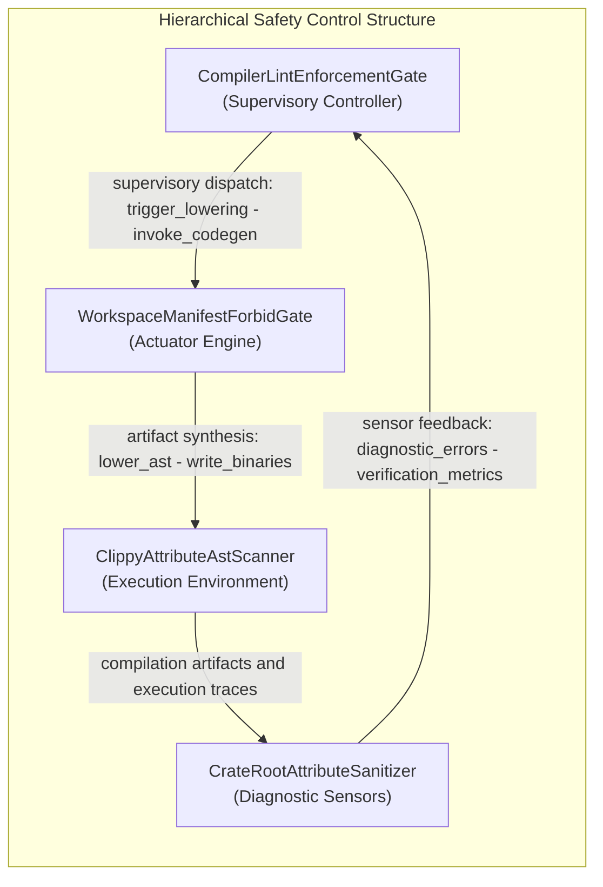
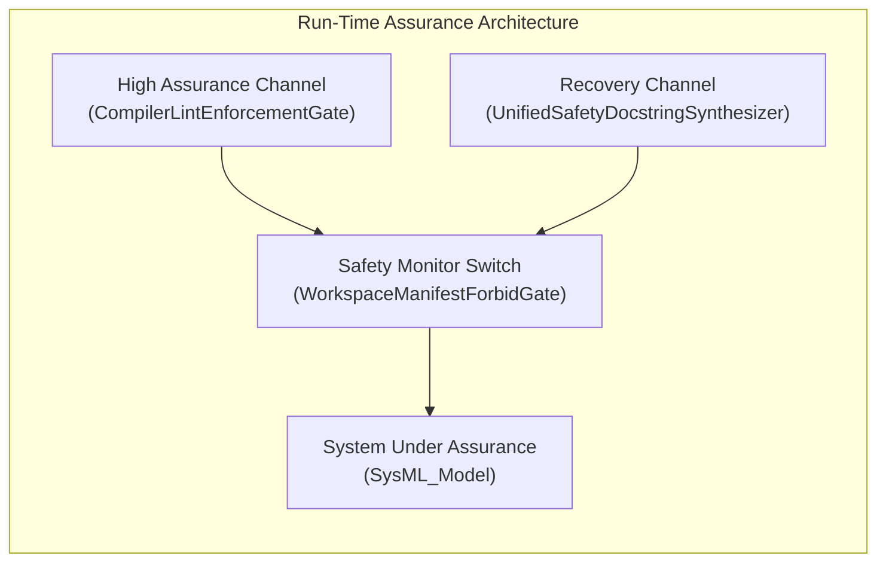

# Unified 8-Pillar STPA Safety & Risk Analysis Matrix

> **Primary Commercial Toolchain Integration Context:** MATLAB / Simulink / Stateflow / Embedded Coder
> **Safety Standards:** ISO/IEC/IEEE 15026-3 | ASTM F3269-17 RTA | MIL-STD-882E | Domain Integrity Framework

---

## System Losses

| Loss ID | Description |
| :--- | :--- |
| L-1 | Loss of safe function of CompilerLintEnforcementGate |

## System Hazards

| Hazard ID | Associated Control Action | Controller |
| :--- | :--- | :--- |
| H-1 | ExecuteCargoClippyWorkspaceAllTargets | CompilerLintEnforcementGate |
| H-2 | ReadWorkspaceLintsClippyForbidTable | CompilerLintEnforcementGate |
| H-3 | ExecuteVerifyBaselineNoDomain | CompilerLintEnforcementGate |
| H-4 | RunScanClippyAllowTokensOn | CompilerLintEnforcementGate |
| H-5 | ExecuteIngestSysmlSchemaBlueprint01 | CompilerLintEnforcementGate |
| H-6 | check_compiler_ast_purity | CompilerLintEnforcementGate |
| H-7 | mask_literals_and_comments | CompilerLintEnforcementGate |
| H-8 | contains_direct_range_slice | CompilerLintEnforcementGate |
| H-9 | audit_fail_closed_io_patterns | CompilerLintEnforcementGate |
| H-10 | audit_test_integrity_and_anti_gaming | CompilerLintEnforcementGate |
| H-11 | audit_ssot_symbol_deduplication | CompilerLintEnforcementGate |
| H-12 | scan_all | CompilerLintEnforcementGate |
| H-13 | parse_package_or_file | CompilerLintEnforcementGate |
| H-14 | ParseTypeExprAndParseTransition | CompilerLintEnforcementGate |
| H-15 | verify_bijective_ast_roundtrip | CompilerLintEnforcementGate |
| H-16 | ast_orig_to_sysml | CompilerLintEnforcementGate |
| H-17 | AssertAstOrigEqualsAstReparsed | CompilerLintEnforcementGate |
| H-18 | CompileSysmlForwardSyncDocs | CompilerLintEnforcementGate |
| H-19 | ResolveParentEpicByPkgName | CompilerLintEnforcementGate |
| H-20 | BindAllPackageStoriesToUse | CompilerLintEnforcementGate |
| H-21 | EmitSymmetricActionDefSignaturesAndE1 | CompilerLintEnforcementGate |
| H-22 | CompileSysmlEmitIcdDocsInterfaces | CompilerLintEnforcementGate |
| H-23 | ProjectNxNConnectionDefMatrixAndFlowDef | CompilerLintEnforcementGate |
| H-24 | CompileSysmlEmitWbsDocsManagement | CompilerLintEnforcementGate |
| H-25 | SynthesizeMilStd881eTreeAnd | CompilerLintEnforcementGate |
| H-26 | ReconcileBacklogReconcileDocsDirDocs | CompilerLintEnforcementGate |
| H-27 | ParseCommonMarkTablesWithInHtml | CompilerLintEnforcementGate |
| H-28 | ReconcileChecklistsWithParentInclusiveEpic | CompilerLintEnforcementGate |
| H-29 | CompileSysmlReverseSyncDocs | CompilerLintEnforcementGate |
| H-30 | MergeExtractedEntitiesIntoOwningSubpackages | CompilerLintEnforcementGate |
| H-31 | RunCompileSysmlInjectSafetyDocstrings | CompilerLintEnforcementGate |
| H-32 | ScanSourceLinesViaRustDartLexStateAnd | CompilerLintEnforcementGate |
| H-33 | ResolveSchemaContextViaCollectAll | CompilerLintEnforcementGate |
| H-34 | RunVerifyBaselineNoDomain | CompilerLintEnforcementGate |
| H-35 | TokenizeRsAndDartFilesUsing | CompilerLintEnforcementGate |
| H-36 | RunIngestSysmlSchemaBlueprint05 | CompilerLintEnforcementGate |
| H-37 | VerifyBaselineAuditCodePathCrates | CompilerLintEnforcementGate |
| H-38 | ParseRustSourceAstAndParse | CompilerLintEnforcementGate |
| H-39 | EvaluateSourceFilePillarsAcross5 | CompilerLintEnforcementGate |
| H-40 | synthesize_defect_dossier_markdown | CompilerLintEnforcementGate |
| H-41 | run_check_defect | CompilerLintEnforcementGate |
| H-42 | Execute12CheckValidateDefectDossier | CompilerLintEnforcementGate |
| H-43 | GhIssueCreateOrGhIssue | CompilerLintEnforcementGate |
| H-44 | GhIssueViewJsonTitleBody | CompilerLintEnforcementGate |

## Hierarchical Control Structure Topology

---

## 4. Unsafe Control Actions (**UCA-1..N**)

Systematic identification across the 4 STPA guide word / failure mode categories:

1. **Not providing causes hazard**
2. **Providing causes hazard**
3. **Too early, too late, or out of order**
4. **Stopped too soon or applied too long**

Cartesian product of controlling part-def control actions across the
four canonical STPA guide-word categories.

| UCA ID | Controller | Control Action | Guide Word | Context | Hazard | Safety Constraint | Severity | Integrity Level |
| :--- | :--- | :--- | :--- | :--- | :--- | :--- | :--- | :--- |
| UCA-001 | CompilerLintEnforcementGate | ExecuteCargoClippyWorkspaceAllTargets | Not providing | CompilerLintEnforcementGate omits ExecuteCargoClippyWorkspaceAllTargets in active operational state across port CargoManifestInputPort while requirement REQ_0601_BP_01_Compiler_Enforced_Forbid_Lint_Gate_and_Zero_Suppression_AST_Architecture_Blueprint (REQ-0601) demands intervention | H-1 | SC-001 | Catastrophic (Derived) | SIL-3 (Derived) |
| UCA-002 | CompilerLintEnforcementGate | ExecuteCargoClippyWorkspaceAllTargets | Providing | CompilerLintEnforcementGate issues ExecuteCargoClippyWorkspaceAllTargets in active operational state across port RustSourceTokenStreamPort violating requirement REQ_0602_BP_02_Check_34_AST_Purity_Fail_Closed_IO_and_Anti_Gaming_Test_Gate_Blueprint (REQ-0602) | H-1 | SC-002 | Catastrophic (Derived) | SIL-3 (Derived) |
| UCA-003 | CompilerLintEnforcementGate | ExecuteCargoClippyWorkspaceAllTargets | Too early / Too late / Out of order | CompilerLintEnforcementGate dispatches ExecuteCargoClippyWorkspaceAllTargets out of temporal sequence in active operational state via port CompilerDiagnosticOutputPort relative to requirement REQ_0603_BP_03_SysML_v2_AST_Bijective_Roundtrip_and_Token_Stream_Parser_Gate_Blueprint (REQ-0603) | H-1 | SC-003 | Critical (Derived) | SIL-2 (Derived) |
| UCA-004 | CompilerLintEnforcementGate | ExecuteCargoClippyWorkspaceAllTargets | Stopped too soon / Applied too long | CompilerLintEnforcementGate prematurely halts or latches ExecuteCargoClippyWorkspaceAllTargets in active operational state on port BaselineGateVerdictPort against requirement REQ_0604_BP_04_Deterministic_Specification_ICD_and_WBS_Forward_Compiler_Blueprint (REQ-0604) | H-1 | SC-004 | Critical (Derived) | SIL-2 (Derived) |
| UCA-005 | CompilerLintEnforcementGate | ReadWorkspaceLintsClippyForbidTable | Not providing | CompilerLintEnforcementGate omits ReadWorkspaceLintsClippyForbidTable in active operational state across port CargoManifestInputPort while requirement REQ_0605_BP_05_Unified_AST_Safety_Docstring_Synthesizer_and_Check_36_Verification_Blueprint (REQ-0605) demands intervention | H-2 | SC-005 | Catastrophic (Derived) | SIL-3 (Derived) |
| UCA-006 | CompilerLintEnforcementGate | ReadWorkspaceLintsClippyForbidTable | Providing | CompilerLintEnforcementGate issues ReadWorkspaceLintsClippyForbidTable in active operational state across port RustSourceTokenStreamPort violating requirement REQ_0606_BP_06_Deterministic_Static_5_Pillar_Code_Auditor_and_Defect_Dossier_Synthesizer_Blueprint (REQ-0606) | H-2 | SC-006 | Catastrophic (Derived) | SIL-3 (Derived) |
| UCA-007 | CompilerLintEnforcementGate | ReadWorkspaceLintsClippyForbidTable | Too early / Too late / Out of order | CompilerLintEnforcementGate dispatches ReadWorkspaceLintsClippyForbidTable out of temporal sequence in active operational state via port CompilerDiagnosticOutputPort relative to requirement REQ_0601_BP_01_Compiler_Enforced_Forbid_Lint_Gate_and_Zero_Suppression_AST_Architecture_Blueprint (REQ-0601) | H-2 | SC-007 | Critical (Derived) | SIL-2 (Derived) |
| UCA-008 | CompilerLintEnforcementGate | ReadWorkspaceLintsClippyForbidTable | Stopped too soon / Applied too long | CompilerLintEnforcementGate prematurely halts or latches ReadWorkspaceLintsClippyForbidTable in active operational state on port BaselineGateVerdictPort against requirement REQ_0602_BP_02_Check_34_AST_Purity_Fail_Closed_IO_and_Anti_Gaming_Test_Gate_Blueprint (REQ-0602) | H-2 | SC-008 | Critical (Derived) | SIL-2 (Derived) |
| UCA-009 | CompilerLintEnforcementGate | ExecuteVerifyBaselineNoDomain | Not providing | CompilerLintEnforcementGate omits ExecuteVerifyBaselineNoDomain in active operational state across port CargoManifestInputPort while requirement REQ_0603_BP_03_SysML_v2_AST_Bijective_Roundtrip_and_Token_Stream_Parser_Gate_Blueprint (REQ-0603) demands intervention | H-3 | SC-009 | Catastrophic (Derived) | SIL-3 (Derived) |
| UCA-010 | CompilerLintEnforcementGate | ExecuteVerifyBaselineNoDomain | Providing | CompilerLintEnforcementGate issues ExecuteVerifyBaselineNoDomain in active operational state across port RustSourceTokenStreamPort violating requirement REQ_0604_BP_04_Deterministic_Specification_ICD_and_WBS_Forward_Compiler_Blueprint (REQ-0604) | H-3 | SC-010 | Catastrophic (Derived) | SIL-3 (Derived) |
| UCA-011 | CompilerLintEnforcementGate | ExecuteVerifyBaselineNoDomain | Too early / Too late / Out of order | CompilerLintEnforcementGate dispatches ExecuteVerifyBaselineNoDomain out of temporal sequence in active operational state via port CompilerDiagnosticOutputPort relative to requirement REQ_0605_BP_05_Unified_AST_Safety_Docstring_Synthesizer_and_Check_36_Verification_Blueprint (REQ-0605) | H-3 | SC-011 | Critical (Derived) | SIL-2 (Derived) |
| UCA-012 | CompilerLintEnforcementGate | ExecuteVerifyBaselineNoDomain | Stopped too soon / Applied too long | CompilerLintEnforcementGate prematurely halts or latches ExecuteVerifyBaselineNoDomain in active operational state on port BaselineGateVerdictPort against requirement REQ_0606_BP_06_Deterministic_Static_5_Pillar_Code_Auditor_and_Defect_Dossier_Synthesizer_Blueprint (REQ-0606) | H-3 | SC-012 | Critical (Derived) | SIL-2 (Derived) |
| UCA-013 | CompilerLintEnforcementGate | RunScanClippyAllowTokensOn | Not providing | CompilerLintEnforcementGate omits RunScanClippyAllowTokensOn in active operational state across port CargoManifestInputPort while requirement REQ_0601_BP_01_Compiler_Enforced_Forbid_Lint_Gate_and_Zero_Suppression_AST_Architecture_Blueprint (REQ-0601) demands intervention | H-4 | SC-013 | Catastrophic (Derived) | SIL-3 (Derived) |
| UCA-014 | CompilerLintEnforcementGate | RunScanClippyAllowTokensOn | Providing | CompilerLintEnforcementGate issues RunScanClippyAllowTokensOn in active operational state across port RustSourceTokenStreamPort violating requirement REQ_0602_BP_02_Check_34_AST_Purity_Fail_Closed_IO_and_Anti_Gaming_Test_Gate_Blueprint (REQ-0602) | H-4 | SC-014 | Catastrophic (Derived) | SIL-3 (Derived) |
| UCA-015 | CompilerLintEnforcementGate | RunScanClippyAllowTokensOn | Too early / Too late / Out of order | CompilerLintEnforcementGate dispatches RunScanClippyAllowTokensOn out of temporal sequence in active operational state via port CompilerDiagnosticOutputPort relative to requirement REQ_0603_BP_03_SysML_v2_AST_Bijective_Roundtrip_and_Token_Stream_Parser_Gate_Blueprint (REQ-0603) | H-4 | SC-015 | Critical (Derived) | SIL-2 (Derived) |
| UCA-016 | CompilerLintEnforcementGate | RunScanClippyAllowTokensOn | Stopped too soon / Applied too long | CompilerLintEnforcementGate prematurely halts or latches RunScanClippyAllowTokensOn in active operational state on port BaselineGateVerdictPort against requirement REQ_0604_BP_04_Deterministic_Specification_ICD_and_WBS_Forward_Compiler_Blueprint (REQ-0604) | H-4 | SC-016 | Critical (Derived) | SIL-2 (Derived) |
| UCA-017 | CompilerLintEnforcementGate | ExecuteIngestSysmlSchemaBlueprint01 | Not providing | CompilerLintEnforcementGate omits ExecuteIngestSysmlSchemaBlueprint01 in active operational state across port CargoManifestInputPort while requirement REQ_0605_BP_05_Unified_AST_Safety_Docstring_Synthesizer_and_Check_36_Verification_Blueprint (REQ-0605) demands intervention | H-5 | SC-017 | Catastrophic (Derived) | SIL-3 (Derived) |
| UCA-018 | CompilerLintEnforcementGate | ExecuteIngestSysmlSchemaBlueprint01 | Providing | CompilerLintEnforcementGate issues ExecuteIngestSysmlSchemaBlueprint01 in active operational state across port RustSourceTokenStreamPort violating requirement REQ_0606_BP_06_Deterministic_Static_5_Pillar_Code_Auditor_and_Defect_Dossier_Synthesizer_Blueprint (REQ-0606) | H-5 | SC-018 | Catastrophic (Derived) | SIL-3 (Derived) |
| UCA-019 | CompilerLintEnforcementGate | ExecuteIngestSysmlSchemaBlueprint01 | Too early / Too late / Out of order | CompilerLintEnforcementGate dispatches ExecuteIngestSysmlSchemaBlueprint01 out of temporal sequence in active operational state via port CompilerDiagnosticOutputPort relative to requirement REQ_0601_BP_01_Compiler_Enforced_Forbid_Lint_Gate_and_Zero_Suppression_AST_Architecture_Blueprint (REQ-0601) | H-5 | SC-019 | Critical (Derived) | SIL-2 (Derived) |
| UCA-020 | CompilerLintEnforcementGate | ExecuteIngestSysmlSchemaBlueprint01 | Stopped too soon / Applied too long | CompilerLintEnforcementGate prematurely halts or latches ExecuteIngestSysmlSchemaBlueprint01 in active operational state on port BaselineGateVerdictPort against requirement REQ_0602_BP_02_Check_34_AST_Purity_Fail_Closed_IO_and_Anti_Gaming_Test_Gate_Blueprint (REQ-0602) | H-5 | SC-020 | Critical (Derived) | SIL-2 (Derived) |
| UCA-021 | CompilerLintEnforcementGate | check_compiler_ast_purity | Not providing | CompilerLintEnforcementGate omits check_compiler_ast_purity in active operational state across port CargoManifestInputPort while requirement REQ_0603_BP_03_SysML_v2_AST_Bijective_Roundtrip_and_Token_Stream_Parser_Gate_Blueprint (REQ-0603) demands intervention | H-6 | SC-021 | Catastrophic (Derived) | SIL-3 (Derived) |
| UCA-022 | CompilerLintEnforcementGate | check_compiler_ast_purity | Providing | CompilerLintEnforcementGate issues check_compiler_ast_purity in active operational state across port RustSourceTokenStreamPort violating requirement REQ_0604_BP_04_Deterministic_Specification_ICD_and_WBS_Forward_Compiler_Blueprint (REQ-0604) | H-6 | SC-022 | Catastrophic (Derived) | SIL-3 (Derived) |
| UCA-023 | CompilerLintEnforcementGate | check_compiler_ast_purity | Too early / Too late / Out of order | CompilerLintEnforcementGate dispatches check_compiler_ast_purity out of temporal sequence in active operational state via port CompilerDiagnosticOutputPort relative to requirement REQ_0605_BP_05_Unified_AST_Safety_Docstring_Synthesizer_and_Check_36_Verification_Blueprint (REQ-0605) | H-6 | SC-023 | Critical (Derived) | SIL-2 (Derived) |
| UCA-024 | CompilerLintEnforcementGate | check_compiler_ast_purity | Stopped too soon / Applied too long | CompilerLintEnforcementGate prematurely halts or latches check_compiler_ast_purity in active operational state on port BaselineGateVerdictPort against requirement REQ_0606_BP_06_Deterministic_Static_5_Pillar_Code_Auditor_and_Defect_Dossier_Synthesizer_Blueprint (REQ-0606) | H-6 | SC-024 | Critical (Derived) | SIL-2 (Derived) |
| UCA-025 | CompilerLintEnforcementGate | mask_literals_and_comments | Not providing | CompilerLintEnforcementGate omits mask_literals_and_comments in active operational state across port CargoManifestInputPort while requirement REQ_0601_BP_01_Compiler_Enforced_Forbid_Lint_Gate_and_Zero_Suppression_AST_Architecture_Blueprint (REQ-0601) demands intervention | H-7 | SC-025 | Catastrophic (Derived) | SIL-3 (Derived) |
| UCA-026 | CompilerLintEnforcementGate | mask_literals_and_comments | Providing | CompilerLintEnforcementGate issues mask_literals_and_comments in active operational state across port RustSourceTokenStreamPort violating requirement REQ_0602_BP_02_Check_34_AST_Purity_Fail_Closed_IO_and_Anti_Gaming_Test_Gate_Blueprint (REQ-0602) | H-7 | SC-026 | Catastrophic (Derived) | SIL-3 (Derived) |
| UCA-027 | CompilerLintEnforcementGate | mask_literals_and_comments | Too early / Too late / Out of order | CompilerLintEnforcementGate dispatches mask_literals_and_comments out of temporal sequence in active operational state via port CompilerDiagnosticOutputPort relative to requirement REQ_0603_BP_03_SysML_v2_AST_Bijective_Roundtrip_and_Token_Stream_Parser_Gate_Blueprint (REQ-0603) | H-7 | SC-027 | Critical (Derived) | SIL-2 (Derived) |
| UCA-028 | CompilerLintEnforcementGate | mask_literals_and_comments | Stopped too soon / Applied too long | CompilerLintEnforcementGate prematurely halts or latches mask_literals_and_comments in active operational state on port BaselineGateVerdictPort against requirement REQ_0604_BP_04_Deterministic_Specification_ICD_and_WBS_Forward_Compiler_Blueprint (REQ-0604) | H-7 | SC-028 | Critical (Derived) | SIL-2 (Derived) |
| UCA-029 | CompilerLintEnforcementGate | contains_direct_range_slice | Not providing | CompilerLintEnforcementGate omits contains_direct_range_slice in active operational state across port CargoManifestInputPort while requirement REQ_0605_BP_05_Unified_AST_Safety_Docstring_Synthesizer_and_Check_36_Verification_Blueprint (REQ-0605) demands intervention | H-8 | SC-029 | Catastrophic (Derived) | SIL-3 (Derived) |
| UCA-030 | CompilerLintEnforcementGate | contains_direct_range_slice | Providing | CompilerLintEnforcementGate issues contains_direct_range_slice in active operational state across port RustSourceTokenStreamPort violating requirement REQ_0606_BP_06_Deterministic_Static_5_Pillar_Code_Auditor_and_Defect_Dossier_Synthesizer_Blueprint (REQ-0606) | H-8 | SC-030 | Catastrophic (Derived) | SIL-3 (Derived) |
| UCA-031 | CompilerLintEnforcementGate | contains_direct_range_slice | Too early / Too late / Out of order | CompilerLintEnforcementGate dispatches contains_direct_range_slice out of temporal sequence in active operational state via port CompilerDiagnosticOutputPort relative to requirement REQ_0601_BP_01_Compiler_Enforced_Forbid_Lint_Gate_and_Zero_Suppression_AST_Architecture_Blueprint (REQ-0601) | H-8 | SC-031 | Critical (Derived) | SIL-2 (Derived) |
| UCA-032 | CompilerLintEnforcementGate | contains_direct_range_slice | Stopped too soon / Applied too long | CompilerLintEnforcementGate prematurely halts or latches contains_direct_range_slice in active operational state on port BaselineGateVerdictPort against requirement REQ_0602_BP_02_Check_34_AST_Purity_Fail_Closed_IO_and_Anti_Gaming_Test_Gate_Blueprint (REQ-0602) | H-8 | SC-032 | Critical (Derived) | SIL-2 (Derived) |
| UCA-033 | CompilerLintEnforcementGate | audit_fail_closed_io_patterns | Not providing | CompilerLintEnforcementGate omits audit_fail_closed_io_patterns in active operational state across port CargoManifestInputPort while requirement REQ_0603_BP_03_SysML_v2_AST_Bijective_Roundtrip_and_Token_Stream_Parser_Gate_Blueprint (REQ-0603) demands intervention | H-9 | SC-033 | Catastrophic (Derived) | SIL-3 (Derived) |
| UCA-034 | CompilerLintEnforcementGate | audit_fail_closed_io_patterns | Providing | CompilerLintEnforcementGate issues audit_fail_closed_io_patterns in active operational state across port RustSourceTokenStreamPort violating requirement REQ_0604_BP_04_Deterministic_Specification_ICD_and_WBS_Forward_Compiler_Blueprint (REQ-0604) | H-9 | SC-034 | Catastrophic (Derived) | SIL-3 (Derived) |
| UCA-035 | CompilerLintEnforcementGate | audit_fail_closed_io_patterns | Too early / Too late / Out of order | CompilerLintEnforcementGate dispatches audit_fail_closed_io_patterns out of temporal sequence in active operational state via port CompilerDiagnosticOutputPort relative to requirement REQ_0605_BP_05_Unified_AST_Safety_Docstring_Synthesizer_and_Check_36_Verification_Blueprint (REQ-0605) | H-9 | SC-035 | Critical (Derived) | SIL-2 (Derived) |
| UCA-036 | CompilerLintEnforcementGate | audit_fail_closed_io_patterns | Stopped too soon / Applied too long | CompilerLintEnforcementGate prematurely halts or latches audit_fail_closed_io_patterns in active operational state on port BaselineGateVerdictPort against requirement REQ_0606_BP_06_Deterministic_Static_5_Pillar_Code_Auditor_and_Defect_Dossier_Synthesizer_Blueprint (REQ-0606) | H-9 | SC-036 | Critical (Derived) | SIL-2 (Derived) |
| UCA-037 | CompilerLintEnforcementGate | audit_test_integrity_and_anti_gaming | Not providing | CompilerLintEnforcementGate omits audit_test_integrity_and_anti_gaming in active operational state across port CargoManifestInputPort while requirement REQ_0601_BP_01_Compiler_Enforced_Forbid_Lint_Gate_and_Zero_Suppression_AST_Architecture_Blueprint (REQ-0601) demands intervention | H-10 | SC-037 | Catastrophic (Derived) | SIL-3 (Derived) |
| UCA-038 | CompilerLintEnforcementGate | audit_test_integrity_and_anti_gaming | Providing | CompilerLintEnforcementGate issues audit_test_integrity_and_anti_gaming in active operational state across port RustSourceTokenStreamPort violating requirement REQ_0602_BP_02_Check_34_AST_Purity_Fail_Closed_IO_and_Anti_Gaming_Test_Gate_Blueprint (REQ-0602) | H-10 | SC-038 | Catastrophic (Derived) | SIL-3 (Derived) |
| UCA-039 | CompilerLintEnforcementGate | audit_test_integrity_and_anti_gaming | Too early / Too late / Out of order | CompilerLintEnforcementGate dispatches audit_test_integrity_and_anti_gaming out of temporal sequence in active operational state via port CompilerDiagnosticOutputPort relative to requirement REQ_0603_BP_03_SysML_v2_AST_Bijective_Roundtrip_and_Token_Stream_Parser_Gate_Blueprint (REQ-0603) | H-10 | SC-039 | Critical (Derived) | SIL-2 (Derived) |
| UCA-040 | CompilerLintEnforcementGate | audit_test_integrity_and_anti_gaming | Stopped too soon / Applied too long | CompilerLintEnforcementGate prematurely halts or latches audit_test_integrity_and_anti_gaming in active operational state on port BaselineGateVerdictPort against requirement REQ_0604_BP_04_Deterministic_Specification_ICD_and_WBS_Forward_Compiler_Blueprint (REQ-0604) | H-10 | SC-040 | Critical (Derived) | SIL-2 (Derived) |
| UCA-041 | CompilerLintEnforcementGate | audit_ssot_symbol_deduplication | Not providing | CompilerLintEnforcementGate omits audit_ssot_symbol_deduplication in active operational state across port CargoManifestInputPort while requirement REQ_0605_BP_05_Unified_AST_Safety_Docstring_Synthesizer_and_Check_36_Verification_Blueprint (REQ-0605) demands intervention | H-11 | SC-041 | Catastrophic (Derived) | SIL-3 (Derived) |
| UCA-042 | CompilerLintEnforcementGate | audit_ssot_symbol_deduplication | Providing | CompilerLintEnforcementGate issues audit_ssot_symbol_deduplication in active operational state across port RustSourceTokenStreamPort violating requirement REQ_0606_BP_06_Deterministic_Static_5_Pillar_Code_Auditor_and_Defect_Dossier_Synthesizer_Blueprint (REQ-0606) | H-11 | SC-042 | Catastrophic (Derived) | SIL-3 (Derived) |
| UCA-043 | CompilerLintEnforcementGate | audit_ssot_symbol_deduplication | Too early / Too late / Out of order | CompilerLintEnforcementGate dispatches audit_ssot_symbol_deduplication out of temporal sequence in active operational state via port CompilerDiagnosticOutputPort relative to requirement REQ_0601_BP_01_Compiler_Enforced_Forbid_Lint_Gate_and_Zero_Suppression_AST_Architecture_Blueprint (REQ-0601) | H-11 | SC-043 | Critical (Derived) | SIL-2 (Derived) |
| UCA-044 | CompilerLintEnforcementGate | audit_ssot_symbol_deduplication | Stopped too soon / Applied too long | CompilerLintEnforcementGate prematurely halts or latches audit_ssot_symbol_deduplication in active operational state on port BaselineGateVerdictPort against requirement REQ_0602_BP_02_Check_34_AST_Purity_Fail_Closed_IO_and_Anti_Gaming_Test_Gate_Blueprint (REQ-0602) | H-11 | SC-044 | Critical (Derived) | SIL-2 (Derived) |
| UCA-045 | CompilerLintEnforcementGate | scan_all | Not providing | CompilerLintEnforcementGate omits scan_all in active operational state across port CargoManifestInputPort while requirement REQ_0603_BP_03_SysML_v2_AST_Bijective_Roundtrip_and_Token_Stream_Parser_Gate_Blueprint (REQ-0603) demands intervention | H-12 | SC-045 | Catastrophic (Derived) | SIL-3 (Derived) |
| UCA-046 | CompilerLintEnforcementGate | scan_all | Providing | CompilerLintEnforcementGate issues scan_all in active operational state across port RustSourceTokenStreamPort violating requirement REQ_0604_BP_04_Deterministic_Specification_ICD_and_WBS_Forward_Compiler_Blueprint (REQ-0604) | H-12 | SC-046 | Catastrophic (Derived) | SIL-3 (Derived) |
| UCA-047 | CompilerLintEnforcementGate | scan_all | Too early / Too late / Out of order | CompilerLintEnforcementGate dispatches scan_all out of temporal sequence in active operational state via port CompilerDiagnosticOutputPort relative to requirement REQ_0605_BP_05_Unified_AST_Safety_Docstring_Synthesizer_and_Check_36_Verification_Blueprint (REQ-0605) | H-12 | SC-047 | Critical (Derived) | SIL-2 (Derived) |
| UCA-048 | CompilerLintEnforcementGate | scan_all | Stopped too soon / Applied too long | CompilerLintEnforcementGate prematurely halts or latches scan_all in active operational state on port BaselineGateVerdictPort against requirement REQ_0606_BP_06_Deterministic_Static_5_Pillar_Code_Auditor_and_Defect_Dossier_Synthesizer_Blueprint (REQ-0606) | H-12 | SC-048 | Critical (Derived) | SIL-2 (Derived) |
| UCA-049 | CompilerLintEnforcementGate | parse_package_or_file | Not providing | CompilerLintEnforcementGate omits parse_package_or_file in active operational state across port CargoManifestInputPort while requirement REQ_0601_BP_01_Compiler_Enforced_Forbid_Lint_Gate_and_Zero_Suppression_AST_Architecture_Blueprint (REQ-0601) demands intervention | H-13 | SC-049 | Catastrophic (Derived) | SIL-3 (Derived) |
| UCA-050 | CompilerLintEnforcementGate | parse_package_or_file | Providing | CompilerLintEnforcementGate issues parse_package_or_file in active operational state across port RustSourceTokenStreamPort violating requirement REQ_0602_BP_02_Check_34_AST_Purity_Fail_Closed_IO_and_Anti_Gaming_Test_Gate_Blueprint (REQ-0602) | H-13 | SC-050 | Catastrophic (Derived) | SIL-3 (Derived) |
| UCA-051 | CompilerLintEnforcementGate | parse_package_or_file | Too early / Too late / Out of order | CompilerLintEnforcementGate dispatches parse_package_or_file out of temporal sequence in active operational state via port CompilerDiagnosticOutputPort relative to requirement REQ_0603_BP_03_SysML_v2_AST_Bijective_Roundtrip_and_Token_Stream_Parser_Gate_Blueprint (REQ-0603) | H-13 | SC-051 | Critical (Derived) | SIL-2 (Derived) |
| UCA-052 | CompilerLintEnforcementGate | parse_package_or_file | Stopped too soon / Applied too long | CompilerLintEnforcementGate prematurely halts or latches parse_package_or_file in active operational state on port BaselineGateVerdictPort against requirement REQ_0604_BP_04_Deterministic_Specification_ICD_and_WBS_Forward_Compiler_Blueprint (REQ-0604) | H-13 | SC-052 | Critical (Derived) | SIL-2 (Derived) |
| UCA-053 | CompilerLintEnforcementGate | ParseTypeExprAndParseTransition | Not providing | CompilerLintEnforcementGate omits ParseTypeExprAndParseTransition in active operational state across port CargoManifestInputPort while requirement REQ_0605_BP_05_Unified_AST_Safety_Docstring_Synthesizer_and_Check_36_Verification_Blueprint (REQ-0605) demands intervention | H-14 | SC-053 | Catastrophic (Derived) | SIL-3 (Derived) |
| UCA-054 | CompilerLintEnforcementGate | ParseTypeExprAndParseTransition | Providing | CompilerLintEnforcementGate issues ParseTypeExprAndParseTransition in active operational state across port RustSourceTokenStreamPort violating requirement REQ_0606_BP_06_Deterministic_Static_5_Pillar_Code_Auditor_and_Defect_Dossier_Synthesizer_Blueprint (REQ-0606) | H-14 | SC-054 | Catastrophic (Derived) | SIL-3 (Derived) |
| UCA-055 | CompilerLintEnforcementGate | ParseTypeExprAndParseTransition | Too early / Too late / Out of order | CompilerLintEnforcementGate dispatches ParseTypeExprAndParseTransition out of temporal sequence in active operational state via port CompilerDiagnosticOutputPort relative to requirement REQ_0601_BP_01_Compiler_Enforced_Forbid_Lint_Gate_and_Zero_Suppression_AST_Architecture_Blueprint (REQ-0601) | H-14 | SC-055 | Critical (Derived) | SIL-2 (Derived) |
| UCA-056 | CompilerLintEnforcementGate | ParseTypeExprAndParseTransition | Stopped too soon / Applied too long | CompilerLintEnforcementGate prematurely halts or latches ParseTypeExprAndParseTransition in active operational state on port BaselineGateVerdictPort against requirement REQ_0602_BP_02_Check_34_AST_Purity_Fail_Closed_IO_and_Anti_Gaming_Test_Gate_Blueprint (REQ-0602) | H-14 | SC-056 | Critical (Derived) | SIL-2 (Derived) |
| UCA-057 | CompilerLintEnforcementGate | verify_bijective_ast_roundtrip | Not providing | CompilerLintEnforcementGate omits verify_bijective_ast_roundtrip in active operational state across port CargoManifestInputPort while requirement REQ_0603_BP_03_SysML_v2_AST_Bijective_Roundtrip_and_Token_Stream_Parser_Gate_Blueprint (REQ-0603) demands intervention | H-15 | SC-057 | Catastrophic (Derived) | SIL-3 (Derived) |
| UCA-058 | CompilerLintEnforcementGate | verify_bijective_ast_roundtrip | Providing | CompilerLintEnforcementGate issues verify_bijective_ast_roundtrip in active operational state across port RustSourceTokenStreamPort violating requirement REQ_0604_BP_04_Deterministic_Specification_ICD_and_WBS_Forward_Compiler_Blueprint (REQ-0604) | H-15 | SC-058 | Catastrophic (Derived) | SIL-3 (Derived) |
| UCA-059 | CompilerLintEnforcementGate | verify_bijective_ast_roundtrip | Too early / Too late / Out of order | CompilerLintEnforcementGate dispatches verify_bijective_ast_roundtrip out of temporal sequence in active operational state via port CompilerDiagnosticOutputPort relative to requirement REQ_0605_BP_05_Unified_AST_Safety_Docstring_Synthesizer_and_Check_36_Verification_Blueprint (REQ-0605) | H-15 | SC-059 | Critical (Derived) | SIL-2 (Derived) |
| UCA-060 | CompilerLintEnforcementGate | verify_bijective_ast_roundtrip | Stopped too soon / Applied too long | CompilerLintEnforcementGate prematurely halts or latches verify_bijective_ast_roundtrip in active operational state on port BaselineGateVerdictPort against requirement REQ_0606_BP_06_Deterministic_Static_5_Pillar_Code_Auditor_and_Defect_Dossier_Synthesizer_Blueprint (REQ-0606) | H-15 | SC-060 | Critical (Derived) | SIL-2 (Derived) |
| UCA-061 | CompilerLintEnforcementGate | ast_orig_to_sysml | Not providing | CompilerLintEnforcementGate omits ast_orig_to_sysml in active operational state across port CargoManifestInputPort while requirement REQ_0601_BP_01_Compiler_Enforced_Forbid_Lint_Gate_and_Zero_Suppression_AST_Architecture_Blueprint (REQ-0601) demands intervention | H-16 | SC-061 | Catastrophic (Derived) | SIL-3 (Derived) |
| UCA-062 | CompilerLintEnforcementGate | ast_orig_to_sysml | Providing | CompilerLintEnforcementGate issues ast_orig_to_sysml in active operational state across port RustSourceTokenStreamPort violating requirement REQ_0602_BP_02_Check_34_AST_Purity_Fail_Closed_IO_and_Anti_Gaming_Test_Gate_Blueprint (REQ-0602) | H-16 | SC-062 | Catastrophic (Derived) | SIL-3 (Derived) |
| UCA-063 | CompilerLintEnforcementGate | ast_orig_to_sysml | Too early / Too late / Out of order | CompilerLintEnforcementGate dispatches ast_orig_to_sysml out of temporal sequence in active operational state via port CompilerDiagnosticOutputPort relative to requirement REQ_0603_BP_03_SysML_v2_AST_Bijective_Roundtrip_and_Token_Stream_Parser_Gate_Blueprint (REQ-0603) | H-16 | SC-063 | Critical (Derived) | SIL-2 (Derived) |
| UCA-064 | CompilerLintEnforcementGate | ast_orig_to_sysml | Stopped too soon / Applied too long | CompilerLintEnforcementGate prematurely halts or latches ast_orig_to_sysml in active operational state on port BaselineGateVerdictPort against requirement REQ_0604_BP_04_Deterministic_Specification_ICD_and_WBS_Forward_Compiler_Blueprint (REQ-0604) | H-16 | SC-064 | Critical (Derived) | SIL-2 (Derived) |
| UCA-065 | CompilerLintEnforcementGate | AssertAstOrigEqualsAstReparsed | Not providing | CompilerLintEnforcementGate omits AssertAstOrigEqualsAstReparsed in active operational state across port CargoManifestInputPort while requirement REQ_0605_BP_05_Unified_AST_Safety_Docstring_Synthesizer_and_Check_36_Verification_Blueprint (REQ-0605) demands intervention | H-17 | SC-065 | Catastrophic (Derived) | SIL-3 (Derived) |
| UCA-066 | CompilerLintEnforcementGate | AssertAstOrigEqualsAstReparsed | Providing | CompilerLintEnforcementGate issues AssertAstOrigEqualsAstReparsed in active operational state across port RustSourceTokenStreamPort violating requirement REQ_0606_BP_06_Deterministic_Static_5_Pillar_Code_Auditor_and_Defect_Dossier_Synthesizer_Blueprint (REQ-0606) | H-17 | SC-066 | Catastrophic (Derived) | SIL-3 (Derived) |
| UCA-067 | CompilerLintEnforcementGate | AssertAstOrigEqualsAstReparsed | Too early / Too late / Out of order | CompilerLintEnforcementGate dispatches AssertAstOrigEqualsAstReparsed out of temporal sequence in active operational state via port CompilerDiagnosticOutputPort relative to requirement REQ_0601_BP_01_Compiler_Enforced_Forbid_Lint_Gate_and_Zero_Suppression_AST_Architecture_Blueprint (REQ-0601) | H-17 | SC-067 | Critical (Derived) | SIL-2 (Derived) |
| UCA-068 | CompilerLintEnforcementGate | AssertAstOrigEqualsAstReparsed | Stopped too soon / Applied too long | CompilerLintEnforcementGate prematurely halts or latches AssertAstOrigEqualsAstReparsed in active operational state on port BaselineGateVerdictPort against requirement REQ_0602_BP_02_Check_34_AST_Purity_Fail_Closed_IO_and_Anti_Gaming_Test_Gate_Blueprint (REQ-0602) | H-17 | SC-068 | Critical (Derived) | SIL-2 (Derived) |
| UCA-069 | CompilerLintEnforcementGate | CompileSysmlForwardSyncDocs | Not providing | CompilerLintEnforcementGate omits CompileSysmlForwardSyncDocs in active operational state across port CargoManifestInputPort while requirement REQ_0603_BP_03_SysML_v2_AST_Bijective_Roundtrip_and_Token_Stream_Parser_Gate_Blueprint (REQ-0603) demands intervention | H-18 | SC-069 | Catastrophic (Derived) | SIL-3 (Derived) |
| UCA-070 | CompilerLintEnforcementGate | CompileSysmlForwardSyncDocs | Providing | CompilerLintEnforcementGate issues CompileSysmlForwardSyncDocs in active operational state across port RustSourceTokenStreamPort violating requirement REQ_0604_BP_04_Deterministic_Specification_ICD_and_WBS_Forward_Compiler_Blueprint (REQ-0604) | H-18 | SC-070 | Catastrophic (Derived) | SIL-3 (Derived) |
| UCA-071 | CompilerLintEnforcementGate | CompileSysmlForwardSyncDocs | Too early / Too late / Out of order | CompilerLintEnforcementGate dispatches CompileSysmlForwardSyncDocs out of temporal sequence in active operational state via port CompilerDiagnosticOutputPort relative to requirement REQ_0605_BP_05_Unified_AST_Safety_Docstring_Synthesizer_and_Check_36_Verification_Blueprint (REQ-0605) | H-18 | SC-071 | Critical (Derived) | SIL-2 (Derived) |
| UCA-072 | CompilerLintEnforcementGate | CompileSysmlForwardSyncDocs | Stopped too soon / Applied too long | CompilerLintEnforcementGate prematurely halts or latches CompileSysmlForwardSyncDocs in active operational state on port BaselineGateVerdictPort against requirement REQ_0606_BP_06_Deterministic_Static_5_Pillar_Code_Auditor_and_Defect_Dossier_Synthesizer_Blueprint (REQ-0606) | H-18 | SC-072 | Critical (Derived) | SIL-2 (Derived) |
| UCA-073 | CompilerLintEnforcementGate | ResolveParentEpicByPkgName | Not providing | CompilerLintEnforcementGate omits ResolveParentEpicByPkgName in active operational state across port CargoManifestInputPort while requirement REQ_0601_BP_01_Compiler_Enforced_Forbid_Lint_Gate_and_Zero_Suppression_AST_Architecture_Blueprint (REQ-0601) demands intervention | H-19 | SC-073 | Catastrophic (Derived) | SIL-3 (Derived) |
| UCA-074 | CompilerLintEnforcementGate | ResolveParentEpicByPkgName | Providing | CompilerLintEnforcementGate issues ResolveParentEpicByPkgName in active operational state across port RustSourceTokenStreamPort violating requirement REQ_0602_BP_02_Check_34_AST_Purity_Fail_Closed_IO_and_Anti_Gaming_Test_Gate_Blueprint (REQ-0602) | H-19 | SC-074 | Catastrophic (Derived) | SIL-3 (Derived) |
| UCA-075 | CompilerLintEnforcementGate | ResolveParentEpicByPkgName | Too early / Too late / Out of order | CompilerLintEnforcementGate dispatches ResolveParentEpicByPkgName out of temporal sequence in active operational state via port CompilerDiagnosticOutputPort relative to requirement REQ_0603_BP_03_SysML_v2_AST_Bijective_Roundtrip_and_Token_Stream_Parser_Gate_Blueprint (REQ-0603) | H-19 | SC-075 | Critical (Derived) | SIL-2 (Derived) |
| UCA-076 | CompilerLintEnforcementGate | ResolveParentEpicByPkgName | Stopped too soon / Applied too long | CompilerLintEnforcementGate prematurely halts or latches ResolveParentEpicByPkgName in active operational state on port BaselineGateVerdictPort against requirement REQ_0604_BP_04_Deterministic_Specification_ICD_and_WBS_Forward_Compiler_Blueprint (REQ-0604) | H-19 | SC-076 | Critical (Derived) | SIL-2 (Derived) |
| UCA-077 | CompilerLintEnforcementGate | BindAllPackageStoriesToUse | Not providing | CompilerLintEnforcementGate omits BindAllPackageStoriesToUse in active operational state across port CargoManifestInputPort while requirement REQ_0605_BP_05_Unified_AST_Safety_Docstring_Synthesizer_and_Check_36_Verification_Blueprint (REQ-0605) demands intervention | H-20 | SC-077 | Catastrophic (Derived) | SIL-3 (Derived) |
| UCA-078 | CompilerLintEnforcementGate | BindAllPackageStoriesToUse | Providing | CompilerLintEnforcementGate issues BindAllPackageStoriesToUse in active operational state across port RustSourceTokenStreamPort violating requirement REQ_0606_BP_06_Deterministic_Static_5_Pillar_Code_Auditor_and_Defect_Dossier_Synthesizer_Blueprint (REQ-0606) | H-20 | SC-078 | Catastrophic (Derived) | SIL-3 (Derived) |
| UCA-079 | CompilerLintEnforcementGate | BindAllPackageStoriesToUse | Too early / Too late / Out of order | CompilerLintEnforcementGate dispatches BindAllPackageStoriesToUse out of temporal sequence in active operational state via port CompilerDiagnosticOutputPort relative to requirement REQ_0601_BP_01_Compiler_Enforced_Forbid_Lint_Gate_and_Zero_Suppression_AST_Architecture_Blueprint (REQ-0601) | H-20 | SC-079 | Critical (Derived) | SIL-2 (Derived) |
| UCA-080 | CompilerLintEnforcementGate | BindAllPackageStoriesToUse | Stopped too soon / Applied too long | CompilerLintEnforcementGate prematurely halts or latches BindAllPackageStoriesToUse in active operational state on port BaselineGateVerdictPort against requirement REQ_0602_BP_02_Check_34_AST_Purity_Fail_Closed_IO_and_Anti_Gaming_Test_Gate_Blueprint (REQ-0602) | H-20 | SC-080 | Critical (Derived) | SIL-2 (Derived) |
| UCA-081 | CompilerLintEnforcementGate | EmitSymmetricActionDefSignaturesAndE1 | Not providing | CompilerLintEnforcementGate omits EmitSymmetricActionDefSignaturesAndE1 in active operational state across port CargoManifestInputPort while requirement REQ_0603_BP_03_SysML_v2_AST_Bijective_Roundtrip_and_Token_Stream_Parser_Gate_Blueprint (REQ-0603) demands intervention | H-21 | SC-081 | Catastrophic (Derived) | SIL-3 (Derived) |
| UCA-082 | CompilerLintEnforcementGate | EmitSymmetricActionDefSignaturesAndE1 | Providing | CompilerLintEnforcementGate issues EmitSymmetricActionDefSignaturesAndE1 in active operational state across port RustSourceTokenStreamPort violating requirement REQ_0604_BP_04_Deterministic_Specification_ICD_and_WBS_Forward_Compiler_Blueprint (REQ-0604) | H-21 | SC-082 | Catastrophic (Derived) | SIL-3 (Derived) |
| UCA-083 | CompilerLintEnforcementGate | EmitSymmetricActionDefSignaturesAndE1 | Too early / Too late / Out of order | CompilerLintEnforcementGate dispatches EmitSymmetricActionDefSignaturesAndE1 out of temporal sequence in active operational state via port CompilerDiagnosticOutputPort relative to requirement REQ_0605_BP_05_Unified_AST_Safety_Docstring_Synthesizer_and_Check_36_Verification_Blueprint (REQ-0605) | H-21 | SC-083 | Critical (Derived) | SIL-2 (Derived) |
| UCA-084 | CompilerLintEnforcementGate | EmitSymmetricActionDefSignaturesAndE1 | Stopped too soon / Applied too long | CompilerLintEnforcementGate prematurely halts or latches EmitSymmetricActionDefSignaturesAndE1 in active operational state on port BaselineGateVerdictPort against requirement REQ_0606_BP_06_Deterministic_Static_5_Pillar_Code_Auditor_and_Defect_Dossier_Synthesizer_Blueprint (REQ-0606) | H-21 | SC-084 | Critical (Derived) | SIL-2 (Derived) |
| UCA-085 | CompilerLintEnforcementGate | CompileSysmlEmitIcdDocsInterfaces | Not providing | CompilerLintEnforcementGate omits CompileSysmlEmitIcdDocsInterfaces in active operational state across port CargoManifestInputPort while requirement REQ_0601_BP_01_Compiler_Enforced_Forbid_Lint_Gate_and_Zero_Suppression_AST_Architecture_Blueprint (REQ-0601) demands intervention | H-22 | SC-085 | Catastrophic (Derived) | SIL-3 (Derived) |
| UCA-086 | CompilerLintEnforcementGate | CompileSysmlEmitIcdDocsInterfaces | Providing | CompilerLintEnforcementGate issues CompileSysmlEmitIcdDocsInterfaces in active operational state across port RustSourceTokenStreamPort violating requirement REQ_0602_BP_02_Check_34_AST_Purity_Fail_Closed_IO_and_Anti_Gaming_Test_Gate_Blueprint (REQ-0602) | H-22 | SC-086 | Catastrophic (Derived) | SIL-3 (Derived) |
| UCA-087 | CompilerLintEnforcementGate | CompileSysmlEmitIcdDocsInterfaces | Too early / Too late / Out of order | CompilerLintEnforcementGate dispatches CompileSysmlEmitIcdDocsInterfaces out of temporal sequence in active operational state via port CompilerDiagnosticOutputPort relative to requirement REQ_0603_BP_03_SysML_v2_AST_Bijective_Roundtrip_and_Token_Stream_Parser_Gate_Blueprint (REQ-0603) | H-22 | SC-087 | Critical (Derived) | SIL-2 (Derived) |
| UCA-088 | CompilerLintEnforcementGate | CompileSysmlEmitIcdDocsInterfaces | Stopped too soon / Applied too long | CompilerLintEnforcementGate prematurely halts or latches CompileSysmlEmitIcdDocsInterfaces in active operational state on port BaselineGateVerdictPort against requirement REQ_0604_BP_04_Deterministic_Specification_ICD_and_WBS_Forward_Compiler_Blueprint (REQ-0604) | H-22 | SC-088 | Critical (Derived) | SIL-2 (Derived) |
| UCA-089 | CompilerLintEnforcementGate | ProjectNxNConnectionDefMatrixAndFlowDef | Not providing | CompilerLintEnforcementGate omits ProjectNxNConnectionDefMatrixAndFlowDef in active operational state across port CargoManifestInputPort while requirement REQ_0605_BP_05_Unified_AST_Safety_Docstring_Synthesizer_and_Check_36_Verification_Blueprint (REQ-0605) demands intervention | H-23 | SC-089 | Catastrophic (Derived) | SIL-3 (Derived) |
| UCA-090 | CompilerLintEnforcementGate | ProjectNxNConnectionDefMatrixAndFlowDef | Providing | CompilerLintEnforcementGate issues ProjectNxNConnectionDefMatrixAndFlowDef in active operational state across port RustSourceTokenStreamPort violating requirement REQ_0606_BP_06_Deterministic_Static_5_Pillar_Code_Auditor_and_Defect_Dossier_Synthesizer_Blueprint (REQ-0606) | H-23 | SC-090 | Catastrophic (Derived) | SIL-3 (Derived) |
| UCA-091 | CompilerLintEnforcementGate | ProjectNxNConnectionDefMatrixAndFlowDef | Too early / Too late / Out of order | CompilerLintEnforcementGate dispatches ProjectNxNConnectionDefMatrixAndFlowDef out of temporal sequence in active operational state via port CompilerDiagnosticOutputPort relative to requirement REQ_0601_BP_01_Compiler_Enforced_Forbid_Lint_Gate_and_Zero_Suppression_AST_Architecture_Blueprint (REQ-0601) | H-23 | SC-091 | Critical (Derived) | SIL-2 (Derived) |
| UCA-092 | CompilerLintEnforcementGate | ProjectNxNConnectionDefMatrixAndFlowDef | Stopped too soon / Applied too long | CompilerLintEnforcementGate prematurely halts or latches ProjectNxNConnectionDefMatrixAndFlowDef in active operational state on port BaselineGateVerdictPort against requirement REQ_0602_BP_02_Check_34_AST_Purity_Fail_Closed_IO_and_Anti_Gaming_Test_Gate_Blueprint (REQ-0602) | H-23 | SC-092 | Critical (Derived) | SIL-2 (Derived) |
| UCA-093 | CompilerLintEnforcementGate | CompileSysmlEmitWbsDocsManagement | Not providing | CompilerLintEnforcementGate omits CompileSysmlEmitWbsDocsManagement in active operational state across port CargoManifestInputPort while requirement REQ_0603_BP_03_SysML_v2_AST_Bijective_Roundtrip_and_Token_Stream_Parser_Gate_Blueprint (REQ-0603) demands intervention | H-24 | SC-093 | Catastrophic (Derived) | SIL-3 (Derived) |
| UCA-094 | CompilerLintEnforcementGate | CompileSysmlEmitWbsDocsManagement | Providing | CompilerLintEnforcementGate issues CompileSysmlEmitWbsDocsManagement in active operational state across port RustSourceTokenStreamPort violating requirement REQ_0604_BP_04_Deterministic_Specification_ICD_and_WBS_Forward_Compiler_Blueprint (REQ-0604) | H-24 | SC-094 | Catastrophic (Derived) | SIL-3 (Derived) |
| UCA-095 | CompilerLintEnforcementGate | CompileSysmlEmitWbsDocsManagement | Too early / Too late / Out of order | CompilerLintEnforcementGate dispatches CompileSysmlEmitWbsDocsManagement out of temporal sequence in active operational state via port CompilerDiagnosticOutputPort relative to requirement REQ_0605_BP_05_Unified_AST_Safety_Docstring_Synthesizer_and_Check_36_Verification_Blueprint (REQ-0605) | H-24 | SC-095 | Critical (Derived) | SIL-2 (Derived) |
| UCA-096 | CompilerLintEnforcementGate | CompileSysmlEmitWbsDocsManagement | Stopped too soon / Applied too long | CompilerLintEnforcementGate prematurely halts or latches CompileSysmlEmitWbsDocsManagement in active operational state on port BaselineGateVerdictPort against requirement REQ_0606_BP_06_Deterministic_Static_5_Pillar_Code_Auditor_and_Defect_Dossier_Synthesizer_Blueprint (REQ-0606) | H-24 | SC-096 | Critical (Derived) | SIL-2 (Derived) |
| UCA-097 | CompilerLintEnforcementGate | SynthesizeMilStd881eTreeAnd | Not providing | CompilerLintEnforcementGate omits SynthesizeMilStd881eTreeAnd in active operational state across port CargoManifestInputPort while requirement REQ_0601_BP_01_Compiler_Enforced_Forbid_Lint_Gate_and_Zero_Suppression_AST_Architecture_Blueprint (REQ-0601) demands intervention | H-25 | SC-097 | Catastrophic (Derived) | SIL-3 (Derived) |
| UCA-098 | CompilerLintEnforcementGate | SynthesizeMilStd881eTreeAnd | Providing | CompilerLintEnforcementGate issues SynthesizeMilStd881eTreeAnd in active operational state across port RustSourceTokenStreamPort violating requirement REQ_0602_BP_02_Check_34_AST_Purity_Fail_Closed_IO_and_Anti_Gaming_Test_Gate_Blueprint (REQ-0602) | H-25 | SC-098 | Catastrophic (Derived) | SIL-3 (Derived) |
| UCA-099 | CompilerLintEnforcementGate | SynthesizeMilStd881eTreeAnd | Too early / Too late / Out of order | CompilerLintEnforcementGate dispatches SynthesizeMilStd881eTreeAnd out of temporal sequence in active operational state via port CompilerDiagnosticOutputPort relative to requirement REQ_0603_BP_03_SysML_v2_AST_Bijective_Roundtrip_and_Token_Stream_Parser_Gate_Blueprint (REQ-0603) | H-25 | SC-099 | Critical (Derived) | SIL-2 (Derived) |
| UCA-100 | CompilerLintEnforcementGate | SynthesizeMilStd881eTreeAnd | Stopped too soon / Applied too long | CompilerLintEnforcementGate prematurely halts or latches SynthesizeMilStd881eTreeAnd in active operational state on port BaselineGateVerdictPort against requirement REQ_0604_BP_04_Deterministic_Specification_ICD_and_WBS_Forward_Compiler_Blueprint (REQ-0604) | H-25 | SC-100 | Critical (Derived) | SIL-2 (Derived) |
| UCA-101 | CompilerLintEnforcementGate | ReconcileBacklogReconcileDocsDirDocs | Not providing | CompilerLintEnforcementGate omits ReconcileBacklogReconcileDocsDirDocs in active operational state across port CargoManifestInputPort while requirement REQ_0605_BP_05_Unified_AST_Safety_Docstring_Synthesizer_and_Check_36_Verification_Blueprint (REQ-0605) demands intervention | H-26 | SC-101 | Catastrophic (Derived) | SIL-3 (Derived) |
| UCA-102 | CompilerLintEnforcementGate | ReconcileBacklogReconcileDocsDirDocs | Providing | CompilerLintEnforcementGate issues ReconcileBacklogReconcileDocsDirDocs in active operational state across port RustSourceTokenStreamPort violating requirement REQ_0606_BP_06_Deterministic_Static_5_Pillar_Code_Auditor_and_Defect_Dossier_Synthesizer_Blueprint (REQ-0606) | H-26 | SC-102 | Catastrophic (Derived) | SIL-3 (Derived) |
| UCA-103 | CompilerLintEnforcementGate | ReconcileBacklogReconcileDocsDirDocs | Too early / Too late / Out of order | CompilerLintEnforcementGate dispatches ReconcileBacklogReconcileDocsDirDocs out of temporal sequence in active operational state via port CompilerDiagnosticOutputPort relative to requirement REQ_0601_BP_01_Compiler_Enforced_Forbid_Lint_Gate_and_Zero_Suppression_AST_Architecture_Blueprint (REQ-0601) | H-26 | SC-103 | Critical (Derived) | SIL-2 (Derived) |
| UCA-104 | CompilerLintEnforcementGate | ReconcileBacklogReconcileDocsDirDocs | Stopped too soon / Applied too long | CompilerLintEnforcementGate prematurely halts or latches ReconcileBacklogReconcileDocsDirDocs in active operational state on port BaselineGateVerdictPort against requirement REQ_0602_BP_02_Check_34_AST_Purity_Fail_Closed_IO_and_Anti_Gaming_Test_Gate_Blueprint (REQ-0602) | H-26 | SC-104 | Critical (Derived) | SIL-2 (Derived) |
| UCA-105 | CompilerLintEnforcementGate | ParseCommonMarkTablesWithInHtml | Not providing | CompilerLintEnforcementGate omits ParseCommonMarkTablesWithInHtml in active operational state across port CargoManifestInputPort while requirement REQ_0603_BP_03_SysML_v2_AST_Bijective_Roundtrip_and_Token_Stream_Parser_Gate_Blueprint (REQ-0603) demands intervention | H-27 | SC-105 | Catastrophic (Derived) | SIL-3 (Derived) |
| UCA-106 | CompilerLintEnforcementGate | ParseCommonMarkTablesWithInHtml | Providing | CompilerLintEnforcementGate issues ParseCommonMarkTablesWithInHtml in active operational state across port RustSourceTokenStreamPort violating requirement REQ_0604_BP_04_Deterministic_Specification_ICD_and_WBS_Forward_Compiler_Blueprint (REQ-0604) | H-27 | SC-106 | Catastrophic (Derived) | SIL-3 (Derived) |
| UCA-107 | CompilerLintEnforcementGate | ParseCommonMarkTablesWithInHtml | Too early / Too late / Out of order | CompilerLintEnforcementGate dispatches ParseCommonMarkTablesWithInHtml out of temporal sequence in active operational state via port CompilerDiagnosticOutputPort relative to requirement REQ_0605_BP_05_Unified_AST_Safety_Docstring_Synthesizer_and_Check_36_Verification_Blueprint (REQ-0605) | H-27 | SC-107 | Critical (Derived) | SIL-2 (Derived) |
| UCA-108 | CompilerLintEnforcementGate | ParseCommonMarkTablesWithInHtml | Stopped too soon / Applied too long | CompilerLintEnforcementGate prematurely halts or latches ParseCommonMarkTablesWithInHtml in active operational state on port BaselineGateVerdictPort against requirement REQ_0606_BP_06_Deterministic_Static_5_Pillar_Code_Auditor_and_Defect_Dossier_Synthesizer_Blueprint (REQ-0606) | H-27 | SC-108 | Critical (Derived) | SIL-2 (Derived) |
| UCA-109 | CompilerLintEnforcementGate | ReconcileChecklistsWithParentInclusiveEpic | Not providing | CompilerLintEnforcementGate omits ReconcileChecklistsWithParentInclusiveEpic in active operational state across port CargoManifestInputPort while requirement REQ_0601_BP_01_Compiler_Enforced_Forbid_Lint_Gate_and_Zero_Suppression_AST_Architecture_Blueprint (REQ-0601) demands intervention | H-28 | SC-109 | Catastrophic (Derived) | SIL-3 (Derived) |
| UCA-110 | CompilerLintEnforcementGate | ReconcileChecklistsWithParentInclusiveEpic | Providing | CompilerLintEnforcementGate issues ReconcileChecklistsWithParentInclusiveEpic in active operational state across port RustSourceTokenStreamPort violating requirement REQ_0602_BP_02_Check_34_AST_Purity_Fail_Closed_IO_and_Anti_Gaming_Test_Gate_Blueprint (REQ-0602) | H-28 | SC-110 | Catastrophic (Derived) | SIL-3 (Derived) |
| UCA-111 | CompilerLintEnforcementGate | ReconcileChecklistsWithParentInclusiveEpic | Too early / Too late / Out of order | CompilerLintEnforcementGate dispatches ReconcileChecklistsWithParentInclusiveEpic out of temporal sequence in active operational state via port CompilerDiagnosticOutputPort relative to requirement REQ_0603_BP_03_SysML_v2_AST_Bijective_Roundtrip_and_Token_Stream_Parser_Gate_Blueprint (REQ-0603) | H-28 | SC-111 | Critical (Derived) | SIL-2 (Derived) |
| UCA-112 | CompilerLintEnforcementGate | ReconcileChecklistsWithParentInclusiveEpic | Stopped too soon / Applied too long | CompilerLintEnforcementGate prematurely halts or latches ReconcileChecklistsWithParentInclusiveEpic in active operational state on port BaselineGateVerdictPort against requirement REQ_0604_BP_04_Deterministic_Specification_ICD_and_WBS_Forward_Compiler_Blueprint (REQ-0604) | H-28 | SC-112 | Critical (Derived) | SIL-2 (Derived) |
| UCA-113 | CompilerLintEnforcementGate | CompileSysmlReverseSyncDocs | Not providing | CompilerLintEnforcementGate omits CompileSysmlReverseSyncDocs in active operational state across port CargoManifestInputPort while requirement REQ_0605_BP_05_Unified_AST_Safety_Docstring_Synthesizer_and_Check_36_Verification_Blueprint (REQ-0605) demands intervention | H-29 | SC-113 | Catastrophic (Derived) | SIL-3 (Derived) |
| UCA-114 | CompilerLintEnforcementGate | CompileSysmlReverseSyncDocs | Providing | CompilerLintEnforcementGate issues CompileSysmlReverseSyncDocs in active operational state across port RustSourceTokenStreamPort violating requirement REQ_0606_BP_06_Deterministic_Static_5_Pillar_Code_Auditor_and_Defect_Dossier_Synthesizer_Blueprint (REQ-0606) | H-29 | SC-114 | Catastrophic (Derived) | SIL-3 (Derived) |
| UCA-115 | CompilerLintEnforcementGate | CompileSysmlReverseSyncDocs | Too early / Too late / Out of order | CompilerLintEnforcementGate dispatches CompileSysmlReverseSyncDocs out of temporal sequence in active operational state via port CompilerDiagnosticOutputPort relative to requirement REQ_0601_BP_01_Compiler_Enforced_Forbid_Lint_Gate_and_Zero_Suppression_AST_Architecture_Blueprint (REQ-0601) | H-29 | SC-115 | Critical (Derived) | SIL-2 (Derived) |
| UCA-116 | CompilerLintEnforcementGate | CompileSysmlReverseSyncDocs | Stopped too soon / Applied too long | CompilerLintEnforcementGate prematurely halts or latches CompileSysmlReverseSyncDocs in active operational state on port BaselineGateVerdictPort against requirement REQ_0602_BP_02_Check_34_AST_Purity_Fail_Closed_IO_and_Anti_Gaming_Test_Gate_Blueprint (REQ-0602) | H-29 | SC-116 | Critical (Derived) | SIL-2 (Derived) |
| UCA-117 | CompilerLintEnforcementGate | MergeExtractedEntitiesIntoOwningSubpackages | Not providing | CompilerLintEnforcementGate omits MergeExtractedEntitiesIntoOwningSubpackages in active operational state across port CargoManifestInputPort while requirement REQ_0603_BP_03_SysML_v2_AST_Bijective_Roundtrip_and_Token_Stream_Parser_Gate_Blueprint (REQ-0603) demands intervention | H-30 | SC-117 | Catastrophic (Derived) | SIL-3 (Derived) |
| UCA-118 | CompilerLintEnforcementGate | MergeExtractedEntitiesIntoOwningSubpackages | Providing | CompilerLintEnforcementGate issues MergeExtractedEntitiesIntoOwningSubpackages in active operational state across port RustSourceTokenStreamPort violating requirement REQ_0604_BP_04_Deterministic_Specification_ICD_and_WBS_Forward_Compiler_Blueprint (REQ-0604) | H-30 | SC-118 | Catastrophic (Derived) | SIL-3 (Derived) |
| UCA-119 | CompilerLintEnforcementGate | MergeExtractedEntitiesIntoOwningSubpackages | Too early / Too late / Out of order | CompilerLintEnforcementGate dispatches MergeExtractedEntitiesIntoOwningSubpackages out of temporal sequence in active operational state via port CompilerDiagnosticOutputPort relative to requirement REQ_0605_BP_05_Unified_AST_Safety_Docstring_Synthesizer_and_Check_36_Verification_Blueprint (REQ-0605) | H-30 | SC-119 | Critical (Derived) | SIL-2 (Derived) |
| UCA-120 | CompilerLintEnforcementGate | MergeExtractedEntitiesIntoOwningSubpackages | Stopped too soon / Applied too long | CompilerLintEnforcementGate prematurely halts or latches MergeExtractedEntitiesIntoOwningSubpackages in active operational state on port BaselineGateVerdictPort against requirement REQ_0606_BP_06_Deterministic_Static_5_Pillar_Code_Auditor_and_Defect_Dossier_Synthesizer_Blueprint (REQ-0606) | H-30 | SC-120 | Critical (Derived) | SIL-2 (Derived) |
| UCA-121 | CompilerLintEnforcementGate | RunCompileSysmlInjectSafetyDocstrings | Not providing | CompilerLintEnforcementGate omits RunCompileSysmlInjectSafetyDocstrings in active operational state across port CargoManifestInputPort while requirement REQ_0601_BP_01_Compiler_Enforced_Forbid_Lint_Gate_and_Zero_Suppression_AST_Architecture_Blueprint (REQ-0601) demands intervention | H-31 | SC-121 | Catastrophic (Derived) | SIL-3 (Derived) |
| UCA-122 | CompilerLintEnforcementGate | RunCompileSysmlInjectSafetyDocstrings | Providing | CompilerLintEnforcementGate issues RunCompileSysmlInjectSafetyDocstrings in active operational state across port RustSourceTokenStreamPort violating requirement REQ_0602_BP_02_Check_34_AST_Purity_Fail_Closed_IO_and_Anti_Gaming_Test_Gate_Blueprint (REQ-0602) | H-31 | SC-122 | Catastrophic (Derived) | SIL-3 (Derived) |
| UCA-123 | CompilerLintEnforcementGate | RunCompileSysmlInjectSafetyDocstrings | Too early / Too late / Out of order | CompilerLintEnforcementGate dispatches RunCompileSysmlInjectSafetyDocstrings out of temporal sequence in active operational state via port CompilerDiagnosticOutputPort relative to requirement REQ_0603_BP_03_SysML_v2_AST_Bijective_Roundtrip_and_Token_Stream_Parser_Gate_Blueprint (REQ-0603) | H-31 | SC-123 | Critical (Derived) | SIL-2 (Derived) |
| UCA-124 | CompilerLintEnforcementGate | RunCompileSysmlInjectSafetyDocstrings | Stopped too soon / Applied too long | CompilerLintEnforcementGate prematurely halts or latches RunCompileSysmlInjectSafetyDocstrings in active operational state on port BaselineGateVerdictPort against requirement REQ_0604_BP_04_Deterministic_Specification_ICD_and_WBS_Forward_Compiler_Blueprint (REQ-0604) | H-31 | SC-124 | Critical (Derived) | SIL-2 (Derived) |
| UCA-125 | CompilerLintEnforcementGate | ScanSourceLinesViaRustDartLexStateAnd | Not providing | CompilerLintEnforcementGate omits ScanSourceLinesViaRustDartLexStateAnd in active operational state across port CargoManifestInputPort while requirement REQ_0605_BP_05_Unified_AST_Safety_Docstring_Synthesizer_and_Check_36_Verification_Blueprint (REQ-0605) demands intervention | H-32 | SC-125 | Catastrophic (Derived) | SIL-3 (Derived) |
| UCA-126 | CompilerLintEnforcementGate | ScanSourceLinesViaRustDartLexStateAnd | Providing | CompilerLintEnforcementGate issues ScanSourceLinesViaRustDartLexStateAnd in active operational state across port RustSourceTokenStreamPort violating requirement REQ_0606_BP_06_Deterministic_Static_5_Pillar_Code_Auditor_and_Defect_Dossier_Synthesizer_Blueprint (REQ-0606) | H-32 | SC-126 | Catastrophic (Derived) | SIL-3 (Derived) |
| UCA-127 | CompilerLintEnforcementGate | ScanSourceLinesViaRustDartLexStateAnd | Too early / Too late / Out of order | CompilerLintEnforcementGate dispatches ScanSourceLinesViaRustDartLexStateAnd out of temporal sequence in active operational state via port CompilerDiagnosticOutputPort relative to requirement REQ_0601_BP_01_Compiler_Enforced_Forbid_Lint_Gate_and_Zero_Suppression_AST_Architecture_Blueprint (REQ-0601) | H-32 | SC-127 | Critical (Derived) | SIL-2 (Derived) |
| UCA-128 | CompilerLintEnforcementGate | ScanSourceLinesViaRustDartLexStateAnd | Stopped too soon / Applied too long | CompilerLintEnforcementGate prematurely halts or latches ScanSourceLinesViaRustDartLexStateAnd in active operational state on port BaselineGateVerdictPort against requirement REQ_0602_BP_02_Check_34_AST_Purity_Fail_Closed_IO_and_Anti_Gaming_Test_Gate_Blueprint (REQ-0602) | H-32 | SC-128 | Critical (Derived) | SIL-2 (Derived) |
| UCA-129 | CompilerLintEnforcementGate | ResolveSchemaContextViaCollectAll | Not providing | CompilerLintEnforcementGate omits ResolveSchemaContextViaCollectAll in active operational state across port CargoManifestInputPort while requirement REQ_0603_BP_03_SysML_v2_AST_Bijective_Roundtrip_and_Token_Stream_Parser_Gate_Blueprint (REQ-0603) demands intervention | H-33 | SC-129 | Catastrophic (Derived) | SIL-3 (Derived) |
| UCA-130 | CompilerLintEnforcementGate | ResolveSchemaContextViaCollectAll | Providing | CompilerLintEnforcementGate issues ResolveSchemaContextViaCollectAll in active operational state across port RustSourceTokenStreamPort violating requirement REQ_0604_BP_04_Deterministic_Specification_ICD_and_WBS_Forward_Compiler_Blueprint (REQ-0604) | H-33 | SC-130 | Catastrophic (Derived) | SIL-3 (Derived) |
| UCA-131 | CompilerLintEnforcementGate | ResolveSchemaContextViaCollectAll | Too early / Too late / Out of order | CompilerLintEnforcementGate dispatches ResolveSchemaContextViaCollectAll out of temporal sequence in active operational state via port CompilerDiagnosticOutputPort relative to requirement REQ_0605_BP_05_Unified_AST_Safety_Docstring_Synthesizer_and_Check_36_Verification_Blueprint (REQ-0605) | H-33 | SC-131 | Critical (Derived) | SIL-2 (Derived) |
| UCA-132 | CompilerLintEnforcementGate | ResolveSchemaContextViaCollectAll | Stopped too soon / Applied too long | CompilerLintEnforcementGate prematurely halts or latches ResolveSchemaContextViaCollectAll in active operational state on port BaselineGateVerdictPort against requirement REQ_0606_BP_06_Deterministic_Static_5_Pillar_Code_Auditor_and_Defect_Dossier_Synthesizer_Blueprint (REQ-0606) | H-33 | SC-132 | Critical (Derived) | SIL-2 (Derived) |
| UCA-133 | CompilerLintEnforcementGate | RunVerifyBaselineNoDomain | Not providing | CompilerLintEnforcementGate omits RunVerifyBaselineNoDomain in active operational state across port CargoManifestInputPort while requirement REQ_0601_BP_01_Compiler_Enforced_Forbid_Lint_Gate_and_Zero_Suppression_AST_Architecture_Blueprint (REQ-0601) demands intervention | H-34 | SC-133 | Catastrophic (Derived) | SIL-3 (Derived) |
| UCA-134 | CompilerLintEnforcementGate | RunVerifyBaselineNoDomain | Providing | CompilerLintEnforcementGate issues RunVerifyBaselineNoDomain in active operational state across port RustSourceTokenStreamPort violating requirement REQ_0602_BP_02_Check_34_AST_Purity_Fail_Closed_IO_and_Anti_Gaming_Test_Gate_Blueprint (REQ-0602) | H-34 | SC-134 | Catastrophic (Derived) | SIL-3 (Derived) |
| UCA-135 | CompilerLintEnforcementGate | RunVerifyBaselineNoDomain | Too early / Too late / Out of order | CompilerLintEnforcementGate dispatches RunVerifyBaselineNoDomain out of temporal sequence in active operational state via port CompilerDiagnosticOutputPort relative to requirement REQ_0603_BP_03_SysML_v2_AST_Bijective_Roundtrip_and_Token_Stream_Parser_Gate_Blueprint (REQ-0603) | H-34 | SC-135 | Critical (Derived) | SIL-2 (Derived) |
| UCA-136 | CompilerLintEnforcementGate | RunVerifyBaselineNoDomain | Stopped too soon / Applied too long | CompilerLintEnforcementGate prematurely halts or latches RunVerifyBaselineNoDomain in active operational state on port BaselineGateVerdictPort against requirement REQ_0604_BP_04_Deterministic_Specification_ICD_and_WBS_Forward_Compiler_Blueprint (REQ-0604) | H-34 | SC-136 | Critical (Derived) | SIL-2 (Derived) |
| UCA-137 | CompilerLintEnforcementGate | TokenizeRsAndDartFilesUsing | Not providing | CompilerLintEnforcementGate omits TokenizeRsAndDartFilesUsing in active operational state across port CargoManifestInputPort while requirement REQ_0605_BP_05_Unified_AST_Safety_Docstring_Synthesizer_and_Check_36_Verification_Blueprint (REQ-0605) demands intervention | H-35 | SC-137 | Catastrophic (Derived) | SIL-3 (Derived) |
| UCA-138 | CompilerLintEnforcementGate | TokenizeRsAndDartFilesUsing | Providing | CompilerLintEnforcementGate issues TokenizeRsAndDartFilesUsing in active operational state across port RustSourceTokenStreamPort violating requirement REQ_0606_BP_06_Deterministic_Static_5_Pillar_Code_Auditor_and_Defect_Dossier_Synthesizer_Blueprint (REQ-0606) | H-35 | SC-138 | Catastrophic (Derived) | SIL-3 (Derived) |
| UCA-139 | CompilerLintEnforcementGate | TokenizeRsAndDartFilesUsing | Too early / Too late / Out of order | CompilerLintEnforcementGate dispatches TokenizeRsAndDartFilesUsing out of temporal sequence in active operational state via port CompilerDiagnosticOutputPort relative to requirement REQ_0601_BP_01_Compiler_Enforced_Forbid_Lint_Gate_and_Zero_Suppression_AST_Architecture_Blueprint (REQ-0601) | H-35 | SC-139 | Critical (Derived) | SIL-2 (Derived) |
| UCA-140 | CompilerLintEnforcementGate | TokenizeRsAndDartFilesUsing | Stopped too soon / Applied too long | CompilerLintEnforcementGate prematurely halts or latches TokenizeRsAndDartFilesUsing in active operational state on port BaselineGateVerdictPort against requirement REQ_0602_BP_02_Check_34_AST_Purity_Fail_Closed_IO_and_Anti_Gaming_Test_Gate_Blueprint (REQ-0602) | H-35 | SC-140 | Critical (Derived) | SIL-2 (Derived) |
| UCA-141 | CompilerLintEnforcementGate | RunIngestSysmlSchemaBlueprint05 | Not providing | CompilerLintEnforcementGate omits RunIngestSysmlSchemaBlueprint05 in active operational state across port CargoManifestInputPort while requirement REQ_0603_BP_03_SysML_v2_AST_Bijective_Roundtrip_and_Token_Stream_Parser_Gate_Blueprint (REQ-0603) demands intervention | H-36 | SC-141 | Catastrophic (Derived) | SIL-3 (Derived) |
| UCA-142 | CompilerLintEnforcementGate | RunIngestSysmlSchemaBlueprint05 | Providing | CompilerLintEnforcementGate issues RunIngestSysmlSchemaBlueprint05 in active operational state across port RustSourceTokenStreamPort violating requirement REQ_0604_BP_04_Deterministic_Specification_ICD_and_WBS_Forward_Compiler_Blueprint (REQ-0604) | H-36 | SC-142 | Catastrophic (Derived) | SIL-3 (Derived) |
| UCA-143 | CompilerLintEnforcementGate | RunIngestSysmlSchemaBlueprint05 | Too early / Too late / Out of order | CompilerLintEnforcementGate dispatches RunIngestSysmlSchemaBlueprint05 out of temporal sequence in active operational state via port CompilerDiagnosticOutputPort relative to requirement REQ_0605_BP_05_Unified_AST_Safety_Docstring_Synthesizer_and_Check_36_Verification_Blueprint (REQ-0605) | H-36 | SC-143 | Critical (Derived) | SIL-2 (Derived) |
| UCA-144 | CompilerLintEnforcementGate | RunIngestSysmlSchemaBlueprint05 | Stopped too soon / Applied too long | CompilerLintEnforcementGate prematurely halts or latches RunIngestSysmlSchemaBlueprint05 in active operational state on port BaselineGateVerdictPort against requirement REQ_0606_BP_06_Deterministic_Static_5_Pillar_Code_Auditor_and_Defect_Dossier_Synthesizer_Blueprint (REQ-0606) | H-36 | SC-144 | Critical (Derived) | SIL-2 (Derived) |
| UCA-145 | CompilerLintEnforcementGate | VerifyBaselineAuditCodePathCrates | Not providing | CompilerLintEnforcementGate omits VerifyBaselineAuditCodePathCrates in active operational state across port CargoManifestInputPort while requirement REQ_0601_BP_01_Compiler_Enforced_Forbid_Lint_Gate_and_Zero_Suppression_AST_Architecture_Blueprint (REQ-0601) demands intervention | H-37 | SC-145 | Catastrophic (Derived) | SIL-3 (Derived) |
| UCA-146 | CompilerLintEnforcementGate | VerifyBaselineAuditCodePathCrates | Providing | CompilerLintEnforcementGate issues VerifyBaselineAuditCodePathCrates in active operational state across port RustSourceTokenStreamPort violating requirement REQ_0602_BP_02_Check_34_AST_Purity_Fail_Closed_IO_and_Anti_Gaming_Test_Gate_Blueprint (REQ-0602) | H-37 | SC-146 | Catastrophic (Derived) | SIL-3 (Derived) |
| UCA-147 | CompilerLintEnforcementGate | VerifyBaselineAuditCodePathCrates | Too early / Too late / Out of order | CompilerLintEnforcementGate dispatches VerifyBaselineAuditCodePathCrates out of temporal sequence in active operational state via port CompilerDiagnosticOutputPort relative to requirement REQ_0603_BP_03_SysML_v2_AST_Bijective_Roundtrip_and_Token_Stream_Parser_Gate_Blueprint (REQ-0603) | H-37 | SC-147 | Critical (Derived) | SIL-2 (Derived) |
| UCA-148 | CompilerLintEnforcementGate | VerifyBaselineAuditCodePathCrates | Stopped too soon / Applied too long | CompilerLintEnforcementGate prematurely halts or latches VerifyBaselineAuditCodePathCrates in active operational state on port BaselineGateVerdictPort against requirement REQ_0604_BP_04_Deterministic_Specification_ICD_and_WBS_Forward_Compiler_Blueprint (REQ-0604) | H-37 | SC-148 | Critical (Derived) | SIL-2 (Derived) |
| UCA-149 | CompilerLintEnforcementGate | ParseRustSourceAstAndParse | Not providing | CompilerLintEnforcementGate omits ParseRustSourceAstAndParse in active operational state across port CargoManifestInputPort while requirement REQ_0605_BP_05_Unified_AST_Safety_Docstring_Synthesizer_and_Check_36_Verification_Blueprint (REQ-0605) demands intervention | H-38 | SC-149 | Catastrophic (Derived) | SIL-3 (Derived) |
| UCA-150 | CompilerLintEnforcementGate | ParseRustSourceAstAndParse | Providing | CompilerLintEnforcementGate issues ParseRustSourceAstAndParse in active operational state across port RustSourceTokenStreamPort violating requirement REQ_0606_BP_06_Deterministic_Static_5_Pillar_Code_Auditor_and_Defect_Dossier_Synthesizer_Blueprint (REQ-0606) | H-38 | SC-150 | Catastrophic (Derived) | SIL-3 (Derived) |
| UCA-151 | CompilerLintEnforcementGate | ParseRustSourceAstAndParse | Too early / Too late / Out of order | CompilerLintEnforcementGate dispatches ParseRustSourceAstAndParse out of temporal sequence in active operational state via port CompilerDiagnosticOutputPort relative to requirement REQ_0601_BP_01_Compiler_Enforced_Forbid_Lint_Gate_and_Zero_Suppression_AST_Architecture_Blueprint (REQ-0601) | H-38 | SC-151 | Critical (Derived) | SIL-2 (Derived) |
| UCA-152 | CompilerLintEnforcementGate | ParseRustSourceAstAndParse | Stopped too soon / Applied too long | CompilerLintEnforcementGate prematurely halts or latches ParseRustSourceAstAndParse in active operational state on port BaselineGateVerdictPort against requirement REQ_0602_BP_02_Check_34_AST_Purity_Fail_Closed_IO_and_Anti_Gaming_Test_Gate_Blueprint (REQ-0602) | H-38 | SC-152 | Critical (Derived) | SIL-2 (Derived) |
| UCA-153 | CompilerLintEnforcementGate | EvaluateSourceFilePillarsAcross5 | Not providing | CompilerLintEnforcementGate omits EvaluateSourceFilePillarsAcross5 in active operational state across port CargoManifestInputPort while requirement REQ_0603_BP_03_SysML_v2_AST_Bijective_Roundtrip_and_Token_Stream_Parser_Gate_Blueprint (REQ-0603) demands intervention | H-39 | SC-153 | Catastrophic (Derived) | SIL-3 (Derived) |
| UCA-154 | CompilerLintEnforcementGate | EvaluateSourceFilePillarsAcross5 | Providing | CompilerLintEnforcementGate issues EvaluateSourceFilePillarsAcross5 in active operational state across port RustSourceTokenStreamPort violating requirement REQ_0604_BP_04_Deterministic_Specification_ICD_and_WBS_Forward_Compiler_Blueprint (REQ-0604) | H-39 | SC-154 | Catastrophic (Derived) | SIL-3 (Derived) |
| UCA-155 | CompilerLintEnforcementGate | EvaluateSourceFilePillarsAcross5 | Too early / Too late / Out of order | CompilerLintEnforcementGate dispatches EvaluateSourceFilePillarsAcross5 out of temporal sequence in active operational state via port CompilerDiagnosticOutputPort relative to requirement REQ_0605_BP_05_Unified_AST_Safety_Docstring_Synthesizer_and_Check_36_Verification_Blueprint (REQ-0605) | H-39 | SC-155 | Critical (Derived) | SIL-2 (Derived) |
| UCA-156 | CompilerLintEnforcementGate | EvaluateSourceFilePillarsAcross5 | Stopped too soon / Applied too long | CompilerLintEnforcementGate prematurely halts or latches EvaluateSourceFilePillarsAcross5 in active operational state on port BaselineGateVerdictPort against requirement REQ_0606_BP_06_Deterministic_Static_5_Pillar_Code_Auditor_and_Defect_Dossier_Synthesizer_Blueprint (REQ-0606) | H-39 | SC-156 | Critical (Derived) | SIL-2 (Derived) |
| UCA-157 | CompilerLintEnforcementGate | synthesize_defect_dossier_markdown | Not providing | CompilerLintEnforcementGate omits synthesize_defect_dossier_markdown in active operational state across port CargoManifestInputPort while requirement REQ_0601_BP_01_Compiler_Enforced_Forbid_Lint_Gate_and_Zero_Suppression_AST_Architecture_Blueprint (REQ-0601) demands intervention | H-40 | SC-157 | Catastrophic (Derived) | SIL-3 (Derived) |
| UCA-158 | CompilerLintEnforcementGate | synthesize_defect_dossier_markdown | Providing | CompilerLintEnforcementGate issues synthesize_defect_dossier_markdown in active operational state across port RustSourceTokenStreamPort violating requirement REQ_0602_BP_02_Check_34_AST_Purity_Fail_Closed_IO_and_Anti_Gaming_Test_Gate_Blueprint (REQ-0602) | H-40 | SC-158 | Catastrophic (Derived) | SIL-3 (Derived) |
| UCA-159 | CompilerLintEnforcementGate | synthesize_defect_dossier_markdown | Too early / Too late / Out of order | CompilerLintEnforcementGate dispatches synthesize_defect_dossier_markdown out of temporal sequence in active operational state via port CompilerDiagnosticOutputPort relative to requirement REQ_0603_BP_03_SysML_v2_AST_Bijective_Roundtrip_and_Token_Stream_Parser_Gate_Blueprint (REQ-0603) | H-40 | SC-159 | Critical (Derived) | SIL-2 (Derived) |
| UCA-160 | CompilerLintEnforcementGate | synthesize_defect_dossier_markdown | Stopped too soon / Applied too long | CompilerLintEnforcementGate prematurely halts or latches synthesize_defect_dossier_markdown in active operational state on port BaselineGateVerdictPort against requirement REQ_0604_BP_04_Deterministic_Specification_ICD_and_WBS_Forward_Compiler_Blueprint (REQ-0604) | H-40 | SC-160 | Critical (Derived) | SIL-2 (Derived) |
| UCA-161 | CompilerLintEnforcementGate | run_check_defect | Not providing | CompilerLintEnforcementGate omits run_check_defect in active operational state across port CargoManifestInputPort while requirement REQ_0605_BP_05_Unified_AST_Safety_Docstring_Synthesizer_and_Check_36_Verification_Blueprint (REQ-0605) demands intervention | H-41 | SC-161 | Catastrophic (Derived) | SIL-3 (Derived) |
| UCA-162 | CompilerLintEnforcementGate | run_check_defect | Providing | CompilerLintEnforcementGate issues run_check_defect in active operational state across port RustSourceTokenStreamPort violating requirement REQ_0606_BP_06_Deterministic_Static_5_Pillar_Code_Auditor_and_Defect_Dossier_Synthesizer_Blueprint (REQ-0606) | H-41 | SC-162 | Catastrophic (Derived) | SIL-3 (Derived) |
| UCA-163 | CompilerLintEnforcementGate | run_check_defect | Too early / Too late / Out of order | CompilerLintEnforcementGate dispatches run_check_defect out of temporal sequence in active operational state via port CompilerDiagnosticOutputPort relative to requirement REQ_0601_BP_01_Compiler_Enforced_Forbid_Lint_Gate_and_Zero_Suppression_AST_Architecture_Blueprint (REQ-0601) | H-41 | SC-163 | Critical (Derived) | SIL-2 (Derived) |
| UCA-164 | CompilerLintEnforcementGate | run_check_defect | Stopped too soon / Applied too long | CompilerLintEnforcementGate prematurely halts or latches run_check_defect in active operational state on port BaselineGateVerdictPort against requirement REQ_0602_BP_02_Check_34_AST_Purity_Fail_Closed_IO_and_Anti_Gaming_Test_Gate_Blueprint (REQ-0602) | H-41 | SC-164 | Critical (Derived) | SIL-2 (Derived) |
| UCA-165 | CompilerLintEnforcementGate | Execute12CheckValidateDefectDossier | Not providing | CompilerLintEnforcementGate omits Execute12CheckValidateDefectDossier in active operational state across port CargoManifestInputPort while requirement REQ_0603_BP_03_SysML_v2_AST_Bijective_Roundtrip_and_Token_Stream_Parser_Gate_Blueprint (REQ-0603) demands intervention | H-42 | SC-165 | Catastrophic (Derived) | SIL-3 (Derived) |
| UCA-166 | CompilerLintEnforcementGate | Execute12CheckValidateDefectDossier | Providing | CompilerLintEnforcementGate issues Execute12CheckValidateDefectDossier in active operational state across port RustSourceTokenStreamPort violating requirement REQ_0604_BP_04_Deterministic_Specification_ICD_and_WBS_Forward_Compiler_Blueprint (REQ-0604) | H-42 | SC-166 | Catastrophic (Derived) | SIL-3 (Derived) |
| UCA-167 | CompilerLintEnforcementGate | Execute12CheckValidateDefectDossier | Too early / Too late / Out of order | CompilerLintEnforcementGate dispatches Execute12CheckValidateDefectDossier out of temporal sequence in active operational state via port CompilerDiagnosticOutputPort relative to requirement REQ_0605_BP_05_Unified_AST_Safety_Docstring_Synthesizer_and_Check_36_Verification_Blueprint (REQ-0605) | H-42 | SC-167 | Critical (Derived) | SIL-2 (Derived) |
| UCA-168 | CompilerLintEnforcementGate | Execute12CheckValidateDefectDossier | Stopped too soon / Applied too long | CompilerLintEnforcementGate prematurely halts or latches Execute12CheckValidateDefectDossier in active operational state on port BaselineGateVerdictPort against requirement REQ_0606_BP_06_Deterministic_Static_5_Pillar_Code_Auditor_and_Defect_Dossier_Synthesizer_Blueprint (REQ-0606) | H-42 | SC-168 | Critical (Derived) | SIL-2 (Derived) |
| UCA-169 | CompilerLintEnforcementGate | GhIssueCreateOrGhIssue | Not providing | CompilerLintEnforcementGate omits GhIssueCreateOrGhIssue in active operational state across port CargoManifestInputPort while requirement REQ_0601_BP_01_Compiler_Enforced_Forbid_Lint_Gate_and_Zero_Suppression_AST_Architecture_Blueprint (REQ-0601) demands intervention | H-43 | SC-169 | Catastrophic (Derived) | SIL-3 (Derived) |
| UCA-170 | CompilerLintEnforcementGate | GhIssueCreateOrGhIssue | Providing | CompilerLintEnforcementGate issues GhIssueCreateOrGhIssue in active operational state across port RustSourceTokenStreamPort violating requirement REQ_0602_BP_02_Check_34_AST_Purity_Fail_Closed_IO_and_Anti_Gaming_Test_Gate_Blueprint (REQ-0602) | H-43 | SC-170 | Catastrophic (Derived) | SIL-3 (Derived) |
| UCA-171 | CompilerLintEnforcementGate | GhIssueCreateOrGhIssue | Too early / Too late / Out of order | CompilerLintEnforcementGate dispatches GhIssueCreateOrGhIssue out of temporal sequence in active operational state via port CompilerDiagnosticOutputPort relative to requirement REQ_0603_BP_03_SysML_v2_AST_Bijective_Roundtrip_and_Token_Stream_Parser_Gate_Blueprint (REQ-0603) | H-43 | SC-171 | Critical (Derived) | SIL-2 (Derived) |
| UCA-172 | CompilerLintEnforcementGate | GhIssueCreateOrGhIssue | Stopped too soon / Applied too long | CompilerLintEnforcementGate prematurely halts or latches GhIssueCreateOrGhIssue in active operational state on port BaselineGateVerdictPort against requirement REQ_0604_BP_04_Deterministic_Specification_ICD_and_WBS_Forward_Compiler_Blueprint (REQ-0604) | H-43 | SC-172 | Critical (Derived) | SIL-2 (Derived) |
| UCA-173 | CompilerLintEnforcementGate | GhIssueViewJsonTitleBody | Not providing | CompilerLintEnforcementGate omits GhIssueViewJsonTitleBody in active operational state across port CargoManifestInputPort while requirement REQ_0605_BP_05_Unified_AST_Safety_Docstring_Synthesizer_and_Check_36_Verification_Blueprint (REQ-0605) demands intervention | H-44 | SC-173 | Catastrophic (Derived) | SIL-3 (Derived) |
| UCA-174 | CompilerLintEnforcementGate | GhIssueViewJsonTitleBody | Providing | CompilerLintEnforcementGate issues GhIssueViewJsonTitleBody in active operational state across port RustSourceTokenStreamPort violating requirement REQ_0606_BP_06_Deterministic_Static_5_Pillar_Code_Auditor_and_Defect_Dossier_Synthesizer_Blueprint (REQ-0606) | H-44 | SC-174 | Catastrophic (Derived) | SIL-3 (Derived) |
| UCA-175 | CompilerLintEnforcementGate | GhIssueViewJsonTitleBody | Too early / Too late / Out of order | CompilerLintEnforcementGate dispatches GhIssueViewJsonTitleBody out of temporal sequence in active operational state via port CompilerDiagnosticOutputPort relative to requirement REQ_0601_BP_01_Compiler_Enforced_Forbid_Lint_Gate_and_Zero_Suppression_AST_Architecture_Blueprint (REQ-0601) | H-44 | SC-175 | Critical (Derived) | SIL-2 (Derived) |
| UCA-176 | CompilerLintEnforcementGate | GhIssueViewJsonTitleBody | Stopped too soon / Applied too long | CompilerLintEnforcementGate prematurely halts or latches GhIssueViewJsonTitleBody in active operational state on port BaselineGateVerdictPort against requirement REQ_0602_BP_02_Check_34_AST_Purity_Fail_Closed_IO_and_Anti_Gaming_Test_Gate_Blueprint (REQ-0602) | H-44 | SC-176 | Critical (Derived) | SIL-2 (Derived) |

---

## 5. Loss Scenarios (**LS-1..N**) & Causal Factors

STPA control-loop loss scenario analysis synthesizing Class-1 controller process-model flaws and Class-2 control-path, feedback, and execution degradations from SysML v2 AST structure.

| Loss Scenario ID | UCA ID | Scenario Class | Controller | Control Action | Scenario | Causal Factor | Safety Constraint Mitigation |
| :--- | :--- | :--- | :--- | :--- | :--- | :--- | :--- |
| LS-001 | UCA-001 | Class-1 (Controller / Process-Model Flaw) | CompilerLintEnforcementGate | ExecuteCargoClippyWorkspaceAllTargets | CompilerLintEnforcementGate omits ExecuteCargoClippyWorkspaceAllTargets while in active operational mode with attribute forbid_unwrap_used=true under RequirementDef REQ_0601_BP_01_Compiler_Enforced_Forbid_Lint_Gate_and_Zero_Suppression_AST_Architecture_Blueprint (REQ-0601) | Stale process-model belief in CompilerLintEnforcementGate during active operational mode due to unrefreshed attribute forbid_unwrap_used=true on port CargoManifestInputPort (Derived: STPA Class-1) | Enforce SC-001 and RequirementDef REQ_0601_BP_01_Compiler_Enforced_Forbid_Lint_Gate_and_Zero_Suppression_AST_Architecture_Blueprint (REQ-0601) with state-consistency check on port CargoManifestInputPort before suppressing ExecuteCargoClippyWorkspaceAllTargets |
| LS-002 | UCA-001 | Class-2 (Control-Path / Feedback / Execution Degradation) | CompilerLintEnforcementGate | ExecuteCargoClippyWorkspaceAllTargets | CompilerLintEnforcementGate command or feedback for ExecuteCargoClippyWorkspaceAllTargets drops across port RustSourceTokenStreamPort and CompilerLintEnforcementGate interface port RustSourceTokenStreamPort while RequirementDef REQ_0601_BP_01_Compiler_Enforced_Forbid_Lint_Gate_and_Zero_Suppression_AST_Architecture_Blueprint (REQ-0601) requires dispatch | Feedback dropout or execution path stall across port RustSourceTokenStreamPort and CompilerLintEnforcementGate interface port RustSourceTokenStreamPort masking attribute forbid_unwrap_used=true threshold (Derived: STPA Class-2) | Enforce SC-001 and RequirementDef REQ_0601_BP_01_Compiler_Enforced_Forbid_Lint_Gate_and_Zero_Suppression_AST_Architecture_Blueprint (REQ-0601) via closed-loop delivery confirmation across port RustSourceTokenStreamPort |
| LS-003 | UCA-002 | Class-1 (Controller / Process-Model Flaw) | CompilerLintEnforcementGate | ExecuteCargoClippyWorkspaceAllTargets | CompilerLintEnforcementGate erroneously issues ExecuteCargoClippyWorkspaceAllTargets while in active operational mode violating attribute forbid_expect_used=true and RequirementDef REQ_0602_BP_02_Check_34_AST_Purity_Fail_Closed_IO_and_Anti_Gaming_Test_Gate_Blueprint (REQ-0602) | Corrupted process-model transition into active operational mode or invalid attribute forbid_expect_used=true evaluation on port RustSourceTokenStreamPort in CompilerLintEnforcementGate (Derived: STPA Class-1) | Enforce SC-002 precondition gate on RequirementDef REQ_0602_BP_02_Check_34_AST_Purity_Fail_Closed_IO_and_Anti_Gaming_Test_Gate_Blueprint (REQ-0602) and active operational mode prior to ExecuteCargoClippyWorkspaceAllTargets |
| LS-004 | UCA-002 | Class-2 (Control-Path / Feedback / Execution Degradation) | CompilerLintEnforcementGate | ExecuteCargoClippyWorkspaceAllTargets | Spurious or corrupted ExecuteCargoClippyWorkspaceAllTargets execution propagates from CompilerLintEnforcementGate across port CompilerDiagnosticOutputPort and CompilerLintEnforcementGate interface port CompilerDiagnosticOutputPort against RequirementDef REQ_0602_BP_02_Check_34_AST_Purity_Fail_Closed_IO_and_Anti_Gaming_Test_Gate_Blueprint (REQ-0602) | Corrupted ingress feedback on port RustSourceTokenStreamPort or unguarded channel transit over CompilerLintEnforcementGate interface port CompilerDiagnosticOutputPort distorting attribute forbid_expect_used=true (Derived: STPA Class-2) | Enforce SC-002 runtime boundary monitor for RequirementDef REQ_0602_BP_02_Check_34_AST_Purity_Fail_Closed_IO_and_Anti_Gaming_Test_Gate_Blueprint (REQ-0602) across port CompilerDiagnosticOutputPort |
| LS-005 | UCA-003 | Class-1 (Controller / Process-Model Flaw) | CompilerLintEnforcementGate | ExecuteCargoClippyWorkspaceAllTargets | CompilerLintEnforcementGate dispatches ExecuteCargoClippyWorkspaceAllTargets out of temporal sequence relative to active operational mode and attribute forbid_panic=true under RequirementDef REQ_0603_BP_03_SysML_v2_AST_Bijective_Roundtrip_and_Token_Stream_Parser_Gate_Blueprint (REQ-0603) | Premature or delayed mode transition across active operational mode and attribute forbid_panic=true triggered by out-of-order input on port CompilerDiagnosticOutputPort (Derived: STPA Class-1) | Enforce SC-003 temporal ordering invariant from RequirementDef REQ_0603_BP_03_SysML_v2_AST_Bijective_Roundtrip_and_Token_Stream_Parser_Gate_Blueprint (REQ-0603) in CompilerLintEnforcementGate |
| LS-006 | UCA-003 | Class-2 (Control-Path / Feedback / Execution Degradation) | CompilerLintEnforcementGate | ExecuteCargoClippyWorkspaceAllTargets | CompilerLintEnforcementGate dispatch of ExecuteCargoClippyWorkspaceAllTargets experiences transport skew across port BaselineGateVerdictPort and CompilerLintEnforcementGate interface port BaselineGateVerdictPort violating RequirementDef REQ_0603_BP_03_SysML_v2_AST_Bijective_Roundtrip_and_Token_Stream_Parser_Gate_Blueprint (REQ-0603) | Queueing delay, jitter, or message reordering across port BaselineGateVerdictPort and CompilerLintEnforcementGate interface port BaselineGateVerdictPort exceeding attribute forbid_panic=true (Derived: STPA Class-2) | Enforce SC-003 bounded-skew interlock for RequirementDef REQ_0603_BP_03_SysML_v2_AST_Bijective_Roundtrip_and_Token_Stream_Parser_Gate_Blueprint (REQ-0603) across port BaselineGateVerdictPort |
| LS-007 | UCA-004 | Class-1 (Controller / Process-Model Flaw) | CompilerLintEnforcementGate | ExecuteCargoClippyWorkspaceAllTargets | CompilerLintEnforcementGate terminates ExecuteCargoClippyWorkspaceAllTargets prematurely or latches execution in active operational mode against attribute forbid_indexing_slicing=true and RequirementDef REQ_0604_BP_04_Deterministic_Specification_ICD_and_WBS_Forward_Compiler_Blueprint (REQ-0604) | Miscalibrated completion predicate on attribute forbid_indexing_slicing=true in active operational mode due to stale feedback on port BaselineGateVerdictPort (Derived: STPA Class-1) | Enforce SC-004 duration and termination predicate bound via RequirementDef REQ_0604_BP_04_Deterministic_Specification_ICD_and_WBS_Forward_Compiler_Blueprint (REQ-0604) in CompilerLintEnforcementGate |
| LS-008 | UCA-004 | Class-2 (Control-Path / Feedback / Execution Degradation) | CompilerLintEnforcementGate | ExecuteCargoClippyWorkspaceAllTargets | CompilerLintEnforcementGate execution of ExecuteCargoClippyWorkspaceAllTargets stalls early or remains latched across port CargoManifestInputPort and CompilerLintEnforcementGate interface port CargoManifestInputPort beyond RequirementDef REQ_0604_BP_04_Deterministic_Specification_ICD_and_WBS_Forward_Compiler_Blueprint (REQ-0604) | Lost completion acknowledgment or stuck execution channel on port CargoManifestInputPort and CompilerLintEnforcementGate interface port CargoManifestInputPort drifting attribute forbid_indexing_slicing=true (Derived: STPA Class-2) | Enforce SC-004 bounded-hold cutoff monitor for RequirementDef REQ_0604_BP_04_Deterministic_Specification_ICD_and_WBS_Forward_Compiler_Blueprint (REQ-0604) on port CargoManifestInputPort |
| LS-009 | UCA-005 | Class-1 (Controller / Process-Model Flaw) | CompilerLintEnforcementGate | ReadWorkspaceLintsClippyForbidTable | CompilerLintEnforcementGate omits ReadWorkspaceLintsClippyForbidTable while in active operational mode with attribute forbid_disallowed_types=true under RequirementDef REQ_0605_BP_05_Unified_AST_Safety_Docstring_Synthesizer_and_Check_36_Verification_Blueprint (REQ-0605) | Stale process-model belief in CompilerLintEnforcementGate during active operational mode due to unrefreshed attribute forbid_disallowed_types=true on port CargoManifestInputPort (Derived: STPA Class-1) | Enforce SC-005 and RequirementDef REQ_0605_BP_05_Unified_AST_Safety_Docstring_Synthesizer_and_Check_36_Verification_Blueprint (REQ-0605) with state-consistency check on port CargoManifestInputPort before suppressing ReadWorkspaceLintsClippyForbidTable |
| LS-010 | UCA-005 | Class-2 (Control-Path / Feedback / Execution Degradation) | CompilerLintEnforcementGate | ReadWorkspaceLintsClippyForbidTable | CompilerLintEnforcementGate command or feedback for ReadWorkspaceLintsClippyForbidTable drops across port RustSourceTokenStreamPort and CompilerLintEnforcementGate interface port RustSourceTokenStreamPort while RequirementDef REQ_0605_BP_05_Unified_AST_Safety_Docstring_Synthesizer_and_Check_36_Verification_Blueprint (REQ-0605) requires dispatch | Feedback dropout or execution path stall across port RustSourceTokenStreamPort and CompilerLintEnforcementGate interface port RustSourceTokenStreamPort masking attribute forbid_disallowed_types=true threshold (Derived: STPA Class-2) | Enforce SC-005 and RequirementDef REQ_0605_BP_05_Unified_AST_Safety_Docstring_Synthesizer_and_Check_36_Verification_Blueprint (REQ-0605) via closed-loop delivery confirmation across port RustSourceTokenStreamPort |
| LS-011 | UCA-006 | Class-1 (Controller / Process-Model Flaw) | CompilerLintEnforcementGate | ReadWorkspaceLintsClippyForbidTable | CompilerLintEnforcementGate erroneously issues ReadWorkspaceLintsClippyForbidTable while in active operational mode violating attribute forbid_type_complexity=true and RequirementDef REQ_0606_BP_06_Deterministic_Static_5_Pillar_Code_Auditor_and_Defect_Dossier_Synthesizer_Blueprint (REQ-0606) | Corrupted process-model transition into active operational mode or invalid attribute forbid_type_complexity=true evaluation on port RustSourceTokenStreamPort in CompilerLintEnforcementGate (Derived: STPA Class-1) | Enforce SC-006 precondition gate on RequirementDef REQ_0606_BP_06_Deterministic_Static_5_Pillar_Code_Auditor_and_Defect_Dossier_Synthesizer_Blueprint (REQ-0606) and active operational mode prior to ReadWorkspaceLintsClippyForbidTable |
| LS-012 | UCA-006 | Class-2 (Control-Path / Feedback / Execution Degradation) | CompilerLintEnforcementGate | ReadWorkspaceLintsClippyForbidTable | Spurious or corrupted ReadWorkspaceLintsClippyForbidTable execution propagates from CompilerLintEnforcementGate across port CompilerDiagnosticOutputPort and CompilerLintEnforcementGate interface port CompilerDiagnosticOutputPort against RequirementDef REQ_0606_BP_06_Deterministic_Static_5_Pillar_Code_Auditor_and_Defect_Dossier_Synthesizer_Blueprint (REQ-0606) | Corrupted ingress feedback on port RustSourceTokenStreamPort or unguarded channel transit over CompilerLintEnforcementGate interface port CompilerDiagnosticOutputPort distorting attribute forbid_type_complexity=true (Derived: STPA Class-2) | Enforce SC-006 runtime boundary monitor for RequirementDef REQ_0606_BP_06_Deterministic_Static_5_Pillar_Code_Auditor_and_Defect_Dossier_Synthesizer_Blueprint (REQ-0606) across port CompilerDiagnosticOutputPort |
| LS-013 | UCA-007 | Class-1 (Controller / Process-Model Flaw) | CompilerLintEnforcementGate | ReadWorkspaceLintsClippyForbidTable | CompilerLintEnforcementGate dispatches ReadWorkspaceLintsClippyForbidTable out of temporal sequence relative to active operational mode and attribute allowed_suppression_count=0 under RequirementDef REQ_0601_BP_01_Compiler_Enforced_Forbid_Lint_Gate_and_Zero_Suppression_AST_Architecture_Blueprint (REQ-0601) | Premature or delayed mode transition across active operational mode and attribute allowed_suppression_count=0 triggered by out-of-order input on port CompilerDiagnosticOutputPort (Derived: STPA Class-1) | Enforce SC-007 temporal ordering invariant from RequirementDef REQ_0601_BP_01_Compiler_Enforced_Forbid_Lint_Gate_and_Zero_Suppression_AST_Architecture_Blueprint (REQ-0601) in CompilerLintEnforcementGate |
| LS-014 | UCA-007 | Class-2 (Control-Path / Feedback / Execution Degradation) | CompilerLintEnforcementGate | ReadWorkspaceLintsClippyForbidTable | CompilerLintEnforcementGate dispatch of ReadWorkspaceLintsClippyForbidTable experiences transport skew across port BaselineGateVerdictPort and CompilerLintEnforcementGate interface port BaselineGateVerdictPort violating RequirementDef REQ_0601_BP_01_Compiler_Enforced_Forbid_Lint_Gate_and_Zero_Suppression_AST_Architecture_Blueprint (REQ-0601) | Queueing delay, jitter, or message reordering across port BaselineGateVerdictPort and CompilerLintEnforcementGate interface port BaselineGateVerdictPort exceeding attribute allowed_suppression_count=0 (Derived: STPA Class-2) | Enforce SC-007 bounded-skew interlock for RequirementDef REQ_0601_BP_01_Compiler_Enforced_Forbid_Lint_Gate_and_Zero_Suppression_AST_Architecture_Blueprint (REQ-0601) across port BaselineGateVerdictPort |
| LS-015 | UCA-008 | Class-1 (Controller / Process-Model Flaw) | CompilerLintEnforcementGate | ReadWorkspaceLintsClippyForbidTable | CompilerLintEnforcementGate terminates ReadWorkspaceLintsClippyForbidTable prematurely or latches execution in active operational mode against attribute forbid_rule_coverage=100 and RequirementDef REQ_0602_BP_02_Check_34_AST_Purity_Fail_Closed_IO_and_Anti_Gaming_Test_Gate_Blueprint (REQ-0602) | Miscalibrated completion predicate on attribute forbid_rule_coverage=100 in active operational mode due to stale feedback on port BaselineGateVerdictPort (Derived: STPA Class-1) | Enforce SC-008 duration and termination predicate bound via RequirementDef REQ_0602_BP_02_Check_34_AST_Purity_Fail_Closed_IO_and_Anti_Gaming_Test_Gate_Blueprint (REQ-0602) in CompilerLintEnforcementGate |
| LS-016 | UCA-008 | Class-2 (Control-Path / Feedback / Execution Degradation) | CompilerLintEnforcementGate | ReadWorkspaceLintsClippyForbidTable | CompilerLintEnforcementGate execution of ReadWorkspaceLintsClippyForbidTable stalls early or remains latched across port CargoManifestInputPort and CompilerLintEnforcementGate interface port CargoManifestInputPort beyond RequirementDef REQ_0602_BP_02_Check_34_AST_Purity_Fail_Closed_IO_and_Anti_Gaming_Test_Gate_Blueprint (REQ-0602) | Lost completion acknowledgment or stuck execution channel on port CargoManifestInputPort and CompilerLintEnforcementGate interface port CargoManifestInputPort drifting attribute forbid_rule_coverage=100 (Derived: STPA Class-2) | Enforce SC-008 bounded-hold cutoff monitor for RequirementDef REQ_0602_BP_02_Check_34_AST_Purity_Fail_Closed_IO_and_Anti_Gaming_Test_Gate_Blueprint (REQ-0602) on port CargoManifestInputPort |
| LS-017 | UCA-009 | Class-1 (Controller / Process-Model Flaw) | CompilerLintEnforcementGate | ExecuteVerifyBaselineNoDomain | CompilerLintEnforcementGate omits ExecuteVerifyBaselineNoDomain while in active operational mode with attribute crates_enforced_count=6 under RequirementDef REQ_0603_BP_03_SysML_v2_AST_Bijective_Roundtrip_and_Token_Stream_Parser_Gate_Blueprint (REQ-0603) | Stale process-model belief in CompilerLintEnforcementGate during active operational mode due to unrefreshed attribute crates_enforced_count=6 on port CargoManifestInputPort (Derived: STPA Class-1) | Enforce SC-009 and RequirementDef REQ_0603_BP_03_SysML_v2_AST_Bijective_Roundtrip_and_Token_Stream_Parser_Gate_Blueprint (REQ-0603) with state-consistency check on port CargoManifestInputPort before suppressing ExecuteVerifyBaselineNoDomain |
| LS-018 | UCA-009 | Class-2 (Control-Path / Feedback / Execution Degradation) | CompilerLintEnforcementGate | ExecuteVerifyBaselineNoDomain | CompilerLintEnforcementGate command or feedback for ExecuteVerifyBaselineNoDomain drops across port RustSourceTokenStreamPort and CompilerLintEnforcementGate interface port RustSourceTokenStreamPort while RequirementDef REQ_0603_BP_03_SysML_v2_AST_Bijective_Roundtrip_and_Token_Stream_Parser_Gate_Blueprint (REQ-0603) requires dispatch | Feedback dropout or execution path stall across port RustSourceTokenStreamPort and CompilerLintEnforcementGate interface port RustSourceTokenStreamPort masking attribute crates_enforced_count=6 threshold (Derived: STPA Class-2) | Enforce SC-009 and RequirementDef REQ_0603_BP_03_SysML_v2_AST_Bijective_Roundtrip_and_Token_Stream_Parser_Gate_Blueprint (REQ-0603) via closed-loop delivery confirmation across port RustSourceTokenStreamPort |
| LS-019 | UCA-010 | Class-1 (Controller / Process-Model Flaw) | CompilerLintEnforcementGate | ExecuteVerifyBaselineNoDomain | CompilerLintEnforcementGate erroneously issues ExecuteVerifyBaselineNoDomain while in active operational mode violating attribute forbid_unwrap_used=true and RequirementDef REQ_0604_BP_04_Deterministic_Specification_ICD_and_WBS_Forward_Compiler_Blueprint (REQ-0604) | Corrupted process-model transition into active operational mode or invalid attribute forbid_unwrap_used=true evaluation on port RustSourceTokenStreamPort in CompilerLintEnforcementGate (Derived: STPA Class-1) | Enforce SC-010 precondition gate on RequirementDef REQ_0604_BP_04_Deterministic_Specification_ICD_and_WBS_Forward_Compiler_Blueprint (REQ-0604) and active operational mode prior to ExecuteVerifyBaselineNoDomain |
| LS-020 | UCA-010 | Class-2 (Control-Path / Feedback / Execution Degradation) | CompilerLintEnforcementGate | ExecuteVerifyBaselineNoDomain | Spurious or corrupted ExecuteVerifyBaselineNoDomain execution propagates from CompilerLintEnforcementGate across port CompilerDiagnosticOutputPort and CompilerLintEnforcementGate interface port CompilerDiagnosticOutputPort against RequirementDef REQ_0604_BP_04_Deterministic_Specification_ICD_and_WBS_Forward_Compiler_Blueprint (REQ-0604) | Corrupted ingress feedback on port RustSourceTokenStreamPort or unguarded channel transit over CompilerLintEnforcementGate interface port CompilerDiagnosticOutputPort distorting attribute forbid_unwrap_used=true (Derived: STPA Class-2) | Enforce SC-010 runtime boundary monitor for RequirementDef REQ_0604_BP_04_Deterministic_Specification_ICD_and_WBS_Forward_Compiler_Blueprint (REQ-0604) across port CompilerDiagnosticOutputPort |
| LS-021 | UCA-011 | Class-1 (Controller / Process-Model Flaw) | CompilerLintEnforcementGate | ExecuteVerifyBaselineNoDomain | CompilerLintEnforcementGate dispatches ExecuteVerifyBaselineNoDomain out of temporal sequence relative to active operational mode and attribute forbid_expect_used=true under RequirementDef REQ_0605_BP_05_Unified_AST_Safety_Docstring_Synthesizer_and_Check_36_Verification_Blueprint (REQ-0605) | Premature or delayed mode transition across active operational mode and attribute forbid_expect_used=true triggered by out-of-order input on port CompilerDiagnosticOutputPort (Derived: STPA Class-1) | Enforce SC-011 temporal ordering invariant from RequirementDef REQ_0605_BP_05_Unified_AST_Safety_Docstring_Synthesizer_and_Check_36_Verification_Blueprint (REQ-0605) in CompilerLintEnforcementGate |
| LS-022 | UCA-011 | Class-2 (Control-Path / Feedback / Execution Degradation) | CompilerLintEnforcementGate | ExecuteVerifyBaselineNoDomain | CompilerLintEnforcementGate dispatch of ExecuteVerifyBaselineNoDomain experiences transport skew across port BaselineGateVerdictPort and CompilerLintEnforcementGate interface port BaselineGateVerdictPort violating RequirementDef REQ_0605_BP_05_Unified_AST_Safety_Docstring_Synthesizer_and_Check_36_Verification_Blueprint (REQ-0605) | Queueing delay, jitter, or message reordering across port BaselineGateVerdictPort and CompilerLintEnforcementGate interface port BaselineGateVerdictPort exceeding attribute forbid_expect_used=true (Derived: STPA Class-2) | Enforce SC-011 bounded-skew interlock for RequirementDef REQ_0605_BP_05_Unified_AST_Safety_Docstring_Synthesizer_and_Check_36_Verification_Blueprint (REQ-0605) across port BaselineGateVerdictPort |
| LS-023 | UCA-012 | Class-1 (Controller / Process-Model Flaw) | CompilerLintEnforcementGate | ExecuteVerifyBaselineNoDomain | CompilerLintEnforcementGate terminates ExecuteVerifyBaselineNoDomain prematurely or latches execution in active operational mode against attribute forbid_panic=true and RequirementDef REQ_0606_BP_06_Deterministic_Static_5_Pillar_Code_Auditor_and_Defect_Dossier_Synthesizer_Blueprint (REQ-0606) | Miscalibrated completion predicate on attribute forbid_panic=true in active operational mode due to stale feedback on port BaselineGateVerdictPort (Derived: STPA Class-1) | Enforce SC-012 duration and termination predicate bound via RequirementDef REQ_0606_BP_06_Deterministic_Static_5_Pillar_Code_Auditor_and_Defect_Dossier_Synthesizer_Blueprint (REQ-0606) in CompilerLintEnforcementGate |
| LS-024 | UCA-012 | Class-2 (Control-Path / Feedback / Execution Degradation) | CompilerLintEnforcementGate | ExecuteVerifyBaselineNoDomain | CompilerLintEnforcementGate execution of ExecuteVerifyBaselineNoDomain stalls early or remains latched across port CargoManifestInputPort and CompilerLintEnforcementGate interface port CargoManifestInputPort beyond RequirementDef REQ_0606_BP_06_Deterministic_Static_5_Pillar_Code_Auditor_and_Defect_Dossier_Synthesizer_Blueprint (REQ-0606) | Lost completion acknowledgment or stuck execution channel on port CargoManifestInputPort and CompilerLintEnforcementGate interface port CargoManifestInputPort drifting attribute forbid_panic=true (Derived: STPA Class-2) | Enforce SC-012 bounded-hold cutoff monitor for RequirementDef REQ_0606_BP_06_Deterministic_Static_5_Pillar_Code_Auditor_and_Defect_Dossier_Synthesizer_Blueprint (REQ-0606) on port CargoManifestInputPort |
| LS-025 | UCA-013 | Class-1 (Controller / Process-Model Flaw) | CompilerLintEnforcementGate | RunScanClippyAllowTokensOn | CompilerLintEnforcementGate omits RunScanClippyAllowTokensOn while in active operational mode with attribute forbid_indexing_slicing=true under RequirementDef REQ_0601_BP_01_Compiler_Enforced_Forbid_Lint_Gate_and_Zero_Suppression_AST_Architecture_Blueprint (REQ-0601) | Stale process-model belief in CompilerLintEnforcementGate during active operational mode due to unrefreshed attribute forbid_indexing_slicing=true on port CargoManifestInputPort (Derived: STPA Class-1) | Enforce SC-013 and RequirementDef REQ_0601_BP_01_Compiler_Enforced_Forbid_Lint_Gate_and_Zero_Suppression_AST_Architecture_Blueprint (REQ-0601) with state-consistency check on port CargoManifestInputPort before suppressing RunScanClippyAllowTokensOn |
| LS-026 | UCA-013 | Class-2 (Control-Path / Feedback / Execution Degradation) | CompilerLintEnforcementGate | RunScanClippyAllowTokensOn | CompilerLintEnforcementGate command or feedback for RunScanClippyAllowTokensOn drops across port RustSourceTokenStreamPort and CompilerLintEnforcementGate interface port RustSourceTokenStreamPort while RequirementDef REQ_0601_BP_01_Compiler_Enforced_Forbid_Lint_Gate_and_Zero_Suppression_AST_Architecture_Blueprint (REQ-0601) requires dispatch | Feedback dropout or execution path stall across port RustSourceTokenStreamPort and CompilerLintEnforcementGate interface port RustSourceTokenStreamPort masking attribute forbid_indexing_slicing=true threshold (Derived: STPA Class-2) | Enforce SC-013 and RequirementDef REQ_0601_BP_01_Compiler_Enforced_Forbid_Lint_Gate_and_Zero_Suppression_AST_Architecture_Blueprint (REQ-0601) via closed-loop delivery confirmation across port RustSourceTokenStreamPort |
| LS-027 | UCA-014 | Class-1 (Controller / Process-Model Flaw) | CompilerLintEnforcementGate | RunScanClippyAllowTokensOn | CompilerLintEnforcementGate erroneously issues RunScanClippyAllowTokensOn while in active operational mode violating attribute forbid_disallowed_types=true and RequirementDef REQ_0602_BP_02_Check_34_AST_Purity_Fail_Closed_IO_and_Anti_Gaming_Test_Gate_Blueprint (REQ-0602) | Corrupted process-model transition into active operational mode or invalid attribute forbid_disallowed_types=true evaluation on port RustSourceTokenStreamPort in CompilerLintEnforcementGate (Derived: STPA Class-1) | Enforce SC-014 precondition gate on RequirementDef REQ_0602_BP_02_Check_34_AST_Purity_Fail_Closed_IO_and_Anti_Gaming_Test_Gate_Blueprint (REQ-0602) and active operational mode prior to RunScanClippyAllowTokensOn |
| LS-028 | UCA-014 | Class-2 (Control-Path / Feedback / Execution Degradation) | CompilerLintEnforcementGate | RunScanClippyAllowTokensOn | Spurious or corrupted RunScanClippyAllowTokensOn execution propagates from CompilerLintEnforcementGate across port CompilerDiagnosticOutputPort and CompilerLintEnforcementGate interface port CompilerDiagnosticOutputPort against RequirementDef REQ_0602_BP_02_Check_34_AST_Purity_Fail_Closed_IO_and_Anti_Gaming_Test_Gate_Blueprint (REQ-0602) | Corrupted ingress feedback on port RustSourceTokenStreamPort or unguarded channel transit over CompilerLintEnforcementGate interface port CompilerDiagnosticOutputPort distorting attribute forbid_disallowed_types=true (Derived: STPA Class-2) | Enforce SC-014 runtime boundary monitor for RequirementDef REQ_0602_BP_02_Check_34_AST_Purity_Fail_Closed_IO_and_Anti_Gaming_Test_Gate_Blueprint (REQ-0602) across port CompilerDiagnosticOutputPort |
| LS-029 | UCA-015 | Class-1 (Controller / Process-Model Flaw) | CompilerLintEnforcementGate | RunScanClippyAllowTokensOn | CompilerLintEnforcementGate dispatches RunScanClippyAllowTokensOn out of temporal sequence relative to active operational mode and attribute forbid_type_complexity=true under RequirementDef REQ_0603_BP_03_SysML_v2_AST_Bijective_Roundtrip_and_Token_Stream_Parser_Gate_Blueprint (REQ-0603) | Premature or delayed mode transition across active operational mode and attribute forbid_type_complexity=true triggered by out-of-order input on port CompilerDiagnosticOutputPort (Derived: STPA Class-1) | Enforce SC-015 temporal ordering invariant from RequirementDef REQ_0603_BP_03_SysML_v2_AST_Bijective_Roundtrip_and_Token_Stream_Parser_Gate_Blueprint (REQ-0603) in CompilerLintEnforcementGate |
| LS-030 | UCA-015 | Class-2 (Control-Path / Feedback / Execution Degradation) | CompilerLintEnforcementGate | RunScanClippyAllowTokensOn | CompilerLintEnforcementGate dispatch of RunScanClippyAllowTokensOn experiences transport skew across port BaselineGateVerdictPort and CompilerLintEnforcementGate interface port BaselineGateVerdictPort violating RequirementDef REQ_0603_BP_03_SysML_v2_AST_Bijective_Roundtrip_and_Token_Stream_Parser_Gate_Blueprint (REQ-0603) | Queueing delay, jitter, or message reordering across port BaselineGateVerdictPort and CompilerLintEnforcementGate interface port BaselineGateVerdictPort exceeding attribute forbid_type_complexity=true (Derived: STPA Class-2) | Enforce SC-015 bounded-skew interlock for RequirementDef REQ_0603_BP_03_SysML_v2_AST_Bijective_Roundtrip_and_Token_Stream_Parser_Gate_Blueprint (REQ-0603) across port BaselineGateVerdictPort |
| LS-031 | UCA-016 | Class-1 (Controller / Process-Model Flaw) | CompilerLintEnforcementGate | RunScanClippyAllowTokensOn | CompilerLintEnforcementGate terminates RunScanClippyAllowTokensOn prematurely or latches execution in active operational mode against attribute allowed_suppression_count=0 and RequirementDef REQ_0604_BP_04_Deterministic_Specification_ICD_and_WBS_Forward_Compiler_Blueprint (REQ-0604) | Miscalibrated completion predicate on attribute allowed_suppression_count=0 in active operational mode due to stale feedback on port BaselineGateVerdictPort (Derived: STPA Class-1) | Enforce SC-016 duration and termination predicate bound via RequirementDef REQ_0604_BP_04_Deterministic_Specification_ICD_and_WBS_Forward_Compiler_Blueprint (REQ-0604) in CompilerLintEnforcementGate |
| LS-032 | UCA-016 | Class-2 (Control-Path / Feedback / Execution Degradation) | CompilerLintEnforcementGate | RunScanClippyAllowTokensOn | CompilerLintEnforcementGate execution of RunScanClippyAllowTokensOn stalls early or remains latched across port CargoManifestInputPort and CompilerLintEnforcementGate interface port CargoManifestInputPort beyond RequirementDef REQ_0604_BP_04_Deterministic_Specification_ICD_and_WBS_Forward_Compiler_Blueprint (REQ-0604) | Lost completion acknowledgment or stuck execution channel on port CargoManifestInputPort and CompilerLintEnforcementGate interface port CargoManifestInputPort drifting attribute allowed_suppression_count=0 (Derived: STPA Class-2) | Enforce SC-016 bounded-hold cutoff monitor for RequirementDef REQ_0604_BP_04_Deterministic_Specification_ICD_and_WBS_Forward_Compiler_Blueprint (REQ-0604) on port CargoManifestInputPort |
| LS-033 | UCA-017 | Class-1 (Controller / Process-Model Flaw) | CompilerLintEnforcementGate | ExecuteIngestSysmlSchemaBlueprint01 | CompilerLintEnforcementGate omits ExecuteIngestSysmlSchemaBlueprint01 while in active operational mode with attribute forbid_rule_coverage=100 under RequirementDef REQ_0605_BP_05_Unified_AST_Safety_Docstring_Synthesizer_and_Check_36_Verification_Blueprint (REQ-0605) | Stale process-model belief in CompilerLintEnforcementGate during active operational mode due to unrefreshed attribute forbid_rule_coverage=100 on port CargoManifestInputPort (Derived: STPA Class-1) | Enforce SC-017 and RequirementDef REQ_0605_BP_05_Unified_AST_Safety_Docstring_Synthesizer_and_Check_36_Verification_Blueprint (REQ-0605) with state-consistency check on port CargoManifestInputPort before suppressing ExecuteIngestSysmlSchemaBlueprint01 |
| LS-034 | UCA-017 | Class-2 (Control-Path / Feedback / Execution Degradation) | CompilerLintEnforcementGate | ExecuteIngestSysmlSchemaBlueprint01 | CompilerLintEnforcementGate command or feedback for ExecuteIngestSysmlSchemaBlueprint01 drops across port RustSourceTokenStreamPort and CompilerLintEnforcementGate interface port RustSourceTokenStreamPort while RequirementDef REQ_0605_BP_05_Unified_AST_Safety_Docstring_Synthesizer_and_Check_36_Verification_Blueprint (REQ-0605) requires dispatch | Feedback dropout or execution path stall across port RustSourceTokenStreamPort and CompilerLintEnforcementGate interface port RustSourceTokenStreamPort masking attribute forbid_rule_coverage=100 threshold (Derived: STPA Class-2) | Enforce SC-017 and RequirementDef REQ_0605_BP_05_Unified_AST_Safety_Docstring_Synthesizer_and_Check_36_Verification_Blueprint (REQ-0605) via closed-loop delivery confirmation across port RustSourceTokenStreamPort |
| LS-035 | UCA-018 | Class-1 (Controller / Process-Model Flaw) | CompilerLintEnforcementGate | ExecuteIngestSysmlSchemaBlueprint01 | CompilerLintEnforcementGate erroneously issues ExecuteIngestSysmlSchemaBlueprint01 while in active operational mode violating attribute crates_enforced_count=6 and RequirementDef REQ_0606_BP_06_Deterministic_Static_5_Pillar_Code_Auditor_and_Defect_Dossier_Synthesizer_Blueprint (REQ-0606) | Corrupted process-model transition into active operational mode or invalid attribute crates_enforced_count=6 evaluation on port RustSourceTokenStreamPort in CompilerLintEnforcementGate (Derived: STPA Class-1) | Enforce SC-018 precondition gate on RequirementDef REQ_0606_BP_06_Deterministic_Static_5_Pillar_Code_Auditor_and_Defect_Dossier_Synthesizer_Blueprint (REQ-0606) and active operational mode prior to ExecuteIngestSysmlSchemaBlueprint01 |
| LS-036 | UCA-018 | Class-2 (Control-Path / Feedback / Execution Degradation) | CompilerLintEnforcementGate | ExecuteIngestSysmlSchemaBlueprint01 | Spurious or corrupted ExecuteIngestSysmlSchemaBlueprint01 execution propagates from CompilerLintEnforcementGate across port CompilerDiagnosticOutputPort and CompilerLintEnforcementGate interface port CompilerDiagnosticOutputPort against RequirementDef REQ_0606_BP_06_Deterministic_Static_5_Pillar_Code_Auditor_and_Defect_Dossier_Synthesizer_Blueprint (REQ-0606) | Corrupted ingress feedback on port RustSourceTokenStreamPort or unguarded channel transit over CompilerLintEnforcementGate interface port CompilerDiagnosticOutputPort distorting attribute crates_enforced_count=6 (Derived: STPA Class-2) | Enforce SC-018 runtime boundary monitor for RequirementDef REQ_0606_BP_06_Deterministic_Static_5_Pillar_Code_Auditor_and_Defect_Dossier_Synthesizer_Blueprint (REQ-0606) across port CompilerDiagnosticOutputPort |
| LS-037 | UCA-019 | Class-1 (Controller / Process-Model Flaw) | CompilerLintEnforcementGate | ExecuteIngestSysmlSchemaBlueprint01 | CompilerLintEnforcementGate dispatches ExecuteIngestSysmlSchemaBlueprint01 out of temporal sequence relative to active operational mode and attribute forbid_unwrap_used=true under RequirementDef REQ_0601_BP_01_Compiler_Enforced_Forbid_Lint_Gate_and_Zero_Suppression_AST_Architecture_Blueprint (REQ-0601) | Premature or delayed mode transition across active operational mode and attribute forbid_unwrap_used=true triggered by out-of-order input on port CompilerDiagnosticOutputPort (Derived: STPA Class-1) | Enforce SC-019 temporal ordering invariant from RequirementDef REQ_0601_BP_01_Compiler_Enforced_Forbid_Lint_Gate_and_Zero_Suppression_AST_Architecture_Blueprint (REQ-0601) in CompilerLintEnforcementGate |
| LS-038 | UCA-019 | Class-2 (Control-Path / Feedback / Execution Degradation) | CompilerLintEnforcementGate | ExecuteIngestSysmlSchemaBlueprint01 | CompilerLintEnforcementGate dispatch of ExecuteIngestSysmlSchemaBlueprint01 experiences transport skew across port BaselineGateVerdictPort and CompilerLintEnforcementGate interface port BaselineGateVerdictPort violating RequirementDef REQ_0601_BP_01_Compiler_Enforced_Forbid_Lint_Gate_and_Zero_Suppression_AST_Architecture_Blueprint (REQ-0601) | Queueing delay, jitter, or message reordering across port BaselineGateVerdictPort and CompilerLintEnforcementGate interface port BaselineGateVerdictPort exceeding attribute forbid_unwrap_used=true (Derived: STPA Class-2) | Enforce SC-019 bounded-skew interlock for RequirementDef REQ_0601_BP_01_Compiler_Enforced_Forbid_Lint_Gate_and_Zero_Suppression_AST_Architecture_Blueprint (REQ-0601) across port BaselineGateVerdictPort |
| LS-039 | UCA-020 | Class-1 (Controller / Process-Model Flaw) | CompilerLintEnforcementGate | ExecuteIngestSysmlSchemaBlueprint01 | CompilerLintEnforcementGate terminates ExecuteIngestSysmlSchemaBlueprint01 prematurely or latches execution in active operational mode against attribute forbid_expect_used=true and RequirementDef REQ_0602_BP_02_Check_34_AST_Purity_Fail_Closed_IO_and_Anti_Gaming_Test_Gate_Blueprint (REQ-0602) | Miscalibrated completion predicate on attribute forbid_expect_used=true in active operational mode due to stale feedback on port BaselineGateVerdictPort (Derived: STPA Class-1) | Enforce SC-020 duration and termination predicate bound via RequirementDef REQ_0602_BP_02_Check_34_AST_Purity_Fail_Closed_IO_and_Anti_Gaming_Test_Gate_Blueprint (REQ-0602) in CompilerLintEnforcementGate |
| LS-040 | UCA-020 | Class-2 (Control-Path / Feedback / Execution Degradation) | CompilerLintEnforcementGate | ExecuteIngestSysmlSchemaBlueprint01 | CompilerLintEnforcementGate execution of ExecuteIngestSysmlSchemaBlueprint01 stalls early or remains latched across port CargoManifestInputPort and CompilerLintEnforcementGate interface port CargoManifestInputPort beyond RequirementDef REQ_0602_BP_02_Check_34_AST_Purity_Fail_Closed_IO_and_Anti_Gaming_Test_Gate_Blueprint (REQ-0602) | Lost completion acknowledgment or stuck execution channel on port CargoManifestInputPort and CompilerLintEnforcementGate interface port CargoManifestInputPort drifting attribute forbid_expect_used=true (Derived: STPA Class-2) | Enforce SC-020 bounded-hold cutoff monitor for RequirementDef REQ_0602_BP_02_Check_34_AST_Purity_Fail_Closed_IO_and_Anti_Gaming_Test_Gate_Blueprint (REQ-0602) on port CargoManifestInputPort |
| LS-041 | UCA-021 | Class-1 (Controller / Process-Model Flaw) | CompilerLintEnforcementGate | check_compiler_ast_purity | CompilerLintEnforcementGate omits check_compiler_ast_purity while in active operational mode with attribute forbid_panic=true under RequirementDef REQ_0603_BP_03_SysML_v2_AST_Bijective_Roundtrip_and_Token_Stream_Parser_Gate_Blueprint (REQ-0603) | Stale process-model belief in CompilerLintEnforcementGate during active operational mode due to unrefreshed attribute forbid_panic=true on port CargoManifestInputPort (Derived: STPA Class-1) | Enforce SC-021 and RequirementDef REQ_0603_BP_03_SysML_v2_AST_Bijective_Roundtrip_and_Token_Stream_Parser_Gate_Blueprint (REQ-0603) with state-consistency check on port CargoManifestInputPort before suppressing check_compiler_ast_purity |
| LS-042 | UCA-021 | Class-2 (Control-Path / Feedback / Execution Degradation) | CompilerLintEnforcementGate | check_compiler_ast_purity | CompilerLintEnforcementGate command or feedback for check_compiler_ast_purity drops across port RustSourceTokenStreamPort and CompilerLintEnforcementGate interface port RustSourceTokenStreamPort while RequirementDef REQ_0603_BP_03_SysML_v2_AST_Bijective_Roundtrip_and_Token_Stream_Parser_Gate_Blueprint (REQ-0603) requires dispatch | Feedback dropout or execution path stall across port RustSourceTokenStreamPort and CompilerLintEnforcementGate interface port RustSourceTokenStreamPort masking attribute forbid_panic=true threshold (Derived: STPA Class-2) | Enforce SC-021 and RequirementDef REQ_0603_BP_03_SysML_v2_AST_Bijective_Roundtrip_and_Token_Stream_Parser_Gate_Blueprint (REQ-0603) via closed-loop delivery confirmation across port RustSourceTokenStreamPort |
| LS-043 | UCA-022 | Class-1 (Controller / Process-Model Flaw) | CompilerLintEnforcementGate | check_compiler_ast_purity | CompilerLintEnforcementGate erroneously issues check_compiler_ast_purity while in active operational mode violating attribute forbid_indexing_slicing=true and RequirementDef REQ_0604_BP_04_Deterministic_Specification_ICD_and_WBS_Forward_Compiler_Blueprint (REQ-0604) | Corrupted process-model transition into active operational mode or invalid attribute forbid_indexing_slicing=true evaluation on port RustSourceTokenStreamPort in CompilerLintEnforcementGate (Derived: STPA Class-1) | Enforce SC-022 precondition gate on RequirementDef REQ_0604_BP_04_Deterministic_Specification_ICD_and_WBS_Forward_Compiler_Blueprint (REQ-0604) and active operational mode prior to check_compiler_ast_purity |
| LS-044 | UCA-022 | Class-2 (Control-Path / Feedback / Execution Degradation) | CompilerLintEnforcementGate | check_compiler_ast_purity | Spurious or corrupted check_compiler_ast_purity execution propagates from CompilerLintEnforcementGate across port CompilerDiagnosticOutputPort and CompilerLintEnforcementGate interface port CompilerDiagnosticOutputPort against RequirementDef REQ_0604_BP_04_Deterministic_Specification_ICD_and_WBS_Forward_Compiler_Blueprint (REQ-0604) | Corrupted ingress feedback on port RustSourceTokenStreamPort or unguarded channel transit over CompilerLintEnforcementGate interface port CompilerDiagnosticOutputPort distorting attribute forbid_indexing_slicing=true (Derived: STPA Class-2) | Enforce SC-022 runtime boundary monitor for RequirementDef REQ_0604_BP_04_Deterministic_Specification_ICD_and_WBS_Forward_Compiler_Blueprint (REQ-0604) across port CompilerDiagnosticOutputPort |
| LS-045 | UCA-023 | Class-1 (Controller / Process-Model Flaw) | CompilerLintEnforcementGate | check_compiler_ast_purity | CompilerLintEnforcementGate dispatches check_compiler_ast_purity out of temporal sequence relative to active operational mode and attribute forbid_disallowed_types=true under RequirementDef REQ_0605_BP_05_Unified_AST_Safety_Docstring_Synthesizer_and_Check_36_Verification_Blueprint (REQ-0605) | Premature or delayed mode transition across active operational mode and attribute forbid_disallowed_types=true triggered by out-of-order input on port CompilerDiagnosticOutputPort (Derived: STPA Class-1) | Enforce SC-023 temporal ordering invariant from RequirementDef REQ_0605_BP_05_Unified_AST_Safety_Docstring_Synthesizer_and_Check_36_Verification_Blueprint (REQ-0605) in CompilerLintEnforcementGate |
| LS-046 | UCA-023 | Class-2 (Control-Path / Feedback / Execution Degradation) | CompilerLintEnforcementGate | check_compiler_ast_purity | CompilerLintEnforcementGate dispatch of check_compiler_ast_purity experiences transport skew across port BaselineGateVerdictPort and CompilerLintEnforcementGate interface port BaselineGateVerdictPort violating RequirementDef REQ_0605_BP_05_Unified_AST_Safety_Docstring_Synthesizer_and_Check_36_Verification_Blueprint (REQ-0605) | Queueing delay, jitter, or message reordering across port BaselineGateVerdictPort and CompilerLintEnforcementGate interface port BaselineGateVerdictPort exceeding attribute forbid_disallowed_types=true (Derived: STPA Class-2) | Enforce SC-023 bounded-skew interlock for RequirementDef REQ_0605_BP_05_Unified_AST_Safety_Docstring_Synthesizer_and_Check_36_Verification_Blueprint (REQ-0605) across port BaselineGateVerdictPort |
| LS-047 | UCA-024 | Class-1 (Controller / Process-Model Flaw) | CompilerLintEnforcementGate | check_compiler_ast_purity | CompilerLintEnforcementGate terminates check_compiler_ast_purity prematurely or latches execution in active operational mode against attribute forbid_type_complexity=true and RequirementDef REQ_0606_BP_06_Deterministic_Static_5_Pillar_Code_Auditor_and_Defect_Dossier_Synthesizer_Blueprint (REQ-0606) | Miscalibrated completion predicate on attribute forbid_type_complexity=true in active operational mode due to stale feedback on port BaselineGateVerdictPort (Derived: STPA Class-1) | Enforce SC-024 duration and termination predicate bound via RequirementDef REQ_0606_BP_06_Deterministic_Static_5_Pillar_Code_Auditor_and_Defect_Dossier_Synthesizer_Blueprint (REQ-0606) in CompilerLintEnforcementGate |
| LS-048 | UCA-024 | Class-2 (Control-Path / Feedback / Execution Degradation) | CompilerLintEnforcementGate | check_compiler_ast_purity | CompilerLintEnforcementGate execution of check_compiler_ast_purity stalls early or remains latched across port CargoManifestInputPort and CompilerLintEnforcementGate interface port CargoManifestInputPort beyond RequirementDef REQ_0606_BP_06_Deterministic_Static_5_Pillar_Code_Auditor_and_Defect_Dossier_Synthesizer_Blueprint (REQ-0606) | Lost completion acknowledgment or stuck execution channel on port CargoManifestInputPort and CompilerLintEnforcementGate interface port CargoManifestInputPort drifting attribute forbid_type_complexity=true (Derived: STPA Class-2) | Enforce SC-024 bounded-hold cutoff monitor for RequirementDef REQ_0606_BP_06_Deterministic_Static_5_Pillar_Code_Auditor_and_Defect_Dossier_Synthesizer_Blueprint (REQ-0606) on port CargoManifestInputPort |
| LS-049 | UCA-025 | Class-1 (Controller / Process-Model Flaw) | CompilerLintEnforcementGate | mask_literals_and_comments | CompilerLintEnforcementGate omits mask_literals_and_comments while in active operational mode with attribute allowed_suppression_count=0 under RequirementDef REQ_0601_BP_01_Compiler_Enforced_Forbid_Lint_Gate_and_Zero_Suppression_AST_Architecture_Blueprint (REQ-0601) | Stale process-model belief in CompilerLintEnforcementGate during active operational mode due to unrefreshed attribute allowed_suppression_count=0 on port CargoManifestInputPort (Derived: STPA Class-1) | Enforce SC-025 and RequirementDef REQ_0601_BP_01_Compiler_Enforced_Forbid_Lint_Gate_and_Zero_Suppression_AST_Architecture_Blueprint (REQ-0601) with state-consistency check on port CargoManifestInputPort before suppressing mask_literals_and_comments |
| LS-050 | UCA-025 | Class-2 (Control-Path / Feedback / Execution Degradation) | CompilerLintEnforcementGate | mask_literals_and_comments | CompilerLintEnforcementGate command or feedback for mask_literals_and_comments drops across port RustSourceTokenStreamPort and CompilerLintEnforcementGate interface port RustSourceTokenStreamPort while RequirementDef REQ_0601_BP_01_Compiler_Enforced_Forbid_Lint_Gate_and_Zero_Suppression_AST_Architecture_Blueprint (REQ-0601) requires dispatch | Feedback dropout or execution path stall across port RustSourceTokenStreamPort and CompilerLintEnforcementGate interface port RustSourceTokenStreamPort masking attribute allowed_suppression_count=0 threshold (Derived: STPA Class-2) | Enforce SC-025 and RequirementDef REQ_0601_BP_01_Compiler_Enforced_Forbid_Lint_Gate_and_Zero_Suppression_AST_Architecture_Blueprint (REQ-0601) via closed-loop delivery confirmation across port RustSourceTokenStreamPort |
| LS-051 | UCA-026 | Class-1 (Controller / Process-Model Flaw) | CompilerLintEnforcementGate | mask_literals_and_comments | CompilerLintEnforcementGate erroneously issues mask_literals_and_comments while in active operational mode violating attribute forbid_rule_coverage=100 and RequirementDef REQ_0602_BP_02_Check_34_AST_Purity_Fail_Closed_IO_and_Anti_Gaming_Test_Gate_Blueprint (REQ-0602) | Corrupted process-model transition into active operational mode or invalid attribute forbid_rule_coverage=100 evaluation on port RustSourceTokenStreamPort in CompilerLintEnforcementGate (Derived: STPA Class-1) | Enforce SC-026 precondition gate on RequirementDef REQ_0602_BP_02_Check_34_AST_Purity_Fail_Closed_IO_and_Anti_Gaming_Test_Gate_Blueprint (REQ-0602) and active operational mode prior to mask_literals_and_comments |
| LS-052 | UCA-026 | Class-2 (Control-Path / Feedback / Execution Degradation) | CompilerLintEnforcementGate | mask_literals_and_comments | Spurious or corrupted mask_literals_and_comments execution propagates from CompilerLintEnforcementGate across port CompilerDiagnosticOutputPort and CompilerLintEnforcementGate interface port CompilerDiagnosticOutputPort against RequirementDef REQ_0602_BP_02_Check_34_AST_Purity_Fail_Closed_IO_and_Anti_Gaming_Test_Gate_Blueprint (REQ-0602) | Corrupted ingress feedback on port RustSourceTokenStreamPort or unguarded channel transit over CompilerLintEnforcementGate interface port CompilerDiagnosticOutputPort distorting attribute forbid_rule_coverage=100 (Derived: STPA Class-2) | Enforce SC-026 runtime boundary monitor for RequirementDef REQ_0602_BP_02_Check_34_AST_Purity_Fail_Closed_IO_and_Anti_Gaming_Test_Gate_Blueprint (REQ-0602) across port CompilerDiagnosticOutputPort |
| LS-053 | UCA-027 | Class-1 (Controller / Process-Model Flaw) | CompilerLintEnforcementGate | mask_literals_and_comments | CompilerLintEnforcementGate dispatches mask_literals_and_comments out of temporal sequence relative to active operational mode and attribute crates_enforced_count=6 under RequirementDef REQ_0603_BP_03_SysML_v2_AST_Bijective_Roundtrip_and_Token_Stream_Parser_Gate_Blueprint (REQ-0603) | Premature or delayed mode transition across active operational mode and attribute crates_enforced_count=6 triggered by out-of-order input on port CompilerDiagnosticOutputPort (Derived: STPA Class-1) | Enforce SC-027 temporal ordering invariant from RequirementDef REQ_0603_BP_03_SysML_v2_AST_Bijective_Roundtrip_and_Token_Stream_Parser_Gate_Blueprint (REQ-0603) in CompilerLintEnforcementGate |
| LS-054 | UCA-027 | Class-2 (Control-Path / Feedback / Execution Degradation) | CompilerLintEnforcementGate | mask_literals_and_comments | CompilerLintEnforcementGate dispatch of mask_literals_and_comments experiences transport skew across port BaselineGateVerdictPort and CompilerLintEnforcementGate interface port BaselineGateVerdictPort violating RequirementDef REQ_0603_BP_03_SysML_v2_AST_Bijective_Roundtrip_and_Token_Stream_Parser_Gate_Blueprint (REQ-0603) | Queueing delay, jitter, or message reordering across port BaselineGateVerdictPort and CompilerLintEnforcementGate interface port BaselineGateVerdictPort exceeding attribute crates_enforced_count=6 (Derived: STPA Class-2) | Enforce SC-027 bounded-skew interlock for RequirementDef REQ_0603_BP_03_SysML_v2_AST_Bijective_Roundtrip_and_Token_Stream_Parser_Gate_Blueprint (REQ-0603) across port BaselineGateVerdictPort |
| LS-055 | UCA-028 | Class-1 (Controller / Process-Model Flaw) | CompilerLintEnforcementGate | mask_literals_and_comments | CompilerLintEnforcementGate terminates mask_literals_and_comments prematurely or latches execution in active operational mode against attribute forbid_unwrap_used=true and RequirementDef REQ_0604_BP_04_Deterministic_Specification_ICD_and_WBS_Forward_Compiler_Blueprint (REQ-0604) | Miscalibrated completion predicate on attribute forbid_unwrap_used=true in active operational mode due to stale feedback on port BaselineGateVerdictPort (Derived: STPA Class-1) | Enforce SC-028 duration and termination predicate bound via RequirementDef REQ_0604_BP_04_Deterministic_Specification_ICD_and_WBS_Forward_Compiler_Blueprint (REQ-0604) in CompilerLintEnforcementGate |
| LS-056 | UCA-028 | Class-2 (Control-Path / Feedback / Execution Degradation) | CompilerLintEnforcementGate | mask_literals_and_comments | CompilerLintEnforcementGate execution of mask_literals_and_comments stalls early or remains latched across port CargoManifestInputPort and CompilerLintEnforcementGate interface port CargoManifestInputPort beyond RequirementDef REQ_0604_BP_04_Deterministic_Specification_ICD_and_WBS_Forward_Compiler_Blueprint (REQ-0604) | Lost completion acknowledgment or stuck execution channel on port CargoManifestInputPort and CompilerLintEnforcementGate interface port CargoManifestInputPort drifting attribute forbid_unwrap_used=true (Derived: STPA Class-2) | Enforce SC-028 bounded-hold cutoff monitor for RequirementDef REQ_0604_BP_04_Deterministic_Specification_ICD_and_WBS_Forward_Compiler_Blueprint (REQ-0604) on port CargoManifestInputPort |
| LS-057 | UCA-029 | Class-1 (Controller / Process-Model Flaw) | CompilerLintEnforcementGate | contains_direct_range_slice | CompilerLintEnforcementGate omits contains_direct_range_slice while in active operational mode with attribute forbid_expect_used=true under RequirementDef REQ_0605_BP_05_Unified_AST_Safety_Docstring_Synthesizer_and_Check_36_Verification_Blueprint (REQ-0605) | Stale process-model belief in CompilerLintEnforcementGate during active operational mode due to unrefreshed attribute forbid_expect_used=true on port CargoManifestInputPort (Derived: STPA Class-1) | Enforce SC-029 and RequirementDef REQ_0605_BP_05_Unified_AST_Safety_Docstring_Synthesizer_and_Check_36_Verification_Blueprint (REQ-0605) with state-consistency check on port CargoManifestInputPort before suppressing contains_direct_range_slice |
| LS-058 | UCA-029 | Class-2 (Control-Path / Feedback / Execution Degradation) | CompilerLintEnforcementGate | contains_direct_range_slice | CompilerLintEnforcementGate command or feedback for contains_direct_range_slice drops across port RustSourceTokenStreamPort and CompilerLintEnforcementGate interface port RustSourceTokenStreamPort while RequirementDef REQ_0605_BP_05_Unified_AST_Safety_Docstring_Synthesizer_and_Check_36_Verification_Blueprint (REQ-0605) requires dispatch | Feedback dropout or execution path stall across port RustSourceTokenStreamPort and CompilerLintEnforcementGate interface port RustSourceTokenStreamPort masking attribute forbid_expect_used=true threshold (Derived: STPA Class-2) | Enforce SC-029 and RequirementDef REQ_0605_BP_05_Unified_AST_Safety_Docstring_Synthesizer_and_Check_36_Verification_Blueprint (REQ-0605) via closed-loop delivery confirmation across port RustSourceTokenStreamPort |
| LS-059 | UCA-030 | Class-1 (Controller / Process-Model Flaw) | CompilerLintEnforcementGate | contains_direct_range_slice | CompilerLintEnforcementGate erroneously issues contains_direct_range_slice while in active operational mode violating attribute forbid_panic=true and RequirementDef REQ_0606_BP_06_Deterministic_Static_5_Pillar_Code_Auditor_and_Defect_Dossier_Synthesizer_Blueprint (REQ-0606) | Corrupted process-model transition into active operational mode or invalid attribute forbid_panic=true evaluation on port RustSourceTokenStreamPort in CompilerLintEnforcementGate (Derived: STPA Class-1) | Enforce SC-030 precondition gate on RequirementDef REQ_0606_BP_06_Deterministic_Static_5_Pillar_Code_Auditor_and_Defect_Dossier_Synthesizer_Blueprint (REQ-0606) and active operational mode prior to contains_direct_range_slice |
| LS-060 | UCA-030 | Class-2 (Control-Path / Feedback / Execution Degradation) | CompilerLintEnforcementGate | contains_direct_range_slice | Spurious or corrupted contains_direct_range_slice execution propagates from CompilerLintEnforcementGate across port CompilerDiagnosticOutputPort and CompilerLintEnforcementGate interface port CompilerDiagnosticOutputPort against RequirementDef REQ_0606_BP_06_Deterministic_Static_5_Pillar_Code_Auditor_and_Defect_Dossier_Synthesizer_Blueprint (REQ-0606) | Corrupted ingress feedback on port RustSourceTokenStreamPort or unguarded channel transit over CompilerLintEnforcementGate interface port CompilerDiagnosticOutputPort distorting attribute forbid_panic=true (Derived: STPA Class-2) | Enforce SC-030 runtime boundary monitor for RequirementDef REQ_0606_BP_06_Deterministic_Static_5_Pillar_Code_Auditor_and_Defect_Dossier_Synthesizer_Blueprint (REQ-0606) across port CompilerDiagnosticOutputPort |
| LS-061 | UCA-031 | Class-1 (Controller / Process-Model Flaw) | CompilerLintEnforcementGate | contains_direct_range_slice | CompilerLintEnforcementGate dispatches contains_direct_range_slice out of temporal sequence relative to active operational mode and attribute forbid_indexing_slicing=true under RequirementDef REQ_0601_BP_01_Compiler_Enforced_Forbid_Lint_Gate_and_Zero_Suppression_AST_Architecture_Blueprint (REQ-0601) | Premature or delayed mode transition across active operational mode and attribute forbid_indexing_slicing=true triggered by out-of-order input on port CompilerDiagnosticOutputPort (Derived: STPA Class-1) | Enforce SC-031 temporal ordering invariant from RequirementDef REQ_0601_BP_01_Compiler_Enforced_Forbid_Lint_Gate_and_Zero_Suppression_AST_Architecture_Blueprint (REQ-0601) in CompilerLintEnforcementGate |
| LS-062 | UCA-031 | Class-2 (Control-Path / Feedback / Execution Degradation) | CompilerLintEnforcementGate | contains_direct_range_slice | CompilerLintEnforcementGate dispatch of contains_direct_range_slice experiences transport skew across port BaselineGateVerdictPort and CompilerLintEnforcementGate interface port BaselineGateVerdictPort violating RequirementDef REQ_0601_BP_01_Compiler_Enforced_Forbid_Lint_Gate_and_Zero_Suppression_AST_Architecture_Blueprint (REQ-0601) | Queueing delay, jitter, or message reordering across port BaselineGateVerdictPort and CompilerLintEnforcementGate interface port BaselineGateVerdictPort exceeding attribute forbid_indexing_slicing=true (Derived: STPA Class-2) | Enforce SC-031 bounded-skew interlock for RequirementDef REQ_0601_BP_01_Compiler_Enforced_Forbid_Lint_Gate_and_Zero_Suppression_AST_Architecture_Blueprint (REQ-0601) across port BaselineGateVerdictPort |
| LS-063 | UCA-032 | Class-1 (Controller / Process-Model Flaw) | CompilerLintEnforcementGate | contains_direct_range_slice | CompilerLintEnforcementGate terminates contains_direct_range_slice prematurely or latches execution in active operational mode against attribute forbid_disallowed_types=true and RequirementDef REQ_0602_BP_02_Check_34_AST_Purity_Fail_Closed_IO_and_Anti_Gaming_Test_Gate_Blueprint (REQ-0602) | Miscalibrated completion predicate on attribute forbid_disallowed_types=true in active operational mode due to stale feedback on port BaselineGateVerdictPort (Derived: STPA Class-1) | Enforce SC-032 duration and termination predicate bound via RequirementDef REQ_0602_BP_02_Check_34_AST_Purity_Fail_Closed_IO_and_Anti_Gaming_Test_Gate_Blueprint (REQ-0602) in CompilerLintEnforcementGate |
| LS-064 | UCA-032 | Class-2 (Control-Path / Feedback / Execution Degradation) | CompilerLintEnforcementGate | contains_direct_range_slice | CompilerLintEnforcementGate execution of contains_direct_range_slice stalls early or remains latched across port CargoManifestInputPort and CompilerLintEnforcementGate interface port CargoManifestInputPort beyond RequirementDef REQ_0602_BP_02_Check_34_AST_Purity_Fail_Closed_IO_and_Anti_Gaming_Test_Gate_Blueprint (REQ-0602) | Lost completion acknowledgment or stuck execution channel on port CargoManifestInputPort and CompilerLintEnforcementGate interface port CargoManifestInputPort drifting attribute forbid_disallowed_types=true (Derived: STPA Class-2) | Enforce SC-032 bounded-hold cutoff monitor for RequirementDef REQ_0602_BP_02_Check_34_AST_Purity_Fail_Closed_IO_and_Anti_Gaming_Test_Gate_Blueprint (REQ-0602) on port CargoManifestInputPort |
| LS-065 | UCA-033 | Class-1 (Controller / Process-Model Flaw) | CompilerLintEnforcementGate | audit_fail_closed_io_patterns | CompilerLintEnforcementGate omits audit_fail_closed_io_patterns while in active operational mode with attribute forbid_type_complexity=true under RequirementDef REQ_0603_BP_03_SysML_v2_AST_Bijective_Roundtrip_and_Token_Stream_Parser_Gate_Blueprint (REQ-0603) | Stale process-model belief in CompilerLintEnforcementGate during active operational mode due to unrefreshed attribute forbid_type_complexity=true on port CargoManifestInputPort (Derived: STPA Class-1) | Enforce SC-033 and RequirementDef REQ_0603_BP_03_SysML_v2_AST_Bijective_Roundtrip_and_Token_Stream_Parser_Gate_Blueprint (REQ-0603) with state-consistency check on port CargoManifestInputPort before suppressing audit_fail_closed_io_patterns |
| LS-066 | UCA-033 | Class-2 (Control-Path / Feedback / Execution Degradation) | CompilerLintEnforcementGate | audit_fail_closed_io_patterns | CompilerLintEnforcementGate command or feedback for audit_fail_closed_io_patterns drops across port RustSourceTokenStreamPort and CompilerLintEnforcementGate interface port RustSourceTokenStreamPort while RequirementDef REQ_0603_BP_03_SysML_v2_AST_Bijective_Roundtrip_and_Token_Stream_Parser_Gate_Blueprint (REQ-0603) requires dispatch | Feedback dropout or execution path stall across port RustSourceTokenStreamPort and CompilerLintEnforcementGate interface port RustSourceTokenStreamPort masking attribute forbid_type_complexity=true threshold (Derived: STPA Class-2) | Enforce SC-033 and RequirementDef REQ_0603_BP_03_SysML_v2_AST_Bijective_Roundtrip_and_Token_Stream_Parser_Gate_Blueprint (REQ-0603) via closed-loop delivery confirmation across port RustSourceTokenStreamPort |
| LS-067 | UCA-034 | Class-1 (Controller / Process-Model Flaw) | CompilerLintEnforcementGate | audit_fail_closed_io_patterns | CompilerLintEnforcementGate erroneously issues audit_fail_closed_io_patterns while in active operational mode violating attribute allowed_suppression_count=0 and RequirementDef REQ_0604_BP_04_Deterministic_Specification_ICD_and_WBS_Forward_Compiler_Blueprint (REQ-0604) | Corrupted process-model transition into active operational mode or invalid attribute allowed_suppression_count=0 evaluation on port RustSourceTokenStreamPort in CompilerLintEnforcementGate (Derived: STPA Class-1) | Enforce SC-034 precondition gate on RequirementDef REQ_0604_BP_04_Deterministic_Specification_ICD_and_WBS_Forward_Compiler_Blueprint (REQ-0604) and active operational mode prior to audit_fail_closed_io_patterns |
| LS-068 | UCA-034 | Class-2 (Control-Path / Feedback / Execution Degradation) | CompilerLintEnforcementGate | audit_fail_closed_io_patterns | Spurious or corrupted audit_fail_closed_io_patterns execution propagates from CompilerLintEnforcementGate across port CompilerDiagnosticOutputPort and CompilerLintEnforcementGate interface port CompilerDiagnosticOutputPort against RequirementDef REQ_0604_BP_04_Deterministic_Specification_ICD_and_WBS_Forward_Compiler_Blueprint (REQ-0604) | Corrupted ingress feedback on port RustSourceTokenStreamPort or unguarded channel transit over CompilerLintEnforcementGate interface port CompilerDiagnosticOutputPort distorting attribute allowed_suppression_count=0 (Derived: STPA Class-2) | Enforce SC-034 runtime boundary monitor for RequirementDef REQ_0604_BP_04_Deterministic_Specification_ICD_and_WBS_Forward_Compiler_Blueprint (REQ-0604) across port CompilerDiagnosticOutputPort |
| LS-069 | UCA-035 | Class-1 (Controller / Process-Model Flaw) | CompilerLintEnforcementGate | audit_fail_closed_io_patterns | CompilerLintEnforcementGate dispatches audit_fail_closed_io_patterns out of temporal sequence relative to active operational mode and attribute forbid_rule_coverage=100 under RequirementDef REQ_0605_BP_05_Unified_AST_Safety_Docstring_Synthesizer_and_Check_36_Verification_Blueprint (REQ-0605) | Premature or delayed mode transition across active operational mode and attribute forbid_rule_coverage=100 triggered by out-of-order input on port CompilerDiagnosticOutputPort (Derived: STPA Class-1) | Enforce SC-035 temporal ordering invariant from RequirementDef REQ_0605_BP_05_Unified_AST_Safety_Docstring_Synthesizer_and_Check_36_Verification_Blueprint (REQ-0605) in CompilerLintEnforcementGate |
| LS-070 | UCA-035 | Class-2 (Control-Path / Feedback / Execution Degradation) | CompilerLintEnforcementGate | audit_fail_closed_io_patterns | CompilerLintEnforcementGate dispatch of audit_fail_closed_io_patterns experiences transport skew across port BaselineGateVerdictPort and CompilerLintEnforcementGate interface port BaselineGateVerdictPort violating RequirementDef REQ_0605_BP_05_Unified_AST_Safety_Docstring_Synthesizer_and_Check_36_Verification_Blueprint (REQ-0605) | Queueing delay, jitter, or message reordering across port BaselineGateVerdictPort and CompilerLintEnforcementGate interface port BaselineGateVerdictPort exceeding attribute forbid_rule_coverage=100 (Derived: STPA Class-2) | Enforce SC-035 bounded-skew interlock for RequirementDef REQ_0605_BP_05_Unified_AST_Safety_Docstring_Synthesizer_and_Check_36_Verification_Blueprint (REQ-0605) across port BaselineGateVerdictPort |
| LS-071 | UCA-036 | Class-1 (Controller / Process-Model Flaw) | CompilerLintEnforcementGate | audit_fail_closed_io_patterns | CompilerLintEnforcementGate terminates audit_fail_closed_io_patterns prematurely or latches execution in active operational mode against attribute crates_enforced_count=6 and RequirementDef REQ_0606_BP_06_Deterministic_Static_5_Pillar_Code_Auditor_and_Defect_Dossier_Synthesizer_Blueprint (REQ-0606) | Miscalibrated completion predicate on attribute crates_enforced_count=6 in active operational mode due to stale feedback on port BaselineGateVerdictPort (Derived: STPA Class-1) | Enforce SC-036 duration and termination predicate bound via RequirementDef REQ_0606_BP_06_Deterministic_Static_5_Pillar_Code_Auditor_and_Defect_Dossier_Synthesizer_Blueprint (REQ-0606) in CompilerLintEnforcementGate |
| LS-072 | UCA-036 | Class-2 (Control-Path / Feedback / Execution Degradation) | CompilerLintEnforcementGate | audit_fail_closed_io_patterns | CompilerLintEnforcementGate execution of audit_fail_closed_io_patterns stalls early or remains latched across port CargoManifestInputPort and CompilerLintEnforcementGate interface port CargoManifestInputPort beyond RequirementDef REQ_0606_BP_06_Deterministic_Static_5_Pillar_Code_Auditor_and_Defect_Dossier_Synthesizer_Blueprint (REQ-0606) | Lost completion acknowledgment or stuck execution channel on port CargoManifestInputPort and CompilerLintEnforcementGate interface port CargoManifestInputPort drifting attribute crates_enforced_count=6 (Derived: STPA Class-2) | Enforce SC-036 bounded-hold cutoff monitor for RequirementDef REQ_0606_BP_06_Deterministic_Static_5_Pillar_Code_Auditor_and_Defect_Dossier_Synthesizer_Blueprint (REQ-0606) on port CargoManifestInputPort |
| LS-073 | UCA-037 | Class-1 (Controller / Process-Model Flaw) | CompilerLintEnforcementGate | audit_test_integrity_and_anti_gaming | CompilerLintEnforcementGate omits audit_test_integrity_and_anti_gaming while in active operational mode with attribute forbid_unwrap_used=true under RequirementDef REQ_0601_BP_01_Compiler_Enforced_Forbid_Lint_Gate_and_Zero_Suppression_AST_Architecture_Blueprint (REQ-0601) | Stale process-model belief in CompilerLintEnforcementGate during active operational mode due to unrefreshed attribute forbid_unwrap_used=true on port CargoManifestInputPort (Derived: STPA Class-1) | Enforce SC-037 and RequirementDef REQ_0601_BP_01_Compiler_Enforced_Forbid_Lint_Gate_and_Zero_Suppression_AST_Architecture_Blueprint (REQ-0601) with state-consistency check on port CargoManifestInputPort before suppressing audit_test_integrity_and_anti_gaming |
| LS-074 | UCA-037 | Class-2 (Control-Path / Feedback / Execution Degradation) | CompilerLintEnforcementGate | audit_test_integrity_and_anti_gaming | CompilerLintEnforcementGate command or feedback for audit_test_integrity_and_anti_gaming drops across port RustSourceTokenStreamPort and CompilerLintEnforcementGate interface port RustSourceTokenStreamPort while RequirementDef REQ_0601_BP_01_Compiler_Enforced_Forbid_Lint_Gate_and_Zero_Suppression_AST_Architecture_Blueprint (REQ-0601) requires dispatch | Feedback dropout or execution path stall across port RustSourceTokenStreamPort and CompilerLintEnforcementGate interface port RustSourceTokenStreamPort masking attribute forbid_unwrap_used=true threshold (Derived: STPA Class-2) | Enforce SC-037 and RequirementDef REQ_0601_BP_01_Compiler_Enforced_Forbid_Lint_Gate_and_Zero_Suppression_AST_Architecture_Blueprint (REQ-0601) via closed-loop delivery confirmation across port RustSourceTokenStreamPort |
| LS-075 | UCA-038 | Class-1 (Controller / Process-Model Flaw) | CompilerLintEnforcementGate | audit_test_integrity_and_anti_gaming | CompilerLintEnforcementGate erroneously issues audit_test_integrity_and_anti_gaming while in active operational mode violating attribute forbid_expect_used=true and RequirementDef REQ_0602_BP_02_Check_34_AST_Purity_Fail_Closed_IO_and_Anti_Gaming_Test_Gate_Blueprint (REQ-0602) | Corrupted process-model transition into active operational mode or invalid attribute forbid_expect_used=true evaluation on port RustSourceTokenStreamPort in CompilerLintEnforcementGate (Derived: STPA Class-1) | Enforce SC-038 precondition gate on RequirementDef REQ_0602_BP_02_Check_34_AST_Purity_Fail_Closed_IO_and_Anti_Gaming_Test_Gate_Blueprint (REQ-0602) and active operational mode prior to audit_test_integrity_and_anti_gaming |
| LS-076 | UCA-038 | Class-2 (Control-Path / Feedback / Execution Degradation) | CompilerLintEnforcementGate | audit_test_integrity_and_anti_gaming | Spurious or corrupted audit_test_integrity_and_anti_gaming execution propagates from CompilerLintEnforcementGate across port CompilerDiagnosticOutputPort and CompilerLintEnforcementGate interface port CompilerDiagnosticOutputPort against RequirementDef REQ_0602_BP_02_Check_34_AST_Purity_Fail_Closed_IO_and_Anti_Gaming_Test_Gate_Blueprint (REQ-0602) | Corrupted ingress feedback on port RustSourceTokenStreamPort or unguarded channel transit over CompilerLintEnforcementGate interface port CompilerDiagnosticOutputPort distorting attribute forbid_expect_used=true (Derived: STPA Class-2) | Enforce SC-038 runtime boundary monitor for RequirementDef REQ_0602_BP_02_Check_34_AST_Purity_Fail_Closed_IO_and_Anti_Gaming_Test_Gate_Blueprint (REQ-0602) across port CompilerDiagnosticOutputPort |
| LS-077 | UCA-039 | Class-1 (Controller / Process-Model Flaw) | CompilerLintEnforcementGate | audit_test_integrity_and_anti_gaming | CompilerLintEnforcementGate dispatches audit_test_integrity_and_anti_gaming out of temporal sequence relative to active operational mode and attribute forbid_panic=true under RequirementDef REQ_0603_BP_03_SysML_v2_AST_Bijective_Roundtrip_and_Token_Stream_Parser_Gate_Blueprint (REQ-0603) | Premature or delayed mode transition across active operational mode and attribute forbid_panic=true triggered by out-of-order input on port CompilerDiagnosticOutputPort (Derived: STPA Class-1) | Enforce SC-039 temporal ordering invariant from RequirementDef REQ_0603_BP_03_SysML_v2_AST_Bijective_Roundtrip_and_Token_Stream_Parser_Gate_Blueprint (REQ-0603) in CompilerLintEnforcementGate |
| LS-078 | UCA-039 | Class-2 (Control-Path / Feedback / Execution Degradation) | CompilerLintEnforcementGate | audit_test_integrity_and_anti_gaming | CompilerLintEnforcementGate dispatch of audit_test_integrity_and_anti_gaming experiences transport skew across port BaselineGateVerdictPort and CompilerLintEnforcementGate interface port BaselineGateVerdictPort violating RequirementDef REQ_0603_BP_03_SysML_v2_AST_Bijective_Roundtrip_and_Token_Stream_Parser_Gate_Blueprint (REQ-0603) | Queueing delay, jitter, or message reordering across port BaselineGateVerdictPort and CompilerLintEnforcementGate interface port BaselineGateVerdictPort exceeding attribute forbid_panic=true (Derived: STPA Class-2) | Enforce SC-039 bounded-skew interlock for RequirementDef REQ_0603_BP_03_SysML_v2_AST_Bijective_Roundtrip_and_Token_Stream_Parser_Gate_Blueprint (REQ-0603) across port BaselineGateVerdictPort |
| LS-079 | UCA-040 | Class-1 (Controller / Process-Model Flaw) | CompilerLintEnforcementGate | audit_test_integrity_and_anti_gaming | CompilerLintEnforcementGate terminates audit_test_integrity_and_anti_gaming prematurely or latches execution in active operational mode against attribute forbid_indexing_slicing=true and RequirementDef REQ_0604_BP_04_Deterministic_Specification_ICD_and_WBS_Forward_Compiler_Blueprint (REQ-0604) | Miscalibrated completion predicate on attribute forbid_indexing_slicing=true in active operational mode due to stale feedback on port BaselineGateVerdictPort (Derived: STPA Class-1) | Enforce SC-040 duration and termination predicate bound via RequirementDef REQ_0604_BP_04_Deterministic_Specification_ICD_and_WBS_Forward_Compiler_Blueprint (REQ-0604) in CompilerLintEnforcementGate |
| LS-080 | UCA-040 | Class-2 (Control-Path / Feedback / Execution Degradation) | CompilerLintEnforcementGate | audit_test_integrity_and_anti_gaming | CompilerLintEnforcementGate execution of audit_test_integrity_and_anti_gaming stalls early or remains latched across port CargoManifestInputPort and CompilerLintEnforcementGate interface port CargoManifestInputPort beyond RequirementDef REQ_0604_BP_04_Deterministic_Specification_ICD_and_WBS_Forward_Compiler_Blueprint (REQ-0604) | Lost completion acknowledgment or stuck execution channel on port CargoManifestInputPort and CompilerLintEnforcementGate interface port CargoManifestInputPort drifting attribute forbid_indexing_slicing=true (Derived: STPA Class-2) | Enforce SC-040 bounded-hold cutoff monitor for RequirementDef REQ_0604_BP_04_Deterministic_Specification_ICD_and_WBS_Forward_Compiler_Blueprint (REQ-0604) on port CargoManifestInputPort |
| LS-081 | UCA-041 | Class-1 (Controller / Process-Model Flaw) | CompilerLintEnforcementGate | audit_ssot_symbol_deduplication | CompilerLintEnforcementGate omits audit_ssot_symbol_deduplication while in active operational mode with attribute forbid_disallowed_types=true under RequirementDef REQ_0605_BP_05_Unified_AST_Safety_Docstring_Synthesizer_and_Check_36_Verification_Blueprint (REQ-0605) | Stale process-model belief in CompilerLintEnforcementGate during active operational mode due to unrefreshed attribute forbid_disallowed_types=true on port CargoManifestInputPort (Derived: STPA Class-1) | Enforce SC-041 and RequirementDef REQ_0605_BP_05_Unified_AST_Safety_Docstring_Synthesizer_and_Check_36_Verification_Blueprint (REQ-0605) with state-consistency check on port CargoManifestInputPort before suppressing audit_ssot_symbol_deduplication |
| LS-082 | UCA-041 | Class-2 (Control-Path / Feedback / Execution Degradation) | CompilerLintEnforcementGate | audit_ssot_symbol_deduplication | CompilerLintEnforcementGate command or feedback for audit_ssot_symbol_deduplication drops across port RustSourceTokenStreamPort and CompilerLintEnforcementGate interface port RustSourceTokenStreamPort while RequirementDef REQ_0605_BP_05_Unified_AST_Safety_Docstring_Synthesizer_and_Check_36_Verification_Blueprint (REQ-0605) requires dispatch | Feedback dropout or execution path stall across port RustSourceTokenStreamPort and CompilerLintEnforcementGate interface port RustSourceTokenStreamPort masking attribute forbid_disallowed_types=true threshold (Derived: STPA Class-2) | Enforce SC-041 and RequirementDef REQ_0605_BP_05_Unified_AST_Safety_Docstring_Synthesizer_and_Check_36_Verification_Blueprint (REQ-0605) via closed-loop delivery confirmation across port RustSourceTokenStreamPort |
| LS-083 | UCA-042 | Class-1 (Controller / Process-Model Flaw) | CompilerLintEnforcementGate | audit_ssot_symbol_deduplication | CompilerLintEnforcementGate erroneously issues audit_ssot_symbol_deduplication while in active operational mode violating attribute forbid_type_complexity=true and RequirementDef REQ_0606_BP_06_Deterministic_Static_5_Pillar_Code_Auditor_and_Defect_Dossier_Synthesizer_Blueprint (REQ-0606) | Corrupted process-model transition into active operational mode or invalid attribute forbid_type_complexity=true evaluation on port RustSourceTokenStreamPort in CompilerLintEnforcementGate (Derived: STPA Class-1) | Enforce SC-042 precondition gate on RequirementDef REQ_0606_BP_06_Deterministic_Static_5_Pillar_Code_Auditor_and_Defect_Dossier_Synthesizer_Blueprint (REQ-0606) and active operational mode prior to audit_ssot_symbol_deduplication |
| LS-084 | UCA-042 | Class-2 (Control-Path / Feedback / Execution Degradation) | CompilerLintEnforcementGate | audit_ssot_symbol_deduplication | Spurious or corrupted audit_ssot_symbol_deduplication execution propagates from CompilerLintEnforcementGate across port CompilerDiagnosticOutputPort and CompilerLintEnforcementGate interface port CompilerDiagnosticOutputPort against RequirementDef REQ_0606_BP_06_Deterministic_Static_5_Pillar_Code_Auditor_and_Defect_Dossier_Synthesizer_Blueprint (REQ-0606) | Corrupted ingress feedback on port RustSourceTokenStreamPort or unguarded channel transit over CompilerLintEnforcementGate interface port CompilerDiagnosticOutputPort distorting attribute forbid_type_complexity=true (Derived: STPA Class-2) | Enforce SC-042 runtime boundary monitor for RequirementDef REQ_0606_BP_06_Deterministic_Static_5_Pillar_Code_Auditor_and_Defect_Dossier_Synthesizer_Blueprint (REQ-0606) across port CompilerDiagnosticOutputPort |
| LS-085 | UCA-043 | Class-1 (Controller / Process-Model Flaw) | CompilerLintEnforcementGate | audit_ssot_symbol_deduplication | CompilerLintEnforcementGate dispatches audit_ssot_symbol_deduplication out of temporal sequence relative to active operational mode and attribute allowed_suppression_count=0 under RequirementDef REQ_0601_BP_01_Compiler_Enforced_Forbid_Lint_Gate_and_Zero_Suppression_AST_Architecture_Blueprint (REQ-0601) | Premature or delayed mode transition across active operational mode and attribute allowed_suppression_count=0 triggered by out-of-order input on port CompilerDiagnosticOutputPort (Derived: STPA Class-1) | Enforce SC-043 temporal ordering invariant from RequirementDef REQ_0601_BP_01_Compiler_Enforced_Forbid_Lint_Gate_and_Zero_Suppression_AST_Architecture_Blueprint (REQ-0601) in CompilerLintEnforcementGate |
| LS-086 | UCA-043 | Class-2 (Control-Path / Feedback / Execution Degradation) | CompilerLintEnforcementGate | audit_ssot_symbol_deduplication | CompilerLintEnforcementGate dispatch of audit_ssot_symbol_deduplication experiences transport skew across port BaselineGateVerdictPort and CompilerLintEnforcementGate interface port BaselineGateVerdictPort violating RequirementDef REQ_0601_BP_01_Compiler_Enforced_Forbid_Lint_Gate_and_Zero_Suppression_AST_Architecture_Blueprint (REQ-0601) | Queueing delay, jitter, or message reordering across port BaselineGateVerdictPort and CompilerLintEnforcementGate interface port BaselineGateVerdictPort exceeding attribute allowed_suppression_count=0 (Derived: STPA Class-2) | Enforce SC-043 bounded-skew interlock for RequirementDef REQ_0601_BP_01_Compiler_Enforced_Forbid_Lint_Gate_and_Zero_Suppression_AST_Architecture_Blueprint (REQ-0601) across port BaselineGateVerdictPort |
| LS-087 | UCA-044 | Class-1 (Controller / Process-Model Flaw) | CompilerLintEnforcementGate | audit_ssot_symbol_deduplication | CompilerLintEnforcementGate terminates audit_ssot_symbol_deduplication prematurely or latches execution in active operational mode against attribute forbid_rule_coverage=100 and RequirementDef REQ_0602_BP_02_Check_34_AST_Purity_Fail_Closed_IO_and_Anti_Gaming_Test_Gate_Blueprint (REQ-0602) | Miscalibrated completion predicate on attribute forbid_rule_coverage=100 in active operational mode due to stale feedback on port BaselineGateVerdictPort (Derived: STPA Class-1) | Enforce SC-044 duration and termination predicate bound via RequirementDef REQ_0602_BP_02_Check_34_AST_Purity_Fail_Closed_IO_and_Anti_Gaming_Test_Gate_Blueprint (REQ-0602) in CompilerLintEnforcementGate |
| LS-088 | UCA-044 | Class-2 (Control-Path / Feedback / Execution Degradation) | CompilerLintEnforcementGate | audit_ssot_symbol_deduplication | CompilerLintEnforcementGate execution of audit_ssot_symbol_deduplication stalls early or remains latched across port CargoManifestInputPort and CompilerLintEnforcementGate interface port CargoManifestInputPort beyond RequirementDef REQ_0602_BP_02_Check_34_AST_Purity_Fail_Closed_IO_and_Anti_Gaming_Test_Gate_Blueprint (REQ-0602) | Lost completion acknowledgment or stuck execution channel on port CargoManifestInputPort and CompilerLintEnforcementGate interface port CargoManifestInputPort drifting attribute forbid_rule_coverage=100 (Derived: STPA Class-2) | Enforce SC-044 bounded-hold cutoff monitor for RequirementDef REQ_0602_BP_02_Check_34_AST_Purity_Fail_Closed_IO_and_Anti_Gaming_Test_Gate_Blueprint (REQ-0602) on port CargoManifestInputPort |
| LS-089 | UCA-045 | Class-1 (Controller / Process-Model Flaw) | CompilerLintEnforcementGate | scan_all | CompilerLintEnforcementGate omits scan_all while in active operational mode with attribute crates_enforced_count=6 under RequirementDef REQ_0603_BP_03_SysML_v2_AST_Bijective_Roundtrip_and_Token_Stream_Parser_Gate_Blueprint (REQ-0603) | Stale process-model belief in CompilerLintEnforcementGate during active operational mode due to unrefreshed attribute crates_enforced_count=6 on port CargoManifestInputPort (Derived: STPA Class-1) | Enforce SC-045 and RequirementDef REQ_0603_BP_03_SysML_v2_AST_Bijective_Roundtrip_and_Token_Stream_Parser_Gate_Blueprint (REQ-0603) with state-consistency check on port CargoManifestInputPort before suppressing scan_all |
| LS-090 | UCA-045 | Class-2 (Control-Path / Feedback / Execution Degradation) | CompilerLintEnforcementGate | scan_all | CompilerLintEnforcementGate command or feedback for scan_all drops across port RustSourceTokenStreamPort and CompilerLintEnforcementGate interface port RustSourceTokenStreamPort while RequirementDef REQ_0603_BP_03_SysML_v2_AST_Bijective_Roundtrip_and_Token_Stream_Parser_Gate_Blueprint (REQ-0603) requires dispatch | Feedback dropout or execution path stall across port RustSourceTokenStreamPort and CompilerLintEnforcementGate interface port RustSourceTokenStreamPort masking attribute crates_enforced_count=6 threshold (Derived: STPA Class-2) | Enforce SC-045 and RequirementDef REQ_0603_BP_03_SysML_v2_AST_Bijective_Roundtrip_and_Token_Stream_Parser_Gate_Blueprint (REQ-0603) via closed-loop delivery confirmation across port RustSourceTokenStreamPort |
| LS-091 | UCA-046 | Class-1 (Controller / Process-Model Flaw) | CompilerLintEnforcementGate | scan_all | CompilerLintEnforcementGate erroneously issues scan_all while in active operational mode violating attribute forbid_unwrap_used=true and RequirementDef REQ_0604_BP_04_Deterministic_Specification_ICD_and_WBS_Forward_Compiler_Blueprint (REQ-0604) | Corrupted process-model transition into active operational mode or invalid attribute forbid_unwrap_used=true evaluation on port RustSourceTokenStreamPort in CompilerLintEnforcementGate (Derived: STPA Class-1) | Enforce SC-046 precondition gate on RequirementDef REQ_0604_BP_04_Deterministic_Specification_ICD_and_WBS_Forward_Compiler_Blueprint (REQ-0604) and active operational mode prior to scan_all |
| LS-092 | UCA-046 | Class-2 (Control-Path / Feedback / Execution Degradation) | CompilerLintEnforcementGate | scan_all | Spurious or corrupted scan_all execution propagates from CompilerLintEnforcementGate across port CompilerDiagnosticOutputPort and CompilerLintEnforcementGate interface port CompilerDiagnosticOutputPort against RequirementDef REQ_0604_BP_04_Deterministic_Specification_ICD_and_WBS_Forward_Compiler_Blueprint (REQ-0604) | Corrupted ingress feedback on port RustSourceTokenStreamPort or unguarded channel transit over CompilerLintEnforcementGate interface port CompilerDiagnosticOutputPort distorting attribute forbid_unwrap_used=true (Derived: STPA Class-2) | Enforce SC-046 runtime boundary monitor for RequirementDef REQ_0604_BP_04_Deterministic_Specification_ICD_and_WBS_Forward_Compiler_Blueprint (REQ-0604) across port CompilerDiagnosticOutputPort |
| LS-093 | UCA-047 | Class-1 (Controller / Process-Model Flaw) | CompilerLintEnforcementGate | scan_all | CompilerLintEnforcementGate dispatches scan_all out of temporal sequence relative to active operational mode and attribute forbid_expect_used=true under RequirementDef REQ_0605_BP_05_Unified_AST_Safety_Docstring_Synthesizer_and_Check_36_Verification_Blueprint (REQ-0605) | Premature or delayed mode transition across active operational mode and attribute forbid_expect_used=true triggered by out-of-order input on port CompilerDiagnosticOutputPort (Derived: STPA Class-1) | Enforce SC-047 temporal ordering invariant from RequirementDef REQ_0605_BP_05_Unified_AST_Safety_Docstring_Synthesizer_and_Check_36_Verification_Blueprint (REQ-0605) in CompilerLintEnforcementGate |
| LS-094 | UCA-047 | Class-2 (Control-Path / Feedback / Execution Degradation) | CompilerLintEnforcementGate | scan_all | CompilerLintEnforcementGate dispatch of scan_all experiences transport skew across port BaselineGateVerdictPort and CompilerLintEnforcementGate interface port BaselineGateVerdictPort violating RequirementDef REQ_0605_BP_05_Unified_AST_Safety_Docstring_Synthesizer_and_Check_36_Verification_Blueprint (REQ-0605) | Queueing delay, jitter, or message reordering across port BaselineGateVerdictPort and CompilerLintEnforcementGate interface port BaselineGateVerdictPort exceeding attribute forbid_expect_used=true (Derived: STPA Class-2) | Enforce SC-047 bounded-skew interlock for RequirementDef REQ_0605_BP_05_Unified_AST_Safety_Docstring_Synthesizer_and_Check_36_Verification_Blueprint (REQ-0605) across port BaselineGateVerdictPort |
| LS-095 | UCA-048 | Class-1 (Controller / Process-Model Flaw) | CompilerLintEnforcementGate | scan_all | CompilerLintEnforcementGate terminates scan_all prematurely or latches execution in active operational mode against attribute forbid_panic=true and RequirementDef REQ_0606_BP_06_Deterministic_Static_5_Pillar_Code_Auditor_and_Defect_Dossier_Synthesizer_Blueprint (REQ-0606) | Miscalibrated completion predicate on attribute forbid_panic=true in active operational mode due to stale feedback on port BaselineGateVerdictPort (Derived: STPA Class-1) | Enforce SC-048 duration and termination predicate bound via RequirementDef REQ_0606_BP_06_Deterministic_Static_5_Pillar_Code_Auditor_and_Defect_Dossier_Synthesizer_Blueprint (REQ-0606) in CompilerLintEnforcementGate |
| LS-096 | UCA-048 | Class-2 (Control-Path / Feedback / Execution Degradation) | CompilerLintEnforcementGate | scan_all | CompilerLintEnforcementGate execution of scan_all stalls early or remains latched across port CargoManifestInputPort and CompilerLintEnforcementGate interface port CargoManifestInputPort beyond RequirementDef REQ_0606_BP_06_Deterministic_Static_5_Pillar_Code_Auditor_and_Defect_Dossier_Synthesizer_Blueprint (REQ-0606) | Lost completion acknowledgment or stuck execution channel on port CargoManifestInputPort and CompilerLintEnforcementGate interface port CargoManifestInputPort drifting attribute forbid_panic=true (Derived: STPA Class-2) | Enforce SC-048 bounded-hold cutoff monitor for RequirementDef REQ_0606_BP_06_Deterministic_Static_5_Pillar_Code_Auditor_and_Defect_Dossier_Synthesizer_Blueprint (REQ-0606) on port CargoManifestInputPort |
| LS-097 | UCA-049 | Class-1 (Controller / Process-Model Flaw) | CompilerLintEnforcementGate | parse_package_or_file | CompilerLintEnforcementGate omits parse_package_or_file while in active operational mode with attribute forbid_indexing_slicing=true under RequirementDef REQ_0601_BP_01_Compiler_Enforced_Forbid_Lint_Gate_and_Zero_Suppression_AST_Architecture_Blueprint (REQ-0601) | Stale process-model belief in CompilerLintEnforcementGate during active operational mode due to unrefreshed attribute forbid_indexing_slicing=true on port CargoManifestInputPort (Derived: STPA Class-1) | Enforce SC-049 and RequirementDef REQ_0601_BP_01_Compiler_Enforced_Forbid_Lint_Gate_and_Zero_Suppression_AST_Architecture_Blueprint (REQ-0601) with state-consistency check on port CargoManifestInputPort before suppressing parse_package_or_file |
| LS-098 | UCA-049 | Class-2 (Control-Path / Feedback / Execution Degradation) | CompilerLintEnforcementGate | parse_package_or_file | CompilerLintEnforcementGate command or feedback for parse_package_or_file drops across port RustSourceTokenStreamPort and CompilerLintEnforcementGate interface port RustSourceTokenStreamPort while RequirementDef REQ_0601_BP_01_Compiler_Enforced_Forbid_Lint_Gate_and_Zero_Suppression_AST_Architecture_Blueprint (REQ-0601) requires dispatch | Feedback dropout or execution path stall across port RustSourceTokenStreamPort and CompilerLintEnforcementGate interface port RustSourceTokenStreamPort masking attribute forbid_indexing_slicing=true threshold (Derived: STPA Class-2) | Enforce SC-049 and RequirementDef REQ_0601_BP_01_Compiler_Enforced_Forbid_Lint_Gate_and_Zero_Suppression_AST_Architecture_Blueprint (REQ-0601) via closed-loop delivery confirmation across port RustSourceTokenStreamPort |
| LS-099 | UCA-050 | Class-1 (Controller / Process-Model Flaw) | CompilerLintEnforcementGate | parse_package_or_file | CompilerLintEnforcementGate erroneously issues parse_package_or_file while in active operational mode violating attribute forbid_disallowed_types=true and RequirementDef REQ_0602_BP_02_Check_34_AST_Purity_Fail_Closed_IO_and_Anti_Gaming_Test_Gate_Blueprint (REQ-0602) | Corrupted process-model transition into active operational mode or invalid attribute forbid_disallowed_types=true evaluation on port RustSourceTokenStreamPort in CompilerLintEnforcementGate (Derived: STPA Class-1) | Enforce SC-050 precondition gate on RequirementDef REQ_0602_BP_02_Check_34_AST_Purity_Fail_Closed_IO_and_Anti_Gaming_Test_Gate_Blueprint (REQ-0602) and active operational mode prior to parse_package_or_file |
| LS-100 | UCA-050 | Class-2 (Control-Path / Feedback / Execution Degradation) | CompilerLintEnforcementGate | parse_package_or_file | Spurious or corrupted parse_package_or_file execution propagates from CompilerLintEnforcementGate across port CompilerDiagnosticOutputPort and CompilerLintEnforcementGate interface port CompilerDiagnosticOutputPort against RequirementDef REQ_0602_BP_02_Check_34_AST_Purity_Fail_Closed_IO_and_Anti_Gaming_Test_Gate_Blueprint (REQ-0602) | Corrupted ingress feedback on port RustSourceTokenStreamPort or unguarded channel transit over CompilerLintEnforcementGate interface port CompilerDiagnosticOutputPort distorting attribute forbid_disallowed_types=true (Derived: STPA Class-2) | Enforce SC-050 runtime boundary monitor for RequirementDef REQ_0602_BP_02_Check_34_AST_Purity_Fail_Closed_IO_and_Anti_Gaming_Test_Gate_Blueprint (REQ-0602) across port CompilerDiagnosticOutputPort |
| LS-101 | UCA-051 | Class-1 (Controller / Process-Model Flaw) | CompilerLintEnforcementGate | parse_package_or_file | CompilerLintEnforcementGate dispatches parse_package_or_file out of temporal sequence relative to active operational mode and attribute forbid_type_complexity=true under RequirementDef REQ_0603_BP_03_SysML_v2_AST_Bijective_Roundtrip_and_Token_Stream_Parser_Gate_Blueprint (REQ-0603) | Premature or delayed mode transition across active operational mode and attribute forbid_type_complexity=true triggered by out-of-order input on port CompilerDiagnosticOutputPort (Derived: STPA Class-1) | Enforce SC-051 temporal ordering invariant from RequirementDef REQ_0603_BP_03_SysML_v2_AST_Bijective_Roundtrip_and_Token_Stream_Parser_Gate_Blueprint (REQ-0603) in CompilerLintEnforcementGate |
| LS-102 | UCA-051 | Class-2 (Control-Path / Feedback / Execution Degradation) | CompilerLintEnforcementGate | parse_package_or_file | CompilerLintEnforcementGate dispatch of parse_package_or_file experiences transport skew across port BaselineGateVerdictPort and CompilerLintEnforcementGate interface port BaselineGateVerdictPort violating RequirementDef REQ_0603_BP_03_SysML_v2_AST_Bijective_Roundtrip_and_Token_Stream_Parser_Gate_Blueprint (REQ-0603) | Queueing delay, jitter, or message reordering across port BaselineGateVerdictPort and CompilerLintEnforcementGate interface port BaselineGateVerdictPort exceeding attribute forbid_type_complexity=true (Derived: STPA Class-2) | Enforce SC-051 bounded-skew interlock for RequirementDef REQ_0603_BP_03_SysML_v2_AST_Bijective_Roundtrip_and_Token_Stream_Parser_Gate_Blueprint (REQ-0603) across port BaselineGateVerdictPort |
| LS-103 | UCA-052 | Class-1 (Controller / Process-Model Flaw) | CompilerLintEnforcementGate | parse_package_or_file | CompilerLintEnforcementGate terminates parse_package_or_file prematurely or latches execution in active operational mode against attribute allowed_suppression_count=0 and RequirementDef REQ_0604_BP_04_Deterministic_Specification_ICD_and_WBS_Forward_Compiler_Blueprint (REQ-0604) | Miscalibrated completion predicate on attribute allowed_suppression_count=0 in active operational mode due to stale feedback on port BaselineGateVerdictPort (Derived: STPA Class-1) | Enforce SC-052 duration and termination predicate bound via RequirementDef REQ_0604_BP_04_Deterministic_Specification_ICD_and_WBS_Forward_Compiler_Blueprint (REQ-0604) in CompilerLintEnforcementGate |
| LS-104 | UCA-052 | Class-2 (Control-Path / Feedback / Execution Degradation) | CompilerLintEnforcementGate | parse_package_or_file | CompilerLintEnforcementGate execution of parse_package_or_file stalls early or remains latched across port CargoManifestInputPort and CompilerLintEnforcementGate interface port CargoManifestInputPort beyond RequirementDef REQ_0604_BP_04_Deterministic_Specification_ICD_and_WBS_Forward_Compiler_Blueprint (REQ-0604) | Lost completion acknowledgment or stuck execution channel on port CargoManifestInputPort and CompilerLintEnforcementGate interface port CargoManifestInputPort drifting attribute allowed_suppression_count=0 (Derived: STPA Class-2) | Enforce SC-052 bounded-hold cutoff monitor for RequirementDef REQ_0604_BP_04_Deterministic_Specification_ICD_and_WBS_Forward_Compiler_Blueprint (REQ-0604) on port CargoManifestInputPort |
| LS-105 | UCA-053 | Class-1 (Controller / Process-Model Flaw) | CompilerLintEnforcementGate | ParseTypeExprAndParseTransition | CompilerLintEnforcementGate omits ParseTypeExprAndParseTransition while in active operational mode with attribute forbid_rule_coverage=100 under RequirementDef REQ_0605_BP_05_Unified_AST_Safety_Docstring_Synthesizer_and_Check_36_Verification_Blueprint (REQ-0605) | Stale process-model belief in CompilerLintEnforcementGate during active operational mode due to unrefreshed attribute forbid_rule_coverage=100 on port CargoManifestInputPort (Derived: STPA Class-1) | Enforce SC-053 and RequirementDef REQ_0605_BP_05_Unified_AST_Safety_Docstring_Synthesizer_and_Check_36_Verification_Blueprint (REQ-0605) with state-consistency check on port CargoManifestInputPort before suppressing ParseTypeExprAndParseTransition |
| LS-106 | UCA-053 | Class-2 (Control-Path / Feedback / Execution Degradation) | CompilerLintEnforcementGate | ParseTypeExprAndParseTransition | CompilerLintEnforcementGate command or feedback for ParseTypeExprAndParseTransition drops across port RustSourceTokenStreamPort and CompilerLintEnforcementGate interface port RustSourceTokenStreamPort while RequirementDef REQ_0605_BP_05_Unified_AST_Safety_Docstring_Synthesizer_and_Check_36_Verification_Blueprint (REQ-0605) requires dispatch | Feedback dropout or execution path stall across port RustSourceTokenStreamPort and CompilerLintEnforcementGate interface port RustSourceTokenStreamPort masking attribute forbid_rule_coverage=100 threshold (Derived: STPA Class-2) | Enforce SC-053 and RequirementDef REQ_0605_BP_05_Unified_AST_Safety_Docstring_Synthesizer_and_Check_36_Verification_Blueprint (REQ-0605) via closed-loop delivery confirmation across port RustSourceTokenStreamPort |
| LS-107 | UCA-054 | Class-1 (Controller / Process-Model Flaw) | CompilerLintEnforcementGate | ParseTypeExprAndParseTransition | CompilerLintEnforcementGate erroneously issues ParseTypeExprAndParseTransition while in active operational mode violating attribute crates_enforced_count=6 and RequirementDef REQ_0606_BP_06_Deterministic_Static_5_Pillar_Code_Auditor_and_Defect_Dossier_Synthesizer_Blueprint (REQ-0606) | Corrupted process-model transition into active operational mode or invalid attribute crates_enforced_count=6 evaluation on port RustSourceTokenStreamPort in CompilerLintEnforcementGate (Derived: STPA Class-1) | Enforce SC-054 precondition gate on RequirementDef REQ_0606_BP_06_Deterministic_Static_5_Pillar_Code_Auditor_and_Defect_Dossier_Synthesizer_Blueprint (REQ-0606) and active operational mode prior to ParseTypeExprAndParseTransition |
| LS-108 | UCA-054 | Class-2 (Control-Path / Feedback / Execution Degradation) | CompilerLintEnforcementGate | ParseTypeExprAndParseTransition | Spurious or corrupted ParseTypeExprAndParseTransition execution propagates from CompilerLintEnforcementGate across port CompilerDiagnosticOutputPort and CompilerLintEnforcementGate interface port CompilerDiagnosticOutputPort against RequirementDef REQ_0606_BP_06_Deterministic_Static_5_Pillar_Code_Auditor_and_Defect_Dossier_Synthesizer_Blueprint (REQ-0606) | Corrupted ingress feedback on port RustSourceTokenStreamPort or unguarded channel transit over CompilerLintEnforcementGate interface port CompilerDiagnosticOutputPort distorting attribute crates_enforced_count=6 (Derived: STPA Class-2) | Enforce SC-054 runtime boundary monitor for RequirementDef REQ_0606_BP_06_Deterministic_Static_5_Pillar_Code_Auditor_and_Defect_Dossier_Synthesizer_Blueprint (REQ-0606) across port CompilerDiagnosticOutputPort |
| LS-109 | UCA-055 | Class-1 (Controller / Process-Model Flaw) | CompilerLintEnforcementGate | ParseTypeExprAndParseTransition | CompilerLintEnforcementGate dispatches ParseTypeExprAndParseTransition out of temporal sequence relative to active operational mode and attribute forbid_unwrap_used=true under RequirementDef REQ_0601_BP_01_Compiler_Enforced_Forbid_Lint_Gate_and_Zero_Suppression_AST_Architecture_Blueprint (REQ-0601) | Premature or delayed mode transition across active operational mode and attribute forbid_unwrap_used=true triggered by out-of-order input on port CompilerDiagnosticOutputPort (Derived: STPA Class-1) | Enforce SC-055 temporal ordering invariant from RequirementDef REQ_0601_BP_01_Compiler_Enforced_Forbid_Lint_Gate_and_Zero_Suppression_AST_Architecture_Blueprint (REQ-0601) in CompilerLintEnforcementGate |
| LS-110 | UCA-055 | Class-2 (Control-Path / Feedback / Execution Degradation) | CompilerLintEnforcementGate | ParseTypeExprAndParseTransition | CompilerLintEnforcementGate dispatch of ParseTypeExprAndParseTransition experiences transport skew across port BaselineGateVerdictPort and CompilerLintEnforcementGate interface port BaselineGateVerdictPort violating RequirementDef REQ_0601_BP_01_Compiler_Enforced_Forbid_Lint_Gate_and_Zero_Suppression_AST_Architecture_Blueprint (REQ-0601) | Queueing delay, jitter, or message reordering across port BaselineGateVerdictPort and CompilerLintEnforcementGate interface port BaselineGateVerdictPort exceeding attribute forbid_unwrap_used=true (Derived: STPA Class-2) | Enforce SC-055 bounded-skew interlock for RequirementDef REQ_0601_BP_01_Compiler_Enforced_Forbid_Lint_Gate_and_Zero_Suppression_AST_Architecture_Blueprint (REQ-0601) across port BaselineGateVerdictPort |
| LS-111 | UCA-056 | Class-1 (Controller / Process-Model Flaw) | CompilerLintEnforcementGate | ParseTypeExprAndParseTransition | CompilerLintEnforcementGate terminates ParseTypeExprAndParseTransition prematurely or latches execution in active operational mode against attribute forbid_expect_used=true and RequirementDef REQ_0602_BP_02_Check_34_AST_Purity_Fail_Closed_IO_and_Anti_Gaming_Test_Gate_Blueprint (REQ-0602) | Miscalibrated completion predicate on attribute forbid_expect_used=true in active operational mode due to stale feedback on port BaselineGateVerdictPort (Derived: STPA Class-1) | Enforce SC-056 duration and termination predicate bound via RequirementDef REQ_0602_BP_02_Check_34_AST_Purity_Fail_Closed_IO_and_Anti_Gaming_Test_Gate_Blueprint (REQ-0602) in CompilerLintEnforcementGate |
| LS-112 | UCA-056 | Class-2 (Control-Path / Feedback / Execution Degradation) | CompilerLintEnforcementGate | ParseTypeExprAndParseTransition | CompilerLintEnforcementGate execution of ParseTypeExprAndParseTransition stalls early or remains latched across port CargoManifestInputPort and CompilerLintEnforcementGate interface port CargoManifestInputPort beyond RequirementDef REQ_0602_BP_02_Check_34_AST_Purity_Fail_Closed_IO_and_Anti_Gaming_Test_Gate_Blueprint (REQ-0602) | Lost completion acknowledgment or stuck execution channel on port CargoManifestInputPort and CompilerLintEnforcementGate interface port CargoManifestInputPort drifting attribute forbid_expect_used=true (Derived: STPA Class-2) | Enforce SC-056 bounded-hold cutoff monitor for RequirementDef REQ_0602_BP_02_Check_34_AST_Purity_Fail_Closed_IO_and_Anti_Gaming_Test_Gate_Blueprint (REQ-0602) on port CargoManifestInputPort |
| LS-113 | UCA-057 | Class-1 (Controller / Process-Model Flaw) | CompilerLintEnforcementGate | verify_bijective_ast_roundtrip | CompilerLintEnforcementGate omits verify_bijective_ast_roundtrip while in active operational mode with attribute forbid_panic=true under RequirementDef REQ_0603_BP_03_SysML_v2_AST_Bijective_Roundtrip_and_Token_Stream_Parser_Gate_Blueprint (REQ-0603) | Stale process-model belief in CompilerLintEnforcementGate during active operational mode due to unrefreshed attribute forbid_panic=true on port CargoManifestInputPort (Derived: STPA Class-1) | Enforce SC-057 and RequirementDef REQ_0603_BP_03_SysML_v2_AST_Bijective_Roundtrip_and_Token_Stream_Parser_Gate_Blueprint (REQ-0603) with state-consistency check on port CargoManifestInputPort before suppressing verify_bijective_ast_roundtrip |
| LS-114 | UCA-057 | Class-2 (Control-Path / Feedback / Execution Degradation) | CompilerLintEnforcementGate | verify_bijective_ast_roundtrip | CompilerLintEnforcementGate command or feedback for verify_bijective_ast_roundtrip drops across port RustSourceTokenStreamPort and CompilerLintEnforcementGate interface port RustSourceTokenStreamPort while RequirementDef REQ_0603_BP_03_SysML_v2_AST_Bijective_Roundtrip_and_Token_Stream_Parser_Gate_Blueprint (REQ-0603) requires dispatch | Feedback dropout or execution path stall across port RustSourceTokenStreamPort and CompilerLintEnforcementGate interface port RustSourceTokenStreamPort masking attribute forbid_panic=true threshold (Derived: STPA Class-2) | Enforce SC-057 and RequirementDef REQ_0603_BP_03_SysML_v2_AST_Bijective_Roundtrip_and_Token_Stream_Parser_Gate_Blueprint (REQ-0603) via closed-loop delivery confirmation across port RustSourceTokenStreamPort |
| LS-115 | UCA-058 | Class-1 (Controller / Process-Model Flaw) | CompilerLintEnforcementGate | verify_bijective_ast_roundtrip | CompilerLintEnforcementGate erroneously issues verify_bijective_ast_roundtrip while in active operational mode violating attribute forbid_indexing_slicing=true and RequirementDef REQ_0604_BP_04_Deterministic_Specification_ICD_and_WBS_Forward_Compiler_Blueprint (REQ-0604) | Corrupted process-model transition into active operational mode or invalid attribute forbid_indexing_slicing=true evaluation on port RustSourceTokenStreamPort in CompilerLintEnforcementGate (Derived: STPA Class-1) | Enforce SC-058 precondition gate on RequirementDef REQ_0604_BP_04_Deterministic_Specification_ICD_and_WBS_Forward_Compiler_Blueprint (REQ-0604) and active operational mode prior to verify_bijective_ast_roundtrip |
| LS-116 | UCA-058 | Class-2 (Control-Path / Feedback / Execution Degradation) | CompilerLintEnforcementGate | verify_bijective_ast_roundtrip | Spurious or corrupted verify_bijective_ast_roundtrip execution propagates from CompilerLintEnforcementGate across port CompilerDiagnosticOutputPort and CompilerLintEnforcementGate interface port CompilerDiagnosticOutputPort against RequirementDef REQ_0604_BP_04_Deterministic_Specification_ICD_and_WBS_Forward_Compiler_Blueprint (REQ-0604) | Corrupted ingress feedback on port RustSourceTokenStreamPort or unguarded channel transit over CompilerLintEnforcementGate interface port CompilerDiagnosticOutputPort distorting attribute forbid_indexing_slicing=true (Derived: STPA Class-2) | Enforce SC-058 runtime boundary monitor for RequirementDef REQ_0604_BP_04_Deterministic_Specification_ICD_and_WBS_Forward_Compiler_Blueprint (REQ-0604) across port CompilerDiagnosticOutputPort |
| LS-117 | UCA-059 | Class-1 (Controller / Process-Model Flaw) | CompilerLintEnforcementGate | verify_bijective_ast_roundtrip | CompilerLintEnforcementGate dispatches verify_bijective_ast_roundtrip out of temporal sequence relative to active operational mode and attribute forbid_disallowed_types=true under RequirementDef REQ_0605_BP_05_Unified_AST_Safety_Docstring_Synthesizer_and_Check_36_Verification_Blueprint (REQ-0605) | Premature or delayed mode transition across active operational mode and attribute forbid_disallowed_types=true triggered by out-of-order input on port CompilerDiagnosticOutputPort (Derived: STPA Class-1) | Enforce SC-059 temporal ordering invariant from RequirementDef REQ_0605_BP_05_Unified_AST_Safety_Docstring_Synthesizer_and_Check_36_Verification_Blueprint (REQ-0605) in CompilerLintEnforcementGate |
| LS-118 | UCA-059 | Class-2 (Control-Path / Feedback / Execution Degradation) | CompilerLintEnforcementGate | verify_bijective_ast_roundtrip | CompilerLintEnforcementGate dispatch of verify_bijective_ast_roundtrip experiences transport skew across port BaselineGateVerdictPort and CompilerLintEnforcementGate interface port BaselineGateVerdictPort violating RequirementDef REQ_0605_BP_05_Unified_AST_Safety_Docstring_Synthesizer_and_Check_36_Verification_Blueprint (REQ-0605) | Queueing delay, jitter, or message reordering across port BaselineGateVerdictPort and CompilerLintEnforcementGate interface port BaselineGateVerdictPort exceeding attribute forbid_disallowed_types=true (Derived: STPA Class-2) | Enforce SC-059 bounded-skew interlock for RequirementDef REQ_0605_BP_05_Unified_AST_Safety_Docstring_Synthesizer_and_Check_36_Verification_Blueprint (REQ-0605) across port BaselineGateVerdictPort |
| LS-119 | UCA-060 | Class-1 (Controller / Process-Model Flaw) | CompilerLintEnforcementGate | verify_bijective_ast_roundtrip | CompilerLintEnforcementGate terminates verify_bijective_ast_roundtrip prematurely or latches execution in active operational mode against attribute forbid_type_complexity=true and RequirementDef REQ_0606_BP_06_Deterministic_Static_5_Pillar_Code_Auditor_and_Defect_Dossier_Synthesizer_Blueprint (REQ-0606) | Miscalibrated completion predicate on attribute forbid_type_complexity=true in active operational mode due to stale feedback on port BaselineGateVerdictPort (Derived: STPA Class-1) | Enforce SC-060 duration and termination predicate bound via RequirementDef REQ_0606_BP_06_Deterministic_Static_5_Pillar_Code_Auditor_and_Defect_Dossier_Synthesizer_Blueprint (REQ-0606) in CompilerLintEnforcementGate |
| LS-120 | UCA-060 | Class-2 (Control-Path / Feedback / Execution Degradation) | CompilerLintEnforcementGate | verify_bijective_ast_roundtrip | CompilerLintEnforcementGate execution of verify_bijective_ast_roundtrip stalls early or remains latched across port CargoManifestInputPort and CompilerLintEnforcementGate interface port CargoManifestInputPort beyond RequirementDef REQ_0606_BP_06_Deterministic_Static_5_Pillar_Code_Auditor_and_Defect_Dossier_Synthesizer_Blueprint (REQ-0606) | Lost completion acknowledgment or stuck execution channel on port CargoManifestInputPort and CompilerLintEnforcementGate interface port CargoManifestInputPort drifting attribute forbid_type_complexity=true (Derived: STPA Class-2) | Enforce SC-060 bounded-hold cutoff monitor for RequirementDef REQ_0606_BP_06_Deterministic_Static_5_Pillar_Code_Auditor_and_Defect_Dossier_Synthesizer_Blueprint (REQ-0606) on port CargoManifestInputPort |
| LS-121 | UCA-061 | Class-1 (Controller / Process-Model Flaw) | CompilerLintEnforcementGate | ast_orig_to_sysml | CompilerLintEnforcementGate omits ast_orig_to_sysml while in active operational mode with attribute allowed_suppression_count=0 under RequirementDef REQ_0601_BP_01_Compiler_Enforced_Forbid_Lint_Gate_and_Zero_Suppression_AST_Architecture_Blueprint (REQ-0601) | Stale process-model belief in CompilerLintEnforcementGate during active operational mode due to unrefreshed attribute allowed_suppression_count=0 on port CargoManifestInputPort (Derived: STPA Class-1) | Enforce SC-061 and RequirementDef REQ_0601_BP_01_Compiler_Enforced_Forbid_Lint_Gate_and_Zero_Suppression_AST_Architecture_Blueprint (REQ-0601) with state-consistency check on port CargoManifestInputPort before suppressing ast_orig_to_sysml |
| LS-122 | UCA-061 | Class-2 (Control-Path / Feedback / Execution Degradation) | CompilerLintEnforcementGate | ast_orig_to_sysml | CompilerLintEnforcementGate command or feedback for ast_orig_to_sysml drops across port RustSourceTokenStreamPort and CompilerLintEnforcementGate interface port RustSourceTokenStreamPort while RequirementDef REQ_0601_BP_01_Compiler_Enforced_Forbid_Lint_Gate_and_Zero_Suppression_AST_Architecture_Blueprint (REQ-0601) requires dispatch | Feedback dropout or execution path stall across port RustSourceTokenStreamPort and CompilerLintEnforcementGate interface port RustSourceTokenStreamPort masking attribute allowed_suppression_count=0 threshold (Derived: STPA Class-2) | Enforce SC-061 and RequirementDef REQ_0601_BP_01_Compiler_Enforced_Forbid_Lint_Gate_and_Zero_Suppression_AST_Architecture_Blueprint (REQ-0601) via closed-loop delivery confirmation across port RustSourceTokenStreamPort |
| LS-123 | UCA-062 | Class-1 (Controller / Process-Model Flaw) | CompilerLintEnforcementGate | ast_orig_to_sysml | CompilerLintEnforcementGate erroneously issues ast_orig_to_sysml while in active operational mode violating attribute forbid_rule_coverage=100 and RequirementDef REQ_0602_BP_02_Check_34_AST_Purity_Fail_Closed_IO_and_Anti_Gaming_Test_Gate_Blueprint (REQ-0602) | Corrupted process-model transition into active operational mode or invalid attribute forbid_rule_coverage=100 evaluation on port RustSourceTokenStreamPort in CompilerLintEnforcementGate (Derived: STPA Class-1) | Enforce SC-062 precondition gate on RequirementDef REQ_0602_BP_02_Check_34_AST_Purity_Fail_Closed_IO_and_Anti_Gaming_Test_Gate_Blueprint (REQ-0602) and active operational mode prior to ast_orig_to_sysml |
| LS-124 | UCA-062 | Class-2 (Control-Path / Feedback / Execution Degradation) | CompilerLintEnforcementGate | ast_orig_to_sysml | Spurious or corrupted ast_orig_to_sysml execution propagates from CompilerLintEnforcementGate across port CompilerDiagnosticOutputPort and CompilerLintEnforcementGate interface port CompilerDiagnosticOutputPort against RequirementDef REQ_0602_BP_02_Check_34_AST_Purity_Fail_Closed_IO_and_Anti_Gaming_Test_Gate_Blueprint (REQ-0602) | Corrupted ingress feedback on port RustSourceTokenStreamPort or unguarded channel transit over CompilerLintEnforcementGate interface port CompilerDiagnosticOutputPort distorting attribute forbid_rule_coverage=100 (Derived: STPA Class-2) | Enforce SC-062 runtime boundary monitor for RequirementDef REQ_0602_BP_02_Check_34_AST_Purity_Fail_Closed_IO_and_Anti_Gaming_Test_Gate_Blueprint (REQ-0602) across port CompilerDiagnosticOutputPort |
| LS-125 | UCA-063 | Class-1 (Controller / Process-Model Flaw) | CompilerLintEnforcementGate | ast_orig_to_sysml | CompilerLintEnforcementGate dispatches ast_orig_to_sysml out of temporal sequence relative to active operational mode and attribute crates_enforced_count=6 under RequirementDef REQ_0603_BP_03_SysML_v2_AST_Bijective_Roundtrip_and_Token_Stream_Parser_Gate_Blueprint (REQ-0603) | Premature or delayed mode transition across active operational mode and attribute crates_enforced_count=6 triggered by out-of-order input on port CompilerDiagnosticOutputPort (Derived: STPA Class-1) | Enforce SC-063 temporal ordering invariant from RequirementDef REQ_0603_BP_03_SysML_v2_AST_Bijective_Roundtrip_and_Token_Stream_Parser_Gate_Blueprint (REQ-0603) in CompilerLintEnforcementGate |
| LS-126 | UCA-063 | Class-2 (Control-Path / Feedback / Execution Degradation) | CompilerLintEnforcementGate | ast_orig_to_sysml | CompilerLintEnforcementGate dispatch of ast_orig_to_sysml experiences transport skew across port BaselineGateVerdictPort and CompilerLintEnforcementGate interface port BaselineGateVerdictPort violating RequirementDef REQ_0603_BP_03_SysML_v2_AST_Bijective_Roundtrip_and_Token_Stream_Parser_Gate_Blueprint (REQ-0603) | Queueing delay, jitter, or message reordering across port BaselineGateVerdictPort and CompilerLintEnforcementGate interface port BaselineGateVerdictPort exceeding attribute crates_enforced_count=6 (Derived: STPA Class-2) | Enforce SC-063 bounded-skew interlock for RequirementDef REQ_0603_BP_03_SysML_v2_AST_Bijective_Roundtrip_and_Token_Stream_Parser_Gate_Blueprint (REQ-0603) across port BaselineGateVerdictPort |
| LS-127 | UCA-064 | Class-1 (Controller / Process-Model Flaw) | CompilerLintEnforcementGate | ast_orig_to_sysml | CompilerLintEnforcementGate terminates ast_orig_to_sysml prematurely or latches execution in active operational mode against attribute forbid_unwrap_used=true and RequirementDef REQ_0604_BP_04_Deterministic_Specification_ICD_and_WBS_Forward_Compiler_Blueprint (REQ-0604) | Miscalibrated completion predicate on attribute forbid_unwrap_used=true in active operational mode due to stale feedback on port BaselineGateVerdictPort (Derived: STPA Class-1) | Enforce SC-064 duration and termination predicate bound via RequirementDef REQ_0604_BP_04_Deterministic_Specification_ICD_and_WBS_Forward_Compiler_Blueprint (REQ-0604) in CompilerLintEnforcementGate |
| LS-128 | UCA-064 | Class-2 (Control-Path / Feedback / Execution Degradation) | CompilerLintEnforcementGate | ast_orig_to_sysml | CompilerLintEnforcementGate execution of ast_orig_to_sysml stalls early or remains latched across port CargoManifestInputPort and CompilerLintEnforcementGate interface port CargoManifestInputPort beyond RequirementDef REQ_0604_BP_04_Deterministic_Specification_ICD_and_WBS_Forward_Compiler_Blueprint (REQ-0604) | Lost completion acknowledgment or stuck execution channel on port CargoManifestInputPort and CompilerLintEnforcementGate interface port CargoManifestInputPort drifting attribute forbid_unwrap_used=true (Derived: STPA Class-2) | Enforce SC-064 bounded-hold cutoff monitor for RequirementDef REQ_0604_BP_04_Deterministic_Specification_ICD_and_WBS_Forward_Compiler_Blueprint (REQ-0604) on port CargoManifestInputPort |
| LS-129 | UCA-065 | Class-1 (Controller / Process-Model Flaw) | CompilerLintEnforcementGate | AssertAstOrigEqualsAstReparsed | CompilerLintEnforcementGate omits AssertAstOrigEqualsAstReparsed while in active operational mode with attribute forbid_expect_used=true under RequirementDef REQ_0605_BP_05_Unified_AST_Safety_Docstring_Synthesizer_and_Check_36_Verification_Blueprint (REQ-0605) | Stale process-model belief in CompilerLintEnforcementGate during active operational mode due to unrefreshed attribute forbid_expect_used=true on port CargoManifestInputPort (Derived: STPA Class-1) | Enforce SC-065 and RequirementDef REQ_0605_BP_05_Unified_AST_Safety_Docstring_Synthesizer_and_Check_36_Verification_Blueprint (REQ-0605) with state-consistency check on port CargoManifestInputPort before suppressing AssertAstOrigEqualsAstReparsed |
| LS-130 | UCA-065 | Class-2 (Control-Path / Feedback / Execution Degradation) | CompilerLintEnforcementGate | AssertAstOrigEqualsAstReparsed | CompilerLintEnforcementGate command or feedback for AssertAstOrigEqualsAstReparsed drops across port RustSourceTokenStreamPort and CompilerLintEnforcementGate interface port RustSourceTokenStreamPort while RequirementDef REQ_0605_BP_05_Unified_AST_Safety_Docstring_Synthesizer_and_Check_36_Verification_Blueprint (REQ-0605) requires dispatch | Feedback dropout or execution path stall across port RustSourceTokenStreamPort and CompilerLintEnforcementGate interface port RustSourceTokenStreamPort masking attribute forbid_expect_used=true threshold (Derived: STPA Class-2) | Enforce SC-065 and RequirementDef REQ_0605_BP_05_Unified_AST_Safety_Docstring_Synthesizer_and_Check_36_Verification_Blueprint (REQ-0605) via closed-loop delivery confirmation across port RustSourceTokenStreamPort |
| LS-131 | UCA-066 | Class-1 (Controller / Process-Model Flaw) | CompilerLintEnforcementGate | AssertAstOrigEqualsAstReparsed | CompilerLintEnforcementGate erroneously issues AssertAstOrigEqualsAstReparsed while in active operational mode violating attribute forbid_panic=true and RequirementDef REQ_0606_BP_06_Deterministic_Static_5_Pillar_Code_Auditor_and_Defect_Dossier_Synthesizer_Blueprint (REQ-0606) | Corrupted process-model transition into active operational mode or invalid attribute forbid_panic=true evaluation on port RustSourceTokenStreamPort in CompilerLintEnforcementGate (Derived: STPA Class-1) | Enforce SC-066 precondition gate on RequirementDef REQ_0606_BP_06_Deterministic_Static_5_Pillar_Code_Auditor_and_Defect_Dossier_Synthesizer_Blueprint (REQ-0606) and active operational mode prior to AssertAstOrigEqualsAstReparsed |
| LS-132 | UCA-066 | Class-2 (Control-Path / Feedback / Execution Degradation) | CompilerLintEnforcementGate | AssertAstOrigEqualsAstReparsed | Spurious or corrupted AssertAstOrigEqualsAstReparsed execution propagates from CompilerLintEnforcementGate across port CompilerDiagnosticOutputPort and CompilerLintEnforcementGate interface port CompilerDiagnosticOutputPort against RequirementDef REQ_0606_BP_06_Deterministic_Static_5_Pillar_Code_Auditor_and_Defect_Dossier_Synthesizer_Blueprint (REQ-0606) | Corrupted ingress feedback on port RustSourceTokenStreamPort or unguarded channel transit over CompilerLintEnforcementGate interface port CompilerDiagnosticOutputPort distorting attribute forbid_panic=true (Derived: STPA Class-2) | Enforce SC-066 runtime boundary monitor for RequirementDef REQ_0606_BP_06_Deterministic_Static_5_Pillar_Code_Auditor_and_Defect_Dossier_Synthesizer_Blueprint (REQ-0606) across port CompilerDiagnosticOutputPort |
| LS-133 | UCA-067 | Class-1 (Controller / Process-Model Flaw) | CompilerLintEnforcementGate | AssertAstOrigEqualsAstReparsed | CompilerLintEnforcementGate dispatches AssertAstOrigEqualsAstReparsed out of temporal sequence relative to active operational mode and attribute forbid_indexing_slicing=true under RequirementDef REQ_0601_BP_01_Compiler_Enforced_Forbid_Lint_Gate_and_Zero_Suppression_AST_Architecture_Blueprint (REQ-0601) | Premature or delayed mode transition across active operational mode and attribute forbid_indexing_slicing=true triggered by out-of-order input on port CompilerDiagnosticOutputPort (Derived: STPA Class-1) | Enforce SC-067 temporal ordering invariant from RequirementDef REQ_0601_BP_01_Compiler_Enforced_Forbid_Lint_Gate_and_Zero_Suppression_AST_Architecture_Blueprint (REQ-0601) in CompilerLintEnforcementGate |
| LS-134 | UCA-067 | Class-2 (Control-Path / Feedback / Execution Degradation) | CompilerLintEnforcementGate | AssertAstOrigEqualsAstReparsed | CompilerLintEnforcementGate dispatch of AssertAstOrigEqualsAstReparsed experiences transport skew across port BaselineGateVerdictPort and CompilerLintEnforcementGate interface port BaselineGateVerdictPort violating RequirementDef REQ_0601_BP_01_Compiler_Enforced_Forbid_Lint_Gate_and_Zero_Suppression_AST_Architecture_Blueprint (REQ-0601) | Queueing delay, jitter, or message reordering across port BaselineGateVerdictPort and CompilerLintEnforcementGate interface port BaselineGateVerdictPort exceeding attribute forbid_indexing_slicing=true (Derived: STPA Class-2) | Enforce SC-067 bounded-skew interlock for RequirementDef REQ_0601_BP_01_Compiler_Enforced_Forbid_Lint_Gate_and_Zero_Suppression_AST_Architecture_Blueprint (REQ-0601) across port BaselineGateVerdictPort |
| LS-135 | UCA-068 | Class-1 (Controller / Process-Model Flaw) | CompilerLintEnforcementGate | AssertAstOrigEqualsAstReparsed | CompilerLintEnforcementGate terminates AssertAstOrigEqualsAstReparsed prematurely or latches execution in active operational mode against attribute forbid_disallowed_types=true and RequirementDef REQ_0602_BP_02_Check_34_AST_Purity_Fail_Closed_IO_and_Anti_Gaming_Test_Gate_Blueprint (REQ-0602) | Miscalibrated completion predicate on attribute forbid_disallowed_types=true in active operational mode due to stale feedback on port BaselineGateVerdictPort (Derived: STPA Class-1) | Enforce SC-068 duration and termination predicate bound via RequirementDef REQ_0602_BP_02_Check_34_AST_Purity_Fail_Closed_IO_and_Anti_Gaming_Test_Gate_Blueprint (REQ-0602) in CompilerLintEnforcementGate |
| LS-136 | UCA-068 | Class-2 (Control-Path / Feedback / Execution Degradation) | CompilerLintEnforcementGate | AssertAstOrigEqualsAstReparsed | CompilerLintEnforcementGate execution of AssertAstOrigEqualsAstReparsed stalls early or remains latched across port CargoManifestInputPort and CompilerLintEnforcementGate interface port CargoManifestInputPort beyond RequirementDef REQ_0602_BP_02_Check_34_AST_Purity_Fail_Closed_IO_and_Anti_Gaming_Test_Gate_Blueprint (REQ-0602) | Lost completion acknowledgment or stuck execution channel on port CargoManifestInputPort and CompilerLintEnforcementGate interface port CargoManifestInputPort drifting attribute forbid_disallowed_types=true (Derived: STPA Class-2) | Enforce SC-068 bounded-hold cutoff monitor for RequirementDef REQ_0602_BP_02_Check_34_AST_Purity_Fail_Closed_IO_and_Anti_Gaming_Test_Gate_Blueprint (REQ-0602) on port CargoManifestInputPort |
| LS-137 | UCA-069 | Class-1 (Controller / Process-Model Flaw) | CompilerLintEnforcementGate | CompileSysmlForwardSyncDocs | CompilerLintEnforcementGate omits CompileSysmlForwardSyncDocs while in active operational mode with attribute forbid_type_complexity=true under RequirementDef REQ_0603_BP_03_SysML_v2_AST_Bijective_Roundtrip_and_Token_Stream_Parser_Gate_Blueprint (REQ-0603) | Stale process-model belief in CompilerLintEnforcementGate during active operational mode due to unrefreshed attribute forbid_type_complexity=true on port CargoManifestInputPort (Derived: STPA Class-1) | Enforce SC-069 and RequirementDef REQ_0603_BP_03_SysML_v2_AST_Bijective_Roundtrip_and_Token_Stream_Parser_Gate_Blueprint (REQ-0603) with state-consistency check on port CargoManifestInputPort before suppressing CompileSysmlForwardSyncDocs |
| LS-138 | UCA-069 | Class-2 (Control-Path / Feedback / Execution Degradation) | CompilerLintEnforcementGate | CompileSysmlForwardSyncDocs | CompilerLintEnforcementGate command or feedback for CompileSysmlForwardSyncDocs drops across port RustSourceTokenStreamPort and CompilerLintEnforcementGate interface port RustSourceTokenStreamPort while RequirementDef REQ_0603_BP_03_SysML_v2_AST_Bijective_Roundtrip_and_Token_Stream_Parser_Gate_Blueprint (REQ-0603) requires dispatch | Feedback dropout or execution path stall across port RustSourceTokenStreamPort and CompilerLintEnforcementGate interface port RustSourceTokenStreamPort masking attribute forbid_type_complexity=true threshold (Derived: STPA Class-2) | Enforce SC-069 and RequirementDef REQ_0603_BP_03_SysML_v2_AST_Bijective_Roundtrip_and_Token_Stream_Parser_Gate_Blueprint (REQ-0603) via closed-loop delivery confirmation across port RustSourceTokenStreamPort |
| LS-139 | UCA-070 | Class-1 (Controller / Process-Model Flaw) | CompilerLintEnforcementGate | CompileSysmlForwardSyncDocs | CompilerLintEnforcementGate erroneously issues CompileSysmlForwardSyncDocs while in active operational mode violating attribute allowed_suppression_count=0 and RequirementDef REQ_0604_BP_04_Deterministic_Specification_ICD_and_WBS_Forward_Compiler_Blueprint (REQ-0604) | Corrupted process-model transition into active operational mode or invalid attribute allowed_suppression_count=0 evaluation on port RustSourceTokenStreamPort in CompilerLintEnforcementGate (Derived: STPA Class-1) | Enforce SC-070 precondition gate on RequirementDef REQ_0604_BP_04_Deterministic_Specification_ICD_and_WBS_Forward_Compiler_Blueprint (REQ-0604) and active operational mode prior to CompileSysmlForwardSyncDocs |
| LS-140 | UCA-070 | Class-2 (Control-Path / Feedback / Execution Degradation) | CompilerLintEnforcementGate | CompileSysmlForwardSyncDocs | Spurious or corrupted CompileSysmlForwardSyncDocs execution propagates from CompilerLintEnforcementGate across port CompilerDiagnosticOutputPort and CompilerLintEnforcementGate interface port CompilerDiagnosticOutputPort against RequirementDef REQ_0604_BP_04_Deterministic_Specification_ICD_and_WBS_Forward_Compiler_Blueprint (REQ-0604) | Corrupted ingress feedback on port RustSourceTokenStreamPort or unguarded channel transit over CompilerLintEnforcementGate interface port CompilerDiagnosticOutputPort distorting attribute allowed_suppression_count=0 (Derived: STPA Class-2) | Enforce SC-070 runtime boundary monitor for RequirementDef REQ_0604_BP_04_Deterministic_Specification_ICD_and_WBS_Forward_Compiler_Blueprint (REQ-0604) across port CompilerDiagnosticOutputPort |
| LS-141 | UCA-071 | Class-1 (Controller / Process-Model Flaw) | CompilerLintEnforcementGate | CompileSysmlForwardSyncDocs | CompilerLintEnforcementGate dispatches CompileSysmlForwardSyncDocs out of temporal sequence relative to active operational mode and attribute forbid_rule_coverage=100 under RequirementDef REQ_0605_BP_05_Unified_AST_Safety_Docstring_Synthesizer_and_Check_36_Verification_Blueprint (REQ-0605) | Premature or delayed mode transition across active operational mode and attribute forbid_rule_coverage=100 triggered by out-of-order input on port CompilerDiagnosticOutputPort (Derived: STPA Class-1) | Enforce SC-071 temporal ordering invariant from RequirementDef REQ_0605_BP_05_Unified_AST_Safety_Docstring_Synthesizer_and_Check_36_Verification_Blueprint (REQ-0605) in CompilerLintEnforcementGate |
| LS-142 | UCA-071 | Class-2 (Control-Path / Feedback / Execution Degradation) | CompilerLintEnforcementGate | CompileSysmlForwardSyncDocs | CompilerLintEnforcementGate dispatch of CompileSysmlForwardSyncDocs experiences transport skew across port BaselineGateVerdictPort and CompilerLintEnforcementGate interface port BaselineGateVerdictPort violating RequirementDef REQ_0605_BP_05_Unified_AST_Safety_Docstring_Synthesizer_and_Check_36_Verification_Blueprint (REQ-0605) | Queueing delay, jitter, or message reordering across port BaselineGateVerdictPort and CompilerLintEnforcementGate interface port BaselineGateVerdictPort exceeding attribute forbid_rule_coverage=100 (Derived: STPA Class-2) | Enforce SC-071 bounded-skew interlock for RequirementDef REQ_0605_BP_05_Unified_AST_Safety_Docstring_Synthesizer_and_Check_36_Verification_Blueprint (REQ-0605) across port BaselineGateVerdictPort |
| LS-143 | UCA-072 | Class-1 (Controller / Process-Model Flaw) | CompilerLintEnforcementGate | CompileSysmlForwardSyncDocs | CompilerLintEnforcementGate terminates CompileSysmlForwardSyncDocs prematurely or latches execution in active operational mode against attribute crates_enforced_count=6 and RequirementDef REQ_0606_BP_06_Deterministic_Static_5_Pillar_Code_Auditor_and_Defect_Dossier_Synthesizer_Blueprint (REQ-0606) | Miscalibrated completion predicate on attribute crates_enforced_count=6 in active operational mode due to stale feedback on port BaselineGateVerdictPort (Derived: STPA Class-1) | Enforce SC-072 duration and termination predicate bound via RequirementDef REQ_0606_BP_06_Deterministic_Static_5_Pillar_Code_Auditor_and_Defect_Dossier_Synthesizer_Blueprint (REQ-0606) in CompilerLintEnforcementGate |
| LS-144 | UCA-072 | Class-2 (Control-Path / Feedback / Execution Degradation) | CompilerLintEnforcementGate | CompileSysmlForwardSyncDocs | CompilerLintEnforcementGate execution of CompileSysmlForwardSyncDocs stalls early or remains latched across port CargoManifestInputPort and CompilerLintEnforcementGate interface port CargoManifestInputPort beyond RequirementDef REQ_0606_BP_06_Deterministic_Static_5_Pillar_Code_Auditor_and_Defect_Dossier_Synthesizer_Blueprint (REQ-0606) | Lost completion acknowledgment or stuck execution channel on port CargoManifestInputPort and CompilerLintEnforcementGate interface port CargoManifestInputPort drifting attribute crates_enforced_count=6 (Derived: STPA Class-2) | Enforce SC-072 bounded-hold cutoff monitor for RequirementDef REQ_0606_BP_06_Deterministic_Static_5_Pillar_Code_Auditor_and_Defect_Dossier_Synthesizer_Blueprint (REQ-0606) on port CargoManifestInputPort |
| LS-145 | UCA-073 | Class-1 (Controller / Process-Model Flaw) | CompilerLintEnforcementGate | ResolveParentEpicByPkgName | CompilerLintEnforcementGate omits ResolveParentEpicByPkgName while in active operational mode with attribute forbid_unwrap_used=true under RequirementDef REQ_0601_BP_01_Compiler_Enforced_Forbid_Lint_Gate_and_Zero_Suppression_AST_Architecture_Blueprint (REQ-0601) | Stale process-model belief in CompilerLintEnforcementGate during active operational mode due to unrefreshed attribute forbid_unwrap_used=true on port CargoManifestInputPort (Derived: STPA Class-1) | Enforce SC-073 and RequirementDef REQ_0601_BP_01_Compiler_Enforced_Forbid_Lint_Gate_and_Zero_Suppression_AST_Architecture_Blueprint (REQ-0601) with state-consistency check on port CargoManifestInputPort before suppressing ResolveParentEpicByPkgName |
| LS-146 | UCA-073 | Class-2 (Control-Path / Feedback / Execution Degradation) | CompilerLintEnforcementGate | ResolveParentEpicByPkgName | CompilerLintEnforcementGate command or feedback for ResolveParentEpicByPkgName drops across port RustSourceTokenStreamPort and CompilerLintEnforcementGate interface port RustSourceTokenStreamPort while RequirementDef REQ_0601_BP_01_Compiler_Enforced_Forbid_Lint_Gate_and_Zero_Suppression_AST_Architecture_Blueprint (REQ-0601) requires dispatch | Feedback dropout or execution path stall across port RustSourceTokenStreamPort and CompilerLintEnforcementGate interface port RustSourceTokenStreamPort masking attribute forbid_unwrap_used=true threshold (Derived: STPA Class-2) | Enforce SC-073 and RequirementDef REQ_0601_BP_01_Compiler_Enforced_Forbid_Lint_Gate_and_Zero_Suppression_AST_Architecture_Blueprint (REQ-0601) via closed-loop delivery confirmation across port RustSourceTokenStreamPort |
| LS-147 | UCA-074 | Class-1 (Controller / Process-Model Flaw) | CompilerLintEnforcementGate | ResolveParentEpicByPkgName | CompilerLintEnforcementGate erroneously issues ResolveParentEpicByPkgName while in active operational mode violating attribute forbid_expect_used=true and RequirementDef REQ_0602_BP_02_Check_34_AST_Purity_Fail_Closed_IO_and_Anti_Gaming_Test_Gate_Blueprint (REQ-0602) | Corrupted process-model transition into active operational mode or invalid attribute forbid_expect_used=true evaluation on port RustSourceTokenStreamPort in CompilerLintEnforcementGate (Derived: STPA Class-1) | Enforce SC-074 precondition gate on RequirementDef REQ_0602_BP_02_Check_34_AST_Purity_Fail_Closed_IO_and_Anti_Gaming_Test_Gate_Blueprint (REQ-0602) and active operational mode prior to ResolveParentEpicByPkgName |
| LS-148 | UCA-074 | Class-2 (Control-Path / Feedback / Execution Degradation) | CompilerLintEnforcementGate | ResolveParentEpicByPkgName | Spurious or corrupted ResolveParentEpicByPkgName execution propagates from CompilerLintEnforcementGate across port CompilerDiagnosticOutputPort and CompilerLintEnforcementGate interface port CompilerDiagnosticOutputPort against RequirementDef REQ_0602_BP_02_Check_34_AST_Purity_Fail_Closed_IO_and_Anti_Gaming_Test_Gate_Blueprint (REQ-0602) | Corrupted ingress feedback on port RustSourceTokenStreamPort or unguarded channel transit over CompilerLintEnforcementGate interface port CompilerDiagnosticOutputPort distorting attribute forbid_expect_used=true (Derived: STPA Class-2) | Enforce SC-074 runtime boundary monitor for RequirementDef REQ_0602_BP_02_Check_34_AST_Purity_Fail_Closed_IO_and_Anti_Gaming_Test_Gate_Blueprint (REQ-0602) across port CompilerDiagnosticOutputPort |
| LS-149 | UCA-075 | Class-1 (Controller / Process-Model Flaw) | CompilerLintEnforcementGate | ResolveParentEpicByPkgName | CompilerLintEnforcementGate dispatches ResolveParentEpicByPkgName out of temporal sequence relative to active operational mode and attribute forbid_panic=true under RequirementDef REQ_0603_BP_03_SysML_v2_AST_Bijective_Roundtrip_and_Token_Stream_Parser_Gate_Blueprint (REQ-0603) | Premature or delayed mode transition across active operational mode and attribute forbid_panic=true triggered by out-of-order input on port CompilerDiagnosticOutputPort (Derived: STPA Class-1) | Enforce SC-075 temporal ordering invariant from RequirementDef REQ_0603_BP_03_SysML_v2_AST_Bijective_Roundtrip_and_Token_Stream_Parser_Gate_Blueprint (REQ-0603) in CompilerLintEnforcementGate |
| LS-150 | UCA-075 | Class-2 (Control-Path / Feedback / Execution Degradation) | CompilerLintEnforcementGate | ResolveParentEpicByPkgName | CompilerLintEnforcementGate dispatch of ResolveParentEpicByPkgName experiences transport skew across port BaselineGateVerdictPort and CompilerLintEnforcementGate interface port BaselineGateVerdictPort violating RequirementDef REQ_0603_BP_03_SysML_v2_AST_Bijective_Roundtrip_and_Token_Stream_Parser_Gate_Blueprint (REQ-0603) | Queueing delay, jitter, or message reordering across port BaselineGateVerdictPort and CompilerLintEnforcementGate interface port BaselineGateVerdictPort exceeding attribute forbid_panic=true (Derived: STPA Class-2) | Enforce SC-075 bounded-skew interlock for RequirementDef REQ_0603_BP_03_SysML_v2_AST_Bijective_Roundtrip_and_Token_Stream_Parser_Gate_Blueprint (REQ-0603) across port BaselineGateVerdictPort |
| LS-151 | UCA-076 | Class-1 (Controller / Process-Model Flaw) | CompilerLintEnforcementGate | ResolveParentEpicByPkgName | CompilerLintEnforcementGate terminates ResolveParentEpicByPkgName prematurely or latches execution in active operational mode against attribute forbid_indexing_slicing=true and RequirementDef REQ_0604_BP_04_Deterministic_Specification_ICD_and_WBS_Forward_Compiler_Blueprint (REQ-0604) | Miscalibrated completion predicate on attribute forbid_indexing_slicing=true in active operational mode due to stale feedback on port BaselineGateVerdictPort (Derived: STPA Class-1) | Enforce SC-076 duration and termination predicate bound via RequirementDef REQ_0604_BP_04_Deterministic_Specification_ICD_and_WBS_Forward_Compiler_Blueprint (REQ-0604) in CompilerLintEnforcementGate |
| LS-152 | UCA-076 | Class-2 (Control-Path / Feedback / Execution Degradation) | CompilerLintEnforcementGate | ResolveParentEpicByPkgName | CompilerLintEnforcementGate execution of ResolveParentEpicByPkgName stalls early or remains latched across port CargoManifestInputPort and CompilerLintEnforcementGate interface port CargoManifestInputPort beyond RequirementDef REQ_0604_BP_04_Deterministic_Specification_ICD_and_WBS_Forward_Compiler_Blueprint (REQ-0604) | Lost completion acknowledgment or stuck execution channel on port CargoManifestInputPort and CompilerLintEnforcementGate interface port CargoManifestInputPort drifting attribute forbid_indexing_slicing=true (Derived: STPA Class-2) | Enforce SC-076 bounded-hold cutoff monitor for RequirementDef REQ_0604_BP_04_Deterministic_Specification_ICD_and_WBS_Forward_Compiler_Blueprint (REQ-0604) on port CargoManifestInputPort |
| LS-153 | UCA-077 | Class-1 (Controller / Process-Model Flaw) | CompilerLintEnforcementGate | BindAllPackageStoriesToUse | CompilerLintEnforcementGate omits BindAllPackageStoriesToUse while in active operational mode with attribute forbid_disallowed_types=true under RequirementDef REQ_0605_BP_05_Unified_AST_Safety_Docstring_Synthesizer_and_Check_36_Verification_Blueprint (REQ-0605) | Stale process-model belief in CompilerLintEnforcementGate during active operational mode due to unrefreshed attribute forbid_disallowed_types=true on port CargoManifestInputPort (Derived: STPA Class-1) | Enforce SC-077 and RequirementDef REQ_0605_BP_05_Unified_AST_Safety_Docstring_Synthesizer_and_Check_36_Verification_Blueprint (REQ-0605) with state-consistency check on port CargoManifestInputPort before suppressing BindAllPackageStoriesToUse |
| LS-154 | UCA-077 | Class-2 (Control-Path / Feedback / Execution Degradation) | CompilerLintEnforcementGate | BindAllPackageStoriesToUse | CompilerLintEnforcementGate command or feedback for BindAllPackageStoriesToUse drops across port RustSourceTokenStreamPort and CompilerLintEnforcementGate interface port RustSourceTokenStreamPort while RequirementDef REQ_0605_BP_05_Unified_AST_Safety_Docstring_Synthesizer_and_Check_36_Verification_Blueprint (REQ-0605) requires dispatch | Feedback dropout or execution path stall across port RustSourceTokenStreamPort and CompilerLintEnforcementGate interface port RustSourceTokenStreamPort masking attribute forbid_disallowed_types=true threshold (Derived: STPA Class-2) | Enforce SC-077 and RequirementDef REQ_0605_BP_05_Unified_AST_Safety_Docstring_Synthesizer_and_Check_36_Verification_Blueprint (REQ-0605) via closed-loop delivery confirmation across port RustSourceTokenStreamPort |
| LS-155 | UCA-078 | Class-1 (Controller / Process-Model Flaw) | CompilerLintEnforcementGate | BindAllPackageStoriesToUse | CompilerLintEnforcementGate erroneously issues BindAllPackageStoriesToUse while in active operational mode violating attribute forbid_type_complexity=true and RequirementDef REQ_0606_BP_06_Deterministic_Static_5_Pillar_Code_Auditor_and_Defect_Dossier_Synthesizer_Blueprint (REQ-0606) | Corrupted process-model transition into active operational mode or invalid attribute forbid_type_complexity=true evaluation on port RustSourceTokenStreamPort in CompilerLintEnforcementGate (Derived: STPA Class-1) | Enforce SC-078 precondition gate on RequirementDef REQ_0606_BP_06_Deterministic_Static_5_Pillar_Code_Auditor_and_Defect_Dossier_Synthesizer_Blueprint (REQ-0606) and active operational mode prior to BindAllPackageStoriesToUse |
| LS-156 | UCA-078 | Class-2 (Control-Path / Feedback / Execution Degradation) | CompilerLintEnforcementGate | BindAllPackageStoriesToUse | Spurious or corrupted BindAllPackageStoriesToUse execution propagates from CompilerLintEnforcementGate across port CompilerDiagnosticOutputPort and CompilerLintEnforcementGate interface port CompilerDiagnosticOutputPort against RequirementDef REQ_0606_BP_06_Deterministic_Static_5_Pillar_Code_Auditor_and_Defect_Dossier_Synthesizer_Blueprint (REQ-0606) | Corrupted ingress feedback on port RustSourceTokenStreamPort or unguarded channel transit over CompilerLintEnforcementGate interface port CompilerDiagnosticOutputPort distorting attribute forbid_type_complexity=true (Derived: STPA Class-2) | Enforce SC-078 runtime boundary monitor for RequirementDef REQ_0606_BP_06_Deterministic_Static_5_Pillar_Code_Auditor_and_Defect_Dossier_Synthesizer_Blueprint (REQ-0606) across port CompilerDiagnosticOutputPort |
| LS-157 | UCA-079 | Class-1 (Controller / Process-Model Flaw) | CompilerLintEnforcementGate | BindAllPackageStoriesToUse | CompilerLintEnforcementGate dispatches BindAllPackageStoriesToUse out of temporal sequence relative to active operational mode and attribute allowed_suppression_count=0 under RequirementDef REQ_0601_BP_01_Compiler_Enforced_Forbid_Lint_Gate_and_Zero_Suppression_AST_Architecture_Blueprint (REQ-0601) | Premature or delayed mode transition across active operational mode and attribute allowed_suppression_count=0 triggered by out-of-order input on port CompilerDiagnosticOutputPort (Derived: STPA Class-1) | Enforce SC-079 temporal ordering invariant from RequirementDef REQ_0601_BP_01_Compiler_Enforced_Forbid_Lint_Gate_and_Zero_Suppression_AST_Architecture_Blueprint (REQ-0601) in CompilerLintEnforcementGate |
| LS-158 | UCA-079 | Class-2 (Control-Path / Feedback / Execution Degradation) | CompilerLintEnforcementGate | BindAllPackageStoriesToUse | CompilerLintEnforcementGate dispatch of BindAllPackageStoriesToUse experiences transport skew across port BaselineGateVerdictPort and CompilerLintEnforcementGate interface port BaselineGateVerdictPort violating RequirementDef REQ_0601_BP_01_Compiler_Enforced_Forbid_Lint_Gate_and_Zero_Suppression_AST_Architecture_Blueprint (REQ-0601) | Queueing delay, jitter, or message reordering across port BaselineGateVerdictPort and CompilerLintEnforcementGate interface port BaselineGateVerdictPort exceeding attribute allowed_suppression_count=0 (Derived: STPA Class-2) | Enforce SC-079 bounded-skew interlock for RequirementDef REQ_0601_BP_01_Compiler_Enforced_Forbid_Lint_Gate_and_Zero_Suppression_AST_Architecture_Blueprint (REQ-0601) across port BaselineGateVerdictPort |
| LS-159 | UCA-080 | Class-1 (Controller / Process-Model Flaw) | CompilerLintEnforcementGate | BindAllPackageStoriesToUse | CompilerLintEnforcementGate terminates BindAllPackageStoriesToUse prematurely or latches execution in active operational mode against attribute forbid_rule_coverage=100 and RequirementDef REQ_0602_BP_02_Check_34_AST_Purity_Fail_Closed_IO_and_Anti_Gaming_Test_Gate_Blueprint (REQ-0602) | Miscalibrated completion predicate on attribute forbid_rule_coverage=100 in active operational mode due to stale feedback on port BaselineGateVerdictPort (Derived: STPA Class-1) | Enforce SC-080 duration and termination predicate bound via RequirementDef REQ_0602_BP_02_Check_34_AST_Purity_Fail_Closed_IO_and_Anti_Gaming_Test_Gate_Blueprint (REQ-0602) in CompilerLintEnforcementGate |
| LS-160 | UCA-080 | Class-2 (Control-Path / Feedback / Execution Degradation) | CompilerLintEnforcementGate | BindAllPackageStoriesToUse | CompilerLintEnforcementGate execution of BindAllPackageStoriesToUse stalls early or remains latched across port CargoManifestInputPort and CompilerLintEnforcementGate interface port CargoManifestInputPort beyond RequirementDef REQ_0602_BP_02_Check_34_AST_Purity_Fail_Closed_IO_and_Anti_Gaming_Test_Gate_Blueprint (REQ-0602) | Lost completion acknowledgment or stuck execution channel on port CargoManifestInputPort and CompilerLintEnforcementGate interface port CargoManifestInputPort drifting attribute forbid_rule_coverage=100 (Derived: STPA Class-2) | Enforce SC-080 bounded-hold cutoff monitor for RequirementDef REQ_0602_BP_02_Check_34_AST_Purity_Fail_Closed_IO_and_Anti_Gaming_Test_Gate_Blueprint (REQ-0602) on port CargoManifestInputPort |
| LS-161 | UCA-081 | Class-1 (Controller / Process-Model Flaw) | CompilerLintEnforcementGate | EmitSymmetricActionDefSignaturesAndE1 | CompilerLintEnforcementGate omits EmitSymmetricActionDefSignaturesAndE1 while in active operational mode with attribute crates_enforced_count=6 under RequirementDef REQ_0603_BP_03_SysML_v2_AST_Bijective_Roundtrip_and_Token_Stream_Parser_Gate_Blueprint (REQ-0603) | Stale process-model belief in CompilerLintEnforcementGate during active operational mode due to unrefreshed attribute crates_enforced_count=6 on port CargoManifestInputPort (Derived: STPA Class-1) | Enforce SC-081 and RequirementDef REQ_0603_BP_03_SysML_v2_AST_Bijective_Roundtrip_and_Token_Stream_Parser_Gate_Blueprint (REQ-0603) with state-consistency check on port CargoManifestInputPort before suppressing EmitSymmetricActionDefSignaturesAndE1 |
| LS-162 | UCA-081 | Class-2 (Control-Path / Feedback / Execution Degradation) | CompilerLintEnforcementGate | EmitSymmetricActionDefSignaturesAndE1 | CompilerLintEnforcementGate command or feedback for EmitSymmetricActionDefSignaturesAndE1 drops across port RustSourceTokenStreamPort and CompilerLintEnforcementGate interface port RustSourceTokenStreamPort while RequirementDef REQ_0603_BP_03_SysML_v2_AST_Bijective_Roundtrip_and_Token_Stream_Parser_Gate_Blueprint (REQ-0603) requires dispatch | Feedback dropout or execution path stall across port RustSourceTokenStreamPort and CompilerLintEnforcementGate interface port RustSourceTokenStreamPort masking attribute crates_enforced_count=6 threshold (Derived: STPA Class-2) | Enforce SC-081 and RequirementDef REQ_0603_BP_03_SysML_v2_AST_Bijective_Roundtrip_and_Token_Stream_Parser_Gate_Blueprint (REQ-0603) via closed-loop delivery confirmation across port RustSourceTokenStreamPort |
| LS-163 | UCA-082 | Class-1 (Controller / Process-Model Flaw) | CompilerLintEnforcementGate | EmitSymmetricActionDefSignaturesAndE1 | CompilerLintEnforcementGate erroneously issues EmitSymmetricActionDefSignaturesAndE1 while in active operational mode violating attribute forbid_unwrap_used=true and RequirementDef REQ_0604_BP_04_Deterministic_Specification_ICD_and_WBS_Forward_Compiler_Blueprint (REQ-0604) | Corrupted process-model transition into active operational mode or invalid attribute forbid_unwrap_used=true evaluation on port RustSourceTokenStreamPort in CompilerLintEnforcementGate (Derived: STPA Class-1) | Enforce SC-082 precondition gate on RequirementDef REQ_0604_BP_04_Deterministic_Specification_ICD_and_WBS_Forward_Compiler_Blueprint (REQ-0604) and active operational mode prior to EmitSymmetricActionDefSignaturesAndE1 |
| LS-164 | UCA-082 | Class-2 (Control-Path / Feedback / Execution Degradation) | CompilerLintEnforcementGate | EmitSymmetricActionDefSignaturesAndE1 | Spurious or corrupted EmitSymmetricActionDefSignaturesAndE1 execution propagates from CompilerLintEnforcementGate across port CompilerDiagnosticOutputPort and CompilerLintEnforcementGate interface port CompilerDiagnosticOutputPort against RequirementDef REQ_0604_BP_04_Deterministic_Specification_ICD_and_WBS_Forward_Compiler_Blueprint (REQ-0604) | Corrupted ingress feedback on port RustSourceTokenStreamPort or unguarded channel transit over CompilerLintEnforcementGate interface port CompilerDiagnosticOutputPort distorting attribute forbid_unwrap_used=true (Derived: STPA Class-2) | Enforce SC-082 runtime boundary monitor for RequirementDef REQ_0604_BP_04_Deterministic_Specification_ICD_and_WBS_Forward_Compiler_Blueprint (REQ-0604) across port CompilerDiagnosticOutputPort |
| LS-165 | UCA-083 | Class-1 (Controller / Process-Model Flaw) | CompilerLintEnforcementGate | EmitSymmetricActionDefSignaturesAndE1 | CompilerLintEnforcementGate dispatches EmitSymmetricActionDefSignaturesAndE1 out of temporal sequence relative to active operational mode and attribute forbid_expect_used=true under RequirementDef REQ_0605_BP_05_Unified_AST_Safety_Docstring_Synthesizer_and_Check_36_Verification_Blueprint (REQ-0605) | Premature or delayed mode transition across active operational mode and attribute forbid_expect_used=true triggered by out-of-order input on port CompilerDiagnosticOutputPort (Derived: STPA Class-1) | Enforce SC-083 temporal ordering invariant from RequirementDef REQ_0605_BP_05_Unified_AST_Safety_Docstring_Synthesizer_and_Check_36_Verification_Blueprint (REQ-0605) in CompilerLintEnforcementGate |
| LS-166 | UCA-083 | Class-2 (Control-Path / Feedback / Execution Degradation) | CompilerLintEnforcementGate | EmitSymmetricActionDefSignaturesAndE1 | CompilerLintEnforcementGate dispatch of EmitSymmetricActionDefSignaturesAndE1 experiences transport skew across port BaselineGateVerdictPort and CompilerLintEnforcementGate interface port BaselineGateVerdictPort violating RequirementDef REQ_0605_BP_05_Unified_AST_Safety_Docstring_Synthesizer_and_Check_36_Verification_Blueprint (REQ-0605) | Queueing delay, jitter, or message reordering across port BaselineGateVerdictPort and CompilerLintEnforcementGate interface port BaselineGateVerdictPort exceeding attribute forbid_expect_used=true (Derived: STPA Class-2) | Enforce SC-083 bounded-skew interlock for RequirementDef REQ_0605_BP_05_Unified_AST_Safety_Docstring_Synthesizer_and_Check_36_Verification_Blueprint (REQ-0605) across port BaselineGateVerdictPort |
| LS-167 | UCA-084 | Class-1 (Controller / Process-Model Flaw) | CompilerLintEnforcementGate | EmitSymmetricActionDefSignaturesAndE1 | CompilerLintEnforcementGate terminates EmitSymmetricActionDefSignaturesAndE1 prematurely or latches execution in active operational mode against attribute forbid_panic=true and RequirementDef REQ_0606_BP_06_Deterministic_Static_5_Pillar_Code_Auditor_and_Defect_Dossier_Synthesizer_Blueprint (REQ-0606) | Miscalibrated completion predicate on attribute forbid_panic=true in active operational mode due to stale feedback on port BaselineGateVerdictPort (Derived: STPA Class-1) | Enforce SC-084 duration and termination predicate bound via RequirementDef REQ_0606_BP_06_Deterministic_Static_5_Pillar_Code_Auditor_and_Defect_Dossier_Synthesizer_Blueprint (REQ-0606) in CompilerLintEnforcementGate |
| LS-168 | UCA-084 | Class-2 (Control-Path / Feedback / Execution Degradation) | CompilerLintEnforcementGate | EmitSymmetricActionDefSignaturesAndE1 | CompilerLintEnforcementGate execution of EmitSymmetricActionDefSignaturesAndE1 stalls early or remains latched across port CargoManifestInputPort and CompilerLintEnforcementGate interface port CargoManifestInputPort beyond RequirementDef REQ_0606_BP_06_Deterministic_Static_5_Pillar_Code_Auditor_and_Defect_Dossier_Synthesizer_Blueprint (REQ-0606) | Lost completion acknowledgment or stuck execution channel on port CargoManifestInputPort and CompilerLintEnforcementGate interface port CargoManifestInputPort drifting attribute forbid_panic=true (Derived: STPA Class-2) | Enforce SC-084 bounded-hold cutoff monitor for RequirementDef REQ_0606_BP_06_Deterministic_Static_5_Pillar_Code_Auditor_and_Defect_Dossier_Synthesizer_Blueprint (REQ-0606) on port CargoManifestInputPort |
| LS-169 | UCA-085 | Class-1 (Controller / Process-Model Flaw) | CompilerLintEnforcementGate | CompileSysmlEmitIcdDocsInterfaces | CompilerLintEnforcementGate omits CompileSysmlEmitIcdDocsInterfaces while in active operational mode with attribute forbid_indexing_slicing=true under RequirementDef REQ_0601_BP_01_Compiler_Enforced_Forbid_Lint_Gate_and_Zero_Suppression_AST_Architecture_Blueprint (REQ-0601) | Stale process-model belief in CompilerLintEnforcementGate during active operational mode due to unrefreshed attribute forbid_indexing_slicing=true on port CargoManifestInputPort (Derived: STPA Class-1) | Enforce SC-085 and RequirementDef REQ_0601_BP_01_Compiler_Enforced_Forbid_Lint_Gate_and_Zero_Suppression_AST_Architecture_Blueprint (REQ-0601) with state-consistency check on port CargoManifestInputPort before suppressing CompileSysmlEmitIcdDocsInterfaces |
| LS-170 | UCA-085 | Class-2 (Control-Path / Feedback / Execution Degradation) | CompilerLintEnforcementGate | CompileSysmlEmitIcdDocsInterfaces | CompilerLintEnforcementGate command or feedback for CompileSysmlEmitIcdDocsInterfaces drops across port RustSourceTokenStreamPort and CompilerLintEnforcementGate interface port RustSourceTokenStreamPort while RequirementDef REQ_0601_BP_01_Compiler_Enforced_Forbid_Lint_Gate_and_Zero_Suppression_AST_Architecture_Blueprint (REQ-0601) requires dispatch | Feedback dropout or execution path stall across port RustSourceTokenStreamPort and CompilerLintEnforcementGate interface port RustSourceTokenStreamPort masking attribute forbid_indexing_slicing=true threshold (Derived: STPA Class-2) | Enforce SC-085 and RequirementDef REQ_0601_BP_01_Compiler_Enforced_Forbid_Lint_Gate_and_Zero_Suppression_AST_Architecture_Blueprint (REQ-0601) via closed-loop delivery confirmation across port RustSourceTokenStreamPort |
| LS-171 | UCA-086 | Class-1 (Controller / Process-Model Flaw) | CompilerLintEnforcementGate | CompileSysmlEmitIcdDocsInterfaces | CompilerLintEnforcementGate erroneously issues CompileSysmlEmitIcdDocsInterfaces while in active operational mode violating attribute forbid_disallowed_types=true and RequirementDef REQ_0602_BP_02_Check_34_AST_Purity_Fail_Closed_IO_and_Anti_Gaming_Test_Gate_Blueprint (REQ-0602) | Corrupted process-model transition into active operational mode or invalid attribute forbid_disallowed_types=true evaluation on port RustSourceTokenStreamPort in CompilerLintEnforcementGate (Derived: STPA Class-1) | Enforce SC-086 precondition gate on RequirementDef REQ_0602_BP_02_Check_34_AST_Purity_Fail_Closed_IO_and_Anti_Gaming_Test_Gate_Blueprint (REQ-0602) and active operational mode prior to CompileSysmlEmitIcdDocsInterfaces |
| LS-172 | UCA-086 | Class-2 (Control-Path / Feedback / Execution Degradation) | CompilerLintEnforcementGate | CompileSysmlEmitIcdDocsInterfaces | Spurious or corrupted CompileSysmlEmitIcdDocsInterfaces execution propagates from CompilerLintEnforcementGate across port CompilerDiagnosticOutputPort and CompilerLintEnforcementGate interface port CompilerDiagnosticOutputPort against RequirementDef REQ_0602_BP_02_Check_34_AST_Purity_Fail_Closed_IO_and_Anti_Gaming_Test_Gate_Blueprint (REQ-0602) | Corrupted ingress feedback on port RustSourceTokenStreamPort or unguarded channel transit over CompilerLintEnforcementGate interface port CompilerDiagnosticOutputPort distorting attribute forbid_disallowed_types=true (Derived: STPA Class-2) | Enforce SC-086 runtime boundary monitor for RequirementDef REQ_0602_BP_02_Check_34_AST_Purity_Fail_Closed_IO_and_Anti_Gaming_Test_Gate_Blueprint (REQ-0602) across port CompilerDiagnosticOutputPort |
| LS-173 | UCA-087 | Class-1 (Controller / Process-Model Flaw) | CompilerLintEnforcementGate | CompileSysmlEmitIcdDocsInterfaces | CompilerLintEnforcementGate dispatches CompileSysmlEmitIcdDocsInterfaces out of temporal sequence relative to active operational mode and attribute forbid_type_complexity=true under RequirementDef REQ_0603_BP_03_SysML_v2_AST_Bijective_Roundtrip_and_Token_Stream_Parser_Gate_Blueprint (REQ-0603) | Premature or delayed mode transition across active operational mode and attribute forbid_type_complexity=true triggered by out-of-order input on port CompilerDiagnosticOutputPort (Derived: STPA Class-1) | Enforce SC-087 temporal ordering invariant from RequirementDef REQ_0603_BP_03_SysML_v2_AST_Bijective_Roundtrip_and_Token_Stream_Parser_Gate_Blueprint (REQ-0603) in CompilerLintEnforcementGate |
| LS-174 | UCA-087 | Class-2 (Control-Path / Feedback / Execution Degradation) | CompilerLintEnforcementGate | CompileSysmlEmitIcdDocsInterfaces | CompilerLintEnforcementGate dispatch of CompileSysmlEmitIcdDocsInterfaces experiences transport skew across port BaselineGateVerdictPort and CompilerLintEnforcementGate interface port BaselineGateVerdictPort violating RequirementDef REQ_0603_BP_03_SysML_v2_AST_Bijective_Roundtrip_and_Token_Stream_Parser_Gate_Blueprint (REQ-0603) | Queueing delay, jitter, or message reordering across port BaselineGateVerdictPort and CompilerLintEnforcementGate interface port BaselineGateVerdictPort exceeding attribute forbid_type_complexity=true (Derived: STPA Class-2) | Enforce SC-087 bounded-skew interlock for RequirementDef REQ_0603_BP_03_SysML_v2_AST_Bijective_Roundtrip_and_Token_Stream_Parser_Gate_Blueprint (REQ-0603) across port BaselineGateVerdictPort |
| LS-175 | UCA-088 | Class-1 (Controller / Process-Model Flaw) | CompilerLintEnforcementGate | CompileSysmlEmitIcdDocsInterfaces | CompilerLintEnforcementGate terminates CompileSysmlEmitIcdDocsInterfaces prematurely or latches execution in active operational mode against attribute allowed_suppression_count=0 and RequirementDef REQ_0604_BP_04_Deterministic_Specification_ICD_and_WBS_Forward_Compiler_Blueprint (REQ-0604) | Miscalibrated completion predicate on attribute allowed_suppression_count=0 in active operational mode due to stale feedback on port BaselineGateVerdictPort (Derived: STPA Class-1) | Enforce SC-088 duration and termination predicate bound via RequirementDef REQ_0604_BP_04_Deterministic_Specification_ICD_and_WBS_Forward_Compiler_Blueprint (REQ-0604) in CompilerLintEnforcementGate |
| LS-176 | UCA-088 | Class-2 (Control-Path / Feedback / Execution Degradation) | CompilerLintEnforcementGate | CompileSysmlEmitIcdDocsInterfaces | CompilerLintEnforcementGate execution of CompileSysmlEmitIcdDocsInterfaces stalls early or remains latched across port CargoManifestInputPort and CompilerLintEnforcementGate interface port CargoManifestInputPort beyond RequirementDef REQ_0604_BP_04_Deterministic_Specification_ICD_and_WBS_Forward_Compiler_Blueprint (REQ-0604) | Lost completion acknowledgment or stuck execution channel on port CargoManifestInputPort and CompilerLintEnforcementGate interface port CargoManifestInputPort drifting attribute allowed_suppression_count=0 (Derived: STPA Class-2) | Enforce SC-088 bounded-hold cutoff monitor for RequirementDef REQ_0604_BP_04_Deterministic_Specification_ICD_and_WBS_Forward_Compiler_Blueprint (REQ-0604) on port CargoManifestInputPort |
| LS-177 | UCA-089 | Class-1 (Controller / Process-Model Flaw) | CompilerLintEnforcementGate | ProjectNxNConnectionDefMatrixAndFlowDef | CompilerLintEnforcementGate omits ProjectNxNConnectionDefMatrixAndFlowDef while in active operational mode with attribute forbid_rule_coverage=100 under RequirementDef REQ_0605_BP_05_Unified_AST_Safety_Docstring_Synthesizer_and_Check_36_Verification_Blueprint (REQ-0605) | Stale process-model belief in CompilerLintEnforcementGate during active operational mode due to unrefreshed attribute forbid_rule_coverage=100 on port CargoManifestInputPort (Derived: STPA Class-1) | Enforce SC-089 and RequirementDef REQ_0605_BP_05_Unified_AST_Safety_Docstring_Synthesizer_and_Check_36_Verification_Blueprint (REQ-0605) with state-consistency check on port CargoManifestInputPort before suppressing ProjectNxNConnectionDefMatrixAndFlowDef |
| LS-178 | UCA-089 | Class-2 (Control-Path / Feedback / Execution Degradation) | CompilerLintEnforcementGate | ProjectNxNConnectionDefMatrixAndFlowDef | CompilerLintEnforcementGate command or feedback for ProjectNxNConnectionDefMatrixAndFlowDef drops across port RustSourceTokenStreamPort and CompilerLintEnforcementGate interface port RustSourceTokenStreamPort while RequirementDef REQ_0605_BP_05_Unified_AST_Safety_Docstring_Synthesizer_and_Check_36_Verification_Blueprint (REQ-0605) requires dispatch | Feedback dropout or execution path stall across port RustSourceTokenStreamPort and CompilerLintEnforcementGate interface port RustSourceTokenStreamPort masking attribute forbid_rule_coverage=100 threshold (Derived: STPA Class-2) | Enforce SC-089 and RequirementDef REQ_0605_BP_05_Unified_AST_Safety_Docstring_Synthesizer_and_Check_36_Verification_Blueprint (REQ-0605) via closed-loop delivery confirmation across port RustSourceTokenStreamPort |
| LS-179 | UCA-090 | Class-1 (Controller / Process-Model Flaw) | CompilerLintEnforcementGate | ProjectNxNConnectionDefMatrixAndFlowDef | CompilerLintEnforcementGate erroneously issues ProjectNxNConnectionDefMatrixAndFlowDef while in active operational mode violating attribute crates_enforced_count=6 and RequirementDef REQ_0606_BP_06_Deterministic_Static_5_Pillar_Code_Auditor_and_Defect_Dossier_Synthesizer_Blueprint (REQ-0606) | Corrupted process-model transition into active operational mode or invalid attribute crates_enforced_count=6 evaluation on port RustSourceTokenStreamPort in CompilerLintEnforcementGate (Derived: STPA Class-1) | Enforce SC-090 precondition gate on RequirementDef REQ_0606_BP_06_Deterministic_Static_5_Pillar_Code_Auditor_and_Defect_Dossier_Synthesizer_Blueprint (REQ-0606) and active operational mode prior to ProjectNxNConnectionDefMatrixAndFlowDef |
| LS-180 | UCA-090 | Class-2 (Control-Path / Feedback / Execution Degradation) | CompilerLintEnforcementGate | ProjectNxNConnectionDefMatrixAndFlowDef | Spurious or corrupted ProjectNxNConnectionDefMatrixAndFlowDef execution propagates from CompilerLintEnforcementGate across port CompilerDiagnosticOutputPort and CompilerLintEnforcementGate interface port CompilerDiagnosticOutputPort against RequirementDef REQ_0606_BP_06_Deterministic_Static_5_Pillar_Code_Auditor_and_Defect_Dossier_Synthesizer_Blueprint (REQ-0606) | Corrupted ingress feedback on port RustSourceTokenStreamPort or unguarded channel transit over CompilerLintEnforcementGate interface port CompilerDiagnosticOutputPort distorting attribute crates_enforced_count=6 (Derived: STPA Class-2) | Enforce SC-090 runtime boundary monitor for RequirementDef REQ_0606_BP_06_Deterministic_Static_5_Pillar_Code_Auditor_and_Defect_Dossier_Synthesizer_Blueprint (REQ-0606) across port CompilerDiagnosticOutputPort |
| LS-181 | UCA-091 | Class-1 (Controller / Process-Model Flaw) | CompilerLintEnforcementGate | ProjectNxNConnectionDefMatrixAndFlowDef | CompilerLintEnforcementGate dispatches ProjectNxNConnectionDefMatrixAndFlowDef out of temporal sequence relative to active operational mode and attribute forbid_unwrap_used=true under RequirementDef REQ_0601_BP_01_Compiler_Enforced_Forbid_Lint_Gate_and_Zero_Suppression_AST_Architecture_Blueprint (REQ-0601) | Premature or delayed mode transition across active operational mode and attribute forbid_unwrap_used=true triggered by out-of-order input on port CompilerDiagnosticOutputPort (Derived: STPA Class-1) | Enforce SC-091 temporal ordering invariant from RequirementDef REQ_0601_BP_01_Compiler_Enforced_Forbid_Lint_Gate_and_Zero_Suppression_AST_Architecture_Blueprint (REQ-0601) in CompilerLintEnforcementGate |
| LS-182 | UCA-091 | Class-2 (Control-Path / Feedback / Execution Degradation) | CompilerLintEnforcementGate | ProjectNxNConnectionDefMatrixAndFlowDef | CompilerLintEnforcementGate dispatch of ProjectNxNConnectionDefMatrixAndFlowDef experiences transport skew across port BaselineGateVerdictPort and CompilerLintEnforcementGate interface port BaselineGateVerdictPort violating RequirementDef REQ_0601_BP_01_Compiler_Enforced_Forbid_Lint_Gate_and_Zero_Suppression_AST_Architecture_Blueprint (REQ-0601) | Queueing delay, jitter, or message reordering across port BaselineGateVerdictPort and CompilerLintEnforcementGate interface port BaselineGateVerdictPort exceeding attribute forbid_unwrap_used=true (Derived: STPA Class-2) | Enforce SC-091 bounded-skew interlock for RequirementDef REQ_0601_BP_01_Compiler_Enforced_Forbid_Lint_Gate_and_Zero_Suppression_AST_Architecture_Blueprint (REQ-0601) across port BaselineGateVerdictPort |
| LS-183 | UCA-092 | Class-1 (Controller / Process-Model Flaw) | CompilerLintEnforcementGate | ProjectNxNConnectionDefMatrixAndFlowDef | CompilerLintEnforcementGate terminates ProjectNxNConnectionDefMatrixAndFlowDef prematurely or latches execution in active operational mode against attribute forbid_expect_used=true and RequirementDef REQ_0602_BP_02_Check_34_AST_Purity_Fail_Closed_IO_and_Anti_Gaming_Test_Gate_Blueprint (REQ-0602) | Miscalibrated completion predicate on attribute forbid_expect_used=true in active operational mode due to stale feedback on port BaselineGateVerdictPort (Derived: STPA Class-1) | Enforce SC-092 duration and termination predicate bound via RequirementDef REQ_0602_BP_02_Check_34_AST_Purity_Fail_Closed_IO_and_Anti_Gaming_Test_Gate_Blueprint (REQ-0602) in CompilerLintEnforcementGate |
| LS-184 | UCA-092 | Class-2 (Control-Path / Feedback / Execution Degradation) | CompilerLintEnforcementGate | ProjectNxNConnectionDefMatrixAndFlowDef | CompilerLintEnforcementGate execution of ProjectNxNConnectionDefMatrixAndFlowDef stalls early or remains latched across port CargoManifestInputPort and CompilerLintEnforcementGate interface port CargoManifestInputPort beyond RequirementDef REQ_0602_BP_02_Check_34_AST_Purity_Fail_Closed_IO_and_Anti_Gaming_Test_Gate_Blueprint (REQ-0602) | Lost completion acknowledgment or stuck execution channel on port CargoManifestInputPort and CompilerLintEnforcementGate interface port CargoManifestInputPort drifting attribute forbid_expect_used=true (Derived: STPA Class-2) | Enforce SC-092 bounded-hold cutoff monitor for RequirementDef REQ_0602_BP_02_Check_34_AST_Purity_Fail_Closed_IO_and_Anti_Gaming_Test_Gate_Blueprint (REQ-0602) on port CargoManifestInputPort |
| LS-185 | UCA-093 | Class-1 (Controller / Process-Model Flaw) | CompilerLintEnforcementGate | CompileSysmlEmitWbsDocsManagement | CompilerLintEnforcementGate omits CompileSysmlEmitWbsDocsManagement while in active operational mode with attribute forbid_panic=true under RequirementDef REQ_0603_BP_03_SysML_v2_AST_Bijective_Roundtrip_and_Token_Stream_Parser_Gate_Blueprint (REQ-0603) | Stale process-model belief in CompilerLintEnforcementGate during active operational mode due to unrefreshed attribute forbid_panic=true on port CargoManifestInputPort (Derived: STPA Class-1) | Enforce SC-093 and RequirementDef REQ_0603_BP_03_SysML_v2_AST_Bijective_Roundtrip_and_Token_Stream_Parser_Gate_Blueprint (REQ-0603) with state-consistency check on port CargoManifestInputPort before suppressing CompileSysmlEmitWbsDocsManagement |
| LS-186 | UCA-093 | Class-2 (Control-Path / Feedback / Execution Degradation) | CompilerLintEnforcementGate | CompileSysmlEmitWbsDocsManagement | CompilerLintEnforcementGate command or feedback for CompileSysmlEmitWbsDocsManagement drops across port RustSourceTokenStreamPort and CompilerLintEnforcementGate interface port RustSourceTokenStreamPort while RequirementDef REQ_0603_BP_03_SysML_v2_AST_Bijective_Roundtrip_and_Token_Stream_Parser_Gate_Blueprint (REQ-0603) requires dispatch | Feedback dropout or execution path stall across port RustSourceTokenStreamPort and CompilerLintEnforcementGate interface port RustSourceTokenStreamPort masking attribute forbid_panic=true threshold (Derived: STPA Class-2) | Enforce SC-093 and RequirementDef REQ_0603_BP_03_SysML_v2_AST_Bijective_Roundtrip_and_Token_Stream_Parser_Gate_Blueprint (REQ-0603) via closed-loop delivery confirmation across port RustSourceTokenStreamPort |
| LS-187 | UCA-094 | Class-1 (Controller / Process-Model Flaw) | CompilerLintEnforcementGate | CompileSysmlEmitWbsDocsManagement | CompilerLintEnforcementGate erroneously issues CompileSysmlEmitWbsDocsManagement while in active operational mode violating attribute forbid_indexing_slicing=true and RequirementDef REQ_0604_BP_04_Deterministic_Specification_ICD_and_WBS_Forward_Compiler_Blueprint (REQ-0604) | Corrupted process-model transition into active operational mode or invalid attribute forbid_indexing_slicing=true evaluation on port RustSourceTokenStreamPort in CompilerLintEnforcementGate (Derived: STPA Class-1) | Enforce SC-094 precondition gate on RequirementDef REQ_0604_BP_04_Deterministic_Specification_ICD_and_WBS_Forward_Compiler_Blueprint (REQ-0604) and active operational mode prior to CompileSysmlEmitWbsDocsManagement |
| LS-188 | UCA-094 | Class-2 (Control-Path / Feedback / Execution Degradation) | CompilerLintEnforcementGate | CompileSysmlEmitWbsDocsManagement | Spurious or corrupted CompileSysmlEmitWbsDocsManagement execution propagates from CompilerLintEnforcementGate across port CompilerDiagnosticOutputPort and CompilerLintEnforcementGate interface port CompilerDiagnosticOutputPort against RequirementDef REQ_0604_BP_04_Deterministic_Specification_ICD_and_WBS_Forward_Compiler_Blueprint (REQ-0604) | Corrupted ingress feedback on port RustSourceTokenStreamPort or unguarded channel transit over CompilerLintEnforcementGate interface port CompilerDiagnosticOutputPort distorting attribute forbid_indexing_slicing=true (Derived: STPA Class-2) | Enforce SC-094 runtime boundary monitor for RequirementDef REQ_0604_BP_04_Deterministic_Specification_ICD_and_WBS_Forward_Compiler_Blueprint (REQ-0604) across port CompilerDiagnosticOutputPort |
| LS-189 | UCA-095 | Class-1 (Controller / Process-Model Flaw) | CompilerLintEnforcementGate | CompileSysmlEmitWbsDocsManagement | CompilerLintEnforcementGate dispatches CompileSysmlEmitWbsDocsManagement out of temporal sequence relative to active operational mode and attribute forbid_disallowed_types=true under RequirementDef REQ_0605_BP_05_Unified_AST_Safety_Docstring_Synthesizer_and_Check_36_Verification_Blueprint (REQ-0605) | Premature or delayed mode transition across active operational mode and attribute forbid_disallowed_types=true triggered by out-of-order input on port CompilerDiagnosticOutputPort (Derived: STPA Class-1) | Enforce SC-095 temporal ordering invariant from RequirementDef REQ_0605_BP_05_Unified_AST_Safety_Docstring_Synthesizer_and_Check_36_Verification_Blueprint (REQ-0605) in CompilerLintEnforcementGate |
| LS-190 | UCA-095 | Class-2 (Control-Path / Feedback / Execution Degradation) | CompilerLintEnforcementGate | CompileSysmlEmitWbsDocsManagement | CompilerLintEnforcementGate dispatch of CompileSysmlEmitWbsDocsManagement experiences transport skew across port BaselineGateVerdictPort and CompilerLintEnforcementGate interface port BaselineGateVerdictPort violating RequirementDef REQ_0605_BP_05_Unified_AST_Safety_Docstring_Synthesizer_and_Check_36_Verification_Blueprint (REQ-0605) | Queueing delay, jitter, or message reordering across port BaselineGateVerdictPort and CompilerLintEnforcementGate interface port BaselineGateVerdictPort exceeding attribute forbid_disallowed_types=true (Derived: STPA Class-2) | Enforce SC-095 bounded-skew interlock for RequirementDef REQ_0605_BP_05_Unified_AST_Safety_Docstring_Synthesizer_and_Check_36_Verification_Blueprint (REQ-0605) across port BaselineGateVerdictPort |
| LS-191 | UCA-096 | Class-1 (Controller / Process-Model Flaw) | CompilerLintEnforcementGate | CompileSysmlEmitWbsDocsManagement | CompilerLintEnforcementGate terminates CompileSysmlEmitWbsDocsManagement prematurely or latches execution in active operational mode against attribute forbid_type_complexity=true and RequirementDef REQ_0606_BP_06_Deterministic_Static_5_Pillar_Code_Auditor_and_Defect_Dossier_Synthesizer_Blueprint (REQ-0606) | Miscalibrated completion predicate on attribute forbid_type_complexity=true in active operational mode due to stale feedback on port BaselineGateVerdictPort (Derived: STPA Class-1) | Enforce SC-096 duration and termination predicate bound via RequirementDef REQ_0606_BP_06_Deterministic_Static_5_Pillar_Code_Auditor_and_Defect_Dossier_Synthesizer_Blueprint (REQ-0606) in CompilerLintEnforcementGate |
| LS-192 | UCA-096 | Class-2 (Control-Path / Feedback / Execution Degradation) | CompilerLintEnforcementGate | CompileSysmlEmitWbsDocsManagement | CompilerLintEnforcementGate execution of CompileSysmlEmitWbsDocsManagement stalls early or remains latched across port CargoManifestInputPort and CompilerLintEnforcementGate interface port CargoManifestInputPort beyond RequirementDef REQ_0606_BP_06_Deterministic_Static_5_Pillar_Code_Auditor_and_Defect_Dossier_Synthesizer_Blueprint (REQ-0606) | Lost completion acknowledgment or stuck execution channel on port CargoManifestInputPort and CompilerLintEnforcementGate interface port CargoManifestInputPort drifting attribute forbid_type_complexity=true (Derived: STPA Class-2) | Enforce SC-096 bounded-hold cutoff monitor for RequirementDef REQ_0606_BP_06_Deterministic_Static_5_Pillar_Code_Auditor_and_Defect_Dossier_Synthesizer_Blueprint (REQ-0606) on port CargoManifestInputPort |
| LS-193 | UCA-097 | Class-1 (Controller / Process-Model Flaw) | CompilerLintEnforcementGate | SynthesizeMilStd881eTreeAnd | CompilerLintEnforcementGate omits SynthesizeMilStd881eTreeAnd while in active operational mode with attribute allowed_suppression_count=0 under RequirementDef REQ_0601_BP_01_Compiler_Enforced_Forbid_Lint_Gate_and_Zero_Suppression_AST_Architecture_Blueprint (REQ-0601) | Stale process-model belief in CompilerLintEnforcementGate during active operational mode due to unrefreshed attribute allowed_suppression_count=0 on port CargoManifestInputPort (Derived: STPA Class-1) | Enforce SC-097 and RequirementDef REQ_0601_BP_01_Compiler_Enforced_Forbid_Lint_Gate_and_Zero_Suppression_AST_Architecture_Blueprint (REQ-0601) with state-consistency check on port CargoManifestInputPort before suppressing SynthesizeMilStd881eTreeAnd |
| LS-194 | UCA-097 | Class-2 (Control-Path / Feedback / Execution Degradation) | CompilerLintEnforcementGate | SynthesizeMilStd881eTreeAnd | CompilerLintEnforcementGate command or feedback for SynthesizeMilStd881eTreeAnd drops across port RustSourceTokenStreamPort and CompilerLintEnforcementGate interface port RustSourceTokenStreamPort while RequirementDef REQ_0601_BP_01_Compiler_Enforced_Forbid_Lint_Gate_and_Zero_Suppression_AST_Architecture_Blueprint (REQ-0601) requires dispatch | Feedback dropout or execution path stall across port RustSourceTokenStreamPort and CompilerLintEnforcementGate interface port RustSourceTokenStreamPort masking attribute allowed_suppression_count=0 threshold (Derived: STPA Class-2) | Enforce SC-097 and RequirementDef REQ_0601_BP_01_Compiler_Enforced_Forbid_Lint_Gate_and_Zero_Suppression_AST_Architecture_Blueprint (REQ-0601) via closed-loop delivery confirmation across port RustSourceTokenStreamPort |
| LS-195 | UCA-098 | Class-1 (Controller / Process-Model Flaw) | CompilerLintEnforcementGate | SynthesizeMilStd881eTreeAnd | CompilerLintEnforcementGate erroneously issues SynthesizeMilStd881eTreeAnd while in active operational mode violating attribute forbid_rule_coverage=100 and RequirementDef REQ_0602_BP_02_Check_34_AST_Purity_Fail_Closed_IO_and_Anti_Gaming_Test_Gate_Blueprint (REQ-0602) | Corrupted process-model transition into active operational mode or invalid attribute forbid_rule_coverage=100 evaluation on port RustSourceTokenStreamPort in CompilerLintEnforcementGate (Derived: STPA Class-1) | Enforce SC-098 precondition gate on RequirementDef REQ_0602_BP_02_Check_34_AST_Purity_Fail_Closed_IO_and_Anti_Gaming_Test_Gate_Blueprint (REQ-0602) and active operational mode prior to SynthesizeMilStd881eTreeAnd |
| LS-196 | UCA-098 | Class-2 (Control-Path / Feedback / Execution Degradation) | CompilerLintEnforcementGate | SynthesizeMilStd881eTreeAnd | Spurious or corrupted SynthesizeMilStd881eTreeAnd execution propagates from CompilerLintEnforcementGate across port CompilerDiagnosticOutputPort and CompilerLintEnforcementGate interface port CompilerDiagnosticOutputPort against RequirementDef REQ_0602_BP_02_Check_34_AST_Purity_Fail_Closed_IO_and_Anti_Gaming_Test_Gate_Blueprint (REQ-0602) | Corrupted ingress feedback on port RustSourceTokenStreamPort or unguarded channel transit over CompilerLintEnforcementGate interface port CompilerDiagnosticOutputPort distorting attribute forbid_rule_coverage=100 (Derived: STPA Class-2) | Enforce SC-098 runtime boundary monitor for RequirementDef REQ_0602_BP_02_Check_34_AST_Purity_Fail_Closed_IO_and_Anti_Gaming_Test_Gate_Blueprint (REQ-0602) across port CompilerDiagnosticOutputPort |
| LS-197 | UCA-099 | Class-1 (Controller / Process-Model Flaw) | CompilerLintEnforcementGate | SynthesizeMilStd881eTreeAnd | CompilerLintEnforcementGate dispatches SynthesizeMilStd881eTreeAnd out of temporal sequence relative to active operational mode and attribute crates_enforced_count=6 under RequirementDef REQ_0603_BP_03_SysML_v2_AST_Bijective_Roundtrip_and_Token_Stream_Parser_Gate_Blueprint (REQ-0603) | Premature or delayed mode transition across active operational mode and attribute crates_enforced_count=6 triggered by out-of-order input on port CompilerDiagnosticOutputPort (Derived: STPA Class-1) | Enforce SC-099 temporal ordering invariant from RequirementDef REQ_0603_BP_03_SysML_v2_AST_Bijective_Roundtrip_and_Token_Stream_Parser_Gate_Blueprint (REQ-0603) in CompilerLintEnforcementGate |
| LS-198 | UCA-099 | Class-2 (Control-Path / Feedback / Execution Degradation) | CompilerLintEnforcementGate | SynthesizeMilStd881eTreeAnd | CompilerLintEnforcementGate dispatch of SynthesizeMilStd881eTreeAnd experiences transport skew across port BaselineGateVerdictPort and CompilerLintEnforcementGate interface port BaselineGateVerdictPort violating RequirementDef REQ_0603_BP_03_SysML_v2_AST_Bijective_Roundtrip_and_Token_Stream_Parser_Gate_Blueprint (REQ-0603) | Queueing delay, jitter, or message reordering across port BaselineGateVerdictPort and CompilerLintEnforcementGate interface port BaselineGateVerdictPort exceeding attribute crates_enforced_count=6 (Derived: STPA Class-2) | Enforce SC-099 bounded-skew interlock for RequirementDef REQ_0603_BP_03_SysML_v2_AST_Bijective_Roundtrip_and_Token_Stream_Parser_Gate_Blueprint (REQ-0603) across port BaselineGateVerdictPort |
| LS-199 | UCA-100 | Class-1 (Controller / Process-Model Flaw) | CompilerLintEnforcementGate | SynthesizeMilStd881eTreeAnd | CompilerLintEnforcementGate terminates SynthesizeMilStd881eTreeAnd prematurely or latches execution in active operational mode against attribute forbid_unwrap_used=true and RequirementDef REQ_0604_BP_04_Deterministic_Specification_ICD_and_WBS_Forward_Compiler_Blueprint (REQ-0604) | Miscalibrated completion predicate on attribute forbid_unwrap_used=true in active operational mode due to stale feedback on port BaselineGateVerdictPort (Derived: STPA Class-1) | Enforce SC-100 duration and termination predicate bound via RequirementDef REQ_0604_BP_04_Deterministic_Specification_ICD_and_WBS_Forward_Compiler_Blueprint (REQ-0604) in CompilerLintEnforcementGate |
| LS-200 | UCA-100 | Class-2 (Control-Path / Feedback / Execution Degradation) | CompilerLintEnforcementGate | SynthesizeMilStd881eTreeAnd | CompilerLintEnforcementGate execution of SynthesizeMilStd881eTreeAnd stalls early or remains latched across port CargoManifestInputPort and CompilerLintEnforcementGate interface port CargoManifestInputPort beyond RequirementDef REQ_0604_BP_04_Deterministic_Specification_ICD_and_WBS_Forward_Compiler_Blueprint (REQ-0604) | Lost completion acknowledgment or stuck execution channel on port CargoManifestInputPort and CompilerLintEnforcementGate interface port CargoManifestInputPort drifting attribute forbid_unwrap_used=true (Derived: STPA Class-2) | Enforce SC-100 bounded-hold cutoff monitor for RequirementDef REQ_0604_BP_04_Deterministic_Specification_ICD_and_WBS_Forward_Compiler_Blueprint (REQ-0604) on port CargoManifestInputPort |
| LS-201 | UCA-101 | Class-1 (Controller / Process-Model Flaw) | CompilerLintEnforcementGate | ReconcileBacklogReconcileDocsDirDocs | CompilerLintEnforcementGate omits ReconcileBacklogReconcileDocsDirDocs while in active operational mode with attribute forbid_expect_used=true under RequirementDef REQ_0605_BP_05_Unified_AST_Safety_Docstring_Synthesizer_and_Check_36_Verification_Blueprint (REQ-0605) | Stale process-model belief in CompilerLintEnforcementGate during active operational mode due to unrefreshed attribute forbid_expect_used=true on port CargoManifestInputPort (Derived: STPA Class-1) | Enforce SC-101 and RequirementDef REQ_0605_BP_05_Unified_AST_Safety_Docstring_Synthesizer_and_Check_36_Verification_Blueprint (REQ-0605) with state-consistency check on port CargoManifestInputPort before suppressing ReconcileBacklogReconcileDocsDirDocs |
| LS-202 | UCA-101 | Class-2 (Control-Path / Feedback / Execution Degradation) | CompilerLintEnforcementGate | ReconcileBacklogReconcileDocsDirDocs | CompilerLintEnforcementGate command or feedback for ReconcileBacklogReconcileDocsDirDocs drops across port RustSourceTokenStreamPort and CompilerLintEnforcementGate interface port RustSourceTokenStreamPort while RequirementDef REQ_0605_BP_05_Unified_AST_Safety_Docstring_Synthesizer_and_Check_36_Verification_Blueprint (REQ-0605) requires dispatch | Feedback dropout or execution path stall across port RustSourceTokenStreamPort and CompilerLintEnforcementGate interface port RustSourceTokenStreamPort masking attribute forbid_expect_used=true threshold (Derived: STPA Class-2) | Enforce SC-101 and RequirementDef REQ_0605_BP_05_Unified_AST_Safety_Docstring_Synthesizer_and_Check_36_Verification_Blueprint (REQ-0605) via closed-loop delivery confirmation across port RustSourceTokenStreamPort |
| LS-203 | UCA-102 | Class-1 (Controller / Process-Model Flaw) | CompilerLintEnforcementGate | ReconcileBacklogReconcileDocsDirDocs | CompilerLintEnforcementGate erroneously issues ReconcileBacklogReconcileDocsDirDocs while in active operational mode violating attribute forbid_panic=true and RequirementDef REQ_0606_BP_06_Deterministic_Static_5_Pillar_Code_Auditor_and_Defect_Dossier_Synthesizer_Blueprint (REQ-0606) | Corrupted process-model transition into active operational mode or invalid attribute forbid_panic=true evaluation on port RustSourceTokenStreamPort in CompilerLintEnforcementGate (Derived: STPA Class-1) | Enforce SC-102 precondition gate on RequirementDef REQ_0606_BP_06_Deterministic_Static_5_Pillar_Code_Auditor_and_Defect_Dossier_Synthesizer_Blueprint (REQ-0606) and active operational mode prior to ReconcileBacklogReconcileDocsDirDocs |
| LS-204 | UCA-102 | Class-2 (Control-Path / Feedback / Execution Degradation) | CompilerLintEnforcementGate | ReconcileBacklogReconcileDocsDirDocs | Spurious or corrupted ReconcileBacklogReconcileDocsDirDocs execution propagates from CompilerLintEnforcementGate across port CompilerDiagnosticOutputPort and CompilerLintEnforcementGate interface port CompilerDiagnosticOutputPort against RequirementDef REQ_0606_BP_06_Deterministic_Static_5_Pillar_Code_Auditor_and_Defect_Dossier_Synthesizer_Blueprint (REQ-0606) | Corrupted ingress feedback on port RustSourceTokenStreamPort or unguarded channel transit over CompilerLintEnforcementGate interface port CompilerDiagnosticOutputPort distorting attribute forbid_panic=true (Derived: STPA Class-2) | Enforce SC-102 runtime boundary monitor for RequirementDef REQ_0606_BP_06_Deterministic_Static_5_Pillar_Code_Auditor_and_Defect_Dossier_Synthesizer_Blueprint (REQ-0606) across port CompilerDiagnosticOutputPort |
| LS-205 | UCA-103 | Class-1 (Controller / Process-Model Flaw) | CompilerLintEnforcementGate | ReconcileBacklogReconcileDocsDirDocs | CompilerLintEnforcementGate dispatches ReconcileBacklogReconcileDocsDirDocs out of temporal sequence relative to active operational mode and attribute forbid_indexing_slicing=true under RequirementDef REQ_0601_BP_01_Compiler_Enforced_Forbid_Lint_Gate_and_Zero_Suppression_AST_Architecture_Blueprint (REQ-0601) | Premature or delayed mode transition across active operational mode and attribute forbid_indexing_slicing=true triggered by out-of-order input on port CompilerDiagnosticOutputPort (Derived: STPA Class-1) | Enforce SC-103 temporal ordering invariant from RequirementDef REQ_0601_BP_01_Compiler_Enforced_Forbid_Lint_Gate_and_Zero_Suppression_AST_Architecture_Blueprint (REQ-0601) in CompilerLintEnforcementGate |
| LS-206 | UCA-103 | Class-2 (Control-Path / Feedback / Execution Degradation) | CompilerLintEnforcementGate | ReconcileBacklogReconcileDocsDirDocs | CompilerLintEnforcementGate dispatch of ReconcileBacklogReconcileDocsDirDocs experiences transport skew across port BaselineGateVerdictPort and CompilerLintEnforcementGate interface port BaselineGateVerdictPort violating RequirementDef REQ_0601_BP_01_Compiler_Enforced_Forbid_Lint_Gate_and_Zero_Suppression_AST_Architecture_Blueprint (REQ-0601) | Queueing delay, jitter, or message reordering across port BaselineGateVerdictPort and CompilerLintEnforcementGate interface port BaselineGateVerdictPort exceeding attribute forbid_indexing_slicing=true (Derived: STPA Class-2) | Enforce SC-103 bounded-skew interlock for RequirementDef REQ_0601_BP_01_Compiler_Enforced_Forbid_Lint_Gate_and_Zero_Suppression_AST_Architecture_Blueprint (REQ-0601) across port BaselineGateVerdictPort |
| LS-207 | UCA-104 | Class-1 (Controller / Process-Model Flaw) | CompilerLintEnforcementGate | ReconcileBacklogReconcileDocsDirDocs | CompilerLintEnforcementGate terminates ReconcileBacklogReconcileDocsDirDocs prematurely or latches execution in active operational mode against attribute forbid_disallowed_types=true and RequirementDef REQ_0602_BP_02_Check_34_AST_Purity_Fail_Closed_IO_and_Anti_Gaming_Test_Gate_Blueprint (REQ-0602) | Miscalibrated completion predicate on attribute forbid_disallowed_types=true in active operational mode due to stale feedback on port BaselineGateVerdictPort (Derived: STPA Class-1) | Enforce SC-104 duration and termination predicate bound via RequirementDef REQ_0602_BP_02_Check_34_AST_Purity_Fail_Closed_IO_and_Anti_Gaming_Test_Gate_Blueprint (REQ-0602) in CompilerLintEnforcementGate |
| LS-208 | UCA-104 | Class-2 (Control-Path / Feedback / Execution Degradation) | CompilerLintEnforcementGate | ReconcileBacklogReconcileDocsDirDocs | CompilerLintEnforcementGate execution of ReconcileBacklogReconcileDocsDirDocs stalls early or remains latched across port CargoManifestInputPort and CompilerLintEnforcementGate interface port CargoManifestInputPort beyond RequirementDef REQ_0602_BP_02_Check_34_AST_Purity_Fail_Closed_IO_and_Anti_Gaming_Test_Gate_Blueprint (REQ-0602) | Lost completion acknowledgment or stuck execution channel on port CargoManifestInputPort and CompilerLintEnforcementGate interface port CargoManifestInputPort drifting attribute forbid_disallowed_types=true (Derived: STPA Class-2) | Enforce SC-104 bounded-hold cutoff monitor for RequirementDef REQ_0602_BP_02_Check_34_AST_Purity_Fail_Closed_IO_and_Anti_Gaming_Test_Gate_Blueprint (REQ-0602) on port CargoManifestInputPort |
| LS-209 | UCA-105 | Class-1 (Controller / Process-Model Flaw) | CompilerLintEnforcementGate | ParseCommonMarkTablesWithInHtml | CompilerLintEnforcementGate omits ParseCommonMarkTablesWithInHtml while in active operational mode with attribute forbid_type_complexity=true under RequirementDef REQ_0603_BP_03_SysML_v2_AST_Bijective_Roundtrip_and_Token_Stream_Parser_Gate_Blueprint (REQ-0603) | Stale process-model belief in CompilerLintEnforcementGate during active operational mode due to unrefreshed attribute forbid_type_complexity=true on port CargoManifestInputPort (Derived: STPA Class-1) | Enforce SC-105 and RequirementDef REQ_0603_BP_03_SysML_v2_AST_Bijective_Roundtrip_and_Token_Stream_Parser_Gate_Blueprint (REQ-0603) with state-consistency check on port CargoManifestInputPort before suppressing ParseCommonMarkTablesWithInHtml |
| LS-210 | UCA-105 | Class-2 (Control-Path / Feedback / Execution Degradation) | CompilerLintEnforcementGate | ParseCommonMarkTablesWithInHtml | CompilerLintEnforcementGate command or feedback for ParseCommonMarkTablesWithInHtml drops across port RustSourceTokenStreamPort and CompilerLintEnforcementGate interface port RustSourceTokenStreamPort while RequirementDef REQ_0603_BP_03_SysML_v2_AST_Bijective_Roundtrip_and_Token_Stream_Parser_Gate_Blueprint (REQ-0603) requires dispatch | Feedback dropout or execution path stall across port RustSourceTokenStreamPort and CompilerLintEnforcementGate interface port RustSourceTokenStreamPort masking attribute forbid_type_complexity=true threshold (Derived: STPA Class-2) | Enforce SC-105 and RequirementDef REQ_0603_BP_03_SysML_v2_AST_Bijective_Roundtrip_and_Token_Stream_Parser_Gate_Blueprint (REQ-0603) via closed-loop delivery confirmation across port RustSourceTokenStreamPort |
| LS-211 | UCA-106 | Class-1 (Controller / Process-Model Flaw) | CompilerLintEnforcementGate | ParseCommonMarkTablesWithInHtml | CompilerLintEnforcementGate erroneously issues ParseCommonMarkTablesWithInHtml while in active operational mode violating attribute allowed_suppression_count=0 and RequirementDef REQ_0604_BP_04_Deterministic_Specification_ICD_and_WBS_Forward_Compiler_Blueprint (REQ-0604) | Corrupted process-model transition into active operational mode or invalid attribute allowed_suppression_count=0 evaluation on port RustSourceTokenStreamPort in CompilerLintEnforcementGate (Derived: STPA Class-1) | Enforce SC-106 precondition gate on RequirementDef REQ_0604_BP_04_Deterministic_Specification_ICD_and_WBS_Forward_Compiler_Blueprint (REQ-0604) and active operational mode prior to ParseCommonMarkTablesWithInHtml |
| LS-212 | UCA-106 | Class-2 (Control-Path / Feedback / Execution Degradation) | CompilerLintEnforcementGate | ParseCommonMarkTablesWithInHtml | Spurious or corrupted ParseCommonMarkTablesWithInHtml execution propagates from CompilerLintEnforcementGate across port CompilerDiagnosticOutputPort and CompilerLintEnforcementGate interface port CompilerDiagnosticOutputPort against RequirementDef REQ_0604_BP_04_Deterministic_Specification_ICD_and_WBS_Forward_Compiler_Blueprint (REQ-0604) | Corrupted ingress feedback on port RustSourceTokenStreamPort or unguarded channel transit over CompilerLintEnforcementGate interface port CompilerDiagnosticOutputPort distorting attribute allowed_suppression_count=0 (Derived: STPA Class-2) | Enforce SC-106 runtime boundary monitor for RequirementDef REQ_0604_BP_04_Deterministic_Specification_ICD_and_WBS_Forward_Compiler_Blueprint (REQ-0604) across port CompilerDiagnosticOutputPort |
| LS-213 | UCA-107 | Class-1 (Controller / Process-Model Flaw) | CompilerLintEnforcementGate | ParseCommonMarkTablesWithInHtml | CompilerLintEnforcementGate dispatches ParseCommonMarkTablesWithInHtml out of temporal sequence relative to active operational mode and attribute forbid_rule_coverage=100 under RequirementDef REQ_0605_BP_05_Unified_AST_Safety_Docstring_Synthesizer_and_Check_36_Verification_Blueprint (REQ-0605) | Premature or delayed mode transition across active operational mode and attribute forbid_rule_coverage=100 triggered by out-of-order input on port CompilerDiagnosticOutputPort (Derived: STPA Class-1) | Enforce SC-107 temporal ordering invariant from RequirementDef REQ_0605_BP_05_Unified_AST_Safety_Docstring_Synthesizer_and_Check_36_Verification_Blueprint (REQ-0605) in CompilerLintEnforcementGate |
| LS-214 | UCA-107 | Class-2 (Control-Path / Feedback / Execution Degradation) | CompilerLintEnforcementGate | ParseCommonMarkTablesWithInHtml | CompilerLintEnforcementGate dispatch of ParseCommonMarkTablesWithInHtml experiences transport skew across port BaselineGateVerdictPort and CompilerLintEnforcementGate interface port BaselineGateVerdictPort violating RequirementDef REQ_0605_BP_05_Unified_AST_Safety_Docstring_Synthesizer_and_Check_36_Verification_Blueprint (REQ-0605) | Queueing delay, jitter, or message reordering across port BaselineGateVerdictPort and CompilerLintEnforcementGate interface port BaselineGateVerdictPort exceeding attribute forbid_rule_coverage=100 (Derived: STPA Class-2) | Enforce SC-107 bounded-skew interlock for RequirementDef REQ_0605_BP_05_Unified_AST_Safety_Docstring_Synthesizer_and_Check_36_Verification_Blueprint (REQ-0605) across port BaselineGateVerdictPort |
| LS-215 | UCA-108 | Class-1 (Controller / Process-Model Flaw) | CompilerLintEnforcementGate | ParseCommonMarkTablesWithInHtml | CompilerLintEnforcementGate terminates ParseCommonMarkTablesWithInHtml prematurely or latches execution in active operational mode against attribute crates_enforced_count=6 and RequirementDef REQ_0606_BP_06_Deterministic_Static_5_Pillar_Code_Auditor_and_Defect_Dossier_Synthesizer_Blueprint (REQ-0606) | Miscalibrated completion predicate on attribute crates_enforced_count=6 in active operational mode due to stale feedback on port BaselineGateVerdictPort (Derived: STPA Class-1) | Enforce SC-108 duration and termination predicate bound via RequirementDef REQ_0606_BP_06_Deterministic_Static_5_Pillar_Code_Auditor_and_Defect_Dossier_Synthesizer_Blueprint (REQ-0606) in CompilerLintEnforcementGate |
| LS-216 | UCA-108 | Class-2 (Control-Path / Feedback / Execution Degradation) | CompilerLintEnforcementGate | ParseCommonMarkTablesWithInHtml | CompilerLintEnforcementGate execution of ParseCommonMarkTablesWithInHtml stalls early or remains latched across port CargoManifestInputPort and CompilerLintEnforcementGate interface port CargoManifestInputPort beyond RequirementDef REQ_0606_BP_06_Deterministic_Static_5_Pillar_Code_Auditor_and_Defect_Dossier_Synthesizer_Blueprint (REQ-0606) | Lost completion acknowledgment or stuck execution channel on port CargoManifestInputPort and CompilerLintEnforcementGate interface port CargoManifestInputPort drifting attribute crates_enforced_count=6 (Derived: STPA Class-2) | Enforce SC-108 bounded-hold cutoff monitor for RequirementDef REQ_0606_BP_06_Deterministic_Static_5_Pillar_Code_Auditor_and_Defect_Dossier_Synthesizer_Blueprint (REQ-0606) on port CargoManifestInputPort |
| LS-217 | UCA-109 | Class-1 (Controller / Process-Model Flaw) | CompilerLintEnforcementGate | ReconcileChecklistsWithParentInclusiveEpic | CompilerLintEnforcementGate omits ReconcileChecklistsWithParentInclusiveEpic while in active operational mode with attribute forbid_unwrap_used=true under RequirementDef REQ_0601_BP_01_Compiler_Enforced_Forbid_Lint_Gate_and_Zero_Suppression_AST_Architecture_Blueprint (REQ-0601) | Stale process-model belief in CompilerLintEnforcementGate during active operational mode due to unrefreshed attribute forbid_unwrap_used=true on port CargoManifestInputPort (Derived: STPA Class-1) | Enforce SC-109 and RequirementDef REQ_0601_BP_01_Compiler_Enforced_Forbid_Lint_Gate_and_Zero_Suppression_AST_Architecture_Blueprint (REQ-0601) with state-consistency check on port CargoManifestInputPort before suppressing ReconcileChecklistsWithParentInclusiveEpic |
| LS-218 | UCA-109 | Class-2 (Control-Path / Feedback / Execution Degradation) | CompilerLintEnforcementGate | ReconcileChecklistsWithParentInclusiveEpic | CompilerLintEnforcementGate command or feedback for ReconcileChecklistsWithParentInclusiveEpic drops across port RustSourceTokenStreamPort and CompilerLintEnforcementGate interface port RustSourceTokenStreamPort while RequirementDef REQ_0601_BP_01_Compiler_Enforced_Forbid_Lint_Gate_and_Zero_Suppression_AST_Architecture_Blueprint (REQ-0601) requires dispatch | Feedback dropout or execution path stall across port RustSourceTokenStreamPort and CompilerLintEnforcementGate interface port RustSourceTokenStreamPort masking attribute forbid_unwrap_used=true threshold (Derived: STPA Class-2) | Enforce SC-109 and RequirementDef REQ_0601_BP_01_Compiler_Enforced_Forbid_Lint_Gate_and_Zero_Suppression_AST_Architecture_Blueprint (REQ-0601) via closed-loop delivery confirmation across port RustSourceTokenStreamPort |
| LS-219 | UCA-110 | Class-1 (Controller / Process-Model Flaw) | CompilerLintEnforcementGate | ReconcileChecklistsWithParentInclusiveEpic | CompilerLintEnforcementGate erroneously issues ReconcileChecklistsWithParentInclusiveEpic while in active operational mode violating attribute forbid_expect_used=true and RequirementDef REQ_0602_BP_02_Check_34_AST_Purity_Fail_Closed_IO_and_Anti_Gaming_Test_Gate_Blueprint (REQ-0602) | Corrupted process-model transition into active operational mode or invalid attribute forbid_expect_used=true evaluation on port RustSourceTokenStreamPort in CompilerLintEnforcementGate (Derived: STPA Class-1) | Enforce SC-110 precondition gate on RequirementDef REQ_0602_BP_02_Check_34_AST_Purity_Fail_Closed_IO_and_Anti_Gaming_Test_Gate_Blueprint (REQ-0602) and active operational mode prior to ReconcileChecklistsWithParentInclusiveEpic |
| LS-220 | UCA-110 | Class-2 (Control-Path / Feedback / Execution Degradation) | CompilerLintEnforcementGate | ReconcileChecklistsWithParentInclusiveEpic | Spurious or corrupted ReconcileChecklistsWithParentInclusiveEpic execution propagates from CompilerLintEnforcementGate across port CompilerDiagnosticOutputPort and CompilerLintEnforcementGate interface port CompilerDiagnosticOutputPort against RequirementDef REQ_0602_BP_02_Check_34_AST_Purity_Fail_Closed_IO_and_Anti_Gaming_Test_Gate_Blueprint (REQ-0602) | Corrupted ingress feedback on port RustSourceTokenStreamPort or unguarded channel transit over CompilerLintEnforcementGate interface port CompilerDiagnosticOutputPort distorting attribute forbid_expect_used=true (Derived: STPA Class-2) | Enforce SC-110 runtime boundary monitor for RequirementDef REQ_0602_BP_02_Check_34_AST_Purity_Fail_Closed_IO_and_Anti_Gaming_Test_Gate_Blueprint (REQ-0602) across port CompilerDiagnosticOutputPort |
| LS-221 | UCA-111 | Class-1 (Controller / Process-Model Flaw) | CompilerLintEnforcementGate | ReconcileChecklistsWithParentInclusiveEpic | CompilerLintEnforcementGate dispatches ReconcileChecklistsWithParentInclusiveEpic out of temporal sequence relative to active operational mode and attribute forbid_panic=true under RequirementDef REQ_0603_BP_03_SysML_v2_AST_Bijective_Roundtrip_and_Token_Stream_Parser_Gate_Blueprint (REQ-0603) | Premature or delayed mode transition across active operational mode and attribute forbid_panic=true triggered by out-of-order input on port CompilerDiagnosticOutputPort (Derived: STPA Class-1) | Enforce SC-111 temporal ordering invariant from RequirementDef REQ_0603_BP_03_SysML_v2_AST_Bijective_Roundtrip_and_Token_Stream_Parser_Gate_Blueprint (REQ-0603) in CompilerLintEnforcementGate |
| LS-222 | UCA-111 | Class-2 (Control-Path / Feedback / Execution Degradation) | CompilerLintEnforcementGate | ReconcileChecklistsWithParentInclusiveEpic | CompilerLintEnforcementGate dispatch of ReconcileChecklistsWithParentInclusiveEpic experiences transport skew across port BaselineGateVerdictPort and CompilerLintEnforcementGate interface port BaselineGateVerdictPort violating RequirementDef REQ_0603_BP_03_SysML_v2_AST_Bijective_Roundtrip_and_Token_Stream_Parser_Gate_Blueprint (REQ-0603) | Queueing delay, jitter, or message reordering across port BaselineGateVerdictPort and CompilerLintEnforcementGate interface port BaselineGateVerdictPort exceeding attribute forbid_panic=true (Derived: STPA Class-2) | Enforce SC-111 bounded-skew interlock for RequirementDef REQ_0603_BP_03_SysML_v2_AST_Bijective_Roundtrip_and_Token_Stream_Parser_Gate_Blueprint (REQ-0603) across port BaselineGateVerdictPort |
| LS-223 | UCA-112 | Class-1 (Controller / Process-Model Flaw) | CompilerLintEnforcementGate | ReconcileChecklistsWithParentInclusiveEpic | CompilerLintEnforcementGate terminates ReconcileChecklistsWithParentInclusiveEpic prematurely or latches execution in active operational mode against attribute forbid_indexing_slicing=true and RequirementDef REQ_0604_BP_04_Deterministic_Specification_ICD_and_WBS_Forward_Compiler_Blueprint (REQ-0604) | Miscalibrated completion predicate on attribute forbid_indexing_slicing=true in active operational mode due to stale feedback on port BaselineGateVerdictPort (Derived: STPA Class-1) | Enforce SC-112 duration and termination predicate bound via RequirementDef REQ_0604_BP_04_Deterministic_Specification_ICD_and_WBS_Forward_Compiler_Blueprint (REQ-0604) in CompilerLintEnforcementGate |
| LS-224 | UCA-112 | Class-2 (Control-Path / Feedback / Execution Degradation) | CompilerLintEnforcementGate | ReconcileChecklistsWithParentInclusiveEpic | CompilerLintEnforcementGate execution of ReconcileChecklistsWithParentInclusiveEpic stalls early or remains latched across port CargoManifestInputPort and CompilerLintEnforcementGate interface port CargoManifestInputPort beyond RequirementDef REQ_0604_BP_04_Deterministic_Specification_ICD_and_WBS_Forward_Compiler_Blueprint (REQ-0604) | Lost completion acknowledgment or stuck execution channel on port CargoManifestInputPort and CompilerLintEnforcementGate interface port CargoManifestInputPort drifting attribute forbid_indexing_slicing=true (Derived: STPA Class-2) | Enforce SC-112 bounded-hold cutoff monitor for RequirementDef REQ_0604_BP_04_Deterministic_Specification_ICD_and_WBS_Forward_Compiler_Blueprint (REQ-0604) on port CargoManifestInputPort |
| LS-225 | UCA-113 | Class-1 (Controller / Process-Model Flaw) | CompilerLintEnforcementGate | CompileSysmlReverseSyncDocs | CompilerLintEnforcementGate omits CompileSysmlReverseSyncDocs while in active operational mode with attribute forbid_disallowed_types=true under RequirementDef REQ_0605_BP_05_Unified_AST_Safety_Docstring_Synthesizer_and_Check_36_Verification_Blueprint (REQ-0605) | Stale process-model belief in CompilerLintEnforcementGate during active operational mode due to unrefreshed attribute forbid_disallowed_types=true on port CargoManifestInputPort (Derived: STPA Class-1) | Enforce SC-113 and RequirementDef REQ_0605_BP_05_Unified_AST_Safety_Docstring_Synthesizer_and_Check_36_Verification_Blueprint (REQ-0605) with state-consistency check on port CargoManifestInputPort before suppressing CompileSysmlReverseSyncDocs |
| LS-226 | UCA-113 | Class-2 (Control-Path / Feedback / Execution Degradation) | CompilerLintEnforcementGate | CompileSysmlReverseSyncDocs | CompilerLintEnforcementGate command or feedback for CompileSysmlReverseSyncDocs drops across port RustSourceTokenStreamPort and CompilerLintEnforcementGate interface port RustSourceTokenStreamPort while RequirementDef REQ_0605_BP_05_Unified_AST_Safety_Docstring_Synthesizer_and_Check_36_Verification_Blueprint (REQ-0605) requires dispatch | Feedback dropout or execution path stall across port RustSourceTokenStreamPort and CompilerLintEnforcementGate interface port RustSourceTokenStreamPort masking attribute forbid_disallowed_types=true threshold (Derived: STPA Class-2) | Enforce SC-113 and RequirementDef REQ_0605_BP_05_Unified_AST_Safety_Docstring_Synthesizer_and_Check_36_Verification_Blueprint (REQ-0605) via closed-loop delivery confirmation across port RustSourceTokenStreamPort |
| LS-227 | UCA-114 | Class-1 (Controller / Process-Model Flaw) | CompilerLintEnforcementGate | CompileSysmlReverseSyncDocs | CompilerLintEnforcementGate erroneously issues CompileSysmlReverseSyncDocs while in active operational mode violating attribute forbid_type_complexity=true and RequirementDef REQ_0606_BP_06_Deterministic_Static_5_Pillar_Code_Auditor_and_Defect_Dossier_Synthesizer_Blueprint (REQ-0606) | Corrupted process-model transition into active operational mode or invalid attribute forbid_type_complexity=true evaluation on port RustSourceTokenStreamPort in CompilerLintEnforcementGate (Derived: STPA Class-1) | Enforce SC-114 precondition gate on RequirementDef REQ_0606_BP_06_Deterministic_Static_5_Pillar_Code_Auditor_and_Defect_Dossier_Synthesizer_Blueprint (REQ-0606) and active operational mode prior to CompileSysmlReverseSyncDocs |
| LS-228 | UCA-114 | Class-2 (Control-Path / Feedback / Execution Degradation) | CompilerLintEnforcementGate | CompileSysmlReverseSyncDocs | Spurious or corrupted CompileSysmlReverseSyncDocs execution propagates from CompilerLintEnforcementGate across port CompilerDiagnosticOutputPort and CompilerLintEnforcementGate interface port CompilerDiagnosticOutputPort against RequirementDef REQ_0606_BP_06_Deterministic_Static_5_Pillar_Code_Auditor_and_Defect_Dossier_Synthesizer_Blueprint (REQ-0606) | Corrupted ingress feedback on port RustSourceTokenStreamPort or unguarded channel transit over CompilerLintEnforcementGate interface port CompilerDiagnosticOutputPort distorting attribute forbid_type_complexity=true (Derived: STPA Class-2) | Enforce SC-114 runtime boundary monitor for RequirementDef REQ_0606_BP_06_Deterministic_Static_5_Pillar_Code_Auditor_and_Defect_Dossier_Synthesizer_Blueprint (REQ-0606) across port CompilerDiagnosticOutputPort |
| LS-229 | UCA-115 | Class-1 (Controller / Process-Model Flaw) | CompilerLintEnforcementGate | CompileSysmlReverseSyncDocs | CompilerLintEnforcementGate dispatches CompileSysmlReverseSyncDocs out of temporal sequence relative to active operational mode and attribute allowed_suppression_count=0 under RequirementDef REQ_0601_BP_01_Compiler_Enforced_Forbid_Lint_Gate_and_Zero_Suppression_AST_Architecture_Blueprint (REQ-0601) | Premature or delayed mode transition across active operational mode and attribute allowed_suppression_count=0 triggered by out-of-order input on port CompilerDiagnosticOutputPort (Derived: STPA Class-1) | Enforce SC-115 temporal ordering invariant from RequirementDef REQ_0601_BP_01_Compiler_Enforced_Forbid_Lint_Gate_and_Zero_Suppression_AST_Architecture_Blueprint (REQ-0601) in CompilerLintEnforcementGate |
| LS-230 | UCA-115 | Class-2 (Control-Path / Feedback / Execution Degradation) | CompilerLintEnforcementGate | CompileSysmlReverseSyncDocs | CompilerLintEnforcementGate dispatch of CompileSysmlReverseSyncDocs experiences transport skew across port BaselineGateVerdictPort and CompilerLintEnforcementGate interface port BaselineGateVerdictPort violating RequirementDef REQ_0601_BP_01_Compiler_Enforced_Forbid_Lint_Gate_and_Zero_Suppression_AST_Architecture_Blueprint (REQ-0601) | Queueing delay, jitter, or message reordering across port BaselineGateVerdictPort and CompilerLintEnforcementGate interface port BaselineGateVerdictPort exceeding attribute allowed_suppression_count=0 (Derived: STPA Class-2) | Enforce SC-115 bounded-skew interlock for RequirementDef REQ_0601_BP_01_Compiler_Enforced_Forbid_Lint_Gate_and_Zero_Suppression_AST_Architecture_Blueprint (REQ-0601) across port BaselineGateVerdictPort |
| LS-231 | UCA-116 | Class-1 (Controller / Process-Model Flaw) | CompilerLintEnforcementGate | CompileSysmlReverseSyncDocs | CompilerLintEnforcementGate terminates CompileSysmlReverseSyncDocs prematurely or latches execution in active operational mode against attribute forbid_rule_coverage=100 and RequirementDef REQ_0602_BP_02_Check_34_AST_Purity_Fail_Closed_IO_and_Anti_Gaming_Test_Gate_Blueprint (REQ-0602) | Miscalibrated completion predicate on attribute forbid_rule_coverage=100 in active operational mode due to stale feedback on port BaselineGateVerdictPort (Derived: STPA Class-1) | Enforce SC-116 duration and termination predicate bound via RequirementDef REQ_0602_BP_02_Check_34_AST_Purity_Fail_Closed_IO_and_Anti_Gaming_Test_Gate_Blueprint (REQ-0602) in CompilerLintEnforcementGate |
| LS-232 | UCA-116 | Class-2 (Control-Path / Feedback / Execution Degradation) | CompilerLintEnforcementGate | CompileSysmlReverseSyncDocs | CompilerLintEnforcementGate execution of CompileSysmlReverseSyncDocs stalls early or remains latched across port CargoManifestInputPort and CompilerLintEnforcementGate interface port CargoManifestInputPort beyond RequirementDef REQ_0602_BP_02_Check_34_AST_Purity_Fail_Closed_IO_and_Anti_Gaming_Test_Gate_Blueprint (REQ-0602) | Lost completion acknowledgment or stuck execution channel on port CargoManifestInputPort and CompilerLintEnforcementGate interface port CargoManifestInputPort drifting attribute forbid_rule_coverage=100 (Derived: STPA Class-2) | Enforce SC-116 bounded-hold cutoff monitor for RequirementDef REQ_0602_BP_02_Check_34_AST_Purity_Fail_Closed_IO_and_Anti_Gaming_Test_Gate_Blueprint (REQ-0602) on port CargoManifestInputPort |
| LS-233 | UCA-117 | Class-1 (Controller / Process-Model Flaw) | CompilerLintEnforcementGate | MergeExtractedEntitiesIntoOwningSubpackages | CompilerLintEnforcementGate omits MergeExtractedEntitiesIntoOwningSubpackages while in active operational mode with attribute crates_enforced_count=6 under RequirementDef REQ_0603_BP_03_SysML_v2_AST_Bijective_Roundtrip_and_Token_Stream_Parser_Gate_Blueprint (REQ-0603) | Stale process-model belief in CompilerLintEnforcementGate during active operational mode due to unrefreshed attribute crates_enforced_count=6 on port CargoManifestInputPort (Derived: STPA Class-1) | Enforce SC-117 and RequirementDef REQ_0603_BP_03_SysML_v2_AST_Bijective_Roundtrip_and_Token_Stream_Parser_Gate_Blueprint (REQ-0603) with state-consistency check on port CargoManifestInputPort before suppressing MergeExtractedEntitiesIntoOwningSubpackages |
| LS-234 | UCA-117 | Class-2 (Control-Path / Feedback / Execution Degradation) | CompilerLintEnforcementGate | MergeExtractedEntitiesIntoOwningSubpackages | CompilerLintEnforcementGate command or feedback for MergeExtractedEntitiesIntoOwningSubpackages drops across port RustSourceTokenStreamPort and CompilerLintEnforcementGate interface port RustSourceTokenStreamPort while RequirementDef REQ_0603_BP_03_SysML_v2_AST_Bijective_Roundtrip_and_Token_Stream_Parser_Gate_Blueprint (REQ-0603) requires dispatch | Feedback dropout or execution path stall across port RustSourceTokenStreamPort and CompilerLintEnforcementGate interface port RustSourceTokenStreamPort masking attribute crates_enforced_count=6 threshold (Derived: STPA Class-2) | Enforce SC-117 and RequirementDef REQ_0603_BP_03_SysML_v2_AST_Bijective_Roundtrip_and_Token_Stream_Parser_Gate_Blueprint (REQ-0603) via closed-loop delivery confirmation across port RustSourceTokenStreamPort |
| LS-235 | UCA-118 | Class-1 (Controller / Process-Model Flaw) | CompilerLintEnforcementGate | MergeExtractedEntitiesIntoOwningSubpackages | CompilerLintEnforcementGate erroneously issues MergeExtractedEntitiesIntoOwningSubpackages while in active operational mode violating attribute forbid_unwrap_used=true and RequirementDef REQ_0604_BP_04_Deterministic_Specification_ICD_and_WBS_Forward_Compiler_Blueprint (REQ-0604) | Corrupted process-model transition into active operational mode or invalid attribute forbid_unwrap_used=true evaluation on port RustSourceTokenStreamPort in CompilerLintEnforcementGate (Derived: STPA Class-1) | Enforce SC-118 precondition gate on RequirementDef REQ_0604_BP_04_Deterministic_Specification_ICD_and_WBS_Forward_Compiler_Blueprint (REQ-0604) and active operational mode prior to MergeExtractedEntitiesIntoOwningSubpackages |
| LS-236 | UCA-118 | Class-2 (Control-Path / Feedback / Execution Degradation) | CompilerLintEnforcementGate | MergeExtractedEntitiesIntoOwningSubpackages | Spurious or corrupted MergeExtractedEntitiesIntoOwningSubpackages execution propagates from CompilerLintEnforcementGate across port CompilerDiagnosticOutputPort and CompilerLintEnforcementGate interface port CompilerDiagnosticOutputPort against RequirementDef REQ_0604_BP_04_Deterministic_Specification_ICD_and_WBS_Forward_Compiler_Blueprint (REQ-0604) | Corrupted ingress feedback on port RustSourceTokenStreamPort or unguarded channel transit over CompilerLintEnforcementGate interface port CompilerDiagnosticOutputPort distorting attribute forbid_unwrap_used=true (Derived: STPA Class-2) | Enforce SC-118 runtime boundary monitor for RequirementDef REQ_0604_BP_04_Deterministic_Specification_ICD_and_WBS_Forward_Compiler_Blueprint (REQ-0604) across port CompilerDiagnosticOutputPort |
| LS-237 | UCA-119 | Class-1 (Controller / Process-Model Flaw) | CompilerLintEnforcementGate | MergeExtractedEntitiesIntoOwningSubpackages | CompilerLintEnforcementGate dispatches MergeExtractedEntitiesIntoOwningSubpackages out of temporal sequence relative to active operational mode and attribute forbid_expect_used=true under RequirementDef REQ_0605_BP_05_Unified_AST_Safety_Docstring_Synthesizer_and_Check_36_Verification_Blueprint (REQ-0605) | Premature or delayed mode transition across active operational mode and attribute forbid_expect_used=true triggered by out-of-order input on port CompilerDiagnosticOutputPort (Derived: STPA Class-1) | Enforce SC-119 temporal ordering invariant from RequirementDef REQ_0605_BP_05_Unified_AST_Safety_Docstring_Synthesizer_and_Check_36_Verification_Blueprint (REQ-0605) in CompilerLintEnforcementGate |
| LS-238 | UCA-119 | Class-2 (Control-Path / Feedback / Execution Degradation) | CompilerLintEnforcementGate | MergeExtractedEntitiesIntoOwningSubpackages | CompilerLintEnforcementGate dispatch of MergeExtractedEntitiesIntoOwningSubpackages experiences transport skew across port BaselineGateVerdictPort and CompilerLintEnforcementGate interface port BaselineGateVerdictPort violating RequirementDef REQ_0605_BP_05_Unified_AST_Safety_Docstring_Synthesizer_and_Check_36_Verification_Blueprint (REQ-0605) | Queueing delay, jitter, or message reordering across port BaselineGateVerdictPort and CompilerLintEnforcementGate interface port BaselineGateVerdictPort exceeding attribute forbid_expect_used=true (Derived: STPA Class-2) | Enforce SC-119 bounded-skew interlock for RequirementDef REQ_0605_BP_05_Unified_AST_Safety_Docstring_Synthesizer_and_Check_36_Verification_Blueprint (REQ-0605) across port BaselineGateVerdictPort |
| LS-239 | UCA-120 | Class-1 (Controller / Process-Model Flaw) | CompilerLintEnforcementGate | MergeExtractedEntitiesIntoOwningSubpackages | CompilerLintEnforcementGate terminates MergeExtractedEntitiesIntoOwningSubpackages prematurely or latches execution in active operational mode against attribute forbid_panic=true and RequirementDef REQ_0606_BP_06_Deterministic_Static_5_Pillar_Code_Auditor_and_Defect_Dossier_Synthesizer_Blueprint (REQ-0606) | Miscalibrated completion predicate on attribute forbid_panic=true in active operational mode due to stale feedback on port BaselineGateVerdictPort (Derived: STPA Class-1) | Enforce SC-120 duration and termination predicate bound via RequirementDef REQ_0606_BP_06_Deterministic_Static_5_Pillar_Code_Auditor_and_Defect_Dossier_Synthesizer_Blueprint (REQ-0606) in CompilerLintEnforcementGate |
| LS-240 | UCA-120 | Class-2 (Control-Path / Feedback / Execution Degradation) | CompilerLintEnforcementGate | MergeExtractedEntitiesIntoOwningSubpackages | CompilerLintEnforcementGate execution of MergeExtractedEntitiesIntoOwningSubpackages stalls early or remains latched across port CargoManifestInputPort and CompilerLintEnforcementGate interface port CargoManifestInputPort beyond RequirementDef REQ_0606_BP_06_Deterministic_Static_5_Pillar_Code_Auditor_and_Defect_Dossier_Synthesizer_Blueprint (REQ-0606) | Lost completion acknowledgment or stuck execution channel on port CargoManifestInputPort and CompilerLintEnforcementGate interface port CargoManifestInputPort drifting attribute forbid_panic=true (Derived: STPA Class-2) | Enforce SC-120 bounded-hold cutoff monitor for RequirementDef REQ_0606_BP_06_Deterministic_Static_5_Pillar_Code_Auditor_and_Defect_Dossier_Synthesizer_Blueprint (REQ-0606) on port CargoManifestInputPort |
| LS-241 | UCA-121 | Class-1 (Controller / Process-Model Flaw) | CompilerLintEnforcementGate | RunCompileSysmlInjectSafetyDocstrings | CompilerLintEnforcementGate omits RunCompileSysmlInjectSafetyDocstrings while in active operational mode with attribute forbid_indexing_slicing=true under RequirementDef REQ_0601_BP_01_Compiler_Enforced_Forbid_Lint_Gate_and_Zero_Suppression_AST_Architecture_Blueprint (REQ-0601) | Stale process-model belief in CompilerLintEnforcementGate during active operational mode due to unrefreshed attribute forbid_indexing_slicing=true on port CargoManifestInputPort (Derived: STPA Class-1) | Enforce SC-121 and RequirementDef REQ_0601_BP_01_Compiler_Enforced_Forbid_Lint_Gate_and_Zero_Suppression_AST_Architecture_Blueprint (REQ-0601) with state-consistency check on port CargoManifestInputPort before suppressing RunCompileSysmlInjectSafetyDocstrings |
| LS-242 | UCA-121 | Class-2 (Control-Path / Feedback / Execution Degradation) | CompilerLintEnforcementGate | RunCompileSysmlInjectSafetyDocstrings | CompilerLintEnforcementGate command or feedback for RunCompileSysmlInjectSafetyDocstrings drops across port RustSourceTokenStreamPort and CompilerLintEnforcementGate interface port RustSourceTokenStreamPort while RequirementDef REQ_0601_BP_01_Compiler_Enforced_Forbid_Lint_Gate_and_Zero_Suppression_AST_Architecture_Blueprint (REQ-0601) requires dispatch | Feedback dropout or execution path stall across port RustSourceTokenStreamPort and CompilerLintEnforcementGate interface port RustSourceTokenStreamPort masking attribute forbid_indexing_slicing=true threshold (Derived: STPA Class-2) | Enforce SC-121 and RequirementDef REQ_0601_BP_01_Compiler_Enforced_Forbid_Lint_Gate_and_Zero_Suppression_AST_Architecture_Blueprint (REQ-0601) via closed-loop delivery confirmation across port RustSourceTokenStreamPort |
| LS-243 | UCA-122 | Class-1 (Controller / Process-Model Flaw) | CompilerLintEnforcementGate | RunCompileSysmlInjectSafetyDocstrings | CompilerLintEnforcementGate erroneously issues RunCompileSysmlInjectSafetyDocstrings while in active operational mode violating attribute forbid_disallowed_types=true and RequirementDef REQ_0602_BP_02_Check_34_AST_Purity_Fail_Closed_IO_and_Anti_Gaming_Test_Gate_Blueprint (REQ-0602) | Corrupted process-model transition into active operational mode or invalid attribute forbid_disallowed_types=true evaluation on port RustSourceTokenStreamPort in CompilerLintEnforcementGate (Derived: STPA Class-1) | Enforce SC-122 precondition gate on RequirementDef REQ_0602_BP_02_Check_34_AST_Purity_Fail_Closed_IO_and_Anti_Gaming_Test_Gate_Blueprint (REQ-0602) and active operational mode prior to RunCompileSysmlInjectSafetyDocstrings |
| LS-244 | UCA-122 | Class-2 (Control-Path / Feedback / Execution Degradation) | CompilerLintEnforcementGate | RunCompileSysmlInjectSafetyDocstrings | Spurious or corrupted RunCompileSysmlInjectSafetyDocstrings execution propagates from CompilerLintEnforcementGate across port CompilerDiagnosticOutputPort and CompilerLintEnforcementGate interface port CompilerDiagnosticOutputPort against RequirementDef REQ_0602_BP_02_Check_34_AST_Purity_Fail_Closed_IO_and_Anti_Gaming_Test_Gate_Blueprint (REQ-0602) | Corrupted ingress feedback on port RustSourceTokenStreamPort or unguarded channel transit over CompilerLintEnforcementGate interface port CompilerDiagnosticOutputPort distorting attribute forbid_disallowed_types=true (Derived: STPA Class-2) | Enforce SC-122 runtime boundary monitor for RequirementDef REQ_0602_BP_02_Check_34_AST_Purity_Fail_Closed_IO_and_Anti_Gaming_Test_Gate_Blueprint (REQ-0602) across port CompilerDiagnosticOutputPort |
| LS-245 | UCA-123 | Class-1 (Controller / Process-Model Flaw) | CompilerLintEnforcementGate | RunCompileSysmlInjectSafetyDocstrings | CompilerLintEnforcementGate dispatches RunCompileSysmlInjectSafetyDocstrings out of temporal sequence relative to active operational mode and attribute forbid_type_complexity=true under RequirementDef REQ_0603_BP_03_SysML_v2_AST_Bijective_Roundtrip_and_Token_Stream_Parser_Gate_Blueprint (REQ-0603) | Premature or delayed mode transition across active operational mode and attribute forbid_type_complexity=true triggered by out-of-order input on port CompilerDiagnosticOutputPort (Derived: STPA Class-1) | Enforce SC-123 temporal ordering invariant from RequirementDef REQ_0603_BP_03_SysML_v2_AST_Bijective_Roundtrip_and_Token_Stream_Parser_Gate_Blueprint (REQ-0603) in CompilerLintEnforcementGate |
| LS-246 | UCA-123 | Class-2 (Control-Path / Feedback / Execution Degradation) | CompilerLintEnforcementGate | RunCompileSysmlInjectSafetyDocstrings | CompilerLintEnforcementGate dispatch of RunCompileSysmlInjectSafetyDocstrings experiences transport skew across port BaselineGateVerdictPort and CompilerLintEnforcementGate interface port BaselineGateVerdictPort violating RequirementDef REQ_0603_BP_03_SysML_v2_AST_Bijective_Roundtrip_and_Token_Stream_Parser_Gate_Blueprint (REQ-0603) | Queueing delay, jitter, or message reordering across port BaselineGateVerdictPort and CompilerLintEnforcementGate interface port BaselineGateVerdictPort exceeding attribute forbid_type_complexity=true (Derived: STPA Class-2) | Enforce SC-123 bounded-skew interlock for RequirementDef REQ_0603_BP_03_SysML_v2_AST_Bijective_Roundtrip_and_Token_Stream_Parser_Gate_Blueprint (REQ-0603) across port BaselineGateVerdictPort |
| LS-247 | UCA-124 | Class-1 (Controller / Process-Model Flaw) | CompilerLintEnforcementGate | RunCompileSysmlInjectSafetyDocstrings | CompilerLintEnforcementGate terminates RunCompileSysmlInjectSafetyDocstrings prematurely or latches execution in active operational mode against attribute allowed_suppression_count=0 and RequirementDef REQ_0604_BP_04_Deterministic_Specification_ICD_and_WBS_Forward_Compiler_Blueprint (REQ-0604) | Miscalibrated completion predicate on attribute allowed_suppression_count=0 in active operational mode due to stale feedback on port BaselineGateVerdictPort (Derived: STPA Class-1) | Enforce SC-124 duration and termination predicate bound via RequirementDef REQ_0604_BP_04_Deterministic_Specification_ICD_and_WBS_Forward_Compiler_Blueprint (REQ-0604) in CompilerLintEnforcementGate |
| LS-248 | UCA-124 | Class-2 (Control-Path / Feedback / Execution Degradation) | CompilerLintEnforcementGate | RunCompileSysmlInjectSafetyDocstrings | CompilerLintEnforcementGate execution of RunCompileSysmlInjectSafetyDocstrings stalls early or remains latched across port CargoManifestInputPort and CompilerLintEnforcementGate interface port CargoManifestInputPort beyond RequirementDef REQ_0604_BP_04_Deterministic_Specification_ICD_and_WBS_Forward_Compiler_Blueprint (REQ-0604) | Lost completion acknowledgment or stuck execution channel on port CargoManifestInputPort and CompilerLintEnforcementGate interface port CargoManifestInputPort drifting attribute allowed_suppression_count=0 (Derived: STPA Class-2) | Enforce SC-124 bounded-hold cutoff monitor for RequirementDef REQ_0604_BP_04_Deterministic_Specification_ICD_and_WBS_Forward_Compiler_Blueprint (REQ-0604) on port CargoManifestInputPort |
| LS-249 | UCA-125 | Class-1 (Controller / Process-Model Flaw) | CompilerLintEnforcementGate | ScanSourceLinesViaRustDartLexStateAnd | CompilerLintEnforcementGate omits ScanSourceLinesViaRustDartLexStateAnd while in active operational mode with attribute forbid_rule_coverage=100 under RequirementDef REQ_0605_BP_05_Unified_AST_Safety_Docstring_Synthesizer_and_Check_36_Verification_Blueprint (REQ-0605) | Stale process-model belief in CompilerLintEnforcementGate during active operational mode due to unrefreshed attribute forbid_rule_coverage=100 on port CargoManifestInputPort (Derived: STPA Class-1) | Enforce SC-125 and RequirementDef REQ_0605_BP_05_Unified_AST_Safety_Docstring_Synthesizer_and_Check_36_Verification_Blueprint (REQ-0605) with state-consistency check on port CargoManifestInputPort before suppressing ScanSourceLinesViaRustDartLexStateAnd |
| LS-250 | UCA-125 | Class-2 (Control-Path / Feedback / Execution Degradation) | CompilerLintEnforcementGate | ScanSourceLinesViaRustDartLexStateAnd | CompilerLintEnforcementGate command or feedback for ScanSourceLinesViaRustDartLexStateAnd drops across port RustSourceTokenStreamPort and CompilerLintEnforcementGate interface port RustSourceTokenStreamPort while RequirementDef REQ_0605_BP_05_Unified_AST_Safety_Docstring_Synthesizer_and_Check_36_Verification_Blueprint (REQ-0605) requires dispatch | Feedback dropout or execution path stall across port RustSourceTokenStreamPort and CompilerLintEnforcementGate interface port RustSourceTokenStreamPort masking attribute forbid_rule_coverage=100 threshold (Derived: STPA Class-2) | Enforce SC-125 and RequirementDef REQ_0605_BP_05_Unified_AST_Safety_Docstring_Synthesizer_and_Check_36_Verification_Blueprint (REQ-0605) via closed-loop delivery confirmation across port RustSourceTokenStreamPort |
| LS-251 | UCA-126 | Class-1 (Controller / Process-Model Flaw) | CompilerLintEnforcementGate | ScanSourceLinesViaRustDartLexStateAnd | CompilerLintEnforcementGate erroneously issues ScanSourceLinesViaRustDartLexStateAnd while in active operational mode violating attribute crates_enforced_count=6 and RequirementDef REQ_0606_BP_06_Deterministic_Static_5_Pillar_Code_Auditor_and_Defect_Dossier_Synthesizer_Blueprint (REQ-0606) | Corrupted process-model transition into active operational mode or invalid attribute crates_enforced_count=6 evaluation on port RustSourceTokenStreamPort in CompilerLintEnforcementGate (Derived: STPA Class-1) | Enforce SC-126 precondition gate on RequirementDef REQ_0606_BP_06_Deterministic_Static_5_Pillar_Code_Auditor_and_Defect_Dossier_Synthesizer_Blueprint (REQ-0606) and active operational mode prior to ScanSourceLinesViaRustDartLexStateAnd |
| LS-252 | UCA-126 | Class-2 (Control-Path / Feedback / Execution Degradation) | CompilerLintEnforcementGate | ScanSourceLinesViaRustDartLexStateAnd | Spurious or corrupted ScanSourceLinesViaRustDartLexStateAnd execution propagates from CompilerLintEnforcementGate across port CompilerDiagnosticOutputPort and CompilerLintEnforcementGate interface port CompilerDiagnosticOutputPort against RequirementDef REQ_0606_BP_06_Deterministic_Static_5_Pillar_Code_Auditor_and_Defect_Dossier_Synthesizer_Blueprint (REQ-0606) | Corrupted ingress feedback on port RustSourceTokenStreamPort or unguarded channel transit over CompilerLintEnforcementGate interface port CompilerDiagnosticOutputPort distorting attribute crates_enforced_count=6 (Derived: STPA Class-2) | Enforce SC-126 runtime boundary monitor for RequirementDef REQ_0606_BP_06_Deterministic_Static_5_Pillar_Code_Auditor_and_Defect_Dossier_Synthesizer_Blueprint (REQ-0606) across port CompilerDiagnosticOutputPort |
| LS-253 | UCA-127 | Class-1 (Controller / Process-Model Flaw) | CompilerLintEnforcementGate | ScanSourceLinesViaRustDartLexStateAnd | CompilerLintEnforcementGate dispatches ScanSourceLinesViaRustDartLexStateAnd out of temporal sequence relative to active operational mode and attribute forbid_unwrap_used=true under RequirementDef REQ_0601_BP_01_Compiler_Enforced_Forbid_Lint_Gate_and_Zero_Suppression_AST_Architecture_Blueprint (REQ-0601) | Premature or delayed mode transition across active operational mode and attribute forbid_unwrap_used=true triggered by out-of-order input on port CompilerDiagnosticOutputPort (Derived: STPA Class-1) | Enforce SC-127 temporal ordering invariant from RequirementDef REQ_0601_BP_01_Compiler_Enforced_Forbid_Lint_Gate_and_Zero_Suppression_AST_Architecture_Blueprint (REQ-0601) in CompilerLintEnforcementGate |
| LS-254 | UCA-127 | Class-2 (Control-Path / Feedback / Execution Degradation) | CompilerLintEnforcementGate | ScanSourceLinesViaRustDartLexStateAnd | CompilerLintEnforcementGate dispatch of ScanSourceLinesViaRustDartLexStateAnd experiences transport skew across port BaselineGateVerdictPort and CompilerLintEnforcementGate interface port BaselineGateVerdictPort violating RequirementDef REQ_0601_BP_01_Compiler_Enforced_Forbid_Lint_Gate_and_Zero_Suppression_AST_Architecture_Blueprint (REQ-0601) | Queueing delay, jitter, or message reordering across port BaselineGateVerdictPort and CompilerLintEnforcementGate interface port BaselineGateVerdictPort exceeding attribute forbid_unwrap_used=true (Derived: STPA Class-2) | Enforce SC-127 bounded-skew interlock for RequirementDef REQ_0601_BP_01_Compiler_Enforced_Forbid_Lint_Gate_and_Zero_Suppression_AST_Architecture_Blueprint (REQ-0601) across port BaselineGateVerdictPort |
| LS-255 | UCA-128 | Class-1 (Controller / Process-Model Flaw) | CompilerLintEnforcementGate | ScanSourceLinesViaRustDartLexStateAnd | CompilerLintEnforcementGate terminates ScanSourceLinesViaRustDartLexStateAnd prematurely or latches execution in active operational mode against attribute forbid_expect_used=true and RequirementDef REQ_0602_BP_02_Check_34_AST_Purity_Fail_Closed_IO_and_Anti_Gaming_Test_Gate_Blueprint (REQ-0602) | Miscalibrated completion predicate on attribute forbid_expect_used=true in active operational mode due to stale feedback on port BaselineGateVerdictPort (Derived: STPA Class-1) | Enforce SC-128 duration and termination predicate bound via RequirementDef REQ_0602_BP_02_Check_34_AST_Purity_Fail_Closed_IO_and_Anti_Gaming_Test_Gate_Blueprint (REQ-0602) in CompilerLintEnforcementGate |
| LS-256 | UCA-128 | Class-2 (Control-Path / Feedback / Execution Degradation) | CompilerLintEnforcementGate | ScanSourceLinesViaRustDartLexStateAnd | CompilerLintEnforcementGate execution of ScanSourceLinesViaRustDartLexStateAnd stalls early or remains latched across port CargoManifestInputPort and CompilerLintEnforcementGate interface port CargoManifestInputPort beyond RequirementDef REQ_0602_BP_02_Check_34_AST_Purity_Fail_Closed_IO_and_Anti_Gaming_Test_Gate_Blueprint (REQ-0602) | Lost completion acknowledgment or stuck execution channel on port CargoManifestInputPort and CompilerLintEnforcementGate interface port CargoManifestInputPort drifting attribute forbid_expect_used=true (Derived: STPA Class-2) | Enforce SC-128 bounded-hold cutoff monitor for RequirementDef REQ_0602_BP_02_Check_34_AST_Purity_Fail_Closed_IO_and_Anti_Gaming_Test_Gate_Blueprint (REQ-0602) on port CargoManifestInputPort |
| LS-257 | UCA-129 | Class-1 (Controller / Process-Model Flaw) | CompilerLintEnforcementGate | ResolveSchemaContextViaCollectAll | CompilerLintEnforcementGate omits ResolveSchemaContextViaCollectAll while in active operational mode with attribute forbid_panic=true under RequirementDef REQ_0603_BP_03_SysML_v2_AST_Bijective_Roundtrip_and_Token_Stream_Parser_Gate_Blueprint (REQ-0603) | Stale process-model belief in CompilerLintEnforcementGate during active operational mode due to unrefreshed attribute forbid_panic=true on port CargoManifestInputPort (Derived: STPA Class-1) | Enforce SC-129 and RequirementDef REQ_0603_BP_03_SysML_v2_AST_Bijective_Roundtrip_and_Token_Stream_Parser_Gate_Blueprint (REQ-0603) with state-consistency check on port CargoManifestInputPort before suppressing ResolveSchemaContextViaCollectAll |
| LS-258 | UCA-129 | Class-2 (Control-Path / Feedback / Execution Degradation) | CompilerLintEnforcementGate | ResolveSchemaContextViaCollectAll | CompilerLintEnforcementGate command or feedback for ResolveSchemaContextViaCollectAll drops across port RustSourceTokenStreamPort and CompilerLintEnforcementGate interface port RustSourceTokenStreamPort while RequirementDef REQ_0603_BP_03_SysML_v2_AST_Bijective_Roundtrip_and_Token_Stream_Parser_Gate_Blueprint (REQ-0603) requires dispatch | Feedback dropout or execution path stall across port RustSourceTokenStreamPort and CompilerLintEnforcementGate interface port RustSourceTokenStreamPort masking attribute forbid_panic=true threshold (Derived: STPA Class-2) | Enforce SC-129 and RequirementDef REQ_0603_BP_03_SysML_v2_AST_Bijective_Roundtrip_and_Token_Stream_Parser_Gate_Blueprint (REQ-0603) via closed-loop delivery confirmation across port RustSourceTokenStreamPort |
| LS-259 | UCA-130 | Class-1 (Controller / Process-Model Flaw) | CompilerLintEnforcementGate | ResolveSchemaContextViaCollectAll | CompilerLintEnforcementGate erroneously issues ResolveSchemaContextViaCollectAll while in active operational mode violating attribute forbid_indexing_slicing=true and RequirementDef REQ_0604_BP_04_Deterministic_Specification_ICD_and_WBS_Forward_Compiler_Blueprint (REQ-0604) | Corrupted process-model transition into active operational mode or invalid attribute forbid_indexing_slicing=true evaluation on port RustSourceTokenStreamPort in CompilerLintEnforcementGate (Derived: STPA Class-1) | Enforce SC-130 precondition gate on RequirementDef REQ_0604_BP_04_Deterministic_Specification_ICD_and_WBS_Forward_Compiler_Blueprint (REQ-0604) and active operational mode prior to ResolveSchemaContextViaCollectAll |
| LS-260 | UCA-130 | Class-2 (Control-Path / Feedback / Execution Degradation) | CompilerLintEnforcementGate | ResolveSchemaContextViaCollectAll | Spurious or corrupted ResolveSchemaContextViaCollectAll execution propagates from CompilerLintEnforcementGate across port CompilerDiagnosticOutputPort and CompilerLintEnforcementGate interface port CompilerDiagnosticOutputPort against RequirementDef REQ_0604_BP_04_Deterministic_Specification_ICD_and_WBS_Forward_Compiler_Blueprint (REQ-0604) | Corrupted ingress feedback on port RustSourceTokenStreamPort or unguarded channel transit over CompilerLintEnforcementGate interface port CompilerDiagnosticOutputPort distorting attribute forbid_indexing_slicing=true (Derived: STPA Class-2) | Enforce SC-130 runtime boundary monitor for RequirementDef REQ_0604_BP_04_Deterministic_Specification_ICD_and_WBS_Forward_Compiler_Blueprint (REQ-0604) across port CompilerDiagnosticOutputPort |
| LS-261 | UCA-131 | Class-1 (Controller / Process-Model Flaw) | CompilerLintEnforcementGate | ResolveSchemaContextViaCollectAll | CompilerLintEnforcementGate dispatches ResolveSchemaContextViaCollectAll out of temporal sequence relative to active operational mode and attribute forbid_disallowed_types=true under RequirementDef REQ_0605_BP_05_Unified_AST_Safety_Docstring_Synthesizer_and_Check_36_Verification_Blueprint (REQ-0605) | Premature or delayed mode transition across active operational mode and attribute forbid_disallowed_types=true triggered by out-of-order input on port CompilerDiagnosticOutputPort (Derived: STPA Class-1) | Enforce SC-131 temporal ordering invariant from RequirementDef REQ_0605_BP_05_Unified_AST_Safety_Docstring_Synthesizer_and_Check_36_Verification_Blueprint (REQ-0605) in CompilerLintEnforcementGate |
| LS-262 | UCA-131 | Class-2 (Control-Path / Feedback / Execution Degradation) | CompilerLintEnforcementGate | ResolveSchemaContextViaCollectAll | CompilerLintEnforcementGate dispatch of ResolveSchemaContextViaCollectAll experiences transport skew across port BaselineGateVerdictPort and CompilerLintEnforcementGate interface port BaselineGateVerdictPort violating RequirementDef REQ_0605_BP_05_Unified_AST_Safety_Docstring_Synthesizer_and_Check_36_Verification_Blueprint (REQ-0605) | Queueing delay, jitter, or message reordering across port BaselineGateVerdictPort and CompilerLintEnforcementGate interface port BaselineGateVerdictPort exceeding attribute forbid_disallowed_types=true (Derived: STPA Class-2) | Enforce SC-131 bounded-skew interlock for RequirementDef REQ_0605_BP_05_Unified_AST_Safety_Docstring_Synthesizer_and_Check_36_Verification_Blueprint (REQ-0605) across port BaselineGateVerdictPort |
| LS-263 | UCA-132 | Class-1 (Controller / Process-Model Flaw) | CompilerLintEnforcementGate | ResolveSchemaContextViaCollectAll | CompilerLintEnforcementGate terminates ResolveSchemaContextViaCollectAll prematurely or latches execution in active operational mode against attribute forbid_type_complexity=true and RequirementDef REQ_0606_BP_06_Deterministic_Static_5_Pillar_Code_Auditor_and_Defect_Dossier_Synthesizer_Blueprint (REQ-0606) | Miscalibrated completion predicate on attribute forbid_type_complexity=true in active operational mode due to stale feedback on port BaselineGateVerdictPort (Derived: STPA Class-1) | Enforce SC-132 duration and termination predicate bound via RequirementDef REQ_0606_BP_06_Deterministic_Static_5_Pillar_Code_Auditor_and_Defect_Dossier_Synthesizer_Blueprint (REQ-0606) in CompilerLintEnforcementGate |
| LS-264 | UCA-132 | Class-2 (Control-Path / Feedback / Execution Degradation) | CompilerLintEnforcementGate | ResolveSchemaContextViaCollectAll | CompilerLintEnforcementGate execution of ResolveSchemaContextViaCollectAll stalls early or remains latched across port CargoManifestInputPort and CompilerLintEnforcementGate interface port CargoManifestInputPort beyond RequirementDef REQ_0606_BP_06_Deterministic_Static_5_Pillar_Code_Auditor_and_Defect_Dossier_Synthesizer_Blueprint (REQ-0606) | Lost completion acknowledgment or stuck execution channel on port CargoManifestInputPort and CompilerLintEnforcementGate interface port CargoManifestInputPort drifting attribute forbid_type_complexity=true (Derived: STPA Class-2) | Enforce SC-132 bounded-hold cutoff monitor for RequirementDef REQ_0606_BP_06_Deterministic_Static_5_Pillar_Code_Auditor_and_Defect_Dossier_Synthesizer_Blueprint (REQ-0606) on port CargoManifestInputPort |
| LS-265 | UCA-133 | Class-1 (Controller / Process-Model Flaw) | CompilerLintEnforcementGate | RunVerifyBaselineNoDomain | CompilerLintEnforcementGate omits RunVerifyBaselineNoDomain while in active operational mode with attribute allowed_suppression_count=0 under RequirementDef REQ_0601_BP_01_Compiler_Enforced_Forbid_Lint_Gate_and_Zero_Suppression_AST_Architecture_Blueprint (REQ-0601) | Stale process-model belief in CompilerLintEnforcementGate during active operational mode due to unrefreshed attribute allowed_suppression_count=0 on port CargoManifestInputPort (Derived: STPA Class-1) | Enforce SC-133 and RequirementDef REQ_0601_BP_01_Compiler_Enforced_Forbid_Lint_Gate_and_Zero_Suppression_AST_Architecture_Blueprint (REQ-0601) with state-consistency check on port CargoManifestInputPort before suppressing RunVerifyBaselineNoDomain |
| LS-266 | UCA-133 | Class-2 (Control-Path / Feedback / Execution Degradation) | CompilerLintEnforcementGate | RunVerifyBaselineNoDomain | CompilerLintEnforcementGate command or feedback for RunVerifyBaselineNoDomain drops across port RustSourceTokenStreamPort and CompilerLintEnforcementGate interface port RustSourceTokenStreamPort while RequirementDef REQ_0601_BP_01_Compiler_Enforced_Forbid_Lint_Gate_and_Zero_Suppression_AST_Architecture_Blueprint (REQ-0601) requires dispatch | Feedback dropout or execution path stall across port RustSourceTokenStreamPort and CompilerLintEnforcementGate interface port RustSourceTokenStreamPort masking attribute allowed_suppression_count=0 threshold (Derived: STPA Class-2) | Enforce SC-133 and RequirementDef REQ_0601_BP_01_Compiler_Enforced_Forbid_Lint_Gate_and_Zero_Suppression_AST_Architecture_Blueprint (REQ-0601) via closed-loop delivery confirmation across port RustSourceTokenStreamPort |
| LS-267 | UCA-134 | Class-1 (Controller / Process-Model Flaw) | CompilerLintEnforcementGate | RunVerifyBaselineNoDomain | CompilerLintEnforcementGate erroneously issues RunVerifyBaselineNoDomain while in active operational mode violating attribute forbid_rule_coverage=100 and RequirementDef REQ_0602_BP_02_Check_34_AST_Purity_Fail_Closed_IO_and_Anti_Gaming_Test_Gate_Blueprint (REQ-0602) | Corrupted process-model transition into active operational mode or invalid attribute forbid_rule_coverage=100 evaluation on port RustSourceTokenStreamPort in CompilerLintEnforcementGate (Derived: STPA Class-1) | Enforce SC-134 precondition gate on RequirementDef REQ_0602_BP_02_Check_34_AST_Purity_Fail_Closed_IO_and_Anti_Gaming_Test_Gate_Blueprint (REQ-0602) and active operational mode prior to RunVerifyBaselineNoDomain |
| LS-268 | UCA-134 | Class-2 (Control-Path / Feedback / Execution Degradation) | CompilerLintEnforcementGate | RunVerifyBaselineNoDomain | Spurious or corrupted RunVerifyBaselineNoDomain execution propagates from CompilerLintEnforcementGate across port CompilerDiagnosticOutputPort and CompilerLintEnforcementGate interface port CompilerDiagnosticOutputPort against RequirementDef REQ_0602_BP_02_Check_34_AST_Purity_Fail_Closed_IO_and_Anti_Gaming_Test_Gate_Blueprint (REQ-0602) | Corrupted ingress feedback on port RustSourceTokenStreamPort or unguarded channel transit over CompilerLintEnforcementGate interface port CompilerDiagnosticOutputPort distorting attribute forbid_rule_coverage=100 (Derived: STPA Class-2) | Enforce SC-134 runtime boundary monitor for RequirementDef REQ_0602_BP_02_Check_34_AST_Purity_Fail_Closed_IO_and_Anti_Gaming_Test_Gate_Blueprint (REQ-0602) across port CompilerDiagnosticOutputPort |
| LS-269 | UCA-135 | Class-1 (Controller / Process-Model Flaw) | CompilerLintEnforcementGate | RunVerifyBaselineNoDomain | CompilerLintEnforcementGate dispatches RunVerifyBaselineNoDomain out of temporal sequence relative to active operational mode and attribute crates_enforced_count=6 under RequirementDef REQ_0603_BP_03_SysML_v2_AST_Bijective_Roundtrip_and_Token_Stream_Parser_Gate_Blueprint (REQ-0603) | Premature or delayed mode transition across active operational mode and attribute crates_enforced_count=6 triggered by out-of-order input on port CompilerDiagnosticOutputPort (Derived: STPA Class-1) | Enforce SC-135 temporal ordering invariant from RequirementDef REQ_0603_BP_03_SysML_v2_AST_Bijective_Roundtrip_and_Token_Stream_Parser_Gate_Blueprint (REQ-0603) in CompilerLintEnforcementGate |
| LS-270 | UCA-135 | Class-2 (Control-Path / Feedback / Execution Degradation) | CompilerLintEnforcementGate | RunVerifyBaselineNoDomain | CompilerLintEnforcementGate dispatch of RunVerifyBaselineNoDomain experiences transport skew across port BaselineGateVerdictPort and CompilerLintEnforcementGate interface port BaselineGateVerdictPort violating RequirementDef REQ_0603_BP_03_SysML_v2_AST_Bijective_Roundtrip_and_Token_Stream_Parser_Gate_Blueprint (REQ-0603) | Queueing delay, jitter, or message reordering across port BaselineGateVerdictPort and CompilerLintEnforcementGate interface port BaselineGateVerdictPort exceeding attribute crates_enforced_count=6 (Derived: STPA Class-2) | Enforce SC-135 bounded-skew interlock for RequirementDef REQ_0603_BP_03_SysML_v2_AST_Bijective_Roundtrip_and_Token_Stream_Parser_Gate_Blueprint (REQ-0603) across port BaselineGateVerdictPort |
| LS-271 | UCA-136 | Class-1 (Controller / Process-Model Flaw) | CompilerLintEnforcementGate | RunVerifyBaselineNoDomain | CompilerLintEnforcementGate terminates RunVerifyBaselineNoDomain prematurely or latches execution in active operational mode against attribute forbid_unwrap_used=true and RequirementDef REQ_0604_BP_04_Deterministic_Specification_ICD_and_WBS_Forward_Compiler_Blueprint (REQ-0604) | Miscalibrated completion predicate on attribute forbid_unwrap_used=true in active operational mode due to stale feedback on port BaselineGateVerdictPort (Derived: STPA Class-1) | Enforce SC-136 duration and termination predicate bound via RequirementDef REQ_0604_BP_04_Deterministic_Specification_ICD_and_WBS_Forward_Compiler_Blueprint (REQ-0604) in CompilerLintEnforcementGate |
| LS-272 | UCA-136 | Class-2 (Control-Path / Feedback / Execution Degradation) | CompilerLintEnforcementGate | RunVerifyBaselineNoDomain | CompilerLintEnforcementGate execution of RunVerifyBaselineNoDomain stalls early or remains latched across port CargoManifestInputPort and CompilerLintEnforcementGate interface port CargoManifestInputPort beyond RequirementDef REQ_0604_BP_04_Deterministic_Specification_ICD_and_WBS_Forward_Compiler_Blueprint (REQ-0604) | Lost completion acknowledgment or stuck execution channel on port CargoManifestInputPort and CompilerLintEnforcementGate interface port CargoManifestInputPort drifting attribute forbid_unwrap_used=true (Derived: STPA Class-2) | Enforce SC-136 bounded-hold cutoff monitor for RequirementDef REQ_0604_BP_04_Deterministic_Specification_ICD_and_WBS_Forward_Compiler_Blueprint (REQ-0604) on port CargoManifestInputPort |
| LS-273 | UCA-137 | Class-1 (Controller / Process-Model Flaw) | CompilerLintEnforcementGate | TokenizeRsAndDartFilesUsing | CompilerLintEnforcementGate omits TokenizeRsAndDartFilesUsing while in active operational mode with attribute forbid_expect_used=true under RequirementDef REQ_0605_BP_05_Unified_AST_Safety_Docstring_Synthesizer_and_Check_36_Verification_Blueprint (REQ-0605) | Stale process-model belief in CompilerLintEnforcementGate during active operational mode due to unrefreshed attribute forbid_expect_used=true on port CargoManifestInputPort (Derived: STPA Class-1) | Enforce SC-137 and RequirementDef REQ_0605_BP_05_Unified_AST_Safety_Docstring_Synthesizer_and_Check_36_Verification_Blueprint (REQ-0605) with state-consistency check on port CargoManifestInputPort before suppressing TokenizeRsAndDartFilesUsing |
| LS-274 | UCA-137 | Class-2 (Control-Path / Feedback / Execution Degradation) | CompilerLintEnforcementGate | TokenizeRsAndDartFilesUsing | CompilerLintEnforcementGate command or feedback for TokenizeRsAndDartFilesUsing drops across port RustSourceTokenStreamPort and CompilerLintEnforcementGate interface port RustSourceTokenStreamPort while RequirementDef REQ_0605_BP_05_Unified_AST_Safety_Docstring_Synthesizer_and_Check_36_Verification_Blueprint (REQ-0605) requires dispatch | Feedback dropout or execution path stall across port RustSourceTokenStreamPort and CompilerLintEnforcementGate interface port RustSourceTokenStreamPort masking attribute forbid_expect_used=true threshold (Derived: STPA Class-2) | Enforce SC-137 and RequirementDef REQ_0605_BP_05_Unified_AST_Safety_Docstring_Synthesizer_and_Check_36_Verification_Blueprint (REQ-0605) via closed-loop delivery confirmation across port RustSourceTokenStreamPort |
| LS-275 | UCA-138 | Class-1 (Controller / Process-Model Flaw) | CompilerLintEnforcementGate | TokenizeRsAndDartFilesUsing | CompilerLintEnforcementGate erroneously issues TokenizeRsAndDartFilesUsing while in active operational mode violating attribute forbid_panic=true and RequirementDef REQ_0606_BP_06_Deterministic_Static_5_Pillar_Code_Auditor_and_Defect_Dossier_Synthesizer_Blueprint (REQ-0606) | Corrupted process-model transition into active operational mode or invalid attribute forbid_panic=true evaluation on port RustSourceTokenStreamPort in CompilerLintEnforcementGate (Derived: STPA Class-1) | Enforce SC-138 precondition gate on RequirementDef REQ_0606_BP_06_Deterministic_Static_5_Pillar_Code_Auditor_and_Defect_Dossier_Synthesizer_Blueprint (REQ-0606) and active operational mode prior to TokenizeRsAndDartFilesUsing |
| LS-276 | UCA-138 | Class-2 (Control-Path / Feedback / Execution Degradation) | CompilerLintEnforcementGate | TokenizeRsAndDartFilesUsing | Spurious or corrupted TokenizeRsAndDartFilesUsing execution propagates from CompilerLintEnforcementGate across port CompilerDiagnosticOutputPort and CompilerLintEnforcementGate interface port CompilerDiagnosticOutputPort against RequirementDef REQ_0606_BP_06_Deterministic_Static_5_Pillar_Code_Auditor_and_Defect_Dossier_Synthesizer_Blueprint (REQ-0606) | Corrupted ingress feedback on port RustSourceTokenStreamPort or unguarded channel transit over CompilerLintEnforcementGate interface port CompilerDiagnosticOutputPort distorting attribute forbid_panic=true (Derived: STPA Class-2) | Enforce SC-138 runtime boundary monitor for RequirementDef REQ_0606_BP_06_Deterministic_Static_5_Pillar_Code_Auditor_and_Defect_Dossier_Synthesizer_Blueprint (REQ-0606) across port CompilerDiagnosticOutputPort |
| LS-277 | UCA-139 | Class-1 (Controller / Process-Model Flaw) | CompilerLintEnforcementGate | TokenizeRsAndDartFilesUsing | CompilerLintEnforcementGate dispatches TokenizeRsAndDartFilesUsing out of temporal sequence relative to active operational mode and attribute forbid_indexing_slicing=true under RequirementDef REQ_0601_BP_01_Compiler_Enforced_Forbid_Lint_Gate_and_Zero_Suppression_AST_Architecture_Blueprint (REQ-0601) | Premature or delayed mode transition across active operational mode and attribute forbid_indexing_slicing=true triggered by out-of-order input on port CompilerDiagnosticOutputPort (Derived: STPA Class-1) | Enforce SC-139 temporal ordering invariant from RequirementDef REQ_0601_BP_01_Compiler_Enforced_Forbid_Lint_Gate_and_Zero_Suppression_AST_Architecture_Blueprint (REQ-0601) in CompilerLintEnforcementGate |
| LS-278 | UCA-139 | Class-2 (Control-Path / Feedback / Execution Degradation) | CompilerLintEnforcementGate | TokenizeRsAndDartFilesUsing | CompilerLintEnforcementGate dispatch of TokenizeRsAndDartFilesUsing experiences transport skew across port BaselineGateVerdictPort and CompilerLintEnforcementGate interface port BaselineGateVerdictPort violating RequirementDef REQ_0601_BP_01_Compiler_Enforced_Forbid_Lint_Gate_and_Zero_Suppression_AST_Architecture_Blueprint (REQ-0601) | Queueing delay, jitter, or message reordering across port BaselineGateVerdictPort and CompilerLintEnforcementGate interface port BaselineGateVerdictPort exceeding attribute forbid_indexing_slicing=true (Derived: STPA Class-2) | Enforce SC-139 bounded-skew interlock for RequirementDef REQ_0601_BP_01_Compiler_Enforced_Forbid_Lint_Gate_and_Zero_Suppression_AST_Architecture_Blueprint (REQ-0601) across port BaselineGateVerdictPort |
| LS-279 | UCA-140 | Class-1 (Controller / Process-Model Flaw) | CompilerLintEnforcementGate | TokenizeRsAndDartFilesUsing | CompilerLintEnforcementGate terminates TokenizeRsAndDartFilesUsing prematurely or latches execution in active operational mode against attribute forbid_disallowed_types=true and RequirementDef REQ_0602_BP_02_Check_34_AST_Purity_Fail_Closed_IO_and_Anti_Gaming_Test_Gate_Blueprint (REQ-0602) | Miscalibrated completion predicate on attribute forbid_disallowed_types=true in active operational mode due to stale feedback on port BaselineGateVerdictPort (Derived: STPA Class-1) | Enforce SC-140 duration and termination predicate bound via RequirementDef REQ_0602_BP_02_Check_34_AST_Purity_Fail_Closed_IO_and_Anti_Gaming_Test_Gate_Blueprint (REQ-0602) in CompilerLintEnforcementGate |
| LS-280 | UCA-140 | Class-2 (Control-Path / Feedback / Execution Degradation) | CompilerLintEnforcementGate | TokenizeRsAndDartFilesUsing | CompilerLintEnforcementGate execution of TokenizeRsAndDartFilesUsing stalls early or remains latched across port CargoManifestInputPort and CompilerLintEnforcementGate interface port CargoManifestInputPort beyond RequirementDef REQ_0602_BP_02_Check_34_AST_Purity_Fail_Closed_IO_and_Anti_Gaming_Test_Gate_Blueprint (REQ-0602) | Lost completion acknowledgment or stuck execution channel on port CargoManifestInputPort and CompilerLintEnforcementGate interface port CargoManifestInputPort drifting attribute forbid_disallowed_types=true (Derived: STPA Class-2) | Enforce SC-140 bounded-hold cutoff monitor for RequirementDef REQ_0602_BP_02_Check_34_AST_Purity_Fail_Closed_IO_and_Anti_Gaming_Test_Gate_Blueprint (REQ-0602) on port CargoManifestInputPort |
| LS-281 | UCA-141 | Class-1 (Controller / Process-Model Flaw) | CompilerLintEnforcementGate | RunIngestSysmlSchemaBlueprint05 | CompilerLintEnforcementGate omits RunIngestSysmlSchemaBlueprint05 while in active operational mode with attribute forbid_type_complexity=true under RequirementDef REQ_0603_BP_03_SysML_v2_AST_Bijective_Roundtrip_and_Token_Stream_Parser_Gate_Blueprint (REQ-0603) | Stale process-model belief in CompilerLintEnforcementGate during active operational mode due to unrefreshed attribute forbid_type_complexity=true on port CargoManifestInputPort (Derived: STPA Class-1) | Enforce SC-141 and RequirementDef REQ_0603_BP_03_SysML_v2_AST_Bijective_Roundtrip_and_Token_Stream_Parser_Gate_Blueprint (REQ-0603) with state-consistency check on port CargoManifestInputPort before suppressing RunIngestSysmlSchemaBlueprint05 |
| LS-282 | UCA-141 | Class-2 (Control-Path / Feedback / Execution Degradation) | CompilerLintEnforcementGate | RunIngestSysmlSchemaBlueprint05 | CompilerLintEnforcementGate command or feedback for RunIngestSysmlSchemaBlueprint05 drops across port RustSourceTokenStreamPort and CompilerLintEnforcementGate interface port RustSourceTokenStreamPort while RequirementDef REQ_0603_BP_03_SysML_v2_AST_Bijective_Roundtrip_and_Token_Stream_Parser_Gate_Blueprint (REQ-0603) requires dispatch | Feedback dropout or execution path stall across port RustSourceTokenStreamPort and CompilerLintEnforcementGate interface port RustSourceTokenStreamPort masking attribute forbid_type_complexity=true threshold (Derived: STPA Class-2) | Enforce SC-141 and RequirementDef REQ_0603_BP_03_SysML_v2_AST_Bijective_Roundtrip_and_Token_Stream_Parser_Gate_Blueprint (REQ-0603) via closed-loop delivery confirmation across port RustSourceTokenStreamPort |
| LS-283 | UCA-142 | Class-1 (Controller / Process-Model Flaw) | CompilerLintEnforcementGate | RunIngestSysmlSchemaBlueprint05 | CompilerLintEnforcementGate erroneously issues RunIngestSysmlSchemaBlueprint05 while in active operational mode violating attribute allowed_suppression_count=0 and RequirementDef REQ_0604_BP_04_Deterministic_Specification_ICD_and_WBS_Forward_Compiler_Blueprint (REQ-0604) | Corrupted process-model transition into active operational mode or invalid attribute allowed_suppression_count=0 evaluation on port RustSourceTokenStreamPort in CompilerLintEnforcementGate (Derived: STPA Class-1) | Enforce SC-142 precondition gate on RequirementDef REQ_0604_BP_04_Deterministic_Specification_ICD_and_WBS_Forward_Compiler_Blueprint (REQ-0604) and active operational mode prior to RunIngestSysmlSchemaBlueprint05 |
| LS-284 | UCA-142 | Class-2 (Control-Path / Feedback / Execution Degradation) | CompilerLintEnforcementGate | RunIngestSysmlSchemaBlueprint05 | Spurious or corrupted RunIngestSysmlSchemaBlueprint05 execution propagates from CompilerLintEnforcementGate across port CompilerDiagnosticOutputPort and CompilerLintEnforcementGate interface port CompilerDiagnosticOutputPort against RequirementDef REQ_0604_BP_04_Deterministic_Specification_ICD_and_WBS_Forward_Compiler_Blueprint (REQ-0604) | Corrupted ingress feedback on port RustSourceTokenStreamPort or unguarded channel transit over CompilerLintEnforcementGate interface port CompilerDiagnosticOutputPort distorting attribute allowed_suppression_count=0 (Derived: STPA Class-2) | Enforce SC-142 runtime boundary monitor for RequirementDef REQ_0604_BP_04_Deterministic_Specification_ICD_and_WBS_Forward_Compiler_Blueprint (REQ-0604) across port CompilerDiagnosticOutputPort |
| LS-285 | UCA-143 | Class-1 (Controller / Process-Model Flaw) | CompilerLintEnforcementGate | RunIngestSysmlSchemaBlueprint05 | CompilerLintEnforcementGate dispatches RunIngestSysmlSchemaBlueprint05 out of temporal sequence relative to active operational mode and attribute forbid_rule_coverage=100 under RequirementDef REQ_0605_BP_05_Unified_AST_Safety_Docstring_Synthesizer_and_Check_36_Verification_Blueprint (REQ-0605) | Premature or delayed mode transition across active operational mode and attribute forbid_rule_coverage=100 triggered by out-of-order input on port CompilerDiagnosticOutputPort (Derived: STPA Class-1) | Enforce SC-143 temporal ordering invariant from RequirementDef REQ_0605_BP_05_Unified_AST_Safety_Docstring_Synthesizer_and_Check_36_Verification_Blueprint (REQ-0605) in CompilerLintEnforcementGate |
| LS-286 | UCA-143 | Class-2 (Control-Path / Feedback / Execution Degradation) | CompilerLintEnforcementGate | RunIngestSysmlSchemaBlueprint05 | CompilerLintEnforcementGate dispatch of RunIngestSysmlSchemaBlueprint05 experiences transport skew across port BaselineGateVerdictPort and CompilerLintEnforcementGate interface port BaselineGateVerdictPort violating RequirementDef REQ_0605_BP_05_Unified_AST_Safety_Docstring_Synthesizer_and_Check_36_Verification_Blueprint (REQ-0605) | Queueing delay, jitter, or message reordering across port BaselineGateVerdictPort and CompilerLintEnforcementGate interface port BaselineGateVerdictPort exceeding attribute forbid_rule_coverage=100 (Derived: STPA Class-2) | Enforce SC-143 bounded-skew interlock for RequirementDef REQ_0605_BP_05_Unified_AST_Safety_Docstring_Synthesizer_and_Check_36_Verification_Blueprint (REQ-0605) across port BaselineGateVerdictPort |
| LS-287 | UCA-144 | Class-1 (Controller / Process-Model Flaw) | CompilerLintEnforcementGate | RunIngestSysmlSchemaBlueprint05 | CompilerLintEnforcementGate terminates RunIngestSysmlSchemaBlueprint05 prematurely or latches execution in active operational mode against attribute crates_enforced_count=6 and RequirementDef REQ_0606_BP_06_Deterministic_Static_5_Pillar_Code_Auditor_and_Defect_Dossier_Synthesizer_Blueprint (REQ-0606) | Miscalibrated completion predicate on attribute crates_enforced_count=6 in active operational mode due to stale feedback on port BaselineGateVerdictPort (Derived: STPA Class-1) | Enforce SC-144 duration and termination predicate bound via RequirementDef REQ_0606_BP_06_Deterministic_Static_5_Pillar_Code_Auditor_and_Defect_Dossier_Synthesizer_Blueprint (REQ-0606) in CompilerLintEnforcementGate |
| LS-288 | UCA-144 | Class-2 (Control-Path / Feedback / Execution Degradation) | CompilerLintEnforcementGate | RunIngestSysmlSchemaBlueprint05 | CompilerLintEnforcementGate execution of RunIngestSysmlSchemaBlueprint05 stalls early or remains latched across port CargoManifestInputPort and CompilerLintEnforcementGate interface port CargoManifestInputPort beyond RequirementDef REQ_0606_BP_06_Deterministic_Static_5_Pillar_Code_Auditor_and_Defect_Dossier_Synthesizer_Blueprint (REQ-0606) | Lost completion acknowledgment or stuck execution channel on port CargoManifestInputPort and CompilerLintEnforcementGate interface port CargoManifestInputPort drifting attribute crates_enforced_count=6 (Derived: STPA Class-2) | Enforce SC-144 bounded-hold cutoff monitor for RequirementDef REQ_0606_BP_06_Deterministic_Static_5_Pillar_Code_Auditor_and_Defect_Dossier_Synthesizer_Blueprint (REQ-0606) on port CargoManifestInputPort |
| LS-289 | UCA-145 | Class-1 (Controller / Process-Model Flaw) | CompilerLintEnforcementGate | VerifyBaselineAuditCodePathCrates | CompilerLintEnforcementGate omits VerifyBaselineAuditCodePathCrates while in active operational mode with attribute forbid_unwrap_used=true under RequirementDef REQ_0601_BP_01_Compiler_Enforced_Forbid_Lint_Gate_and_Zero_Suppression_AST_Architecture_Blueprint (REQ-0601) | Stale process-model belief in CompilerLintEnforcementGate during active operational mode due to unrefreshed attribute forbid_unwrap_used=true on port CargoManifestInputPort (Derived: STPA Class-1) | Enforce SC-145 and RequirementDef REQ_0601_BP_01_Compiler_Enforced_Forbid_Lint_Gate_and_Zero_Suppression_AST_Architecture_Blueprint (REQ-0601) with state-consistency check on port CargoManifestInputPort before suppressing VerifyBaselineAuditCodePathCrates |
| LS-290 | UCA-145 | Class-2 (Control-Path / Feedback / Execution Degradation) | CompilerLintEnforcementGate | VerifyBaselineAuditCodePathCrates | CompilerLintEnforcementGate command or feedback for VerifyBaselineAuditCodePathCrates drops across port RustSourceTokenStreamPort and CompilerLintEnforcementGate interface port RustSourceTokenStreamPort while RequirementDef REQ_0601_BP_01_Compiler_Enforced_Forbid_Lint_Gate_and_Zero_Suppression_AST_Architecture_Blueprint (REQ-0601) requires dispatch | Feedback dropout or execution path stall across port RustSourceTokenStreamPort and CompilerLintEnforcementGate interface port RustSourceTokenStreamPort masking attribute forbid_unwrap_used=true threshold (Derived: STPA Class-2) | Enforce SC-145 and RequirementDef REQ_0601_BP_01_Compiler_Enforced_Forbid_Lint_Gate_and_Zero_Suppression_AST_Architecture_Blueprint (REQ-0601) via closed-loop delivery confirmation across port RustSourceTokenStreamPort |
| LS-291 | UCA-146 | Class-1 (Controller / Process-Model Flaw) | CompilerLintEnforcementGate | VerifyBaselineAuditCodePathCrates | CompilerLintEnforcementGate erroneously issues VerifyBaselineAuditCodePathCrates while in active operational mode violating attribute forbid_expect_used=true and RequirementDef REQ_0602_BP_02_Check_34_AST_Purity_Fail_Closed_IO_and_Anti_Gaming_Test_Gate_Blueprint (REQ-0602) | Corrupted process-model transition into active operational mode or invalid attribute forbid_expect_used=true evaluation on port RustSourceTokenStreamPort in CompilerLintEnforcementGate (Derived: STPA Class-1) | Enforce SC-146 precondition gate on RequirementDef REQ_0602_BP_02_Check_34_AST_Purity_Fail_Closed_IO_and_Anti_Gaming_Test_Gate_Blueprint (REQ-0602) and active operational mode prior to VerifyBaselineAuditCodePathCrates |
| LS-292 | UCA-146 | Class-2 (Control-Path / Feedback / Execution Degradation) | CompilerLintEnforcementGate | VerifyBaselineAuditCodePathCrates | Spurious or corrupted VerifyBaselineAuditCodePathCrates execution propagates from CompilerLintEnforcementGate across port CompilerDiagnosticOutputPort and CompilerLintEnforcementGate interface port CompilerDiagnosticOutputPort against RequirementDef REQ_0602_BP_02_Check_34_AST_Purity_Fail_Closed_IO_and_Anti_Gaming_Test_Gate_Blueprint (REQ-0602) | Corrupted ingress feedback on port RustSourceTokenStreamPort or unguarded channel transit over CompilerLintEnforcementGate interface port CompilerDiagnosticOutputPort distorting attribute forbid_expect_used=true (Derived: STPA Class-2) | Enforce SC-146 runtime boundary monitor for RequirementDef REQ_0602_BP_02_Check_34_AST_Purity_Fail_Closed_IO_and_Anti_Gaming_Test_Gate_Blueprint (REQ-0602) across port CompilerDiagnosticOutputPort |
| LS-293 | UCA-147 | Class-1 (Controller / Process-Model Flaw) | CompilerLintEnforcementGate | VerifyBaselineAuditCodePathCrates | CompilerLintEnforcementGate dispatches VerifyBaselineAuditCodePathCrates out of temporal sequence relative to active operational mode and attribute forbid_panic=true under RequirementDef REQ_0603_BP_03_SysML_v2_AST_Bijective_Roundtrip_and_Token_Stream_Parser_Gate_Blueprint (REQ-0603) | Premature or delayed mode transition across active operational mode and attribute forbid_panic=true triggered by out-of-order input on port CompilerDiagnosticOutputPort (Derived: STPA Class-1) | Enforce SC-147 temporal ordering invariant from RequirementDef REQ_0603_BP_03_SysML_v2_AST_Bijective_Roundtrip_and_Token_Stream_Parser_Gate_Blueprint (REQ-0603) in CompilerLintEnforcementGate |
| LS-294 | UCA-147 | Class-2 (Control-Path / Feedback / Execution Degradation) | CompilerLintEnforcementGate | VerifyBaselineAuditCodePathCrates | CompilerLintEnforcementGate dispatch of VerifyBaselineAuditCodePathCrates experiences transport skew across port BaselineGateVerdictPort and CompilerLintEnforcementGate interface port BaselineGateVerdictPort violating RequirementDef REQ_0603_BP_03_SysML_v2_AST_Bijective_Roundtrip_and_Token_Stream_Parser_Gate_Blueprint (REQ-0603) | Queueing delay, jitter, or message reordering across port BaselineGateVerdictPort and CompilerLintEnforcementGate interface port BaselineGateVerdictPort exceeding attribute forbid_panic=true (Derived: STPA Class-2) | Enforce SC-147 bounded-skew interlock for RequirementDef REQ_0603_BP_03_SysML_v2_AST_Bijective_Roundtrip_and_Token_Stream_Parser_Gate_Blueprint (REQ-0603) across port BaselineGateVerdictPort |
| LS-295 | UCA-148 | Class-1 (Controller / Process-Model Flaw) | CompilerLintEnforcementGate | VerifyBaselineAuditCodePathCrates | CompilerLintEnforcementGate terminates VerifyBaselineAuditCodePathCrates prematurely or latches execution in active operational mode against attribute forbid_indexing_slicing=true and RequirementDef REQ_0604_BP_04_Deterministic_Specification_ICD_and_WBS_Forward_Compiler_Blueprint (REQ-0604) | Miscalibrated completion predicate on attribute forbid_indexing_slicing=true in active operational mode due to stale feedback on port BaselineGateVerdictPort (Derived: STPA Class-1) | Enforce SC-148 duration and termination predicate bound via RequirementDef REQ_0604_BP_04_Deterministic_Specification_ICD_and_WBS_Forward_Compiler_Blueprint (REQ-0604) in CompilerLintEnforcementGate |
| LS-296 | UCA-148 | Class-2 (Control-Path / Feedback / Execution Degradation) | CompilerLintEnforcementGate | VerifyBaselineAuditCodePathCrates | CompilerLintEnforcementGate execution of VerifyBaselineAuditCodePathCrates stalls early or remains latched across port CargoManifestInputPort and CompilerLintEnforcementGate interface port CargoManifestInputPort beyond RequirementDef REQ_0604_BP_04_Deterministic_Specification_ICD_and_WBS_Forward_Compiler_Blueprint (REQ-0604) | Lost completion acknowledgment or stuck execution channel on port CargoManifestInputPort and CompilerLintEnforcementGate interface port CargoManifestInputPort drifting attribute forbid_indexing_slicing=true (Derived: STPA Class-2) | Enforce SC-148 bounded-hold cutoff monitor for RequirementDef REQ_0604_BP_04_Deterministic_Specification_ICD_and_WBS_Forward_Compiler_Blueprint (REQ-0604) on port CargoManifestInputPort |
| LS-297 | UCA-149 | Class-1 (Controller / Process-Model Flaw) | CompilerLintEnforcementGate | ParseRustSourceAstAndParse | CompilerLintEnforcementGate omits ParseRustSourceAstAndParse while in active operational mode with attribute forbid_disallowed_types=true under RequirementDef REQ_0605_BP_05_Unified_AST_Safety_Docstring_Synthesizer_and_Check_36_Verification_Blueprint (REQ-0605) | Stale process-model belief in CompilerLintEnforcementGate during active operational mode due to unrefreshed attribute forbid_disallowed_types=true on port CargoManifestInputPort (Derived: STPA Class-1) | Enforce SC-149 and RequirementDef REQ_0605_BP_05_Unified_AST_Safety_Docstring_Synthesizer_and_Check_36_Verification_Blueprint (REQ-0605) with state-consistency check on port CargoManifestInputPort before suppressing ParseRustSourceAstAndParse |
| LS-298 | UCA-149 | Class-2 (Control-Path / Feedback / Execution Degradation) | CompilerLintEnforcementGate | ParseRustSourceAstAndParse | CompilerLintEnforcementGate command or feedback for ParseRustSourceAstAndParse drops across port RustSourceTokenStreamPort and CompilerLintEnforcementGate interface port RustSourceTokenStreamPort while RequirementDef REQ_0605_BP_05_Unified_AST_Safety_Docstring_Synthesizer_and_Check_36_Verification_Blueprint (REQ-0605) requires dispatch | Feedback dropout or execution path stall across port RustSourceTokenStreamPort and CompilerLintEnforcementGate interface port RustSourceTokenStreamPort masking attribute forbid_disallowed_types=true threshold (Derived: STPA Class-2) | Enforce SC-149 and RequirementDef REQ_0605_BP_05_Unified_AST_Safety_Docstring_Synthesizer_and_Check_36_Verification_Blueprint (REQ-0605) via closed-loop delivery confirmation across port RustSourceTokenStreamPort |
| LS-299 | UCA-150 | Class-1 (Controller / Process-Model Flaw) | CompilerLintEnforcementGate | ParseRustSourceAstAndParse | CompilerLintEnforcementGate erroneously issues ParseRustSourceAstAndParse while in active operational mode violating attribute forbid_type_complexity=true and RequirementDef REQ_0606_BP_06_Deterministic_Static_5_Pillar_Code_Auditor_and_Defect_Dossier_Synthesizer_Blueprint (REQ-0606) | Corrupted process-model transition into active operational mode or invalid attribute forbid_type_complexity=true evaluation on port RustSourceTokenStreamPort in CompilerLintEnforcementGate (Derived: STPA Class-1) | Enforce SC-150 precondition gate on RequirementDef REQ_0606_BP_06_Deterministic_Static_5_Pillar_Code_Auditor_and_Defect_Dossier_Synthesizer_Blueprint (REQ-0606) and active operational mode prior to ParseRustSourceAstAndParse |
| LS-300 | UCA-150 | Class-2 (Control-Path / Feedback / Execution Degradation) | CompilerLintEnforcementGate | ParseRustSourceAstAndParse | Spurious or corrupted ParseRustSourceAstAndParse execution propagates from CompilerLintEnforcementGate across port CompilerDiagnosticOutputPort and CompilerLintEnforcementGate interface port CompilerDiagnosticOutputPort against RequirementDef REQ_0606_BP_06_Deterministic_Static_5_Pillar_Code_Auditor_and_Defect_Dossier_Synthesizer_Blueprint (REQ-0606) | Corrupted ingress feedback on port RustSourceTokenStreamPort or unguarded channel transit over CompilerLintEnforcementGate interface port CompilerDiagnosticOutputPort distorting attribute forbid_type_complexity=true (Derived: STPA Class-2) | Enforce SC-150 runtime boundary monitor for RequirementDef REQ_0606_BP_06_Deterministic_Static_5_Pillar_Code_Auditor_and_Defect_Dossier_Synthesizer_Blueprint (REQ-0606) across port CompilerDiagnosticOutputPort |
| LS-301 | UCA-151 | Class-1 (Controller / Process-Model Flaw) | CompilerLintEnforcementGate | ParseRustSourceAstAndParse | CompilerLintEnforcementGate dispatches ParseRustSourceAstAndParse out of temporal sequence relative to active operational mode and attribute allowed_suppression_count=0 under RequirementDef REQ_0601_BP_01_Compiler_Enforced_Forbid_Lint_Gate_and_Zero_Suppression_AST_Architecture_Blueprint (REQ-0601) | Premature or delayed mode transition across active operational mode and attribute allowed_suppression_count=0 triggered by out-of-order input on port CompilerDiagnosticOutputPort (Derived: STPA Class-1) | Enforce SC-151 temporal ordering invariant from RequirementDef REQ_0601_BP_01_Compiler_Enforced_Forbid_Lint_Gate_and_Zero_Suppression_AST_Architecture_Blueprint (REQ-0601) in CompilerLintEnforcementGate |
| LS-302 | UCA-151 | Class-2 (Control-Path / Feedback / Execution Degradation) | CompilerLintEnforcementGate | ParseRustSourceAstAndParse | CompilerLintEnforcementGate dispatch of ParseRustSourceAstAndParse experiences transport skew across port BaselineGateVerdictPort and CompilerLintEnforcementGate interface port BaselineGateVerdictPort violating RequirementDef REQ_0601_BP_01_Compiler_Enforced_Forbid_Lint_Gate_and_Zero_Suppression_AST_Architecture_Blueprint (REQ-0601) | Queueing delay, jitter, or message reordering across port BaselineGateVerdictPort and CompilerLintEnforcementGate interface port BaselineGateVerdictPort exceeding attribute allowed_suppression_count=0 (Derived: STPA Class-2) | Enforce SC-151 bounded-skew interlock for RequirementDef REQ_0601_BP_01_Compiler_Enforced_Forbid_Lint_Gate_and_Zero_Suppression_AST_Architecture_Blueprint (REQ-0601) across port BaselineGateVerdictPort |
| LS-303 | UCA-152 | Class-1 (Controller / Process-Model Flaw) | CompilerLintEnforcementGate | ParseRustSourceAstAndParse | CompilerLintEnforcementGate terminates ParseRustSourceAstAndParse prematurely or latches execution in active operational mode against attribute forbid_rule_coverage=100 and RequirementDef REQ_0602_BP_02_Check_34_AST_Purity_Fail_Closed_IO_and_Anti_Gaming_Test_Gate_Blueprint (REQ-0602) | Miscalibrated completion predicate on attribute forbid_rule_coverage=100 in active operational mode due to stale feedback on port BaselineGateVerdictPort (Derived: STPA Class-1) | Enforce SC-152 duration and termination predicate bound via RequirementDef REQ_0602_BP_02_Check_34_AST_Purity_Fail_Closed_IO_and_Anti_Gaming_Test_Gate_Blueprint (REQ-0602) in CompilerLintEnforcementGate |
| LS-304 | UCA-152 | Class-2 (Control-Path / Feedback / Execution Degradation) | CompilerLintEnforcementGate | ParseRustSourceAstAndParse | CompilerLintEnforcementGate execution of ParseRustSourceAstAndParse stalls early or remains latched across port CargoManifestInputPort and CompilerLintEnforcementGate interface port CargoManifestInputPort beyond RequirementDef REQ_0602_BP_02_Check_34_AST_Purity_Fail_Closed_IO_and_Anti_Gaming_Test_Gate_Blueprint (REQ-0602) | Lost completion acknowledgment or stuck execution channel on port CargoManifestInputPort and CompilerLintEnforcementGate interface port CargoManifestInputPort drifting attribute forbid_rule_coverage=100 (Derived: STPA Class-2) | Enforce SC-152 bounded-hold cutoff monitor for RequirementDef REQ_0602_BP_02_Check_34_AST_Purity_Fail_Closed_IO_and_Anti_Gaming_Test_Gate_Blueprint (REQ-0602) on port CargoManifestInputPort |
| LS-305 | UCA-153 | Class-1 (Controller / Process-Model Flaw) | CompilerLintEnforcementGate | EvaluateSourceFilePillarsAcross5 | CompilerLintEnforcementGate omits EvaluateSourceFilePillarsAcross5 while in active operational mode with attribute crates_enforced_count=6 under RequirementDef REQ_0603_BP_03_SysML_v2_AST_Bijective_Roundtrip_and_Token_Stream_Parser_Gate_Blueprint (REQ-0603) | Stale process-model belief in CompilerLintEnforcementGate during active operational mode due to unrefreshed attribute crates_enforced_count=6 on port CargoManifestInputPort (Derived: STPA Class-1) | Enforce SC-153 and RequirementDef REQ_0603_BP_03_SysML_v2_AST_Bijective_Roundtrip_and_Token_Stream_Parser_Gate_Blueprint (REQ-0603) with state-consistency check on port CargoManifestInputPort before suppressing EvaluateSourceFilePillarsAcross5 |
| LS-306 | UCA-153 | Class-2 (Control-Path / Feedback / Execution Degradation) | CompilerLintEnforcementGate | EvaluateSourceFilePillarsAcross5 | CompilerLintEnforcementGate command or feedback for EvaluateSourceFilePillarsAcross5 drops across port RustSourceTokenStreamPort and CompilerLintEnforcementGate interface port RustSourceTokenStreamPort while RequirementDef REQ_0603_BP_03_SysML_v2_AST_Bijective_Roundtrip_and_Token_Stream_Parser_Gate_Blueprint (REQ-0603) requires dispatch | Feedback dropout or execution path stall across port RustSourceTokenStreamPort and CompilerLintEnforcementGate interface port RustSourceTokenStreamPort masking attribute crates_enforced_count=6 threshold (Derived: STPA Class-2) | Enforce SC-153 and RequirementDef REQ_0603_BP_03_SysML_v2_AST_Bijective_Roundtrip_and_Token_Stream_Parser_Gate_Blueprint (REQ-0603) via closed-loop delivery confirmation across port RustSourceTokenStreamPort |
| LS-307 | UCA-154 | Class-1 (Controller / Process-Model Flaw) | CompilerLintEnforcementGate | EvaluateSourceFilePillarsAcross5 | CompilerLintEnforcementGate erroneously issues EvaluateSourceFilePillarsAcross5 while in active operational mode violating attribute forbid_unwrap_used=true and RequirementDef REQ_0604_BP_04_Deterministic_Specification_ICD_and_WBS_Forward_Compiler_Blueprint (REQ-0604) | Corrupted process-model transition into active operational mode or invalid attribute forbid_unwrap_used=true evaluation on port RustSourceTokenStreamPort in CompilerLintEnforcementGate (Derived: STPA Class-1) | Enforce SC-154 precondition gate on RequirementDef REQ_0604_BP_04_Deterministic_Specification_ICD_and_WBS_Forward_Compiler_Blueprint (REQ-0604) and active operational mode prior to EvaluateSourceFilePillarsAcross5 |
| LS-308 | UCA-154 | Class-2 (Control-Path / Feedback / Execution Degradation) | CompilerLintEnforcementGate | EvaluateSourceFilePillarsAcross5 | Spurious or corrupted EvaluateSourceFilePillarsAcross5 execution propagates from CompilerLintEnforcementGate across port CompilerDiagnosticOutputPort and CompilerLintEnforcementGate interface port CompilerDiagnosticOutputPort against RequirementDef REQ_0604_BP_04_Deterministic_Specification_ICD_and_WBS_Forward_Compiler_Blueprint (REQ-0604) | Corrupted ingress feedback on port RustSourceTokenStreamPort or unguarded channel transit over CompilerLintEnforcementGate interface port CompilerDiagnosticOutputPort distorting attribute forbid_unwrap_used=true (Derived: STPA Class-2) | Enforce SC-154 runtime boundary monitor for RequirementDef REQ_0604_BP_04_Deterministic_Specification_ICD_and_WBS_Forward_Compiler_Blueprint (REQ-0604) across port CompilerDiagnosticOutputPort |
| LS-309 | UCA-155 | Class-1 (Controller / Process-Model Flaw) | CompilerLintEnforcementGate | EvaluateSourceFilePillarsAcross5 | CompilerLintEnforcementGate dispatches EvaluateSourceFilePillarsAcross5 out of temporal sequence relative to active operational mode and attribute forbid_expect_used=true under RequirementDef REQ_0605_BP_05_Unified_AST_Safety_Docstring_Synthesizer_and_Check_36_Verification_Blueprint (REQ-0605) | Premature or delayed mode transition across active operational mode and attribute forbid_expect_used=true triggered by out-of-order input on port CompilerDiagnosticOutputPort (Derived: STPA Class-1) | Enforce SC-155 temporal ordering invariant from RequirementDef REQ_0605_BP_05_Unified_AST_Safety_Docstring_Synthesizer_and_Check_36_Verification_Blueprint (REQ-0605) in CompilerLintEnforcementGate |
| LS-310 | UCA-155 | Class-2 (Control-Path / Feedback / Execution Degradation) | CompilerLintEnforcementGate | EvaluateSourceFilePillarsAcross5 | CompilerLintEnforcementGate dispatch of EvaluateSourceFilePillarsAcross5 experiences transport skew across port BaselineGateVerdictPort and CompilerLintEnforcementGate interface port BaselineGateVerdictPort violating RequirementDef REQ_0605_BP_05_Unified_AST_Safety_Docstring_Synthesizer_and_Check_36_Verification_Blueprint (REQ-0605) | Queueing delay, jitter, or message reordering across port BaselineGateVerdictPort and CompilerLintEnforcementGate interface port BaselineGateVerdictPort exceeding attribute forbid_expect_used=true (Derived: STPA Class-2) | Enforce SC-155 bounded-skew interlock for RequirementDef REQ_0605_BP_05_Unified_AST_Safety_Docstring_Synthesizer_and_Check_36_Verification_Blueprint (REQ-0605) across port BaselineGateVerdictPort |
| LS-311 | UCA-156 | Class-1 (Controller / Process-Model Flaw) | CompilerLintEnforcementGate | EvaluateSourceFilePillarsAcross5 | CompilerLintEnforcementGate terminates EvaluateSourceFilePillarsAcross5 prematurely or latches execution in active operational mode against attribute forbid_panic=true and RequirementDef REQ_0606_BP_06_Deterministic_Static_5_Pillar_Code_Auditor_and_Defect_Dossier_Synthesizer_Blueprint (REQ-0606) | Miscalibrated completion predicate on attribute forbid_panic=true in active operational mode due to stale feedback on port BaselineGateVerdictPort (Derived: STPA Class-1) | Enforce SC-156 duration and termination predicate bound via RequirementDef REQ_0606_BP_06_Deterministic_Static_5_Pillar_Code_Auditor_and_Defect_Dossier_Synthesizer_Blueprint (REQ-0606) in CompilerLintEnforcementGate |
| LS-312 | UCA-156 | Class-2 (Control-Path / Feedback / Execution Degradation) | CompilerLintEnforcementGate | EvaluateSourceFilePillarsAcross5 | CompilerLintEnforcementGate execution of EvaluateSourceFilePillarsAcross5 stalls early or remains latched across port CargoManifestInputPort and CompilerLintEnforcementGate interface port CargoManifestInputPort beyond RequirementDef REQ_0606_BP_06_Deterministic_Static_5_Pillar_Code_Auditor_and_Defect_Dossier_Synthesizer_Blueprint (REQ-0606) | Lost completion acknowledgment or stuck execution channel on port CargoManifestInputPort and CompilerLintEnforcementGate interface port CargoManifestInputPort drifting attribute forbid_panic=true (Derived: STPA Class-2) | Enforce SC-156 bounded-hold cutoff monitor for RequirementDef REQ_0606_BP_06_Deterministic_Static_5_Pillar_Code_Auditor_and_Defect_Dossier_Synthesizer_Blueprint (REQ-0606) on port CargoManifestInputPort |
| LS-313 | UCA-157 | Class-1 (Controller / Process-Model Flaw) | CompilerLintEnforcementGate | synthesize_defect_dossier_markdown | CompilerLintEnforcementGate omits synthesize_defect_dossier_markdown while in active operational mode with attribute forbid_indexing_slicing=true under RequirementDef REQ_0601_BP_01_Compiler_Enforced_Forbid_Lint_Gate_and_Zero_Suppression_AST_Architecture_Blueprint (REQ-0601) | Stale process-model belief in CompilerLintEnforcementGate during active operational mode due to unrefreshed attribute forbid_indexing_slicing=true on port CargoManifestInputPort (Derived: STPA Class-1) | Enforce SC-157 and RequirementDef REQ_0601_BP_01_Compiler_Enforced_Forbid_Lint_Gate_and_Zero_Suppression_AST_Architecture_Blueprint (REQ-0601) with state-consistency check on port CargoManifestInputPort before suppressing synthesize_defect_dossier_markdown |
| LS-314 | UCA-157 | Class-2 (Control-Path / Feedback / Execution Degradation) | CompilerLintEnforcementGate | synthesize_defect_dossier_markdown | CompilerLintEnforcementGate command or feedback for synthesize_defect_dossier_markdown drops across port RustSourceTokenStreamPort and CompilerLintEnforcementGate interface port RustSourceTokenStreamPort while RequirementDef REQ_0601_BP_01_Compiler_Enforced_Forbid_Lint_Gate_and_Zero_Suppression_AST_Architecture_Blueprint (REQ-0601) requires dispatch | Feedback dropout or execution path stall across port RustSourceTokenStreamPort and CompilerLintEnforcementGate interface port RustSourceTokenStreamPort masking attribute forbid_indexing_slicing=true threshold (Derived: STPA Class-2) | Enforce SC-157 and RequirementDef REQ_0601_BP_01_Compiler_Enforced_Forbid_Lint_Gate_and_Zero_Suppression_AST_Architecture_Blueprint (REQ-0601) via closed-loop delivery confirmation across port RustSourceTokenStreamPort |
| LS-315 | UCA-158 | Class-1 (Controller / Process-Model Flaw) | CompilerLintEnforcementGate | synthesize_defect_dossier_markdown | CompilerLintEnforcementGate erroneously issues synthesize_defect_dossier_markdown while in active operational mode violating attribute forbid_disallowed_types=true and RequirementDef REQ_0602_BP_02_Check_34_AST_Purity_Fail_Closed_IO_and_Anti_Gaming_Test_Gate_Blueprint (REQ-0602) | Corrupted process-model transition into active operational mode or invalid attribute forbid_disallowed_types=true evaluation on port RustSourceTokenStreamPort in CompilerLintEnforcementGate (Derived: STPA Class-1) | Enforce SC-158 precondition gate on RequirementDef REQ_0602_BP_02_Check_34_AST_Purity_Fail_Closed_IO_and_Anti_Gaming_Test_Gate_Blueprint (REQ-0602) and active operational mode prior to synthesize_defect_dossier_markdown |
| LS-316 | UCA-158 | Class-2 (Control-Path / Feedback / Execution Degradation) | CompilerLintEnforcementGate | synthesize_defect_dossier_markdown | Spurious or corrupted synthesize_defect_dossier_markdown execution propagates from CompilerLintEnforcementGate across port CompilerDiagnosticOutputPort and CompilerLintEnforcementGate interface port CompilerDiagnosticOutputPort against RequirementDef REQ_0602_BP_02_Check_34_AST_Purity_Fail_Closed_IO_and_Anti_Gaming_Test_Gate_Blueprint (REQ-0602) | Corrupted ingress feedback on port RustSourceTokenStreamPort or unguarded channel transit over CompilerLintEnforcementGate interface port CompilerDiagnosticOutputPort distorting attribute forbid_disallowed_types=true (Derived: STPA Class-2) | Enforce SC-158 runtime boundary monitor for RequirementDef REQ_0602_BP_02_Check_34_AST_Purity_Fail_Closed_IO_and_Anti_Gaming_Test_Gate_Blueprint (REQ-0602) across port CompilerDiagnosticOutputPort |
| LS-317 | UCA-159 | Class-1 (Controller / Process-Model Flaw) | CompilerLintEnforcementGate | synthesize_defect_dossier_markdown | CompilerLintEnforcementGate dispatches synthesize_defect_dossier_markdown out of temporal sequence relative to active operational mode and attribute forbid_type_complexity=true under RequirementDef REQ_0603_BP_03_SysML_v2_AST_Bijective_Roundtrip_and_Token_Stream_Parser_Gate_Blueprint (REQ-0603) | Premature or delayed mode transition across active operational mode and attribute forbid_type_complexity=true triggered by out-of-order input on port CompilerDiagnosticOutputPort (Derived: STPA Class-1) | Enforce SC-159 temporal ordering invariant from RequirementDef REQ_0603_BP_03_SysML_v2_AST_Bijective_Roundtrip_and_Token_Stream_Parser_Gate_Blueprint (REQ-0603) in CompilerLintEnforcementGate |
| LS-318 | UCA-159 | Class-2 (Control-Path / Feedback / Execution Degradation) | CompilerLintEnforcementGate | synthesize_defect_dossier_markdown | CompilerLintEnforcementGate dispatch of synthesize_defect_dossier_markdown experiences transport skew across port BaselineGateVerdictPort and CompilerLintEnforcementGate interface port BaselineGateVerdictPort violating RequirementDef REQ_0603_BP_03_SysML_v2_AST_Bijective_Roundtrip_and_Token_Stream_Parser_Gate_Blueprint (REQ-0603) | Queueing delay, jitter, or message reordering across port BaselineGateVerdictPort and CompilerLintEnforcementGate interface port BaselineGateVerdictPort exceeding attribute forbid_type_complexity=true (Derived: STPA Class-2) | Enforce SC-159 bounded-skew interlock for RequirementDef REQ_0603_BP_03_SysML_v2_AST_Bijective_Roundtrip_and_Token_Stream_Parser_Gate_Blueprint (REQ-0603) across port BaselineGateVerdictPort |
| LS-319 | UCA-160 | Class-1 (Controller / Process-Model Flaw) | CompilerLintEnforcementGate | synthesize_defect_dossier_markdown | CompilerLintEnforcementGate terminates synthesize_defect_dossier_markdown prematurely or latches execution in active operational mode against attribute allowed_suppression_count=0 and RequirementDef REQ_0604_BP_04_Deterministic_Specification_ICD_and_WBS_Forward_Compiler_Blueprint (REQ-0604) | Miscalibrated completion predicate on attribute allowed_suppression_count=0 in active operational mode due to stale feedback on port BaselineGateVerdictPort (Derived: STPA Class-1) | Enforce SC-160 duration and termination predicate bound via RequirementDef REQ_0604_BP_04_Deterministic_Specification_ICD_and_WBS_Forward_Compiler_Blueprint (REQ-0604) in CompilerLintEnforcementGate |
| LS-320 | UCA-160 | Class-2 (Control-Path / Feedback / Execution Degradation) | CompilerLintEnforcementGate | synthesize_defect_dossier_markdown | CompilerLintEnforcementGate execution of synthesize_defect_dossier_markdown stalls early or remains latched across port CargoManifestInputPort and CompilerLintEnforcementGate interface port CargoManifestInputPort beyond RequirementDef REQ_0604_BP_04_Deterministic_Specification_ICD_and_WBS_Forward_Compiler_Blueprint (REQ-0604) | Lost completion acknowledgment or stuck execution channel on port CargoManifestInputPort and CompilerLintEnforcementGate interface port CargoManifestInputPort drifting attribute allowed_suppression_count=0 (Derived: STPA Class-2) | Enforce SC-160 bounded-hold cutoff monitor for RequirementDef REQ_0604_BP_04_Deterministic_Specification_ICD_and_WBS_Forward_Compiler_Blueprint (REQ-0604) on port CargoManifestInputPort |
| LS-321 | UCA-161 | Class-1 (Controller / Process-Model Flaw) | CompilerLintEnforcementGate | run_check_defect | CompilerLintEnforcementGate omits run_check_defect while in active operational mode with attribute forbid_rule_coverage=100 under RequirementDef REQ_0605_BP_05_Unified_AST_Safety_Docstring_Synthesizer_and_Check_36_Verification_Blueprint (REQ-0605) | Stale process-model belief in CompilerLintEnforcementGate during active operational mode due to unrefreshed attribute forbid_rule_coverage=100 on port CargoManifestInputPort (Derived: STPA Class-1) | Enforce SC-161 and RequirementDef REQ_0605_BP_05_Unified_AST_Safety_Docstring_Synthesizer_and_Check_36_Verification_Blueprint (REQ-0605) with state-consistency check on port CargoManifestInputPort before suppressing run_check_defect |
| LS-322 | UCA-161 | Class-2 (Control-Path / Feedback / Execution Degradation) | CompilerLintEnforcementGate | run_check_defect | CompilerLintEnforcementGate command or feedback for run_check_defect drops across port RustSourceTokenStreamPort and CompilerLintEnforcementGate interface port RustSourceTokenStreamPort while RequirementDef REQ_0605_BP_05_Unified_AST_Safety_Docstring_Synthesizer_and_Check_36_Verification_Blueprint (REQ-0605) requires dispatch | Feedback dropout or execution path stall across port RustSourceTokenStreamPort and CompilerLintEnforcementGate interface port RustSourceTokenStreamPort masking attribute forbid_rule_coverage=100 threshold (Derived: STPA Class-2) | Enforce SC-161 and RequirementDef REQ_0605_BP_05_Unified_AST_Safety_Docstring_Synthesizer_and_Check_36_Verification_Blueprint (REQ-0605) via closed-loop delivery confirmation across port RustSourceTokenStreamPort |
| LS-323 | UCA-162 | Class-1 (Controller / Process-Model Flaw) | CompilerLintEnforcementGate | run_check_defect | CompilerLintEnforcementGate erroneously issues run_check_defect while in active operational mode violating attribute crates_enforced_count=6 and RequirementDef REQ_0606_BP_06_Deterministic_Static_5_Pillar_Code_Auditor_and_Defect_Dossier_Synthesizer_Blueprint (REQ-0606) | Corrupted process-model transition into active operational mode or invalid attribute crates_enforced_count=6 evaluation on port RustSourceTokenStreamPort in CompilerLintEnforcementGate (Derived: STPA Class-1) | Enforce SC-162 precondition gate on RequirementDef REQ_0606_BP_06_Deterministic_Static_5_Pillar_Code_Auditor_and_Defect_Dossier_Synthesizer_Blueprint (REQ-0606) and active operational mode prior to run_check_defect |
| LS-324 | UCA-162 | Class-2 (Control-Path / Feedback / Execution Degradation) | CompilerLintEnforcementGate | run_check_defect | Spurious or corrupted run_check_defect execution propagates from CompilerLintEnforcementGate across port CompilerDiagnosticOutputPort and CompilerLintEnforcementGate interface port CompilerDiagnosticOutputPort against RequirementDef REQ_0606_BP_06_Deterministic_Static_5_Pillar_Code_Auditor_and_Defect_Dossier_Synthesizer_Blueprint (REQ-0606) | Corrupted ingress feedback on port RustSourceTokenStreamPort or unguarded channel transit over CompilerLintEnforcementGate interface port CompilerDiagnosticOutputPort distorting attribute crates_enforced_count=6 (Derived: STPA Class-2) | Enforce SC-162 runtime boundary monitor for RequirementDef REQ_0606_BP_06_Deterministic_Static_5_Pillar_Code_Auditor_and_Defect_Dossier_Synthesizer_Blueprint (REQ-0606) across port CompilerDiagnosticOutputPort |
| LS-325 | UCA-163 | Class-1 (Controller / Process-Model Flaw) | CompilerLintEnforcementGate | run_check_defect | CompilerLintEnforcementGate dispatches run_check_defect out of temporal sequence relative to active operational mode and attribute forbid_unwrap_used=true under RequirementDef REQ_0601_BP_01_Compiler_Enforced_Forbid_Lint_Gate_and_Zero_Suppression_AST_Architecture_Blueprint (REQ-0601) | Premature or delayed mode transition across active operational mode and attribute forbid_unwrap_used=true triggered by out-of-order input on port CompilerDiagnosticOutputPort (Derived: STPA Class-1) | Enforce SC-163 temporal ordering invariant from RequirementDef REQ_0601_BP_01_Compiler_Enforced_Forbid_Lint_Gate_and_Zero_Suppression_AST_Architecture_Blueprint (REQ-0601) in CompilerLintEnforcementGate |
| LS-326 | UCA-163 | Class-2 (Control-Path / Feedback / Execution Degradation) | CompilerLintEnforcementGate | run_check_defect | CompilerLintEnforcementGate dispatch of run_check_defect experiences transport skew across port BaselineGateVerdictPort and CompilerLintEnforcementGate interface port BaselineGateVerdictPort violating RequirementDef REQ_0601_BP_01_Compiler_Enforced_Forbid_Lint_Gate_and_Zero_Suppression_AST_Architecture_Blueprint (REQ-0601) | Queueing delay, jitter, or message reordering across port BaselineGateVerdictPort and CompilerLintEnforcementGate interface port BaselineGateVerdictPort exceeding attribute forbid_unwrap_used=true (Derived: STPA Class-2) | Enforce SC-163 bounded-skew interlock for RequirementDef REQ_0601_BP_01_Compiler_Enforced_Forbid_Lint_Gate_and_Zero_Suppression_AST_Architecture_Blueprint (REQ-0601) across port BaselineGateVerdictPort |
| LS-327 | UCA-164 | Class-1 (Controller / Process-Model Flaw) | CompilerLintEnforcementGate | run_check_defect | CompilerLintEnforcementGate terminates run_check_defect prematurely or latches execution in active operational mode against attribute forbid_expect_used=true and RequirementDef REQ_0602_BP_02_Check_34_AST_Purity_Fail_Closed_IO_and_Anti_Gaming_Test_Gate_Blueprint (REQ-0602) | Miscalibrated completion predicate on attribute forbid_expect_used=true in active operational mode due to stale feedback on port BaselineGateVerdictPort (Derived: STPA Class-1) | Enforce SC-164 duration and termination predicate bound via RequirementDef REQ_0602_BP_02_Check_34_AST_Purity_Fail_Closed_IO_and_Anti_Gaming_Test_Gate_Blueprint (REQ-0602) in CompilerLintEnforcementGate |
| LS-328 | UCA-164 | Class-2 (Control-Path / Feedback / Execution Degradation) | CompilerLintEnforcementGate | run_check_defect | CompilerLintEnforcementGate execution of run_check_defect stalls early or remains latched across port CargoManifestInputPort and CompilerLintEnforcementGate interface port CargoManifestInputPort beyond RequirementDef REQ_0602_BP_02_Check_34_AST_Purity_Fail_Closed_IO_and_Anti_Gaming_Test_Gate_Blueprint (REQ-0602) | Lost completion acknowledgment or stuck execution channel on port CargoManifestInputPort and CompilerLintEnforcementGate interface port CargoManifestInputPort drifting attribute forbid_expect_used=true (Derived: STPA Class-2) | Enforce SC-164 bounded-hold cutoff monitor for RequirementDef REQ_0602_BP_02_Check_34_AST_Purity_Fail_Closed_IO_and_Anti_Gaming_Test_Gate_Blueprint (REQ-0602) on port CargoManifestInputPort |
| LS-329 | UCA-165 | Class-1 (Controller / Process-Model Flaw) | CompilerLintEnforcementGate | Execute12CheckValidateDefectDossier | CompilerLintEnforcementGate omits Execute12CheckValidateDefectDossier while in active operational mode with attribute forbid_panic=true under RequirementDef REQ_0603_BP_03_SysML_v2_AST_Bijective_Roundtrip_and_Token_Stream_Parser_Gate_Blueprint (REQ-0603) | Stale process-model belief in CompilerLintEnforcementGate during active operational mode due to unrefreshed attribute forbid_panic=true on port CargoManifestInputPort (Derived: STPA Class-1) | Enforce SC-165 and RequirementDef REQ_0603_BP_03_SysML_v2_AST_Bijective_Roundtrip_and_Token_Stream_Parser_Gate_Blueprint (REQ-0603) with state-consistency check on port CargoManifestInputPort before suppressing Execute12CheckValidateDefectDossier |
| LS-330 | UCA-165 | Class-2 (Control-Path / Feedback / Execution Degradation) | CompilerLintEnforcementGate | Execute12CheckValidateDefectDossier | CompilerLintEnforcementGate command or feedback for Execute12CheckValidateDefectDossier drops across port RustSourceTokenStreamPort and CompilerLintEnforcementGate interface port RustSourceTokenStreamPort while RequirementDef REQ_0603_BP_03_SysML_v2_AST_Bijective_Roundtrip_and_Token_Stream_Parser_Gate_Blueprint (REQ-0603) requires dispatch | Feedback dropout or execution path stall across port RustSourceTokenStreamPort and CompilerLintEnforcementGate interface port RustSourceTokenStreamPort masking attribute forbid_panic=true threshold (Derived: STPA Class-2) | Enforce SC-165 and RequirementDef REQ_0603_BP_03_SysML_v2_AST_Bijective_Roundtrip_and_Token_Stream_Parser_Gate_Blueprint (REQ-0603) via closed-loop delivery confirmation across port RustSourceTokenStreamPort |
| LS-331 | UCA-166 | Class-1 (Controller / Process-Model Flaw) | CompilerLintEnforcementGate | Execute12CheckValidateDefectDossier | CompilerLintEnforcementGate erroneously issues Execute12CheckValidateDefectDossier while in active operational mode violating attribute forbid_indexing_slicing=true and RequirementDef REQ_0604_BP_04_Deterministic_Specification_ICD_and_WBS_Forward_Compiler_Blueprint (REQ-0604) | Corrupted process-model transition into active operational mode or invalid attribute forbid_indexing_slicing=true evaluation on port RustSourceTokenStreamPort in CompilerLintEnforcementGate (Derived: STPA Class-1) | Enforce SC-166 precondition gate on RequirementDef REQ_0604_BP_04_Deterministic_Specification_ICD_and_WBS_Forward_Compiler_Blueprint (REQ-0604) and active operational mode prior to Execute12CheckValidateDefectDossier |
| LS-332 | UCA-166 | Class-2 (Control-Path / Feedback / Execution Degradation) | CompilerLintEnforcementGate | Execute12CheckValidateDefectDossier | Spurious or corrupted Execute12CheckValidateDefectDossier execution propagates from CompilerLintEnforcementGate across port CompilerDiagnosticOutputPort and CompilerLintEnforcementGate interface port CompilerDiagnosticOutputPort against RequirementDef REQ_0604_BP_04_Deterministic_Specification_ICD_and_WBS_Forward_Compiler_Blueprint (REQ-0604) | Corrupted ingress feedback on port RustSourceTokenStreamPort or unguarded channel transit over CompilerLintEnforcementGate interface port CompilerDiagnosticOutputPort distorting attribute forbid_indexing_slicing=true (Derived: STPA Class-2) | Enforce SC-166 runtime boundary monitor for RequirementDef REQ_0604_BP_04_Deterministic_Specification_ICD_and_WBS_Forward_Compiler_Blueprint (REQ-0604) across port CompilerDiagnosticOutputPort |
| LS-333 | UCA-167 | Class-1 (Controller / Process-Model Flaw) | CompilerLintEnforcementGate | Execute12CheckValidateDefectDossier | CompilerLintEnforcementGate dispatches Execute12CheckValidateDefectDossier out of temporal sequence relative to active operational mode and attribute forbid_disallowed_types=true under RequirementDef REQ_0605_BP_05_Unified_AST_Safety_Docstring_Synthesizer_and_Check_36_Verification_Blueprint (REQ-0605) | Premature or delayed mode transition across active operational mode and attribute forbid_disallowed_types=true triggered by out-of-order input on port CompilerDiagnosticOutputPort (Derived: STPA Class-1) | Enforce SC-167 temporal ordering invariant from RequirementDef REQ_0605_BP_05_Unified_AST_Safety_Docstring_Synthesizer_and_Check_36_Verification_Blueprint (REQ-0605) in CompilerLintEnforcementGate |
| LS-334 | UCA-167 | Class-2 (Control-Path / Feedback / Execution Degradation) | CompilerLintEnforcementGate | Execute12CheckValidateDefectDossier | CompilerLintEnforcementGate dispatch of Execute12CheckValidateDefectDossier experiences transport skew across port BaselineGateVerdictPort and CompilerLintEnforcementGate interface port BaselineGateVerdictPort violating RequirementDef REQ_0605_BP_05_Unified_AST_Safety_Docstring_Synthesizer_and_Check_36_Verification_Blueprint (REQ-0605) | Queueing delay, jitter, or message reordering across port BaselineGateVerdictPort and CompilerLintEnforcementGate interface port BaselineGateVerdictPort exceeding attribute forbid_disallowed_types=true (Derived: STPA Class-2) | Enforce SC-167 bounded-skew interlock for RequirementDef REQ_0605_BP_05_Unified_AST_Safety_Docstring_Synthesizer_and_Check_36_Verification_Blueprint (REQ-0605) across port BaselineGateVerdictPort |
| LS-335 | UCA-168 | Class-1 (Controller / Process-Model Flaw) | CompilerLintEnforcementGate | Execute12CheckValidateDefectDossier | CompilerLintEnforcementGate terminates Execute12CheckValidateDefectDossier prematurely or latches execution in active operational mode against attribute forbid_type_complexity=true and RequirementDef REQ_0606_BP_06_Deterministic_Static_5_Pillar_Code_Auditor_and_Defect_Dossier_Synthesizer_Blueprint (REQ-0606) | Miscalibrated completion predicate on attribute forbid_type_complexity=true in active operational mode due to stale feedback on port BaselineGateVerdictPort (Derived: STPA Class-1) | Enforce SC-168 duration and termination predicate bound via RequirementDef REQ_0606_BP_06_Deterministic_Static_5_Pillar_Code_Auditor_and_Defect_Dossier_Synthesizer_Blueprint (REQ-0606) in CompilerLintEnforcementGate |
| LS-336 | UCA-168 | Class-2 (Control-Path / Feedback / Execution Degradation) | CompilerLintEnforcementGate | Execute12CheckValidateDefectDossier | CompilerLintEnforcementGate execution of Execute12CheckValidateDefectDossier stalls early or remains latched across port CargoManifestInputPort and CompilerLintEnforcementGate interface port CargoManifestInputPort beyond RequirementDef REQ_0606_BP_06_Deterministic_Static_5_Pillar_Code_Auditor_and_Defect_Dossier_Synthesizer_Blueprint (REQ-0606) | Lost completion acknowledgment or stuck execution channel on port CargoManifestInputPort and CompilerLintEnforcementGate interface port CargoManifestInputPort drifting attribute forbid_type_complexity=true (Derived: STPA Class-2) | Enforce SC-168 bounded-hold cutoff monitor for RequirementDef REQ_0606_BP_06_Deterministic_Static_5_Pillar_Code_Auditor_and_Defect_Dossier_Synthesizer_Blueprint (REQ-0606) on port CargoManifestInputPort |
| LS-337 | UCA-169 | Class-1 (Controller / Process-Model Flaw) | CompilerLintEnforcementGate | GhIssueCreateOrGhIssue | CompilerLintEnforcementGate omits GhIssueCreateOrGhIssue while in active operational mode with attribute allowed_suppression_count=0 under RequirementDef REQ_0601_BP_01_Compiler_Enforced_Forbid_Lint_Gate_and_Zero_Suppression_AST_Architecture_Blueprint (REQ-0601) | Stale process-model belief in CompilerLintEnforcementGate during active operational mode due to unrefreshed attribute allowed_suppression_count=0 on port CargoManifestInputPort (Derived: STPA Class-1) | Enforce SC-169 and RequirementDef REQ_0601_BP_01_Compiler_Enforced_Forbid_Lint_Gate_and_Zero_Suppression_AST_Architecture_Blueprint (REQ-0601) with state-consistency check on port CargoManifestInputPort before suppressing GhIssueCreateOrGhIssue |
| LS-338 | UCA-169 | Class-2 (Control-Path / Feedback / Execution Degradation) | CompilerLintEnforcementGate | GhIssueCreateOrGhIssue | CompilerLintEnforcementGate command or feedback for GhIssueCreateOrGhIssue drops across port RustSourceTokenStreamPort and CompilerLintEnforcementGate interface port RustSourceTokenStreamPort while RequirementDef REQ_0601_BP_01_Compiler_Enforced_Forbid_Lint_Gate_and_Zero_Suppression_AST_Architecture_Blueprint (REQ-0601) requires dispatch | Feedback dropout or execution path stall across port RustSourceTokenStreamPort and CompilerLintEnforcementGate interface port RustSourceTokenStreamPort masking attribute allowed_suppression_count=0 threshold (Derived: STPA Class-2) | Enforce SC-169 and RequirementDef REQ_0601_BP_01_Compiler_Enforced_Forbid_Lint_Gate_and_Zero_Suppression_AST_Architecture_Blueprint (REQ-0601) via closed-loop delivery confirmation across port RustSourceTokenStreamPort |
| LS-339 | UCA-170 | Class-1 (Controller / Process-Model Flaw) | CompilerLintEnforcementGate | GhIssueCreateOrGhIssue | CompilerLintEnforcementGate erroneously issues GhIssueCreateOrGhIssue while in active operational mode violating attribute forbid_rule_coverage=100 and RequirementDef REQ_0602_BP_02_Check_34_AST_Purity_Fail_Closed_IO_and_Anti_Gaming_Test_Gate_Blueprint (REQ-0602) | Corrupted process-model transition into active operational mode or invalid attribute forbid_rule_coverage=100 evaluation on port RustSourceTokenStreamPort in CompilerLintEnforcementGate (Derived: STPA Class-1) | Enforce SC-170 precondition gate on RequirementDef REQ_0602_BP_02_Check_34_AST_Purity_Fail_Closed_IO_and_Anti_Gaming_Test_Gate_Blueprint (REQ-0602) and active operational mode prior to GhIssueCreateOrGhIssue |
| LS-340 | UCA-170 | Class-2 (Control-Path / Feedback / Execution Degradation) | CompilerLintEnforcementGate | GhIssueCreateOrGhIssue | Spurious or corrupted GhIssueCreateOrGhIssue execution propagates from CompilerLintEnforcementGate across port CompilerDiagnosticOutputPort and CompilerLintEnforcementGate interface port CompilerDiagnosticOutputPort against RequirementDef REQ_0602_BP_02_Check_34_AST_Purity_Fail_Closed_IO_and_Anti_Gaming_Test_Gate_Blueprint (REQ-0602) | Corrupted ingress feedback on port RustSourceTokenStreamPort or unguarded channel transit over CompilerLintEnforcementGate interface port CompilerDiagnosticOutputPort distorting attribute forbid_rule_coverage=100 (Derived: STPA Class-2) | Enforce SC-170 runtime boundary monitor for RequirementDef REQ_0602_BP_02_Check_34_AST_Purity_Fail_Closed_IO_and_Anti_Gaming_Test_Gate_Blueprint (REQ-0602) across port CompilerDiagnosticOutputPort |
| LS-341 | UCA-171 | Class-1 (Controller / Process-Model Flaw) | CompilerLintEnforcementGate | GhIssueCreateOrGhIssue | CompilerLintEnforcementGate dispatches GhIssueCreateOrGhIssue out of temporal sequence relative to active operational mode and attribute crates_enforced_count=6 under RequirementDef REQ_0603_BP_03_SysML_v2_AST_Bijective_Roundtrip_and_Token_Stream_Parser_Gate_Blueprint (REQ-0603) | Premature or delayed mode transition across active operational mode and attribute crates_enforced_count=6 triggered by out-of-order input on port CompilerDiagnosticOutputPort (Derived: STPA Class-1) | Enforce SC-171 temporal ordering invariant from RequirementDef REQ_0603_BP_03_SysML_v2_AST_Bijective_Roundtrip_and_Token_Stream_Parser_Gate_Blueprint (REQ-0603) in CompilerLintEnforcementGate |
| LS-342 | UCA-171 | Class-2 (Control-Path / Feedback / Execution Degradation) | CompilerLintEnforcementGate | GhIssueCreateOrGhIssue | CompilerLintEnforcementGate dispatch of GhIssueCreateOrGhIssue experiences transport skew across port BaselineGateVerdictPort and CompilerLintEnforcementGate interface port BaselineGateVerdictPort violating RequirementDef REQ_0603_BP_03_SysML_v2_AST_Bijective_Roundtrip_and_Token_Stream_Parser_Gate_Blueprint (REQ-0603) | Queueing delay, jitter, or message reordering across port BaselineGateVerdictPort and CompilerLintEnforcementGate interface port BaselineGateVerdictPort exceeding attribute crates_enforced_count=6 (Derived: STPA Class-2) | Enforce SC-171 bounded-skew interlock for RequirementDef REQ_0603_BP_03_SysML_v2_AST_Bijective_Roundtrip_and_Token_Stream_Parser_Gate_Blueprint (REQ-0603) across port BaselineGateVerdictPort |
| LS-343 | UCA-172 | Class-1 (Controller / Process-Model Flaw) | CompilerLintEnforcementGate | GhIssueCreateOrGhIssue | CompilerLintEnforcementGate terminates GhIssueCreateOrGhIssue prematurely or latches execution in active operational mode against attribute forbid_unwrap_used=true and RequirementDef REQ_0604_BP_04_Deterministic_Specification_ICD_and_WBS_Forward_Compiler_Blueprint (REQ-0604) | Miscalibrated completion predicate on attribute forbid_unwrap_used=true in active operational mode due to stale feedback on port BaselineGateVerdictPort (Derived: STPA Class-1) | Enforce SC-172 duration and termination predicate bound via RequirementDef REQ_0604_BP_04_Deterministic_Specification_ICD_and_WBS_Forward_Compiler_Blueprint (REQ-0604) in CompilerLintEnforcementGate |
| LS-344 | UCA-172 | Class-2 (Control-Path / Feedback / Execution Degradation) | CompilerLintEnforcementGate | GhIssueCreateOrGhIssue | CompilerLintEnforcementGate execution of GhIssueCreateOrGhIssue stalls early or remains latched across port CargoManifestInputPort and CompilerLintEnforcementGate interface port CargoManifestInputPort beyond RequirementDef REQ_0604_BP_04_Deterministic_Specification_ICD_and_WBS_Forward_Compiler_Blueprint (REQ-0604) | Lost completion acknowledgment or stuck execution channel on port CargoManifestInputPort and CompilerLintEnforcementGate interface port CargoManifestInputPort drifting attribute forbid_unwrap_used=true (Derived: STPA Class-2) | Enforce SC-172 bounded-hold cutoff monitor for RequirementDef REQ_0604_BP_04_Deterministic_Specification_ICD_and_WBS_Forward_Compiler_Blueprint (REQ-0604) on port CargoManifestInputPort |
| LS-345 | UCA-173 | Class-1 (Controller / Process-Model Flaw) | CompilerLintEnforcementGate | GhIssueViewJsonTitleBody | CompilerLintEnforcementGate omits GhIssueViewJsonTitleBody while in active operational mode with attribute forbid_expect_used=true under RequirementDef REQ_0605_BP_05_Unified_AST_Safety_Docstring_Synthesizer_and_Check_36_Verification_Blueprint (REQ-0605) | Stale process-model belief in CompilerLintEnforcementGate during active operational mode due to unrefreshed attribute forbid_expect_used=true on port CargoManifestInputPort (Derived: STPA Class-1) | Enforce SC-173 and RequirementDef REQ_0605_BP_05_Unified_AST_Safety_Docstring_Synthesizer_and_Check_36_Verification_Blueprint (REQ-0605) with state-consistency check on port CargoManifestInputPort before suppressing GhIssueViewJsonTitleBody |
| LS-346 | UCA-173 | Class-2 (Control-Path / Feedback / Execution Degradation) | CompilerLintEnforcementGate | GhIssueViewJsonTitleBody | CompilerLintEnforcementGate command or feedback for GhIssueViewJsonTitleBody drops across port RustSourceTokenStreamPort and CompilerLintEnforcementGate interface port RustSourceTokenStreamPort while RequirementDef REQ_0605_BP_05_Unified_AST_Safety_Docstring_Synthesizer_and_Check_36_Verification_Blueprint (REQ-0605) requires dispatch | Feedback dropout or execution path stall across port RustSourceTokenStreamPort and CompilerLintEnforcementGate interface port RustSourceTokenStreamPort masking attribute forbid_expect_used=true threshold (Derived: STPA Class-2) | Enforce SC-173 and RequirementDef REQ_0605_BP_05_Unified_AST_Safety_Docstring_Synthesizer_and_Check_36_Verification_Blueprint (REQ-0605) via closed-loop delivery confirmation across port RustSourceTokenStreamPort |
| LS-347 | UCA-174 | Class-1 (Controller / Process-Model Flaw) | CompilerLintEnforcementGate | GhIssueViewJsonTitleBody | CompilerLintEnforcementGate erroneously issues GhIssueViewJsonTitleBody while in active operational mode violating attribute forbid_panic=true and RequirementDef REQ_0606_BP_06_Deterministic_Static_5_Pillar_Code_Auditor_and_Defect_Dossier_Synthesizer_Blueprint (REQ-0606) | Corrupted process-model transition into active operational mode or invalid attribute forbid_panic=true evaluation on port RustSourceTokenStreamPort in CompilerLintEnforcementGate (Derived: STPA Class-1) | Enforce SC-174 precondition gate on RequirementDef REQ_0606_BP_06_Deterministic_Static_5_Pillar_Code_Auditor_and_Defect_Dossier_Synthesizer_Blueprint (REQ-0606) and active operational mode prior to GhIssueViewJsonTitleBody |
| LS-348 | UCA-174 | Class-2 (Control-Path / Feedback / Execution Degradation) | CompilerLintEnforcementGate | GhIssueViewJsonTitleBody | Spurious or corrupted GhIssueViewJsonTitleBody execution propagates from CompilerLintEnforcementGate across port CompilerDiagnosticOutputPort and CompilerLintEnforcementGate interface port CompilerDiagnosticOutputPort against RequirementDef REQ_0606_BP_06_Deterministic_Static_5_Pillar_Code_Auditor_and_Defect_Dossier_Synthesizer_Blueprint (REQ-0606) | Corrupted ingress feedback on port RustSourceTokenStreamPort or unguarded channel transit over CompilerLintEnforcementGate interface port CompilerDiagnosticOutputPort distorting attribute forbid_panic=true (Derived: STPA Class-2) | Enforce SC-174 runtime boundary monitor for RequirementDef REQ_0606_BP_06_Deterministic_Static_5_Pillar_Code_Auditor_and_Defect_Dossier_Synthesizer_Blueprint (REQ-0606) across port CompilerDiagnosticOutputPort |
| LS-349 | UCA-175 | Class-1 (Controller / Process-Model Flaw) | CompilerLintEnforcementGate | GhIssueViewJsonTitleBody | CompilerLintEnforcementGate dispatches GhIssueViewJsonTitleBody out of temporal sequence relative to active operational mode and attribute forbid_indexing_slicing=true under RequirementDef REQ_0601_BP_01_Compiler_Enforced_Forbid_Lint_Gate_and_Zero_Suppression_AST_Architecture_Blueprint (REQ-0601) | Premature or delayed mode transition across active operational mode and attribute forbid_indexing_slicing=true triggered by out-of-order input on port CompilerDiagnosticOutputPort (Derived: STPA Class-1) | Enforce SC-175 temporal ordering invariant from RequirementDef REQ_0601_BP_01_Compiler_Enforced_Forbid_Lint_Gate_and_Zero_Suppression_AST_Architecture_Blueprint (REQ-0601) in CompilerLintEnforcementGate |
| LS-350 | UCA-175 | Class-2 (Control-Path / Feedback / Execution Degradation) | CompilerLintEnforcementGate | GhIssueViewJsonTitleBody | CompilerLintEnforcementGate dispatch of GhIssueViewJsonTitleBody experiences transport skew across port BaselineGateVerdictPort and CompilerLintEnforcementGate interface port BaselineGateVerdictPort violating RequirementDef REQ_0601_BP_01_Compiler_Enforced_Forbid_Lint_Gate_and_Zero_Suppression_AST_Architecture_Blueprint (REQ-0601) | Queueing delay, jitter, or message reordering across port BaselineGateVerdictPort and CompilerLintEnforcementGate interface port BaselineGateVerdictPort exceeding attribute forbid_indexing_slicing=true (Derived: STPA Class-2) | Enforce SC-175 bounded-skew interlock for RequirementDef REQ_0601_BP_01_Compiler_Enforced_Forbid_Lint_Gate_and_Zero_Suppression_AST_Architecture_Blueprint (REQ-0601) across port BaselineGateVerdictPort |
| LS-351 | UCA-176 | Class-1 (Controller / Process-Model Flaw) | CompilerLintEnforcementGate | GhIssueViewJsonTitleBody | CompilerLintEnforcementGate terminates GhIssueViewJsonTitleBody prematurely or latches execution in active operational mode against attribute forbid_disallowed_types=true and RequirementDef REQ_0602_BP_02_Check_34_AST_Purity_Fail_Closed_IO_and_Anti_Gaming_Test_Gate_Blueprint (REQ-0602) | Miscalibrated completion predicate on attribute forbid_disallowed_types=true in active operational mode due to stale feedback on port BaselineGateVerdictPort (Derived: STPA Class-1) | Enforce SC-176 duration and termination predicate bound via RequirementDef REQ_0602_BP_02_Check_34_AST_Purity_Fail_Closed_IO_and_Anti_Gaming_Test_Gate_Blueprint (REQ-0602) in CompilerLintEnforcementGate |
| LS-352 | UCA-176 | Class-2 (Control-Path / Feedback / Execution Degradation) | CompilerLintEnforcementGate | GhIssueViewJsonTitleBody | CompilerLintEnforcementGate execution of GhIssueViewJsonTitleBody stalls early or remains latched across port CargoManifestInputPort and CompilerLintEnforcementGate interface port CargoManifestInputPort beyond RequirementDef REQ_0602_BP_02_Check_34_AST_Purity_Fail_Closed_IO_and_Anti_Gaming_Test_Gate_Blueprint (REQ-0602) | Lost completion acknowledgment or stuck execution channel on port CargoManifestInputPort and CompilerLintEnforcementGate interface port CargoManifestInputPort drifting attribute forbid_disallowed_types=true (Derived: STPA Class-2) | Enforce SC-176 bounded-hold cutoff monitor for RequirementDef REQ_0602_BP_02_Check_34_AST_Purity_Fail_Closed_IO_and_Anti_Gaming_Test_Gate_Blueprint (REQ-0602) on port CargoManifestInputPort |

---

## 6. Formal Safety Constraints (**SC-1..N**) & Stateflow Synthesis Hooks

The formal safety constraints and Run-Time Assurance supervisory monitors (`RTA`) are synthesized directly into **MATLAB / Simulink / Stateflow** charts for envelope protection and SLDV verification.

## Derived Safety Constraints per Unsafe Control Action

| Safety Constraint ID | UCA ID | Constraint Statement |
| :--- | :--- | :--- |
| SC-001 | UCA-001 | ExecuteCargoClippyWorkspaceAllTargets shall remain within safe bounds under Not providing |
| SC-002 | UCA-002 | ExecuteCargoClippyWorkspaceAllTargets shall remain within safe bounds under Providing |
| SC-003 | UCA-003 | ExecuteCargoClippyWorkspaceAllTargets shall remain within safe bounds under Too early / Too late / Out of order |
| SC-004 | UCA-004 | ExecuteCargoClippyWorkspaceAllTargets shall remain within safe bounds under Stopped too soon / Applied too long |
| SC-005 | UCA-005 | ReadWorkspaceLintsClippyForbidTable shall remain within safe bounds under Not providing |
| SC-006 | UCA-006 | ReadWorkspaceLintsClippyForbidTable shall remain within safe bounds under Providing |
| SC-007 | UCA-007 | ReadWorkspaceLintsClippyForbidTable shall remain within safe bounds under Too early / Too late / Out of order |
| SC-008 | UCA-008 | ReadWorkspaceLintsClippyForbidTable shall remain within safe bounds under Stopped too soon / Applied too long |
| SC-009 | UCA-009 | ExecuteVerifyBaselineNoDomain shall remain within safe bounds under Not providing |
| SC-010 | UCA-010 | ExecuteVerifyBaselineNoDomain shall remain within safe bounds under Providing |
| SC-011 | UCA-011 | ExecuteVerifyBaselineNoDomain shall remain within safe bounds under Too early / Too late / Out of order |
| SC-012 | UCA-012 | ExecuteVerifyBaselineNoDomain shall remain within safe bounds under Stopped too soon / Applied too long |
| SC-013 | UCA-013 | RunScanClippyAllowTokensOn shall remain within safe bounds under Not providing |
| SC-014 | UCA-014 | RunScanClippyAllowTokensOn shall remain within safe bounds under Providing |
| SC-015 | UCA-015 | RunScanClippyAllowTokensOn shall remain within safe bounds under Too early / Too late / Out of order |
| SC-016 | UCA-016 | RunScanClippyAllowTokensOn shall remain within safe bounds under Stopped too soon / Applied too long |
| SC-017 | UCA-017 | ExecuteIngestSysmlSchemaBlueprint01 shall remain within safe bounds under Not providing |
| SC-018 | UCA-018 | ExecuteIngestSysmlSchemaBlueprint01 shall remain within safe bounds under Providing |
| SC-019 | UCA-019 | ExecuteIngestSysmlSchemaBlueprint01 shall remain within safe bounds under Too early / Too late / Out of order |
| SC-020 | UCA-020 | ExecuteIngestSysmlSchemaBlueprint01 shall remain within safe bounds under Stopped too soon / Applied too long |
| SC-021 | UCA-021 | check_compiler_ast_purity shall remain within safe bounds under Not providing |
| SC-022 | UCA-022 | check_compiler_ast_purity shall remain within safe bounds under Providing |
| SC-023 | UCA-023 | check_compiler_ast_purity shall remain within safe bounds under Too early / Too late / Out of order |
| SC-024 | UCA-024 | check_compiler_ast_purity shall remain within safe bounds under Stopped too soon / Applied too long |
| SC-025 | UCA-025 | mask_literals_and_comments shall remain within safe bounds under Not providing |
| SC-026 | UCA-026 | mask_literals_and_comments shall remain within safe bounds under Providing |
| SC-027 | UCA-027 | mask_literals_and_comments shall remain within safe bounds under Too early / Too late / Out of order |
| SC-028 | UCA-028 | mask_literals_and_comments shall remain within safe bounds under Stopped too soon / Applied too long |
| SC-029 | UCA-029 | contains_direct_range_slice shall remain within safe bounds under Not providing |
| SC-030 | UCA-030 | contains_direct_range_slice shall remain within safe bounds under Providing |
| SC-031 | UCA-031 | contains_direct_range_slice shall remain within safe bounds under Too early / Too late / Out of order |
| SC-032 | UCA-032 | contains_direct_range_slice shall remain within safe bounds under Stopped too soon / Applied too long |
| SC-033 | UCA-033 | audit_fail_closed_io_patterns shall remain within safe bounds under Not providing |
| SC-034 | UCA-034 | audit_fail_closed_io_patterns shall remain within safe bounds under Providing |
| SC-035 | UCA-035 | audit_fail_closed_io_patterns shall remain within safe bounds under Too early / Too late / Out of order |
| SC-036 | UCA-036 | audit_fail_closed_io_patterns shall remain within safe bounds under Stopped too soon / Applied too long |
| SC-037 | UCA-037 | audit_test_integrity_and_anti_gaming shall remain within safe bounds under Not providing |
| SC-038 | UCA-038 | audit_test_integrity_and_anti_gaming shall remain within safe bounds under Providing |
| SC-039 | UCA-039 | audit_test_integrity_and_anti_gaming shall remain within safe bounds under Too early / Too late / Out of order |
| SC-040 | UCA-040 | audit_test_integrity_and_anti_gaming shall remain within safe bounds under Stopped too soon / Applied too long |
| SC-041 | UCA-041 | audit_ssot_symbol_deduplication shall remain within safe bounds under Not providing |
| SC-042 | UCA-042 | audit_ssot_symbol_deduplication shall remain within safe bounds under Providing |
| SC-043 | UCA-043 | audit_ssot_symbol_deduplication shall remain within safe bounds under Too early / Too late / Out of order |
| SC-044 | UCA-044 | audit_ssot_symbol_deduplication shall remain within safe bounds under Stopped too soon / Applied too long |
| SC-045 | UCA-045 | scan_all shall remain within safe bounds under Not providing |
| SC-046 | UCA-046 | scan_all shall remain within safe bounds under Providing |
| SC-047 | UCA-047 | scan_all shall remain within safe bounds under Too early / Too late / Out of order |
| SC-048 | UCA-048 | scan_all shall remain within safe bounds under Stopped too soon / Applied too long |
| SC-049 | UCA-049 | parse_package_or_file shall remain within safe bounds under Not providing |
| SC-050 | UCA-050 | parse_package_or_file shall remain within safe bounds under Providing |
| SC-051 | UCA-051 | parse_package_or_file shall remain within safe bounds under Too early / Too late / Out of order |
| SC-052 | UCA-052 | parse_package_or_file shall remain within safe bounds under Stopped too soon / Applied too long |
| SC-053 | UCA-053 | ParseTypeExprAndParseTransition shall remain within safe bounds under Not providing |
| SC-054 | UCA-054 | ParseTypeExprAndParseTransition shall remain within safe bounds under Providing |
| SC-055 | UCA-055 | ParseTypeExprAndParseTransition shall remain within safe bounds under Too early / Too late / Out of order |
| SC-056 | UCA-056 | ParseTypeExprAndParseTransition shall remain within safe bounds under Stopped too soon / Applied too long |
| SC-057 | UCA-057 | verify_bijective_ast_roundtrip shall remain within safe bounds under Not providing |
| SC-058 | UCA-058 | verify_bijective_ast_roundtrip shall remain within safe bounds under Providing |
| SC-059 | UCA-059 | verify_bijective_ast_roundtrip shall remain within safe bounds under Too early / Too late / Out of order |
| SC-060 | UCA-060 | verify_bijective_ast_roundtrip shall remain within safe bounds under Stopped too soon / Applied too long |
| SC-061 | UCA-061 | ast_orig_to_sysml shall remain within safe bounds under Not providing |
| SC-062 | UCA-062 | ast_orig_to_sysml shall remain within safe bounds under Providing |
| SC-063 | UCA-063 | ast_orig_to_sysml shall remain within safe bounds under Too early / Too late / Out of order |
| SC-064 | UCA-064 | ast_orig_to_sysml shall remain within safe bounds under Stopped too soon / Applied too long |
| SC-065 | UCA-065 | AssertAstOrigEqualsAstReparsed shall remain within safe bounds under Not providing |
| SC-066 | UCA-066 | AssertAstOrigEqualsAstReparsed shall remain within safe bounds under Providing |
| SC-067 | UCA-067 | AssertAstOrigEqualsAstReparsed shall remain within safe bounds under Too early / Too late / Out of order |
| SC-068 | UCA-068 | AssertAstOrigEqualsAstReparsed shall remain within safe bounds under Stopped too soon / Applied too long |
| SC-069 | UCA-069 | CompileSysmlForwardSyncDocs shall remain within safe bounds under Not providing |
| SC-070 | UCA-070 | CompileSysmlForwardSyncDocs shall remain within safe bounds under Providing |
| SC-071 | UCA-071 | CompileSysmlForwardSyncDocs shall remain within safe bounds under Too early / Too late / Out of order |
| SC-072 | UCA-072 | CompileSysmlForwardSyncDocs shall remain within safe bounds under Stopped too soon / Applied too long |
| SC-073 | UCA-073 | ResolveParentEpicByPkgName shall remain within safe bounds under Not providing |
| SC-074 | UCA-074 | ResolveParentEpicByPkgName shall remain within safe bounds under Providing |
| SC-075 | UCA-075 | ResolveParentEpicByPkgName shall remain within safe bounds under Too early / Too late / Out of order |
| SC-076 | UCA-076 | ResolveParentEpicByPkgName shall remain within safe bounds under Stopped too soon / Applied too long |
| SC-077 | UCA-077 | BindAllPackageStoriesToUse shall remain within safe bounds under Not providing |
| SC-078 | UCA-078 | BindAllPackageStoriesToUse shall remain within safe bounds under Providing |
| SC-079 | UCA-079 | BindAllPackageStoriesToUse shall remain within safe bounds under Too early / Too late / Out of order |
| SC-080 | UCA-080 | BindAllPackageStoriesToUse shall remain within safe bounds under Stopped too soon / Applied too long |
| SC-081 | UCA-081 | EmitSymmetricActionDefSignaturesAndE1 shall remain within safe bounds under Not providing |
| SC-082 | UCA-082 | EmitSymmetricActionDefSignaturesAndE1 shall remain within safe bounds under Providing |
| SC-083 | UCA-083 | EmitSymmetricActionDefSignaturesAndE1 shall remain within safe bounds under Too early / Too late / Out of order |
| SC-084 | UCA-084 | EmitSymmetricActionDefSignaturesAndE1 shall remain within safe bounds under Stopped too soon / Applied too long |
| SC-085 | UCA-085 | CompileSysmlEmitIcdDocsInterfaces shall remain within safe bounds under Not providing |
| SC-086 | UCA-086 | CompileSysmlEmitIcdDocsInterfaces shall remain within safe bounds under Providing |
| SC-087 | UCA-087 | CompileSysmlEmitIcdDocsInterfaces shall remain within safe bounds under Too early / Too late / Out of order |
| SC-088 | UCA-088 | CompileSysmlEmitIcdDocsInterfaces shall remain within safe bounds under Stopped too soon / Applied too long |
| SC-089 | UCA-089 | ProjectNxNConnectionDefMatrixAndFlowDef shall remain within safe bounds under Not providing |
| SC-090 | UCA-090 | ProjectNxNConnectionDefMatrixAndFlowDef shall remain within safe bounds under Providing |
| SC-091 | UCA-091 | ProjectNxNConnectionDefMatrixAndFlowDef shall remain within safe bounds under Too early / Too late / Out of order |
| SC-092 | UCA-092 | ProjectNxNConnectionDefMatrixAndFlowDef shall remain within safe bounds under Stopped too soon / Applied too long |
| SC-093 | UCA-093 | CompileSysmlEmitWbsDocsManagement shall remain within safe bounds under Not providing |
| SC-094 | UCA-094 | CompileSysmlEmitWbsDocsManagement shall remain within safe bounds under Providing |
| SC-095 | UCA-095 | CompileSysmlEmitWbsDocsManagement shall remain within safe bounds under Too early / Too late / Out of order |
| SC-096 | UCA-096 | CompileSysmlEmitWbsDocsManagement shall remain within safe bounds under Stopped too soon / Applied too long |
| SC-097 | UCA-097 | SynthesizeMilStd881eTreeAnd shall remain within safe bounds under Not providing |
| SC-098 | UCA-098 | SynthesizeMilStd881eTreeAnd shall remain within safe bounds under Providing |
| SC-099 | UCA-099 | SynthesizeMilStd881eTreeAnd shall remain within safe bounds under Too early / Too late / Out of order |
| SC-100 | UCA-100 | SynthesizeMilStd881eTreeAnd shall remain within safe bounds under Stopped too soon / Applied too long |
| SC-101 | UCA-101 | ReconcileBacklogReconcileDocsDirDocs shall remain within safe bounds under Not providing |
| SC-102 | UCA-102 | ReconcileBacklogReconcileDocsDirDocs shall remain within safe bounds under Providing |
| SC-103 | UCA-103 | ReconcileBacklogReconcileDocsDirDocs shall remain within safe bounds under Too early / Too late / Out of order |
| SC-104 | UCA-104 | ReconcileBacklogReconcileDocsDirDocs shall remain within safe bounds under Stopped too soon / Applied too long |
| SC-105 | UCA-105 | ParseCommonMarkTablesWithInHtml shall remain within safe bounds under Not providing |
| SC-106 | UCA-106 | ParseCommonMarkTablesWithInHtml shall remain within safe bounds under Providing |
| SC-107 | UCA-107 | ParseCommonMarkTablesWithInHtml shall remain within safe bounds under Too early / Too late / Out of order |
| SC-108 | UCA-108 | ParseCommonMarkTablesWithInHtml shall remain within safe bounds under Stopped too soon / Applied too long |
| SC-109 | UCA-109 | ReconcileChecklistsWithParentInclusiveEpic shall remain within safe bounds under Not providing |
| SC-110 | UCA-110 | ReconcileChecklistsWithParentInclusiveEpic shall remain within safe bounds under Providing |
| SC-111 | UCA-111 | ReconcileChecklistsWithParentInclusiveEpic shall remain within safe bounds under Too early / Too late / Out of order |
| SC-112 | UCA-112 | ReconcileChecklistsWithParentInclusiveEpic shall remain within safe bounds under Stopped too soon / Applied too long |
| SC-113 | UCA-113 | CompileSysmlReverseSyncDocs shall remain within safe bounds under Not providing |
| SC-114 | UCA-114 | CompileSysmlReverseSyncDocs shall remain within safe bounds under Providing |
| SC-115 | UCA-115 | CompileSysmlReverseSyncDocs shall remain within safe bounds under Too early / Too late / Out of order |
| SC-116 | UCA-116 | CompileSysmlReverseSyncDocs shall remain within safe bounds under Stopped too soon / Applied too long |
| SC-117 | UCA-117 | MergeExtractedEntitiesIntoOwningSubpackages shall remain within safe bounds under Not providing |
| SC-118 | UCA-118 | MergeExtractedEntitiesIntoOwningSubpackages shall remain within safe bounds under Providing |
| SC-119 | UCA-119 | MergeExtractedEntitiesIntoOwningSubpackages shall remain within safe bounds under Too early / Too late / Out of order |
| SC-120 | UCA-120 | MergeExtractedEntitiesIntoOwningSubpackages shall remain within safe bounds under Stopped too soon / Applied too long |
| SC-121 | UCA-121 | RunCompileSysmlInjectSafetyDocstrings shall remain within safe bounds under Not providing |
| SC-122 | UCA-122 | RunCompileSysmlInjectSafetyDocstrings shall remain within safe bounds under Providing |
| SC-123 | UCA-123 | RunCompileSysmlInjectSafetyDocstrings shall remain within safe bounds under Too early / Too late / Out of order |
| SC-124 | UCA-124 | RunCompileSysmlInjectSafetyDocstrings shall remain within safe bounds under Stopped too soon / Applied too long |
| SC-125 | UCA-125 | ScanSourceLinesViaRustDartLexStateAnd shall remain within safe bounds under Not providing |
| SC-126 | UCA-126 | ScanSourceLinesViaRustDartLexStateAnd shall remain within safe bounds under Providing |
| SC-127 | UCA-127 | ScanSourceLinesViaRustDartLexStateAnd shall remain within safe bounds under Too early / Too late / Out of order |
| SC-128 | UCA-128 | ScanSourceLinesViaRustDartLexStateAnd shall remain within safe bounds under Stopped too soon / Applied too long |
| SC-129 | UCA-129 | ResolveSchemaContextViaCollectAll shall remain within safe bounds under Not providing |
| SC-130 | UCA-130 | ResolveSchemaContextViaCollectAll shall remain within safe bounds under Providing |
| SC-131 | UCA-131 | ResolveSchemaContextViaCollectAll shall remain within safe bounds under Too early / Too late / Out of order |
| SC-132 | UCA-132 | ResolveSchemaContextViaCollectAll shall remain within safe bounds under Stopped too soon / Applied too long |
| SC-133 | UCA-133 | RunVerifyBaselineNoDomain shall remain within safe bounds under Not providing |
| SC-134 | UCA-134 | RunVerifyBaselineNoDomain shall remain within safe bounds under Providing |
| SC-135 | UCA-135 | RunVerifyBaselineNoDomain shall remain within safe bounds under Too early / Too late / Out of order |
| SC-136 | UCA-136 | RunVerifyBaselineNoDomain shall remain within safe bounds under Stopped too soon / Applied too long |
| SC-137 | UCA-137 | TokenizeRsAndDartFilesUsing shall remain within safe bounds under Not providing |
| SC-138 | UCA-138 | TokenizeRsAndDartFilesUsing shall remain within safe bounds under Providing |
| SC-139 | UCA-139 | TokenizeRsAndDartFilesUsing shall remain within safe bounds under Too early / Too late / Out of order |
| SC-140 | UCA-140 | TokenizeRsAndDartFilesUsing shall remain within safe bounds under Stopped too soon / Applied too long |
| SC-141 | UCA-141 | RunIngestSysmlSchemaBlueprint05 shall remain within safe bounds under Not providing |
| SC-142 | UCA-142 | RunIngestSysmlSchemaBlueprint05 shall remain within safe bounds under Providing |
| SC-143 | UCA-143 | RunIngestSysmlSchemaBlueprint05 shall remain within safe bounds under Too early / Too late / Out of order |
| SC-144 | UCA-144 | RunIngestSysmlSchemaBlueprint05 shall remain within safe bounds under Stopped too soon / Applied too long |
| SC-145 | UCA-145 | VerifyBaselineAuditCodePathCrates shall remain within safe bounds under Not providing |
| SC-146 | UCA-146 | VerifyBaselineAuditCodePathCrates shall remain within safe bounds under Providing |
| SC-147 | UCA-147 | VerifyBaselineAuditCodePathCrates shall remain within safe bounds under Too early / Too late / Out of order |
| SC-148 | UCA-148 | VerifyBaselineAuditCodePathCrates shall remain within safe bounds under Stopped too soon / Applied too long |
| SC-149 | UCA-149 | ParseRustSourceAstAndParse shall remain within safe bounds under Not providing |
| SC-150 | UCA-150 | ParseRustSourceAstAndParse shall remain within safe bounds under Providing |
| SC-151 | UCA-151 | ParseRustSourceAstAndParse shall remain within safe bounds under Too early / Too late / Out of order |
| SC-152 | UCA-152 | ParseRustSourceAstAndParse shall remain within safe bounds under Stopped too soon / Applied too long |
| SC-153 | UCA-153 | EvaluateSourceFilePillarsAcross5 shall remain within safe bounds under Not providing |
| SC-154 | UCA-154 | EvaluateSourceFilePillarsAcross5 shall remain within safe bounds under Providing |
| SC-155 | UCA-155 | EvaluateSourceFilePillarsAcross5 shall remain within safe bounds under Too early / Too late / Out of order |
| SC-156 | UCA-156 | EvaluateSourceFilePillarsAcross5 shall remain within safe bounds under Stopped too soon / Applied too long |
| SC-157 | UCA-157 | synthesize_defect_dossier_markdown shall remain within safe bounds under Not providing |
| SC-158 | UCA-158 | synthesize_defect_dossier_markdown shall remain within safe bounds under Providing |
| SC-159 | UCA-159 | synthesize_defect_dossier_markdown shall remain within safe bounds under Too early / Too late / Out of order |
| SC-160 | UCA-160 | synthesize_defect_dossier_markdown shall remain within safe bounds under Stopped too soon / Applied too long |
| SC-161 | UCA-161 | run_check_defect shall remain within safe bounds under Not providing |
| SC-162 | UCA-162 | run_check_defect shall remain within safe bounds under Providing |
| SC-163 | UCA-163 | run_check_defect shall remain within safe bounds under Too early / Too late / Out of order |
| SC-164 | UCA-164 | run_check_defect shall remain within safe bounds under Stopped too soon / Applied too long |
| SC-165 | UCA-165 | Execute12CheckValidateDefectDossier shall remain within safe bounds under Not providing |
| SC-166 | UCA-166 | Execute12CheckValidateDefectDossier shall remain within safe bounds under Providing |
| SC-167 | UCA-167 | Execute12CheckValidateDefectDossier shall remain within safe bounds under Too early / Too late / Out of order |
| SC-168 | UCA-168 | Execute12CheckValidateDefectDossier shall remain within safe bounds under Stopped too soon / Applied too long |
| SC-169 | UCA-169 | GhIssueCreateOrGhIssue shall remain within safe bounds under Not providing |
| SC-170 | UCA-170 | GhIssueCreateOrGhIssue shall remain within safe bounds under Providing |
| SC-171 | UCA-171 | GhIssueCreateOrGhIssue shall remain within safe bounds under Too early / Too late / Out of order |
| SC-172 | UCA-172 | GhIssueCreateOrGhIssue shall remain within safe bounds under Stopped too soon / Applied too long |
| SC-173 | UCA-173 | GhIssueViewJsonTitleBody shall remain within safe bounds under Not providing |
| SC-174 | UCA-174 | GhIssueViewJsonTitleBody shall remain within safe bounds under Providing |
| SC-175 | UCA-175 | GhIssueViewJsonTitleBody shall remain within safe bounds under Too early / Too late / Out of order |
| SC-176 | UCA-176 | GhIssueViewJsonTitleBody shall remain within safe bounds under Stopped too soon / Applied too long |

## Schema-Declared Constraint Defs (SysML v2 SSOT)

No `constraint def` invariants declared in package `SysML_Model`.

## Schema-Declared Calculation Obligations (SysML v2 SSOT)

No `calc def` expressions declared in package `SysML_Model`.

## Schema-Declared Safety Requirement Obligations (SysML v2 SSOT)

| Requirement Def | Specification |
| :--- | :--- |
| REQ_0601_BP_01_Compiler_Enforced_Forbid_Lint_Gate_and_Zero_Suppression_AST_Architecture_Blueprint | UUIDv5:  / Complexity: Class P / Standard: IEEE 29148-2018 / RFC 2119 / Diagnostics: E0100 |
| REQ_0602_BP_02_Check_34_AST_Purity_Fail_Closed_IO_and_Anti_Gaming_Test_Gate_Blueprint | UUIDv5:  / Complexity: Class P / Standard: IEEE 29148-2018 / RFC 2119 / Diagnostics: E0100 |
| REQ_0603_BP_03_SysML_v2_AST_Bijective_Roundtrip_and_Token_Stream_Parser_Gate_Blueprint | UUIDv5:  / Complexity: Class P / Standard: IEEE 29148-2018 / RFC 2119 / Diagnostics: E0100 |
| REQ_0604_BP_04_Deterministic_Specification_ICD_and_WBS_Forward_Compiler_Blueprint | UUIDv5:  / Complexity: Class P / Standard: IEEE 29148-2018 / RFC 2119 / Diagnostics: E0100 |
| REQ_0605_BP_05_Unified_AST_Safety_Docstring_Synthesizer_and_Check_36_Verification_Blueprint | UUIDv5:  / Complexity: Class P / Standard: IEEE 29148-2018 / RFC 2119 / Diagnostics: E0100 |
| REQ_0606_BP_06_Deterministic_Static_5_Pillar_Code_Auditor_and_Defect_Dossier_Synthesizer_Blueprint | UUIDv5:  / Complexity: Class P / Standard: IEEE 29148-2018 / RFC 2119 / Diagnostics: E0100 |

---

## 7. FMECA Criticality Matrix

The Risk Priority Number is the product of severity (S), occurrence (O)
and detection (D) scores.

| FMECA ID | Component | Failure Mode | Potential Effect | Severity (S) | Occurrence (O) | Detection (D) | RPN (S x O x D) | Mitigation | Derivation Basis |
| :--- | :--- | :--- | :--- | :--- | :--- | :--- | :--- | :--- | :--- |
| FMECA-001 | CompilerLintEnforcementGate | CompilerLintEnforcementGate Port 'CargoManifestInputPort' Interface Contract Violation / Payload Malformation | CompilerLintEnforcementGate: Loss of inter-component contract exchange or rejected boundary message on port 'CargoManifestInputPort' | 8 | 3 | 2 | 48 | CompilerLintEnforcementGate: Enforce boundary schema contract validation and deterministic rejection for port 'CargoManifestInputPort' | Derived |
| FMECA-002 | CompilerLintEnforcementGate | CompilerLintEnforcementGate Port 'RustSourceTokenStreamPort' Interface Contract Violation / Payload Malformation | CompilerLintEnforcementGate: Loss of inter-component contract exchange or rejected boundary message on port 'RustSourceTokenStreamPort' | 8 | 3 | 2 | 48 | CompilerLintEnforcementGate: Enforce boundary schema contract validation and deterministic rejection for port 'RustSourceTokenStreamPort' | Derived |
| FMECA-003 | CompilerLintEnforcementGate | CompilerLintEnforcementGate Port 'CompilerDiagnosticOutputPort' Interface Contract Violation / Payload Malformation | CompilerLintEnforcementGate: Loss of inter-component contract exchange or rejected boundary message on port 'CompilerDiagnosticOutputPort' | 8 | 3 | 2 | 48 | CompilerLintEnforcementGate: Enforce boundary schema contract validation and deterministic rejection for port 'CompilerDiagnosticOutputPort' | Derived |
| FMECA-004 | CompilerLintEnforcementGate | CompilerLintEnforcementGate Port 'BaselineGateVerdictPort' Interface Contract Violation / Payload Malformation | CompilerLintEnforcementGate: Loss of inter-component contract exchange or rejected boundary message on port 'BaselineGateVerdictPort' | 8 | 3 | 2 | 48 | CompilerLintEnforcementGate: Enforce boundary schema contract validation and deterministic rejection for port 'BaselineGateVerdictPort' | Derived |
| FMECA-005 | CompilerLintEnforcementGate | CompilerLintEnforcementGate State Invariant Divergence / Transition Deadlock | CompilerLintEnforcementGate: Component fails to satisfy target lifecycle state invariant | 7 | 3 | 2 | 42 | CompilerLintEnforcementGate: Enforce guarded state transition preconditions and deterministic recovery transition | Derived |
| FMECA-006 | CompilerLintEnforcementGate | CompilerLintEnforcementGate Behavioral Execution Fault / Postcondition Violation | CompilerLintEnforcementGate: Incomplete or non-terminating behavioral transformation | 8 | 2 | 3 | 48 | CompilerLintEnforcementGate: Enforce precondition guards, bounded execution steps, and postcondition assertions | Derived |
| FMECA-007 | CompilerLintEnforcementGate | CompilerLintEnforcementGate Attribute 'forbid_unwrap_used' Resource Capacity Exhaustion / Attribute Bound Breach | CompilerLintEnforcementGate: Degraded structural capacity or rejected allocation under peak load affecting attribute 'forbid_unwrap_used' | 6 | 3 | 2 | 36 | CompilerLintEnforcementGate: Enforce explicit capacity bounds, quota checks, and admission backpressure for attribute 'forbid_unwrap_used' | Derived |
| FMECA-008 | CompilerLintEnforcementGate | CompilerLintEnforcementGate Attribute 'forbid_expect_used' Resource Capacity Exhaustion / Attribute Bound Breach | CompilerLintEnforcementGate: Degraded structural capacity or rejected allocation under peak load affecting attribute 'forbid_expect_used' | 6 | 3 | 2 | 36 | CompilerLintEnforcementGate: Enforce explicit capacity bounds, quota checks, and admission backpressure for attribute 'forbid_expect_used' | Derived |
| FMECA-009 | CompilerLintEnforcementGate | CompilerLintEnforcementGate Attribute 'forbid_panic' Resource Capacity Exhaustion / Attribute Bound Breach | CompilerLintEnforcementGate: Degraded structural capacity or rejected allocation under peak load affecting attribute 'forbid_panic' | 6 | 3 | 2 | 36 | CompilerLintEnforcementGate: Enforce explicit capacity bounds, quota checks, and admission backpressure for attribute 'forbid_panic' | Derived |
| FMECA-010 | CompilerLintEnforcementGate | CompilerLintEnforcementGate Attribute 'forbid_indexing_slicing' Resource Capacity Exhaustion / Attribute Bound Breach | CompilerLintEnforcementGate: Degraded structural capacity or rejected allocation under peak load affecting attribute 'forbid_indexing_slicing' | 6 | 3 | 2 | 36 | CompilerLintEnforcementGate: Enforce explicit capacity bounds, quota checks, and admission backpressure for attribute 'forbid_indexing_slicing' | Derived |
| FMECA-011 | CompilerLintEnforcementGate | CompilerLintEnforcementGate Attribute 'forbid_disallowed_types' Resource Capacity Exhaustion / Attribute Bound Breach | CompilerLintEnforcementGate: Degraded structural capacity or rejected allocation under peak load affecting attribute 'forbid_disallowed_types' | 6 | 3 | 2 | 36 | CompilerLintEnforcementGate: Enforce explicit capacity bounds, quota checks, and admission backpressure for attribute 'forbid_disallowed_types' | Derived |
| FMECA-012 | CompilerLintEnforcementGate | CompilerLintEnforcementGate Attribute 'forbid_type_complexity' Resource Capacity Exhaustion / Attribute Bound Breach | CompilerLintEnforcementGate: Degraded structural capacity or rejected allocation under peak load affecting attribute 'forbid_type_complexity' | 6 | 3 | 2 | 36 | CompilerLintEnforcementGate: Enforce explicit capacity bounds, quota checks, and admission backpressure for attribute 'forbid_type_complexity' | Derived |
| FMECA-013 | CompilerLintEnforcementGate | CompilerLintEnforcementGate Attribute 'allowed_suppression_count' Resource Capacity Exhaustion / Attribute Bound Breach | CompilerLintEnforcementGate: Degraded structural capacity or rejected allocation under peak load affecting attribute 'allowed_suppression_count' | 6 | 3 | 2 | 36 | CompilerLintEnforcementGate: Enforce explicit capacity bounds, quota checks, and admission backpressure for attribute 'allowed_suppression_count' | Derived |
| FMECA-014 | CompilerLintEnforcementGate | CompilerLintEnforcementGate Attribute 'forbid_rule_coverage' Resource Capacity Exhaustion / Attribute Bound Breach | CompilerLintEnforcementGate: Degraded structural capacity or rejected allocation under peak load affecting attribute 'forbid_rule_coverage' | 6 | 3 | 2 | 36 | CompilerLintEnforcementGate: Enforce explicit capacity bounds, quota checks, and admission backpressure for attribute 'forbid_rule_coverage' | Derived |
| FMECA-015 | CompilerLintEnforcementGate | CompilerLintEnforcementGate Attribute 'crates_enforced_count' Resource Capacity Exhaustion / Attribute Bound Breach | CompilerLintEnforcementGate: Degraded structural capacity or rejected allocation under peak load affecting attribute 'crates_enforced_count' | 6 | 3 | 2 | 36 | CompilerLintEnforcementGate: Enforce explicit capacity bounds, quota checks, and admission backpressure for attribute 'crates_enforced_count' | Derived |
| FMECA-016 | WorkspaceManifestForbidGate | WorkspaceManifestForbidGate Port 'cmd_in' Interface Contract Violation / Payload Malformation | WorkspaceManifestForbidGate: Loss of inter-component contract exchange or rejected boundary message on port 'cmd_in' | 8 | 3 | 2 | 48 | WorkspaceManifestForbidGate: Enforce boundary schema contract validation and deterministic rejection for port 'cmd_in' | Derived |
| FMECA-017 | WorkspaceManifestForbidGate | WorkspaceManifestForbidGate Port 'status_out' Interface Contract Violation / Payload Malformation | WorkspaceManifestForbidGate: Loss of inter-component contract exchange or rejected boundary message on port 'status_out' | 8 | 3 | 2 | 48 | WorkspaceManifestForbidGate: Enforce boundary schema contract validation and deterministic rejection for port 'status_out' | Derived |
| FMECA-018 | WorkspaceManifestForbidGate | WorkspaceManifestForbidGate State Invariant Divergence / Transition Deadlock | WorkspaceManifestForbidGate: Component fails to satisfy target lifecycle state invariant | 7 | 3 | 2 | 42 | WorkspaceManifestForbidGate: Enforce guarded state transition preconditions and deterministic recovery transition | Derived |
| FMECA-019 | WorkspaceManifestForbidGate | WorkspaceManifestForbidGate Behavioral Execution Fault / Postcondition Violation | WorkspaceManifestForbidGate: Incomplete or non-terminating behavioral transformation | 8 | 2 | 3 | 48 | WorkspaceManifestForbidGate: Enforce precondition guards, bounded execution steps, and postcondition assertions | Derived |
| FMECA-020 | WorkspaceManifestForbidGate | WorkspaceManifestForbidGate Attribute 'quantity' Resource Capacity Exhaustion / Attribute Bound Breach | WorkspaceManifestForbidGate: Degraded structural capacity or rejected allocation under peak load affecting attribute 'quantity' | 6 | 3 | 2 | 36 | WorkspaceManifestForbidGate: Enforce explicit capacity bounds, quota checks, and admission backpressure for attribute 'quantity' | Derived |
| FMECA-021 | ClippyAttributeAstScanner | ClippyAttributeAstScanner Port 'cmd_in' Interface Contract Violation / Payload Malformation | ClippyAttributeAstScanner: Loss of inter-component contract exchange or rejected boundary message on port 'cmd_in' | 8 | 3 | 2 | 48 | ClippyAttributeAstScanner: Enforce boundary schema contract validation and deterministic rejection for port 'cmd_in' | Derived |
| FMECA-022 | ClippyAttributeAstScanner | ClippyAttributeAstScanner Port 'status_out' Interface Contract Violation / Payload Malformation | ClippyAttributeAstScanner: Loss of inter-component contract exchange or rejected boundary message on port 'status_out' | 8 | 3 | 2 | 48 | ClippyAttributeAstScanner: Enforce boundary schema contract validation and deterministic rejection for port 'status_out' | Derived |
| FMECA-023 | ClippyAttributeAstScanner | ClippyAttributeAstScanner State Invariant Divergence / Transition Deadlock | ClippyAttributeAstScanner: Component fails to satisfy target lifecycle state invariant | 7 | 3 | 2 | 42 | ClippyAttributeAstScanner: Enforce guarded state transition preconditions and deterministic recovery transition | Derived |
| FMECA-024 | ClippyAttributeAstScanner | ClippyAttributeAstScanner Behavioral Execution Fault / Postcondition Violation | ClippyAttributeAstScanner: Incomplete or non-terminating behavioral transformation | 8 | 2 | 3 | 48 | ClippyAttributeAstScanner: Enforce precondition guards, bounded execution steps, and postcondition assertions | Derived |
| FMECA-025 | ClippyAttributeAstScanner | ClippyAttributeAstScanner Attribute 'quantity' Resource Capacity Exhaustion / Attribute Bound Breach | ClippyAttributeAstScanner: Degraded structural capacity or rejected allocation under peak load affecting attribute 'quantity' | 6 | 3 | 2 | 36 | ClippyAttributeAstScanner: Enforce explicit capacity bounds, quota checks, and admission backpressure for attribute 'quantity' | Derived |
| FMECA-026 | CrateRootAttributeSanitizer | CrateRootAttributeSanitizer Port 'cmd_in' Interface Contract Violation / Payload Malformation | CrateRootAttributeSanitizer: Loss of inter-component contract exchange or rejected boundary message on port 'cmd_in' | 8 | 3 | 2 | 48 | CrateRootAttributeSanitizer: Enforce boundary schema contract validation and deterministic rejection for port 'cmd_in' | Derived |
| FMECA-027 | CrateRootAttributeSanitizer | CrateRootAttributeSanitizer Port 'status_out' Interface Contract Violation / Payload Malformation | CrateRootAttributeSanitizer: Loss of inter-component contract exchange or rejected boundary message on port 'status_out' | 8 | 3 | 2 | 48 | CrateRootAttributeSanitizer: Enforce boundary schema contract validation and deterministic rejection for port 'status_out' | Derived |
| FMECA-028 | CrateRootAttributeSanitizer | CrateRootAttributeSanitizer State Invariant Divergence / Transition Deadlock | CrateRootAttributeSanitizer: Component fails to satisfy target lifecycle state invariant | 7 | 3 | 2 | 42 | CrateRootAttributeSanitizer: Enforce guarded state transition preconditions and deterministic recovery transition | Derived |
| FMECA-029 | CrateRootAttributeSanitizer | CrateRootAttributeSanitizer Behavioral Execution Fault / Postcondition Violation | CrateRootAttributeSanitizer: Incomplete or non-terminating behavioral transformation | 8 | 2 | 3 | 48 | CrateRootAttributeSanitizer: Enforce precondition guards, bounded execution steps, and postcondition assertions | Derived |
| FMECA-030 | CrateRootAttributeSanitizer | CrateRootAttributeSanitizer Attribute 'quantity' Resource Capacity Exhaustion / Attribute Bound Breach | CrateRootAttributeSanitizer: Degraded structural capacity or rejected allocation under peak load affecting attribute 'quantity' | 6 | 3 | 2 | 36 | CrateRootAttributeSanitizer: Enforce explicit capacity bounds, quota checks, and admission backpressure for attribute 'quantity' | Derived |
| FMECA-031 | TestTargetLintEnforcer | TestTargetLintEnforcer Port 'cmd_in' Interface Contract Violation / Payload Malformation | TestTargetLintEnforcer: Loss of inter-component contract exchange or rejected boundary message on port 'cmd_in' | 8 | 3 | 2 | 48 | TestTargetLintEnforcer: Enforce boundary schema contract validation and deterministic rejection for port 'cmd_in' | Derived |
| FMECA-032 | TestTargetLintEnforcer | TestTargetLintEnforcer Port 'status_out' Interface Contract Violation / Payload Malformation | TestTargetLintEnforcer: Loss of inter-component contract exchange or rejected boundary message on port 'status_out' | 8 | 3 | 2 | 48 | TestTargetLintEnforcer: Enforce boundary schema contract validation and deterministic rejection for port 'status_out' | Derived |
| FMECA-033 | TestTargetLintEnforcer | TestTargetLintEnforcer State Invariant Divergence / Transition Deadlock | TestTargetLintEnforcer: Component fails to satisfy target lifecycle state invariant | 7 | 3 | 2 | 42 | TestTargetLintEnforcer: Enforce guarded state transition preconditions and deterministic recovery transition | Derived |
| FMECA-034 | TestTargetLintEnforcer | TestTargetLintEnforcer Behavioral Execution Fault / Postcondition Violation | TestTargetLintEnforcer: Incomplete or non-terminating behavioral transformation | 8 | 2 | 3 | 48 | TestTargetLintEnforcer: Enforce precondition guards, bounded execution steps, and postcondition assertions | Derived |
| FMECA-035 | TestTargetLintEnforcer | TestTargetLintEnforcer Attribute 'quantity' Resource Capacity Exhaustion / Attribute Bound Breach | TestTargetLintEnforcer: Degraded structural capacity or rejected allocation under peak load affecting attribute 'quantity' | 6 | 3 | 2 | 36 | TestTargetLintEnforcer: Enforce explicit capacity bounds, quota checks, and admission backpressure for attribute 'quantity' | Derived |
| FMECA-036 | AntiGamingTestBodyAuditor | AntiGamingTestBodyAuditor Interface Contract Violation / Payload Malformation | AntiGamingTestBodyAuditor: Loss of inter-component contract exchange or rejected boundary message | 8 | 3 | 2 | 48 | AntiGamingTestBodyAuditor: Enforce boundary schema contract validation and deterministic rejection | Derived |
| FMECA-037 | AntiGamingTestBodyAuditor | AntiGamingTestBodyAuditor State Invariant Divergence / Transition Deadlock | AntiGamingTestBodyAuditor: Component fails to satisfy target lifecycle state invariant | 7 | 3 | 2 | 42 | AntiGamingTestBodyAuditor: Enforce guarded state transition preconditions and deterministic recovery transition | Derived |
| FMECA-038 | AntiGamingTestBodyAuditor | AntiGamingTestBodyAuditor Behavioral Execution Fault / Postcondition Violation | AntiGamingTestBodyAuditor: Incomplete or non-terminating behavioral transformation | 8 | 2 | 3 | 48 | AntiGamingTestBodyAuditor: Enforce precondition guards, bounded execution steps, and postcondition assertions | Derived |
| FMECA-039 | AntiGamingTestBodyAuditor | AntiGamingTestBodyAuditor Attribute 'quantity' Resource Capacity Exhaustion / Attribute Bound Breach | AntiGamingTestBodyAuditor: Degraded structural capacity or rejected allocation under peak load affecting attribute 'quantity' | 6 | 3 | 2 | 36 | AntiGamingTestBodyAuditor: Enforce explicit capacity bounds, quota checks, and admission backpressure for attribute 'quantity' | Derived |
| FMECA-040 | AntiGamingTestBodyAuditor | AntiGamingTestBodyAuditor Attribute 'type' Resource Capacity Exhaustion / Attribute Bound Breach | AntiGamingTestBodyAuditor: Degraded structural capacity or rejected allocation under peak load affecting attribute 'type' | 6 | 3 | 2 | 36 | AntiGamingTestBodyAuditor: Enforce explicit capacity bounds, quota checks, and admission backpressure for attribute 'type' | Derived |
| FMECA-041 | Check34AstPurityAndAntiGamingGate | Check34AstPurityAndAntiGamingGate Port 'WorkspaceSourceAstPort' Interface Contract Violation / Payload Malformation | Check34AstPurityAndAntiGamingGate: Loss of inter-component contract exchange or rejected boundary message on port 'WorkspaceSourceAstPort' | 8 | 3 | 2 | 48 | Check34AstPurityAndAntiGamingGate: Enforce boundary schema contract validation and deterministic rejection for port 'WorkspaceSourceAstPort' | Derived |
| FMECA-042 | Check34AstPurityAndAntiGamingGate | Check34AstPurityAndAntiGamingGate Port 'TestFunctionAstStreamPort' Interface Contract Violation / Payload Malformation | Check34AstPurityAndAntiGamingGate: Loss of inter-component contract exchange or rejected boundary message on port 'TestFunctionAstStreamPort' | 8 | 3 | 2 | 48 | Check34AstPurityAndAntiGamingGate: Enforce boundary schema contract validation and deterministic rejection for port 'TestFunctionAstStreamPort' | Derived |
| FMECA-043 | Check34AstPurityAndAntiGamingGate | Check34AstPurityAndAntiGamingGate Port 'PurityViolationDiagnosticPort' Interface Contract Violation / Payload Malformation | Check34AstPurityAndAntiGamingGate: Loss of inter-component contract exchange or rejected boundary message on port 'PurityViolationDiagnosticPort' | 8 | 3 | 2 | 48 | Check34AstPurityAndAntiGamingGate: Enforce boundary schema contract validation and deterministic rejection for port 'PurityViolationDiagnosticPort' | Derived |
| FMECA-044 | Check34AstPurityAndAntiGamingGate | Check34AstPurityAndAntiGamingGate Port 'Check34GateStatusPort' Interface Contract Violation / Payload Malformation | Check34AstPurityAndAntiGamingGate: Loss of inter-component contract exchange or rejected boundary message on port 'Check34GateStatusPort' | 8 | 3 | 2 | 48 | Check34AstPurityAndAntiGamingGate: Enforce boundary schema contract validation and deterministic rejection for port 'Check34GateStatusPort' | Derived |
| FMECA-045 | Check34AstPurityAndAntiGamingGate | Check34AstPurityAndAntiGamingGate State Invariant Divergence / Transition Deadlock | Check34AstPurityAndAntiGamingGate: Component fails to satisfy target lifecycle state invariant | 7 | 3 | 2 | 42 | Check34AstPurityAndAntiGamingGate: Enforce guarded state transition preconditions and deterministic recovery transition | Derived |
| FMECA-046 | Check34AstPurityAndAntiGamingGate | Check34AstPurityAndAntiGamingGate Behavioral Execution Fault / Postcondition Violation | Check34AstPurityAndAntiGamingGate: Incomplete or non-terminating behavioral transformation | 8 | 2 | 3 | 48 | Check34AstPurityAndAntiGamingGate: Enforce precondition guards, bounded execution steps, and postcondition assertions | Derived |
| FMECA-047 | Check34AstPurityAndAntiGamingGate | Check34AstPurityAndAntiGamingGate Attribute 'direct_range_slice_count' Resource Capacity Exhaustion / Attribute Bound Breach | Check34AstPurityAndAntiGamingGate: Degraded structural capacity or rejected allocation under peak load affecting attribute 'direct_range_slice_count' | 6 | 3 | 2 | 36 | Check34AstPurityAndAntiGamingGate: Enforce explicit capacity bounds, quota checks, and admission backpressure for attribute 'direct_range_slice_count' | Derived |
| FMECA-048 | Check34AstPurityAndAntiGamingGate | Check34AstPurityAndAntiGamingGate Attribute 'fail_open_io_site_count' Resource Capacity Exhaustion / Attribute Bound Breach | Check34AstPurityAndAntiGamingGate: Degraded structural capacity or rejected allocation under peak load affecting attribute 'fail_open_io_site_count' | 6 | 3 | 2 | 36 | Check34AstPurityAndAntiGamingGate: Enforce explicit capacity bounds, quota checks, and admission backpressure for attribute 'fail_open_io_site_count' | Derived |
| FMECA-049 | Check34AstPurityAndAntiGamingGate | Check34AstPurityAndAntiGamingGate Attribute 'vacuous_test_count' Resource Capacity Exhaustion / Attribute Bound Breach | Check34AstPurityAndAntiGamingGate: Degraded structural capacity or rejected allocation under peak load affecting attribute 'vacuous_test_count' | 6 | 3 | 2 | 36 | Check34AstPurityAndAntiGamingGate: Enforce explicit capacity bounds, quota checks, and admission backpressure for attribute 'vacuous_test_count' | Derived |
| FMECA-050 | Check34AstPurityAndAntiGamingGate | Check34AstPurityAndAntiGamingGate Attribute 'duplicate_sha256_impl_count' Resource Capacity Exhaustion / Attribute Bound Breach | Check34AstPurityAndAntiGamingGate: Degraded structural capacity or rejected allocation under peak load affecting attribute 'duplicate_sha256_impl_count' | 6 | 3 | 2 | 36 | Check34AstPurityAndAntiGamingGate: Enforce explicit capacity bounds, quota checks, and admission backpressure for attribute 'duplicate_sha256_impl_count' | Derived |
| FMECA-051 | Check34AstPurityAndAntiGamingGate | Check34AstPurityAndAntiGamingGate Attribute 'duplicate_lexer_impl_count' Resource Capacity Exhaustion / Attribute Bound Breach | Check34AstPurityAndAntiGamingGate: Degraded structural capacity or rejected allocation under peak load affecting attribute 'duplicate_lexer_impl_count' | 6 | 3 | 2 | 36 | Check34AstPurityAndAntiGamingGate: Enforce explicit capacity bounds, quota checks, and admission backpressure for attribute 'duplicate_lexer_impl_count' | Derived |
| FMECA-052 | FailClosedIoAstVerifier | FailClosedIoAstVerifier Interface Contract Violation / Payload Malformation | FailClosedIoAstVerifier: Loss of inter-component contract exchange or rejected boundary message | 8 | 3 | 2 | 48 | FailClosedIoAstVerifier: Enforce boundary schema contract validation and deterministic rejection | Derived |
| FMECA-053 | FailClosedIoAstVerifier | FailClosedIoAstVerifier State Invariant Divergence / Transition Deadlock | FailClosedIoAstVerifier: Component fails to satisfy target lifecycle state invariant | 7 | 3 | 2 | 42 | FailClosedIoAstVerifier: Enforce guarded state transition preconditions and deterministic recovery transition | Derived |
| FMECA-054 | FailClosedIoAstVerifier | FailClosedIoAstVerifier Behavioral Execution Fault / Postcondition Violation | FailClosedIoAstVerifier: Incomplete or non-terminating behavioral transformation | 8 | 2 | 3 | 48 | FailClosedIoAstVerifier: Enforce precondition guards, bounded execution steps, and postcondition assertions | Derived |
| FMECA-055 | FailClosedIoAstVerifier | FailClosedIoAstVerifier Attribute 'quantity' Resource Capacity Exhaustion / Attribute Bound Breach | FailClosedIoAstVerifier: Degraded structural capacity or rejected allocation under peak load affecting attribute 'quantity' | 6 | 3 | 2 | 36 | FailClosedIoAstVerifier: Enforce explicit capacity bounds, quota checks, and admission backpressure for attribute 'quantity' | Derived |
| FMECA-056 | FailClosedIoAstVerifier | FailClosedIoAstVerifier Attribute 'type' Resource Capacity Exhaustion / Attribute Bound Breach | FailClosedIoAstVerifier: Degraded structural capacity or rejected allocation under peak load affecting attribute 'type' | 6 | 3 | 2 | 36 | FailClosedIoAstVerifier: Enforce explicit capacity bounds, quota checks, and admission backpressure for attribute 'type' | Derived |
| FMECA-057 | RangeSliceAstDetector | RangeSliceAstDetector Interface Contract Violation / Payload Malformation | RangeSliceAstDetector: Loss of inter-component contract exchange or rejected boundary message | 8 | 3 | 2 | 48 | RangeSliceAstDetector: Enforce boundary schema contract validation and deterministic rejection | Derived |
| FMECA-058 | RangeSliceAstDetector | RangeSliceAstDetector State Invariant Divergence / Transition Deadlock | RangeSliceAstDetector: Component fails to satisfy target lifecycle state invariant | 7 | 3 | 2 | 42 | RangeSliceAstDetector: Enforce guarded state transition preconditions and deterministic recovery transition | Derived |
| FMECA-059 | RangeSliceAstDetector | RangeSliceAstDetector Behavioral Execution Fault / Postcondition Violation | RangeSliceAstDetector: Incomplete or non-terminating behavioral transformation | 8 | 2 | 3 | 48 | RangeSliceAstDetector: Enforce precondition guards, bounded execution steps, and postcondition assertions | Derived |
| FMECA-060 | RangeSliceAstDetector | RangeSliceAstDetector Attribute 'quantity' Resource Capacity Exhaustion / Attribute Bound Breach | RangeSliceAstDetector: Degraded structural capacity or rejected allocation under peak load affecting attribute 'quantity' | 6 | 3 | 2 | 36 | RangeSliceAstDetector: Enforce explicit capacity bounds, quota checks, and admission backpressure for attribute 'quantity' | Derived |
| FMECA-061 | RangeSliceAstDetector | RangeSliceAstDetector Attribute 'type' Resource Capacity Exhaustion / Attribute Bound Breach | RangeSliceAstDetector: Degraded structural capacity or rejected allocation under peak load affecting attribute 'type' | 6 | 3 | 2 | 36 | RangeSliceAstDetector: Enforce explicit capacity bounds, quota checks, and admission backpressure for attribute 'type' | Derived |
| FMECA-062 | SsotSymbolDeduplicationGate | SsotSymbolDeduplicationGate Interface Contract Violation / Payload Malformation | SsotSymbolDeduplicationGate: Loss of inter-component contract exchange or rejected boundary message | 8 | 3 | 2 | 48 | SsotSymbolDeduplicationGate: Enforce boundary schema contract validation and deterministic rejection | Derived |
| FMECA-063 | SsotSymbolDeduplicationGate | SsotSymbolDeduplicationGate State Invariant Divergence / Transition Deadlock | SsotSymbolDeduplicationGate: Component fails to satisfy target lifecycle state invariant | 7 | 3 | 2 | 42 | SsotSymbolDeduplicationGate: Enforce guarded state transition preconditions and deterministic recovery transition | Derived |
| FMECA-064 | SsotSymbolDeduplicationGate | SsotSymbolDeduplicationGate Behavioral Execution Fault / Postcondition Violation | SsotSymbolDeduplicationGate: Incomplete or non-terminating behavioral transformation | 8 | 2 | 3 | 48 | SsotSymbolDeduplicationGate: Enforce precondition guards, bounded execution steps, and postcondition assertions | Derived |
| FMECA-065 | SsotSymbolDeduplicationGate | SsotSymbolDeduplicationGate Attribute 'quantity' Resource Capacity Exhaustion / Attribute Bound Breach | SsotSymbolDeduplicationGate: Degraded structural capacity or rejected allocation under peak load affecting attribute 'quantity' | 6 | 3 | 2 | 36 | SsotSymbolDeduplicationGate: Enforce explicit capacity bounds, quota checks, and admission backpressure for attribute 'quantity' | Derived |
| FMECA-066 | SsotSymbolDeduplicationGate | SsotSymbolDeduplicationGate Attribute 'type' Resource Capacity Exhaustion / Attribute Bound Breach | SsotSymbolDeduplicationGate: Degraded structural capacity or rejected allocation under peak load affecting attribute 'type' | 6 | 3 | 2 | 36 | SsotSymbolDeduplicationGate: Enforce explicit capacity bounds, quota checks, and admission backpressure for attribute 'type' | Derived |
| FMECA-067 | BijectiveSysmlSerializer | BijectiveSysmlSerializer Interface Contract Violation / Payload Malformation | BijectiveSysmlSerializer: Loss of inter-component contract exchange or rejected boundary message | 8 | 3 | 2 | 48 | BijectiveSysmlSerializer: Enforce boundary schema contract validation and deterministic rejection | Derived |
| FMECA-068 | BijectiveSysmlSerializer | BijectiveSysmlSerializer State Invariant Divergence / Transition Deadlock | BijectiveSysmlSerializer: Component fails to satisfy target lifecycle state invariant | 7 | 3 | 2 | 42 | BijectiveSysmlSerializer: Enforce guarded state transition preconditions and deterministic recovery transition | Derived |
| FMECA-069 | BijectiveSysmlSerializer | BijectiveSysmlSerializer Behavioral Execution Fault / Postcondition Violation | BijectiveSysmlSerializer: Incomplete or non-terminating behavioral transformation | 8 | 2 | 3 | 48 | BijectiveSysmlSerializer: Enforce precondition guards, bounded execution steps, and postcondition assertions | Derived |
| FMECA-070 | BijectiveSysmlSerializer | BijectiveSysmlSerializer Attribute 'quantity' Resource Capacity Exhaustion / Attribute Bound Breach | BijectiveSysmlSerializer: Degraded structural capacity or rejected allocation under peak load affecting attribute 'quantity' | 6 | 3 | 2 | 36 | BijectiveSysmlSerializer: Enforce explicit capacity bounds, quota checks, and admission backpressure for attribute 'quantity' | Derived |
| FMECA-071 | BijectiveSysmlSerializer | BijectiveSysmlSerializer Attribute 'type' Resource Capacity Exhaustion / Attribute Bound Breach | BijectiveSysmlSerializer: Degraded structural capacity or rejected allocation under peak load affecting attribute 'type' | 6 | 3 | 2 | 36 | BijectiveSysmlSerializer: Enforce explicit capacity bounds, quota checks, and admission backpressure for attribute 'type' | Derived |
| FMECA-072 | CompilerRoundtripVerificationGate | CompilerRoundtripVerificationGate Interface Contract Violation / Payload Malformation | CompilerRoundtripVerificationGate: Loss of inter-component contract exchange or rejected boundary message | 8 | 3 | 2 | 48 | CompilerRoundtripVerificationGate: Enforce boundary schema contract validation and deterministic rejection | Derived |
| FMECA-073 | CompilerRoundtripVerificationGate | CompilerRoundtripVerificationGate State Invariant Divergence / Transition Deadlock | CompilerRoundtripVerificationGate: Component fails to satisfy target lifecycle state invariant | 7 | 3 | 2 | 42 | CompilerRoundtripVerificationGate: Enforce guarded state transition preconditions and deterministic recovery transition | Derived |
| FMECA-074 | CompilerRoundtripVerificationGate | CompilerRoundtripVerificationGate Behavioral Execution Fault / Postcondition Violation | CompilerRoundtripVerificationGate: Incomplete or non-terminating behavioral transformation | 8 | 2 | 3 | 48 | CompilerRoundtripVerificationGate: Enforce precondition guards, bounded execution steps, and postcondition assertions | Derived |
| FMECA-075 | CompilerRoundtripVerificationGate | CompilerRoundtripVerificationGate Attribute 'quantity' Resource Capacity Exhaustion / Attribute Bound Breach | CompilerRoundtripVerificationGate: Degraded structural capacity or rejected allocation under peak load affecting attribute 'quantity' | 6 | 3 | 2 | 36 | CompilerRoundtripVerificationGate: Enforce explicit capacity bounds, quota checks, and admission backpressure for attribute 'quantity' | Derived |
| FMECA-076 | CompilerRoundtripVerificationGate | CompilerRoundtripVerificationGate Attribute 'type' Resource Capacity Exhaustion / Attribute Bound Breach | CompilerRoundtripVerificationGate: Degraded structural capacity or rejected allocation under peak load affecting attribute 'type' | 6 | 3 | 2 | 36 | CompilerRoundtripVerificationGate: Enforce explicit capacity bounds, quota checks, and admission backpressure for attribute 'type' | Derived |
| FMECA-077 | FailClosedRecursiveDescentParser | FailClosedRecursiveDescentParser Interface Contract Violation / Payload Malformation | FailClosedRecursiveDescentParser: Loss of inter-component contract exchange or rejected boundary message | 8 | 3 | 2 | 48 | FailClosedRecursiveDescentParser: Enforce boundary schema contract validation and deterministic rejection | Derived |
| FMECA-078 | FailClosedRecursiveDescentParser | FailClosedRecursiveDescentParser State Invariant Divergence / Transition Deadlock | FailClosedRecursiveDescentParser: Component fails to satisfy target lifecycle state invariant | 7 | 3 | 2 | 42 | FailClosedRecursiveDescentParser: Enforce guarded state transition preconditions and deterministic recovery transition | Derived |
| FMECA-079 | FailClosedRecursiveDescentParser | FailClosedRecursiveDescentParser Behavioral Execution Fault / Postcondition Violation | FailClosedRecursiveDescentParser: Incomplete or non-terminating behavioral transformation | 8 | 2 | 3 | 48 | FailClosedRecursiveDescentParser: Enforce precondition guards, bounded execution steps, and postcondition assertions | Derived |
| FMECA-080 | FailClosedRecursiveDescentParser | FailClosedRecursiveDescentParser Attribute 'quantity' Resource Capacity Exhaustion / Attribute Bound Breach | FailClosedRecursiveDescentParser: Degraded structural capacity or rejected allocation under peak load affecting attribute 'quantity' | 6 | 3 | 2 | 36 | FailClosedRecursiveDescentParser: Enforce explicit capacity bounds, quota checks, and admission backpressure for attribute 'quantity' | Derived |
| FMECA-081 | FailClosedRecursiveDescentParser | FailClosedRecursiveDescentParser Attribute 'type' Resource Capacity Exhaustion / Attribute Bound Breach | FailClosedRecursiveDescentParser: Degraded structural capacity or rejected allocation under peak load affecting attribute 'type' | 6 | 3 | 2 | 36 | FailClosedRecursiveDescentParser: Enforce explicit capacity bounds, quota checks, and admission backpressure for attribute 'type' | Derived |
| FMECA-082 | NativeSigilAndLifetimeLexer | NativeSigilAndLifetimeLexer Interface Contract Violation / Payload Malformation | NativeSigilAndLifetimeLexer: Loss of inter-component contract exchange or rejected boundary message | 8 | 3 | 2 | 48 | NativeSigilAndLifetimeLexer: Enforce boundary schema contract validation and deterministic rejection | Derived |
| FMECA-083 | NativeSigilAndLifetimeLexer | NativeSigilAndLifetimeLexer State Invariant Divergence / Transition Deadlock | NativeSigilAndLifetimeLexer: Component fails to satisfy target lifecycle state invariant | 7 | 3 | 2 | 42 | NativeSigilAndLifetimeLexer: Enforce guarded state transition preconditions and deterministic recovery transition | Derived |
| FMECA-084 | NativeSigilAndLifetimeLexer | NativeSigilAndLifetimeLexer Behavioral Execution Fault / Postcondition Violation | NativeSigilAndLifetimeLexer: Incomplete or non-terminating behavioral transformation | 8 | 2 | 3 | 48 | NativeSigilAndLifetimeLexer: Enforce precondition guards, bounded execution steps, and postcondition assertions | Derived |
| FMECA-085 | NativeSigilAndLifetimeLexer | NativeSigilAndLifetimeLexer Attribute 'quantity' Resource Capacity Exhaustion / Attribute Bound Breach | NativeSigilAndLifetimeLexer: Degraded structural capacity or rejected allocation under peak load affecting attribute 'quantity' | 6 | 3 | 2 | 36 | NativeSigilAndLifetimeLexer: Enforce explicit capacity bounds, quota checks, and admission backpressure for attribute 'quantity' | Derived |
| FMECA-086 | NativeSigilAndLifetimeLexer | NativeSigilAndLifetimeLexer Attribute 'type' Resource Capacity Exhaustion / Attribute Bound Breach | NativeSigilAndLifetimeLexer: Degraded structural capacity or rejected allocation under peak load affecting attribute 'type' | 6 | 3 | 2 | 36 | NativeSigilAndLifetimeLexer: Enforce explicit capacity bounds, quota checks, and admission backpressure for attribute 'type' | Derived |
| FMECA-087 | SysmlBijectiveRoundtripCompilerGate | SysmlBijectiveRoundtripCompilerGate Port 'RawSysmlSourceInputPort' Interface Contract Violation / Payload Malformation | SysmlBijectiveRoundtripCompilerGate: Loss of inter-component contract exchange or rejected boundary message on port 'RawSysmlSourceInputPort' | 8 | 3 | 2 | 48 | SysmlBijectiveRoundtripCompilerGate: Enforce boundary schema contract validation and deterministic rejection for port 'RawSysmlSourceInputPort' | Derived |
| FMECA-088 | SysmlBijectiveRoundtripCompilerGate | SysmlBijectiveRoundtripCompilerGate Port 'TokenStreamChannelPort' Interface Contract Violation / Payload Malformation | SysmlBijectiveRoundtripCompilerGate: Loss of inter-component contract exchange or rejected boundary message on port 'TokenStreamChannelPort' | 8 | 3 | 2 | 48 | SysmlBijectiveRoundtripCompilerGate: Enforce boundary schema contract validation and deterministic rejection for port 'TokenStreamChannelPort' | Derived |
| FMECA-089 | SysmlBijectiveRoundtripCompilerGate | SysmlBijectiveRoundtripCompilerGate Port 'SerializedSysmlOutputPort' Interface Contract Violation / Payload Malformation | SysmlBijectiveRoundtripCompilerGate: Loss of inter-component contract exchange or rejected boundary message on port 'SerializedSysmlOutputPort' | 8 | 3 | 2 | 48 | SysmlBijectiveRoundtripCompilerGate: Enforce boundary schema contract validation and deterministic rejection for port 'SerializedSysmlOutputPort' | Derived |
| FMECA-090 | SysmlBijectiveRoundtripCompilerGate | SysmlBijectiveRoundtripCompilerGate Port 'BijectiveDiffDiagnosticPort' Interface Contract Violation / Payload Malformation | SysmlBijectiveRoundtripCompilerGate: Loss of inter-component contract exchange or rejected boundary message on port 'BijectiveDiffDiagnosticPort' | 8 | 3 | 2 | 48 | SysmlBijectiveRoundtripCompilerGate: Enforce boundary schema contract validation and deterministic rejection for port 'BijectiveDiffDiagnosticPort' | Derived |
| FMECA-091 | SysmlBijectiveRoundtripCompilerGate | SysmlBijectiveRoundtripCompilerGate State Invariant Divergence / Transition Deadlock | SysmlBijectiveRoundtripCompilerGate: Component fails to satisfy target lifecycle state invariant | 7 | 3 | 2 | 42 | SysmlBijectiveRoundtripCompilerGate: Enforce guarded state transition preconditions and deterministic recovery transition | Derived |
| FMECA-092 | SysmlBijectiveRoundtripCompilerGate | SysmlBijectiveRoundtripCompilerGate Behavioral Execution Fault / Postcondition Violation | SysmlBijectiveRoundtripCompilerGate: Incomplete or non-terminating behavioral transformation | 8 | 2 | 3 | 48 | SysmlBijectiveRoundtripCompilerGate: Enforce precondition guards, bounded execution steps, and postcondition assertions | Derived |
| FMECA-093 | SysmlBijectiveRoundtripCompilerGate | SysmlBijectiveRoundtripCompilerGate Attribute 'span_offset_drift_bytes' Resource Capacity Exhaustion / Attribute Bound Breach | SysmlBijectiveRoundtripCompilerGate: Degraded structural capacity or rejected allocation under peak load affecting attribute 'span_offset_drift_bytes' | 6 | 3 | 2 | 36 | SysmlBijectiveRoundtripCompilerGate: Enforce explicit capacity bounds, quota checks, and admission backpressure for attribute 'span_offset_drift_bytes' | Derived |
| FMECA-094 | SysmlBijectiveRoundtripCompilerGate | SysmlBijectiveRoundtripCompilerGate Attribute 'silent_skip_branch_count' Resource Capacity Exhaustion / Attribute Bound Breach | SysmlBijectiveRoundtripCompilerGate: Degraded structural capacity or rejected allocation under peak load affecting attribute 'silent_skip_branch_count' | 6 | 3 | 2 | 36 | SysmlBijectiveRoundtripCompilerGate: Enforce explicit capacity bounds, quota checks, and admission backpressure for attribute 'silent_skip_branch_count' | Derived |
| FMECA-095 | SysmlBijectiveRoundtripCompilerGate | SysmlBijectiveRoundtripCompilerGate Attribute 'dropped_ast_field_count' Resource Capacity Exhaustion / Attribute Bound Breach | SysmlBijectiveRoundtripCompilerGate: Degraded structural capacity or rejected allocation under peak load affecting attribute 'dropped_ast_field_count' | 6 | 3 | 2 | 36 | SysmlBijectiveRoundtripCompilerGate: Enforce explicit capacity bounds, quota checks, and admission backpressure for attribute 'dropped_ast_field_count' | Derived |
| FMECA-096 | SysmlBijectiveRoundtripCompilerGate | SysmlBijectiveRoundtripCompilerGate Attribute 'roundtrip_ast_mismatch_count' Resource Capacity Exhaustion / Attribute Bound Breach | SysmlBijectiveRoundtripCompilerGate: Degraded structural capacity or rejected allocation under peak load affecting attribute 'roundtrip_ast_mismatch_count' | 6 | 3 | 2 | 36 | SysmlBijectiveRoundtripCompilerGate: Enforce explicit capacity bounds, quota checks, and admission backpressure for attribute 'roundtrip_ast_mismatch_count' | Derived |
| FMECA-097 | AgileSpecForwardProjector | AgileSpecForwardProjector Port 'packageAstInPort' Interface Contract Violation / Payload Malformation | AgileSpecForwardProjector: Loss of inter-component contract exchange or rejected boundary message on port 'packageAstInPort' | 8 | 3 | 2 | 48 | AgileSpecForwardProjector: Enforce boundary schema contract validation and deterministic rejection for port 'packageAstInPort' | Derived |
| FMECA-098 | AgileSpecForwardProjector | AgileSpecForwardProjector Port 'specMarkdownOutPort' Interface Contract Violation / Payload Malformation | AgileSpecForwardProjector: Loss of inter-component contract exchange or rejected boundary message on port 'specMarkdownOutPort' | 8 | 3 | 2 | 48 | AgileSpecForwardProjector: Enforce boundary schema contract validation and deterministic rejection for port 'specMarkdownOutPort' | Derived |
| FMECA-099 | AgileSpecForwardProjector | AgileSpecForwardProjector State Invariant Divergence / Transition Deadlock | AgileSpecForwardProjector: Component fails to satisfy target lifecycle state invariant | 7 | 3 | 2 | 42 | AgileSpecForwardProjector: Enforce guarded state transition preconditions and deterministic recovery transition | Derived |
| FMECA-100 | AgileSpecForwardProjector | AgileSpecForwardProjector Behavioral Execution Fault / Postcondition Violation | AgileSpecForwardProjector: Incomplete or non-terminating behavioral transformation | 8 | 2 | 3 | 48 | AgileSpecForwardProjector: Enforce precondition guards, bounded execution steps, and postcondition assertions | Derived |
| FMECA-101 | AgileSpecForwardProjector | AgileSpecForwardProjector Attribute 'maxForwardLatencyMs' Resource Capacity Exhaustion / Attribute Bound Breach | AgileSpecForwardProjector: Degraded structural capacity or rejected allocation under peak load affecting attribute 'maxForwardLatencyMs' | 6 | 3 | 2 | 36 | AgileSpecForwardProjector: Enforce explicit capacity bounds, quota checks, and admission backpressure for attribute 'maxForwardLatencyMs' | Derived |
| FMECA-102 | AgileSpecForwardProjector | AgileSpecForwardProjector Attribute 'preserveTypedActionParams' Resource Capacity Exhaustion / Attribute Bound Breach | AgileSpecForwardProjector: Degraded structural capacity or rejected allocation under peak load affecting attribute 'preserveTypedActionParams' | 6 | 3 | 2 | 36 | AgileSpecForwardProjector: Enforce explicit capacity bounds, quota checks, and admission backpressure for attribute 'preserveTypedActionParams' | Derived |
| FMECA-103 | BidirectionalBacklogReconciler | BidirectionalBacklogReconciler Port 'specDocsInOutPort' Interface Contract Violation / Payload Malformation | BidirectionalBacklogReconciler: Loss of inter-component contract exchange or rejected boundary message on port 'specDocsInOutPort' | 8 | 3 | 2 | 48 | BidirectionalBacklogReconciler: Enforce boundary schema contract validation and deterministic rejection for port 'specDocsInOutPort' | Derived |
| FMECA-104 | BidirectionalBacklogReconciler | BidirectionalBacklogReconciler Port 'subpackageSyncOutPort' Interface Contract Violation / Payload Malformation | BidirectionalBacklogReconciler: Loss of inter-component contract exchange or rejected boundary message on port 'subpackageSyncOutPort' | 8 | 3 | 2 | 48 | BidirectionalBacklogReconciler: Enforce boundary schema contract validation and deterministic rejection for port 'subpackageSyncOutPort' | Derived |
| FMECA-105 | BidirectionalBacklogReconciler | BidirectionalBacklogReconciler State Invariant Divergence / Transition Deadlock | BidirectionalBacklogReconciler: Component fails to satisfy target lifecycle state invariant | 7 | 3 | 2 | 42 | BidirectionalBacklogReconciler: Enforce guarded state transition preconditions and deterministic recovery transition | Derived |
| FMECA-106 | BidirectionalBacklogReconciler | BidirectionalBacklogReconciler Behavioral Execution Fault / Postcondition Violation | BidirectionalBacklogReconciler: Incomplete or non-terminating behavioral transformation | 8 | 2 | 3 | 48 | BidirectionalBacklogReconciler: Enforce precondition guards, bounded execution steps, and postcondition assertions | Derived |
| FMECA-107 | BidirectionalBacklogReconciler | BidirectionalBacklogReconciler Attribute 'trackHtmlCommentState' Resource Capacity Exhaustion / Attribute Bound Breach | BidirectionalBacklogReconciler: Degraded structural capacity or rejected allocation under peak load affecting attribute 'trackHtmlCommentState' | 6 | 3 | 2 | 36 | BidirectionalBacklogReconciler: Enforce explicit capacity bounds, quota checks, and admission backpressure for attribute 'trackHtmlCommentState' | Derived |
| FMECA-108 | BidirectionalBacklogReconciler | BidirectionalBacklogReconciler Attribute 'parentInclusiveEpics' Resource Capacity Exhaustion / Attribute Bound Breach | BidirectionalBacklogReconciler: Degraded structural capacity or rejected allocation under peak load affecting attribute 'parentInclusiveEpics' | 6 | 3 | 2 | 36 | BidirectionalBacklogReconciler: Enforce explicit capacity bounds, quota checks, and admission backpressure for attribute 'parentInclusiveEpics' | Derived |
| FMECA-109 | DeterministicSpecIcdWbsForwardCompiler | DeterministicSpecIcdWbsForwardCompiler Port 'SysmlPackageAstInputPort' Interface Contract Violation / Payload Malformation | DeterministicSpecIcdWbsForwardCompiler: Loss of inter-component contract exchange or rejected boundary message on port 'SysmlPackageAstInputPort' | 8 | 3 | 2 | 48 | DeterministicSpecIcdWbsForwardCompiler: Enforce boundary schema contract validation and deterministic rejection for port 'SysmlPackageAstInputPort' | Derived |
| FMECA-110 | DeterministicSpecIcdWbsForwardCompiler | DeterministicSpecIcdWbsForwardCompiler Port 'MarkdownSpecSuiteOutputPort' Interface Contract Violation / Payload Malformation | DeterministicSpecIcdWbsForwardCompiler: Loss of inter-component contract exchange or rejected boundary message on port 'MarkdownSpecSuiteOutputPort' | 8 | 3 | 2 | 48 | DeterministicSpecIcdWbsForwardCompiler: Enforce boundary schema contract validation and deterministic rejection for port 'MarkdownSpecSuiteOutputPort' | Derived |
| FMECA-111 | DeterministicSpecIcdWbsForwardCompiler | DeterministicSpecIcdWbsForwardCompiler Port 'IcdMatrixArtifactPort' Interface Contract Violation / Payload Malformation | DeterministicSpecIcdWbsForwardCompiler: Loss of inter-component contract exchange or rejected boundary message on port 'IcdMatrixArtifactPort' | 8 | 3 | 2 | 48 | DeterministicSpecIcdWbsForwardCompiler: Enforce boundary schema contract validation and deterministic rejection for port 'IcdMatrixArtifactPort' | Derived |
| FMECA-112 | DeterministicSpecIcdWbsForwardCompiler | DeterministicSpecIcdWbsForwardCompiler Port 'WbsEnterpriseExportPort' Interface Contract Violation / Payload Malformation | DeterministicSpecIcdWbsForwardCompiler: Loss of inter-component contract exchange or rejected boundary message on port 'WbsEnterpriseExportPort' | 8 | 3 | 2 | 48 | DeterministicSpecIcdWbsForwardCompiler: Enforce boundary schema contract validation and deterministic rejection for port 'WbsEnterpriseExportPort' | Derived |
| FMECA-113 | DeterministicSpecIcdWbsForwardCompiler | DeterministicSpecIcdWbsForwardCompiler State Invariant Divergence / Transition Deadlock | DeterministicSpecIcdWbsForwardCompiler: Component fails to satisfy target lifecycle state invariant | 7 | 3 | 2 | 42 | DeterministicSpecIcdWbsForwardCompiler: Enforce guarded state transition preconditions and deterministic recovery transition | Derived |
| FMECA-114 | DeterministicSpecIcdWbsForwardCompiler | DeterministicSpecIcdWbsForwardCompiler Behavioral Execution Fault / Postcondition Violation | DeterministicSpecIcdWbsForwardCompiler: Incomplete or non-terminating behavioral transformation | 8 | 2 | 3 | 48 | DeterministicSpecIcdWbsForwardCompiler: Enforce precondition guards, bounded execution steps, and postcondition assertions | Derived |
| FMECA-115 | DeterministicSpecIcdWbsForwardCompiler | DeterministicSpecIcdWbsForwardCompiler Attribute 'llm_subagent_invocation_count' Resource Capacity Exhaustion / Attribute Bound Breach | DeterministicSpecIcdWbsForwardCompiler: Degraded structural capacity or rejected allocation under peak load affecting attribute 'llm_subagent_invocation_count' | 6 | 3 | 2 | 36 | DeterministicSpecIcdWbsForwardCompiler: Enforce explicit capacity bounds, quota checks, and admission backpressure for attribute 'llm_subagent_invocation_count' | Derived |
| FMECA-116 | DeterministicSpecIcdWbsForwardCompiler | DeterministicSpecIcdWbsForwardCompiler Attribute 'ast_node_coverage_percent' Resource Capacity Exhaustion / Attribute Bound Breach | DeterministicSpecIcdWbsForwardCompiler: Degraded structural capacity or rejected allocation under peak load affecting attribute 'ast_node_coverage_percent' | 6 | 3 | 2 | 36 | DeterministicSpecIcdWbsForwardCompiler: Enforce explicit capacity bounds, quota checks, and admission backpressure for attribute 'ast_node_coverage_percent' | Derived |
| FMECA-117 | DeterministicSpecIcdWbsForwardCompiler | DeterministicSpecIcdWbsForwardCompiler Attribute 'mermaid_e1_e5_violation_count' Resource Capacity Exhaustion / Attribute Bound Breach | DeterministicSpecIcdWbsForwardCompiler: Degraded structural capacity or rejected allocation under peak load affecting attribute 'mermaid_e1_e5_violation_count' | 6 | 3 | 2 | 36 | DeterministicSpecIcdWbsForwardCompiler: Enforce explicit capacity bounds, quota checks, and admission backpressure for attribute 'mermaid_e1_e5_violation_count' | Derived |
| FMECA-118 | DeterministicSpecIcdWbsForwardCompiler | DeterministicSpecIcdWbsForwardCompiler Attribute 'forward_reverse_drift_count' Resource Capacity Exhaustion / Attribute Bound Breach | DeterministicSpecIcdWbsForwardCompiler: Degraded structural capacity or rejected allocation under peak load affecting attribute 'forward_reverse_drift_count' | 6 | 3 | 2 | 36 | DeterministicSpecIcdWbsForwardCompiler: Enforce explicit capacity bounds, quota checks, and admission backpressure for attribute 'forward_reverse_drift_count' | Derived |
| FMECA-119 | LogicalIcdMatrixCompiler | LogicalIcdMatrixCompiler Port 'interconnectAstInPort' Interface Contract Violation / Payload Malformation | LogicalIcdMatrixCompiler: Loss of inter-component contract exchange or rejected boundary message on port 'interconnectAstInPort' | 8 | 3 | 2 | 48 | LogicalIcdMatrixCompiler: Enforce boundary schema contract validation and deterministic rejection for port 'interconnectAstInPort' | Derived |
| FMECA-120 | LogicalIcdMatrixCompiler | LogicalIcdMatrixCompiler Port 'icdMarkdownOutPort' Interface Contract Violation / Payload Malformation | LogicalIcdMatrixCompiler: Loss of inter-component contract exchange or rejected boundary message on port 'icdMarkdownOutPort' | 8 | 3 | 2 | 48 | LogicalIcdMatrixCompiler: Enforce boundary schema contract validation and deterministic rejection for port 'icdMarkdownOutPort' | Derived |
| FMECA-121 | LogicalIcdMatrixCompiler | LogicalIcdMatrixCompiler State Invariant Divergence / Transition Deadlock | LogicalIcdMatrixCompiler: Component fails to satisfy target lifecycle state invariant | 7 | 3 | 2 | 42 | LogicalIcdMatrixCompiler: Enforce guarded state transition preconditions and deterministic recovery transition | Derived |
| FMECA-122 | LogicalIcdMatrixCompiler | LogicalIcdMatrixCompiler Behavioral Execution Fault / Postcondition Violation | LogicalIcdMatrixCompiler: Incomplete or non-terminating behavioral transformation | 8 | 2 | 3 | 48 | LogicalIcdMatrixCompiler: Enforce precondition guards, bounded execution steps, and postcondition assertions | Derived |
| FMECA-123 | LogicalIcdMatrixCompiler | LogicalIcdMatrixCompiler Attribute 'maxIcdLatencyMs' Resource Capacity Exhaustion / Attribute Bound Breach | LogicalIcdMatrixCompiler: Degraded structural capacity or rejected allocation under peak load affecting attribute 'maxIcdLatencyMs' | 6 | 3 | 2 | 36 | LogicalIcdMatrixCompiler: Enforce explicit capacity bounds, quota checks, and admission backpressure for attribute 'maxIcdLatencyMs' | Derived |
| FMECA-124 | LogicalIcdMatrixCompiler | LogicalIcdMatrixCompiler Attribute 'lexicographicalSort' Resource Capacity Exhaustion / Attribute Bound Breach | LogicalIcdMatrixCompiler: Degraded structural capacity or rejected allocation under peak load affecting attribute 'lexicographicalSort' | 6 | 3 | 2 | 36 | LogicalIcdMatrixCompiler: Enforce explicit capacity bounds, quota checks, and admission backpressure for attribute 'lexicographicalSort' | Derived |
| FMECA-125 | MilStd881eWbsExporter | MilStd881eWbsExporter Port 'wbsAstMetadataInPort' Interface Contract Violation / Payload Malformation | MilStd881eWbsExporter: Loss of inter-component contract exchange or rejected boundary message on port 'wbsAstMetadataInPort' | 8 | 3 | 2 | 48 | MilStd881eWbsExporter: Enforce boundary schema contract validation and deterministic rejection for port 'wbsAstMetadataInPort' | Derived |
| FMECA-126 | MilStd881eWbsExporter | MilStd881eWbsExporter Port 'wbsArtifactsOutPort' Interface Contract Violation / Payload Malformation | MilStd881eWbsExporter: Loss of inter-component contract exchange or rejected boundary message on port 'wbsArtifactsOutPort' | 8 | 3 | 2 | 48 | MilStd881eWbsExporter: Enforce boundary schema contract validation and deterministic rejection for port 'wbsArtifactsOutPort' | Derived |
| FMECA-127 | MilStd881eWbsExporter | MilStd881eWbsExporter State Invariant Divergence / Transition Deadlock | MilStd881eWbsExporter: Component fails to satisfy target lifecycle state invariant | 7 | 3 | 2 | 42 | MilStd881eWbsExporter: Enforce guarded state transition preconditions and deterministic recovery transition | Derived |
| FMECA-128 | MilStd881eWbsExporter | MilStd881eWbsExporter Behavioral Execution Fault / Postcondition Violation | MilStd881eWbsExporter: Incomplete or non-terminating behavioral transformation | 8 | 2 | 3 | 48 | MilStd881eWbsExporter: Enforce precondition guards, bounded execution steps, and postcondition assertions | Derived |
| FMECA-129 | MilStd881eWbsExporter | MilStd881eWbsExporter Attribute 'wbsHierarchyDepth' Resource Capacity Exhaustion / Attribute Bound Breach | MilStd881eWbsExporter: Degraded structural capacity or rejected allocation under peak load affecting attribute 'wbsHierarchyDepth' | 6 | 3 | 2 | 36 | MilStd881eWbsExporter: Enforce explicit capacity bounds, quota checks, and admission backpressure for attribute 'wbsHierarchyDepth' | Derived |
| FMECA-130 | MilStd881eWbsExporter | MilStd881eWbsExporter Attribute 'maxWbsLatencyMs' Resource Capacity Exhaustion / Attribute Bound Breach | MilStd881eWbsExporter: Degraded structural capacity or rejected allocation under peak load affecting attribute 'maxWbsLatencyMs' | 6 | 3 | 2 | 36 | MilStd881eWbsExporter: Enforce explicit capacity bounds, quota checks, and admission backpressure for attribute 'maxWbsLatencyMs' | Derived |
| FMECA-131 | Check36AstCompletenessVerifier | Check36AstCompletenessVerifier Interface Contract Violation / Payload Malformation | Check36AstCompletenessVerifier: Loss of inter-component contract exchange or rejected boundary message | 8 | 3 | 2 | 48 | Check36AstCompletenessVerifier: Enforce boundary schema contract validation and deterministic rejection | Derived |
| FMECA-132 | Check36AstCompletenessVerifier | Check36AstCompletenessVerifier State Invariant Divergence / Transition Deadlock | Check36AstCompletenessVerifier: Component fails to satisfy target lifecycle state invariant | 7 | 3 | 2 | 42 | Check36AstCompletenessVerifier: Enforce guarded state transition preconditions and deterministic recovery transition | Derived |
| FMECA-133 | Check36AstCompletenessVerifier | Check36AstCompletenessVerifier Behavioral Execution Fault / Postcondition Violation | Check36AstCompletenessVerifier: Incomplete or non-terminating behavioral transformation | 8 | 2 | 3 | 48 | Check36AstCompletenessVerifier: Enforce precondition guards, bounded execution steps, and postcondition assertions | Derived |
| FMECA-134 | Check36AstCompletenessVerifier | Check36AstCompletenessVerifier Attribute 'quantity' Resource Capacity Exhaustion / Attribute Bound Breach | Check36AstCompletenessVerifier: Degraded structural capacity or rejected allocation under peak load affecting attribute 'quantity' | 6 | 3 | 2 | 36 | Check36AstCompletenessVerifier: Enforce explicit capacity bounds, quota checks, and admission backpressure for attribute 'quantity' | Derived |
| FMECA-135 | Check36AstCompletenessVerifier | Check36AstCompletenessVerifier Attribute 'type' Resource Capacity Exhaustion / Attribute Bound Breach | Check36AstCompletenessVerifier: Degraded structural capacity or rejected allocation under peak load affecting attribute 'type' | 6 | 3 | 2 | 36 | Check36AstCompletenessVerifier: Enforce explicit capacity bounds, quota checks, and admission backpressure for attribute 'type' | Derived |
| FMECA-136 | ScopedSchemaContextResolver | ScopedSchemaContextResolver Interface Contract Violation / Payload Malformation | ScopedSchemaContextResolver: Loss of inter-component contract exchange or rejected boundary message | 8 | 3 | 2 | 48 | ScopedSchemaContextResolver: Enforce boundary schema contract validation and deterministic rejection | Derived |
| FMECA-137 | ScopedSchemaContextResolver | ScopedSchemaContextResolver State Invariant Divergence / Transition Deadlock | ScopedSchemaContextResolver: Component fails to satisfy target lifecycle state invariant | 7 | 3 | 2 | 42 | ScopedSchemaContextResolver: Enforce guarded state transition preconditions and deterministic recovery transition | Derived |
| FMECA-138 | ScopedSchemaContextResolver | ScopedSchemaContextResolver Behavioral Execution Fault / Postcondition Violation | ScopedSchemaContextResolver: Incomplete or non-terminating behavioral transformation | 8 | 2 | 3 | 48 | ScopedSchemaContextResolver: Enforce precondition guards, bounded execution steps, and postcondition assertions | Derived |
| FMECA-139 | ScopedSchemaContextResolver | ScopedSchemaContextResolver Attribute 'quantity' Resource Capacity Exhaustion / Attribute Bound Breach | ScopedSchemaContextResolver: Degraded structural capacity or rejected allocation under peak load affecting attribute 'quantity' | 6 | 3 | 2 | 36 | ScopedSchemaContextResolver: Enforce explicit capacity bounds, quota checks, and admission backpressure for attribute 'quantity' | Derived |
| FMECA-140 | ScopedSchemaContextResolver | ScopedSchemaContextResolver Attribute 'type' Resource Capacity Exhaustion / Attribute Bound Breach | ScopedSchemaContextResolver: Degraded structural capacity or rejected allocation under peak load affecting attribute 'type' | 6 | 3 | 2 | 36 | ScopedSchemaContextResolver: Enforce explicit capacity bounds, quota checks, and admission backpressure for attribute 'type' | Derived |
| FMECA-141 | SevenSectionDocstringGenerator | SevenSectionDocstringGenerator Interface Contract Violation / Payload Malformation | SevenSectionDocstringGenerator: Loss of inter-component contract exchange or rejected boundary message | 8 | 3 | 2 | 48 | SevenSectionDocstringGenerator: Enforce boundary schema contract validation and deterministic rejection | Derived |
| FMECA-142 | SevenSectionDocstringGenerator | SevenSectionDocstringGenerator State Invariant Divergence / Transition Deadlock | SevenSectionDocstringGenerator: Component fails to satisfy target lifecycle state invariant | 7 | 3 | 2 | 42 | SevenSectionDocstringGenerator: Enforce guarded state transition preconditions and deterministic recovery transition | Derived |
| FMECA-143 | SevenSectionDocstringGenerator | SevenSectionDocstringGenerator Behavioral Execution Fault / Postcondition Violation | SevenSectionDocstringGenerator: Incomplete or non-terminating behavioral transformation | 8 | 2 | 3 | 48 | SevenSectionDocstringGenerator: Enforce precondition guards, bounded execution steps, and postcondition assertions | Derived |
| FMECA-144 | SevenSectionDocstringGenerator | SevenSectionDocstringGenerator Attribute 'quantity' Resource Capacity Exhaustion / Attribute Bound Breach | SevenSectionDocstringGenerator: Degraded structural capacity or rejected allocation under peak load affecting attribute 'quantity' | 6 | 3 | 2 | 36 | SevenSectionDocstringGenerator: Enforce explicit capacity bounds, quota checks, and admission backpressure for attribute 'quantity' | Derived |
| FMECA-145 | SevenSectionDocstringGenerator | SevenSectionDocstringGenerator Attribute 'type' Resource Capacity Exhaustion / Attribute Bound Breach | SevenSectionDocstringGenerator: Degraded structural capacity or rejected allocation under peak load affecting attribute 'type' | 6 | 3 | 2 | 36 | SevenSectionDocstringGenerator: Enforce explicit capacity bounds, quota checks, and admission backpressure for attribute 'type' | Derived |
| FMECA-146 | UnifiedRustDartLexicalScanner | UnifiedRustDartLexicalScanner Interface Contract Violation / Payload Malformation | UnifiedRustDartLexicalScanner: Loss of inter-component contract exchange or rejected boundary message | 8 | 3 | 2 | 48 | UnifiedRustDartLexicalScanner: Enforce boundary schema contract validation and deterministic rejection | Derived |
| FMECA-147 | UnifiedRustDartLexicalScanner | UnifiedRustDartLexicalScanner State Invariant Divergence / Transition Deadlock | UnifiedRustDartLexicalScanner: Component fails to satisfy target lifecycle state invariant | 7 | 3 | 2 | 42 | UnifiedRustDartLexicalScanner: Enforce guarded state transition preconditions and deterministic recovery transition | Derived |
| FMECA-148 | UnifiedRustDartLexicalScanner | UnifiedRustDartLexicalScanner Behavioral Execution Fault / Postcondition Violation | UnifiedRustDartLexicalScanner: Incomplete or non-terminating behavioral transformation | 8 | 2 | 3 | 48 | UnifiedRustDartLexicalScanner: Enforce precondition guards, bounded execution steps, and postcondition assertions | Derived |
| FMECA-149 | UnifiedRustDartLexicalScanner | UnifiedRustDartLexicalScanner Attribute 'quantity' Resource Capacity Exhaustion / Attribute Bound Breach | UnifiedRustDartLexicalScanner: Degraded structural capacity or rejected allocation under peak load affecting attribute 'quantity' | 6 | 3 | 2 | 36 | UnifiedRustDartLexicalScanner: Enforce explicit capacity bounds, quota checks, and admission backpressure for attribute 'quantity' | Derived |
| FMECA-150 | UnifiedRustDartLexicalScanner | UnifiedRustDartLexicalScanner Attribute 'type' Resource Capacity Exhaustion / Attribute Bound Breach | UnifiedRustDartLexicalScanner: Degraded structural capacity or rejected allocation under peak load affecting attribute 'type' | 6 | 3 | 2 | 36 | UnifiedRustDartLexicalScanner: Enforce explicit capacity bounds, quota checks, and admission backpressure for attribute 'type' | Derived |
| FMECA-151 | UnifiedSafetyDocstringSynthesizer | UnifiedSafetyDocstringSynthesizer Interface Contract Violation / Payload Malformation | UnifiedSafetyDocstringSynthesizer: Loss of inter-component contract exchange or rejected boundary message | 8 | 3 | 2 | 48 | UnifiedSafetyDocstringSynthesizer: Enforce boundary schema contract validation and deterministic rejection | Derived |
| FMECA-152 | UnifiedSafetyDocstringSynthesizer | UnifiedSafetyDocstringSynthesizer State Invariant Divergence / Transition Deadlock | UnifiedSafetyDocstringSynthesizer: Component fails to satisfy target lifecycle state invariant | 7 | 3 | 2 | 42 | UnifiedSafetyDocstringSynthesizer: Enforce guarded state transition preconditions and deterministic recovery transition | Derived |
| FMECA-153 | UnifiedSafetyDocstringSynthesizer | UnifiedSafetyDocstringSynthesizer Behavioral Execution Fault / Postcondition Violation | UnifiedSafetyDocstringSynthesizer: Incomplete or non-terminating behavioral transformation | 8 | 2 | 3 | 48 | UnifiedSafetyDocstringSynthesizer: Enforce precondition guards, bounded execution steps, and postcondition assertions | Derived |
| FMECA-154 | UnifiedSafetyDocstringSynthesizer | UnifiedSafetyDocstringSynthesizer Resource Capacity Exhaustion / Attribute Bound Breach | UnifiedSafetyDocstringSynthesizer: Degraded structural capacity or rejected allocation under peak load | 6 | 3 | 2 | 36 | UnifiedSafetyDocstringSynthesizer: Enforce explicit capacity bounds, quota checks, and admission backpressure | Derived |
| FMECA-155 | ClosedLoopDefectPublisherGate | ClosedLoopDefectPublisherGate Port 'dossierCandidateInPort' Interface Contract Violation / Payload Malformation | ClosedLoopDefectPublisherGate: Loss of inter-component contract exchange or rejected boundary message on port 'dossierCandidateInPort' | 8 | 3 | 2 | 48 | ClosedLoopDefectPublisherGate: Enforce boundary schema contract validation and deterministic rejection for port 'dossierCandidateInPort' | Derived |
| FMECA-156 | ClosedLoopDefectPublisherGate | ClosedLoopDefectPublisherGate Port 'verifiedReceiptOutPort' Interface Contract Violation / Payload Malformation | ClosedLoopDefectPublisherGate: Loss of inter-component contract exchange or rejected boundary message on port 'verifiedReceiptOutPort' | 8 | 3 | 2 | 48 | ClosedLoopDefectPublisherGate: Enforce boundary schema contract validation and deterministic rejection for port 'verifiedReceiptOutPort' | Derived |
| FMECA-157 | ClosedLoopDefectPublisherGate | ClosedLoopDefectPublisherGate State Invariant Divergence / Transition Deadlock | ClosedLoopDefectPublisherGate: Component fails to satisfy target lifecycle state invariant | 7 | 3 | 2 | 42 | ClosedLoopDefectPublisherGate: Enforce guarded state transition preconditions and deterministic recovery transition | Derived |
| FMECA-158 | ClosedLoopDefectPublisherGate | ClosedLoopDefectPublisherGate Behavioral Execution Fault / Postcondition Violation | ClosedLoopDefectPublisherGate: Incomplete or non-terminating behavioral transformation | 8 | 2 | 3 | 48 | ClosedLoopDefectPublisherGate: Enforce precondition guards, bounded execution steps, and postcondition assertions | Derived |
| FMECA-159 | ClosedLoopDefectPublisherGate | ClosedLoopDefectPublisherGate Attribute 'schemaGateCount' Resource Capacity Exhaustion / Attribute Bound Breach | ClosedLoopDefectPublisherGate: Degraded structural capacity or rejected allocation under peak load affecting attribute 'schemaGateCount' | 6 | 3 | 2 | 36 | ClosedLoopDefectPublisherGate: Enforce explicit capacity bounds, quota checks, and admission backpressure for attribute 'schemaGateCount' | Derived |
| FMECA-160 | ClosedLoopDefectPublisherGate | ClosedLoopDefectPublisherGate Attribute 'requireByteParity' Resource Capacity Exhaustion / Attribute Bound Breach | ClosedLoopDefectPublisherGate: Degraded structural capacity or rejected allocation under peak load affecting attribute 'requireByteParity' | 6 | 3 | 2 | 36 | ClosedLoopDefectPublisherGate: Enforce explicit capacity bounds, quota checks, and admission backpressure for attribute 'requireByteParity' | Derived |
| FMECA-161 | DeterministicDossierSynthesizer | DeterministicDossierSynthesizer Port 'findingInPort' Interface Contract Violation / Payload Malformation | DeterministicDossierSynthesizer: Loss of inter-component contract exchange or rejected boundary message on port 'findingInPort' | 8 | 3 | 2 | 48 | DeterministicDossierSynthesizer: Enforce boundary schema contract validation and deterministic rejection for port 'findingInPort' | Derived |
| FMECA-162 | DeterministicDossierSynthesizer | DeterministicDossierSynthesizer Port 'dossierMarkdownOutPort' Interface Contract Violation / Payload Malformation | DeterministicDossierSynthesizer: Loss of inter-component contract exchange or rejected boundary message on port 'dossierMarkdownOutPort' | 8 | 3 | 2 | 48 | DeterministicDossierSynthesizer: Enforce boundary schema contract validation and deterministic rejection for port 'dossierMarkdownOutPort' | Derived |
| FMECA-163 | DeterministicDossierSynthesizer | DeterministicDossierSynthesizer State Invariant Divergence / Transition Deadlock | DeterministicDossierSynthesizer: Component fails to satisfy target lifecycle state invariant | 7 | 3 | 2 | 42 | DeterministicDossierSynthesizer: Enforce guarded state transition preconditions and deterministic recovery transition | Derived |
| FMECA-164 | DeterministicDossierSynthesizer | DeterministicDossierSynthesizer Behavioral Execution Fault / Postcondition Violation | DeterministicDossierSynthesizer: Incomplete or non-terminating behavioral transformation | 8 | 2 | 3 | 48 | DeterministicDossierSynthesizer: Enforce precondition guards, bounded execution steps, and postcondition assertions | Derived |
| FMECA-165 | DeterministicDossierSynthesizer | DeterministicDossierSynthesizer Attribute 'mandatorySectionCount' Resource Capacity Exhaustion / Attribute Bound Breach | DeterministicDossierSynthesizer: Degraded structural capacity or rejected allocation under peak load affecting attribute 'mandatorySectionCount' | 6 | 3 | 2 | 36 | DeterministicDossierSynthesizer: Enforce explicit capacity bounds, quota checks, and admission backpressure for attribute 'mandatorySectionCount' | Derived |
| FMECA-166 | DeterministicDossierSynthesizer | DeterministicDossierSynthesizer Attribute 'whysChainDepth' Resource Capacity Exhaustion / Attribute Bound Breach | DeterministicDossierSynthesizer: Degraded structural capacity or rejected allocation under peak load affecting attribute 'whysChainDepth' | 6 | 3 | 2 | 36 | DeterministicDossierSynthesizer: Enforce explicit capacity bounds, quota checks, and admission backpressure for attribute 'whysChainDepth' | Derived |
| FMECA-167 | DeterministicStaticDefectAuditor | DeterministicStaticDefectAuditor Port 'TargetSourceAstInputPort' Interface Contract Violation / Payload Malformation | DeterministicStaticDefectAuditor: Loss of inter-component contract exchange or rejected boundary message on port 'TargetSourceAstInputPort' | 8 | 3 | 2 | 48 | DeterministicStaticDefectAuditor: Enforce boundary schema contract validation and deterministic rejection for port 'TargetSourceAstInputPort' | Derived |
| FMECA-168 | DeterministicStaticDefectAuditor | DeterministicStaticDefectAuditor Port 'GitHubIssueSsotQueryPort' Interface Contract Violation / Payload Malformation | DeterministicStaticDefectAuditor: Loss of inter-component contract exchange or rejected boundary message on port 'GitHubIssueSsotQueryPort' | 8 | 3 | 2 | 48 | DeterministicStaticDefectAuditor: Enforce boundary schema contract validation and deterministic rejection for port 'GitHubIssueSsotQueryPort' | Derived |
| FMECA-169 | DeterministicStaticDefectAuditor | DeterministicStaticDefectAuditor Port 'DefectDossierArtifactPort' Interface Contract Violation / Payload Malformation | DeterministicStaticDefectAuditor: Loss of inter-component contract exchange or rejected boundary message on port 'DefectDossierArtifactPort' | 8 | 3 | 2 | 48 | DeterministicStaticDefectAuditor: Enforce boundary schema contract validation and deterministic rejection for port 'DefectDossierArtifactPort' | Derived |
| FMECA-170 | DeterministicStaticDefectAuditor | DeterministicStaticDefectAuditor Port 'ClosedLoopTrackerPublishPort' Interface Contract Violation / Payload Malformation | DeterministicStaticDefectAuditor: Loss of inter-component contract exchange or rejected boundary message on port 'ClosedLoopTrackerPublishPort' | 8 | 3 | 2 | 48 | DeterministicStaticDefectAuditor: Enforce boundary schema contract validation and deterministic rejection for port 'ClosedLoopTrackerPublishPort' | Derived |
| FMECA-171 | DeterministicStaticDefectAuditor | DeterministicStaticDefectAuditor State Invariant Divergence / Transition Deadlock | DeterministicStaticDefectAuditor: Component fails to satisfy target lifecycle state invariant | 7 | 3 | 2 | 42 | DeterministicStaticDefectAuditor: Enforce guarded state transition preconditions and deterministic recovery transition | Derived |
| FMECA-172 | DeterministicStaticDefectAuditor | DeterministicStaticDefectAuditor Behavioral Execution Fault / Postcondition Violation | DeterministicStaticDefectAuditor: Incomplete or non-terminating behavioral transformation | 8 | 2 | 3 | 48 | DeterministicStaticDefectAuditor: Enforce precondition guards, bounded execution steps, and postcondition assertions | Derived |
| FMECA-173 | DeterministicStaticDefectAuditor | DeterministicStaticDefectAuditor Attribute 'auditor_subagent_count' Resource Capacity Exhaustion / Attribute Bound Breach | DeterministicStaticDefectAuditor: Degraded structural capacity or rejected allocation under peak load affecting attribute 'auditor_subagent_count' | 6 | 3 | 2 | 36 | DeterministicStaticDefectAuditor: Enforce explicit capacity bounds, quota checks, and admission backpressure for attribute 'auditor_subagent_count' | Derived |
| FMECA-174 | DeterministicStaticDefectAuditor | DeterministicStaticDefectAuditor Attribute 'dossier_schema_check_count' Resource Capacity Exhaustion / Attribute Bound Breach | DeterministicStaticDefectAuditor: Degraded structural capacity or rejected allocation under peak load affecting attribute 'dossier_schema_check_count' | 6 | 3 | 2 | 36 | DeterministicStaticDefectAuditor: Enforce explicit capacity bounds, quota checks, and admission backpressure for attribute 'dossier_schema_check_count' | Derived |
| FMECA-175 | DeterministicStaticDefectAuditor | DeterministicStaticDefectAuditor Attribute 'pillar_coverage_count' Resource Capacity Exhaustion / Attribute Bound Breach | DeterministicStaticDefectAuditor: Degraded structural capacity or rejected allocation under peak load affecting attribute 'pillar_coverage_count' | 6 | 3 | 2 | 36 | DeterministicStaticDefectAuditor: Enforce explicit capacity bounds, quota checks, and admission backpressure for attribute 'pillar_coverage_count' | Derived |
| FMECA-176 | DeterministicStaticDefectAuditor | DeterministicStaticDefectAuditor Attribute 'closed_loop_mismatch_bytes' Resource Capacity Exhaustion / Attribute Bound Breach | DeterministicStaticDefectAuditor: Degraded structural capacity or rejected allocation under peak load affecting attribute 'closed_loop_mismatch_bytes' | 6 | 3 | 2 | 36 | DeterministicStaticDefectAuditor: Enforce explicit capacity bounds, quota checks, and admission backpressure for attribute 'closed_loop_mismatch_bytes' | Derived |
| FMECA-177 | FivePillarStaticAstAnalyzer | FivePillarStaticAstAnalyzer Port 'astStreamInPort' Interface Contract Violation / Payload Malformation | FivePillarStaticAstAnalyzer: Loss of inter-component contract exchange or rejected boundary message on port 'astStreamInPort' | 8 | 3 | 2 | 48 | FivePillarStaticAstAnalyzer: Enforce boundary schema contract validation and deterministic rejection for port 'astStreamInPort' | Derived |
| FMECA-178 | FivePillarStaticAstAnalyzer | FivePillarStaticAstAnalyzer Port 'findingStreamOutPort' Interface Contract Violation / Payload Malformation | FivePillarStaticAstAnalyzer: Loss of inter-component contract exchange or rejected boundary message on port 'findingStreamOutPort' | 8 | 3 | 2 | 48 | FivePillarStaticAstAnalyzer: Enforce boundary schema contract validation and deterministic rejection for port 'findingStreamOutPort' | Derived |
| FMECA-179 | FivePillarStaticAstAnalyzer | FivePillarStaticAstAnalyzer State Invariant Divergence / Transition Deadlock | FivePillarStaticAstAnalyzer: Component fails to satisfy target lifecycle state invariant | 7 | 3 | 2 | 42 | FivePillarStaticAstAnalyzer: Enforce guarded state transition preconditions and deterministic recovery transition | Derived |
| FMECA-180 | FivePillarStaticAstAnalyzer | FivePillarStaticAstAnalyzer Behavioral Execution Fault / Postcondition Violation | FivePillarStaticAstAnalyzer: Incomplete or non-terminating behavioral transformation | 8 | 2 | 3 | 48 | FivePillarStaticAstAnalyzer: Enforce precondition guards, bounded execution steps, and postcondition assertions | Derived |
| FMECA-181 | FivePillarStaticAstAnalyzer | FivePillarStaticAstAnalyzer Attribute 'activePillarCount' Resource Capacity Exhaustion / Attribute Bound Breach | FivePillarStaticAstAnalyzer: Degraded structural capacity or rejected allocation under peak load affecting attribute 'activePillarCount' | 6 | 3 | 2 | 36 | FivePillarStaticAstAnalyzer: Enforce explicit capacity bounds, quota checks, and admission backpressure for attribute 'activePillarCount' | Derived |
| FMECA-182 | FivePillarStaticAstAnalyzer | FivePillarStaticAstAnalyzer Attribute 'zeroRegexMode' Resource Capacity Exhaustion / Attribute Bound Breach | FivePillarStaticAstAnalyzer: Degraded structural capacity or rejected allocation under peak load affecting attribute 'zeroRegexMode' | 6 | 3 | 2 | 36 | FivePillarStaticAstAnalyzer: Enforce explicit capacity bounds, quota checks, and admission backpressure for attribute 'zeroRegexMode' | Derived |
| FMECA-183 | MermaidUmlDiagramGenerator | MermaidUmlDiagramGenerator Port 'umlSpecInPort' Interface Contract Violation / Payload Malformation | MermaidUmlDiagramGenerator: Loss of inter-component contract exchange or rejected boundary message on port 'umlSpecInPort' | 8 | 3 | 2 | 48 | MermaidUmlDiagramGenerator: Enforce boundary schema contract validation and deterministic rejection for port 'umlSpecInPort' | Derived |
| FMECA-184 | MermaidUmlDiagramGenerator | MermaidUmlDiagramGenerator Port 'mermaidBlockOutPort' Interface Contract Violation / Payload Malformation | MermaidUmlDiagramGenerator: Loss of inter-component contract exchange or rejected boundary message on port 'mermaidBlockOutPort' | 8 | 3 | 2 | 48 | MermaidUmlDiagramGenerator: Enforce boundary schema contract validation and deterministic rejection for port 'mermaidBlockOutPort' | Derived |
| FMECA-185 | MermaidUmlDiagramGenerator | MermaidUmlDiagramGenerator State Invariant Divergence / Transition Deadlock | MermaidUmlDiagramGenerator: Component fails to satisfy target lifecycle state invariant | 7 | 3 | 2 | 42 | MermaidUmlDiagramGenerator: Enforce guarded state transition preconditions and deterministic recovery transition | Derived |
| FMECA-186 | MermaidUmlDiagramGenerator | MermaidUmlDiagramGenerator Behavioral Execution Fault / Postcondition Violation | MermaidUmlDiagramGenerator: Incomplete or non-terminating behavioral transformation | 8 | 2 | 3 | 48 | MermaidUmlDiagramGenerator: Enforce precondition guards, bounded execution steps, and postcondition assertions | Derived |
| FMECA-187 | MermaidUmlDiagramGenerator | MermaidUmlDiagramGenerator Attribute 'forbidSemicolons' Resource Capacity Exhaustion / Attribute Bound Breach | MermaidUmlDiagramGenerator: Degraded structural capacity or rejected allocation under peak load affecting attribute 'forbidSemicolons' | 6 | 3 | 2 | 36 | MermaidUmlDiagramGenerator: Enforce explicit capacity bounds, quota checks, and admission backpressure for attribute 'forbidSemicolons' | Derived |
| FMECA-188 | MermaidUmlDiagramGenerator | MermaidUmlDiagramGenerator Attribute 'check13bCompliant' Resource Capacity Exhaustion / Attribute Bound Breach | MermaidUmlDiagramGenerator: Degraded structural capacity or rejected allocation under peak load affecting attribute 'check13bCompliant' | 6 | 3 | 2 | 36 | MermaidUmlDiagramGenerator: Enforce explicit capacity bounds, quota checks, and admission backpressure for attribute 'check13bCompliant' | Derived |

---

## 8. Domain Regulatory Objectives & Integrity Level Mapping

| Assessment Field | Value |
| :--- | :--- |
| Target System Package | SysML_Model |
| Declared Architectural Components | 30 |
| Declared Formal Constraints & Calculations | 0 constraints, 0 calculations |

## Declared Regulatory Safety Objectives

| Objective ID | Objective | Robustness | Integrity | Assurance Level | Evidence |
| :--- | :--- | :--- | :--- | :--- | :--- |
| OBJ-01 | UUIDv5:  / Complexity: Class P / Standard: IEEE 29148-2018 / RFC 2119 / Diagnostics: E0100 | Verified | Requirement Bound | SIL-1 / Baseline Assurance (Derived: AST Schema) | RequirementDef(REQ_0601_BP_01_Compiler_Enforced_Forbid_Lint_Gate_and_Zero_Suppression_AST_Architecture_Blueprint) |
| OBJ-02 | UUIDv5:  / Complexity: Class P / Standard: IEEE 29148-2018 / RFC 2119 / Diagnostics: E0100 | Verified | Requirement Bound | SIL-1 / Baseline Assurance (Derived: AST Schema) | RequirementDef(REQ_0602_BP_02_Check_34_AST_Purity_Fail_Closed_IO_and_Anti_Gaming_Test_Gate_Blueprint) |
| OBJ-03 | UUIDv5:  / Complexity: Class P / Standard: IEEE 29148-2018 / RFC 2119 / Diagnostics: E0100 | Verified | Requirement Bound | SIL-1 / Baseline Assurance (Derived: AST Schema) | RequirementDef(REQ_0603_BP_03_SysML_v2_AST_Bijective_Roundtrip_and_Token_Stream_Parser_Gate_Blueprint) |
| OBJ-04 | UUIDv5:  / Complexity: Class P / Standard: IEEE 29148-2018 / RFC 2119 / Diagnostics: E0100 | Verified | Requirement Bound | SIL-1 / Baseline Assurance (Derived: AST Schema) | RequirementDef(REQ_0604_BP_04_Deterministic_Specification_ICD_and_WBS_Forward_Compiler_Blueprint) |
| OBJ-05 | UUIDv5:  / Complexity: Class P / Standard: IEEE 29148-2018 / RFC 2119 / Diagnostics: E0100 | Verified | Requirement Bound | SIL-1 / Baseline Assurance (Derived: AST Schema) | RequirementDef(REQ_0605_BP_05_Unified_AST_Safety_Docstring_Synthesizer_and_Check_36_Verification_Blueprint) |
| OBJ-06 | UUIDv5:  / Complexity: Class P / Standard: IEEE 29148-2018 / RFC 2119 / Diagnostics: E0100 | Verified | Requirement Bound | SIL-1 / Baseline Assurance (Derived: AST Schema) | RequirementDef(REQ_0606_BP_06_Deterministic_Static_5_Pillar_Code_Auditor_and_Defect_Dossier_Synthesizer_Blueprint) |

---

## 9. ASTM F3269-17 Run-Time Assurance (RTA) Architecture & Toolchain Proof Hooks

## Simplex Run-Time Assurance Topology

## Formal Proof Suite

No `calc def` or `constraint def` expressions declared in package `SysML_Model`.

