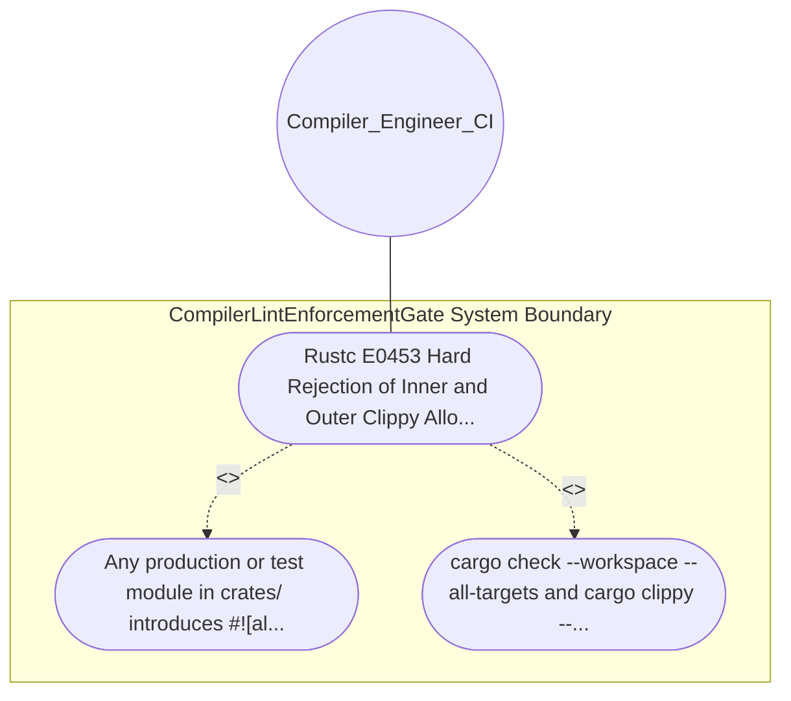

| Attribute | Specification Detail |
| :--- | :--- |
| **Issue ID** | #624 |
| **Title** | Use Case 01: Rustc E0453 Hard Rejection of Inner and Outer Clippy Allow Attributes |
| **Type** | use-case |
| **Primary Actor** | Compiler_Engineer_CI |
| **Scope** | CompilerLintEnforcementGate |
| **Level** | User Goal |
| **Generation Mode** | subagent |
| **Specification Source** | [schema/model.sysml](../../schema/model.sysml) |

# Use Case 01: Rustc E0453 Hard Rejection of Inner and Outer Clippy Allow Attributes

## UML Diagrams

## 1. Actors
- `Compiler_Engineer_CI`

## 2. Preconditions
- [workspace.lints.clippy] in root Cargo.toml configures unwrap_used = \"forbid\", expect_used = \"forbid\", panic = \"forbid\", indexing_slicing = \"forbid\", disallowed_types = \"forbid\", and type_complexity = \"forbid\".

## 3. Trigger
- Any production or test module in crates/ introduces #![allow(clippy::unwrap_used)] or #[allow(clippy::indexing_slicing)].

## 4. Main Success Scenario
1. Any production or test module in crates/ introduces #![allow(clippy::unwrap_used)] or #[allow(clippy::indexing_slicing)].
2. cargo check --workspace --all-targets and cargo clippy --workspace --all-targets fail closed with non-zero exit status and emit error[E0453]: allow(clippy::...) overruled by outer forbid(clippy::...).

## 5. Alternate and Exception Flows
- Precondition guard failure in `CompilerLintEnforcementGate`:
  - `CompilerLintEnforcementGate` rejects the `Rustc E0453 Hard Rejection of Inner and Outer Clippy Allow Attributes` request without partial state mutation and reports diagnostic status to `Compiler_Engineer_CI`.
- Invariant violation while enforcing `Rustc E0453 Hard Rejection of Inner and Outer Clippy Allow Attributes`:
  - `CompilerLintEnforcementGate` aborts `Rustc E0453 Hard Rejection of Inner and Outer Clippy Allow Attributes` execution, preserves prior verified state, and notifies `Compiler_Engineer_CI`.

## 6. Postconditions
- cargo check --workspace --all-targets and cargo clippy --workspace --all-targets fail closed with non-zero exit status and emit error[E0453]: allow(clippy::...) overruled by outer forbid(clippy::...).

## 8. Realization Matrix
| Specification Item | Type | Link / Reference |
| :--- | :--- | :--- |
| **#700** | User Story | [User Story 01: Execute Cargo Clippy Workspace All Targets](../user-stories/US-01-ExecuteCargoClippyWorkspaceAllTargets.md) |
| **#655** | Feature | [Feature 01: [BP 01 Compiler Enforced Forbid Lint Gate and Zero Suppression AST Architecture Blueprint] CompilerLintEnforcementGate](../features/FEAT-01-CompilerLintEnforcementGate.md) |

## Source References
Use case operational flows and lifecycle activity references:
- System Architecture Model: `schema/model.sysml`
- Normative Systems Engineering Standard: ISO/IEC/IEEE 29148:2018 §6.4.2 Concept of Operations

Operational use case realization and traceability links derive from `schema/model.sysml` pursuant to ISO/IEC/IEEE 29148.
