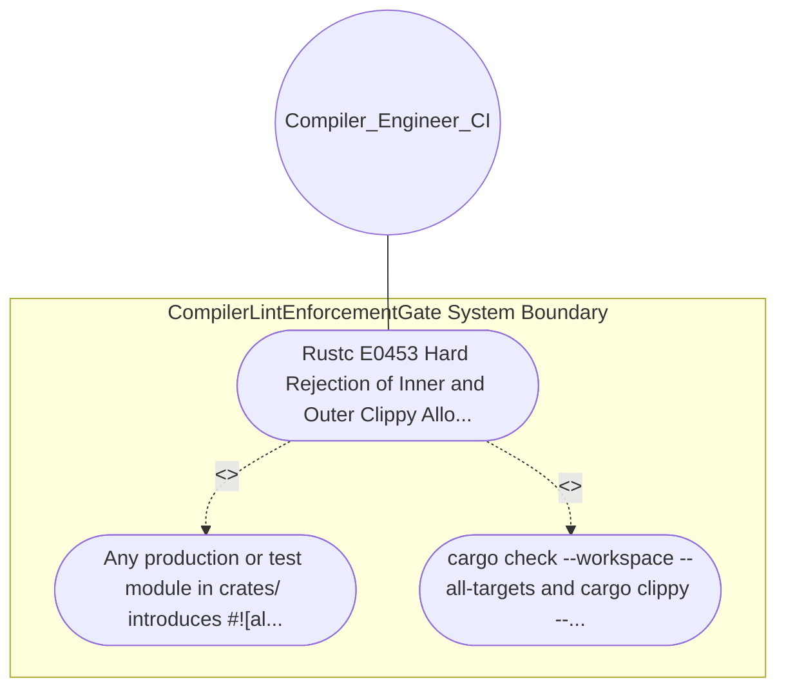

| Attribute | Specification Detail |
| :--- | :--- |
| **Issue ID** | #624 |
| **Title** | Use Case 01: Rustc E0453 Hard Rejection of Inner and Outer Clippy Allow Attributes |
| **Type** | use-case |
| **Primary Actor** | Compiler_Engineer_CI |
| **Scope** | CompilerLintEnforcementGate |
| **Level** | User Goal |
| **Generation Mode** | subagent |
| **Specification Source** | [schema/model.sysml](../../schema/model.sysml) |

# Use Case 01: Rustc E0453 Hard Rejection of Inner and Outer Clippy Allow Attributes

## UML Diagrams

## 1. Actors
- `Compiler_Engineer_CI`

## 2. Preconditions
- `[workspace.lints.clippy]` in root `Cargo.toml` configures `unwrap_used = "forbid"`, `expect_used = "forbid"`, `panic = "forbid"`, `indexing_slicing = "forbid"`, `disallowed_types = "forbid"`, and `type_complexity = "forbid"` under Contract A (full OMG SysML v2.0 + KerML 1.0 grammar coverage, zero 16-construct caps) and Contract B (`rustc`/`cargo clippy --message-format=json` + `ra_ap_syntax` attr CST verification, `ra_ap_vfs`, `ra_ap_paths`, `ra_ap_line_index`, `ra_ap_text_edit`, `rowan`, `camino`, `ignore`, zero text-scanner lint mandates).

## 3. Trigger
- Any production or test module in crates/ introduces inner allow(clippy::unwrap_used) or outer allow(clippy::indexing_slicing).

## 4. Main Success Scenario
1. `Compiler_Engineer_CI` invokes `ExecuteCargoClippyWorkspaceAllTargets` on `CompilerLintEnforcementGate` across all workspace crates using `cargo_metadata`, `cargo-lock`, `cargo-util-schemas`, `cargo-platform`, and `toml_edit` to load root `Cargo.toml` via `CargoManifestInputPort` (Layer 1 Domain State & Data Model).
2. `WorkspaceManifestForbidGate` executes `ReadWorkspaceLintsClippyForbidTable` inside `< 380`-SLOC submodules (`crates/verify-baseline/src/clippy_forbid/` and `crates/deap-core/src/rust_cst/`, replacing deleted legacy `source_ast.rs` and `structural.rs` scanners) to verify that `forbid_unwrap_used`, `forbid_expect_used`, `forbid_panic`, `forbid_indexing_slicing`, `forbid_disallowed_types`, and `forbid_type_complexity` are set to `true` across all `crates_enforced_count = 6` member manifests (Layer 2 Logic & State Management).
3. `CompilerLintEnforcementGate` streams production and test Rust source files through `RustSourceTokenStreamPort` into `ClippyAttributeCstParser` using `ra_ap_syntax` (`ast::Attr`, `ast::HasAttrs`), `ra_ap_vfs`, `ra_ap_paths`, `ra_ap_line_index`, `ra_ap_text_edit`, `rowan`, `camino`, and `ignore` CST inspection with zero hand-rolled text scanners.
4. A production or test module in `crates/` introduces inner `allow(clippy::unwrap_used)` or outer `allow(clippy::indexing_slicing)` in conflict with the inherited workspace `forbid` lint table.
5. `rustc` and `cargo clippy --workspace --all-targets --message-format=json` fail closed with non-zero exit status and emit structured `error[E0453]` diagnostics via `CompilerDiagnosticOutputPort` and `ariadne` / `ra_ap_line_index` span reporting (Layer 3 Presentation & Actuator Interface Binding).

## 5. Alternate and Exception Flows
- 3a. Precondition or manifest parse failure in `WorkspaceManifestForbidGate`:
  - `WorkspaceManifestForbidGate` returns `Result::Err` with a `toml_edit` / `miette` span diagnostic on `CompilerDiagnosticOutputPort`, rejects the `Rustc E0453 Hard Rejection of Inner and Outer Clippy Allow Attributes` request without partial state mutation, and exits fail-closed with code 1.
- 4a. Member crate missing `workspace = true` lint inheritance under `Invariant_REQ_0601_C_LINT_03`:
  - `CompilerLintEnforcementGate` detects `forbid_rule_coverage < 100` via `cargo_metadata`, emits an `ariadne` diagnostic on `CompilerDiagnosticOutputPort`, sets `BaselineGateVerdictPort` to `false`, and terminates fail-closed with exit code 1.
- 5a. Invariant violation while enforcing `Invariant_REQ_0601_FormalInvariant`:
  - `CompilerLintEnforcementGate` aborts execution via `Result<T, E>` error propagation, preserves prior verified state, emits a deterministic `miette` diagnostic to `Compiler_Engineer_CI`, and exits with non-zero status code 1.

## 6. Postconditions
- cargo check --workspace --all-targets and cargo clippy --workspace --all-targets fail closed with non-zero exit status and emit error[E0453]: allow(clippy::...) overruled by outer forbid(clippy::...).

## 8. Realization Matrix
| Specification Item | Type | Link / Reference |
| :--- | :--- | :--- |
| **#700** | User Story | [User Story 01: Execute Cargo Clippy Workspace All Targets](../user-stories/US-01-ExecuteCargoClippyWorkspaceAllTargets.md) |
| **#655** | Feature | [Feature 01: [BP 01 Compiler Enforced Forbid Lint Gate and Zero Suppression AST Architecture Blueprint] CompilerLintEnforcementGate](../features/FEAT-01-CompilerLintEnforcementGate.md) |

## Source References
Use case operational flows and lifecycle activity references:
- System Architecture Model: `schema/model.sysml`
- Normative Systems Engineering Standard: ISO/IEC/IEEE 29148:2018 §6.4.2 Concept of Operations

Operational use case realization and traceability links derive from `schema/model.sysml` pursuant to ISO/IEC/IEEE 29148.
