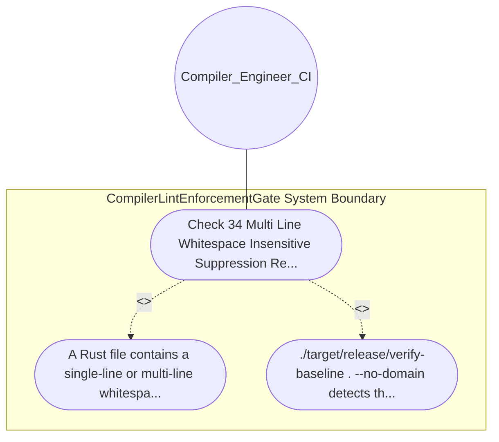

| Attribute | Specification Detail |
| :--- | :--- |
| **Issue ID** | #625 |
| **Title** | Use Case 02: Check 34 Multi Line Whitespace Insensitive Suppression Rejection |
| **Type** | use-case |
| **Primary Actor** | Compiler_Engineer_CI |
| **Scope** | CompilerLintEnforcementGate |
| **Level** | User Goal |
| **Generation Mode** | subagent |
| **Specification Source** | [schema/model.sysml](../../schema/model.sysml) |

# Use Case 02: Check 34 Multi Line Whitespace Insensitive Suppression Rejection

## UML Diagrams

## 1. Actors
- `Compiler_Engineer_CI`

## 2. Preconditions
- The Check 34 zero-regex token-stream scanner scan_clippy_allow_tokens in crates/verify-baseline/src/checks/structural.rs.

## 3. Trigger
- A Rust file contains a single-line or multi-line whitespace-split attribute such as #[ allow ( clippy :: expect_used ) ] or #![ cfg_attr ( test , allow ( clippy :: panic ) ) ].

## 4. Main Success Scenario
1. A Rust file contains a single-line or multi-line whitespace-split attribute such as #[ allow ( clippy :: expect_used ) ] or #![ cfg_attr ( test , allow ( clippy :: panic ) ) ].
2. ./target/release/verify-baseline . --no-domain detects the normalized #![allow(clippy::...)] or #[allow(clippy::...)] token sequence, reports the exact file path and starting 1-based line number, and fails closed with exit code 1.

## 5. Alternate and Exception Flows
- Precondition guard failure in `CompilerLintEnforcementGate`:
  - `CompilerLintEnforcementGate` rejects the `Check 34 Multi Line Whitespace Insensitive Suppression Rejection` request without partial state mutation and reports diagnostic status to `Compiler_Engineer_CI`.
- Invariant violation while enforcing `Check 34 Multi Line Whitespace Insensitive Suppression Rejection`:
  - `CompilerLintEnforcementGate` aborts `Check 34 Multi Line Whitespace Insensitive Suppression Rejection` execution, preserves prior verified state, and notifies `Compiler_Engineer_CI`.

## 6. Postconditions
- ./target/release/verify-baseline . --no-domain detects the normalized #![allow(clippy::...)] or #[allow(clippy::...)] token sequence, reports the exact file path and starting 1-based line number, and fails closed with exit code 1.

## 8. Realization Matrix
| Specification Item | Type | Link / Reference |
| :--- | :--- | :--- |
| **#701** | User Story | [User Story 02: Read Workspace Lints Clippy Forbid Table](../user-stories/US-02-ReadWorkspaceLintsClippyForbidTable.md) |
| **#655** | Feature | [Feature 01: [BP 01 Compiler Enforced Forbid Lint Gate and Zero Suppression AST Architecture Blueprint] CompilerLintEnforcementGate](../features/FEAT-01-CompilerLintEnforcementGate.md) |

## Source References
Use case operational flows and lifecycle activity references:
- System Architecture Model: `schema/model.sysml`
- Normative Systems Engineering Standard: ISO/IEC/IEEE 29148:2018 §6.4.2 Concept of Operations

Operational use case realization and traceability links derive from `schema/model.sysml` pursuant to ISO/IEC/IEEE 29148.
