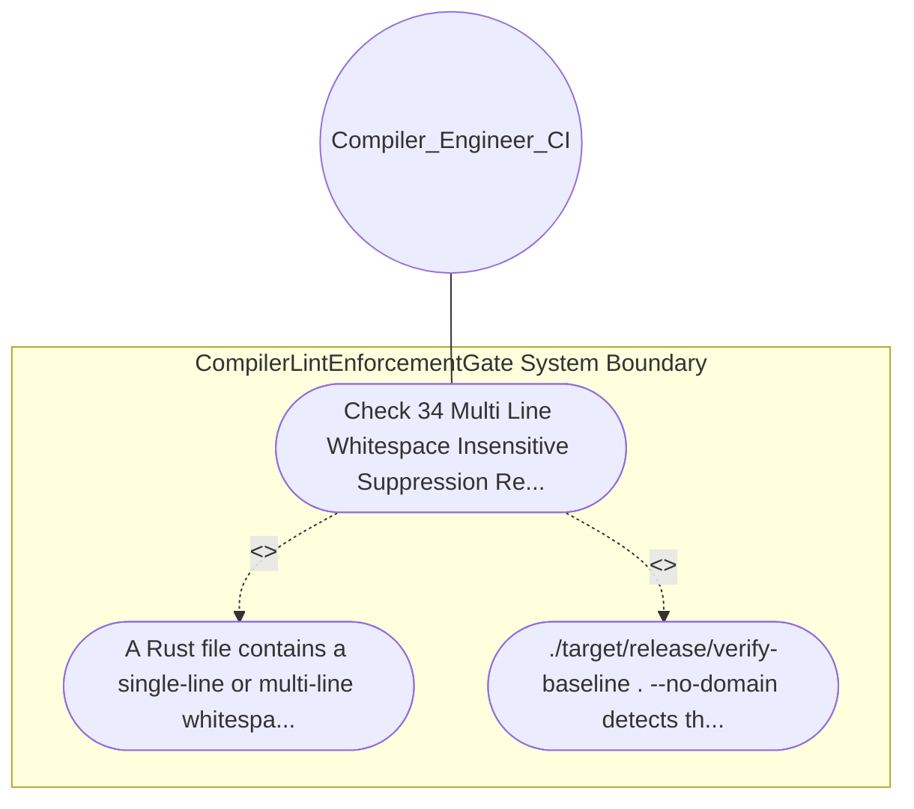

| Attribute | Specification Detail |
| :--- | :--- |
| **Issue ID** | #625 |
| **Title** | Use Case 02: Check 34 Multi Line Whitespace Insensitive Suppression Rejection |
| **Type** | use-case |
| **Primary Actor** | Compiler_Engineer_CI |
| **Scope** | CompilerLintEnforcementGate |
| **Level** | User Goal |
| **Generation Mode** | subagent |
| **Specification Source** | [schema/model.sysml](../../schema/model.sysml) |

# Use Case 02: Check 34 Multi Line Whitespace Insensitive Suppression Rejection

## UML Diagrams

## 1. Actors
- `Compiler_Engineer_CI`

## 2. Preconditions
- The Check 34 zero-regex attribute CST verifier `scan_clippy_allow_tokens` in `< 380`-SLOC submodules (`crates/verify-baseline/src/clippy_forbid/` and `crates/deap-core/src/rust_cst/`) backed by Contract A (full OMG SysML v2.0 + KerML 1.0 grammar coverage, zero 16-construct caps) and Contract B (`rustc`/`cargo clippy --message-format=json` + `ra_ap_syntax` attr CST verification, `ra_ap_vfs`, `ra_ap_paths`, `ra_ap_line_index`, `ra_ap_text_edit`, `rowan`, `camino`, `ignore`, zero text-scanner lint mandates), with explicit deletion of legacy hand-rolled scanners (`source_ast.rs`, `structural.rs`).

## 3. Trigger
- A Rust file contains a single-line or multi-line whitespace-split attribute such as allow ( clippy :: expect_used ) or cfg_attr ( test , allow ( clippy :: panic ) ).

## 4. Main Success Scenario
1. `Compiler_Engineer_CI` invokes `ExecuteVerifyBaselineNoDomain` on `CompilerLintEnforcementGate` to audit all workspace Rust files via `RustSourceTokenStreamPort` using `camino`, `ignore`, `ra_ap_vfs`, and `ra_ap_paths` (Layer 1 Domain State & Data Model).
2. `ClippyAttributeCstParser` executes `RunScanClippyAllowTokensOn` inside `< 380`-SLOC submodules (`crates/verify-baseline/src/clippy_forbid/` and `crates/deap-core/src/rust_cst/`, replacing deleted legacy `source_ast.rs` and `structural.rs`) using `ra_ap_syntax` (`ast::Attr`, `ast::HasAttrs`) and `rowan` lossless CST nodes to transition from `ScanningSource` to `InspectingAttribute` outside comments and string literals (Layer 2 Logic & State Management).
3. A Rust source file contains a single-line or multi-line whitespace-split attribute such as `allow ( clippy :: expect_used )` or `cfg_attr ( test , allow ( clippy :: panic ) )`.
4. `ClippyAttributeCstParser` transitions to `NormalizingBracketBody`, inspects the lossless `ra_ap_syntax` attribute token tree across line boundaries without hand-rolled text scanners, matches the forbidden `allow(clippy::` sequence, and transitions to `ViolationRecorded`.
5. `./target/release/verify-baseline . --no-domain` and `rustc`/`cargo clippy --message-format=json` emit a deterministic `ariadne` / `ra_ap_line_index` diagnostic via `CompilerDiagnosticOutputPort` with the exact file path and starting 1-based line number, set `BaselineGateVerdictPort` to `false`, and fail closed with exit code 1 (Layer 3 Presentation & Actuator Interface Binding).

## 5. Alternate and Exception Flows
- 3a. Unreadable source file or invalid UTF-8 stream on `RustSourceTokenStreamPort`:
  - `ClippyAttributeCstParser` propagates `Result::Err` without silent fallback, emits a `miette` I/O diagnostic on `CompilerDiagnosticOutputPort`, and exits fail-closed with code 1.
- 4a. Unbalanced bracket delimiter or malformed attribute syntax in `NormalizingBracketBody`:
  - `ClippyAttributeCstParser` records a syntax violation via `ra_ap_syntax` and `ariadne`, aborts token normalization without partial state mutation, and exits fail-closed with code 1.
- 5a. Invariant violation on `allowed_suppression_count` under `Invariant_REQ_0601_C_LINT_03`:
  - `CompilerLintEnforcementGate` aborts verification via `Result<T, E>`, preserves prior verified state, notifies `Compiler_Engineer_CI` via `CompilerDiagnosticOutputPort`, and returns fail-closed exit code 1.

## 6. Postconditions
- ./target/release/verify-baseline . --no-domain detects the normalized inner or outer allow(clippy::...) token sequence, reports the exact file path and starting 1-based line number, and fails closed with exit code 1.

## 8. Realization Matrix
| Specification Item | Type | Link / Reference |
| :--- | :--- | :--- |
| **#701** | User Story | [User Story 02: Read Workspace Lints Clippy Forbid Table](../user-stories/US-02-ReadWorkspaceLintsClippyForbidTable.md) |
| **#655** | Feature | [Feature 01: [BP 01 Compiler Enforced Forbid Lint Gate and Zero Suppression AST Architecture Blueprint] CompilerLintEnforcementGate](../features/FEAT-01-CompilerLintEnforcementGate.md) |

## Source References
Use case operational flows and lifecycle activity references:
- System Architecture Model: `schema/model.sysml`
- Normative Systems Engineering Standard: ISO/IEC/IEEE 29148:2018 §6.4.2 Concept of Operations

Operational use case realization and traceability links derive from `schema/model.sysml` pursuant to ISO/IEC/IEEE 29148.
