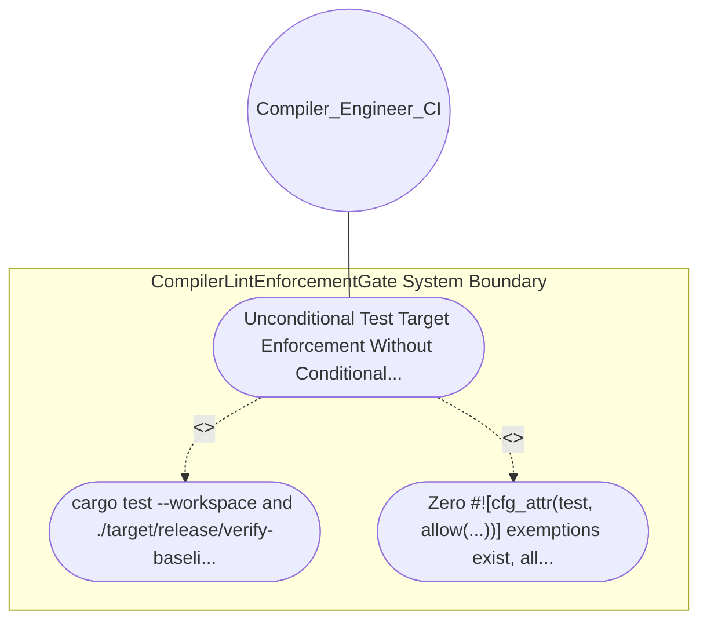

| Attribute | Specification Detail |
| :--- | :--- |
| **Issue ID** | #626 |
| **Title** | Use Case 03: Unconditional Test Target Enforcement Without Conditional Exemption |
| **Type** | use-case |
| **Primary Actor** | Compiler_Engineer_CI |
| **Scope** | CompilerLintEnforcementGate |
| **Level** | User Goal |
| **Generation Mode** | subagent |
| **Specification Source** | [schema/model.sysml](../../schema/model.sysml) |

# Use Case 03: Unconditional Test Target Enforcement Without Conditional Exemption

## UML Diagrams

## 1. Actors
- `Compiler_Engineer_CI`

## 2. Preconditions
- Unit test modules (`cfg(test) mod tests`) and integration test files (`crates/*/tests/*.rs`) across all six workspace crates under Contract A (full OMG SysML v2.0 + KerML 1.0 grammar coverage, zero 16-construct caps) and Contract B (`rustc`/`cargo clippy --message-format=json` + `ra_ap_syntax` attr CST verification, `ra_ap_vfs`, `ra_ap_paths`, `ra_ap_line_index`, `ra_ap_text_edit`, `rowan`, `camino`, `ignore`, zero text-scanner lint mandates).

## 3. Trigger
- cargo test --workspace and ./target/release/verify-baseline . --no-domain are executed.

## 4. Main Success Scenario
1. `Compiler_Engineer_CI` invokes `ExecuteCargoClippyWorkspaceAllTargets` and `ExecuteVerifyBaselineNoDomain` on `CompilerLintEnforcementGate` across all six workspace crates enumerated via `cargo_metadata`, `cargo-lock`, `cargo-util-schemas`, `cargo-platform`, and `toml_edit` (Layer 1 Domain State & Data Model).
2. `TestTargetLintEnforcer` inspects all unit test modules (`cfg(test) mod tests`) and integration test targets (`crates/*/tests/*.rs`) streamed over `RustSourceTokenStreamPort` using `ra_ap_syntax` (`ast::Attr`, `ast::HasAttrs`), `ra_ap_vfs`, `ra_ap_paths`, `ra_ap_line_index`, `ra_ap_text_edit`, `rowan`, `camino`, and `ignore` inside `< 380`-SLOC submodules (`crates/verify-baseline/src/clippy_forbid/` and `crates/deap-core/src/rust_cst/`, replacing deleted legacy `source_ast.rs` and `structural.rs` scanners).
3. `ClippyAttributeCstParser` executes `RunScanClippyAllowTokensOn` to verify that zero `cfg_attr(test, allow(...))` conditional lint exemptions exist in any crate root or test module with zero hand-rolled text-scanner lint mandates (Layer 2 Logic & State Management).
4. `CompilerLintEnforcementGate` verifies via `rustc` and `cargo clippy --workspace --all-targets --message-format=json` that all test assertions use fallible `Result<T, E>` return signatures or pattern matching instead of `.unwrap()`, `.expect()`, or direct slice indexing.
5. `cargo test --workspace` and `./target/release/verify-baseline . --no-domain` complete with zero `E0453` or Check 34 violations and emit `true` on `BaselineGateVerdictPort` with exit code 0 (Layer 3 Presentation & Actuator Interface Binding).

## 5. Alternate and Exception Flows
- 3a. Conditional `cfg_attr(test, allow(clippy::...))` exemption detected in a test module:
  - `TestTargetLintEnforcer` transitions to `ViolationRecorded`, emits an `ariadne` / `miette` span diagnostic via `CompilerDiagnosticOutputPort`, and terminates fail-closed with exit code 1.
- 4a. Test target invokes `.unwrap()`, `.expect()`, or direct slice indexing under `forbid` lint rules:
  - `cargo clippy --workspace --all-targets` rejects the test target via `Result::Err` and `CompilerDiagnosticOutputPort` diagnostic output, halting test execution with non-zero exit code 1.
- 5a. Invariant violation while enforcing `Invariant_REQ_0601_FormalInvariant` in `CompilerLintEnforcementGate`:
  - `CompilerLintEnforcementGate` aborts execution without partial state mutation, preserves prior verified state, emits a deterministic `miette` diagnostic to `Compiler_Engineer_CI`, and exits fail-closed with code 1.

## 6. Postconditions
- Zero #![cfg_attr(test, allow(...))] exemptions exist, all test assertions use fallible Result return signatures or pattern matching instead of .unwrap(), .expect(), or direct slice indexing, and all workspace tests pass.

## 8. Realization Matrix
| Specification Item | Type | Link / Reference |
| :--- | :--- | :--- |
| **#702** | User Story | [User Story 03: Execute Verify Baseline No Domain](../user-stories/US-03-ExecuteVerifyBaselineNoDomain.md) |
| **#655** | Feature | [Feature 01: [BP 01 Compiler Enforced Forbid Lint Gate and Zero Suppression AST Architecture Blueprint] CompilerLintEnforcementGate](../features/FEAT-01-CompilerLintEnforcementGate.md) |

## Source References
Use case operational flows and lifecycle activity references:
- System Architecture Model: `schema/model.sysml`
- Normative Systems Engineering Standard: ISO/IEC/IEEE 29148:2018 §6.4.2 Concept of Operations

Operational use case realization and traceability links derive from `schema/model.sysml` pursuant to ISO/IEC/IEEE 29148.
