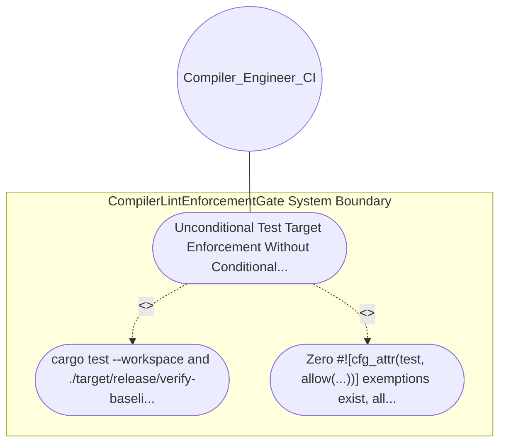

| Attribute | Specification Detail |
| :--- | :--- |
| **Issue ID** | #626 |
| **Title** | Use Case 03: Unconditional Test Target Enforcement Without Conditional Exemption |
| **Type** | use-case |
| **Primary Actor** | Compiler_Engineer_CI |
| **Scope** | CompilerLintEnforcementGate |
| **Level** | User Goal |
| **Generation Mode** | subagent |
| **Specification Source** | [schema/model.sysml](../../schema/model.sysml) |

# Use Case 03: Unconditional Test Target Enforcement Without Conditional Exemption

## UML Diagrams

## 1. Actors
- `Compiler_Engineer_CI`

## 2. Preconditions
- Unit test modules (#[cfg(test)] mod tests) and integration test files (crates/ * /tests/ *.rs) across all six workspace crates.

## 3. Trigger
- cargo test --workspace and ./target/release/verify-baseline . --no-domain are executed.

## 4. Main Success Scenario
1. cargo test --workspace and ./target/release/verify-baseline . --no-domain are executed.
2. Zero #![cfg_attr(test, allow(...))] exemptions exist, all test assertions use fallible Result return signatures or pattern matching instead of .unwrap(), .expect(), or direct slice indexing, and all workspace tests pass.

## 5. Alternate and Exception Flows
- Precondition guard failure in `CompilerLintEnforcementGate`:
  - `CompilerLintEnforcementGate` rejects the `Unconditional Test Target Enforcement Without Conditional Exemption` request without partial state mutation and reports diagnostic status to `Compiler_Engineer_CI`.
- Invariant violation while enforcing `Unconditional Test Target Enforcement Without Conditional Exemption`:
  - `CompilerLintEnforcementGate` aborts `Unconditional Test Target Enforcement Without Conditional Exemption` execution, preserves prior verified state, and notifies `Compiler_Engineer_CI`.

## 6. Postconditions
- Zero #![cfg_attr(test, allow(...))] exemptions exist, all test assertions use fallible Result return signatures or pattern matching instead of .unwrap(), .expect(), or direct slice indexing, and all workspace tests pass.

## 8. Realization Matrix
| Specification Item | Type | Link / Reference |
| :--- | :--- | :--- |
| **#702** | User Story | [User Story 03: Execute Verify Baseline No Domain](../user-stories/US-03-ExecuteVerifyBaselineNoDomain.md) |
| **#655** | Feature | [Feature 01: [BP 01 Compiler Enforced Forbid Lint Gate and Zero Suppression AST Architecture Blueprint] CompilerLintEnforcementGate](../features/FEAT-01-CompilerLintEnforcementGate.md) |

## Source References
Use case operational flows and lifecycle activity references:
- System Architecture Model: `schema/model.sysml`
- Normative Systems Engineering Standard: ISO/IEC/IEEE 29148:2018 §6.4.2 Concept of Operations

Operational use case realization and traceability links derive from `schema/model.sysml` pursuant to ISO/IEC/IEEE 29148.
