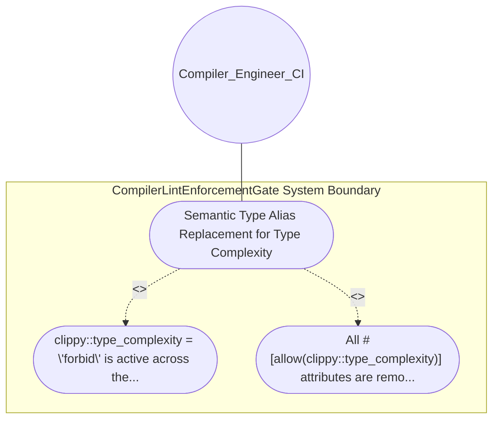

| Attribute | Specification Detail |
| :--- | :--- |
| **Issue ID** | #627 |
| **Title** | Use Case 04: Semantic Type Alias Replacement for Type Complexity |
| **Type** | use-case |
| **Primary Actor** | Compiler_Engineer_CI |
| **Scope** | CompilerLintEnforcementGate |
| **Level** | User Goal |
| **Generation Mode** | subagent |
| **Specification Source** | [schema/model.sysml](../../schema/model.sysml) |

# Use Case 04: Semantic Type Alias Replacement for Type Complexity

## UML Diagrams

## 1. Actors
- `Compiler_Engineer_CI`

## 2. Preconditions
- Complex nested return or collection signatures in crates/deap-core/src/source_ast.rs and crates/compile-sysml/src/lib.rs.

## 3. Trigger
- clippy::type_complexity = \"forbid\" is active across the workspace.

## 4. Main Success Scenario
1. clippy::type_complexity = \"forbid\" is active across the workspace.
2. All #[allow(clippy::type_complexity)] attributes are removed and replaced by documented semantic pub type aliases (ExtractedMethodSignature and ComponentMethodTable) or domain structs that compile with zero warnings under cargo clippy --workspace --all-targets -- -D warnings.

## 5. Alternate and Exception Flows
- Precondition guard failure in `CompilerLintEnforcementGate`:
  - `CompilerLintEnforcementGate` rejects the `Semantic Type Alias Replacement for Type Complexity` request without partial state mutation and reports diagnostic status to `Compiler_Engineer_CI`.
- Invariant violation while enforcing `Semantic Type Alias Replacement for Type Complexity`:
  - `CompilerLintEnforcementGate` aborts `Semantic Type Alias Replacement for Type Complexity` execution, preserves prior verified state, and notifies `Compiler_Engineer_CI`.

## 6. Postconditions
- All #[allow(clippy::type_complexity)] attributes are removed and replaced by documented semantic pub type aliases (ExtractedMethodSignature and ComponentMethodTable) or domain structs that compile with zero warnings under cargo clippy --workspace --all-targets -- -D warnings.

## 8. Realization Matrix
| Specification Item | Type | Link / Reference |
| :--- | :--- | :--- |
| **#703** | User Story | [User Story 04: Run Scan Clippy Allow Tokens On](../user-stories/US-04-RunScanClippyAllowTokensOn.md) |
| **#655** | Feature | [Feature 01: [BP 01 Compiler Enforced Forbid Lint Gate and Zero Suppression AST Architecture Blueprint] CompilerLintEnforcementGate](../features/FEAT-01-CompilerLintEnforcementGate.md) |

## Source References
Use case operational flows and lifecycle activity references:
- System Architecture Model: `schema/model.sysml`
- Normative Systems Engineering Standard: ISO/IEC/IEEE 29148:2018 §6.4.2 Concept of Operations

Operational use case realization and traceability links derive from `schema/model.sysml` pursuant to ISO/IEC/IEEE 29148.
