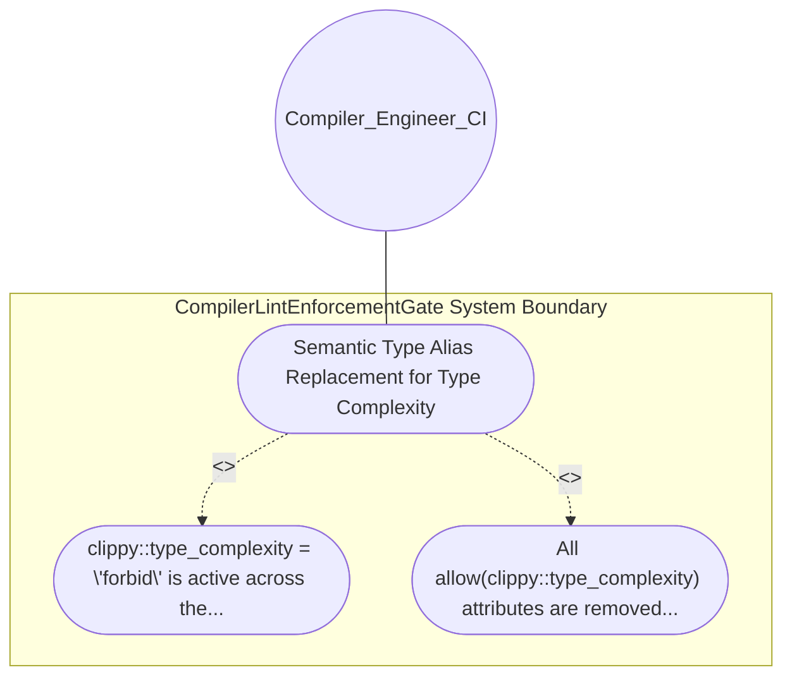

| Attribute | Specification Detail |
| :--- | :--- |
| **Issue ID** | #627 |
| **Title** | Use Case 04: Semantic Type Alias Replacement for Type Complexity |
| **Type** | use-case |
| **Primary Actor** | Compiler_Engineer_CI |
| **Scope** | CompilerLintEnforcementGate |
| **Level** | User Goal |
| **Generation Mode** | subagent |
| **Specification Source** | [schema/model.sysml](../../schema/model.sysml) |

# Use Case 04: Semantic Type Alias Replacement for Type Complexity

## UML Diagrams

## 1. Actors
- `Compiler_Engineer_CI`

## 2. Preconditions
- Complex nested return or collection signatures in crates/deap-core/src/deap_core::rust_cst / deap_core::dart_cst.rs and crates/compile-sysml/src/lib.rs.

## 3. Trigger
- clippy::type_complexity = \"forbid\" is active across the workspace.

## 4. Main Success Scenario
1. `Compiler_Engineer_CI` activates `forbid_type_complexity = true` in `CompilerLintEnforcementGate` via `WorkspaceManifestForbidGate` and `toml_edit` on `CargoManifestInputPort`.
2. `CrateRootAttributeSanitizer` scans `crates/deap-core/src/` and `crates/compile-sysml/src/lib.rs` through `RustSourceTokenStreamPort` using `ra_ap_syntax`, `syn`, `quote`, and `prettyplease`.
3. `CrateRootAttributeSanitizer` removes all `allow(clippy::type_complexity)` attributes and replaces deeply nested tuple or collection signatures with documented semantic `pub type` aliases (`ExtractedMethodSignature` and `ComponentMethodTable`) or domain structs.
4. `ClippyAttributeCstParser` executes `RunScanClippyAllowTokensOn` to confirm `allowed_suppression_count == 0` across all workspace source files.
5. `Compiler_Engineer_CI` executes `ExecuteCargoClippyWorkspaceAllTargets` (`cargo clippy --workspace --all-targets -- -D warnings`), which compiles cleanly with zero warnings and emits `true` on `BaselineGateVerdictPort`.

## 5. Alternate and Exception Flows
- 3a. Residual `allow(clippy::type_complexity)` attribute detected by `ClippyAttributeCstParser`:
  - `CompilerLintEnforcementGate` emits `error[E0453]` and a Check 34 `ariadne` / `miette` diagnostic on `CompilerDiagnosticOutputPort`, sets `BaselineGateVerdictPort` to `false`, and exits fail-closed with code 1.
- 4a. Unaliased complex type signature exceeds the `clippy::type_complexity` threshold:
  - `cargo clippy --workspace --all-targets -- -D warnings` returns `Result::Err`, emits a compiler diagnostic identifying the offending signature span, and halts the build with exit code 1.
- 5a. AST formatting or syntax validation failure during `syn` / `prettyplease` type alias verification:
  - `CrateRootAttributeSanitizer` aborts without partial state mutation, preserves prior verified state, reports a deterministic `miette` diagnostic to `Compiler_Engineer_CI`, and exits fail-closed with code 1.

## 6. Postconditions
- All allow(clippy::type_complexity) attributes are removed and replaced by documented semantic pub type aliases (ExtractedMethodSignature and ComponentMethodTable) or domain structs that compile with zero warnings under cargo clippy --workspace --all-targets -- -D warnings.

## 8. Realization Matrix
| Specification Item | Type | Link / Reference |
| :--- | :--- | :--- |
| **#703** | User Story | [User Story 04: Run Scan Clippy Allow Tokens On](../user-stories/US-04-RunScanClippyAllowTokensOn.md) |
| **#655** | Feature | [Feature 01: [BP 01 Compiler Enforced Forbid Lint Gate and Zero Suppression AST Architecture Blueprint] CompilerLintEnforcementGate](../features/FEAT-01-CompilerLintEnforcementGate.md) |

## Source References
Use case operational flows and lifecycle activity references:
- System Architecture Model: `schema/model.sysml`
- Normative Systems Engineering Standard: ISO/IEC/IEEE 29148:2018 §6.4.2 Concept of Operations

Operational use case realization and traceability links derive from `schema/model.sysml` pursuant to ISO/IEC/IEEE 29148.
