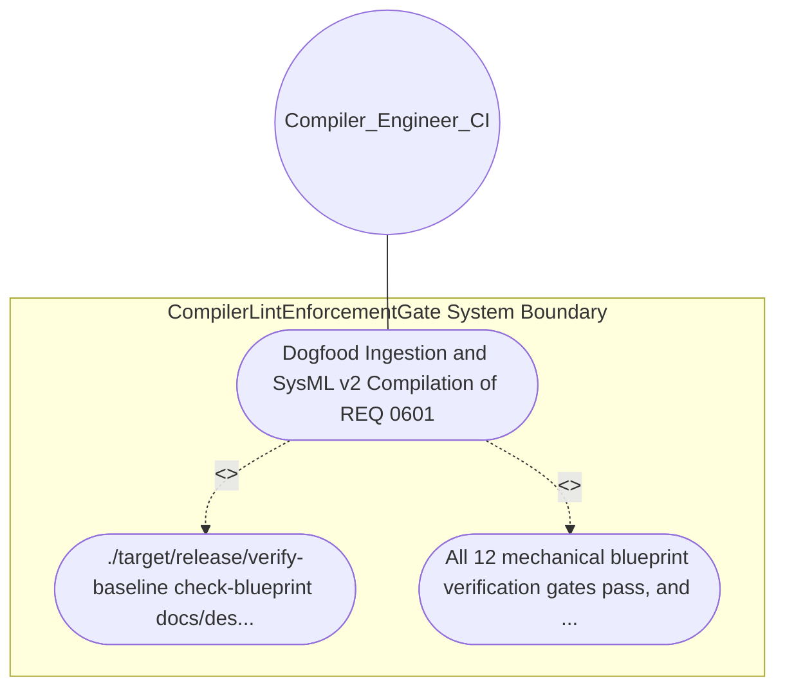

| Attribute | Specification Detail |
| :--- | :--- |
| **Issue ID** | #628 |
| **Title** | Use Case 05: Dogfood Ingestion and SysML v2 Compilation of REQ 0601 |
| **Type** | use-case |
| **Primary Actor** | Compiler_Engineer_CI |
| **Scope** | CompilerLintEnforcementGate |
| **Level** | User Goal |
| **Generation Mode** | subagent |
| **Specification Source** | [schema/model.sysml](../../schema/model.sysml) |

# Use Case 05: Dogfood Ingestion and SysML v2 Compilation of REQ 0601

## UML Diagrams

## 1. Actors
- `Compiler_Engineer_CI`

## 2. Preconditions
- This blueprint specification `docs/designs/blueprint-01-compiler-enforced-lint-forbid-gate.md` under Contract A (full 100% normative OMG SysML v2.0 + KerML 1.0 Definition and Usage grammar coverage, zero 16-construct caps) and Contract B (`rustc`/`cargo clippy --message-format=json` + `ra_ap_syntax` attr CST verification, `ra_ap_vfs`, `ra_ap_paths`, `ra_ap_line_index`, `ra_ap_text_edit`, `rowan`, `camino`, `ignore`, `logos`, `salsa`, `ariadne`, `pulldown-cmark`, zero text-scanner lint mandates).

## 3. Trigger
- ./target/release/verify-baseline check-blueprint docs/designs/blueprint-01-compiler-enforced-lint-forbid-gate.md --dry-run is executed.

## 4. Main Success Scenario
1. `Compiler_Engineer_CI` invokes `./target/release/verify-baseline check-blueprint docs/designs/blueprint-01-compiler-enforced-lint-forbid-gate.md --dry-run` using `pulldown-cmark` AST parsing and `ra_ap_syntax`/`ra_ap_vfs`/`ra_ap_paths`/`ra_ap_line_index`/`ra_ap_text_edit`/`rowan`/`camino`/`ignore` inside `< 380`-SLOC submodules (`crates/verify-baseline/src/clippy_forbid/` and `crates/deap-core/src/rust_cst/`, replacing deleted legacy `source_ast.rs` and `structural.rs` scanners) to validate the 8-part blueprint structure (Layer 1 Domain State & Data Model).
2. `CompilerLintEnforcementGate` verifies all 12 mechanical blueprint verification gates, including `REQ-0601` traceability, KaTeX math blocks, Mermaid state/sequence diagrams, 5-column STPA/FMECA tables, and `rustc`/`cargo clippy --message-format=json` + `ra_ap_syntax` attr CST invariants with zero text-scanner lint mandates (Layer 2 Logic & State Management).
3. `Compiler_Engineer_CI` invokes `ExecuteIngestSysmlSchemaBlueprint01` (`./target/release/ingest-sysml --schema docs/designs/blueprint-01-compiler-enforced-lint-forbid-gate.md --format markdown`) to extract full OMG SysML v2.0 + KerML 1.0 CST/AST nodes (zero 16-construct caps) via `logos`, `rowan`, `salsa`, and `ariadne` (`deap_core::sysml_cst`).
4. `ingest_sysml` synthesizes `REQ_0601_BP_01_Compiler_Enforced_Forbid_Lint_Gate_and_Zero_Suppression_AST_Architecture_Blueprint`, `CompilerLintEnforcementGate`, `WorkspaceManifestForbidGate`, `ClippyAttributeCstParser`, `CrateRootAttributeSanitizer`, `TestTargetLintEnforcer`, `CargoManifestInputPort`, `RustSourceTokenStreamPort`, `CompilerDiagnosticOutputPort`, `BaselineGateVerdictPort`, and formal constraints `Invariant_REQ_0601_C_LINT_03` and `Invariant_REQ_0601_FormalInvariant`.
5. `CompilerLintEnforcementGate` verifies bijective SysML v2 compilation into `schema/model.sysml` and emits `true` on `BaselineGateVerdictPort` with exit code 0 (Layer 3 Presentation & Actuator Interface Binding).

## 5. Alternate and Exception Flows
- 3a. Blueprint Markdown fails any of the 12 mechanical verification gates in `check-blueprint`:
  - `verify_baseline` returns `Result::Err`, emits an `ariadne` / `miette` structural diagnostic on `CompilerDiagnosticOutputPort`, and exits fail-closed with code 1 without modifying `.sysml` artifacts.
- 4a. Duplicate or unresolved SysML v2 identifier encountered during `ExecuteIngestSysmlSchemaBlueprint01`:
  - `ingest_sysml` aborts AST synthesis via `Result<T, E>`, preserves prior verified `schema/model.sysml` state, and emits a deterministic `miette` diagnostic with exit code 1.
- 5a. Invariant violation while enforcing `Invariant_REQ_0601_FormalInvariant`:
  - `CompilerLintEnforcementGate` halts compilation, sets `BaselineGateVerdictPort` to `false`, notifies `Compiler_Engineer_CI`, and exits fail-closed with status code 1.

## 6. Postconditions
- All 12 mechanical blueprint verification gates pass, and the translator synthesizes `REQ-0601`, `CompilerLintEnforcementGate`, its interface ports, state attributes, formal constraints (`C-LINT-01`..`C-LINT-03`), and `AC-01`..`AC-05` into `docs/designs/blueprint-01-compiler-enforced-lint-forbid-gate.sysml` and `schema/model.sysml` with full OMG SysML v2.0 + KerML 1.0 grammar coverage (zero 16-construct caps).

## 8. Realization Matrix
| Specification Item | Type | Link / Reference |
| :--- | :--- | :--- |
| **#704** | User Story | [User Story 05: Execute Ingest Sysml Schema Blueprint01](../user-stories/US-05-ExecuteIngestSysmlSchemaBlueprint01.md) |
| **#655** | Feature | [Feature 01: [BP 01 Compiler Enforced Forbid Lint Gate and Zero Suppression AST Architecture Blueprint] CompilerLintEnforcementGate](../features/FEAT-01-CompilerLintEnforcementGate.md) |

## Source References
Use case operational flows and lifecycle activity references:
- System Architecture Model: `schema/model.sysml`
- Normative Systems Engineering Standard: ISO/IEC/IEEE 29148:2018 §6.4.2 Concept of Operations

Operational use case realization and traceability links derive from `schema/model.sysml` pursuant to ISO/IEC/IEEE 29148.
