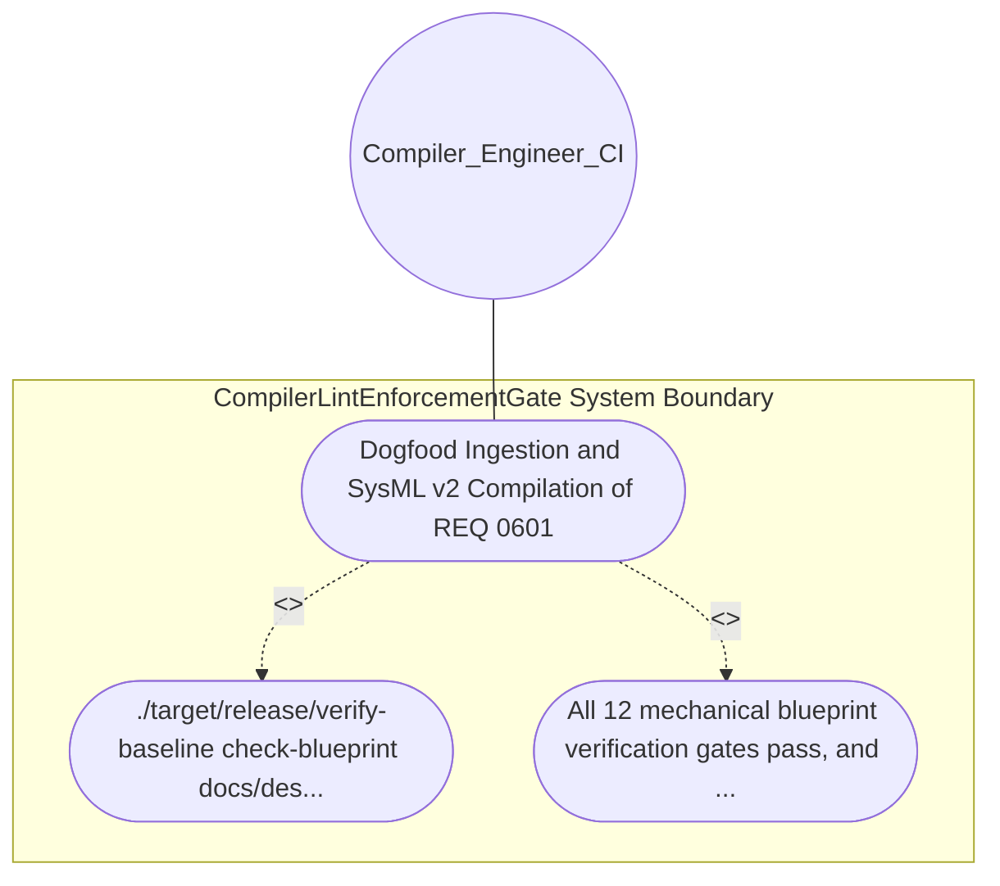

| Attribute | Specification Detail |
| :--- | :--- |
| **Issue ID** | #628 |
| **Title** | Use Case 05: Dogfood Ingestion and SysML v2 Compilation of REQ 0601 |
| **Type** | use-case |
| **Primary Actor** | Compiler_Engineer_CI |
| **Scope** | CompilerLintEnforcementGate |
| **Level** | User Goal |
| **Generation Mode** | subagent |
| **Specification Source** | [schema/model.sysml](../../schema/model.sysml) |

# Use Case 05: Dogfood Ingestion and SysML v2 Compilation of REQ 0601

## UML Diagrams

## 1. Actors
- `Compiler_Engineer_CI`

## 2. Preconditions
- This blueprint specification docs/designs/blueprint-01-compiler-enforced-lint-forbid-gate.md.

## 3. Trigger
- ./target/release/verify-baseline check-blueprint docs/designs/blueprint-01-compiler-enforced-lint-forbid-gate.md --dry-run is executed.

## 4. Main Success Scenario
1. ./target/release/verify-baseline check-blueprint docs/designs/blueprint-01-compiler-enforced-lint-forbid-gate.md --dry-run is executed.
2. All 12 mechanical blueprint verification gates pass, and the translator synthesizes REQ-0601, CompilerLintEnforcementGate, its interface ports, state attributes, formal constraints (C-LINT-01..C-LINT-03), and AC-01..AC-05 into docs/designs/blueprint-01-compiler-enforced-lint-forbid-gate.sysml and.

## 5. Alternate and Exception Flows
- Precondition guard failure in `CompilerLintEnforcementGate`:
  - `CompilerLintEnforcementGate` rejects the `Dogfood Ingestion and SysML v2 Compilation of REQ 0601` request without partial state mutation and reports diagnostic status to `Compiler_Engineer_CI`.
- Invariant violation while enforcing `Dogfood Ingestion and SysML v2 Compilation of REQ 0601`:
  - `CompilerLintEnforcementGate` aborts `Dogfood Ingestion and SysML v2 Compilation of REQ 0601` execution, preserves prior verified state, and notifies `Compiler_Engineer_CI`.

## 6. Postconditions
- All 12 mechanical blueprint verification gates pass, and the translator synthesizes REQ-0601, CompilerLintEnforcementGate, its interface ports, state attributes, formal constraints (C-LINT-01..C-LINT-03), and AC-01..AC-05 into docs/designs/blueprint-01-compiler-enforced-lint-forbid-gate.sysml and.

## 8. Realization Matrix
| Specification Item | Type | Link / Reference |
| :--- | :--- | :--- |
| **#704** | User Story | [User Story 05: Execute Ingest Sysml Schema Blueprint01](../user-stories/US-05-ExecuteIngestSysmlSchemaBlueprint01.md) |
| **#655** | Feature | [Feature 01: [BP 01 Compiler Enforced Forbid Lint Gate and Zero Suppression AST Architecture Blueprint] CompilerLintEnforcementGate](../features/FEAT-01-CompilerLintEnforcementGate.md) |

## Source References
Use case operational flows and lifecycle activity references:
- System Architecture Model: `schema/model.sysml`
- Normative Systems Engineering Standard: ISO/IEC/IEEE 29148:2018 §6.4.2 Concept of Operations

Operational use case realization and traceability links derive from `schema/model.sysml` pursuant to ISO/IEC/IEEE 29148.
