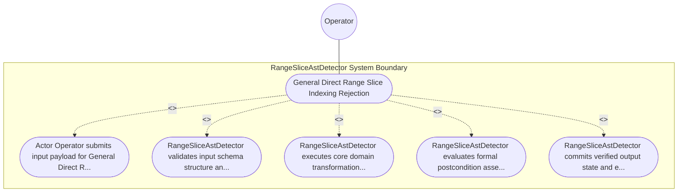

| Attribute | Specification Detail |
| :--- | :--- |
| **Issue ID** | #629 |
| **Title** | Use Case 06: General Direct Range Slice Indexing Rejection |
| **Type** | use-case |
| **Primary Actor** | Operator |
| **Scope** | RangeSliceAstDetector |
| **Level** | User Goal |
| **Generation Mode** | subagent |
| **Specification Source** | [schema/model.sysml](../../schema/model.sysml) |

# Use Case 06: General Direct Range Slice Indexing Rejection

## UML Diagrams

## 1. Actors
- `Operator`

## 2. Preconditions
- The compiler execution environment is initialized in nominal operational state.
- Authoritative input schema files exist with read access.

## 3. Trigger
- General Direct Range Slice Indexing Rejection

## 4. Main Success Scenario
1. Actor `Operator` submits input payload for `General Direct Range Slice Indexing Rejection` to `RangeSliceAstDetector`.
2. `RangeSliceAstDetector` validates input schema structure and precondition guards for `General Direct Range Slice Indexing Rejection`.
3. `RangeSliceAstDetector` executes core domain transformation and state transition logic for `General Direct Range Slice Indexing Rejection`.
4. `RangeSliceAstDetector` evaluates formal postcondition assertions and structural invariants.
5. `RangeSliceAstDetector` commits verified output state and emits completion telemetry to `Operator`.

## 5. Alternate and Exception Flows
- 5a. Input schema or precondition validation failure in `RangeSliceAstDetector`:
  - `RangeSliceAstDetector` rejects the malformed request and records a structured diagnostic event.
  - System preserves prior verified state without partial mutation.
- 5b. Formal invariant or constraint violation detected during `General Direct Range Slice Indexing Rejection` execution:
  - `RangeSliceAstDetector` aborts the active transaction and transitions to safe fallback mode.
  - Diagnostic telemetry is emitted to `Operator`.
- 5c. Downstream resource timeout or communication fault in `RangeSliceAstDetector`:
  - `RangeSliceAstDetector` halts execution cleanly and reports deterministic fault status.

## 6. Postconditions
- All semantic models and generated artifacts satisfy formal invariant requirements.
- Output artifacts are deterministically emitted with bitwise reproducibility.

## 8. Realization Matrix
| Specification Item | Type | Link / Reference |
| :--- | :--- | :--- |
| **#567** | User Story | [User Story 06: check compiler ast purity](../user-stories/US-06-check_compiler_ast_purity.md) |
| **#660** | Feature | [Feature 06: [BP 02 Check 34 AST Purity Fail Closed IO and Anti Gaming Test Gate Blueprint] RangeSliceAstDetector](../features/FEAT-06-RangeSliceAstDetector.md) |

## Source References
Use case operational flows and lifecycle activity references:
- System Architecture Model: `schema/model.sysml`
- Normative Systems Engineering Standard: ISO/IEC/IEEE 29148:2018 §6.4.2 Concept of Operations

Operational use case realization and traceability links derive from `schema/model.sysml` pursuant to ISO/IEC/IEEE 29148.
