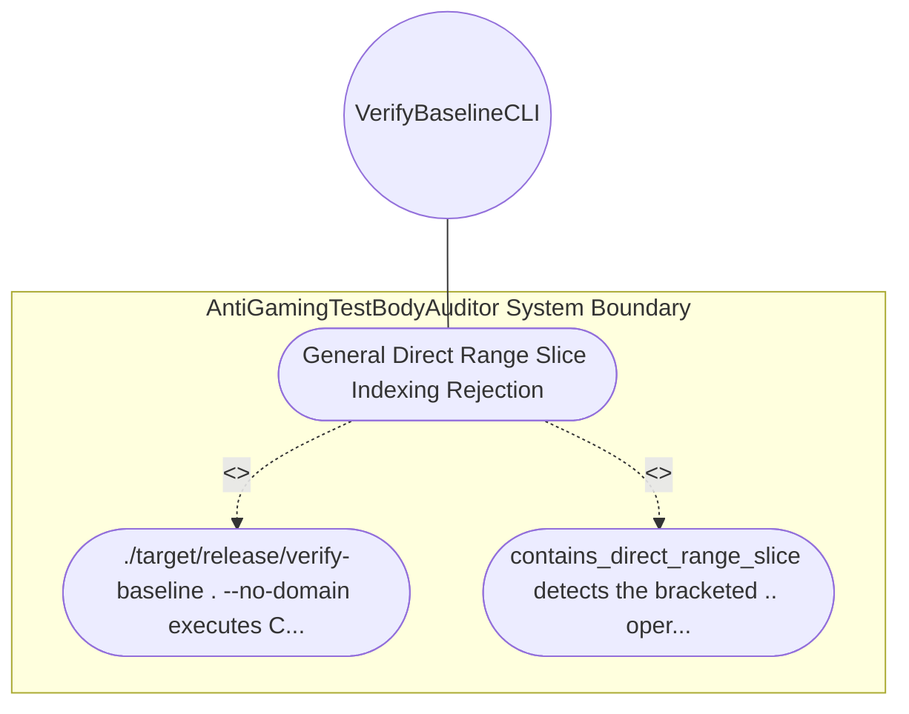

| Attribute | Specification Detail |
| :--- | :--- |
| **Issue ID** | #629 |
| **Title** | Use Case 06: General Direct Range Slice Indexing Rejection |
| **Type** | use-case |
| **Primary Actor** | VerifyBaselineCLI |
| **Scope** | AntiGamingTestBodyAuditor |
| **Level** | User Goal |
| **Generation Mode** | subagent |
| **Specification Source** | [schema/model.sysml](../../schema/model.sysml) |

# Use Case 06: General Direct Range Slice Indexing Rejection

## UML Diagrams

## 1. Actors
- `VerifyBaselineCLI`

## 2. Preconditions
- Any audited Rust source file in crates/ containing a direct range-slice indexing expression (&s[a..b], &rest[..idx], &buf[start..], or &items[..=end]) outside string literals and comments.

## 3. Trigger
- ./target/release/verify-baseline . --no-domain executes Check 34 (C-PURITY-01).

## 4. Main Success Scenario
1. `VerifyBaselineCLI` resolves workspace crate manifests via `cargo_metadata`, `cargo-lock`, `cargo-util-schemas`, `cargo-platform`, and `toml_edit` (Contract B, zero hand-rolled scanners) and invokes `check_compiler_ast_purity` on `Check34AstPurityAndAntiGamingGate`, streaming non-test workspace Rust source files through `WorkspaceRustCstPort` across full OMG SysML v2.0 + KerML 1.0 grammar definitions and usages (Contract A, zero 16-construct caps).
2. `Check34AstPurityAndAntiGamingGate` invokes `mask_literals_and_comments` via `deap_core_rust_cst` (`ra_ap_syntax`, `logos`, and `rowan`) to strip string literals, raw strings, character literals, and comments while preserving line numbering and typed `ast::{MatchExpr, MatchArmList, CallExpr, MethodCallExpr, TryExpr, IndexExpr}` CST spans inside `< 380`-SLOC submodules with explicit legacy hand-rolled scanner deletion.
3. `RangeSliceAstDetector` executes `contains_direct_range_slice` using typed `ra_ap_syntax` CST/AST inspection (`ast::{IndexExpr, CallExpr, MethodCallExpr, MatchExpr, MatchArmList, TryExpr}`) to detect bracketed `..` or `..=` range operators outside fallible `.get(..)` and `.get_mut(..)` calls.
4. `RangeSliceAstDetector` detects a direct range-slice indexing expression (`expr[a..b]`, `expr[..idx]`, `expr[start..]`, or `expr[..=end]`) and increments `direct_range_slice_count` (Layer 1 Domain State, Layer 2 Logic & State Management).
5. `Check34AstPurityAndAntiGamingGate` emits a sorted file-and-line `ariadne` / `miette` diagnostic on `PurityViolationDiagnosticPort` (Layer 3 Interface Binding) instructing the caller to use fallible `.get(..)`, outputs `1` on `Check34GateStatusPort`, and exits fail-closed with code 1.

## 5. Alternate and Exception Flows
- 3a. Source file read or UTF-8 decoding failure on `WorkspaceRustCstPort`:
  - `Check34AstPurityAndAntiGamingGate` propagates `Result::Err` without silent error swallowing, emits a `miette` I/O diagnostic on `PurityViolationDiagnosticPort`, and exits fail-closed with code 1.
- 4a. Unterminated string literal or block comment encountered during `mask_literals_and_comments`:
  - `deap_core_rust_cst` returns a deterministic lexical error via `Result<T, E>` and `ariadne`, halting `Check34AstPurityAndAntiGamingGate` with exit code 1.
- 5a. Invariant violation under `Invariant_REQ_0602_SC_01` (`direct_range_slice_count > 0`):
  - `AntiGamingTestBodyAuditor` and `Check34AstPurityAndAntiGamingGate` abort verification without partial state mutation, preserve prior verified state, and return fail-closed exit status 1 to `VerifyBaselineCLI`.

## 6. Postconditions
- contains_direct_range_slice detects the bracketed .. operator regardless of variable name, emits a file-and-line diagnostic instructing the caller to use .get(..), and exits fail-closed with code 1.

## 8. Realization Matrix
| Specification Item | Type | Link / Reference |
| :--- | :--- | :--- |
| **#567** | User Story | [User Story 06: Check Compiler Ast Purity](../user-stories/US-06-check_compiler_ast_purity.md) |
| **#662** | Feature | [Feature 06: [BP 02 Check 34 AST Purity Fail Closed IO and Anti Gaming Test Gate Blueprint] AntiGamingTestBodyAuditor](../features/FEAT-06-AntiGamingTestBodyAuditor.md) |

## Source References
Use case operational flows and lifecycle activity references:
- System Architecture Model: `schema/model.sysml`
- Normative Systems Engineering Standard: ISO/IEC/IEEE 29148:2018 §6.4.2 Concept of Operations

Operational use case realization and traceability links derive from `schema/model.sysml` pursuant to ISO/IEC/IEEE 29148.
