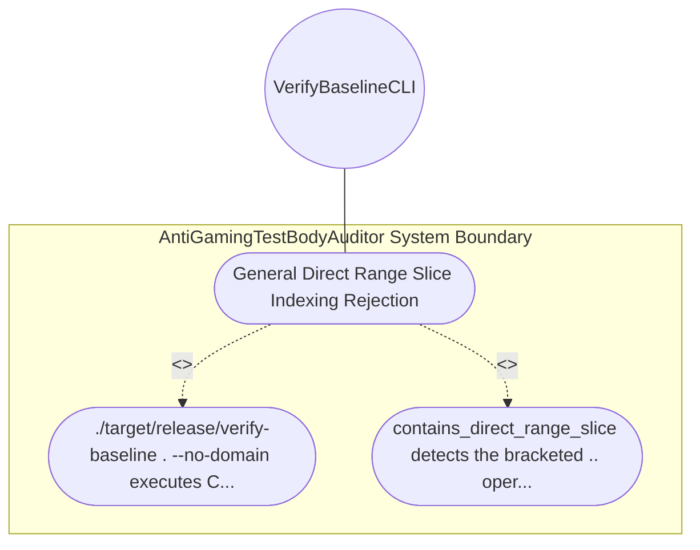

| Attribute | Specification Detail |
| :--- | :--- |
| **Issue ID** | #629 |
| **Title** | Use Case 06: General Direct Range Slice Indexing Rejection |
| **Type** | use-case |
| **Primary Actor** | VerifyBaselineCLI |
| **Scope** | AntiGamingTestBodyAuditor |
| **Level** | User Goal |
| **Generation Mode** | subagent |
| **Specification Source** | [schema/model.sysml](../../schema/model.sysml) |

# Use Case 06: General Direct Range Slice Indexing Rejection

## UML Diagrams

## 1. Actors
- `VerifyBaselineCLI`

## 2. Preconditions
- Any audited Rust source file in crates/ containing a direct range-slice indexing expression (&s[a..b], &rest[..idx], &buf[start..], or &items[..=end]) outside string literals and comments.

## 3. Trigger
- ./target/release/verify-baseline . --no-domain executes Check 34 (C-PURITY-01).

## 4. Main Success Scenario
1. ./target/release/verify-baseline . --no-domain executes Check 34 (C-PURITY-01).
2. contains_direct_range_slice detects the bracketed .. operator regardless of variable name, emits a file-and-line diagnostic instructing the caller to use .get(..), and exits fail-closed with code 1.

## 5. Alternate and Exception Flows
- Precondition guard failure in `AntiGamingTestBodyAuditor`:
  - `AntiGamingTestBodyAuditor` rejects the `General Direct Range Slice Indexing Rejection` request without partial state mutation and reports diagnostic status to `VerifyBaselineCLI`.
- Invariant violation while enforcing `General Direct Range Slice Indexing Rejection`:
  - `AntiGamingTestBodyAuditor` aborts `General Direct Range Slice Indexing Rejection` execution, preserves prior verified state, and notifies `VerifyBaselineCLI`.

## 6. Postconditions
- contains_direct_range_slice detects the bracketed .. operator regardless of variable name, emits a file-and-line diagnostic instructing the caller to use .get(..), and exits fail-closed with code 1.

## 8. Realization Matrix
| Specification Item | Type | Link / Reference |
| :--- | :--- | :--- |
| **#567** | User Story | [User Story 06: check compiler ast purity](../user-stories/US-06-check_compiler_ast_purity.md) |
| **#662** | Feature | [Feature 06: [BP 02 Check 34 AST Purity Fail Closed IO and Anti Gaming Test Gate Blueprint] AntiGamingTestBodyAuditor](../features/FEAT-06-AntiGamingTestBodyAuditor.md) |

## Source References
Use case operational flows and lifecycle activity references:
- System Architecture Model: `schema/model.sysml`
- Normative Systems Engineering Standard: ISO/IEC/IEEE 29148:2018 §6.4.2 Concept of Operations

Operational use case realization and traceability links derive from `schema/model.sysml` pursuant to ISO/IEC/IEEE 29148.
