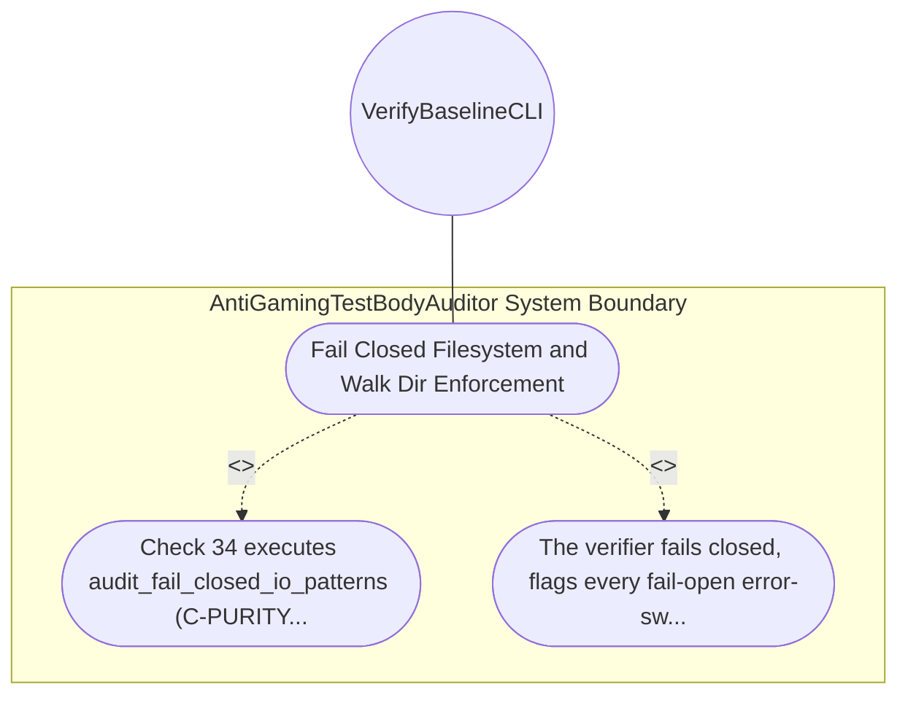

| Attribute | Specification Detail |
| :--- | :--- |
| **Issue ID** | #630 |
| **Title** | Use Case 07: Fail Closed Filesystem and Walk Dir Enforcement |
| **Type** | use-case |
| **Primary Actor** | VerifyBaselineCLI |
| **Scope** | AntiGamingTestBodyAuditor |
| **Level** | User Goal |
| **Generation Mode** | subagent |
| **Specification Source** | [schema/model.sysml](../../schema/model.sysml) |

# Use Case 07: Fail Closed Filesystem and Walk Dir Enforcement

## UML Diagrams

## 1. Actors
- `VerifyBaselineCLI`

## 2. Preconditions
- Any workspace Rust module containing .into_iter().flatten(), .filter_map(Result::ok), fs::read_to_string(...).unwrap_or_default(), or let _ = fs::remove_dir_all(...).

## 3. Trigger
- Check 34 executes audit_fail_closed_io_patterns (C-PURITY-02).

## 4. Main Success Scenario
1. `VerifyBaselineCLI` resolves workspace crate targets via `cargo_metadata`, `cargo-lock`, `cargo-util-schemas`, `cargo-platform`, and `toml_edit` (Contract B, zero hand-rolled scanners) and invokes `check_compiler_ast_purity` on `Check34AstPurityAndAntiGamingGate`, feeding workspace Rust CST streams through `WorkspaceRustCstPort` under full OMG SysML v2.0 + KerML 1.0 grammar coverage (Contract A, zero 16-construct caps).
2. `Check34AstPurityAndAntiGamingGate` invokes `mask_literals_and_comments` via `deap_core_rust_cst` (`ra_ap_syntax`, `syn`, and `rowan`) to construct lossless syntax trees inside `< 380`-SLOC submodules with explicit legacy hand-rolled scanner deletion.
3. `FailClosedIoAstVerifier` executes `audit_fail_closed_io_patterns` (constraint `C-PURITY-02`) by traversing typed `ra_ap_syntax` `ast::{MatchExpr, MatchArmList, CallExpr, MethodCallExpr, TryExpr}` nodes across all non-test modules in `./crates/*/src/**/*.rs`.
4. `FailClosedIoAstVerifier` detects fail-open error-swallowing patterns including `.into_iter().flatten()`, `.filter_map(Result::ok)`, `fs::read_to_string(...).unwrap_or_default()`, or `let _ = fs::remove_dir_all(...)`, incrementing `fail_open_io_site_count` (Layer 1 Domain State, Layer 2 Logic & State Management).
5. `Check34AstPurityAndAntiGamingGate` emits sorted file-and-line `ariadne` / `miette` diagnostics via `PurityViolationDiagnosticPort` (Layer 3 Interface Binding), writes `1` to `Check34GateStatusPort`, and terminates fail-closed with exit code 1.

## 5. Alternate and Exception Flows
- 3a. Directory traversal or filesystem metadata error while enumerating `crates/*/src/**/*.rs`:
  - `FailClosedIoAstVerifier` propagates `Result::Err` immediately without `.filter_map(Result::ok)` suppression, emits a `miette` diagnostic on `PurityViolationDiagnosticPort`, and exits fail-closed with code 1.
- 4a. Unparseable Rust token stream encountered on `WorkspaceRustCstPort`:
  - `deap_core_rust_cst` reports a syntax diagnostic via `ra_ap_syntax` and `ariadne`, aborting `audit_fail_closed_io_patterns` with exit code 1.
- 5a. Invariant violation under `Invariant_REQ_0602_SC_01` (`fail_open_io_site_count > 0`):
  - `Check34AstPurityAndAntiGamingGate` aborts execution without partial state mutation, preserves prior verified state, and returns fail-closed status code 1 to `VerifyBaselineCLI`.

## 6. Postconditions
- The verifier fails closed, flags every fail-open error-swallowing site with its exact line number, and terminates with a non-zero exit code.

## 8. Realization Matrix
| Specification Item | Type | Link / Reference |
| :--- | :--- | :--- |
| **#568** | User Story | [User Story 07: Mask Literals And Comments](../user-stories/US-07-mask_literals_and_comments.md) |
| **#662** | Feature | [Feature 06: [BP 02 Check 34 AST Purity Fail Closed IO and Anti Gaming Test Gate Blueprint] AntiGamingTestBodyAuditor](../features/FEAT-06-AntiGamingTestBodyAuditor.md) |

## Source References
Use case operational flows and lifecycle activity references:
- System Architecture Model: `schema/model.sysml`
- Normative Systems Engineering Standard: ISO/IEC/IEEE 29148:2018 §6.4.2 Concept of Operations

Operational use case realization and traceability links derive from `schema/model.sysml` pursuant to ISO/IEC/IEEE 29148.
