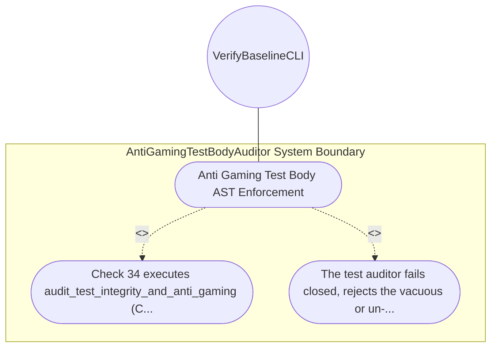

| Attribute | Specification Detail |
| :--- | :--- |
| **Issue ID** | #631 |
| **Title** | Use Case 08: Anti Gaming Test Body AST Enforcement |
| **Type** | use-case |
| **Primary Actor** | VerifyBaselineCLI |
| **Scope** | AntiGamingTestBodyAuditor |
| **Level** | User Goal |
| **Generation Mode** | subagent |
| **Specification Source** | [schema/model.sysml](../../schema/model.sysml) |

# Use Case 08: Anti Gaming Test Body AST Enforcement

## UML Diagrams

## 1. Actors
- `VerifyBaselineCLI`

## 2. Preconditions
- A #[test] function in any workspace crate that contains zero assert* macros, asserts std::mem::size_of::<T>() > 0, wraps its assertions in an unguarded if Path::new(\"...\").exists() check, or constructs a hardcoded std::env::temp_dir().join(\"...\") path.

## 3. Trigger
- Check 34 executes audit_test_integrity_and_anti_gaming (C-PURITY-03).

## 4. Main Success Scenario
1. Check 34 executes audit_test_integrity_and_anti_gaming (C-PURITY-03).
2. The test auditor fails closed, rejects the vacuous or un-isolated test function, and halts baseline verification.

## 5. Alternate and Exception Flows
- Precondition guard failure in `AntiGamingTestBodyAuditor`:
  - `AntiGamingTestBodyAuditor` rejects the `Anti Gaming Test Body AST Enforcement` request without partial state mutation and reports diagnostic status to `VerifyBaselineCLI`.
- Invariant violation while enforcing `Anti Gaming Test Body AST Enforcement`:
  - `AntiGamingTestBodyAuditor` aborts `Anti Gaming Test Body AST Enforcement` execution, preserves prior verified state, and notifies `VerifyBaselineCLI`.

## 6. Postconditions
- The test auditor fails closed, rejects the vacuous or un-isolated test function, and halts baseline verification.

## 8. Realization Matrix
| Specification Item | Type | Link / Reference |
| :--- | :--- | :--- |
| **#570** | User Story | [User Story 08: contains direct range slice](../user-stories/US-08-contains_direct_range_slice.md) |
| **#662** | Feature | [Feature 06: [BP 02 Check 34 AST Purity Fail Closed IO and Anti Gaming Test Gate Blueprint] AntiGamingTestBodyAuditor](../features/FEAT-06-AntiGamingTestBodyAuditor.md) |

## Source References
Use case operational flows and lifecycle activity references:
- System Architecture Model: `schema/model.sysml`
- Normative Systems Engineering Standard: ISO/IEC/IEEE 29148:2018 §6.4.2 Concept of Operations

Operational use case realization and traceability links derive from `schema/model.sysml` pursuant to ISO/IEC/IEEE 29148.
