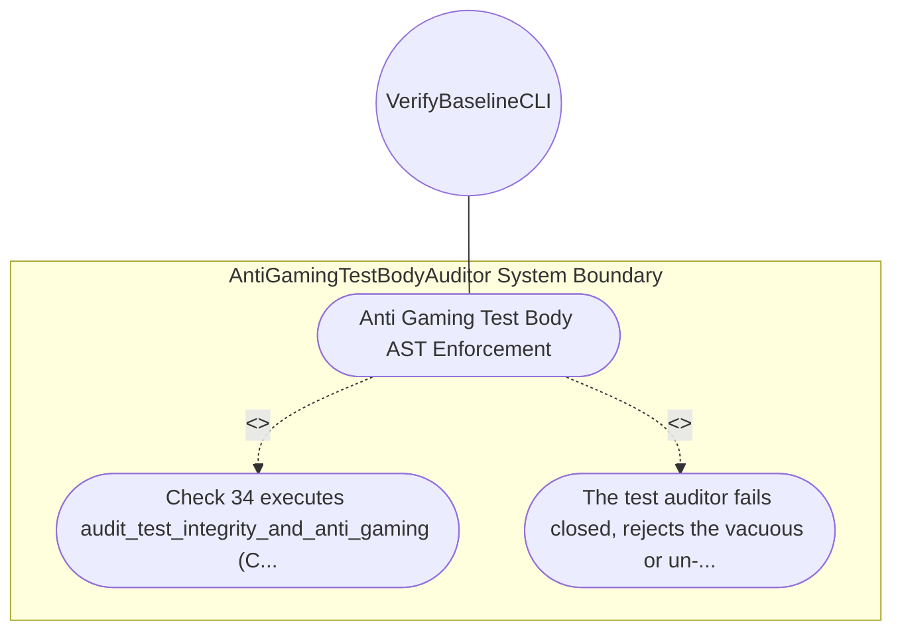

| Attribute | Specification Detail |
| :--- | :--- |
| **Issue ID** | #631 |
| **Title** | Use Case 08: Anti Gaming Test Body AST Enforcement |
| **Type** | use-case |
| **Primary Actor** | VerifyBaselineCLI |
| **Scope** | AntiGamingTestBodyAuditor |
| **Level** | User Goal |
| **Generation Mode** | subagent |
| **Specification Source** | [schema/model.sysml](../../schema/model.sysml) |

# Use Case 08: Anti Gaming Test Body AST Enforcement

## UML Diagrams

## 1. Actors
- `VerifyBaselineCLI`

## 2. Preconditions
- A Rust test function in any workspace crate that contains zero assert* macros, asserts std::mem::size_of::<T>() > 0, wraps its assertions in an unguarded if Path::new(\"...\").exists() check, or constructs a hardcoded std::env::temp_dir().join(\"...\") path.

## 3. Trigger
- Check 34 executes audit_test_integrity_and_anti_gaming (C-PURITY-03).

## 4. Main Success Scenario
1. `VerifyBaselineCLI` invokes `check_compiler_ast_purity` on `Check34AstPurityAndAntiGamingGate`, which extracts Rust `test` attribute function AST blocks via `deap_core_rust_cst` (`syn` and `ra_ap_syntax`) and routes them to `TestFunctionAstStreamPort`.
2. `AntiGamingTestBodyAuditor` receives the parsed test function stream via `BP_02_AuditorToPurityGateConnection` and executes `audit_test_integrity_and_anti_gaming` (constraint `C-PURITY-03`).
3. `AntiGamingTestBodyAuditor` inspects each test body AST for assertion macro invocations (`assert!`, `assert_eq!`, `assert_ne!`, `matches!`), tautological `std::mem::size_of::<T>() > 0` checks, unguarded `if Path::new(...).exists()` skips, and non-RAII `std::env::temp_dir().join(...)` paths.
4. `AntiGamingTestBodyAuditor` identifies a vacuous or un-isolated test function and increments `vacuous_test_count` on `Check34AstPurityAndAntiGamingGate`.
5. `Check34AstPurityAndAntiGamingGate` emits a file-and-line `ariadne` / `miette` diagnostic on `PurityViolationDiagnosticPort`, sets `Check34GateStatusPort` to `1`, and halts baseline verification fail-closed with exit code 1.

## 5. Alternate and Exception Flows
- 3a. Malformed Rust `test` attribute function body or unbalanced brace block on `TestFunctionAstStreamPort`:
  - `AntiGamingTestBodyAuditor` returns `Result::Err` with a `syn` / `ariadne` span diagnostic via `PurityViolationDiagnosticPort` and terminates fail-closed with exit code 1.
- 4a. Test fixture uses hardcoded shared temp path instead of an auto-cleaned RAII temp directory:
  - `AntiGamingTestBodyAuditor` flags the `std::env::temp_dir()` call site as a `C-PURITY-03` isolation violation, emits a `miette` diagnostic, and exits fail-closed with code 1.
- 5a. Invariant violation under `Invariant_REQ_0602_SC_01` (`vacuous_test_count > 0`):
  - `AntiGamingTestBodyAuditor` aborts verification without partial state mutation, preserves prior verified state, and notifies `VerifyBaselineCLI` with non-zero exit code 1.

## 6. Postconditions
- The test auditor fails closed, rejects the vacuous or un-isolated test function, and halts baseline verification.

## 8. Realization Matrix
| Specification Item | Type | Link / Reference |
| :--- | :--- | :--- |
| **#570** | User Story | [User Story 08: contains direct range slice](../user-stories/US-08-contains_direct_range_slice.md) |
| **#662** | Feature | [Feature 06: [BP 02 Check 34 AST Purity Fail Closed IO and Anti Gaming Test Gate Blueprint] AntiGamingTestBodyAuditor](../features/FEAT-06-AntiGamingTestBodyAuditor.md) |

## Source References
Use case operational flows and lifecycle activity references:
- System Architecture Model: `schema/model.sysml`
- Normative Systems Engineering Standard: ISO/IEC/IEEE 29148:2018 §6.4.2 Concept of Operations

Operational use case realization and traceability links derive from `schema/model.sysml` pursuant to ISO/IEC/IEEE 29148.
