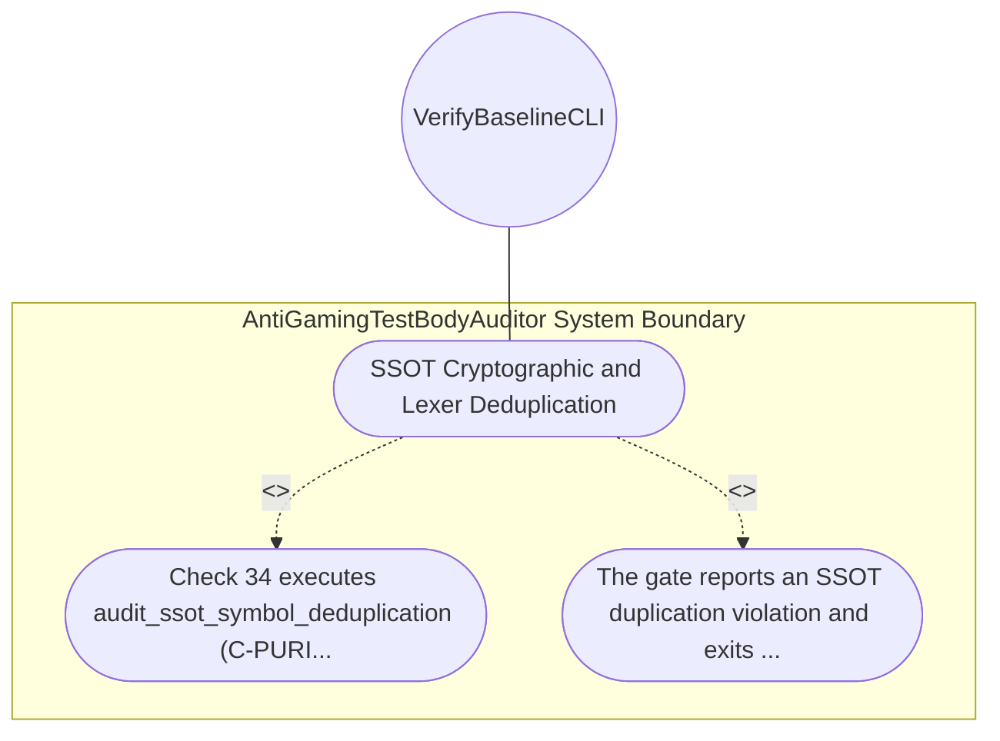

| Attribute | Specification Detail |
| :--- | :--- |
| **Issue ID** | #632 |
| **Title** | Use Case 09: SSOT Cryptographic and Lexer Deduplication |
| **Type** | use-case |
| **Primary Actor** | VerifyBaselineCLI |
| **Scope** | AntiGamingTestBodyAuditor |
| **Level** | User Goal |
| **Generation Mode** | subagent |
| **Specification Source** | [schema/model.sysml](../../schema/model.sysml) |

# Use Case 09: SSOT Cryptographic and Lexer Deduplication

## UML Diagrams

## 1. Actors
- `VerifyBaselineCLI`

## 2. Preconditions
- A Rust source file outside crates/deap-core/src/digest.rs that defines SHA-256 round constant 0x428a2f98 or a file outside crates/deap-core/src/deap_core::rust_cst / deap_core::dart_cst.rs that defines a duplicate Rust source tokenizer.

## 3. Trigger
- Check 34 executes audit_ssot_symbol_deduplication (C-PURITY-04 and C-PURITY-05).

## 4. Main Success Scenario
1. `VerifyBaselineCLI` resolves workspace members using `cargo_metadata`, `cargo-lock`, `cargo-util-schemas`, `cargo-platform`, and `toml_edit` (Contract B, zero hand-rolled scanners) and invokes `check_compiler_ast_purity` on `Check34AstPurityAndAntiGamingGate` to audit all workspace Rust modules via `WorkspaceRustCstPort` under full OMG SysML v2.0 + KerML 1.0 grammar coverage (Contract A, zero 16-construct caps).
2. `Check34AstPurityAndAntiGamingGate` invokes `mask_literals_and_comments` via `deap_core_rust_cst` (`ra_ap_syntax` typed `ast::{MatchExpr, MatchArmList, CallExpr, MethodCallExpr, TryExpr}`, `logos`, and `rowan`) and delegates SSOT symbol verification to `SsotSymbolDeduplicationGate` inside `< 380`-SLOC submodules with explicit legacy hand-rolled scanner deletion.
3. `SsotSymbolDeduplicationGate` executes `audit_ssot_symbol_deduplication` (constraints `C-PURITY-04` and `C-PURITY-05`) across every workspace relative path and lossless CST token stream.
4. `SsotSymbolDeduplicationGate` detects SHA-256 round constant `0x428a2f98` outside `./crates/deap-core/src/digest.rs` (`duplicate_sha256_impl_count > 0`) or a duplicate Rust lexical state machine outside `./crates/deap-core/src/rust_cst.rs` (`duplicate_lexer_impl_count > 0`) across Layer 1 Domain State and Layer 2 Logic & State Management.
5. `Check34AstPurityAndAntiGamingGate` emits a sorted SSOT duplication diagnostic via `ariadne` / `miette` on `PurityViolationDiagnosticPort` (Layer 3 Interface Binding), sets `Check34GateStatusPort` to `1`, and exits fail-closed with status code 1.

## 5. Alternate and Exception Flows
- 3a. Unreadable source file or path canonicalization failure during workspace walk:
  - `SsotSymbolDeduplicationGate` propagates `Result::Err`, emits a `miette` filesystem diagnostic on `PurityViolationDiagnosticPort`, and exits fail-closed with code 1.
- 4a. Unauthorized hand-rolled parser or lexer state machine detected in a downstream crate:
  - `SsotSymbolDeduplicationGate` increments `duplicate_lexer_impl_count`, reports the offending module path and line number via `ariadne`, and halts verification with exit code 1.
- 5a. Invariant violation under `Invariant_REQ_0602_SC_01` (`duplicate_sha256_impl_count + duplicate_lexer_impl_count > 0`):
  - `Check34AstPurityAndAntiGamingGate` aborts execution without partial state mutation, preserves prior verified state, and returns fail-closed exit code 1 to `VerifyBaselineCLI`.

## 6. Postconditions
- The gate reports an SSOT duplication violation and exits fail-closed with a non-zero status code.

## 8. Realization Matrix
| Specification Item | Type | Link / Reference |
| :--- | :--- | :--- |
| **#571** | User Story | [User Story 09: Audit Fail Closed Io Patterns](../user-stories/US-09-audit_fail_closed_io_patterns.md) |
| **#662** | Feature | [Feature 06: [BP 02 Check 34 AST Purity Fail Closed IO and Anti Gaming Test Gate Blueprint] AntiGamingTestBodyAuditor](../features/FEAT-06-AntiGamingTestBodyAuditor.md) |

## Source References
Use case operational flows and lifecycle activity references:
- System Architecture Model: `schema/model.sysml`
- Normative Systems Engineering Standard: ISO/IEC/IEEE 29148:2018 §6.4.2 Concept of Operations

Operational use case realization and traceability links derive from `schema/model.sysml` pursuant to ISO/IEC/IEEE 29148.
