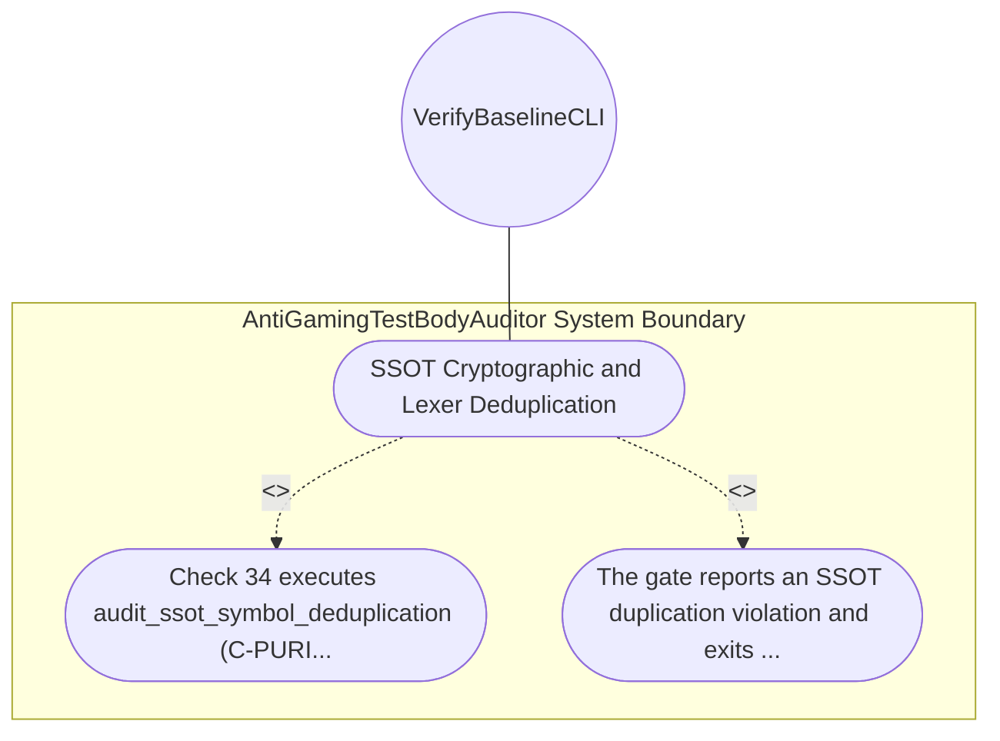

| Attribute | Specification Detail |
| :--- | :--- |
| **Issue ID** | #632 |
| **Title** | Use Case 09: SSOT Cryptographic and Lexer Deduplication |
| **Type** | use-case |
| **Primary Actor** | VerifyBaselineCLI |
| **Scope** | AntiGamingTestBodyAuditor |
| **Level** | User Goal |
| **Generation Mode** | subagent |
| **Specification Source** | [schema/model.sysml](../../schema/model.sysml) |

# Use Case 09: SSOT Cryptographic and Lexer Deduplication

## UML Diagrams

## 1. Actors
- `VerifyBaselineCLI`

## 2. Preconditions
- A Rust source file outside crates/deap-core/src/digest.rs that defines SHA-256 round constant 0x428a2f98 or a file outside crates/deap-core/src/source_ast.rs that defines a duplicate Rust source tokenizer.

## 3. Trigger
- Check 34 executes audit_ssot_symbol_deduplication (C-PURITY-04 and C-PURITY-05).

## 4. Main Success Scenario
1. Check 34 executes audit_ssot_symbol_deduplication (C-PURITY-04 and C-PURITY-05).
2. The gate reports an SSOT duplication violation and exits fail-closed with a non-zero status code.

## 5. Alternate and Exception Flows
- Precondition guard failure in `AntiGamingTestBodyAuditor`:
  - `AntiGamingTestBodyAuditor` rejects the `SSOT Cryptographic and Lexer Deduplication` request without partial state mutation and reports diagnostic status to `VerifyBaselineCLI`.
- Invariant violation while enforcing `SSOT Cryptographic and Lexer Deduplication`:
  - `AntiGamingTestBodyAuditor` aborts `SSOT Cryptographic and Lexer Deduplication` execution, preserves prior verified state, and notifies `VerifyBaselineCLI`.

## 6. Postconditions
- The gate reports an SSOT duplication violation and exits fail-closed with a non-zero status code.

## 8. Realization Matrix
| Specification Item | Type | Link / Reference |
| :--- | :--- | :--- |
| **#571** | User Story | [User Story 09: audit fail closed io patterns](../user-stories/US-09-audit_fail_closed_io_patterns.md) |
| **#662** | Feature | [Feature 06: [BP 02 Check 34 AST Purity Fail Closed IO and Anti Gaming Test Gate Blueprint] AntiGamingTestBodyAuditor](../features/FEAT-06-AntiGamingTestBodyAuditor.md) |

## Source References
Use case operational flows and lifecycle activity references:
- System Architecture Model: `schema/model.sysml`
- Normative Systems Engineering Standard: ISO/IEC/IEEE 29148:2018 §6.4.2 Concept of Operations

Operational use case realization and traceability links derive from `schema/model.sysml` pursuant to ISO/IEC/IEEE 29148.
