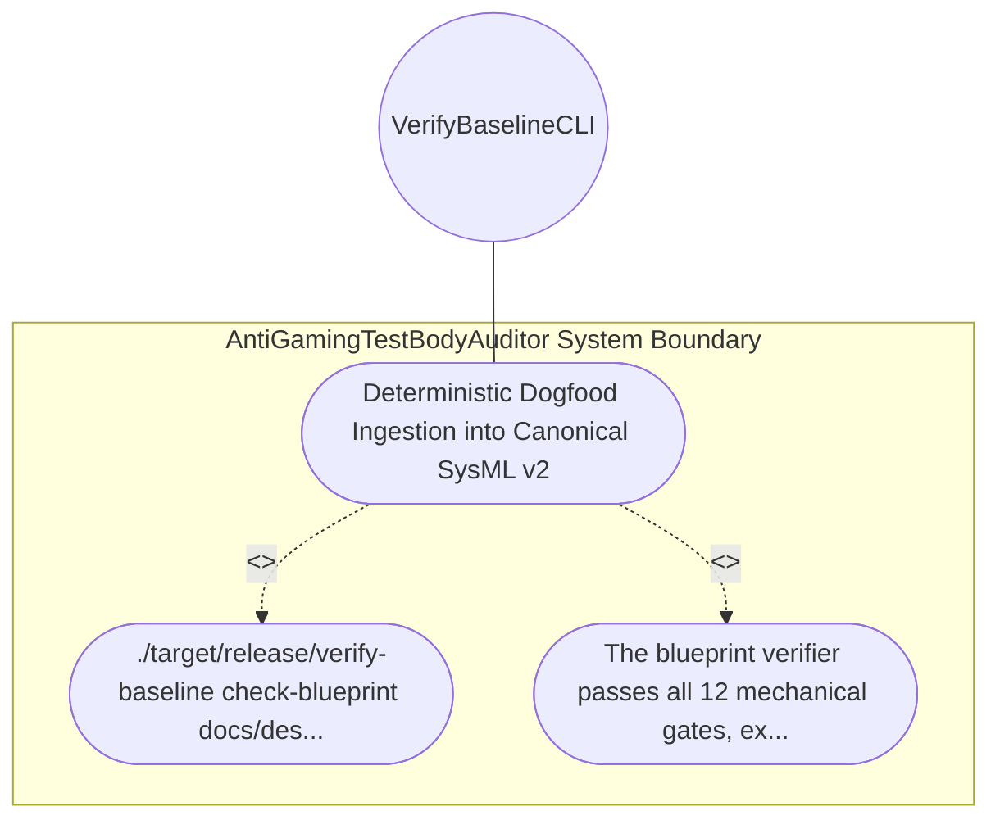

| Attribute | Specification Detail |
| :--- | :--- |
| **Issue ID** | #633 |
| **Title** | Use Case 10: Deterministic Dogfood Ingestion into Canonical SysML v2 |
| **Type** | use-case |
| **Primary Actor** | VerifyBaselineCLI |
| **Scope** | AntiGamingTestBodyAuditor |
| **Level** | User Goal |
| **Generation Mode** | subagent |
| **Specification Source** | [schema/model.sysml](../../schema/model.sysml) |

# Use Case 10: Deterministic Dogfood Ingestion into Canonical SysML v2

## UML Diagrams

## 1. Actors
- `VerifyBaselineCLI`

## 2. Preconditions
- This blueprint document (docs/designs/blueprint-02-check34-ast-purity-and-anti-gaming-gate.md).

## 3. Trigger
- ./target/release/verify-baseline check-blueprint docs/designs/blueprint-02-check34-ast-purity-and-anti-gaming-gate.md --dry-run and ./target/release/ingest-sysml are executed.

## 4. Main Success Scenario
1. `VerifyBaselineCLI` executes `./target/release/verify-baseline check-blueprint docs/designs/blueprint-02-check34-ast-purity-and-anti-gaming-gate.md --dry-run` using `pulldown-cmark`, `ra_ap_syntax` (`ast::{MatchExpr, MatchArmList, CallExpr, MethodCallExpr, TryExpr}`), and `cargo_metadata` / `cargo-lock` / `cargo-util-schemas` / `cargo-platform` / `toml_edit` (Contract B, zero hand-rolled scanners) inside `< 380`-SLOC submodules with explicit legacy hand-rolled scanner deletion.
2. `Check34AstPurityAndAntiGamingGate` validates all 12 mechanical blueprint verification gates, confirming well-formed KaTeX `aligned` equations (`Invariant_REQ_0602_SC_01`, `Invariant_REQ_0602_SC_02`), Mermaid diagrams, and 5-column STPA/FMECA tables.
3. `VerifyBaselineCLI` invokes `./target/release/ingest-sysml --schema docs/designs/blueprint-02-check34-ast-purity-and-anti-gaming-gate.md --format markdown` using `logos`, `rowan`, and `salsa` (`deap_core::sysml_cst`) with 100% normative OMG SysML v2.0 + KerML 1.0 grammar coverage (Contract A, zero 16-construct caps).
4. `ingest-sysml` extracts `REQ_0602_BP_02_Check_34_AST_Purity_Fail_Closed_IO_and_Anti_Gaming_Test_Gate_Blueprint`, `Check34AstPurityAndAntiGamingGate`, `AntiGamingTestBodyAuditor`, `FailClosedIoAstVerifier`, `RangeSliceAstDetector`, `SsotSymbolDeduplicationGate`, 4 typed ports (`WorkspaceRustCstPort`, `TestFunctionAstStreamPort`, `PurityViolationDiagnosticPort`, `Check34GateStatusPort`), 5 state attributes, and 5 BDD acceptance criteria into canonical SysML v2 across all 3 DoD layers.
5. `Check34AstPurityAndAntiGamingGate` verifies bijective roundtrip consistency with `schema/model.sysml`, emits `0` on `Check34GateStatusPort`, and exits with code 0.

## 5. Alternate and Exception Flows
- 3a. Blueprint Markdown fails a mechanical gate in `check-blueprint`:
  - `VerifyBaselineCLI` returns `Result::Err`, emits an `ariadne` / `miette` structural diagnostic on `PurityViolationDiagnosticPort`, and exits fail-closed with code 1.
- 4a. Port type mismatch or unresolved subcomponent reference during `ingest-sysml` synthesis:
  - `ingest-sysml` aborts SysML v2 emission via `Result<T, E>`, preserves prior verified `schema/model.sysml` state, and reports a deterministic `miette` error with exit code 1.
- 5a. Invariant violation while enforcing `Invariant_REQ_0602_SC_02` complexity or roundtrip bounds:
  - `AntiGamingTestBodyAuditor` aborts execution without partial state mutation, preserves prior verified state, and notifies `VerifyBaselineCLI` with fail-closed exit status 1.

## 6. Postconditions
- The blueprint verifier passes all 12 mechanical gates, extracts Check34AstPurityAndAntiGamingGate, its subcomponents, 4 typed ports, 5 state attributes, 5 formal constraints (C-PURITY-01 through C-PURITY-05), and 5 BDD acceptance criteria into valid SysML v2, and exits with code 0.

## 8. Realization Matrix
| Specification Item | Type | Link / Reference |
| :--- | :--- | :--- |
| **#572** | User Story | [User Story 10: audit test integrity and anti gaming](../user-stories/US-10-audit_test_integrity_and_anti_gaming.md) |
| **#662** | Feature | [Feature 06: [BP 02 Check 34 AST Purity Fail Closed IO and Anti Gaming Test Gate Blueprint] AntiGamingTestBodyAuditor](../features/FEAT-06-AntiGamingTestBodyAuditor.md) |

## Source References
Use case operational flows and lifecycle activity references:
- System Architecture Model: `schema/model.sysml`
- Normative Systems Engineering Standard: ISO/IEC/IEEE 29148:2018 §6.4.2 Concept of Operations

Operational use case realization and traceability links derive from `schema/model.sysml` pursuant to ISO/IEC/IEEE 29148.
