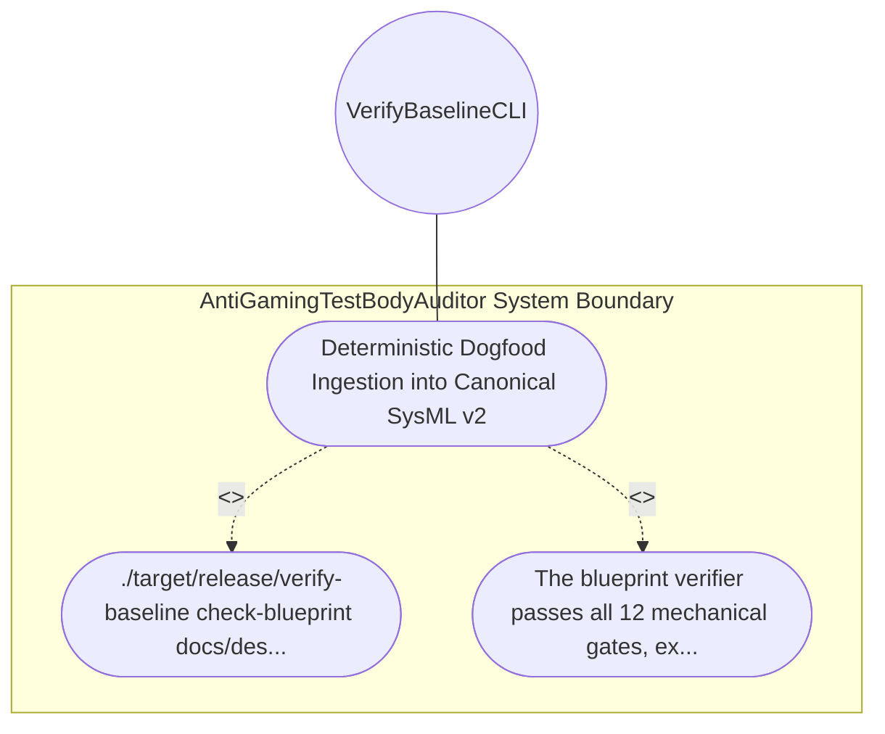

| Attribute | Specification Detail |
| :--- | :--- |
| **Issue ID** | #633 |
| **Title** | Use Case 10: Deterministic Dogfood Ingestion into Canonical SysML v2 |
| **Type** | use-case |
| **Primary Actor** | VerifyBaselineCLI |
| **Scope** | AntiGamingTestBodyAuditor |
| **Level** | User Goal |
| **Generation Mode** | subagent |
| **Specification Source** | [schema/model.sysml](../../schema/model.sysml) |

# Use Case 10: Deterministic Dogfood Ingestion into Canonical SysML v2

## UML Diagrams

## 1. Actors
- `VerifyBaselineCLI`

## 2. Preconditions
- This blueprint document (docs/designs/blueprint-02-check34-ast-purity-and-anti-gaming-gate.md).

## 3. Trigger
- ./target/release/verify-baseline check-blueprint docs/designs/blueprint-02-check34-ast-purity-and-anti-gaming-gate.md --dry-run and ./target/release/ingest-sysml are executed.

## 4. Main Success Scenario
1. ./target/release/verify-baseline check-blueprint docs/designs/blueprint-02-check34-ast-purity-and-anti-gaming-gate.md --dry-run and ./target/release/ingest-sysml are executed.
2. The blueprint verifier passes all 12 mechanical gates, extracts Check34AstPurityAndAntiGamingGate, its subcomponents, 4 typed ports, 5 state attributes, 5 formal constraints (C-PURITY-01 through C-PURITY-05), and 5 BDD acceptance criteria into valid SysML v2, and exits with code 0.

## 5. Alternate and Exception Flows
- Precondition guard failure in `AntiGamingTestBodyAuditor`:
  - `AntiGamingTestBodyAuditor` rejects the `Deterministic Dogfood Ingestion into Canonical SysML v2` request without partial state mutation and reports diagnostic status to `VerifyBaselineCLI`.
- Invariant violation while enforcing `Deterministic Dogfood Ingestion into Canonical SysML v2`:
  - `AntiGamingTestBodyAuditor` aborts `Deterministic Dogfood Ingestion into Canonical SysML v2` execution, preserves prior verified state, and notifies `VerifyBaselineCLI`.

## 6. Postconditions
- The blueprint verifier passes all 12 mechanical gates, extracts Check34AstPurityAndAntiGamingGate, its subcomponents, 4 typed ports, 5 state attributes, 5 formal constraints (C-PURITY-01 through C-PURITY-05), and 5 BDD acceptance criteria into valid SysML v2, and exits with code 0.

## 8. Realization Matrix
| Specification Item | Type | Link / Reference |
| :--- | :--- | :--- |
| **#572** | User Story | [User Story 10: audit test integrity and anti gaming](../user-stories/US-10-audit_test_integrity_and_anti_gaming.md) |
| **#662** | Feature | [Feature 06: [BP 02 Check 34 AST Purity Fail Closed IO and Anti Gaming Test Gate Blueprint] AntiGamingTestBodyAuditor](../features/FEAT-06-AntiGamingTestBodyAuditor.md) |

## Source References
Use case operational flows and lifecycle activity references:
- System Architecture Model: `schema/model.sysml`
- Normative Systems Engineering Standard: ISO/IEC/IEEE 29148:2018 §6.4.2 Concept of Operations

Operational use case realization and traceability links derive from `schema/model.sysml` pursuant to ISO/IEC/IEEE 29148.
