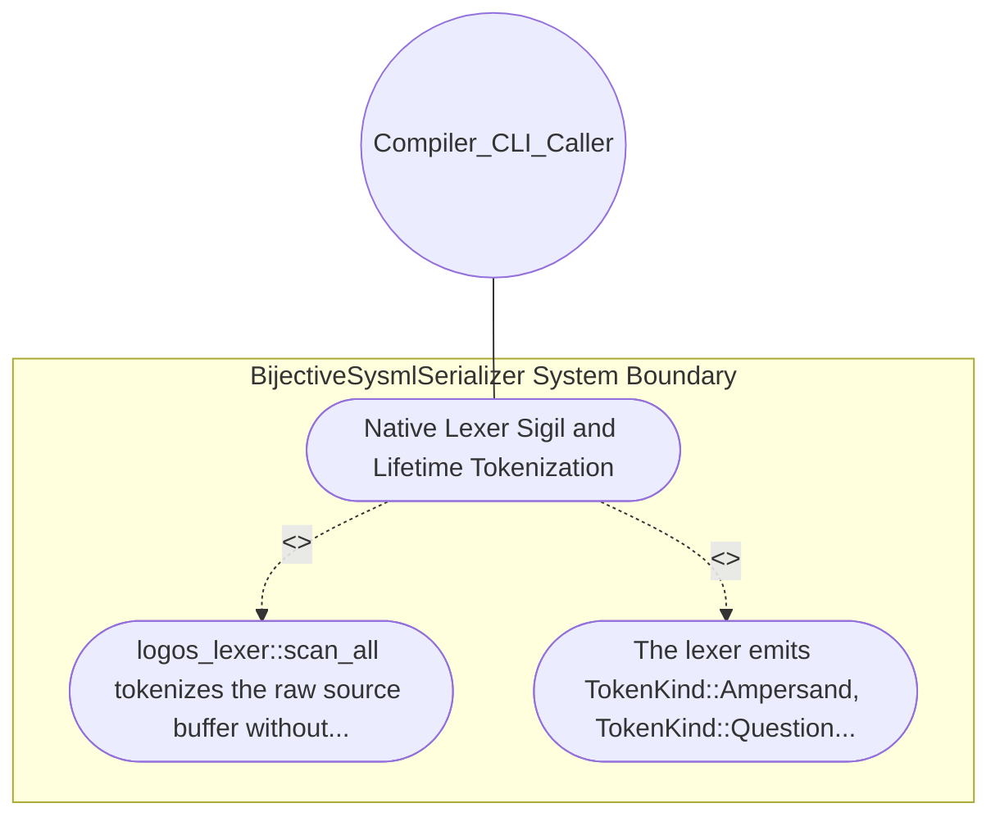

| Attribute | Specification Detail |
| :--- | :--- |
| **Issue ID** | #634 |
| **Title** | Use Case 11: Native Lexer Sigil and Lifetime Tokenization |
| **Type** | use-case |
| **Primary Actor** | Compiler_CLI_Caller |
| **Scope** | BijectiveSysmlSerializer |
| **Level** | User Goal |
| **Generation Mode** | subagent |
| **Specification Source** | [schema/model.sysml](../../schema/model.sysml) |

# Use Case 11: Native Lexer Sigil and Lifetime Tokenization

## UML Diagrams

## 1. Actors
- `Compiler_CLI_Caller`

## 2. Preconditions
- A SysML v2 model containing reference type sigils (`&`), optionality sigils (`?`), lifetime annotations (`'a`), qualified paths (`::`), logical `&&` expressions (#495), and any construct across all 6 normative clauses of the OMG SysML v2.0 + KerML 1.0 BNF grammar (zero 16-construct artificial caps), including `#hazard`, `#risk`, `#capability`, `#rt_loop`, `#dal`, `#fls` `metadata def` (`@Metadata` / `#user_keyword`) and backward-compatible `hazard def`, `risk def`, and `capability def` declarations.

## 3. Trigger
- logos_lexer::scan_all tokenizes the raw source buffer without invoking normalize_type_sigils.

## 4. Main Success Scenario
1. `Compiler_CLI_Caller` feeds unmodified UTF-8 SysML v2 source text into `SysmlBijectiveRoundtripCompilerGate` via `RawSysmlSourceInputPort` without invoking pre-lexer string rewriting (`normalize_type_sigils`) or hand-rolled character scanners.
2. `NativeSigilAndLifetimeLexer` transitions `BP_03_SysML_v2_AST_Bijective_Roundtrip_and_Token_Stream_Parser_Gate_Blueprint_LifecycleState` to `LexicalScanning` and executes `scan_all` using `logos` DFA tokenization, `rowan` lossless Red/Green CST trivia preservation (`deap_core::sysml_cst`), and `salsa` incremental query caching (`salsa::input`, `salsa::tracked`).
3. `NativeSigilAndLifetimeLexer` tokenizes reference type sigils (`&`), optionality sigils (`?`), lifetime annotations (`'a`), qualified paths (`::`), logical `&&` expressions, and all 6 normative OMG SysML v2.0 + KerML 1.0 BNF clauses (including `#hazard`, `#risk`, `#capability`, `#rt_loop`, `#dal`, `#fls` `metadata def` and backward-compatible `hazard def`/`risk def`/`capability def`) directly from the UTF-8 byte buffer.
4. `NativeSigilAndLifetimeLexer` emits `TokenKind::Ampersand`, `TokenKind::Question`, `TokenKind::Lifetime`, `TokenKind::DoubleColon`, and `TokenKind::AmpAmp` onto `TokenStreamChannelPort` with exact 1:1 byte and column offsets (`span_offset_drift_bytes == 0`), closing the 3-Layer DoD (Layer 1 CST/HIR Domain State, Layer 2 `< 380`-SLOC Logic Submodules in `./crates/deap-core/src/sysml_cst/` and `./crates/compile-sysml/src/roundtrip/` with explicit legacy hand-rolled scanner deletion, Layer 3 Port & `ariadne` Diagnostic Binding).
5. `SysmlBijectiveRoundtripCompilerGate` transitions to `RecursiveDescentParsing` on `zeroDriftTokenStream` and returns the span-exact token vector to `Compiler_CLI_Caller`.

## 5. Alternate and Exception Flows
- 3a. Invalid UTF-8 byte sequence or unrecognized lexical sigil on `RawSysmlSourceInputPort`:
  - `NativeSigilAndLifetimeLexer` transitions to `RejectedE0100` on `lexicalSpanError`, emits a diagnostic `E0100` via `ariadne` / `miette` on `BijectiveDiffDiagnosticPort`, and exits fail-closed with code 1.
- 4a. Non-zero byte span drift detected (`span_offset_drift_bytes != 0`) under `Invariant_REQ_0603_Formal_Bijectivity_Complexity_Invariants`:
  - `SysmlBijectiveRoundtripCompilerGate` returns `Result::Err`, emits a structured span-drift diagnostic on `BijectiveDiffDiagnosticPort`, and terminates fail-closed with exit code 1.
- 5a. Precondition or invariant violation under `Invariant_REQ_0603_SC_04`:
  - `BijectiveSysmlSerializer` aborts execution without partial state mutation, preserves prior verified state, and notifies `Compiler_CLI_Caller` with fail-closed status code 1.

## 6. Postconditions
- The `logos` + `rowan` lexer (`deap_core::sysml_cst`) emits `TokenKind::Ampersand`, `TokenKind::Question`, `TokenKind::Lifetime`, `TokenKind::DoubleColon`, and `TokenKind::AmpAmp` across all 6 OMG SysML v2.0 + KerML 1.0 BNF clauses with exact 1:1 byte and column offsets (`span_offset_drift_bytes == 0`), feeding the Stage-1 == Stage-2 bijective round-trip gate with zero hand-rolled scanners.

## 8. Realization Matrix
| Specification Item | Type | Link / Reference |
| :--- | :--- | :--- |
| **#577** | User Story | [User Story 12: scan all](../user-stories/US-12-scan_all.md) |
| **#667** | Feature | [Feature 11: [BP 03 SysML v2 AST Bijective Roundtrip and Token Stream Parser Gate Blueprint] BijectiveSysmlSerializer](../features/FEAT-11-BijectiveSysmlSerializer.md) |

## Source References
Use case operational flows and lifecycle activity references:
- System Architecture Model: `schema/model.sysml`
- Normative Systems Engineering Standard: ISO/IEC/IEEE 29148:2018 §6.4.2 Concept of Operations

Operational use case realization and traceability links derive from `schema/model.sysml` pursuant to ISO/IEC/IEEE 29148.
