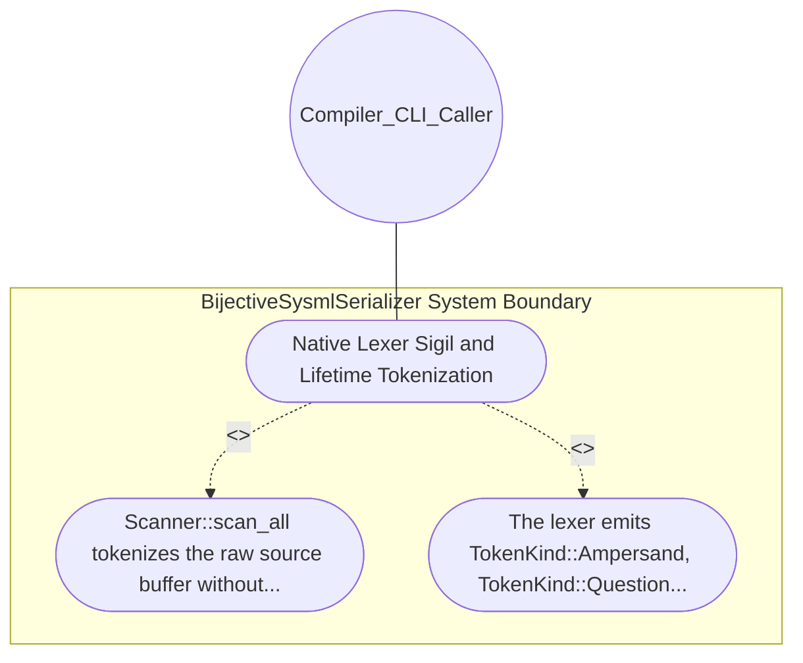

| Attribute | Specification Detail |
| :--- | :--- |
| **Issue ID** | #634 |
| **Title** | Use Case 11: Native Lexer Sigil and Lifetime Tokenization |
| **Type** | use-case |
| **Primary Actor** | Compiler_CLI_Caller |
| **Scope** | BijectiveSysmlSerializer |
| **Level** | User Goal |
| **Generation Mode** | subagent |
| **Specification Source** | [schema/model.sysml](../../schema/model.sysml) |

# Use Case 11: Native Lexer Sigil and Lifetime Tokenization

## UML Diagrams

## 1. Actors
- `Compiler_CLI_Caller`

## 2. Preconditions
- A SysML v2 model containing reference type sigils (&), optionality sigils (?), lifetime annotations ('a), qualified paths (::), and logical && expressions (#495).

## 3. Trigger
- Scanner::scan_all tokenizes the raw source buffer without invoking normalize_type_sigils.

## 4. Main Success Scenario
1. Scanner::scan_all tokenizes the raw source buffer without invoking normalize_type_sigils.
2. The lexer emits TokenKind::Ampersand, TokenKind::Question, TokenKind::Lifetime, TokenKind::DoubleColon, and TokenKind::AmpAmp with exact 1:1 byte and column offsets (span_offset_drift_bytes == 0).

## 5. Alternate and Exception Flows
- Precondition guard failure in `BijectiveSysmlSerializer`:
  - `BijectiveSysmlSerializer` rejects the `Native Lexer Sigil and Lifetime Tokenization` request without partial state mutation and reports diagnostic status to `Compiler_CLI_Caller`.
- Invariant violation while enforcing `Native Lexer Sigil and Lifetime Tokenization`:
  - `BijectiveSysmlSerializer` aborts `Native Lexer Sigil and Lifetime Tokenization` execution, preserves prior verified state, and notifies `Compiler_CLI_Caller`.

## 6. Postconditions
- The lexer emits TokenKind::Ampersand, TokenKind::Question, TokenKind::Lifetime, TokenKind::DoubleColon, and TokenKind::AmpAmp with exact 1:1 byte and column offsets (span_offset_drift_bytes == 0).

## 8. Realization Matrix
| Specification Item | Type | Link / Reference |
| :--- | :--- | :--- |
| **#577** | User Story | [User Story 12: scan all](../user-stories/US-12-scan_all.md) |
| **#667** | Feature | [Feature 11: [BP 03 SysML v2 AST Bijective Roundtrip and Token Stream Parser Gate Blueprint] BijectiveSysmlSerializer](../features/FEAT-11-BijectiveSysmlSerializer.md) |

## Source References
Use case operational flows and lifecycle activity references:
- System Architecture Model: `schema/model.sysml`
- Normative Systems Engineering Standard: ISO/IEC/IEEE 29148:2018 §6.4.2 Concept of Operations

Operational use case realization and traceability links derive from `schema/model.sysml` pursuant to ISO/IEC/IEEE 29148.
