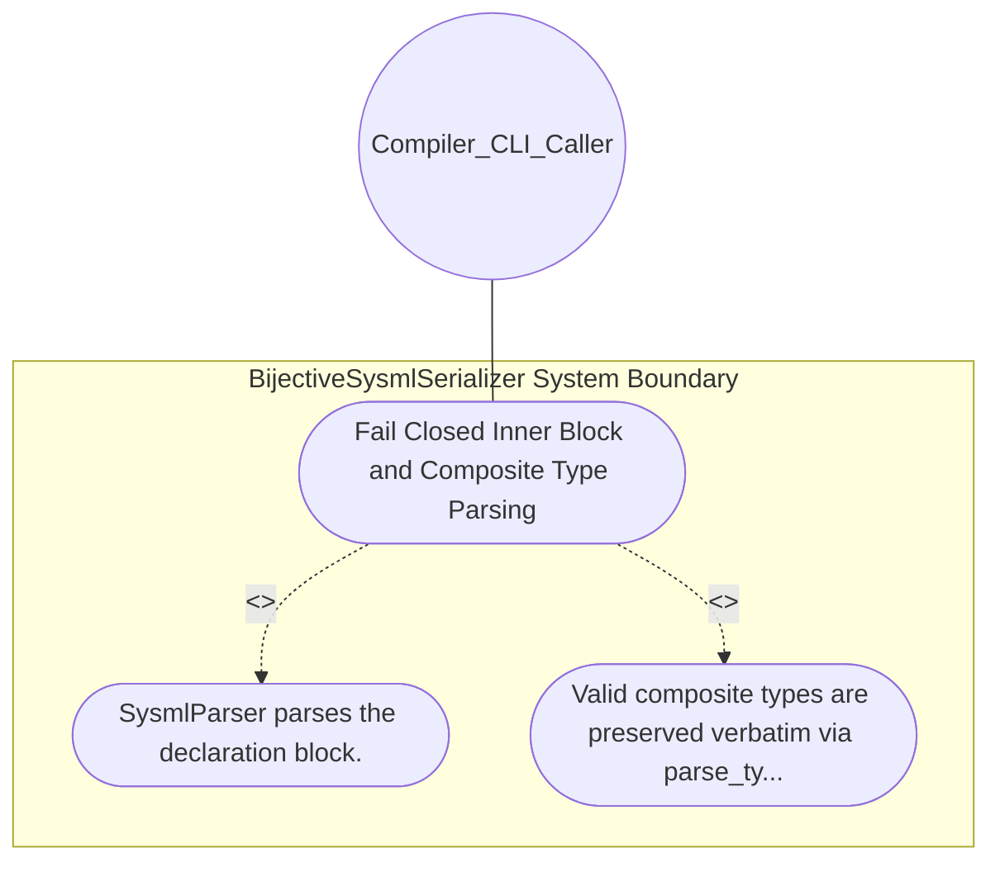

| Attribute | Specification Detail |
| :--- | :--- |
| **Issue ID** | #635 |
| **Title** | Use Case 12: Fail Closed Inner Block and Composite Type Parsing |
| **Type** | use-case |
| **Primary Actor** | Compiler_CLI_Caller |
| **Scope** | BijectiveSysmlSerializer |
| **Level** | User Goal |
| **Generation Mode** | subagent |
| **Specification Source** | [schema/model.sysml](../../schema/model.sysml) |

# Use Case 12: Fail Closed Inner Block and Composite Type Parsing

## UML Diagrams

## 1. Actors
- `Compiler_CLI_Caller`

## 2. Preconditions
- Any declaration block under **Contract A (100% Normative OMG SysML v2.0 + KerML 1.0 BNF Grammar Coverage -- Zero 16-Construct Artificial Caps)** across 100% of the 6 normative clauses of the OMG SysML v2.0 + KerML 1.0 BNF grammar (including `package`, `library package`, `standard library package`, `import`, `alias`, `doc`, `comment`, `rep`, `dependency`, `metadata def`/`metadata`/`@Metadata`/`#user_keyword` for `#hazard`/`#risk`/`#capability`/`#rt_loop`/`#dal`/`#fls` plus backward-compatible `hazard def`/`risk def`/`capability def`, `attribute def`/`attribute`, `enum def`/`enum`, `item def`/`item`, `part def`/`part`, `port def`/`port`, `connection def`/`connection`, `interface def`/`interface`, `flow def`/`flow`, `allocation def`/`allocation`, `occurrence def`/`occurrence`, `action def`/`action`, `state def`/`state`, `calc def`/`calc`, `constraint def`/`constraint`, `requirement def`/`requirement`, `concern def`/`concern`, `use case def`/`use case`, `analysis def`/`analysis`, `verification def`/`verification`, `test case def`/`test case`, `interaction def`/`interaction`, `view def`/`view`, `viewpoint def`/`viewpoint`, `rendering def`/`rendering`, `variation`/`variant`, and KerML 1.0 specialization/multiplicity/expressions) containing either composite parameter types (`Result<PackageDef, ParseError>`, `&'a [Token]`) or an invalid inner statement (#504).

## 3. Trigger
- SysmlParser parses the declaration block.

## 4. Main Success Scenario
1. `Compiler_CLI_Caller` invokes `parse_package_or_file` on `FailClosedRecursiveDescentParser`, streaming span-exact tokens from `NativeSigilAndLifetimeLexer` across `TokenStreamChannelPort`.
2. `FailClosedRecursiveDescentParser` enters `RecursiveDescentParsing` and dispatches declaration block parsers across all 6 normative clauses of the OMG SysML v2.0 + KerML 1.0 BNF grammar (zero 16-construct artificial caps, including `#hazard`/`#risk`/`#capability`/`#rt_loop`/`#dal`/`#fls` `metadata def` and backward-compatible `hazard def`/`risk def`/`capability def`) under **Contract B (Lossless `logos` + `rowan` CST, `salsa` DB, `ariadne` Diagnostics & Stage-1 == Stage-2 Bijective Gate -- Zero Hand-Rolled Scanners)** using `logos` + `rowan` lossless Red/Green CSTs (`deap_core::sysml_cst`) and `salsa` incremental queries (`salsa::input`, `salsa::tracked`).
3. `FailClosedRecursiveDescentParser` invokes `ParseTypeExprAndParseTransition` (`parse_type_expr`) to parse composite generic, reference, lifetime, slice, and KerML expression parameter types verbatim into typed CST/AST nodes.
4. `FailClosedRecursiveDescentParser` enforces `silent_skip_branch_count == 0` so zero `skip_until_semi_or_brace` silent-erasure branches and zero hand-rolled scanners execute during inner block parsing, bounded inside `< 380` exec SLOC submodules (`./crates/deap-core/src/sysml_cst/` and `./crates/compile-sysml/src/roundtrip/`) with explicit deletion of legacy hand-rolled parser monoliths (`-2,400+` SLOC retired).
5. For valid composite types, `FailClosedRecursiveDescentParser` constructs the canonical `PackageDef` AST and transitions to `CanonicalSerialization`; for any unrecognized inner statement, it transitions to `RejectedE0200` and emits `Err(ParseError)` with diagnostic code `E0200` via `ariadne` on `BijectiveDiffDiagnosticPort`.

## 5. Alternate and Exception Flows
- 3a. Unrecognized inner block token or malformed statement encountered during `parse_package_or_file`:
  - `FailClosedRecursiveDescentParser` transitions to `RejectedE0200` on `unexpectedInnerBlockToken`, emits an `ariadne` / `miette` `E0200` diagnostic on `BijectiveDiffDiagnosticPort`, and exits fail-closed with code 1.
- 4a. Unbalanced angle brackets or invalid lifetime sigil in `ParseTypeExprAndParseTransition`:
  - `FailClosedRecursiveDescentParser` returns `Result::Err(ParseError)` without silent skip recovery, preserves prior verified state, and terminates fail-closed with exit code 1.
- 5a. Invariant violation while enforcing `Invariant_REQ_0603_SC_04` (`silent_skip_branch_count > 0`):
  - `BijectiveSysmlSerializer` and `SysmlBijectiveRoundtripCompilerGate` abort compilation, emit a structured diagnostic to `Compiler_CLI_Caller`, and exit with non-zero status code 1.

## 6. Postconditions
- Valid composite types and all 6 normative OMG SysML v2.0 + KerML 1.0 BNF grammar clauses are preserved verbatim via `parse_type_expr()` in `deap_core::sysml_cst` (`logos` + `rowan` + `salsa`), and any unrecognized statement fails closed and is rejected with `Err(ParseError)` reporting `ariadne` diagnostic code `E0200` (`silent_skip_branch_count == 0`).
- **3-Layer Definition of Done (DoD)**:
  - **Layer 1 (Domain State & Data Model)**: Lossless `rowan` Red/Green `SyntaxNode` (`deap_core::sysml_cst`) and `salsa`-tracked `PackageDef` HIR/AST across all 6 OMG SysML v2.0 + KerML 1.0 clauses (`silent_skip_branch_count == 0`).
  - **Layer 2 (Logic & State Management)**: Fail-closed recursive-descent CST/AST parsing (`parse_package_or_file`, `ParseTypeExprAndParseTransition`) inside `< 380` exec SLOC submodules (`./crates/deap-core/src/sysml_cst/` and `./crates/compile-sysml/src/roundtrip/`) with explicit deletion of legacy hand-rolled parser monoliths (`-2,400+` SLOC retired).
  - **Layer 3 (Presentation & Actuator Interface Binding)**: Port bindings (`TokenStreamChannelPort`, `BijectiveDiffDiagnosticPort`) and `ariadne` source-span diagnostics (`E0200`).

## 8. Realization Matrix
| Specification Item | Type | Link / Reference |
| :--- | :--- | :--- |
| **#579** | User Story | [User Story 13: Parse Package Or File](../user-stories/US-13-parse_package_or_file.md) |
| **#667** | Feature | [Feature 11: [BP 03 SysML v2 AST Bijective Roundtrip and Token Stream Parser Gate Blueprint] BijectiveSysmlSerializer](../features/FEAT-11-BijectiveSysmlSerializer.md) |

## Source References
Use case operational flows and lifecycle activity references:
- System Architecture Model: `schema/model.sysml`
- Normative Systems Engineering Standard: ISO/IEC/IEEE 29148:2018 §6.4.2 Concept of Operations

Operational use case realization and traceability links derive from `schema/model.sysml` pursuant to ISO/IEC/IEEE 29148.
