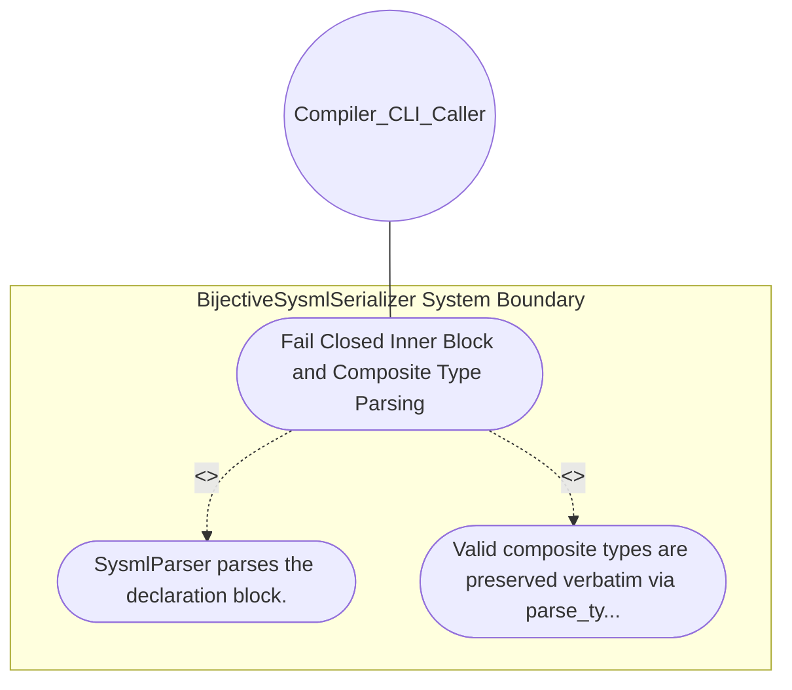

| Attribute | Specification Detail |
| :--- | :--- |
| **Issue ID** | #635 |
| **Title** | Use Case 12: Fail Closed Inner Block and Composite Type Parsing |
| **Type** | use-case |
| **Primary Actor** | Compiler_CLI_Caller |
| **Scope** | BijectiveSysmlSerializer |
| **Level** | User Goal |
| **Generation Mode** | subagent |
| **Specification Source** | [schema/model.sysml](../../schema/model.sysml) |

# Use Case 12: Fail Closed Inner Block and Composite Type Parsing

## UML Diagrams

## 1. Actors
- `Compiler_CLI_Caller`

## 2. Preconditions
- Any of the 12 SysML v2 inner declaration blocks (port, action, requirement, state, connection, use case, item, hazard, risk, test case, capability, interaction) containing either composite parameter types (Result<PackageDef, ParseError>, &'a [Token]) or an invalid inner statement (#504).

## 3. Trigger
- SysmlParser parses the declaration block.

## 4. Main Success Scenario
1. SysmlParser parses the declaration block.
2. Valid composite types are preserved verbatim via parse_type_expr() and any unrecognized statement fails closed and is rejected with Err(ParseError) reporting diagnostic code E0200 (silent_skip_branch_count == 0).

## 5. Alternate and Exception Flows
- Precondition guard failure in `BijectiveSysmlSerializer`:
  - `BijectiveSysmlSerializer` rejects the `Fail Closed Inner Block and Composite Type Parsing` request without partial state mutation and reports diagnostic status to `Compiler_CLI_Caller`.
- Invariant violation while enforcing `Fail Closed Inner Block and Composite Type Parsing`:
  - `BijectiveSysmlSerializer` aborts `Fail Closed Inner Block and Composite Type Parsing` execution, preserves prior verified state, and notifies `Compiler_CLI_Caller`.

## 6. Postconditions
- Valid composite types are preserved verbatim via parse_type_expr() and any unrecognized statement fails closed and is rejected with Err(ParseError) reporting diagnostic code E0200 (silent_skip_branch_count == 0).

## 8. Realization Matrix
| Specification Item | Type | Link / Reference |
| :--- | :--- | :--- |
| **#579** | User Story | [User Story 13: parse package or file](../user-stories/US-13-parse_package_or_file.md) |
| **#667** | Feature | [Feature 11: [BP 03 SysML v2 AST Bijective Roundtrip and Token Stream Parser Gate Blueprint] BijectiveSysmlSerializer](../features/FEAT-11-BijectiveSysmlSerializer.md) |

## Source References
Use case operational flows and lifecycle activity references:
- System Architecture Model: `schema/model.sysml`
- Normative Systems Engineering Standard: ISO/IEC/IEEE 29148:2018 §6.4.2 Concept of Operations

Operational use case realization and traceability links derive from `schema/model.sysml` pursuant to ISO/IEC/IEEE 29148.
