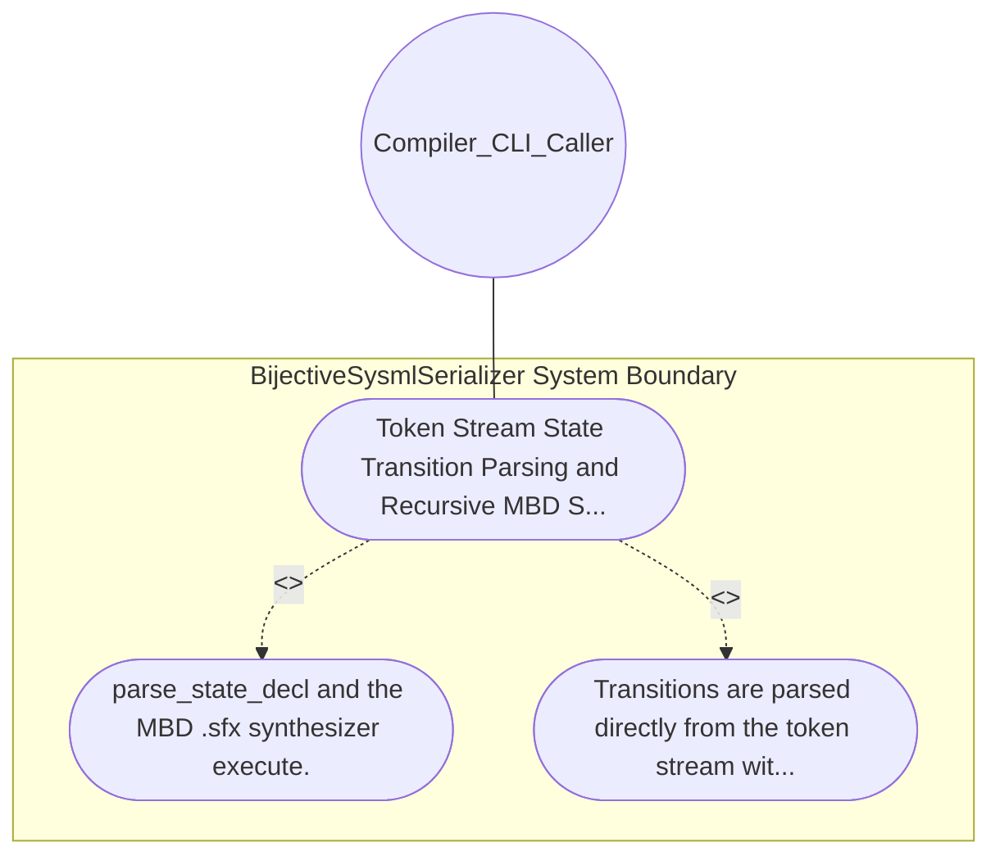

| Attribute | Specification Detail |
| :--- | :--- |
| **Issue ID** | #636 |
| **Title** | Use Case 13: Token Stream State Transition Parsing and Recursive MBD Synthesis |
| **Type** | use-case |
| **Primary Actor** | Compiler_CLI_Caller |
| **Scope** | BijectiveSysmlSerializer |
| **Level** | User Goal |
| **Generation Mode** | subagent |
| **Specification Source** | [schema/model.sysml](../../schema/model.sysml) |

# Use Case 13: Token Stream State Transition Parsing and Recursive MBD Synthesis

## UML Diagrams

## 1. Actors
- `Compiler_CLI_Caller`

## 2. Preconditions
- A hierarchical state def containing anonymous and named transition statements (first S1 accept trig if grd do eff then S2;) and nested composite sub_states with their own transitions and doc blocks (#496, #509).

## 3. Trigger
- parse_state_decl and the MBD .sfx synthesizer execute.

## 4. Main Success Scenario
1. parse_state_decl and the MBD .sfx synthesizer execute.
2. Transitions are parsed directly from the token stream without fabricating {s}_to_{t} names (name: None preserved when unnamed), sub-state doc blocks attach to their target StateDef or TransitionDef, and MBD .sfx synthesis recursively emits transitions across all nesting depths.

## 5. Alternate and Exception Flows
- Precondition guard failure in `BijectiveSysmlSerializer`:
  - `BijectiveSysmlSerializer` rejects the `Token Stream State Transition Parsing and Recursive MBD Synthesis` request without partial state mutation and reports diagnostic status to `Compiler_CLI_Caller`.
- Invariant violation while enforcing `Token Stream State Transition Parsing and Recursive MBD Synthesis`:
  - `BijectiveSysmlSerializer` aborts `Token Stream State Transition Parsing and Recursive MBD Synthesis` execution, preserves prior verified state, and notifies `Compiler_CLI_Caller`.

## 6. Postconditions
- Transitions are parsed directly from the token stream without fabricating {s}_to_{t} names (name: None preserved when unnamed), sub-state doc blocks attach to their target StateDef or TransitionDef, and MBD .sfx synthesis recursively emits transitions across all nesting depths.

## 8. Realization Matrix
| Specification Item | Type | Link / Reference |
| :--- | :--- | :--- |
| **#705** | User Story | [User Story 14: Parse Type Expr And Parse Transition](../user-stories/US-14-ParseTypeExprAndParseTransition.md) |
| **#667** | Feature | [Feature 11: [BP 03 SysML v2 AST Bijective Roundtrip and Token Stream Parser Gate Blueprint] BijectiveSysmlSerializer](../features/FEAT-11-BijectiveSysmlSerializer.md) |

## Source References
Use case operational flows and lifecycle activity references:
- System Architecture Model: `schema/model.sysml`
- Normative Systems Engineering Standard: ISO/IEC/IEEE 29148:2018 §6.4.2 Concept of Operations

Operational use case realization and traceability links derive from `schema/model.sysml` pursuant to ISO/IEC/IEEE 29148.
