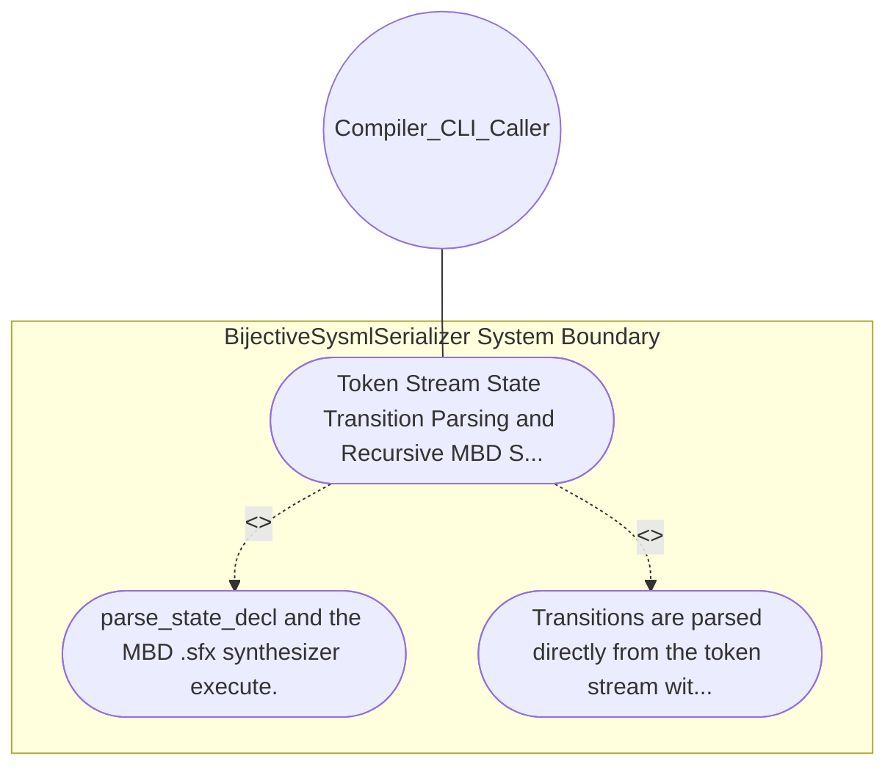

| Attribute | Specification Detail |
| :--- | :--- |
| **Issue ID** | #636 |
| **Title** | Use Case 13: Token Stream State Transition Parsing and Recursive MBD Synthesis |
| **Type** | use-case |
| **Primary Actor** | Compiler_CLI_Caller |
| **Scope** | BijectiveSysmlSerializer |
| **Level** | User Goal |
| **Generation Mode** | subagent |
| **Specification Source** | [schema/model.sysml](../../schema/model.sysml) |

# Use Case 13: Token Stream State Transition Parsing and Recursive MBD Synthesis

## UML Diagrams

## 1. Actors
- `Compiler_CLI_Caller`

## 2. Preconditions
- A hierarchical `state def`/`state` (`exhibit`, `parallel`, `entry`, `do`, `exit`, `transition first S1 accept trig if grd do eff then S2;`) and nested composite `sub_states` with their own transitions, `doc` blocks, and `#hazard`/`#risk`/`#capability`/`#rt_loop`/`#dal`/`#fls` `metadata def` annotations (or backward-compatible `hazard def`/`risk def`/`capability def` blocks) across the 6 normative clauses of the OMG SysML v2.0 + KerML 1.0 BNF grammar (#496, #509).

## 3. Trigger
- parse_state_decl and the MBD .sfx synthesizer execute.

## 4. Main Success Scenario
1. `Compiler_CLI_Caller` invokes `parse_package_or_file` on `FailClosedRecursiveDescentParser` with a hierarchical `state def`/`state` token stream supplied via `TokenStreamChannelPort`.
2. `FailClosedRecursiveDescentParser` executes `ParseTypeExprAndParseTransition` (`parse_state_decl` and `parse_transition_decl_tokens`) using `logos` + `rowan` lossless Red/Green CST combinators (`deap_core::sysml_cst`) and `salsa` incremental query evaluation (`salsa::input`, `salsa::tracked`) with zero hand-rolled scanners.
3. `FailClosedRecursiveDescentParser` parses anonymous and named transition statements (`first S1 accept trig if grd do eff then S2;`) directly from the token stream while preserving `name: None` when unnamed and attaching `doc` blocks and `#hazard`/`#risk`/`#capability`/`#rt_loop`/`#dal`/`#fls` `metadata def` annotations to their target `StateDef` or `TransitionDef`.
4. `FailClosedRecursiveDescentParser` recursively traverses nested composite `sub_states` and their inner transitions across all 6 OMG SysML v2.0 + KerML 1.0 BNF clauses (zero 16-construct artificial caps) without dropping AST fields (`dropped_ast_field_count == 0`), bounded inside `< 380` exec SLOC submodules (`./crates/deap-core/src/sysml_cst/` and `./crates/compile-sysml/src/roundtrip/`) with explicit deletion of legacy hand-rolled scanner/parser monoliths (`-2,400+` SLOC retired).
5. `BijectiveSysmlSerializer` and the MBD `.sfx` synthesizer emit canonical SysML v2 and recursive statechart transitions across all nesting depths via `SerializedSysmlOutputPort`, verified by the Stage-1 == Stage-2 bijective round-trip gate.

## 5. Alternate and Exception Flows
- 3a. Malformed transition clause (`first`, `accept`, `if`, `do`, or `then` missing target state) in `parse_transition_decl_tokens`:
  - `FailClosedRecursiveDescentParser` transitions to `RejectedE0200`, emits an `ariadne` / `miette` syntax diagnostic (`E0200`) on `BijectiveDiffDiagnosticPort`, and exits fail-closed with code 1.
- 4a. Unattached or orphaned `doc` comment inside a nested `state def` block:
  - `FailClosedRecursiveDescentParser` returns `Result::Err(ParseError)` via `BijectiveDiffDiagnosticPort` rather than silently discarding documentation nodes, terminating fail-closed with exit code 1.
- 5a. Invariant violation under `Invariant_REQ_0603_Formal_Bijectivity_Complexity_Invariants`:
  - `BijectiveSysmlSerializer` aborts `.sfx` and SysML v2 synthesis without partial state mutation, preserves prior verified state, and returns fail-closed status code 1 to `Compiler_CLI_Caller`.

## 6. Postconditions
- Transitions are parsed directly from the `logos` + `rowan` token stream (`deap_core::sysml_cst`) without fabricating `{s}_to_{t}` names (`name: None` preserved when unnamed), sub-state `doc` blocks attach to their target `StateDef` or `TransitionDef`, and MBD `.sfx` synthesis recursively emits transitions across all nesting depths with Stage-1 == Stage-2 bijective round-trip parity (`dropped_ast_field_count == 0`).

## 8. Realization Matrix
| Specification Item | Type | Link / Reference |
| :--- | :--- | :--- |
| **#705** | User Story | [User Story 14: Parse Type Expr And Parse Transition](../user-stories/US-14-ParseTypeExprAndParseTransition.md) |
| **#667** | Feature | [Feature 11: [BP 03 SysML v2 AST Bijective Roundtrip and Token Stream Parser Gate Blueprint] BijectiveSysmlSerializer](../features/FEAT-11-BijectiveSysmlSerializer.md) |

## Source References
Use case operational flows and lifecycle activity references:
- System Architecture Model: `schema/model.sysml`
- Normative Systems Engineering Standard: ISO/IEC/IEEE 29148:2018 §6.4.2 Concept of Operations

Operational use case realization and traceability links derive from `schema/model.sysml` pursuant to ISO/IEC/IEEE 29148.
