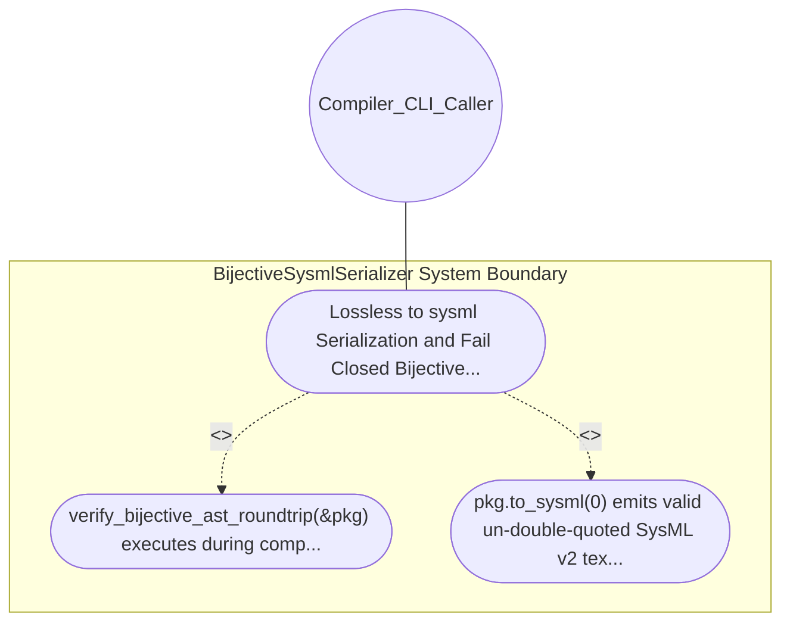

| Attribute | Specification Detail |
| :--- | :--- |
| **Issue ID** | #637 |
| **Title** | Use Case 14: Lossless to sysml Serialization and Fail Closed Bijective Roundtrip Gate |
| **Type** | use-case |
| **Primary Actor** | Compiler_CLI_Caller |
| **Scope** | BijectiveSysmlSerializer |
| **Level** | User Goal |
| **Generation Mode** | subagent |
| **Specification Source** | [schema/model.sysml](../../schema/model.sysml) |

# Use Case 14: Lossless to sysml Serialization and Fail Closed Bijective Roundtrip Gate

## UML Diagrams

## 1. Actors
- `Compiler_CLI_Caller`

## 2. Preconditions
- A populated PackageDef AST containing StateDef transitions (source, trigger, guard, effect, target, doc), PortDef / HazardDef / RiskDef attributes, and UseCaseDef / ConnectionDef / RequirementDef / ActionDef blocks (#493, #497, #505), or a mutated AST with a simulated field divergence.

## 3. Trigger
- verify_bijective_ast_roundtrip(&pkg) executes during compile-sysml.

## 4. Main Success Scenario
1. verify_bijective_ast_roundtrip(&pkg) executes during compile-sysml.
2. pkg.to_sysml(0) emits valid un-double-quoted SysML v2 text, SysmlParser::parse_source(&pkg.to_sysml(0), &pkg.name) returns a PackageDef structurally equal to pkg (roundtrip_ast_mismatch_count == 0), and any.

## 5. Alternate and Exception Flows
- Precondition guard failure in `BijectiveSysmlSerializer`:
  - `BijectiveSysmlSerializer` rejects the `Lossless to sysml Serialization and Fail Closed Bijective Roundtrip Gate` request without partial state mutation and reports diagnostic status to `Compiler_CLI_Caller`.
- Invariant violation while enforcing `Lossless to sysml Serialization and Fail Closed Bijective Roundtrip Gate`:
  - `BijectiveSysmlSerializer` aborts `Lossless to sysml Serialization and Fail Closed Bijective Roundtrip Gate` execution, preserves prior verified state, and notifies `Compiler_CLI_Caller`.

## 6. Postconditions
- pkg.to_sysml(0) emits valid un-double-quoted SysML v2 text, SysmlParser::parse_source(&pkg.to_sysml(0), &pkg.name) returns a PackageDef structurally equal to pkg (roundtrip_ast_mismatch_count == 0), and any.

## 8. Realization Matrix
| Specification Item | Type | Link / Reference |
| :--- | :--- | :--- |
| **#582** | User Story | [User Story 15: verify bijective ast roundtrip](../user-stories/US-15-verify_bijective_ast_roundtrip.md) |
| **#667** | Feature | [Feature 11: [BP 03 SysML v2 AST Bijective Roundtrip and Token Stream Parser Gate Blueprint] BijectiveSysmlSerializer](../features/FEAT-11-BijectiveSysmlSerializer.md) |

## Source References
Use case operational flows and lifecycle activity references:
- System Architecture Model: `schema/model.sysml`
- Normative Systems Engineering Standard: ISO/IEC/IEEE 29148:2018 §6.4.2 Concept of Operations

Operational use case realization and traceability links derive from `schema/model.sysml` pursuant to ISO/IEC/IEEE 29148.
