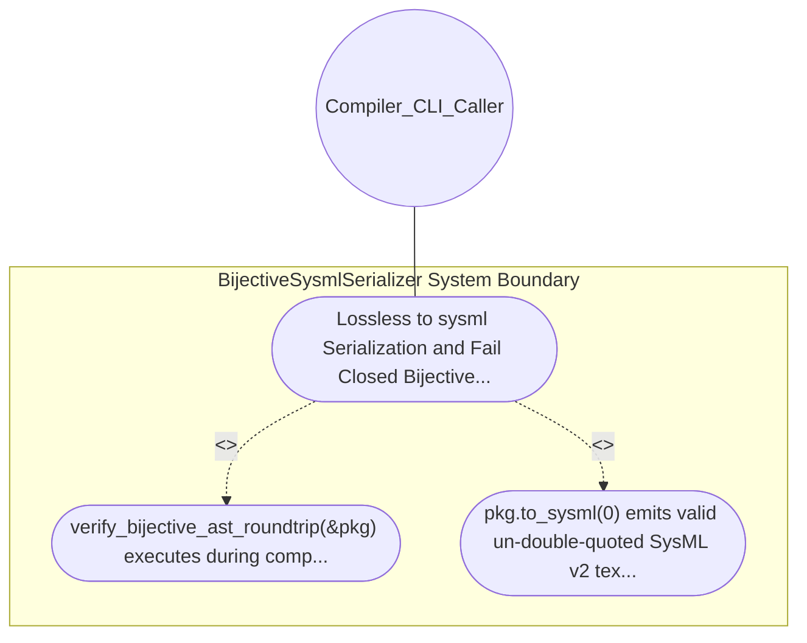

| Attribute | Specification Detail |
| :--- | :--- |
| **Issue ID** | #637 |
| **Title** | Use Case 14: Lossless to sysml Serialization and Fail Closed Bijective Roundtrip Gate |
| **Type** | use-case |
| **Primary Actor** | Compiler_CLI_Caller |
| **Scope** | BijectiveSysmlSerializer |
| **Level** | User Goal |
| **Generation Mode** | subagent |
| **Specification Source** | [schema/model.sysml](../../schema/model.sysml) |

# Use Case 14: Lossless to sysml Serialization and Fail Closed Bijective Roundtrip Gate

## UML Diagrams

## 1. Actors
- `Compiler_CLI_Caller`

## 2. Preconditions
- A populated `PackageDef` AST under **Contract A (100% Normative OMG SysML v2.0 + KerML 1.0 BNF Grammar Coverage -- Zero 16-Construct Artificial Caps)** covering 100% of the 6 normative clauses of the OMG SysML v2.0 + KerML 1.0 BNF grammar (including `StateDef` transitions with `source`, `trigger`, `guard`, `effect`, `target`, `doc`, `PortDef`/`PartDef`/`ItemDef`/`AttributeDef`/`EnumDef`/`InterfaceDef`/`FlowDef`/`AllocationDef`/`OccurrenceDef`, `#hazard`/`#risk`/`#capability`/`#rt_loop`/`#dal`/`#fls` `metadata def` annotations alongside backward-compatible `HazardDef`/`RiskDef`/`CapabilityDef`, and `UseCaseDef`/`ConnectionDef`/`RequirementDef`/`ConstraintDef`/`ConcernDef`/`ActionDef`/`CalcDef`/`AnalysisDef`/`VerificationDef`/`TestCaseDef`/`InteractionDef`/`ViewDef`/`ViewpointDef`/`RenderingDef`/`VariationDef` blocks) (#493, #497, #505), or a mutated AST with a simulated field divergence.

## 3. Trigger
- verify_bijective_ast_roundtrip(&pkg) executes during compile-sysml.

## 4. Main Success Scenario
1. `Compiler_CLI_Caller` invokes `verify_bijective_ast_roundtrip` on `CompilerRoundtripVerificationGate` with a populated `PackageDef` AST (`ast_orig`).
2. `CompilerRoundtripVerificationGate` transitions to `CanonicalSerialization` and invokes `ast_orig_to_sysml` on `BijectiveSysmlSerializer` to emit canonical, un-double-quoted SysML v2 text via `SerializedSysmlOutputPort` with `dropped_ast_field_count == 0` across all 6 normative OMG SysML v2.0 + KerML 1.0 BNF clauses.
3. `CompilerRoundtripVerificationGate` transitions to `RoundtripReparsing` and routes the serialized text through `BP_03_SerializerToRoundtripGateConnection` (`RawSysmlSourceInputPort`) into `NativeSigilAndLifetimeLexer` (`scan_all`) and `FailClosedRecursiveDescentParser` (`parse_package_or_file`) under **Contract B (Lossless `logos` + `rowan` CST, `salsa` DB, `ariadne` Diagnostics & Stage-1 == Stage-2 Bijective Gate -- Zero Hand-Rolled Scanners)** using `logos` + `rowan` lossless Red/Green CSTs (`deap_core::sysml_cst`) and `salsa` incremental query evaluation (`salsa::input`, `salsa::tracked`) with zero hand-rolled scanners.
4. `CompilerRoundtripVerificationGate` transitions to `AstStructuralEqualityCheck` and executes `AssertAstOrigEqualsAstReparsed` to compare Stage-1 `ast_orig` against Stage-2 `ast_reparsed` across all 6 normative OMG SysML v2.0 + KerML 1.0 clauses (`StateDef`, `PortDef`, `HazardDef`, `RiskDef`, `CapabilityDef`, `MetadataDef`, `UseCaseDef`, `ConnectionDef`, `RequirementDef`, `ActionDef`, `PartDef`, `ItemDef`, `CalcDef`, `ConstraintDef`, `TestCaseDef`, `VerificationDef`, `InteractionDef`, and KerML specialization/multiplicity/expression nodes), bounded inside `< 380` exec SLOC submodules (`./crates/deap-core/src/sysml_cst/` and `./crates/compile-sysml/src/roundtrip/`) with explicit deletion of legacy hand-rolled scanner/parser monoliths (`-2,400+` SLOC retired).
5. `CompilerRoundtripVerificationGate` confirms `roundtrip_ast_mismatch_count == 0` (Stage-1 == Stage-2 bijective parity), transitions to `VerifiedBijectiveAst`, and returns `Result::Ok` to `Compiler_CLI_Caller`.

## 5. Alternate and Exception Flows
- 3a. Serialized SysML v2 text fails re-lexing or re-parsing during `RoundtripReparsing`:
  - `CompilerRoundtripVerificationGate` transitions to `RejectedE0400` on `reparseSyntaxFailure`, emits a diagnostic `E0400` via `ariadne` / `miette` on `BijectiveDiffDiagnosticPort`, and exits fail-closed with code 1.
- 4a. Structural AST divergence detected between `ast_orig` and `ast_reparsed` (`roundtrip_ast_mismatch_count > 0`):
  - `CompilerRoundtripVerificationGate` transitions to `RejectedE0400` on `structuralAstDiffDetected`, emits a field-level AST diff diagnostic (`E0400`) on `BijectiveDiffDiagnosticPort`, and exits fail-closed with code 1.
- 5a. Invariant violation under `Invariant_REQ_0603_Formal_Bijectivity_Complexity_Invariants` or `Invariant_REQ_0603_SC_04`:
  - `BijectiveSysmlSerializer` aborts serialization without partial file writes, preserves prior verified state, and notifies `Compiler_CLI_Caller` with fail-closed exit status 1.

## 6. Postconditions
- `pkg.to_sysml(0)` emits valid un-double-quoted SysML v2 text across all 6 normative OMG SysML v2.0 + KerML 1.0 BNF clauses, `SysmlParser::parse_source(&pkg.to_sysml(0), &pkg.name)` returns a `PackageDef` structurally equal to `pkg` (`roundtrip_ast_mismatch_count == 0`, Stage-1 == Stage-2), and any structural AST divergence fails closed with `ariadne` diagnostic code `E0400`.
- **3-Layer Definition of Done (DoD)**:
  - **Layer 1 (Domain State & Data Model)**: Lossless `deap_core::sysml_cst` (`logos` + `rowan` + `salsa`) CST and `PackageDef` HIR/AST across all 6 OMG SysML v2.0 + KerML 1.0 clauses (`dropped_ast_field_count == 0`, `roundtrip_ast_mismatch_count == 0`).
  - **Layer 2 (Logic & State Management)**: Canonical `to_sysml` serialization (`ast_orig_to_sysml`) and Stage-1 == Stage-2 bijective round-trip verification (`verify_bijective_ast_roundtrip`, `AssertAstOrigEqualsAstReparsed`) inside `< 380` exec SLOC submodules (`./crates/deap-core/src/sysml_cst/` and `./crates/compile-sysml/src/roundtrip/`) with explicit deletion of legacy hand-rolled scanner/serializer monoliths (`-2,400+` SLOC retired).
  - **Layer 3 (Presentation & Actuator Interface Binding)**: Port bindings (`RawSysmlSourceInputPort`, `SerializedSysmlOutputPort`, `BijectiveDiffDiagnosticPort`) and `ariadne` source-span diagnostics (`E0300`, `E0400`).

## 8. Realization Matrix
| Specification Item | Type | Link / Reference |
| :--- | :--- | :--- |
| **#582** | User Story | [User Story 15: Verify Bijective Ast Roundtrip](../user-stories/US-15-verify_bijective_ast_roundtrip.md) |
| **#667** | Feature | [Feature 11: [BP 03 SysML v2 AST Bijective Roundtrip and Token Stream Parser Gate Blueprint] BijectiveSysmlSerializer](../features/FEAT-11-BijectiveSysmlSerializer.md) |

## Source References
Use case operational flows and lifecycle activity references:
- System Architecture Model: `schema/model.sysml`
- Normative Systems Engineering Standard: ISO/IEC/IEEE 29148:2018 §6.4.2 Concept of Operations

Operational use case realization and traceability links derive from `schema/model.sysml` pursuant to ISO/IEC/IEEE 29148.
